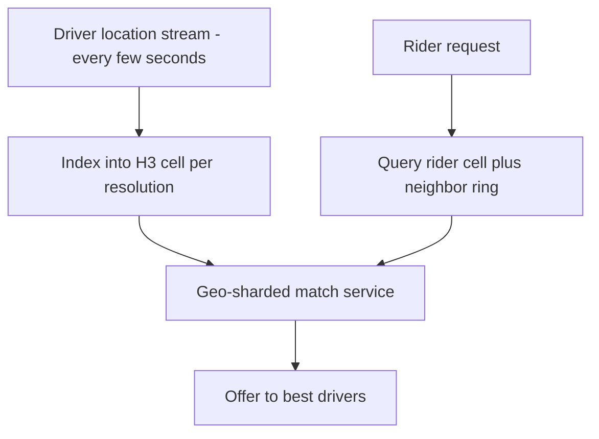
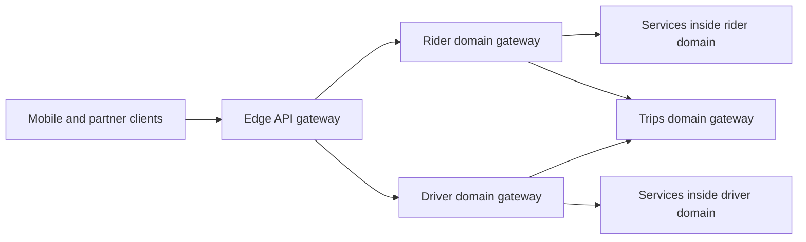

# Uber Architecture

Uber is two case studies in one. The first is **geography as the sharding dimension**: a marketplace that matches physical supply (drivers) to physical demand (riders) in real time naturally partitions by location, and Uber built custom geo-indexing (S2 cells, then **H3** hexagons) and geo-sharded dispatch to exploit that. The second is **the microservices pendulum**: Uber decomposed a monolith into thousands of microservices, felt the full cost of that sprawl, and then re-aggregated them into domains (**DOMA**) — the best-documented public admission that microservice count is a liability, not a KPI.

## The scale of the problem

Era-labeled facts from Uber's engineering blog and conference talks:

| Year | Fact |
|---|---|
| ~2012–2014 | Monolithic beginnings: a Python API monolith plus a Node.js real-time dispatch system |
| 2015 | Dispatch rewritten ("DISCO"); Matt Ranney's talk "Scaling Uber's Real-time Market Platform" describes geo-sharded matching; driver phones send location updates every ~4 seconds |
| 2016 | "Schemaless" datastore blog series — MySQL-backed sharded storage for trip data |
| ~2016–2018 | Microservice explosion: well over a thousand services (Ranney's 2016 talk is literally titled "What I Wish I Had Known Before Scaling Uber to 1000 Services") |
| 2018 | **H3** hexagonal geo-index open-sourced |
| 2020 | DOMA blog: **~2,200 critical microservices**, and the re-aggregation strategy |

The workload: millions of concurrent trips globally; every active driver streaming location updates every few seconds (a firehose of writes that are *only briefly valuable*); matching that must complete in seconds; pricing and ETAs computed per micro-region; and strict per-city variation in rules. Load is bursty and geographically correlated — a concert or rainstorm spikes one city while others sleep ([[Scalability]]: load parameters here are *active drivers per region* and *matches per second*, not global RPS).

### Why the location firehose cannot be a database

One documented number — a location update every ~4 seconds per driver — decides most of the architecture once you multiply it out. Take **1 million concurrently active drivers** as an illustrative figure (Uber has never published a precise concurrent-driver count, so treat the round number as a sizing exercise, not a fact):

```
1,000,000 drivers ÷ 4 seconds        = 250,000 location updates/sec
250,000 updates/sec × 1 KB per write = 250 MB/sec of sustained writes
250 MB/sec × 86,400 seconds          = 21.6 TB/day
```

Twenty-one terabytes a day — of data whose useful lifetime is **four seconds**, because the next update supersedes it. Durably writing that firehose would mean buying replication, backup, compaction, and retention for information that is already stale by the time it is fsynced. Worse, the write path would sit in the critical loop of matching, so every location ping would pay a network hop and a disk commit.

That arithmetic is the whole justification for keeping dispatch state in sharded service memory with a rebuild path. It also shows how to argue the point in an interview: not "in-memory is faster", which is a preference, but "durability costs 21.6 TB/day to protect data with a four-second half-life", which is a decision.

## The architecture

### Geo-indexing: squares, then hexagons

You cannot B-tree-index "all drivers near me" efficiently with raw lat/long. The standard trick is to tile the planet into cells with hierarchical IDs so "nearby" becomes "same or adjacent cell ID" — turning a 2-D proximity query into key lookups. Uber's 2015 dispatch used **Google S2** cells (quadrilateral tiling). Uber later built and open-sourced **H3 (2018)**, a **hexagonal** hierarchical index, because hexagons fit movement-and-smoothing math better: every neighbor of a hexagon is edge-adjacent at the **same center-to-center distance**, whereas squares have two neighbor classes (edge and corner) that complicate gradient calculations for supply/demand smoothing, surge pricing, and ETA modeling. H3 supports multiple resolutions (coarse cells for city analytics, fine cells for matching) with parent/child relationships between levels.



Squares vs hexagons at a glance:

| | **S2 — squares (2015 dispatch)** | **H3 — hexagons (2018, open source)** |
|---|---|---|
| Neighbor classes | Two — edge neighbors and corner neighbors, at different distances | One — all six neighbors edge-adjacent, equidistant centers |
| Gradient/smoothing math | Must weight neighbor types differently | Uniform, simpler and less distorted |
| Hierarchy | Exact — each cell splits into 4 children, which tile it perfectly | Aperture 7 — each hexagon has 7 children, but they do not tile it perfectly |
| Degenerate cells | None | Exactly 12 pentagons per resolution |
| Takeaway | Fine for containment and point indexing | Better for flow, smoothing, and marketplace math |

Two honest costs sit in that table, and both are the kind of detail an interviewer uses to tell whether you have actually read about H3.

**The hierarchy is logically exact and geographically approximate.** H3's documentation puts it plainly: hexagons do not cleanly subdivide into seven finer hexagons, so the subdivision is *approximated* by alternating grid orientation between resolutions — while **containment in the index is exact**. In practice: "which resolution-9 cells belong to this resolution-6 cell" is a deterministic index operation you can trust absolutely; "is this point inside the geographic union of those children" is not guaranteed to match the parent's boundary. That is fine for analytics, pricing, and supply smoothing, and it is a trap for anything that must be exact about boundaries — a city limit, a geofenced surcharge zone, a regulatory boundary.

**And hexagons cannot tile a sphere.** H3 projects onto an icosahedron, which has 12 vertices, so resolution 0 has **122 base cells: 110 hexagons and 12 pentagons**, one centred on each icosahedron vertex — and the pentagons persist at every one of the 16 resolutions (0 through 15). A pentagon has five neighbours rather than six, and subdivides into six children (five hexagons and a pentagon) rather than seven — so it breaks both the uniform-neighbour property that motivated hexagons and the clean aperture-7 arithmetic in the row above. Uber positions them over ocean so most applications never meet one, but any code that assumes "every cell has six neighbours" has a latent bug waiting for the day someone requests a ride near an icosahedron vertex. The general lesson is worth more than the H3 trivia: **a tiling scheme's degenerate cases are the ones your test data will never contain.**

### Dispatch (DISCO): geo-sharded, stateful matching

The 2015-era dispatch redesign (DISCO) treats matching as a **stateful, geo-sharded** problem:

- **Supply and demand services** hold the live state: which drivers are where, which riders are waiting. This state is too hot and too ephemeral for a database round-trip per update — it lives in memory in the service tier ([[Stateless vs Stateful Services]] — this is the justified stateful case).
- The world is partitioned by geography: a shard owns a set of cells, and all updates/queries for those cells route to it. Matching is then a *local* computation — a city's supply meets that city's demand on one shard, no global coordination.
- **Ringpop** (open-sourced by Uber) makes this sharding self-managing: it combines [[Consistent Hashing]] (which node owns which key) with **SWIM-style gossip** membership (who is alive), so the dispatch fleet redistributes ownership automatically when nodes join or die — application-layer sharding without an external coordinator ([[Health Checks and Service Discovery]]).

### Storage: Schemaless → Docstore

Uber's trip storage outgrew a single Postgres early. The response was **Schemaless** (built ~2014, blog series 2016): a **sharded, append-only, MySQL-backed** datastore. Each logical row is a cell addressed by (row key, column name, ref key/version); cells are **immutable** — updates append new versions. MySQL provides the durable, well-understood storage engine per shard; Schemaless adds partitioning, buffered writes, and asynchronous **secondary indexes** on top. This is a second strong data point (after Facebook — see [[How Facebook Scales MySQL]]) for [[Why MySQL Does Scale]]: planet-scale companies repeatedly choose boring, operable MySQL as the storage brick and build the distribution layer themselves. (Uber also published "Why Uber Engineering Switched from Postgres to MySQL", 2016 — replication and operational reasons.) The successor, **Docstore** (blogged ~2021), evolved this into a more general distributed document store, still MySQL-based, with stricter schemas and richer query support.

### DOMA: the pendulum swings back

By 2020 Uber had ~2,200 critical microservices. The published pain list: changes spanning many services, graph-shaped debugging, unclear ownership, and onboarding cost — the classic [[The Distributed Monolith Anti-Pattern]] symptoms appearing even in a well-run shop. **DOMA (Domain-Oriented Microservice Architecture)** re-aggregates services into **domains** (related services behind one interface), arranged in **layers** by blast radius and product-specificity, with a **gateway** per domain as the single entry point and **extension points** so other teams plug in without modifying domain internals. Services survive; the *unit of reasoning* becomes the domain — bounded contexts rediscovered at scale ([[Service Boundaries and Domain-Driven Design]]).

DOMA's layering is worth internalizing: domains are assigned to layers by **blast radius and product-specificity** — roughly infrastructure at the bottom, then business/core-flow domains, then product/presentation domains at the top. A lower layer must never depend on a higher one, so a failed experiment in a product domain cannot take down trip fulfillment. This is dependency direction as a *reliability* tool, not just a code-hygiene rule.



## Key decisions and why

1. **Shard by geography because the problem shards by geography.** A match in Bengaluru never needs Mumbai's state. When the real world gives you a partition key with near-zero cross-partition traffic, take it — it buys locality, small blast radius, and per-region scaling ([[Sharding]]).
2. **Hexagons over squares (H3).** Uniform neighbor distance makes "spill demand to neighboring cells", surge smoothing, and ETA gradients mathematically clean. A niche-looking choice justified by the actual math the business runs.
3. **Keep hot ephemeral state in memory, sharded, not in a database.** Driver locations are worthless after seconds; writing each update durably buys nothing. Dispatch stores them in sharded service memory and accepts rebuild-on-failure — drivers re-report within seconds anyway. Durability spent where it pays (trips, payments), not uniformly.
4. **Ringpop: let consistent hashing + gossip manage stateful shards.** Instead of a coordinator service assigning shards, every node can route any request to the owner via the hash ring; membership changes rebalance automatically. Trade-off: gossip convergence is eventual — brief routing ambiguity during churn ([[Failover]]).
5. **Build the distribution layer over MySQL rather than adopting an exotic store (Schemaless).** Operability won: known failure modes, known backup/replication story, hireable expertise. Append-only immutable cells sidestep in-place-update anomalies and make replication/debugging simpler ([[Replication]]).
6. **DOMA: optimize for cognitive load, not service count.** The correction wasn't "merge back to a monolith"; it was adding an aggregation layer (domains, gateways) so humans reason about ~tens of domains instead of ~thousands of services ([[Monolith vs Microservices]]).

## What broke along the way

- **The monolith broke first** — team-scaling and deploy contention, the standard story that justified decomposition.
- **Microservice sprawl became its own outage class.** Uber's DOMA post describes multi-service changes, debugging across deep call graphs, and ownership confusion; Ranney's 2016 talk adds RPC-version drift and "nobody understands the whole system". Sprawl is a *latent* failure: each service is fine, the graph is not ([[Failure Modes in Distributed Systems]]).
- **A single Postgres for trips hit its ceiling (~2014)** — the Mezzanine migration onto Schemaless was the escape. Later, Postgres-specific replication/operational pain drove the broader MySQL move (2016 post).
- **Stateful dispatch + node churn** is a standing hazard: when a dispatch node dies, its cells' in-memory supply state vanishes and must rebuild from the location stream; during gossip convergence, requests can route to a node that no longer owns the cell. Mitigations: fast membership detection, hand-off protocols, and accepting seconds of degraded matching in the affected cells (not public in fine detail).
- **Geo-correlated load spikes** (weather, events, New Year's Eve) overwhelm *specific cells* — the geographic twin of the [[Hot Partition Problem]]. Finer-grained cells, spill-to-neighbor matching, and surge pricing (an economic rate limiter — see [[Rate Limiting]] for the engineering kind) absorb it.

### What a hot cell looks like when the stadium empties

Uber has not published an incident narrative for this, so read it as the mechanism — but it is the one failure mode a geo-sharded marketplace is guaranteed to meet, and the diagnosis has a fork in it that catches people.

Sixty thousand people walk out of a stadium inside fifteen minutes. Demand in two or three fine-resolution cells goes from near zero to thousands of requests per minute while the rest of the city is unchanged.

- **The symptom arrives as "the app is broken in one neighbourhood."** Global match-service CPU is unremarkable, because the fleet-wide average is diluted by every other city. Only the shard or shards owning those cells are saturated. Like the [[Hot Partition Problem]], this is invisible in aggregates and obvious in per-shard views.
- **The fork in the diagnosis.** Two completely different failures produce the same user-facing symptom — long waits and no cars — and the fix for one does nothing for the other:
  1. **A compute hot spot.** Drivers *are* in the cell, but one dispatch shard is saturated and matching is falling behind. Signal: supply count in the cell is healthy, matching queue depth and match latency on that shard are climbing, and the shard's CPU is pinned while its peers idle.
  2. **A genuine supply shortage.** Matching is fast and finding nothing, because there are no cars. Signal: match latency is *normal*, the shard is not busy, and the unmatched-request-to-available-driver ratio has gone vertical.
- **How you tell them apart in thirty seconds**: look at supply count in the cell alongside match latency. Slow matching with supply present is an engineering problem; fast matching with no supply is a marketplace problem. Mixing them up is how teams spend an incident scaling a service that was never the bottleneck.
- **Fixes for case 1** are ordinary distributed-systems moves: finer cell resolution so the hot area's load splits across more owners, spill-to-neighbour-ring matching, and shedding low-value work ([[Load Shedding and Graceful Degradation]]).
- **The fix for case 2 is not engineering at all** — and this is the genuinely interesting thing about Uber. When the bottleneck is physical reality, the control loop has to act on the real world. Surge pricing raises price in the hot cells, which simultaneously damps demand and *pulls supply in* from neighbouring cells. No amount of server capacity creates a car. An engineer's instinct is to add capacity; here capacity is drivers, and the only way to buy them is with price.

## Lessons you can reuse

- **Find the dimension along which your problem naturally shards** — geography for Uber, channel for Discord, account for most fintech. The best shard key is the one the business logic never needs to cross.
- **Not all state deserves durability.** Classify state by its useful lifetime; ephemeral-but-hot state (locations, presence, sessions) often belongs in sharded memory with rebuild paths, not in your primary datastore.
- **Service count is a cost.** Expect a re-aggregation phase in any microservices journey; design domain boundaries and gateways *before* the sprawl forces you ([[Service Boundaries and Domain-Driven Design]]). Netflix runs comparably vast microservices but pairs them with a deliberate resilience culture — the other half of affording sprawl ([[Netflix Architecture]]).
- **Boring storage + custom distribution layer** is a proven planet-scale pattern (Uber Schemaless, Facebook's sharded MySQL). The database you can operate beats the database with the best benchmark ([[Choosing a Database]]).
- **Consistent hashing + gossip membership** is the reusable recipe for self-managing stateful tiers — the same pair appears in [[The Dynamo Paper]] and Cassandra.

## Common misconceptions

- **"Uber went back to the monolith."** DOMA re-aggregates the *interface and the unit of reasoning*, not the deployable. The thousands of services still exist and still deploy independently; what changed is that a consumer depends on a domain gateway rather than on a particular service inside it. Describing DOMA as a retreat is the fastest way to show an interviewer you only read the headline.
- **"Microservices were a mistake for Uber."** The DOMA post's own framing is kinder and more useful: microservices solved the problem they were adopted for — team autonomy and independent deploys — and then produced a *second-order* problem at a scale nobody had designed for. The error was not adopting them; it was letting the count grow for years without an aggregation layer ([[The Distributed Monolith Anti-Pattern]]).
- **"H3 replaced S2 because hexagons are better."** Hexagons are better *for the specific math Uber runs*: flow, smoothing, and gradients over neighbours. S2's exact quadrilateral subdivision is genuinely better where containment must be exact. These are different tools for different questions, and "which is better" has no answer without naming the query.
- **"Ringpop is consistent hashing."** It is consistent hashing **plus SWIM gossip membership**, and the membership half is what makes it self-managing. A hash ring tells you which node *should* own a key; only a membership protocol tells you which nodes are alive to own anything. Either alone needs an external coordinator; together they do not ([[Health Checks and Service Discovery]]).
- **"Surge pricing is just a rate limiter."** The analogy is useful for intuition and wrong as a mechanism. A rate limiter rejects requests; surge *reprices* them and never refuses one. More importantly, a limiter can only reduce demand, while surge also increases supply by paying drivers to move toward the hot cell. It is a two-sided control loop, which is why it fixes a shortage that no server-side control could.
- **"Schemaless means there is no schema."** It means the storage layer does not enforce one — the application still has a schema, it is simply unvalidated at write time, which trades safety for migration-free evolution. Uber's own arc tells the ending: Docstore reintroduced stricter schemas once the product stabilised. That sequence — loose early, strict later — is the normal one, not a reversal.

## In your stack

- Your microservice fleet on EKS is far from 2,200 services, but DOMA's unit-of-reasoning lesson applies at 30 services too: group them into domains behind clear gateway routes in Kong *now*, while it's cheap. The pendulum is easier to pre-empt than to swing back.
- Driver-location-style ephemeral state maps to your Redis usage: presence, device sessions, OTP state — Redis with TTLs is your "sharded memory with rebuild paths". Keep it out of MongoDB.
- Schemaless's append-only immutable cells are philosophically identical to a fintech ledger: never update in place, append versions, derive current state. The same discipline you need for RBI-auditable money movement ([[Stripe and Payment System Design]]).
- Uber's per-city rules anticipate your per-partner/per-bank variation: extension points per domain beat if-else forests inside shared services.
- **DOMA's layering rule is the one to steal first**, because it is free and it is a reliability control, not a style guide: a lower layer must never depend on a higher one. Translated to your fleet, money movement and KYC sit *below* every product and experiment domain, so a new feature flag, a partner integration, or a marketing surface can fail without touching a transfer. Dependency direction is the cheapest blast-radius control you own, and it is far easier to establish at 30 services than to retrofit at 300 ([[Bulkheads and Isolation]]).
- Honest note on Ringpop-style statefulness: with services pinned at 1 replica, a stateful in-memory tier has no peer to rebalance to — a crash means full state loss until rebuild. That is acceptable for cache-like state only; anything else needs the datastore.

## Interview angle

- **The 60-second story:** "Uber matches physical supply to demand, so everything shards by geography. Driver phones stream locations every few seconds into a geo-index — S2 cells in the 2015 dispatch, later Uber's own H3 hexagons, which have uniform neighbor distances that make supply/demand smoothing clean. Dispatch (DISCO) is geo-sharded and stateful: Ringpop — consistent hashing plus SWIM gossip — spreads cell ownership across nodes. Trips live in Schemaless, an append-only sharded datastore built on MySQL, later evolved into Docstore. Organizationally they went monolith → ~2,200 microservices → DOMA, re-aggregating services into domains with gateways because sprawl had become the bottleneck."
- Interviewers probe: why hexagons (neighbor uniformity), why dispatch state isn't in a database (ephemeral value, rebuild path), and whether you understand DOMA as *re-aggregation*, not retreat.
- Classic follow-ups: "How do you find nearby drivers?" (cell + neighbor-ring lookup, never radius scans over lat/long); "What happens when a dispatch shard dies?"; "How would you handle a stadium emptying?" (cell-level hot spot: finer resolution, neighbor spill, surge); "Why not store driver locations in Redis instead of service memory?" (viable at smaller scale — the talk-era answer was co-locating state with matching compute to avoid a network hop per match cycle). Full problem walkthrough: [[Design a Ride Sharing Service]].

## Check yourself

> [!question]- Q: Explain why Uber indexes locations with hierarchical cells instead of querying raw coordinates, and why H3 uses hexagons.
> "Drivers within 2 km" over raw lat/long is a 2-D range query that ordinary indexes serve poorly at high write rates. Tiling the planet into cells with hierarchical IDs converts proximity into equality: index drivers by cell ID, query the rider's cell plus its neighbor ring — key lookups, cache-friendly, shardable by cell. Hexagons specifically: all six neighbors are edge-adjacent at the same center distance, while squares have edge- and corner-neighbors at different distances, which complicates the smoothing/gradient math used for surge and supply-demand flow.

> [!question]- Q: A dispatch node owning 50 busy cells crashes. Walk through what happens and what is lost.
> Ringpop's gossip detects the failure within seconds and membership updates propagate; the hash ring reassigns the dead node's cells to surviving nodes. The in-memory supply state for those cells is gone — but it is ephemeral by design: drivers re-send locations within seconds, so the new owners rebuild state from the live stream. During the convergence window, requests may route stale and matching in those cells degrades briefly. Trips already created are safe — they live in durable storage (Schemaless/Docstore), not dispatch memory. The design deliberately trades brief local degradation for never paying database-write cost on every location ping.

> [!question]- Q: Your org has 40 microservices and changes increasingly span 5+ of them. What does the Uber story say you should do, and what should you avoid?
> Do: re-aggregate at the reasoning level — define domains along business capabilities, put a gateway in front of each so consumers depend on the domain interface rather than internal services, assign domain ownership, and add extension points where other teams need hooks. Avoid: both extremes — a big-bang merge back to a monolith, and "just add more services" (the sprawl that caused this). Also avoid gateways becoming business-logic monoliths themselves; they route and compose, domains own logic.

> [!question]- Q: Riders in one neighbourhood report long waits and no cars. Fleet-wide dispatch CPU is 30 percent. What two different root causes produce this symptom, how do you tell them apart, and why does only one of them have an engineering fix?
> Cause 1, a compute hot spot: drivers are present in the cell, but the dispatch shard owning it is saturated and matching is falling behind. Cause 2, a genuine supply shortage: matching is running fine and finding nothing, because there are no cars within range. The fleet-wide 30 percent tells you nothing either way — it is an average over every shard in every city, and a geo-sharded hot spot is invisible in aggregates by construction. To distinguish, put supply count in the cell next to match latency on the shard that owns it: slow matching with supply present is cause 1; normal match latency with a vertical unmatched-to-available ratio is cause 2. Only cause 1 has an engineering fix — finer cell resolution, spill-to-neighbour matching, shedding low-value requests. Cause 2 is a marketplace problem, and the control loop has to act on the physical world: surge pricing damps demand and simultaneously pays drivers to move into the cell. No quantity of servers manufactures a car, which is why a pure capacity response to cause 2 burns the whole incident achieving nothing.

> [!question]- Q: Why did Schemaless use MySQL underneath instead of a distributed NoSQL store, and what did Uber build on top?
> MySQL per shard gave a battle-tested storage engine with known replication, backup, and failure behavior — operability was the selection criterion. Uber built the distribution on top: sharding across many MySQL instances, an append-only immutable cell model (updates create versions rather than overwrite), buffered writes, and asynchronous secondary indexes. The same "boring brick, custom mortar" pattern as Facebook's sharded MySQL — evidence for [[Why MySQL Does Scale]].

## Sources

- Matt Ranney, "Scaling Uber's Real-time Market Platform" (QCon London, 2015; InfoQ recording) — DISCO, geo-sharding, Ringpop, the 4-second driver location stream.
- Matt Ranney, "What I Wish I Had Known Before Scaling Uber to 1000 Services" (GOTO 2016) — sprawl pain.
- Uber Engineering blog: "Introducing Domain-Oriented Microservice Architecture" (Adam Gluck, 2020) — the ~2,200-service figure and DOMA design.
- Uber Engineering blog: "Designing Schemaless, Uber Engineering's Scalable Datastore Using MySQL" (2016 series); "Why Uber Engineering Switched from Postgres to MySQL" (2016); Docstore posts (~2021).
- Uber Engineering blog: "H3: Uber's Hexagonal Hierarchical Spatial Index" (2018) and the open-source H3 documentation.
- Ringpop open-source documentation (ringpop-node / ringpop-go) — consistent hashing + SWIM membership.
