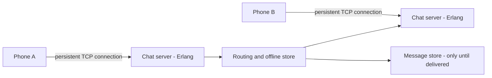
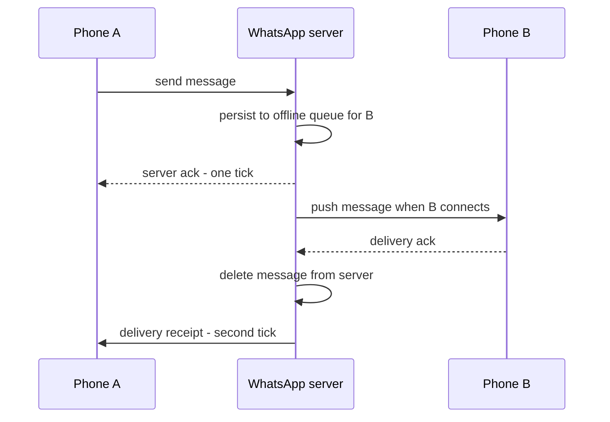

# WhatsApp and the Small-Team Scale Story

WhatsApp is the strongest counterexample to the belief that planet scale requires planet-sized engineering organizations. When Facebook acquired it in **February 2014**, WhatsApp served roughly **450 million monthly users with about 32 engineers**; by **September 2015** it had grown to roughly **900 million users with still only ~50 engineers** — a ratio in the neighborhood of 18 million users per engineer. The case study is not "Erlang is magic". It is a lesson in how three mutually reinforcing choices — a runtime built for exactly this workload, an operating system tuned to its limits, and a product kept deliberately tiny — let a small team avoid most of the work that consumes large ones.

## The scale of the problem

Messaging is a deceptively hard workload. Unlike a request/response web app, a messaging service must hold a **persistent connection open for every online user** so the server can push messages the moment they arrive ([[WebSockets Server-Sent Events and Long Polling]] explains why polling doesn't cut it). That changes the dominant load parameter from requests per second to **concurrent open connections** — millions of mostly idle sockets, each needing a sliver of memory and the ability to wake instantly.

Era-labeled numbers (all from WhatsApp's own blog and Rick Reed's conference talks — always label these with their year, because the system kept growing):

| Year | Fact |
|---|---|
| 2011–2012 | **~1M, then 2M+ TCP connections on a single server** in benchmark/production tuning (WhatsApp blog post "1 million is so 2011"; Rick Reed's 2012 talk) |
| 2014 (acquisition) | ~450M monthly users, ~32 engineers, tens of billions of messages per day |
| 2014 (Rick Reed talk) | ~465M monthly users; peak ~342K messages in/sec and ~712K out/sec; ~147M concurrent connections carried by roughly 550 servers, of which about 150 were chat servers holding ~1M connections each |
| 2015 | ~900M monthly users, ~50 engineers |

The connection-count problem is the same one Discord, Slack, and every chat system faces ([[Design a Chat System]]), but WhatsApp hit it earlier and at larger scale than almost anyone, on hardware budgets a startup could afford. For how the dominant bottleneck shifts at each order of magnitude of load, see [[Anatomy of 1M RPS]].

## The architecture

The high-level shape is simple, and that is the point.

- **Modified ejabberd core.** WhatsApp started from **ejabberd**, an open-source XMPP server written in **Erlang**, then rewrote and stripped it heavily (including replacing XMPP's verbose XML with a custom binary protocol) until little of the original remained. Starting from a working open-source base and specializing it was itself a small-team move.
- **Erlang/OTP as the runtime.** Each connected phone is handled by an **Erlang process** — not an OS thread but a runtime-managed green process costing a few KB — a newly spawned process is 327 words, about 2.6 KB on a 64-bit VM, per the Erlang efficiency guide (OTP 27 figure). Millions of them run inside one BEAM VM, scheduled across cores. OTP supplies supervision trees (crashed processes are restarted in isolation — "let it crash") and **hot code reload**: new code is loaded into the running VM without dropping the millions of live connections. For a system whose core asset *is* open connections, deploys without disconnects are an enormous operational win.
- **FreeBSD, tuned hard.** WhatsApp ran on **FreeBSD** servers with aggressive kernel tuning — raising file-descriptor and socket limits, sizing network buffers, and working with the network stack (`kqueue`-based event handling) — to reach the famous **2M+ connections per server (2012 era)**. The lesson is not the specific sysctl values (they are era-specific); it is that the team treated the OS as part of the system and measured until the kernel, not the application, was the limit.
- **Mnesia and friends for state.** Transient state (sessions, offline queues) lived largely in Erlang-native storage (Mnesia/ETS) rather than a separate database tier, keeping the moving-parts count low. Details beyond that are not public in depth.
- **Store-and-forward messaging.** The server's job is relay, not archive. A message is persisted only while the recipient is offline; **once delivered, the server deletes it**. The durable message history lives on the phones. This is the exact opposite of Discord's store-everything model ([[Discord Message Storage Evolution]]), and it deletes an entire planet-scale problem — trillions-of-rows message storage — from the architecture. (It also later made end-to-end encryption, rolled out fully in 2016, architecturally natural: the server never needed to read message bodies.)

The tick marks users see are this protocol made visible: the first confirms the server has the message durably queued, the second confirms delivery — after which the server's copy is gone. The acknowledgement chain is textbook [[Delivery Semantics]]: at-least-once hops with client-side dedup, because a lost ack must trigger a resend rather than a lost message.

What the Erlang/OTP platform specifically bought a ~50-person team:

| OTP capability | Operational work it replaced |
|---|---|
| Lightweight processes (one per connection) | Connection-pool tuning, thread-per-connection memory walls, event-loop callback complexity |
| Supervision trees, "let it crash" | Defensive per-connection error handling; one bad session cannot take down a server |
| Hot code reload | Drain-and-restart deploy choreography across servers holding millions of live sockets |
| Message passing between processes | Hand-built inter-connection routing and locking |
| Per-process heaps and GC | Global stop-the-world GC pauses under millions of objects |

### The arithmetic of two million connections

The runtime choice looks like a matter of taste until you do the memory math for one server holding **2 million idle sockets** — the 2012-era target. Three models, same workload:

| Model | Per-connection cost | At 2M connections | What stops you first |
|---|---|---|---|
| Thread per connection (the default JVM shape of that era) | ~512 KB–1 MB of reserved thread stack | ~1–2 TB of reserved stack | Memory, then the kernel scheduler |
| Event loop over `epoll`/`kqueue` (NIO, Netty) | A few KB of socket buffers | Single-digit GB | Programming model, shared heap and GC, no per-connection crash boundary |
| Erlang process per connection | ~2.6 KB at spawn (327 words, 64-bit), growing with per-connection state | ~5 GB at 2.6 KB each | Runtime internals — exactly what WhatsApp hit and patched |

Check the first row: 2,000,000 × 1 MB ≈ 2 TB of address space. Most of those pages are never touched, so *committed* memory is far smaller — but the kernel must still schedule two million runnable entities, and context-switch and run-queue costs dwarf the actual work of a socket that sends nothing for minutes. The model fails on two independent axes before any business logic runs. Now the third row: 2,000,000 × 2.6 KB ≈ 5.2 GB, a machine you can buy. That is a ratio of roughly **400:1** in per-connection memory (1 MB ÷ 2.6 KB), and ratios that size are what let one company run on hundreds of machines where another would need tens of thousands.

The middle row is the honest one for a Java reader: the JVM is not condemned to thread-per-connection, and every modern JVM WebSocket server is an event loop whose per-connection cost is buffers, not stacks. What the event loop does *not* give you is Erlang's isolation — a process per connection with its own heap, its own crash boundary, and its own garbage collection. That is why one pathological session cannot stall its neighbours on BEAM, but can on a shared event loop with a shared heap.

Independent of all three rows, the kernel takes its own cut: a file descriptor and send/receive socket buffers per connection. This is why WhatsApp's tuning was as much `sysctl` as Erlang — you can drive user-space cost per connection arbitrarily low and still be stopped by default buffer sizes multiplied by two million.

## Key decisions and why

1. **Pick the runtime that matches the load parameter.** The dominant cost was *concurrent connections*, and Erlang/OTP was built (at Ericsson, for telecom switches) for exactly that: massive cheap concurrency, fault isolation, and in-place upgrades. A thread-per-connection Java design of that era would have hit memory walls orders of magnitude earlier; an event-loop design in C would have cost far more engineering time for the same result. Choosing the right tool substituted for headcount.
2. **One product, minimal features.** WhatsApp was messaging — no feed, no ads infrastructure, no games platform, no analytics empire. "No ads, no games, no gimmicks" was a stated founding principle. Every feature not built is a distributed system not operated. The small team was *downstream* of the small surface area, not a heroic exception to it.
3. **Store-and-forward instead of store-everything.** Deleting messages after delivery turned storage from a scaling problem that compounds forever into a bounded queue of undelivered messages. Compare what Discord paid — three database migrations — for the opposite choice.
4. **Vertical capability before horizontal sprawl.** By pushing one server to 2M+ connections, the fleet stayed small (hundreds, not tens of thousands, of machines in the 2014 era), which kept operations — deploys, monitoring, failure domains — tractable for a tiny team. This is [[Vertical vs Horizontal Scaling]] nuance: they still scaled out, but each unit was maximally utilized first.
5. **Measure the real system.** Reed's talks are full of production-derived numbers — contention points found with instrumentation, patches to the BEAM VM where its locks became bottlenecks. The team fixed the runtime itself when needed, rather than architecting around unmeasured guesses.

## What broke along the way

- **BEAM VM internals at the extremes.** At millions of processes and extreme message rates, WhatsApp hit contention inside Erlang's runtime (lock contention in parts of the VM, timer wheels, ETS tables) and patched or worked around it — documented in Rick Reed's 2012 and 2014 talks. Lesson: at the far tail of scale, *your platform* becomes your codebase.
- **Head-of-line amplification during reconnect storms.** Any mass-disconnect event (a network blip, a bad deploy elsewhere) turns millions of idle connections into a simultaneous reconnect-and-sync stampede — the connection-oriented cousin of [[Cache Stampede and Thundering Herd]]. Chat systems must rate-limit and jitter reconnects, and WhatsApp's offline-queue design bounded the resync work per user.
- **Outages still happened.** WhatsApp had several widely reported multi-hour outages (notably in 2014, shortly after the acquisition). Small-team simplicity reduces failure surface; it does not eliminate it, and with ~1 service in the critical path, when it was down, everything was down. (Root-cause details were not published — "not public" is the honest label.)
- **Store-and-forward made multi-device hard.** With the phone as the sole archive, a second device has no server to sync history from. The original WhatsApp Web (2015) dodged this by proxying through the phone — the browser was a remote display, dead whenever the phone was offline. True multi-device support arrived only in 2021, requiring a redesigned architecture (per-device message copies and identity keys, described in Meta's engineering announcement). The deleted storage problem partially returned as a synchronization problem — architecture choices defer costs more often than they erase them.

### What a reconnect storm looks like at 3 a.m.

WhatsApp never published root causes for its outages, so take this as the mechanism rather than their incident — it is the failure every connection-oriented system eventually meets, and the shape is always the same.

- **The trigger** is anything that drops a large fraction of sockets at once: a gateway restart, a rollout, an upstream network blip, a load balancer draining.
- **The amplification** is the part people miss. The steady-state cost of an idle connection is almost nothing; the *establishment* cost — TCP handshake, TLS handshake, authentication, session restore, missed-message sync — is orders of magnitude higher. A mass disconnect instantly converts the fleet's cheapest workload into its most expensive one, at 100% concurrency.
- **On the dashboards**, the connection-count graph falls off a cliff and then climbs a near-vertical wall. CPU is dominated by crypto rather than message handling. The authentication service sees a day's worth of traffic in thirty seconds. The sync path spikes as every returning client asks "what did I miss?"
- **The second wave** turns an incident into an outage: if the fleet cannot absorb the first reconnect pulse, clients time out and retry — all of them together, because they all failed at the same instant. Without jitter, each retry round arrives in a tighter pulse than the last. This is [[Cache Stampede and Thundering Herd]] with sockets instead of cache keys.
- **How you confirm it**: compare handshake rate against steady-state connection count, and look for the sawtooth of synchronized retry. A capacity problem produces a smooth ramp; a reconnect storm produces a pulse train.
- **The fixes, in order of leverage**: jittered exponential reconnect backoff *in the client* — highest leverage, and the one you cannot add mid-incident because it ships in an app release; admission control at the gateway so the fleet accepts connections only as fast as it can authenticate them ([[Load Shedding and Graceful Degradation]]); and bounding per-user resync work so a returning client's catch-up is a page, not an archive. WhatsApp's small, bounded offline queue did that third one for free — another dividend of store-and-forward.

## Lessons you can reuse

- **Scale comes from the right runtime and ruthless simplicity, not headcount.** Headcount often *follows* complexity rather than taming it. The question "what can we refuse to build?" is a scaling strategy.
- **Identify the dominant load parameter and optimize for it specifically.** For WhatsApp it was concurrent connections; for Twitter it is fan-out ([[Twitter Timeline Design]]); for Stripe it is correctness ([[Stripe and Payment System Design]]). Generic "scalability" effort spent off the dominant parameter is wasted.
- **Data you don't keep is data you don't have to scale.** Retention policy is an architecture decision, not a compliance afterthought. Store-and-forward vs store-everything is the cleanest illustration in the industry.
- **Deploys that preserve connections matter for stateful services.** Hot code reload is Erlang-specific, but the general requirement — drain or hand off long-lived state during deploys — applies to any WebSocket tier ([[Stateless vs Stateful Services]], [[Graceful Shutdown and Deployment Safety]]).
- **Squeeze a machine before multiplying machines.** Knowing your true per-node ceiling ([[Capacity Planning]]) can shrink your fleet — and your ops burden — by 10x.

## Common misconceptions

- **"Fifty engineers ran the entire company."** The headcount figures are *engineers*; WhatsApp was roughly 55 employees in total at the 2014 acquisition, and after it the service ran inside Facebook, on Facebook's data centres and network. The small-team claim is real and remarkable for the *application*; it was never a claim that no one else was involved in keeping it online.
- **"Erlang is why it worked."** Erlang matched the dominant load parameter, which is a real and large advantage — but the product's refusal to grow features did at least as much work, and that half is language-independent. Watch which half of the claim each counterexample actually touches: Discord's gateway is Elixir, a *different language on the same BEAM VM*, so it argues **for** runtime fit rather than against it. Slack — PHP and Java over MySQL — is the genuine cross-runtime counterexample. The transferable claim is runtime-to-workload fit, never a language verdict.
- **"Two million connections per server means two million users per server."** It was a tuned benchmark of concurrent TCP connections, not a production per-box user count. Reed's 2014 figures put roughly 147M concurrent connections across about 150 chat servers — close to 1M per box, about half the benchmark ceiling — and only a fraction of a user base is online at any instant anyway. The useful takeaway is "measure your per-node ceiling, then run well under it", not "copy the number".
- **"Store-and-forward means the message is deleted immediately."** It is deleted after the *recipient* acknowledges delivery. Undelivered messages sit on the server, durably, for as long as the recipient stays offline. The bound is on undelivered *volume*, not on time — which is why the storage requirement stays small without any retention policy at all.
- **"The two ticks are read receipts."** They are transport signals: one tick means the server has the message, two ticks mean it reached the recipient's device. The blue/read indicator is a separate, third signal and a product decision. Conflating the two hides the architecturally interesting part, which is that the second tick is what authorises the server to forget.
- **"Hot code reload gives you zero-downtime deploys for free."** It removes the *connection* cost of deploying; it does not remove the correctness cost. Old and new code coexist in one VM for a while, so state and message formats must be compatible across versions, and a bad in-place upgrade is considerably harder to reason about than a restart. It is a powerful tool with its own discipline, not a free lunch.

## In your stack

- Your Java/Spring Boot services on EKS sit at the other end of the runtime spectrum: heavier per-connection cost, but you rarely hold millions of sockets — Kong and the ALB terminate most client connections at the edge, which is why the WhatsApp problem doesn't bite you daily.
- The "every feature not built is a system not operated" lesson maps directly to a fintech: each new money-movement flow adds audit, reconciliation, and RBI-regulated surface. Feature minimalism is also a compliance strategy.
- Store-and-forward has a direct analogue in your messaging journey: an SQS queue whose messages are deleted on successful consumption is store-and-forward; a Kafka topic with long retention is store-everything ([[Message Queues vs Event Logs]]). You have run both — the retention decision changed your storage and replay story each time.
- The day you add a long-lived-connection tier — live transaction alerts over WebSocket or SSE, in-app support chat — every lesson above becomes operational at once on EKS. A pod holding open sockets cannot be rolled like a stateless pod: `terminationGracePeriodSeconds` must exceed your drain window, the ALB and Kong must drain connections rather than cut them, and clients need jittered reconnect ([[Graceful Shutdown and Deployment Safety]], [[WebSockets Server-Sent Events and Long Polling]]).
- There is a specific trap waiting for your JWT setup: if reconnecting requires a *fresh* token from the central IAM service, every mass-disconnect event becomes an IAM load test. A million clients reconnecting means a million token issuances in seconds, against a service sized for steady-state login traffic. Accept a still-valid token on reconnect and reauthenticate lazily, and the storm stays inside the connection tier instead of taking out authentication for every other service.
- Services pinned at 1 replica echo WhatsApp's single-path reality honestly: simplicity and low cost, but when the one instance is down, that capability is down. For a stateless REST service that means a few seconds of retried requests. For a connection tier it is categorically worse — **every deploy is a 100% disconnect event**, because there is no second replica to hold half the sockets while the first restarts. If you ever put long-lived connections behind a 1-replica service, the client-side jittered reconnect is not a nice-to-have; it is the only thing standing between a routine rollout and a self-inflicted thundering herd. WhatsApp accepted its single-path trade knowingly; the lesson is to accept yours *explicitly*, not by default.

## Interview angle

- **The 60-second story:** "WhatsApp served ~900M users with ~50 engineers (2015). Three reasons: Erlang/OTP gave them a process per connection, supervision, and hot code reload — the runtime matched the dominant load parameter, concurrent connections; FreeBSD kernel tuning pushed single servers past 2M connections (2012 benchmark), keeping the fleet and ops small; and the product was ruthlessly simple — store-and-forward messaging with server-side deletion after delivery meant they never had to scale a message archive. The lesson: pick the right runtime, refuse complexity, and know your per-node ceiling."
- Interviewers probe whether you understand **why messaging is connection-bound rather than RPS-bound**, and whether you can contrast **store-and-forward vs store-everything** (WhatsApp vs Discord) and derive the storage consequences.
- Classic follow-ups: "How would you deploy new code to a server holding 2M live connections?" (drain gradually, hand off, or hot-reload); "What breaks first if you build this on thread-per-connection?" (memory, then scheduler); "Where does end-to-end encryption fit?" (naturally — the server never needed message contents); "How do you add a second device?" (that's the store-and-forward weak spot — be ready to discuss per-device queues and history sync).
- Don't overclaim: Erlang is not required to build chat — Slack built large-scale chat on PHP (later Hack), Java and MySQL (see [[Why MySQL Does Scale]]), and Discord's Elixir is the same BEAM runtime wearing a different syntax.

## Check yourself

> [!question]- Q: Explain why a messaging system's hard limit is concurrent connections rather than requests per second, and how Erlang addresses it.
> Online users must receive messages with no polling delay, so each keeps a persistent socket open; most are idle at any instant, so RPS stays modest while open connections climb into the millions. The cost per connection — memory and scheduling — becomes the ceiling. Erlang gives each connection a runtime-managed process costing a few KB (about 2.6 KB at spawn on a 64-bit VM), preemptively scheduled across cores, so one machine can host millions; supervision trees isolate per-connection crashes, and hot code reload upgrades the server without dropping the sockets that *are* the service.

> [!question]- Q: What happens if a WhatsApp-style store-and-forward server crashes while holding undelivered messages, and how is that different from a Discord-style system crashing?
> In store-and-forward, only the *undelivered* window is at risk; that queue is small and bounded, so replicating or persisting it durably is cheap, and delivered history is safe on phones regardless. In store-everything, the server-side archive is the single source of history, so a crash risks (and a storage failure threatens) the entire corpus — which is why Discord needed replicated Cassandra/ScyllaDB clusters with all the operational weight that carries ([[Replication]]).

> [!question]- Q: Your team of 6 must build a notification/chat feature for millions of users. Which three WhatsApp decisions do you copy first?
> First, minimize retention: deliver and delete wherever product allows — don't build an archive you don't need. Second, match the runtime/tier to the connection load: terminate long-lived connections in a dedicated gateway tier built for cheap concurrency, and keep business logic in stateless services behind it ([[Stateless vs Stateful Services]]). Third, cut product surface: one transport, one protocol, no speculative features — each feature refused is an on-call burden avoided. Then measure the per-node connection ceiling before sizing the fleet ([[Back of the Envelope Estimation]]).

> [!question]- Q: Why does hot code reload matter more for WhatsApp than for a typical stateless REST service?
> A stateless REST service can do a rolling deploy: drain in-flight requests for a few seconds and restart — clients retry transparently through the load balancer. WhatsApp's servers each held millions of long-lived connections; a restart disconnects them all, triggering a reconnect stampede and message-sync storm across the fleet. Hot reload swaps code inside the running VM, preserving the connections, so deploys don't convert the fleet's steady state into its worst-case load.

> [!question]- Q: You add a WebSocket tier for live transaction alerts to your EKS cluster, at 1 replica like everything else. A routine 11 a.m. deploy causes a five-minute outage of the central IAM service. Explain the chain, and name the fixes in order of leverage.
> The chain: rolling a single pod drops 100% of sockets at once, because there is no peer holding the other half. Every client reconnects simultaneously, and each reconnect authenticates — so IAM receives a large fraction of its daily token-issuance volume inside a few seconds. IAM saturates; reconnects start failing; clients retry, synchronized because they all failed at the same instant; each retry round lands in a tighter pulse. The root cause is not the deploy but the cost asymmetry: establishing a connection is orders of magnitude more expensive than maintaining one, and at 1 replica the disconnect fraction is always 100%. Fixes in order of leverage: (1) jittered exponential reconnect backoff in the client — ships in an app release, so it must exist before you need it; (2) accept the client's still-valid JWT on reconnect instead of minting a new one, which removes IAM from the storm path entirely; (3) admission control at Kong so the gateway accepts new connections only as fast as the fleet can authenticate them; (4) a second replica, so a rollout drops half the fleet at a time instead of all of it — the only fix that addresses the 100% figure itself.

> [!question]- Q: Trace a message sent to an offline recipient through a store-and-forward system. Where is it durable, and when does the server forget it?
> The sender's phone transmits to the server, which persists the message in the recipient's offline queue and acks the sender (first tick) — from this moment the sender may go offline safely. The message sits server-side, durable, only while the recipient is unreachable. When the recipient connects, the server pushes the queued message; the recipient's ack triggers server-side deletion and a delivery receipt to the sender (second tick). After that, the only copies live on the two phones. The server's storage requirement is therefore proportional to *undelivered* messages — bounded and small — not to all messages ever sent.

## Sources

- Rick Reed, "Scaling to Millions of Simultaneous Connections" — Erlang Factory SF 2012 talk (the 2M-connections-per-server material).
- Meta/WhatsApp engineering announcement on multi-device architecture (2021) — the per-device redesign referenced under "What broke".
- Rick Reed, "That's 'Billion' with a B: Scaling to the Next Level at WhatsApp" — Erlang Factory SF 2014 talk (the 465M-user, ~550-server, 147M-concurrent-connection figures; peak message rates; BEAM patches).
- WhatsApp engineering blog post "1 million is so 2011" (the single-server connection benchmark posts, 2011–2012).
- Facebook/WhatsApp acquisition disclosures (2014) and WhatsApp's September 2015 ~900M-user announcement — the era-labeled user and headcount figures.
- *Designing Data-Intensive Applications* (Kleppmann) — ch. 1 on load parameters; the framing used throughout this note.
