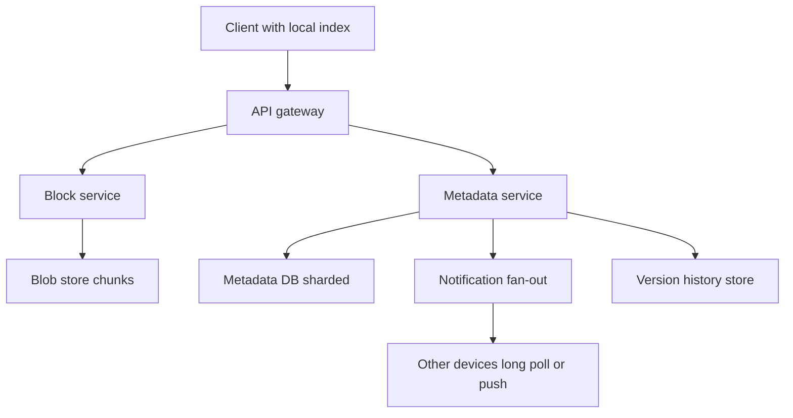

# Design Distributed File Storage

"Design Dropbox" looks like a storage problem but is really a **synchronization** problem: many devices, intermittently connected, all editing the same files, must converge to the same state without losing anyone's work. The storage itself is the easy half — blob storage solved it ([[How S3 Works]]). The design hinges on splitting the system into a small, strongly consistent **metadata service** and a huge, dumb **block store**, and on a client sync protocol that handles conflicts honestly. Run it through [[The System Design Interview Framework]]; the deep dives here are where interviews are won.

## Requirements clarification

**Functional**
- Upload, download, and sync files across a user's devices automatically.
- File versioning and restore (clarify retention: e.g., 30 days of versions).
- Sharing: folders shared between users, with permissions (viewer/editor).
- Offline edits sync when the device reconnects; conflicting edits must never silently discard data.
- Clarify file-size bounds: support up to, say, 10 GB files — rules out "just POST the file".

**Non-functional**
- Scale target: **500 million registered users**, ~100M daily active (an assumption; Dropbox's FY2025 10-K reports 700M+ registered and ~18M paying users).
- Durability is paramount — losing a user's file is the unforgivable failure. Availability target high but secondary to durability ([[Availability Reliability Durability]]).
- Sync latency: edits visible on other devices within seconds, not minutes.
- Bandwidth efficiency: re-uploading a 2 GB file for a 1-line edit is unacceptable — this requirement *forces* chunking and delta sync into the design.

## Back-of-envelope estimation

Storage:

- 500M users; assume average 5 GB stored per user (free-tier skew keeps the average well under the quota).
- Raw logical storage = 5 × 10⁸ users × 5 × 10⁹ B = 2.5 × 10¹⁸ B. Walk the units: 2.5 × 10⁹ GB = 2.5 × 10⁶ TB = 2,500 PB = **2.5 EB logical**. (Write the exponents out — unit conversion is exactly where estimation slips happen.)
- **Dedup factor**: much stored content is identical across users (installers, media, shared docs, re-uploads). Assume a conservative overall dedup+compression factor of 2× (vendors have reported higher; treat as roughly 2×): **~1.25 EB physical** before replication.
- With 3× redundancy (or ~1.5× via erasure coding like [[How S3 Works]] describes): erasure-coded ≈ **~1.9 EB raw disk**. The conclusion that matters: this lives in purpose-built blob storage, and *dedup is a first-class economic feature, not an optimization*.

Metadata:

- Assume ~1,000 files per user average → 5 × 10¹¹ file records. At ~500 B of metadata per file-version record ≈ **250 TB** of metadata — large, but shardable by user/namespace; tiny next to the blocks.

Traffic:

- 100M DAU, each syncing say 10 file changes/day → 10⁹ change events/day ÷ 86,400 ≈ **~12K changes/s average**, peak ~2–3× → design metadata service for ~30–40K writes/s plus a much larger read/notification fan-out.

## High-level design

- **Client** — not a thin client: it chunks files, hashes chunks, keeps a local index (chunk hashes of every synced file), watches the filesystem, and runs the sync protocol.
- **Block service** — accepts chunk uploads/downloads; stateless front over the blob store; verifies hashes.
- **Blob store** — stores chunks keyed by content hash; S3-class storage ([[How S3 Works]]). Chunks are immutable — a changed file produces *new* chunks, never mutated ones.
- **Metadata service** — the consistency-critical core: the mapping file → ordered list of chunk hashes, plus versions, namespaces, sharing ACLs, and the per-namespace change journal. Everything hard lives here; see deep dive.
- **Notification service** — tells other online devices "namespace X changed, sync now" via long-poll or push ([[WebSockets Server-Sent Events and Long Polling]]). It is a hint, not a delivery mechanism: clients reconcile via the journal, so a lost notification costs latency, not correctness.

## Deep dives

### 1. Chunking and content-addressed storage

Files are split into **~4 MB chunks** (Dropbox's choice, per its 2014 sync write-up: 4 MB blocks named by SHA-256). Each chunk is identified by its **SHA-256 hash** — content addressing. Consequences, all load-bearing:

- **Dedup falls out for free**: before uploading, the client sends the chunk hash list; the server replies with which hashes it already has (from *any* user); the client uploads only missing chunks. The installer already uploaded by a million users costs the million-and-first user one metadata write.
- **Integrity falls out for free**: the hash *is* the name; corruption is detectable on every read.
- **Immutability simplifies everything**: no chunk is ever overwritten, so replication, caching, and versioning never deal with mutation — a version is just a different list of hashes.
- Fixed-size chunking has one weakness: an *insertion* at the start of a file shifts every boundary and changes every chunk hash. Content-defined chunking (rolling hash, e.g. Rabin fingerprinting) cuts chunks at content-determined boundaries so an insertion only disturbs nearby chunks — mention it as the refinement; LBFS introduced it and backup tools such as restic and Borg use it (rsync attacks the same shift problem differently, matching the old file's fixed blocks at any offset with a rolling checksum).
- Security note worth volunteering: cross-user dedup can leak information (upload speed reveals whether a chunk exists globally — the "dedup oracle"); per-user dedup or encrypted chunks trade storage efficiency for confidentiality.

### 2. Delta sync

A 1-line edit to a 2 GB file must cost ~one chunk, not 2 GB:

1. Client's file watcher sees the change; re-chunks the file (cheap with rolling hash), hashes chunks.
2. Diff against the local index: identify changed chunk hashes.
3. Upload only new chunks to the block service.
4. **Commit** to the metadata service: "file F, parent version v17, new chunk list [h1…hn]". The commit is the atomic step — until it succeeds, no other device sees the change; chunks without a committed metadata record are invisible garbage (collected later).
5. Metadata service appends to the namespace **journal**; notification service pings other devices; they pull journal entries, see which chunk hashes they lack, download just those, and reassemble.

Upload-then-commit ordering is the invariant: **blocks first, metadata last**. The reverse order could commit a version whose chunks don't exist.

### 3. The metadata service — the consistency-critical core

The block store can be eventually consistent, massively replicated, dumb. The metadata service cannot:

- A version commit must be **atomic and ordered** per file: two devices committing against parent v17 must serialize — one becomes v18, the other is rejected with a conflict (compare-and-swap on the parent version; see [[ACID Transactions]] for why a transactional store earns its keep here).
- The **journal** (append-only change log per namespace) is what devices sync against: "give me everything after cursor 4812". This is an event-log pattern ([[Message Queues vs Event Logs]]) applied to file state.
- Shard metadata **by namespace** (user's root folder, or a shared folder), not by file — all commits to a namespace hit one shard, giving per-namespace ordering without cross-shard transactions ([[Sharding]]). A shared folder is its own namespace mounted into each member's view, so sharing does not fan out writes.
- Hot namespaces (a 10,000-member shared folder) are the [[Hot Partition Problem]] here — mitigations: journal read replicas and notification batching.

### 4. Client sync protocol: local index, remote cursor, conflicts

Each client keeps: a **local index** (path → chunk hashes + local version) and a **remote cursor** (position in each namespace journal). The loop:

1. Pull journal entries after cursor → remote changes; apply (download missing chunks, update files), advance cursor.
2. Local filesystem events → upload chunks, commit, update index.
3. Both at once for the same file = **conflict**. The server never merges: the first commit wins v18; the losing device's commit is rejected. The client then creates a **conflict copy** — "report (Kunal's conflicted copy 2026-10-01).docx" — committing it as a *new file*, preserving both versions.

This is the honest answer to concurrent edits: file contents are opaque bytes, so automatic merging is impossible in general; **never silently drop either side**. (Google Docs avoids this only by owning the format and using operational transforms — a different problem.) Rename/delete races get the same treatment: deletes are tombstones in the journal, so a delete racing an edit resurfaces the edited file rather than losing the edit.

Idempotency matters throughout: chunk uploads are naturally idempotent (same hash, same bytes), and commits carry client-generated request IDs so a retried commit after a timeout doesn't create duplicate versions ([[Idempotency]]).

### 5. Sharing and permissions

- A shared folder = a namespace with an **ACL** (member → role). Membership changes are themselves journal entries, so devices learn about new/removed shares through the same sync loop.
- Authorization check on every metadata *and* block request — and the block check must verify the caller has access to a *file containing that chunk*, else chunk hashes become bearer tokens to anyone who learns them (cross-user dedup makes this a real leak: knowing a hash shouldn't grant the bytes).
- Links-with-token sharing: signed URLs with expiry for unauthenticated download, generated by the metadata service, served by the block path.

## Scaling and failure handling

- **Blob store**: delegate — replication, erasure coding, and 11-nines durability are [[How S3 Works]]'s job. Our job is never losing the *mapping* (metadata) and never committing metadata before blocks exist.
- **Metadata DB**: shard by namespace; replicate with synchronous commit to a majority ([[Replication]], [[Quorum Reads and Writes]]) — metadata loss = data loss even with all chunks intact, since 2.5 EB of unaddressable chunks is noise.
- **Notification tier**: millions of concurrent long-poll/push connections — stateless connection servers in front of a pub/sub; lost notifications are safe (clients also poll periodically as a backstop).
- **Client resilience**: all sync steps are resumable — chunked upload means a dropped connection re-uploads at most one chunk, not the file; the cursor means a crashed client re-pulls the journal from its last durable position. At-least-once everywhere, with idempotent operations absorbing duplicates ([[Exactly-Once Delivery Is a Lie]]).
- **Garbage collection**: orphan chunks (uploaded, never committed; or last reference deleted past version retention) are collected by an async reference-counting sweep — reference counting across ~5 × 10¹¹ files is itself a batch pipeline, worth mentioning as an operational reality.
- **Degradation**: if the metadata service is down, clients keep working locally and queue changes — the design is offline-first by nature, which is a resilience feature worth stating explicitly.

## Common mistakes

- **Designing the storage, not the sync** — spending 20 minutes on replication of chunks (solved by S3) and 2 minutes on conflicts, versions, and the journal (the actual problem).
- Uploading whole files on every change — missing that the bandwidth requirement *forces* chunk-level delta sync.
- Metadata-before-blocks commit ordering, creating versions that reference nonexistent chunks.
- Silent last-writer-wins on conflicting edits — losing user data; the conflict-copy answer is mandatory.
- Treating notifications as reliable delivery instead of a latency hint over a pollable journal.
- Ignoring the security edge of content-addressed dedup (chunk hash as bearer token; dedup oracle).
- One global metadata DB without sharding — 40K writes/s with hot shared-folder namespaces needs a sharding story.

## Check yourself

> [!question]- Q: Explain why the metadata service must be strongly consistent while the block store can be eventually consistent.
> Blocks are immutable and content-addressed: a chunk read either returns bytes matching the hash or doesn't exist yet — there is no stale *state* to observe, so eventual consistency is harmless. Metadata is mutable, ordered state: version numbers, chunk lists, ACLs. If two devices both commit "v18" or a device reads a stale chunk list, you get forked history or files assembled from mismatched versions. So the small metadata core takes the cost of strong consistency (serialized commits per file, quorum replication), and the enormous block tier is exempt — the classic move of shrinking the consistency-critical surface.

> [!question]- Q: What happens if a client uploads all chunks, then crashes before the metadata commit?
> Nothing visible: no journal entry exists, so no device (including this one, after restart) sees a new version. The uploaded chunks are orphans — invisible, harmless, eventually removed by garbage collection unless the client retries the commit first (its local state shows the pending change, so it re-runs the sync loop; chunk uploads short-circuit because the hashes already exist, and the commit completes). This is why blocks-first ordering is safe and the reverse is not.

> [!question]- Q: Two users in a shared folder edit the same file while both offline, then reconnect simultaneously. Walk through what each client experiences.
> Both reconnect and run the loop. Client A pulls the journal (no new entries for the file), uploads chunks, commits against parent v17 → accepted, v18 journaled. Client B pulls — if it pulls before committing, it sees v18, detects its local edit conflicts, and creates a conflict copy. If B instead commits first on a stale cursor, the compare-and-swap on parent v17 fails (A got there first); B then pulls v18, applies it, and commits its own edit as a conflict copy. Either path ends identically: v18 = A's edit, plus a new file holding B's edit, on both devices. No data lost, no merge attempted.

> [!question]- Q: Design the variant — the same product, but every file is end-to-end encrypted so the server can never read content.
> Chunking and hashing move entirely client-side over *ciphertext* (or use convergent encryption — key derived from the plaintext hash — to preserve dedup at the cost of a confirmation-of-file attack; plain per-user keys kill cross-user dedup entirely: name the storage-cost consequence from the estimation, roughly doubling physical storage). The metadata service still sees structure (file sizes, change times, sharing graph) — state that metadata privacy is a separate, harder problem. Sharing requires key exchange: wrap per-file keys with recipients' public keys; revocation forces re-encryption or lazy re-keying on next change. Server-side features that read content (preview thumbnails, search) disappear — enumerate what the product loses, not just what the crypto gains.

## Sources

- Alex Xu, *System Design Interview Vol. 1*, chapter "Design Google Drive" — the chunk/metadata/notification split.
- Dropbox Tech Blog: "Streaming File Synchronization" and the "Magic Pocket" series (Dropbox's exabyte-scale block store) — chunking at 4 MB, content addressing in production.
- rsync algorithm (Tridgell & Mackerras, 1996) — rolling-hash delta transfer; content-defined chunking proper comes from LBFS (Muthitacharoen, Chen & Mazières, SOSP 2001).
- *Designing Data-Intensive Applications* (Kleppmann), ch. 5 and 9 — replication and consistency trade-offs behind the metadata/block split.
