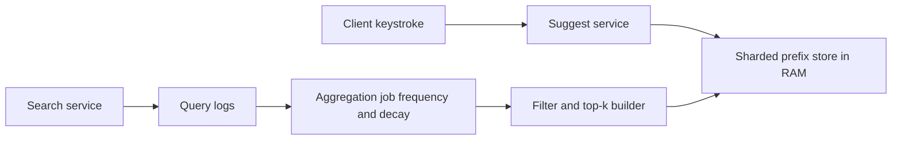

# Design Typeahead Autocomplete

Typeahead (Google's search suggestions, your app's search box) fires a query on nearly **every keystroke** and must return the top suggestions before the user types the next character — a perceptible budget of roughly 100 ms end-to-end, leaving single-digit milliseconds for the actual lookup. The defining insight: this is a **read-time system fed by a batch pipeline**. Nothing is computed per request; everything is *precomputed* so the serving path degenerates to one key lookup. The interview tests whether you see that split — and whether you can defend the pragmatic flat-table design against the textbook trie.

## Requirements clarification

**Functional:**

- Given a **prefix**, return the **top k** (k ≈ 5–10) completed query suggestions.
- Ranked by **popularity** (historical query frequency); confirm the freshness expectation — must a breaking-news query surface within minutes, or is daily refresh fine? (This single question decides half the architecture — see deep dive 4.)
- **Prefix match only** (not fuzzy/mid-string match); lowercase-normalized; confirm language scope.
- **Personalization out of scope** — say it explicitly (per-user re-ranking multiplies the problem; interviewers accept the scoping gladly). Likewise spell-correction: out.

**Non-functional:**

- **Latency is the product**: server-side lookup in ~10 ms, end-to-end under ~100 ms at p99 — above that, suggestions arrive after the user's next keystroke and feel broken.
- **Read-dominated to an extreme degree**: every search generates ~10–20 typeahead reads but at most one new data point (the submitted query). Availability over freshness; stale-by-a-day suggestions are fine (confirm), a slow lookup is not.
- Suggestions must exclude **blocked content** (abuse/legal filter in the pipeline — one sentence, real systems all have it).

## Back-of-envelope estimation

Assume Google-ish-but-smaller: **500M searches/day**, average query 20 characters. Undebounced, that is ~20 requests per search — one per keystroke. Debounce and in-flight cancellation collapse the runs of fast typing, so *assume* **10 effective requests per search**; carry both numbers, because the gap between them is a capacity decision the client makes for you (deep dive 4).

- **Read QPS**: 500M × 10 = 5 × 10⁹ typeahead requests/day ÷ 86,400 ≈ **58,000 QPS** average; × 2.5 peak ≈ **145,000 QPS**. This is why per-request computation is unaffordable and the serving store must be memory-resident.
- **Write volume (raw signal)**: 500M submitted queries/day ÷ 86,400 ≈ **5,800/sec** — but these are *not* served as writes; they are logged and batch-aggregated. The asymmetry is what licenses the precompute: 58,000 reads/sec against 5,800 logged queries/sec is 10:1 on the *logging* path, while against the **serving store** the ratio is effectively infinite, because that store absorbs zero online writes at all between rebuilds.
- **Corpus size**: say 1B distinct historical queries, keep queries seen enough to matter → ~100M suggestible queries × ~50 B each ≈ **5 GB** of raw strings.
- **Distinct prefixes — derive it, don't assert it**: upper bound = 100M queries × ~20 prefixes each = **2 × 10⁹ prefix instances**. These collapse heavily, because short prefixes are shared by everything: all 100M queries share the handful of one-character prefixes, sharing stays high through ~4–5 characters, and beyond that prefixes are nearly unique to one query. *Assume* a 10× collapse overall — say the assumption out loud rather than hiding it — → **~2 × 10⁸ distinct prefixes**.
- **Serving dataset size**: each entry is the prefix key plus 10 ranked suggestions, stored as suggestion IDs (4–8 B each) and scores rather than repeated strings; budget ~200 B per entry including key and container overhead → 2 × 10⁸ × 200 B = **40 GB**. Show this: it proves the flat table is affordable and kills the "we must save space with a trie" reflex.
- **Shard count — show which constraint binds**: *assume* ~64 GB usable RAM per cache node → 40 GB ÷ 64 GB = **1 node by memory**. *Assume* a single instance sustains order 10⁵ simple GETs/sec (the right order of magnitude for an in-memory store on commodity hardware; measure yours) and that you refuse to run a shard above half its ceiling → 145,000 ÷ 50,000 = **3 primaries by throughput**, each holding 40 GB ÷ 3 ≈ 13 GB. Throughput binds, memory does not — the opposite of most caches, and worth saying aloud. Add 2 replicas per primary for read spread and failover → **~9 nodes**.
- **Bandwidth**: 145K QPS × ~500 B response ≈ **72 MB/sec** egress at peak — modest; responses are tiny.

**Where the 100 ms actually goes.** The end-to-end budget is mostly not yours, which is the point of decomposing it (all figures assumed — measure your own):

| Segment | Assumed cost | Who controls it |
|---|---|---|
| Client → edge network round trip | ~40 ms | Edge/PoP placement only; nothing in your backend touches it |
| TLS + gateway + auth on a reused connection | ~5 ms | Connection reuse; a fresh handshake per keystroke would not fit at all |
| Suggest service, in-process hot-prefix cache hit | <1 ms | You |
| Suggest service → prefix store round trip | ~1 ms | You |
| Serialization and response assembly | ~2 ms | You |
| **Server-side total** | **~4 ms typical, ~10 ms at p99** | **the sliver you own** |

Add it up: ~45 ms is network and edge you do not own, your server-side slice is single-digit milliseconds, and the remaining ~45–50 ms is slack absorbing variance. That shape is the whole argument for a ~10 ms server-side target rather than a comfortable 50 ms — the terms you cannot control are precisely the ones that spike, so the only way the total still fits inside 100 ms on a bad network is for your slice to be negligible rather than merely acceptable.

## High-level design

**API**: `GET /suggest?q=<prefix>&limit=10` → `{suggestions: [{text, score}...]}`. Client fires it per keystroke (debounced), cancels in-flight requests on the next keystroke.

Two planes, deliberately separated:

- **Serving plane**: stateless suggest service → sharded in-memory store mapping `prefix → top-10 list`. One key lookup per request. No ranking, no scanning, no computation.
- **Build plane (offline)**: query logs stream into aggregation → periodic job computes per-query frequencies (with time-decay), filters blocked terms, derives every prefix's top-k, and publishes a new serving dataset (bulk-load into Redis or ship immutable index files to servers), then atomically flips version.

The flip is versioned (`prefixes:v42:...`) so a bad build rolls back by pointing at v41 — treat the serving data as an immutable artifact, like a deploy.

## Deep dives

### 1. Trie with precomputed top-k vs the pragmatic prefix hash table

**The textbook trie**: one node per prefix; walking `d→e→s` reaches the node owning prefix "des", whose subtree contains every completion. Naive query = walk to node + **DFS the entire subtree** collecting frequencies + sort for top-k — for a short prefix like "a" that subtree is millions of queries; catastrophically slow. The fix that makes tries viable: **precompute and cache the top-k at every node** (each node stores its 10 best completions, maintained at build time). Queries become walk + read — O(prefix length). Cost: updates are painful (one query's new frequency must bubble into the cached top-k of *all* its prefixes' ancestors), and a pointer-chasing in-memory structure is harder to shard, serialize, and bulk-replace than flat keys.

**The pragmatic alternative — prefix hash table**: skip the tree entirely; materialize `prefix → top-10` as flat key-value pairs in Redis (or an embedded map). Same precomputation, but stored as data, not structure: O(1) lookup, trivially sharded by key, trivially bulk-loaded/versioned, operable by anyone who can run Redis.

| | Trie + per-node top-k | Prefix hash table |
|---|---|---|
| Lookup | O(prefix) pointer walk | O(1) hash get |
| Space | shared prefixes compress; nodes + pointers add overhead | prefixes stored redundantly; ~40 GB fine (estimated above) |
| Update | bubble into ancestors' cached lists | rewrite affected keys / full rebuild |
| Sharding and ops | awkward — a tree wants one memory space | natural — it's just keys |
| Extras | supports range/lexicographic walks | top-k only — exactly what was asked |

The graded move: present both, note the trie's space elegance, then **choose the hash table because the requirement is only top-k by prefix** — when the entire answer set is precomputed, the data structure holding it stops mattering and operability wins. (If asked for *fuzzy* matching or unlimited-depth exploration, the calculus changes — that's the honest caveat.)

### 2. The offline ranking pipeline

The signal is the search service's **submitted-query log**. Path: logs land on a stream/log system (Kafka-class — [[Message Queues vs Event Logs]]); alternatively, if queries are written to a store first, [[Change Data Capture]] taps that store's change stream as the source — either way the pipeline consumes an append-only event flow, never burdening the search hot path. Then, on a schedule (hourly/daily):

1. **Aggregate**: count query frequencies over a window; apply **time decay** (e.g. exponentially weighted over weeks) so rankings reflect current popularity, not all-time history — "christmas gifts" must fade in January.
2. **Filter**: drop one-off junk (minimum frequency floor), PII-looking strings, and the blocked-terms list.
3. **Build**: for every prefix of every surviving query, compute the top-10 by score — a classic MapReduce/Spark-shaped job (map: query→(prefix, query, score); reduce per prefix: keep 10).
4. **Publish**: bulk-write `v(n+1)` keys to the serving store (or ship index files), verify sample lookups, flip the version pointer, reap `v(n-1)`.

**Sizing the build — the number that sets your refresh cadence.** The map stage emits one tuple per (prefix, query) pair, and the shuffle happens *before* the dedup collapse, so it carries the upper bound, not the 2 × 10⁸ result: 2 × 10⁹ tuples at ~60 B each (prefix, query ID, score) ≈ **120 GB shuffled per full rebuild**. That single figure is what decides whether a rebuild is a twenty-minute job or a four-hour one on your cluster, and therefore whether "hourly" is even on the menu. Refresh cadence is a consequence of shuffle volume, not a product preference — state it that way and the freshness conversation in deep dive 4 has real ground under it.

Full rebuilds beat incremental updates until scale forbids it: idempotent, rollbackable ([[Idempotency]] thinking applied to data artifacts), immune to drift. Incremental (streaming) updates enter only for the trending-freshness requirement — deep dive 4.

### 3. Sharding by prefix — and the hot-prefix problem

40 GB and 145K QPS want a handful of shards. **Shard by hash of the full prefix string** (each key lands wherever the hash says — standard [[Consistent Hashing]]), *not* by prefix range/first letter. Range-by-first-letter is the seductive wrong answer: letters are wildly skewed (English queries starting with 's' vastly outnumber 'x'/'q'/'z'), so the 's' shard melts while 'z' idles — a self-inflicted [[Hot Partition Problem]]. Hashing the full prefix spreads `s`, `st`, `sta`… across different shards, flattening letter skew for free.

What hashing cannot flatten: **individual hot keys**. During a live event, millions of users type the same thing — the keys `t`, `ta`, `tay`… each become a single-key hotspot on whichever shard owns them ([[Hot Key Problem]]). Mitigations, in order: a tiny **in-process cache in the suggest service** for the top few thousand prefixes with a short TTL (10–60 s — suggestions change daily, so even 60 s staleness is invisible; this alone absorbs most of the spike, and short prefixes 1–3 chars are *always* hot enough to deserve it); then key replication across shards with randomized reads. Note the happy coincidence: the hottest keys (short prefixes) are also the most stable — cache-friendliness and hotness arrive together.

**What this looks like at 3am** (the shape of the page, not a specific history). The alert is *suggest p99 latency above 200 ms* — not an error-rate alert, because nothing is failing; it is only slow. Aggregate request rate is up perhaps 3×, which by the sizing above should be absorbable, so the fleet-level graphs say "fine". The tell is the per-shard panel: one shard's operations-per-second counter sits 5–10× above its siblings while the rest idle at baseline, and the suggest service's store-call latency is elevated *only* for calls that hash to that shard. You confirm it in one step — sample the `q` parameter of the slow requests and find they are all 1–3 character prefixes of the same string. Root cause: single-key concentration, not fleet capacity. The immediate lever is the in-process cache (widen it, extend the TTL — a config push, not a deploy, if you built it that way); the durable fix is replicating the hot keys across shards. The diagnostic lesson is the one worth carrying out of this note: **aggregate QPS graphs hide single-key hotspots completely**, so without per-shard and per-key breakdowns you will add nodes and watch p99 refuse to move.

### 4. Client-side debounce and the freshness trade

**Debounce**: don't fire on every raw keystroke — wait ~100–150 ms of typing pause (or request-cancel on next keystroke). A fast typist producing 10 chars/sec would otherwise fire 10 QPS alone; across the fleet that is the difference between the 10 effective requests per search we sized for and the ~20 an undebounced client sends — 500M × 20 ÷ 86,400 × 2.5 ≈ **290K peak QPS instead of 145K**, so debounce is worth **~2x** of your serving tier. Client behavior is a capacity decision; say so. The client also **caches its own session's prefix→results** (typing "desi", deleting to "des", retyping hits the local cache) and the CDN/edge can cache `GET /suggest?q=...` responses for the hottest prefixes with a short TTL since responses are user-independent (personalization was scoped out — this is the payoff).

**Freshness vs precompute** — the closing trade-off: the batch pipeline gives cheap, simple, rollbackable serving with suggestions stale by one build interval. If product wants **trending** queries live within minutes, bolt on a *small* streaming side-path: a sliding-window counter over the live query stream detects spiking queries and patches them into the serving top-k for affected prefixes (a targeted overlay, merged at read or written as key patches) — never a full streaming rebuild of everything. Architecture lesson to state: serve a **lambda-style split** — batch for the 99.9% body, a thin stream for the trending head — and keep the batch path as the source of truth.

The streaming path's hard part is not detection, it is **the merge contract**. A patch that overwrites `prefix → top-10` fights the next batch build, which knows nothing about the patch and silently reverts it; a patch written under a separate key and merged at read time costs a second lookup on every request and must define precedence (trending entry wins one slot, never the whole list, so a spike cannot blank out durable suggestions). Pick the overlay, bound it to one or two slots, and give the overlay keys their own short TTL so a stuck stream decays back to the batch truth instead of pinning a stale trend forever.

### 5. The honest limit — prefix-only matching

Everything above answers exactly one question: *which queries start with this string*. Users ask a broader one. Someone typing `delhi` expects `cheap flights to delhi`, and a pure prefix table over full query strings returns nothing for it.

The standard extension is to index **every word-boundary suffix**: for `cheap flights to delhi`, also index the prefixes of `flights to delhi`, `to delhi`, and `delhi`, all pointing at the same suggestion. Run it through the arithmetic rather than waving at it: a ~20-character query averages roughly 3–4 words, so indexable starting points roughly triple. Word-suffix prefixes are shorter on average and therefore dedup slightly better, so call the dataset growth **roughly 2.5×** — 40 GB becomes **~100 GB**, and the build's 120 GB shuffle grows in step. Still affordable, no longer a rounding error, and note what changed: at 100 GB across 3 primaries (33 GB each) memory is finally in the same conversation as throughput.

What this still does not buy is **typo tolerance** (`delih` → `delhi`) or **semantic matching** (`capital of india` → `delhi`). Those are different machinery, not a bigger table: edit-distance search over an n-gram index, or an embedding retriever ([[Vector Databases and Similarity Search]]), neither of which collapses to one hash lookup inside a 10 ms budget. The graded move is to name the boundary rather than blur it — "prefix and word-prefix matching are table lookups; fuzzy and semantic matching are a search system, and I would scope and staff them separately."

## Scaling and failure handling

- **Suggest service**: stateless, autoscaled; the in-process hot-prefix cache makes added replicas instantly useful.
- **Store shard loss**: replicas per shard; a cold replacement bulk-loads the current version artifact (minutes) — rebuildable-from-artifact is a resilience feature of the batch design.
- **Degradation ladder**: store slow → serve from in-process/edge caches (stale-but-instant); prefix missing → return empty list, *never* block the search box — typeahead is an enhancement, fail open and silent ([[Load Shedding and Graceful Degradation]]). An empty suggestion box is invisible; a spinning one is product damage.
- **Pipeline failure**: the serving plane keeps serving yesterday's version indefinitely — total build-plane outage costs freshness only, which is exactly the failure you designed for. The danger is that it is *silent*: no error rate moves, no latency moves, suggestions simply rot. The one alert that catches it is **serving-dataset age** — `now − dataset.build_timestamp > 2 × refresh interval` — and it belongs on the serving side reading the live version pointer, not on the job's own exit status, because "the job never started" is the failure the job cannot report.
- **Bad build** — a filter regression lets junk through, or a reducer bug empties most prefixes. Catch it *before* the flip with a publish gate: replay a fixed sample of a few thousand known prefixes against the candidate version and require both non-empty results and a high overlap with the outgoing version's results. An empty-reducer bug collapses the non-empty rate; a filter regression collapses the overlap. If it gets past the gate anyway, the version flip-back is the rollback — keep two versions warm and never reap `v(n-1)` until `v(n)` has served real traffic for a full interval.
- **Capacity**: growth shows up as QPS (scale suggest replicas + cache) or corpus size (more shards; the build job re-partitions on publish — no live [[Rebalancing Partitions|rebalancing]] needed because datasets are immutable artifacts).

## Common mistakes

- **Computing top-k at query time** — scanning a trie subtree or running `LIKE 'prefix%' ORDER BY freq` per keystroke; the latency budget makes precomputation mandatory, and arriving there late burns half the interview.
- **Reciting the trie without the per-node top-k cache** — the naive trie is *the* known trap; and never comparing it against the flat-table alternative suggests memorization over judgment.
- **Updating rankings synchronously on each search** — coupling the write path to the serving structure; the log-and-batch split exists precisely to avoid it.
- **Sharding by first letter** — the skew is the first follow-up question; hash the prefix.
- **No debounce/client story** — leaving ~2x server load on the table and signaling you've never built a search box.
- **Over-promising freshness** — claiming real-time rankings from a daily batch, or building full streaming when "daily is fine" was confirmed in requirements. Match the machinery to the stated freshness need.
- **Forgetting the empty-result fail-open** — a typeahead that errors visibly, or worse blocks typing, inverts its purpose.
- **Sizing the serving tier by memory alone** — "40 GB fits in one node, so one node." The QPS and the failure case set the node count here; memory is the slack constraint. Saying *which* constraint binds is half the credit for the estimate.
- **Promising fuzzy matching for free** — treating typo tolerance or semantic matching as a small addition to a prefix table, when both replace the lookup with a search index and a different latency story.

## Check yourself

> [!question]- Q: Explain in 60 seconds why typeahead is "a batch system with a key-value serving layer," not a search system.
> The latency budget (~10 ms server-side at ~145K QPS) forbids any per-request computation, and the product needs only the top-10 per prefix — a small, enumerable answer set. So all ranking work moves offline: logs → aggregate with decay → filter → top-k per prefix → publish an immutable versioned dataset. The serving path is one hash lookup in RAM. Search engines compute relevance at query time because the query space is unbounded; typeahead's query space is just "every prefix," which is finite and precomputable — that's the structural difference.

> [!question]- Q: The naive trie answer fails — why exactly, and what is the fix inside the trie world?
> Walking to the prefix node is cheap, but the completions live in the node's entire subtree: for a one-letter prefix that's millions of descendants to visit and rank per request — O(subtree) work against a 10 ms budget. The fix is precomputing the top-k list at every node during the build, turning queries into walk + read of a cached list, O(prefix length). The remaining costs — update bubbling into every ancestor's cached list, and shipping/sharding a pointer structure — are what justify the flat prefix-table alternative.

> [!question]- Q: Scenario — a major event breaks and millions of users type the same query within two minutes. Trace the two distinct problems and your mitigations.
> Problem 1, serving hot keys: prefixes of that query each hammer one shard — absorbed by the in-process hot-prefix cache (10–60 s TTL) in every suggest replica, then key replication if needed; short prefixes were already cached since they're permanently hot. Problem 2, ranking staleness: the batch build won't surface the new query until tomorrow — only the trending side-path (sliding-window counters over the live stream patching affected prefixes' top-k) fixes that, and whether it exists at all was decided by the freshness requirement in minute three of the interview. One event, two subsystems, two time constants.

> [!question]- Q: Why is time decay in the frequency aggregation load-bearing rather than a nicety?
> Without decay, scores are all-time counts: entrenched old queries ("facebook login") permanently outrank anything newer, and seasonal queries never fall off after their season. Exponential decay makes the ranking a moving estimate of current popularity — the actual product promise — and it also bounds the influence of any single historical burst, making rankings self-healing after junk or attack traffic. Freshness of the *ranking function* is distinct from freshness of the *dataset*; decay fixes the former inside even a daily batch.

> [!question]- Q: Scenario — your suggest service reports a server-side p99 of 9 ms, comfortably inside budget, yet users keep reporting that suggestions "lag behind typing". Where is the time, and what would you change?
> Server-side p99 measures only the ~10% of the budget you own. Three other terms dominate perceived latency. First, the **debounce timer itself**: a 150 ms pause requirement means a steady typist never sees a suggestion at all until they hesitate — tune it down, or fire on pause *and* on a short character-count trigger. Second, **network round trip** — on mobile this is tens of milliseconds and is the single largest term; the only levers are edge presence and connection reuse, so verify keep-alive is actually holding, because a per-keystroke TLS handshake blows the budget by itself. Third, **client request handling**: if in-flight requests are not cancelled on the next keystroke, responses arrive out of order and a stale response can overwrite a newer one, which users read as lag even when every response was fast. Diagnose by measuring at the client — keystroke timestamp to render timestamp — not at the server; the gap between the two numbers *is* the finding.

> [!question]- Q: Scenario — a product manager asks for typo tolerance "since we already have the prefix index". What do you say, with the sizing to back it?
> Prefix and word-prefix matching are table lookups: every answer is precomputed, so serving is one hash get and the dataset grows by a bounded factor — indexing word-boundary suffixes roughly triples the indexable starting points and takes the dataset from ~40 GB to ~100 GB, which the same fleet absorbs. Typo tolerance is not that. There is no finite set of misspellings to precompute, so the lookup becomes a *search*: an n-gram or edit-distance index that retrieves candidates and scores them per request — computation on the hot path, which is precisely what the 10 ms budget was built to eliminate. The honest answer is not "no", it is "that is a different system with its own index, its own latency budget and its own build; scope it separately, and in the meantime word-prefix indexing captures most of the perceived gap for a known cost."

> [!question]- Q: Variant drill — add per-user personalization (your own recent searches rank first). What breaks, and what's the standard shape of the fix?
> The precompute-everything premise breaks: results are no longer user-independent, so edge/CDN caching dies and a shared prefix table can't encode per-user order. Standard shape: keep the global prefix table as the candidate source, and add a small per-user overlay — the user's own recent/frequent queries (a few KB in Redis per user, or shipped to the client) merged and boosted at read time in the suggest service: global top-10 ∪ user's matching history, re-ranked by a simple rule. Personalization becomes a cheap merge stage over precomputed candidates — the two-stage candidate/rerank shape again ([[Design a News Feed]]'s ranking stage, miniaturized). Full per-user precomputation (100M users × all prefixes) is the wrong answer by arithmetic alone.

## Sources

- *System Design Interview Vol. 1* (Alex Xu) — chapter "Design a Search Autocomplete System"; the trie-with-cached-top-k treatment follows it.
- *Grokking the System Design Interview* (Design Gurus) — "Designing Typeahead Suggestion".
- Facebook engineering — "The Life of a Typeahead Query" (2010): the classic production write-up of edge caching, candidate sources, and latency budgets.
- *Designing Data-Intensive Applications* (Kleppmann), ch. 10–11 — batch pipelines producing serving artifacts, and the batch/stream (lambda) split the freshness section leans on.
