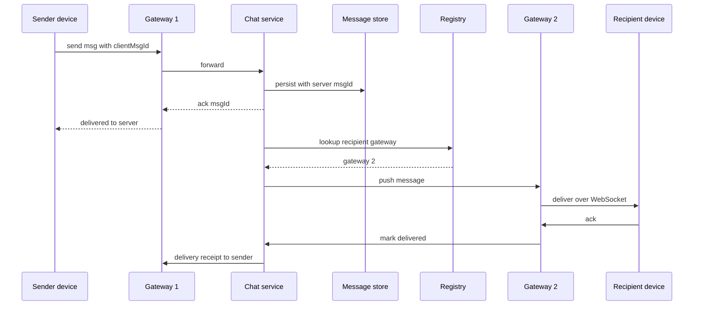

# Design a Chat System

A chat system (WhatsApp, Slack, Messenger) inverts the usual web shape: instead of clients pulling data when they feel like it, the *server* must push a message to a specific phone within a second of another phone sending it. That requires holding millions of long-lived connections, knowing exactly which server holds which user, ordering messages within a conversation, and syncing devices that were offline for a week. It is the canonical interview for stateful real-time infrastructure — the opposite muscle from the stateless request/response systems everywhere else in this vault ([[Stateless vs Stateful Services]]).

## Requirements clarification

**Functional:**

- **1:1 chat** and **group chat** (confirm group size cap — WhatsApp historically low hundreds, ~1,024 as of ~2024; Slack channels reach tens of thousands; the cap drives fan-out design).
- **Delivery states**: sent / delivered / read indicators.
- **Multi-device**: the same account on phone + laptop, both in sync, including messages received while a device was offline.
- **Online presence** (online / last-seen).
- **Push notification** on message to offline users — delegate to [[Design a Notification Service]]; don't rebuild it.
- Ask about media: usually "upload to object storage, send a URL in the message" — one sentence, out of deep scope.

**Non-functional:**

- **Latency**: sender→recipient under ~500 ms when both online; chat feels broken above a second.
- **Scale**: assume 500M DAU (WhatsApp-class; confirm).
- **No message loss, ever** — a chat app that drops messages is dead; prefer duplicate-then-dedup over loss ([[Exactly-Once Delivery Is a Lie]]).
- **Per-conversation ordering**: messages in one chat appear in one agreed order on every device. Global cross-conversation ordering is explicitly NOT required — say this, it kills a whole class of over-design ([[Message Ordering]]).

**Out of scope**: voice/video calls, stories, spam/abuse systems, search.

## Back-of-envelope estimation

Assume **500M DAU × 40 messages sent/day** each:

- **Writes**: 500,000,000 × 40 = 2 × 10¹⁰ messages/day ÷ 86,400 ≈ **231,000 messages/sec** average; × 2.5 peak ≈ **~580,000/sec**. Each delivered message is written once and pushed to ≥1 recipient — a **write-heavy** system, which drives the storage choice.
- **Connections**: 500M DAU, say 1/3 concurrently connected ≈ **~170M open WebSockets**. At ~1M connections per gateway box (achievable with tuned epoll-based servers; WhatsApp famously ran >1M per Erlang server) → **~170–200 gateway servers**. Memory: ~10 KB/connection ≈ 10 GB per box for a million — feasible.
- **Storage**: message row ≈ 100 bytes (ids, sender, 60-byte avg text, timestamps) → 2 × 10¹⁰ × 100 B = **2 TB/day**; 1 year hot retention ≈ **730 TB** → sharded, write-optimized store, compression on.
- **Registry size**: one `userId → gatewayId` entry per online user: 170M × ~50 B ≈ **8.5 GB** — fits a Redis cluster.

## High-level design

Three planes: a **stateful WebSocket gateway fleet** (holds connections, does almost nothing else), a **stateless chat service** (business logic: persist, fan out, states), and **storage** (messages + the connection registry).

- Clients hold one **WebSocket** to a gateway ([[WebSockets Server-Sent Events and Long Polling]] — chosen over SSE/long-polling because chat needs low-latency *bidirectional* push).
- The **connection registry** (Redis) maps `userId → {gatewayId, deviceIds}`, written on connect, removed on disconnect, expiring via TTL + heartbeat refresh so crashed gateways' entries self-clean.
- **Gateways stay dumb** so the stateful tier — the hard tier to scale and drain — changes as rarely as possible; logic lives in the stateless chat service that scales freely.

If the registry lookup finds no entry (recipient offline): store for sync (it's already persisted) and trigger a push notification via the notification service. **Persist before ack** — the sender's single checkmark means "the server owns this message now"; loss after that point is the system's fault and must not happen.

## Deep dives

### 1. Message IDs and per-conversation ordering

Requirements for the ID: unique, and **sortable within a conversation** — every device must render one agreed order, and sync needs "give me everything after X." Options: a per-conversation sequence number (clean semantics — a strict +1 chain per chat, gaps reveal missing messages — but needs an atomic counter per conversation, a write hot spot for huge groups), or **Snowflake-style k-sorted IDs** assigned by the chat service ([[Design a Distributed ID Generator]]) — coordination-free, time-ordered, the common choice; Discord does this. Hybrid (Snowflake ID + the conversation as the sort partition) is the practical answer.

Two honest subtleties: order is fixed by **server arrival, not client send time** (client clocks lie; two messages sent "simultaneously" get the order the service assigned — [[Logical Clocks and Ordering]]); and the sender's own UI shows its message optimistically, re-sorting if the server assigns a different position. Client-generated `clientMsgId` dedups retried sends ([[Idempotency]]).

### 2. Storage — write-heavy, time-ordered, huge

The access pattern: colossal append rate (~580K writes/sec peak), reads almost always "recent messages of conversation C, newest first," old data cooling rapidly. That is the textbook fit for a **wide-column, LSM-based store** ([[Cassandra and Wide-Column Stores]], [[B-Tree vs LSM-Tree]]): partition key `conversationId`, clustering key `messageId DESC` — one conversation's messages live together, sorted, and writes are sequential appends.

Scars to cite from [[Discord Message Storage Evolution]]: Discord outgrew MongoDB (index/working-set pain at billions of messages), moved to Cassandra, then suffered from giant partitions (one busy channel's years of history in one partition) and tombstone-heavy reads, eventually bucketing partitions by time window (`(channelId, bucket)`) and later migrating to ScyllaDB. Takeaway for your design: **partition by conversation AND a time bucket** so no partition grows unbounded ([[Hot Partition Problem]]), and let per-device deletes be cursor-based rather than tombstoning every row.

### 3. Sync protocol — per-device cursors

Multi-device + offline means each *device* (not user) tracks its own position: a **per-device cursor** = the last contiguous messageId it has applied, per conversation (or per-user inbox stream). Reconnect flow: device sends its cursors → server returns everything after them, in order, paginated → device applies, advances cursors, acks. Properties worth naming: **resumable** (sync crashes mid-way restart from the last acked cursor), **idempotent** (re-delivered messages beyond the cursor dedup by messageId), and it doubles as the read-receipt substrate (a second "read" cursor per conversation). This is the same consumer-offset idea as Kafka ([[Message Queues vs Event Logs]]) — one sentence of that comparison lands well. Server retention of undelivered messages is bounded (e.g. WhatsApp historically ~30 days) — state the policy.

### 4. Group fan-out

A message to a 500-member group: persist **once** against the conversation, then fan out *delivery*, not storage — look up online members in the registry, group them by gateway, and send **one batch per gateway** which distributes locally to its connected members (170 gateways means a 500-member group rarely touches more than a few dozen boxes). Offline members get it via their sync cursors + a push notification. Do the fan-out async via a queue for large groups so the sender's ack isn't held hostage by 500 pushes. Contrast with [[Design a News Feed]]: chat fans out **delivery to online devices**, feeds fan out **storage into timelines** — different because chat readers must see the message now, feed readers scroll later. For mega-groups/channels (100K+), per-member delivery pushes collapse into "notify conversation updated; members pull" — the push→pull flip at high fan-out is the same celebrity lesson as [[Twitter Timeline Design]].

### 5. Presence — heartbeat + TTL

Presence is a soft, eventually-consistent fact: client heartbeats every ~30 s over its WebSocket → gateway refreshes `presence:{userId}` in Redis with TTL ~60 s; key expiry = offline, clean disconnect = immediate delete. Crashed gateways need no cleanup — TTLs do it ([[Health Checks and Service Discovery]] uses the same trick). The real cost is **presence fan-out**: telling N friends about every online/offline flap is its own notification storm — mitigate by debouncing flaps, lazily fetching presence when a chat screen opens instead of pushing every change, and only pushing to users actively viewing you. Say explicitly: a user dying with a live TCP socket shows "online" up to one TTL — seconds of staleness is the accepted trade.

### 6. End-to-end encryption — one paragraph

With E2EE (WhatsApp runs the Signal protocol), clients hold the keys and the server relays **ciphertext**. Everything above still works — routing, ordering, cursors, receipts operate on metadata, not content. What the server *can no longer do*: read or search message bodies server-side, filter spam/abuse by content, render previews, or hand plaintext to anyone — and multi-device becomes harder (each device has its own keys; sender encrypts per device, which is why adding a device re-keys sessions). Offering this trade-off unprompted — features and moderation surrendered for the server's inability to betray content — is a strong signal.

## Scaling and failure handling

- **Gateway dies** → ~1M clients drop and reconnect elsewhere. Dangers: the reconnect stampede (mitigate: jittered client backoff, connection-rate limiting at the LB — [[Cache Stampede and Thundering Herd|thundering herd]] logic) and stale registry entries (TTL + heartbeat clean them; meanwhile pushes to the dead gateway fail → message stays persisted, delivery retries after the client re-registers — loss is impossible because persistence precedes delivery).
- **Registry (Redis) degraded** → can't route live pushes; fall back to "persist + push notification + sync on reconnect" — chat degrades from instant to near-instant rather than failing ([[Load Shedding and Graceful Degradation]]).
- **Storage scaling**: shard by `(conversationId, time bucket)`; write volume is the driver — this is where LSM write throughput earns its keep. Replicate per shard; tune consistency (quorum writes, or accept brief read staleness per [[Quorum Reads and Writes]]).
- **Hot conversation** (a 1,024-member group in a frenzy): one partition takes the full write rate — time-bucketing bounds history size, and per-conversation rate limits bound the frenzy.
- **Cross-region**: terminate WebSockets in the user's nearest region; route cross-region messages between chat services over an inter-region bus. Per-conversation ordering survives if one region sequences each conversation (home-region per conversation) — cheaper than global consensus.
- **Deployment**: draining a gateway = ask clients to reconnect gradually before killing the box ([[Graceful Shutdown and Deployment Safety]]); never deploy the whole stateful fleet at once.

## Common mistakes

- **HTTP polling as the transport** — "clients poll every second" fails the latency requirement at 500M DAU arithmetic (500M polls/sec of mostly-empty responses); the interviewer expects WebSockets and a reason.
- **No connection registry** — a design where "the server" pushes to the recipient without explaining *which* of 200 gateways holds that socket hasn't engaged the core problem.
- **Fat gateways** — business logic in the connection tier makes every deploy a mass disconnection event.
- **Ack before persist** — sender sees ✓, gateway crashes, message gone. The single unforgivable data-loss bug in this design.
- **Global message ordering** — importing consensus to totally order *all* messages when the requirement is per-conversation only.
- **Storage fan-out for groups** — writing 500 copies of every group message; chat persists once per conversation.
- **Presence via synchronous "who's online" DB queries** or pushing every flap to every contact — presence must be cheap, TTL-based, and debounced.
- **Hand-waving multi-device** — "the user gets the message" ignores that sync is per *device*; cursors are the expected answer.

## Check yourself

> [!question]- Q: Walk the message flow sender→recipient (both online) in under 60 seconds, naming every component and what would be lost if it vanished.
> Sender's WebSocket → gateway 1 (holds the socket; without gateways, no push channel) → chat service (stateless logic; validates, assigns msgId) → message store (persists before any ack; without it, a crash loses messages) → ack back to sender (single check) → registry lookup userId→gateway (without it, you'd broadcast to 200 gateways per message) → gateway 2 pushes to recipient → recipient acks → delivery receipt to sender (double check). Offline recipient: skip the push, rely on persistence + sync cursor + push notification.

> [!question]- Q: Why per-conversation ordering instead of global ordering, and what does each cost?
> The product requirement is only that one chat reads identically on all devices — conversations are independent, so cross-conversation order is unobservable to users. Per-conversation order needs only a per-conversation sequencer (or k-sorted IDs within the partition): cheap, parallel across conversations. Global order requires every message in the system to pass one sequencing point or consensus round — a throughput ceiling and a latency tax at ~580K msg/sec, purchasing nothing users can see. Scoping ordering to the smallest unit that satisfies the requirement is the general lesson.

> [!question]- Q: A gateway holding 1M connections crashes. Trace what happens to (a) messages in flight to its users, (b) the registry, (c) the reconnecting clients.
> (a) Pushes to that gateway fail, but every message was persisted before delivery — they wait in storage and are delivered via sync once recipients reconnect; nothing is lost, only delayed. (b) Its entries go stale; heartbeat-refreshed TTLs expire them within ~a minute, and each client's reconnect overwrites its own entry sooner. (c) 1M clients reconnect — a stampede; jittered exponential backoff on clients plus LB connection-rate limiting spreads it, and remaining gateways need headroom (the reason you don't run the fleet at 95% connection capacity).

> [!question]- Q: What exactly does a per-device cursor contain, and why is it per device rather than per user?
> It's the last contiguously-applied message position (messageId / sequence) per conversation or per inbox stream, stored server-side per device. Per device because devices diverge: the phone was online all week, the laptop wasn't — "the user's" single cursor would either re-send everything to the phone or skip a week on the laptop. Per-device cursors make sync resumable (restart from last ack), idempotent (dedup by messageId past the cursor), and they generalize to read receipts as a second cursor.

> [!question]- Q: Variant drill — adapt the design for a Slack-like product: large channels (50K members), message history search, and no E2EE. What changes?
> Fan-out: per-member push at 50K members dies — flip to notify-and-pull for big channels (push only to members with the channel open; badge counts via async counters). History: unlimited retention becomes a feature, so storage tiers (hot recent buckets, cold object storage) and the time-bucketed partitioning matter more. Search: without E2EE the server can read content — add an indexing pipeline (messages → queue → search cluster, e.g. inverted index) as a separate read path ([[CQRS]]-shaped). Presence shifts from contacts to channel-viewers. The WebSocket/registry/cursor core survives intact — which is the point of learning it once.

## Sources

- *System Design Interview Vol. 1* (Alex Xu) — chapter "Design a Chat System"; the gateway/registry/sync decomposition follows it.
- [[Discord Message Storage Evolution]] — Discord engineering blog: "How Discord Stores Billions of Messages" (Cassandra, bucketing) and "How Discord Stores Trillions of Messages" (ScyllaDB migration).
- WhatsApp engineering lore — the ~1M+ connections per Erlang server figures (Rick Reed's Erlang Factory talks, 2012/2014); see [[WhatsApp and the Small-Team Scale Story]].
- Signal protocol documentation — the double ratchet and multi-device sessions, for the E2EE paragraph.
- *Designing Data-Intensive Applications* (Kleppmann), ch. 5 and 11 — replication, ordering, and log-offset ideas the sync cursor borrows.
