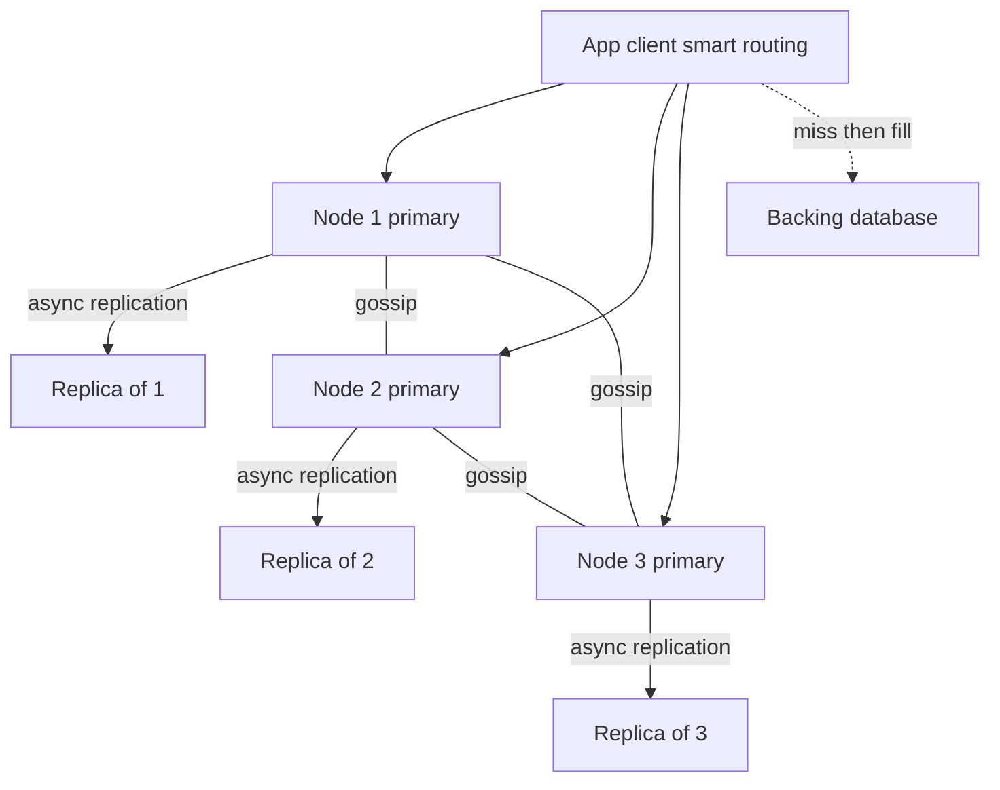

# Design a Distributed Cache

"Design a distributed cache" asks you to build what [[Redis Cluster and Sentinel|Redis Cluster]] already is: a fleet of in-memory nodes that together present one big, fast key-value cache. It is the friendliest of the "build the infrastructure" problems because every sub-problem maps onto a note you already have — [[Consistent Hashing]] for placement, [[Cache Eviction Policies]] for memory, [[Replication]] for failover, gossip for membership. The honest framing to open with: **it's a cache, so the backing database is the source of truth** — that single assumption licenses async replication, approximate eviction, and losing data on failover, and every design choice below cashes in on it. Structure the hour with [[The System Design Interview Framework]].

## Requirements clarification

**Functional**
- API: `get(key)`, `put(key, value, ttl?)`, `delete(key)` — values are opaque bytes (clarify: no rich data structures in v1; that's Redis's moat, not the core design).
- **TTL** per key: entries expire; expired reads return miss.
- Cluster behavior: keys spread across nodes; adding/removing nodes moves a minimal fraction of keys; clients route to the right node without a central lookup.

**Non-functional**
- Latency: sub-millisecond p99 for get/put within a datacenter — the entire reason this tier exists ([[Latency Numbers Every Engineer Should Know]]: ~0.5 ms intra-DC RTT means the network *is* most of the budget; the node's work must be microseconds).
- Scale anchor: say **100M keys, average 1 KB entry → ~100 GB logical**, served at **1M ops/s, ~90% reads**.
- Availability over consistency: it's a cache — stale or lost entries degrade hit rate, not correctness. **This is the licensing assumption; state it and design to it.**
- Elasticity: scale out/in without a full cache wipe (naive mod-N rehashing wipes ~everything — the motivating failure of [[Consistent Hashing]]).

## Back-of-envelope estimation

- Memory: 100M × 1 KB = **100 GB** data + per-entry overhead (pointers, expiry, LRU metadata ≈ 50–100 B/key → ~5–10 GB) ≈ **~110 GB**. On 32 GB-usable nodes → **4 nodes minimum; take 6–8** for headroom (memory pressure near 100% means eviction storms, and failover headroom must absorb a dead node's keyspace).
- Throughput: 1M ops/s ÷ 8 nodes = **125K ops/s per node** — comfortable for an in-memory single-threaded event loop (Redis-class nodes sustain 100K+ ops/s; [[Redis Internals]]). Network: 1M ops/s × ~1 KB ≈ **1 GB/s ≈ 8 Gbps aggregate**, ~1 Gbps per node — fine on 10 GbE, worth checking aloud.
- Replication doubles memory to **~220 GB** for one replica per shard (16 nodes, or bigger nodes) — replicas serve failover, not capacity, under primary-reads; name the cost.
- Hit-rate arithmetic that justifies the whole tier ([[Why Caching Works]]): at 90% hit rate, 1M ops/s sends 100K/s to the database; losing one of 8 shards un-cached ≈ 12.5% of keyspace → **+125K/s of DB load until re-warmed** — this number is why failover and warm replicas matter in a *cache*.

## High-level design

- **Nodes**: in-memory hash table + TTL index + LRU machinery; single-threaded event loop per node for lock-free simplicity ([[Redis Internals]] — the same reasoning as [[Design a Stock Exchange]]'s engine at smaller stakes: memory-speed work gains nothing from threads fighting over locks).
- **Placement**: [[Consistent Hashing]] ring with virtual nodes maps key → primary node.
- **Replication**: each primary streams writes asynchronously to its replica(s) ([[Replication]] — leader-based, async by deliberate choice).
- **Smart clients**: the routing logic lives in the client library — no proxy hop on the hot path.
- **Membership**: nodes gossip liveness and ring configuration among themselves; failover promotes replicas by quorum agreement.
- **Cache-aside contract**: on miss, the *application* reads the DB and `put`s the result ([[Caching Strategies]]) — the cache never talks to the DB itself, which keeps it generic and keeps correctness ownership with the app.

## Deep dives

### 1. Key → node: consistent hashing with virtual nodes

Everything from [[Consistent Hashing]] applies verbatim — this is that note deployed:

- Naive `hash(key) mod N` remaps ~N/(N+1) of all keys when N grows to N+1 — a cluster-wide cache wipe per scaling event, and the +125K/s DB-load math above, multiplied by every shard at once ([[Cache Stampede and Thundering Herd]] by your own hand).
- The **ring**: hash nodes and keys into the same space; a key belongs to the first node clockwise. Adding a node steals only ~1/N of the keyspace — the rest of the cluster is untouched.
- **Virtual nodes** (each physical node appears at ~100–500 ring positions): smooths the variance of random placement (few physical nodes = wildly unequal arcs), spreads a dead node's load across *all* survivors instead of dumping it on one clockwise neighbor, and lets heterogeneous hardware take proportional vnode counts. Redis Cluster achieves the same ends with 16,384 fixed **hash slots** instead of a ring — slots are explicit and make manual rebalancing/migration first-class ([[Redis Cluster and Sentinel]]); mention both and note they solve the identical placement problem.
- Rebalancing on scale-out: the new node's slots/arcs migrate key-by-key in the background ([[Rebalancing Partitions]]); during migration both nodes answer with redirects for in-flight keys (Redis's ASK/MOVED mechanic is the production reference). For a pure cache there's a lazy alternative — let stolen ranges simply miss-and-refill — trading a temporary hit-rate dip for zero migration machinery; name the trade.

### 2. Replication per shard — async, and what that admits

- Each shard = 1 primary + 1 (maybe 2) replicas. Writes go to the primary, which acks the client **immediately** and streams the write to replicas in the background — **asynchronous** [[Replication]].
- Why async is *correct here* and not a cop-out: synchronous replication puts a network round trip plus the replica's apply inside every write's latency — doubling sub-ms latency for data that is, by contract, reconstructible from the DB. The cache's licensing assumption pays precisely here.
- **What async admits — say it unprompted**: on primary failure, writes acked but not yet streamed are **gone**; the promoted replica serves slightly stale data and *misses* for the lost tail. Consequences: a read after failover may return an older value (apps needing read-your-writes must not get it from a cache — [[Read Your Own Writes and Replica Lag Anomalies]]); a lost `delete` is nastier than a lost `put` (a stale entry *resurrects* until TTL kills it — one more reason every entry should carry a TTL even when "immortal").
- Replica reads: default **primary-only** (replicas exist for failover; reading them adds a staleness source for marginal capacity). Offering stale-tolerant replica reads for hot read scaling is a legitimate labeled option.

### 3. Eviction and TTL: LRU per node

Memory is the budget; eviction is how a cache says no ([[Cache Eviction Policies]] deployed):

- Each node enforces `maxmemory`; at the limit, writes trigger eviction of the least-valuable entries. **LRU** is the default policy (recency predicts re-access for most workloads); LFU where frequency beats recency (steady scans polluting recency — name it as the alternative).
- **Approximate LRU, not exact** — Redis's actual trick: exact LRU needs a doubly-linked list touched on *every read* (pointer churn, cache-line invalidation, and in a multi-threaded design a global lock — on the hot read path). Instead: store a last-access clock per entry, evict by sampling k random entries (k≈5) and dropping the oldest — statistically close to LRU at a fraction of the cost. This is the classic "approximate beats exact when the contract is best-effort" lesson, and it only flies because eviction correctness is *advisory* — the licensing assumption again.
- **TTL expiry, two mechanisms** (Redis's model): **lazy** (a read finding an expired entry deletes it and reports miss — expiry costs nothing until touched) + **active** (periodic sampling of the TTL index evicts expired entries that nobody reads, else they'd squat until eviction pressure). Expired-but-unsampled entries still counting toward memory is a real operational subtlety worth voicing.
- Eviction interacts with replication: evictions/expiries on the primary propagate as deletes to replicas — replicas never decide expiry independently (clock skew would desynchronize the pair).

### 4. Routing: client-side vs proxy vs gossip-aware smart clients

Three ways a `get` finds its node — a genuine trade-off table:

| Approach | Hot-path cost | Upgrade/ops burden | Who tracks the cluster |
|---|---|---|---|
| **Proxy tier** (Twemproxy/Envoy-style) | +1 network hop (~0.5 ms — doubles latency) | centralised, easy — apps stay dumb | the proxy |
| **Dumb client + redirects** | occasional extra hop on topology change | minimal | nodes redirect (MOVED-style), client caches slot map lazily |
| **Smart client** | zero extra hops | routing logic in every app's library, every language | client subscribes to topology (seeded from nodes, updated on gossip-driven change notifications or redirects) |

- Sub-ms latency targets make the proxy's extra hop expensive — **smart clients win the hot path**, which is why Redis Cluster chose client-side slot maps with MOVED/ASK redirects as the self-healing mechanism: a client with a stale map is *corrected by the data path itself*, no control-plane round trip.
- The honest cost: a smart client is a distributed-systems library you now maintain per language, and client bugs become cluster incidents. Proxy tiers remain the right answer when you can't control clients (multi-tenant platform teams) — centralization as a deliberate ops trade.

### 5. Hot keys

One celebrity key can saturate a single primary while seven nodes idle — [[Hot Key Problem]], applied:

- **Detect**: per-node top-k key sampling (count-min sketch / hotness counters), alert on skew — you can't fix what you can't see.
- **Local L1**: a small in-process cache in the client (ms-scale TTL, e.g. 100 ms–1 s) absorbs the overwhelming majority of reads for white-hot keys at the cost of bounded extra staleness — the single cheapest fix, and it composes with everything else.
- **Key replication**: write hot key copies as `key#1…key#n` (or to r replicas); readers pick a random suffix — fanning one key's load across n nodes. Writes now fan out ×n and copies can briefly diverge — fine under the cache contract, enumerate it anyway.
- The adjacent failure: **stampede on a hot key's expiry** — thousands of concurrent misses all hit the DB and all try to refill ([[Cache Stampede and Thundering Herd]]). Standard kit: jittered TTLs, request coalescing (one flight refills, rest wait), and probabilistic early refresh for the hottest entries. A distributed-cache design that never mentions stampedes is incomplete.

### 6. Membership, failure detection, and failover

No central coordinator — the nodes govern themselves ([[Redis Cluster and Sentinel]]'s cluster bus, generalized):

- **Gossip**: every node periodically pings a few random peers with its view (node list, liveness verdicts, ring/slot version). Information spreads epidemically in O(log N) rounds; no single point of failure, constant per-node traffic ([[The Dynamo Paper]] uses the same mechanism for the same reason).
- **Failure detection in two stages** (crucial subtlety): one node missing heartbeats marks a peer *suspected* (PFAIL) — but one observer can be partitioned themselves, so suspicion only escalates to *confirmed failed* (FAIL) when **a majority of primaries** report it. This quorum stops a minority partition from declaring the majority dead.
- **Quorum promotion**: on confirmed primary failure, its replica requests promotion votes from a **majority of primaries**; winning the vote, it takes over the slot range and the new topology gossips outward (clients learn via redirects/notifications). Majority voting prevents **split-brain** — two primaries for one shard accepting divergent writes ([[Split Brain and Fencing]], [[Failover]]); epoch/config version numbers fence the loser: nodes and clients reject messages stamped with a stale epoch.
- Minority-partition behavior: nodes that can't see a majority stop serving (fail closed) rather than serving an un-promotable, possibly stale shard — availability sacrificed for not forking the cache, the same [[CAP Theorem]] stance Redis Cluster takes.

### Where each module note plugs in

| Piece of this design | The note that taught it |
|---|---|
| Ring placement, virtual nodes, minimal remap | [[Consistent Hashing]] |
| Why mod-N rehash is a wipe; shard keys | [[Sharding]] |
| Moving slots without downtime | [[Rebalancing Partitions]] |
| Async primary→replica streams, what they lose | [[Replication]] |
| Promotion votes, split-brain, epochs | [[Failover]], [[Split Brain and Fencing]], [[Quorum Reads and Writes]] |
| LRU/LFU/TTL and approximated LRU | [[Cache Eviction Policies]] |
| Cache-aside contract with the DB | [[Caching Strategies]] |
| Hit-rate math, skew, why the tier exists | [[Why Caching Works]] |
| Expiry stampedes and coalescing | [[Cache Stampede and Thundering Herd]] |
| Hot key detection and splitting | [[Hot Key Problem]] |
| Single-threaded node engine, slots, gossip bus | [[Redis Internals]], [[Redis Cluster and Sentinel]] |
| Gossip + hinted-handoff lineage | [[The Dynamo Paper]] |

## Scaling and failure handling

- **Scale out**: add node → it announces via gossip → slots/arcs rebalance gradually → clients learn by redirect. Hit rate dips on moved ranges and recovers as they re-fill; schedule rebalances off-peak and rate-limit migration.
- **Node death**: suspicion → quorum FAIL → replica promotion (seconds). Lost: the un-replicated write tail and (if no replica existed) the shard's warm data — the +125K/s DB-load number from estimation is the blast radius; replicas exist to cap it. The DB behind the cache must survive brief cache-miss storms — [[Load Shedding and Graceful Degradation]] on the DB path is part of *this* design's safety case.
- **Network partition**: majority side operates; minority fails closed. Clients partitioned with the minority see errors/timeouts and fall through to the DB — degraded latency, preserved correctness.
- **Cold start / mass restart**: an empty cluster at full traffic is a DB stampede — warm-up strategies (replay recent key logs, gradual traffic ramp, coalesced refill) belong in the runbook, not improvisation.
- **At 1 replica per shard and small clusters, be honest**: a double failure (primary + its replica) means that keyspace is simply gone until refilled; quorum promotion needs a majority of primaries alive. This mirrors the 1-replica honesty your own stack lives with — resilience features protect against *single* faults; name what a second simultaneous fault costs.

## Common mistakes

- `hash(key) mod N` placement — the first scaling event wipes the cache; this is the canonical [[Consistent Hashing]] motivation and interviewers listen for it.
- Synchronous replication or quorum writes "for safety" in a cache — paying durability costs for data whose source of truth is the DB; the design's one licensing assumption, unused.
- Exact LRU with a global lock on the read path — the approximate-sampling answer is the production answer.
- No TTL on "immortal" keys — delete-loss resurrection and unbounded staleness have no backstop.
- Forgetting the client is part of the system: routing, L1, coalescing, and redirect handling all live there; "the client just calls the cluster" hides a quarter of the design.
- No stampede story for hot-key expiry; no detection story for hot keys at all.
- Single-observer failure detection (one missed ping → failover) — partition-triggered split-brain; the PFAIL→quorum-FAIL two-stage exists for exactly this.
- Sizing memory to 100% of data with zero headroom — eviction storms at steady state, nowhere to absorb a failed peer's load.

## Check yourself

> [!question]- Q: Explain to a new engineer why this cache replicates asynchronously, while the database behind it replicates synchronously — same company, same data, opposite choices.
> The difference is the source-of-truth contract. The DB is the system of record: an acked write that later vanishes is data loss, so it pays latency for synchronous majority commit. The cache holds *reconstructible copies*: its worst failure (lost tail, stale read, cold shard) costs extra DB reads and brief staleness, not truth — so paying a replication round trip on every sub-ms write buys almost nothing. One assumption — "the DB is the truth" — flips the correct answer for replication, eviction exactness, and failover data loss all at once. Corollary: anything *not* reconstructible (sessions used as the only session store, counters, locks) silently breaks the contract, and that misuse — not the cache's design — is where such systems get burned.

> [!question]- Q: A primary acks a `delete(key)` and dies before streaming it to its replica. Walk through what the application observes over the next hour, and the mitigation.
> The replica promotes with the key still present at its pre-delete value. The app — which deleted the key because the underlying row changed or vanished — now reads a **resurrected stale entry** and may serve wrong data (worse than a miss: it's confidently wrong). This persists until the entry's TTL fires, the key is overwritten by a fresh fill, or eviction removes it. Mitigations: mandatory TTLs bound the damage window (the backstop); delete-then-verify or versioned values (compare a version stamp against the DB on sensitive reads) close it further; and genuinely delete-sensitive data shouldn't rely on cache deletes as its only invalidation path ([[Cache Invalidation]] — event-driven invalidation can re-send deletes after failover).

> [!question]- Q: Your cluster's p99 latency doubles but only on one node, and that node's CPU is flat. Give a hot-key-shaped diagnosis path.
> Flat CPU with rising p99 on one node suggests saturation elsewhere: check the node's **network throughput** first — a hot *large* key (say a 100 KB value at 50K reads/s = 5 GB/s = 40 Gbps) saturates the NIC long before CPU; top-k sampling with value sizes confirms. If network is clean, check for a few giant values causing event-loop stalls (a single-threaded node serializes a multi-MB response inline — one fat key adds queueing delay to every request behind it). Fixes by cause: hot-large-key → client L1 + key replication to spread reads; fat-value stalls → split/compress the value or cap value sizes at the API. The general lesson: in single-threaded memory-speed nodes, tail latency is usually one key's shape, not aggregate load.

> [!question]- Q: Design the variant — the same cluster, but as the *primary* store for session data with no database behind it.
> The licensing assumption is revoked, and the design must change where it had cashed it in: replication per shard becomes synchronous (or quorum-acked — [[Quorum Reads and Writes]]) because a lost session is now data loss, accepting the write-latency hit; eviction can no longer silently drop entries — memory pressure must reject writes (fail closed) or spill to disk instead of evicting live sessions; failover must prefer consistency (don't promote a replica known to be behind without surfacing it); TTLs become the actual session-expiry semantics (product behavior, not hygiene); and persistence (snapshot + append log, as [[Redis Internals]] describes RDB/AOF) enters so a full-cluster restart isn't a mass logout. What you've built, step by step, is no longer a cache — it's a small AP-leaning key-value store, which is exactly why [[Design a Key-Value Store]] is a different note.

## Sources

- Redis Cluster specification and Redis documentation (cluster bus, gossip, MOVED/ASK, approximated LRU, maxmemory policies) — the production system this design mirrors.
- Alex Xu, *System Design Interview Vol. 1*, chapters "Design Consistent Hashing" and "Design a Key-Value Store" — the placement and replication building blocks (neither volume has a dedicated distributed-cache chapter).
- Karger et al., "Consistent Hashing and Random Trees" (1997) — the original ring paper behind [[Consistent Hashing]].
- DeCandia et al., "Dynamo: Amazon's Highly Available Key-Value Store" (SOSP 2007) — gossip membership and the AP design stance; see [[The Dynamo Paper]].
- *Designing Data-Intensive Applications* (Kleppmann), ch. 5–6 — replication modes and partitioning foundations.
