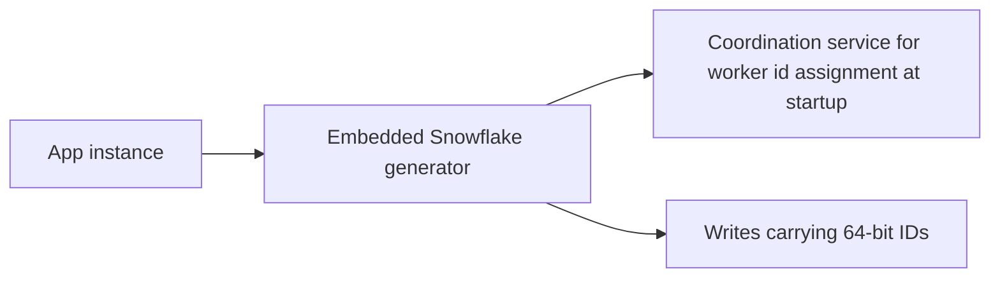

# Design a Distributed ID Generator

Every system that writes data needs unique identifiers, and the moment writes happen on more than one machine, "just use the database's auto-increment" stops working. This problem asks you to mint unique IDs across hundreds of nodes, at millions per second, with no coordination on the hot path — and, crucially, IDs that **sort by creation time**. It is a favorite interview because it is small, has one famous canonical answer (Twitter's Snowflake), and rewards candidates who notice that the *sortability requirement drives the entire design*.

## Requirements clarification

**Functional:**

- Generate **globally unique** 64-bit numeric IDs (confirm size — 64 bits fits a `BIGINT`, a CPU register, and existing schemas; 128 bits is the fallback if uniqueness must be coordination-free forever).
- IDs are **roughly sortable by generation time** — ask *why* the requirement exists: "do you need ordering for pagination/merging, or just uniqueness?" If only uniqueness, the problem collapses to UUIDs and you just saved 30 minutes. Interviewers want you to notice this fork.
- Numeric only (confirm) — some consumers (URLs, JS clients) care about encoding; JavaScript's largest safe integer is 2⁵³ − 1, which is a real reason APIs return IDs as strings.

**Non-functional:**

- **Scale**: tens of thousands of IDs/sec per node, across hundreds of nodes (the classic layout below caps at 1,024 generators).
- **Latency**: generation must be local and sub-millisecond — **no network call per ID**.
- **High availability**: ID generation is upstream of *every write* in the company; if it blocks, everything blocks.
- **No duplicates, ever** — a duplicate ID is silent data corruption (two tweets, one ID). Fail closed: refuse to generate rather than risk a dupe.

**Out of scope**: human-friendly/short codes (that's [[Design a URL Shortener]]'s key problem), cryptographic unguessability.

## Back-of-envelope estimation

Assume Twitter-scale writes: **10,000 new objects/sec** average across the fleet, 3x peak = 30,000 IDs/sec.

- **Per-node load**: with even 10 generator-bearing nodes, 3,000 IDs/sec/node — trivial for an in-memory counter. The constraint is never throughput; it is **uniqueness without coordination**.
- **Capacity of a 41-bit millisecond timestamp**: 2⁴¹ ms = 2.199 × 10¹² ms ≈ 2.199 × 10⁹ s ≈ **69.7 years** from the chosen custom epoch. Show the division: 2⁴¹ ÷ 1000 ÷ 86,400 ÷ 365 ≈ 69.7.
- **Per-node rate ceiling**: a 12-bit sequence = 2¹² = **4,096 IDs per millisecond per worker** ≈ 4.1M IDs/sec/worker — three orders of magnitude above our need; 1,024 workers (10 bits) × 4,096 = ~4.2 **billion** IDs/sec fleet-wide ceiling.
- **Storage effect**: 64-bit IDs = 8 bytes vs UUID's 16 bytes (36 as text). At 10B rows, the ID column alone is 80 GB vs 160 GB — *before* counting its repetition in every index and foreign key, where the difference multiplies.

## High-level design

First, kill the two naive answers — the interview expects this demolition explicitly:

**Why not database auto-increment?** It's a per-node counter: one database is a single point of failure and a write bottleneck for the entire company; and it **doesn't shard** — two shards both issue "1001". Workarounds (per-shard offsets: server A odd, server B even — Flickr really did this) work but make adding servers painful and leak topology into IDs. Auto-increment also exposes business volume (competitors can watch your order IDs climb) — worth one sentence.

**Why not UUIDv4?** Uniqueness is solved (122 random bits; collision odds negligible), coordination-free, available forever. Two real costs: **size** (16 bytes, doubling every index entry and FK), and — the killer — **no time ordering**: v4 is pure randomness, so consecutive inserts land at *random positions* in a B-tree primary index. Instead of appending to the rightmost page (the hot, in-cache page), every insert hits a random page → constant **page splits**, cold-page reads, bloated write amplification, and a buffer pool that can't keep the working set ([[Database Indexes]], [[How Databases Store Data]]). InnoDB clusters rows by primary key, so random PKs scatter the *table itself*. Random IDs also can't be used for time-range scans or cursor pagination.

So the requirement set — unique, coordination-free, 64-bit, time-sorted — points at **Snowflake** (Twitter, 2010):

```
 1 bit    41 bits                    5 bits       5 bits      12 bits
+------+---------------------------+------------+-----------+--------------+
| sign | timestamp ms since epoch  | datacenter | worker id  |  sequence    |
|  0   | 69.7 years of range       |  0..31     |  0..31     |  0..4095/ms  |
+------+---------------------------+------------+-----------+--------------+
         most significant bits  ———————————————————————→  least significant
```

- **Sign bit** stays 0 (keeps the ID positive in signed `BIGINT`s).
- **41-bit timestamp**: milliseconds since a **custom epoch** (e.g. the service's launch date — not 1970, which would waste decades of range).
- **5 + 5 bits** of datacenter and worker ID: 32 × 32 = **1,024 distinct generators** — uniqueness across space.
- **12-bit sequence**: a counter reset every millisecond — uniqueness within one worker-millisecond; if it overflows (4,096 in one ms), spin-wait for the next millisecond.

Because the timestamp occupies the high bits, **numeric order ≈ time order** (k-sorted: ordering is exact across milliseconds, arbitrary within one). Generation is pure local arithmetic: read clock, compare, increment, bit-shift, OR — no I/O, nanoseconds of work.



The only coordination is **worker-ID assignment at startup** (ZooKeeper/etcd lease, or derived from the pod's stable identity) — once per process lifetime, never per ID.

## Deep dives

### 1. The clock-backwards problem

Snowflake's uniqueness *within one worker* rests entirely on "time moves forward." Real clocks don't promise that: **NTP corrections step clocks backward**, VM migrations and un-smeared leap seconds (a repeated second) shift them. If the clock jumps back 50 ms, the generator may re-enter a worker-millisecond it already used — and with the sequence reset, **re-issue identical IDs**. Silent duplicates: the worst failure available.

Handling, in the order to present:

1. **Detect**: keep `lastTimestamp` in memory; `now < lastTimestamp` means the clock went back.
2. **Tiny regression (a few ms)**: **wait it out** — spin/sleep until `now > lastTimestamp`. Generation pauses briefly; no dupes. (Alternative: keep issuing on `lastTimestamp` by continuing the sequence until it's exhausted — buys time without blocking.)
3. **Large regression**: **refuse to generate** — error out, alert, let the instance's traffic fail over. Fail closed: unavailability is visible and recoverable; duplicate IDs are invisible and forever.
4. **Prevent**: run NTP in **slew mode** (gradual rate adjustment, never stepping backward), and never reuse a worker ID immediately after a crash-restart without either persisted `lastTimestamp` or a fresh worker ID — a restarted node with a slow clock is the same bug in disguise.

Bonus point: note that this is physical-clock fragility in general, the same reason distributed systems reach for [[Logical Clocks and Ordering|logical clocks]] and why Spanner built TrueTime ([[Google Spanner Deep Dive]]).

### 2. Alternatives and when they beat Snowflake

- **DB segment / ticket servers (Flickr)**: a tiny MySQL "ticket" table dispenses blocks — or in the **segment** variant, services lease *ranges* (e.g. IDs 1M–2M) from a central allocator and serve them from memory, fetching the next range before exhaustion. Flickr ran two ticket servers (odd/even) and round-robined between them for load spreading and availability. Pros: dead simple, strictly increasing-ish, no clock dependency. Cons: central service to operate; IDs leak volume; ordering across services is coarse (range-grained, not time-grained). Right answer when you need *numeric* IDs but only weak ordering.
- **UUIDv7** (RFC 9562, 2024): 128-bit UUID with a 48-bit Unix-millisecond timestamp in the high bits + random tail — i.e. "Snowflake's idea, standardized, no worker-ID ceremony." Time-sorted, index-friendly, zero coordination (no worker registration, negligible clock-back dupe risk because ~74 bits of the tail are random). Cost: 16 bytes, and only k-sorted. Increasingly the *practical* default when 64 bits isn't mandatory — saying "today I'd reach for UUIDv7 unless 64-bit is a hard constraint" is a current-knowledge signal. (ULID is the same shape, older, base32-encoded.)
- **Multi-ID-per-call RPC service** (Snowflake as a *service* rather than a library): centralizes clock discipline and worker IDs; clients fetch batches to amortize the network hop. Trades a hop for operational control.

| Option | Bits | Sorted by time | Coordination | Clock-sensitive | Pick when |
|---|---|---|---|---|---|
| Auto-increment | 64 | strictly | every write | no | single DB, no shards |
| UUIDv4 | 128 | no | none | no | uniqueness only, no DB-index pressure |
| Snowflake | 64 | k-sorted | worker ID at startup | **yes** | 64-bit + time-sorted at scale |
| Ticket/segment server | 64 | coarse | per range lease | no | simple numeric IDs, modest ordering |
| UUIDv7 | 128 | k-sorted | none | duplicates negligible; ordering only | 128 bits acceptable — the modern default |

### 3. Sortability drives everything — say it explicitly

Why do the high bits hold a timestamp? Because downstream systems *consume* the ordering: **cursor pagination** ("give me messages after ID X") needs IDs that order like time; **merging per-shard streams** into one timeline sorts by ID; **B-tree append locality** keeps inserts on the hot rightmost page; even [[Sharding]] interacts — Discord and Instagram both built on Snowflake-style IDs partly for these reasons ([[Discord Message Storage Evolution]]). Remove the sortability requirement and the correct design is UUIDv4 and this interview is over in five minutes. State that dependency in the first ten minutes and you've demonstrated the top-level skill: *requirements drive structure*.

Also name the limit honestly: k-sorted means IDs within the same millisecond carry no order, and clock skew *between* workers means cross-worker order is approximate at ms granularity. If the requirement is a **strict total order**, no decentralized generator delivers it — you need a single sequencer or consensus ([[Consensus and Raft]]), at a steep throughput cost. Distinguishing "sortable enough for pagination" from "total order" is the senior move.

## Scaling and failure handling

- **Throughput scaling is free**: generators are embedded libraries; more pods = more worker IDs, up to 1,024. Beyond that, rebalance the bit budget (fewer datacenter bits, more worker bits) — the layout is a *policy*, not a law.
- **Worker-ID assignment** must guarantee no two live processes share an ID: lease-based (ZooKeeper/etcd ephemeral nodes with TTL) or derived from stable infrastructure identity (StatefulSet ordinal). The failure to avoid: a network-partitioned node whose lease expired keeps generating while its ID is reassigned — leases must be honored by *stopping generation* on expiry ([[Split Brain and Fencing]]).
- **Restart safety**: persist `lastTimestamp` periodically, or make restarts take a fresh worker ID; otherwise crash + slow clock = reuse.
- **Epoch exhaustion**: 69.7 years from custom epoch — a real but distant cliff; document the epoch constant, don't bury it.
- **Monitoring**: alert on clock-regression events, sequence-overflow spin-waits (means a hot worker), and worker-ID lease churn. These are the three observable precursors to the two real failure modes (dupes, stalls).

## Common mistakes

- **Reciting the bit layout without the why** — the layout is trivia; *timestamp-in-high-bits ⇒ sortable ⇒ pagination/merging/B-tree locality* is the understanding being graded.
- **Dismissing UUIDs with "they're not unique enough."** Wrong axis: v4's problem is size and randomness (index locality, no ordering), not collision probability.
- **No clock-backwards answer.** This is *the* follow-up. "Clocks are monotonic" is false; `System.currentTimeMillis()` is not monotonic even when the JVM's `nanoTime` is.
- **Putting a network call on the per-ID path** — a central "ID API" called per write re-creates the single bottleneck the design exists to remove; batching is the minimum fix.
- **Claiming strict global ordering** from Snowflake IDs — they are k-sorted; same-millisecond and cross-worker order is approximate.
- **Not knowing UUIDv7 exists** — as of ~2024 it's standardized and widely supported; proposing hand-rolled Snowflake where UUIDv7 suffices is yesterday's answer.

## Check yourself

> [!question]- Q: Explain in 60 seconds why UUIDv4 primary keys hurt a B-tree-backed database at scale.
> UUIDv4 is 16 random bytes. Random key values mean each insert lands at a uniformly random position in the primary index instead of appending to the rightmost page, so the B-tree constantly splits cold pages; the working set becomes the whole index, blowing the buffer pool; and in clustered storage like InnoDB the table rows themselves scatter. Plus every index entry and foreign key pays 16 bytes instead of 8. The fix is time-ordered high bits — Snowflake or UUIDv7 — which restores append-like locality.

> [!question]- Q: What happens, step by step, if a Snowflake worker's clock steps back 30 ms — and what does the generator do?
> The generator reads now, compares to lastTimestamp, and sees now < lastTimestamp — detection. If it ignored this and continued, it would re-enter already-used worker-milliseconds with a reset sequence and emit duplicate IDs — silent corruption. Correct behavior for 30 ms: pause generation (spin or sleep) until the clock passes lastTimestamp, then resume; for large regressions, refuse to generate and alert, failing closed. Prevention: NTP slew mode, and never reusing a worker ID after restart without persisted lastTimestamp.

> [!question]- Q: Show the math: how long does a 41-bit millisecond timestamp last, and how many IDs can one worker mint per second?
> Range: 2⁴¹ = 2,199,023,255,552 ms; ÷1000 ≈ 2.199 × 10⁹ s; ÷86,400 ≈ 25,451 days; ÷365 ≈ 69.7 years from the custom epoch. Per-worker rate: 12 sequence bits = 4,096 IDs per millisecond = 4,096 × 1,000 ≈ 4.1 million IDs/sec. Fleet ceiling: 1,024 workers × 4.1M ≈ 4.2 billion IDs/sec.

> [!question]- Q: The interviewer says "we only need uniqueness — ordering doesn't matter." How does your design change?
> The problem collapses: UUIDv4 (or random 128-bit values) generated locally with no worker IDs, no clock dependency, no coordination service, and no clock-backwards failure mode. The only remaining concerns are the 16-byte storage/index cost and, if the DB clusters by primary key, insert locality — which argues for keeping the random ID as a secondary unique column with a surrogate internal key, or accepting the cost. Recognizing that sortability was the load-bearing requirement is the point of the question.

> [!question]- Q: Variant drill — design ID generation for a system that must expose IDs to JavaScript clients and paginate by them.
> Two constraints collide: JS numbers are safe only to 2⁵³, so a 64-bit ID sent as a JSON number silently loses precision — serialize IDs as strings in APIs (what Twitter's API does: id plus id_str). Pagination needs k-sorted IDs, so keep Snowflake/UUIDv7 time-ordering and implement cursors as "after this ID". If IDs are user-visible, consider that timestamp bits leak creation time and sequence bits leak volume — acceptable for most products, but worth one sentence of acknowledgment.

## Sources

- Twitter engineering blog — "Announcing Snowflake" (2010): the original 64-bit layout and motivation (k-sorted IDs for tweets).
- *System Design Interview Vol. 1* (Alex Xu) — chapter "Design a Unique ID Generator in Distributed Systems".
- Flickr engineering blog — "Ticket Servers: Distributed Unique Primary Keys on the Cheap" (the odd/even MySQL ticket-server design).
- RFC 9562 (2024) — UUID formats, defining UUIDv7's millisecond-timestamp layout.
- Instagram engineering — "Sharding & IDs at Instagram" (Snowflake-style IDs generated inside Postgres per shard).
