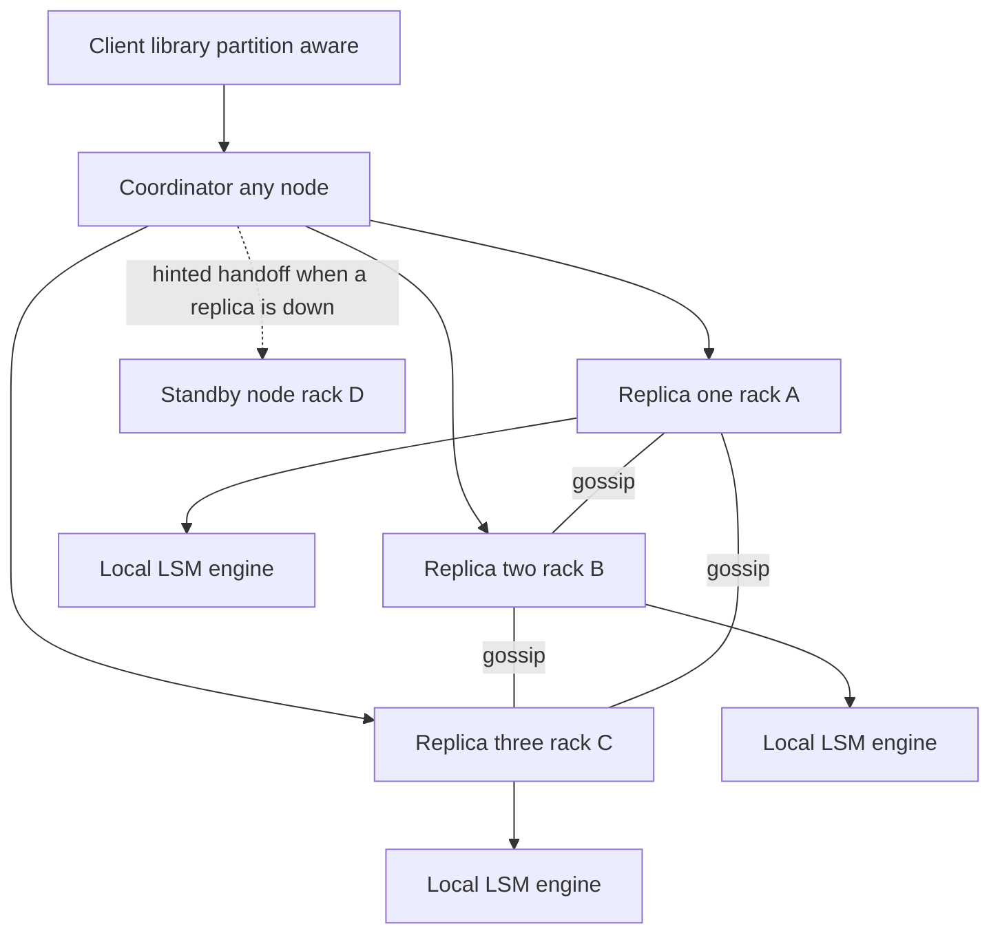
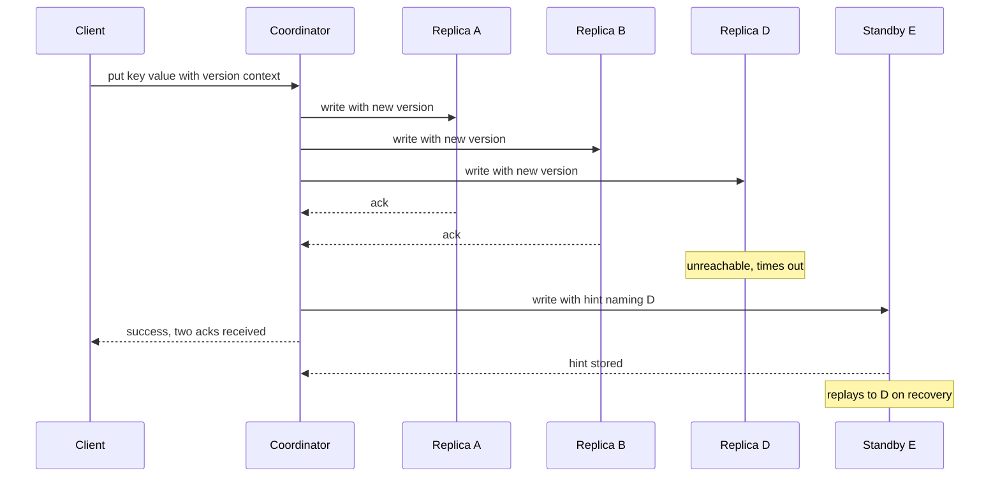

# Design a Key-Value Store

[[Design a Distributed Cache]] ended by revoking its one licensing assumption — "the database behind it is the truth" — and observed that what remained was no longer a cache but a small AP-leaning key-value store. This note is that store, built properly. It is the vault's capstone because almost nothing here is new: it is [[Consistent Hashing]] for placement, [[Replication]] for durability, [[Quorum Reads and Writes]] for the consistency dial, [[Logical Clocks and Ordering]] for conflicts, [[B-Tree vs LSM-Tree]] for the engine, and gossip for membership — assembled into one system whose shape was published by Amazon in 2007 as [[The Dynamo Paper]]. If you can build this, you have the whole curriculum; structure the hour with [[The System Design Interview Framework]].

## Requirements clarification

**Functional**
- `get(key)` and `put(key, value)` on opaque byte values. `delete(key)` as a third primitive (it is not free — see the storage dive).
- **Single-key operations only.** No multi-key transactions, no range scans, no secondary indexes, no joins. Say this out loud and get it agreed: it is the constraint that makes every later decision tractable ([[Two-Phase Commit and Distributed Transactions]] is what you avoid; [[Secondary Indexes on Sharded Data]] is the other door you close).
- Consistency is **tunable per operation**: a caller chooses how many replicas must answer, trading latency and availability against staleness.

**Non-functional**
- **High availability for writes above all.** The motivating workload in [[The Dynamo Paper]] is Amazon's shopping cart: an "add to cart" must not be rejected because a disk failed or a network route flapped. That requirement — always writeable — is what forces an AP design ([[CAP Theorem]]) and pushes conflict resolution onto reads.
- Horizontal scale: adding a node adds capacity and throughput, and moves only its fair share of data ([[Rebalancing Partitions]]).
- **Tail latency is the SLO, not the average.** Dynamo's published service-level target was a response within 300 ms for 99.9% of requests at a peak load of 500 requests per second (2007 figures, for one internal service). The lesson generalizes: in a system where every request fans out to several machines, the mean hides the experience of the slowest fan-out. State your SLO in p99.9.
- Durability: an acknowledged write must survive single-node loss, so no write is acknowledged from one replica by default.
- Decentralized: no leader, no coordinator service, no configuration store. Every node runs the same code and knows the same things, eventually ([[Stateless vs Stateful Services]] inverted — these nodes are deliberately stateful, but symmetric).

## Back-of-envelope estimation

Anchor numbers (announce them as assumptions, not facts): **10 billion keys, ~1 KB average value, 500K ops/s at peak, 80% reads**.

- **Logical data**: 10e9 × 1 KB = **10 TB**. With replication factor N = 3 → **30 TB** stored. LSM engines carry space amplification from un-compacted overlapping files plus index and bloom-filter metadata; budget roughly ×1.3 → **~39 TB, call it 40 TB**.
- **Nodes**: on 4 TB usable NVMe per node, 40 TB / 4 TB = 10 nodes minimum. Take **16**: compaction needs free scratch space, and when a node dies the survivors absorb its share. 39 TB over 16 × 4 TB = **~61% full** — the right kind of uncomfortable.
- **Internal op rate**: 500K client ops/s = 400K reads/s + 100K writes/s. A write goes to all N = 3 replicas → **300K internal writes/s**. A read is sent to all N and the coordinator waits for R → **1.2M internal reads/s**. Total 1.5M / 16 nodes ≈ **~94K ops/s per node** — feasible for an LSM engine on NVMe *only because* most reads are answered from the memtable, page cache, or a single bloom-filtered file. Say that caveat; it is where the design can fail.
- **Network**: naively, 400K reads/s × 3 × 1 KB = 1.2 GB/s of replica responses. The standard fix is **digest reads** — the coordinator asks one replica for the full value and the other two for a cheap hash, fetching full data again only on mismatch: 400 MB/s + a few tens of MB/s of digests ≈ **~425 MB/s**. Writes add 100K × 3 × 1 KB = **300 MB/s**. ~725 MB/s over 16 nodes ≈ 45 MB/s each — comfortable on 10 GbE, and the digest trick just saved two thirds of the read bandwidth.
- **The arithmetic that changes a requirement**: 100K writes/s × 1 KB = 100 MB/s = **8.6 TB/day**. The cluster's entire 10 TB logical capacity is one day of writes. So the workload *must* be overwrite-dominated or TTL'd — if these are 100K genuinely new keys per second, the honest answer is "this cluster is sized for about 28 hours" and the capacity plan, not the architecture, is the problem ([[Back of the Envelope Estimation]], [[Capacity Planning]]).
- **Latency budget for a quorum read**: one intra-datacenter round trip to the coordinator (~0.5 ms, skippable with a partition-aware client) + one parallel round trip to replicas (~0.5 ms) + node-local storage, which is microseconds from memory and tens of microseconds from an NVMe random read — call it 50 µs as the memorized anchor ([[Latency Numbers Every Engineer Should Know]]). p50 lands a few milliseconds; the p99.9 is set by compaction, garbage collection, and queueing — not by the happy path.

## High-level design

- **Every node is identical**: it stores data, coordinates requests, gossips membership, and runs repair. There is no special node to lose.
- **Placement**: a [[Consistent Hashing]] ring with virtual nodes maps key → a *preference list* of nodes.
- **Replication**: the first N = 3 distinct physical nodes on that list hold copies.
- **Consistency**: per-request R and W against N ([[Quorum Reads and Writes]]).
- **Conflicts**: versions carried with values; divergence surfaced or resolved on read.
- **Repair**: hinted handoff for brief failures, read repair opportunistically, Merkle-tree anti-entropy for everything else.
- **Membership**: gossip, with explicit operator-initiated joins and departures.

## Deep dives

### 1. Partitioning: the ring with virtual nodes

Hash the key space onto a fixed circular range; hash each node into the same range; a key belongs to the first node clockwise. This is [[Consistent Hashing]] exactly as that note describes it, and the reason it is not `hash(key) mod N` is that going from N to N+1 servers remaps about N/(N+1) of the keyspace — in a cache that is a wipe ([[Design a Distributed Cache]]), in a *database* it is a full-cluster data migration triggered by adding one machine.

**Virtual nodes** — each physical node claiming many ring positions ("tokens") rather than one — buy three distinct things, and interviewers want all three:
1. **Load smoothing.** With 16 nodes at one position each, random placement produces wildly unequal arcs; with many positions each, the law of large numbers flattens them. Don't quote a fashionable number as if it were a law: Cassandra shipped 256 tokens per node for years and dropped its default to 16 in 4.0, because a smarter token-allocation algorithm reaches the same balance with far fewer ranges to repair and stream. The count is a tuning knob traded against the bookkeeping below, not a constant.
2. **Spread recovery.** When a node dies, its many small arcs are inherited by *many* different survivors, so the dead node's traffic and its rebuild I/O are shared instead of dumped on one clockwise neighbour — the difference between a degraded cluster and a cascading one ([[Failure Modes in Distributed Systems]]).
3. **Heterogeneity.** A node with twice the disk takes twice the tokens.

The cost is bookkeeping: more tokens means more ranges, more Merkle trees to maintain (dive 5), and more streams during rebalance. Note that this solves **partition** skew only — [[Hot Partition Problem]] is addressed here; a single scorching key is not, and that is a separate problem with a separate answer.

### 2. Replication: N equals 3 across failure domains

Walking clockwise from the key's position gives the **preference list**. Two rules make it correct rather than merely clockwise:

- **Skip virtual nodes that belong to a physical node already on the list.** Three ring positions owned by one machine is a replication factor of one wearing a disguise. [[The Dynamo Paper]] calls this out explicitly.
- **Spread across failure domains.** Three replicas in one rack share a top-of-rack switch and a power feed; three in one availability zone share an AZ. Cassandra formalizes this as a topology-aware placement strategy that walks the ring until it has satisfied a per-datacenter and per-rack quota. The correlation you are buying out of is the one that makes "three independent 99.9% machines" arithmetic a lie ([[Availability Reliability Durability]] — independence is an assumption, and replica placement is how you earn it).
- **The list is longer than N.** It contains extra nodes precisely so that when a member is down, there is a defined next candidate to take a hinted write (dive 5).

N = 3 is the usual choice because it is the smallest number that tolerates one failure *and* still permits a majority among the replicas themselves (2 of 3). Worth naming honestly against your own stack: many Niyo services run at one replica as a deliberate cost decision, and no quorum, hinted handoff, or repair mechanism in this note does anything at N = 1. Every guarantee below is bought with the second and third copy.

### 3. Tunable consistency: R plus W greater than N

**N** is how many replicas hold the key. **W** is how many must acknowledge a write before the client is told "ok". **R** is how many must answer a read before the coordinator replies. The rule from [[Quorum Reads and Writes]]: if **R + W > N**, the read set and the write set must share at least one node, so a read is guaranteed to see at least one replica carrying the latest acknowledged write.

Worked through for N = 3:

| W | R | R+W>3 | What you get | What it costs |
|---|---|---|---|---|
| 3 | 1 | 4 ✓ | Fastest reads; one-node reads are correct | Any single replica down makes **writes** fail |
| 2 | 2 | 4 ✓ | Overlap with one node down on either path — the default | Both paths pay a second response's latency |
| 1 | 3 | 4 ✓ | Fastest, most available writes | Any single replica down makes **reads** fail |
| 1 | 1 | 2 ✗ | Lowest latency, highest availability on both paths | No overlap: reads may miss the newest write entirely |

**W = R = 2** is the classic configuration, and the one [[The Dynamo Paper]] reports as the common choice for N = 3. The asymmetric rows are real tools: a write-once-read-many config can afford W = 3, R = 1; a telemetry firehose can afford W = 1, R = 1 and never notice.

Three honesty points that separate a good answer from a recited one:
- **R + W > N is not linearizability.** It guarantees *overlap*, not ordering. Concurrent writes still race; a write that fails after reaching one replica is not rolled back, so a later read may or may not see it; two readers at the same moment can disagree. [[Consistency Models]] names what you actually have: eventual consistency with a probabilistic staleness bound, not a strong one.
- **Sloppy quorums break the overlap outright.** If W = 2 is satisfied by two *substitute* nodes holding hints (dive 5), none of the real replicas has the write, and a subsequent R = 2 read of the real replicas sees nothing. Dynamo accepts this knowingly: availability for writes was the requirement, and the hint will be delivered.
- In [[PACELC]] terms this is **PA/EL** — on a partition choose availability, and even without a partition choose latency over consistency. [[CAP Theorem]] alone does not capture the second half, which is the half you live with every day.

### 4. Conflict handling: last-write-wins versus version vectors

Because any replica accepts writes and any replica may be stale, two values for one key can legitimately exist. Something must decide.

**Last-write-wins** attaches a wall-clock timestamp to each write; the highest timestamp is the value, the other is discarded. It is one number of metadata, needs no client logic, and is what Cassandra does per cell. It is also **lossy by construction**: when two writes are genuinely concurrent, one is deleted and nobody is told. Worse, "last" means "whichever machine's clock was ahead" — clock skew between servers decides your data, resting on a synchronized-clock assumption nobody guaranteed you. That assumption is not one of the canonical eight in [[The Fallacies of Distributed Computing]]; it is the unstated ninth, and it is exactly why [[Logical Clocks and Ordering]] exists at all — wall-clock time cannot order events across machines, so a system that uses it to pick a winner is picking at random under skew. [[The Dynamo Paper]] notes that some Dynamo services chose it anyway, session state being the example — for data whose loss is a re-login, the trade is fine.

**Version vectors** (Dynamo calls them vector clocks; [[Logical Clocks and Ordering]] explains why the per-key-per-replica form is more precisely a version vector) attach a set of `node → counter` pairs. A coordinator increments its own counter on write. Comparing two versions then gives a real answer: if every counter in A is ≥ B's, A **descends from** B and supersedes it; if each has a counter the other lacks, they are **concurrent** and neither may be discarded. A client that read before writing passes the version it saw back as a *context*, which is how causality is captured at all.

| | Last-write-wins | Version vectors |
|---|---|---|
| Metadata | One timestamp | Grows with the number of distinct coordinating nodes |
| Concurrent writes | Silently drops one | Preserved as siblings, surfaced to the reader |
| Correctness depends on | Synchronized clocks | Nothing external |
| Who writes the merge logic | Nobody | The application, for every key type |
| Honest verdict | Fine when loss is acceptable | Correct, and you pay for it in client complexity |

The costs of version vectors are real and should be volunteered. The vector can grow if many nodes coordinate writes to one key, so implementations cap it by evicting the oldest entry past a threshold — the paper's example threshold is 10 — which can in principle make two versions look concurrent when one actually descended from the other. The application must supply a merge function, and the canonical one is cautionary: Dynamo's shopping cart merged siblings by unioning their contents, which meant a removed item could **reappear** after a failure, because "add" survives a union and "remove" does not. Modern systems answer this with conflict-free replicated data types (Riak 2.0 shipped them as built-in types), which make merge an associative, commutative, idempotent operation defined once by the data type rather than ad hoc by each caller.

Empirically, divergence is rarer than the machinery suggests: over a 24-hour window on that shopping-cart service, the paper reports **99.94% of requests saw exactly one version**, with the small remainder spread across two to four. That number is the real argument — version vectors are insurance, and insurance that pays out 0.06% of the time is still worth buying when the alternative is silent data loss. For your own world: money and KYC state must never be merged by "latest timestamp wins" ([[Idempotency]] and an append-only ledger are the fintech answer, not LWW — see [[Design a Payment System]]).

### 5. Keeping replicas honest: hinted handoff, read repair, Merkle anti-entropy

Three mechanisms, each covering a different duration of failure. Say all three; most candidates say one.

- **Hinted handoff — seconds to hours.** If a preference-list replica is unreachable, the coordinator sends the write to the next healthy node *beyond* N, tagged with a hint naming the intended owner. The substitute stores it in a separate local area, not as its own data, and periodically retries delivery; on success it deletes its copy. This is what makes the store "always writeable", and it is also exactly what makes the quorum sloppy — the overlap guarantee of dive 3 is suspended for as long as the hint is undelivered. Hints also expire; a node down longer than the hint window leaves gaps that only the next mechanism closes.
- **Read repair — opportunistic, free.** The coordinator already fanned out to all N and compared digests. When replicas disagree, it resolves the conflict (dive 4), returns the answer, and asynchronously writes the winning version back to the stale replicas. Frequently-read keys therefore heal themselves at no extra I/O. Rarely-read keys do not heal at all — which is precisely the hole the third mechanism fills.
- **Merkle-tree anti-entropy — the backstop.** Each node builds a hash tree per key range it owns: leaves hash individual keys' values, each parent hashes its children. Two replicas compare root hashes; equal roots mean the ranges are identical and **zero further data moves**. Unequal roots means descending only into subtrees that differ, so traffic scales with the number of *differences*, not the size of the range. The costs: trees must be rebuilt when ranges change (every join, departure, and rebalance invalidates them), and the comparison itself is scheduled background work competing with live traffic — repair that is never scheduled is repair that does not exist, which is an operations failure, not a design one. The word "anti-entropy" comes from the 1987 epidemic-algorithms literature, which is the same family as the gossip in dive 6.

**The delete problem these create.** If `delete` removed the row, any replica that missed the delete would re-propagate the value during repair and resurrect it. So deletes write a **tombstone** — a marker that is itself replicated and that wins by the normal version rules. Tombstones may only be garbage-collected after every replica has certainly seen them; Cassandra exposes this as a grace period, defaulting to 10 days. Reclaim early and deleted data comes back; never reclaim and tombstones accumulate until reads slow down. There is no third option, and knowing that is a senior signal.

### 6. Membership and failure detection by gossip

- **Gossip**: each node periodically — Dynamo's interval is once per second — picks a random peer and exchanges its view of the cluster: the member list, token assignments, and version stamps. Updates spread epidemically, reaching the whole cluster in a number of rounds that grows logarithmically with cluster size, with constant per-node traffic and no central registry to lose. It is the same reasoning as [[Health Checks and Service Discovery]], minus the registry.
- **Failure detection is local and does not need agreement.** If node A's requests to B time out, A marks B unreachable *for A's purposes*, routes around it using the preference list, and retries B periodically. B may be perfectly healthy from C's view, and that is allowed — nothing in this design requires a globally consistent opinion about who is alive, which is why there is no election, no split-brain, and nothing for [[Split Brain and Fencing]] to fence. Contrast this sharply with a leader-based system: a leaderless store has no single role two partitions can both claim. Tuning the timeouts is [[Timeouts Retries and Exponential Backoff]] applied directly.
- **Joins and departures are explicit, not inferred.** An operator adds or decommissions a node through an administrative command; gossip then propagates the resulting token changes. Treating an unreachable node as *departed* would make every network blip trigger a terabyte-scale rebalance — a textbook metastable failure where the recovery mechanism becomes the outage.
- **Seed nodes** are well-known members every node contacts on startup, so two halves of a cluster booting simultaneously cannot gossip into two disjoint, internally-consistent "clusters" that never learn of each other.

### 7. The storage engine: pick LSM, and justify it

[[B-Tree vs LSM-Tree]] is the whole decision, and here the answer is **log-structured merge tree**: an append-only commit log for durability, an in-memory sorted **memtable**, periodic flushes to immutable sorted files (**SSTables**), and background **compaction** merging them.

Why LSM wins *this* workload specifically:
- **Consistent hashing has destroyed all key locality on purpose.** Writes arrive in uniformly random key order — the single worst pattern for a B-tree, which must dirty a random page per write and write it twice (write-ahead log, then the page). An LSM turns the same random keys into a sequential append plus a later sequential merge.
- **Deletes must be values, not absences** (dive 5). Tombstones are native to an LSM's merge model; on a B-tree you would be bolting them on.
- **Immutable files make data movement a file operation.** Bootstrapping a new node, streaming a range during rebalance, or snapshotting for backup can copy or hard-link sealed files instead of walking a live, mutating index.

The costs, stated plainly: **read amplification** — a key may live in several SSTables, so a read checks the memtable then candidate files, mitigated by per-file bloom filters and sparse indexes, which is exactly why the "~94K ops/s per node" estimate carried a caveat. And **compaction competes with foreground traffic**, producing latency spikes at the tail — a direct threat to a p99.9 SLO, and the reason a KV store's worst graph is usually p99.9 latency against compaction activity rather than throughput against load.

Two honest footnotes. First, the original Dynamo did **not** use an LSM: its storage layer was pluggable, most commonly Berkeley DB's transactional store, with MySQL used where values were large. Choosing LSM follows Cassandra, which married Dynamo's distribution model to Bigtable's storage model ([[Cassandra and Wide-Column Stores]]). Second, a B-tree would be the right call if the requirements changed to include range scans or single-node transactional reads — which is why "single-key operations only" was worth nailing down in minute three.

### 8. The request path

Any node can coordinate; the coordinator is normally the first live node in the preference list. There are two routing styles and the choice is a real trade: a **generic load balancer** in front keeps clients dumb at the cost of an extra hop, since the chosen node usually is not a replica and must forward; a **partition-aware client library** holds the ring and talks to a replica directly, removing that hop — [[The Dynamo Paper]] reports measurably better 99.9th-percentile latency for the client-driven variant — at the cost of a routing library you now maintain per language, with stale ring views to reconcile. This is the same trade decided the same way in [[Design a Distributed Cache]].

## Scaling and failure handling

- **Adding a node**: it claims tokens, gossip propagates them, and it streams the ranges it now owns from their current holders in the background, serving reads only once a range is complete ([[Rebalancing Partitions]]). Rate-limit the streams — an unthrottled bootstrap saturates the disks of the nodes it is copying *from*, which is how adding capacity causes an outage.
- **Removing a node**: decommission streams its ranges out first, then it leaves. Yanking the plug instead is survivable — that is what repair is for — but it leaves the cluster under-replicated until anti-entropy finishes.
- **Multi-region**: N can span regions with a per-region quorum, buying disaster tolerance and paying cross-region round trips on every quorum write ([[Disaster Recovery]]). Note the new regulatory surface this creates for Indian fintech data — placing replicas abroad is a data-localisation question before it is an architecture one.
- **Load shedding**: a coordinator whose replicas are slow must shed rather than queue, or its own request backlog becomes the cluster's bottleneck ([[Load Shedding and Graceful Degradation]], [[Bulkheads and Isolation]]).

### Scenario 1 — a node dies mid-write

The coordinator has sent the write to A, B and D. A and B acknowledge; D's socket times out. With W = 2 the client is already told "ok", so nothing is pending on D's behalf from the client's view. The coordinator writes the value to standby E with a hint naming D. The quorum is now **sloppy**: a subsequent R = 2 read of {A, B, D} still overlaps {A, B}, so this case is fine. Push it one step further, though: had two of the three been unreachable, W = 2 could have been satisfied by one real replica plus a standby holding a hint, and an R = 2 read that happened to poll the two replicas *without* the value would legitimately miss it. That is the admitted cost of being always-writeable, not a bug.

The nastier variant: the coordinator dies after one replica has stored the write. Nothing rolls back — there is no transaction coordinator and no undo. The write exists on one replica, the client saw a timeout and does not know whether it succeeded, and it will either propagate via repair or be superseded by a later write. The only correct client behaviour is to retry with the same logical operation and let the version rules sort it out, which is why [[Idempotency]] is load-bearing even here ([[Exactly-Once Delivery Is a Lie]] — the store gives at-least-once effects, and idempotent writes convert that into exactly-once outcomes).

### Scenario 2 — a network partition splits the ring

Say the ring splits into a 10-node side and a 6-node side. **Both sides keep serving.** Each coordinator can reach only its own side's replicas, so both sides satisfy W via hinted handoff onto whichever nodes they can see, and both accept writes to the same keys. There is no election, no fencing, and no minority shutdown — this is the deliberate opposite of the quorum-promotion behaviour in [[Design a Distributed Cache]] and of a MongoDB replica set, where the minority side has no primary and stops accepting writes ([[Failover]], [[MongoDB Architecture]]).

What you get instead: during the partition, reads on either side may be stale with respect to the other, and R + W > N guarantees nothing *across* the split. On heal, hints flow to their intended owners, anti-entropy compares Merkle roots, and divergent versions meet. Keys written on only one side converge cleanly. Keys written on both sides are genuinely concurrent and resolve by whichever policy dive 4 chose: LWW silently keeps one, version vectors hand the application two siblings. **The partition does not corrupt anything — it manufactures conflicts, and your conflict policy is the real answer to "what happens during a partition".**

### Scenario 3 — two clients write the same key concurrently

Client 1 reads `cart = [A]` with version `{n1:1}` and writes `[A,B]` coordinated by n1 → `{n1:2}`. Client 2, from a stale read of the same `[A]` at `{n1:1}`, writes `[A,C]` coordinated by n2 → `{n1:1, n2:1}`.

Compare: `{n1:2}` has n1 = 2 against the other's 1; `{n1:1, n2:1}` has n2 = 1 against the other's absent n2. Neither dominates, so they are **concurrent** — and the comparison, not a timestamp, proved it. Under LWW one of `[A,B]` and `[A,C]` vanishes with nobody informed. Under version vectors the next reader receives both, plus the merged context `{n1:2, n2:1}`, and the application decides: union to `[A,B,C]` for a cart, or domain-specific logic elsewhere. Writing back the merge with the merged context causally supersedes both siblings and collapses the divergence.

If instead client 2 had read client 1's value first and passed `{n1:2}` back as its context, its write would produce `{n1:2, n2:1}` — which matches or exceeds `{n1:2}` on every entry and therefore strictly descends from it. No conflict, no sibling. **Conflicts are not caused by simultaneity; they are caused by writing without having seen the version you are overwriting**, which is the entire content of happens-before in [[Logical Clocks and Ordering]].

### Scenario 4 — a hot key saturates one node

One key, one hash, one preference list: all traffic for it lands on the same three nodes while thirteen idle. Virtual nodes do not help — they smooth *partitions*, and a single key is not a partition. This is [[Hot Key Problem]] in its purest form.

- **Detect first.** Per-node top-k sampling (a count-min sketch over recent requests) plus per-key request and byte counters; alert on skew. Aggregate node CPU will often look unremarkable while the NIC or the event loop is the actual ceiling.
- **Client-side L1.** A tiny in-process cache with a short TTL — hundreds of milliseconds — absorbs the overwhelming majority of reads for a white-hot key, trading bounded extra staleness for an enormous reduction in fan-out. Cheapest fix, composes with everything ([[Caching Strategies]], and jitter the TTLs or you have rebuilt [[Cache Stampede and Thundering Herd]]).
- **Raise N for that key alone.** More replicas means more read capacity and a wider read quorum to choose from; writes fan out further. Legitimate for read-dominated hot keys.
- **Split the key** into `key#1 … key#n` so readers pick a suffix at random. This genuinely works and it genuinely **breaks the single-key contract** — writers must now update n copies, and the copies can diverge between updates. Say the cost out loud rather than presenting it as free.
- **What a managed service does instead**: DynamoDB's answer is adaptive capacity plus isolating a hot item into its own partition ([[DynamoDB Design]], [[DynamoDB in Production]]) — useful to cite, because it shows the problem is intrinsic to hash partitioning rather than a flaw in your design.

## Common mistakes

- Reaching for `hash(key) mod N` — the motivating failure of [[Consistent Hashing]], and in a database it means migrating the entire dataset to add one node.
- Claiming R + W > N gives strong consistency. It gives *overlap*. Sloppy quorums, non-rolled-back partial writes, and concurrent writes all survive it.
- Choosing last-write-wins without naming what it discards, or choosing version vectors without naming who writes the merge function.
- Offering hinted handoff as the whole repair story. Hints expire; read repair only touches read keys; without Merkle anti-entropy a long-down node never fully heals.
- Forgetting tombstones — then explaining a delete that reverses itself after a repair.
- Designing a leader election for a leaderless store. No leader means nothing to elect, nothing to fence, and no minority shutdown; importing those mechanisms imports their failure modes for free.
- Putting all N replicas in one rack or one AZ and then quoting independent-failure availability math.
- Treating a gossip timeout as a departure, triggering cluster-wide rebalancing on a network blip.
- Ignoring compaction when discussing latency, after setting a p99.9 SLO that compaction is the main threat to.
- Quietly adding range scans, multi-key transactions, or secondary indexes later — each one invalidates a decision made because the API was single-key.

## Check yourself

> [!question]- Q: Explain to a backend engineer who knows MongoDB replica sets why this store has no primary, and what they gain and lose by that.
> A replica set has one primary; all writes go through it, so every write is ordered by a single machine and a majority write concern gives a genuinely strong guarantee. The cost is that the primary is a single point of write unavailability: during an election — or on the minority side of a partition — writes are rejected outright. A Dynamo-style store deletes the role. Any replica accepts any write, so write availability survives partitions, node death, and rolling restarts with no election pause at all. What you lose is exactly what the primary was providing: a single point that orders writes. Without it, concurrent writes to one key are unordered by construction, and the system must either discard one (LWW) or surface both (version vectors). The trade is not "better or worse" — it is *where you pay*. MongoDB pays in write availability to avoid conflicts; this design pays in conflicts to avoid unavailability. Choose by asking whether your data can be merged: a cart can, a balance cannot.

> [!question]- Q: Your cluster runs N=3, W=2, R=2. A node is down for two hours, comes back, and a user reports that a record they deleted yesterday has reappeared. Diagnose it.
> The recovered node holds a pre-delete version of the key and no record of the delete, because it was down when the delete was written. On the next read of that key, the coordinator receives the live value from the recovered node and either a tombstone or nothing from the others — and whether the delete wins depends entirely on whether tombstones exist and whether they outlived their garbage-collection window. The two plausible root causes: (1) deletes were implemented as row removal rather than tombstones, so there is no delete *record* to beat the stale value, and read repair faithfully propagated the resurrection; or (2) tombstones exist but the grace period was shortened below the node's downtime, so the tombstone was compacted away before the straggler could learn about it — the documented reason Cassandra's default grace period is as long as 10 days and why running repair inside that window is mandatory, not optional. Fix: tombstones for all deletes, grace period safely longer than your worst tolerable node outage, scheduled anti-entropy inside that window, and an operational rule that a node down longer than the grace period is rebuilt from scratch rather than rejoined.

> [!question]- Q: What happens if you set W = 1 and R = 1 on a payments-adjacent workload, and why is the answer not simply "don't"?
> R + W = 2 ≤ N = 3, so there is no guaranteed overlap: a read can be served entirely by replicas that never received the last write, and the client sees a value it already overwrote. Latency and availability are the best the design can offer — one fast replica answers each path — which is genuinely the right setting for metrics, telemetry, or caches of derived data. It is wrong for money, but the interesting part is *why* the fix is not merely raising R and W: even at W = R = 2 this store cannot give you a correct debit, because a debit is a read-modify-write on a value multiple clients can touch concurrently, and concurrency here produces siblings, not serialization. Balances need either a single-writer per account, a compare-and-set primitive the store does not offer, or an append-only ledger where entries are independent and never merged ([[Design a Payment System]]). The lesson: quorum settings tune staleness, they do not manufacture atomicity.
> 
> Note the regulatory edge for your own stack: anything carrying money movement or KYC state should fail closed and be replayable from an immutable record — a store whose documented behaviour is "concurrent writes may be silently discarded" cannot be the system of record for either.

> [!question]- Q: Design the variant — the same cluster, but single-key linearizable reads and writes are now a requirement. What changes, and what does it cost?
> Linearizability means every operation appears to take effect at one instant, in one global order. The leaderless design cannot provide it, so the per-key replica group acquires a leader elected by consensus — Raft or equivalent, one group per partition ([[Consensus and Raft]]). Writes go through that leader, are committed to a majority of the group's log, and are applied in log order; reads either go through the leader with a lease or read from a majority. What that buys: no siblings, no vector clocks, no LWW, no read repair for conflict purposes, and a compare-and-set primitive — which makes the balance operation from the previous question legal. What it costs: write availability during elections and on the minority side of a partition (the system becomes CP, and [[PACELC]] classifies it PC/EC — consistency even in the no-partition case, paid in latency); a round trip to the leader for every write; and a far more complicated membership change protocol, since joint-consensus reconfiguration replaces "gossip the new token". Hinted handoff disappears entirely — you cannot hand a write to a non-member and stay linearizable. This is roughly the path from Dynamo to a Raft-per-shard store, and it is why [[Bigtable and Spanner]] and Dynamo-lineage systems read like different species despite solving the same surface problem.

## Sources

- DeCandia et al., "Dynamo: Amazon's Highly Available Key-Value Store", SOSP 2007 — the source of nearly everything in this note: consistent hashing with virtual nodes, preference lists, sloppy quorums, hinted handoff, vector clocks, Merkle anti-entropy, gossip membership, and the 300 ms at 99.9% service-level target. See [[The Dynamo Paper]].
- *Designing Data-Intensive Applications* (Kleppmann), ch. 5 (replication, leaderless quorums and their limitations, version vectors) and ch. 6 (partitioning); ch. 3 covers B-trees and LSM-trees.
- Apache Cassandra documentation — tunable consistency levels, topology-aware replica placement, tombstones and the garbage-collection grace period, repair and streaming. See [[Cassandra and Wide-Column Stores]].
- Demers et al., "Epidemic Algorithms for Replicated Database Maintenance" (1987) — the origin of anti-entropy and gossip as used here.
- Karger et al., "Consistent Hashing and Random Trees" (1997) — the ring; O'Neil et al., "The Log-Structured Merge-Tree" (1996) — the engine.
- Riak documentation on siblings, dotted version vectors, and conflict-free replicated data types — the production system that exposed Dynamo's conflict model most directly to application developers.
- Alex Xu, *System Design Interview Vol. 1*, chapter "Design a Key-Value Store" — the interview framing of this problem.

## Which note taught each piece

This is the vault's final exam. Every row is a component of the design above and the note that teaches it; if a row feels unfamiliar, that note is the gap.

| Piece of this design | Taught by | Module |
|---|---|---|
| Ring placement, virtual nodes, minimal remap on resize | [[Consistent Hashing]] | 6 |
| Why mod-N hashing fails; choosing what to partition on | [[Sharding]] | 6 |
| Copies across failure domains, sync vs async trade | [[Replication]] | 6 |
| Streaming ranges on join and decommission without downtime | [[Rebalancing Partitions]] | 6 |
| Partition skew vs key skew; why vnodes fix only one | [[Hot Partition Problem]] | 6 |
| Leaderless vs leader-based failover, and what elections cost | [[Failover]] | 6 |
| The door closed by single-key-only operations | [[Secondary Indexes on Sharded Data]] | 6 |
| Sloppy quorums, hinted handoff, Merkle anti-entropy, gossip | [[The Dynamo Paper]] | 7 |
| LSM vs B-tree, compaction, bloom filters, write amplification | [[B-Tree vs LSM-Tree]] | 7 |
| Tunable consistency and the write-optimised path in production | [[Cassandra and Wide-Column Stores]] | 7 |
| Adaptive capacity and hot-item isolation as a managed answer | [[DynamoDB Design]], [[DynamoDB in Production]] | 7, 14 |
| Where a key-value store sits among document and wide-column stores | [[NoSQL Taxonomy]], [[Choosing a Database]] | 7 |
| Leader-based replica sets as the contrast case | [[MongoDB Architecture]] | 7 |
| R + W > N, overlap, and the limits of quorum consistency | [[Quorum Reads and Writes]] | 8 |
| Happens-before, Lamport clocks, vector and version vectors | [[Logical Clocks and Ordering]] | 8 |
| Why availability during a partition is a choice, not a property | [[CAP Theorem]], [[PACELC]] | 8 |
| What eventual consistency actually promises | [[Consistency Models]] | 8 |
| Why retries are safe only when writes are idempotent | [[Idempotency]], [[Exactly-Once Delivery Is a Lie]] | 8 |
| Why a leaderless store has nothing to fence | [[Split Brain and Fencing]] | 8 |
| Unreliable networks, changing topology, and the assumptions that bite | [[The Fallacies of Distributed Computing]] | 8 |
| The Raft-per-shard variant in the last self-test | [[Consensus and Raft]] | 8 |
| Hot key detection, local caching, key splitting | [[Hot Key Problem]] | 4 |
| Client-side L1 caches and the cache-aside contract | [[Caching Strategies]] | 4 |
| Jittered TTLs and coalescing when a hot key's L1 expires | [[Cache Stampede and Thundering Herd]] | 4 |
| Coordinator timeouts, retry budgets, backoff on unreachable replicas | [[Timeouts Retries and Exponential Backoff]] | 12 |
| Shedding instead of queueing when replicas are slow | [[Load Shedding and Graceful Degradation]] | 12 |
| Metastable failure — when rebalancing becomes the outage | [[Failure Modes in Distributed Systems]] | 12 |
| Containing a hot key's blast radius to one tenant | [[Bulkheads and Isolation]] | 12 |
| Multi-region replicas, RPO and RTO | [[Disaster Recovery]] | 12 |
| RPS, storage and bandwidth arithmetic; p99.9 and the fan-out tail | [[Back of the Envelope Estimation]], [[Latency Numbers Every Engineer Should Know]] | 1 |
| Where the cache's assumptions stop and a database's begin | [[Design a Distributed Cache]] | 15 |
