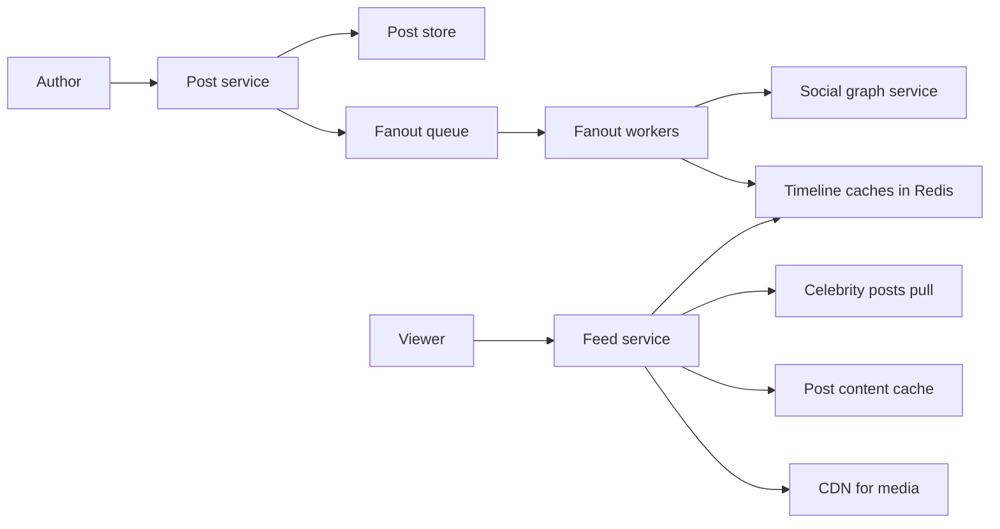
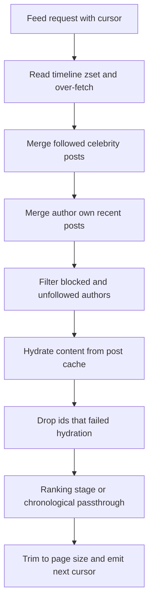

# Design a News Feed

A news feed (Twitter home timeline, Instagram feed, Facebook News Feed) shows each user a merged, ranked stream of posts from everyone they follow. The whole interview orbits one decision: when someone posts, do you **push** the post into every follower's precomputed timeline, or do followers **pull** and merge on read? Everything else — storage, caching, ranking — hangs off that answer, and the answer is famously "both, depending on follower count." This problem *is* [[Twitter Timeline Design]] generalized into an interview; read that case study alongside this note.

## Requirements clarification

**Functional:**

- **Publish a post** (text + media) to one's followers.
- **View the home feed**: a scrollable, paginated stream of posts from followed accounts — confirm **reverse-chronological vs ranked** (start chrono, add ranking as a stage; interviewers like that sequencing).
- **Follow/unfollow** maintains the social graph.
- **Engagement**: like counts displayed per post (confirm comments are out of scope).

**Non-functional:**

- **Feed load latency**: p99 under ~200 ms — the feed is the app's front door.
- **Read-dominated**: users scroll constantly, post rarely — we'll assume **200:1 read:write, measured as posts read versus posts written**. Name the granularity when you state a ratio; counting feed *requests* instead of posts gives a different number for the same system, and the estimation below shows both.
- **Eventual consistency is fine**: a post appearing in followers' feeds a few seconds late is invisible; a slow feed is not. Explicitly trade freshness for latency ([[CAP Theorem|AP-leaning]]).
- **Skewed graph**: most users have <1,000 followers; celebrities have tens of millions. The tail IS the problem.

**Out of scope**: ads, stories, notifications (that's [[Design a Notification Service]]), content moderation.

## Back-of-envelope estimation

Assume **100M DAU**; each user posts 0.5 posts/day and loads/refreshes the feed ~10 times/day pulling ~10 new posts each.

- **Writes (posts)**: 100M × 0.5 = 50M posts/day ÷ 86,400 ≈ **580 posts/sec**; × 3 peak ≈ **1,700/sec**.
- **Reads (feed loads)**: 100M × 10 = 10⁹ feed requests/day ÷ 86,400 ≈ **11,600 requests/sec**; × 3 peak ≈ **35,000/sec**.
- **Ratio check — the two granularities differ by 10x, so say which you mean.** At *request* granularity: 10⁹ feed requests : 5 × 10⁷ posts = **20:1**. At *post* granularity, which is the one that drives the architecture because each request returns ~10 posts: 100M users × 10 loads × 10 posts = **10¹⁰ post-reads/day**, and 10¹⁰ : 5 × 10⁷ = **200:1**, matching the assumption above. That 10¹⁰ ÷ 86,400 ≈ **116,000 post-hydrations/sec** is also the load the post-content cache must serve, so it is worth carrying forward rather than discarding. The conclusion to say aloud: *optimize the read path at the write path's expense* — which is exactly what fan-out-on-write does.
- **Fan-out write amplification**: average 200 followers → 580 posts/sec × 200 = **116,000 timeline-inserts/sec** average, **348,000/sec** at the 3x peak. (That it lands near the post-hydration figure above is coincidence, not a relationship — they are different operations on different tiers.) One celebrity with 50M followers posting once = **50,000,000 inserts** from a single action. Put that in time: 50,000,000 ÷ 348,000 ≈ **144 seconds** of the *entire* peak-sized fan-out fleet doing nothing but that one post, or 50,000,000 ÷ 116,000 ≈ **431 seconds** — over seven minutes — at average capacity. That is the number that breaks pure push and forces the hybrid, and it is far more persuasive stated as "one post monopolizes the fleet for nearly two and a half minutes" than as "50M inserts".
- **Timeline cache sizing**: cache 500 post IDs per user. Entry ≈ 8-byte ID + zset overhead ≈ 70 B → 500 × 70 B ≈ 35 KB/user; × 100M users ≈ **3.5 TB**. *Assume* ~64 GB usable per cache node → 3,500 GB ÷ 64 GB ≈ **55 primaries**, plus one replica each ≈ a 110-node fleet. Post *content* is a separate, much smaller hot cache (50M posts/day × 1 KB = 50 GB/day).
- **Which constraint binds the timeline fleet**: 35,000 feed loads/sec ÷ 55 shards ≈ **640 reads/sec per shard**, and peak fan-out 348,000 inserts/sec ÷ 55 ≈ **6,300 writes/sec per shard** — both far below what an in-memory store sustains. So this fleet is **memory-bound, not throughput-bound**: node count comes from the 3.5 TB, and the spare throughput is what makes the eviction and rebuild story in deep dive 2 survivable. Working out which of the two constraints sets your node count, and saying so, is most of the credit for a sizing estimate.

## High-level design

**API**: `POST /posts {text, mediaIds}` · `GET /feed?cursor=...&limit=20` · `POST /follows/{userId}` · `POST /posts/{id}/like`.

**Write path**: post service persists the post (post store, keyed by Snowflake-style postId — time-sorted IDs matter for pagination, [[Design a Distributed ID Generator]]) → emits a `post-created` event onto a queue → **fan-out workers** consume, fetch the author's follower list from the graph service, and insert the postId into each follower's **timeline cache**. Async because the author's ack must not wait for 200 (or 50M) inserts ([[Message Queues vs Event Logs]]).

**Read path**: feed service reads the user's timeline zset from Redis → merges celebrity posts (deep dive 1) → hydrates post content (post cache → post store) → optional ranking stage → returns a page + next cursor. Media URLs point at a [[CDN]].

## Deep dives

### 1. The fan-out decision — push vs pull vs hybrid

**Push (fan-out on write)**: on post, insert the postId into every follower's timeline. Reads become one cheap Redis fetch — perfect for the 200:1 ratio. Cost: write amplification × follower count, wasted work for dormant followers, and the celebrity catastrophe: 50M inserts per celebrity post creates minutes of lag and a thundering write storm — the fan-out worker fleet melts for one user's action ([[Hot Key Problem]] on the write side).

**Pull (fan-out on read)**: store posts only by author; on feed load, fetch the followee list, read each followee's recent posts, merge, rank. Writes are O(1); celebrities cost nothing special. Cost: every feed load does a ~200-way scatter-gather read-and-merge at p99 of the slowest shard — at 35K reads/sec that is millions of partial reads/sec, and latency blows the 200 ms budget. This was early Twitter, and it could not keep up ([[Twitter Timeline Design]]).

**Hybrid — the answer**: push for the ~99.9% of authors below a follower threshold (say 10K–1M, tuned); **don't fan out celebrities** — instead, at read time, pull the short list of followed celebrities' recent posts and merge them into the viewer's precomputed timeline. Each feed load = 1 timeline fetch + a handful of celebrity-post fetches (themselves served from a tiny, extremely hot post cache — a *read* hot key handled by cache replication). Per-user work is bounded on both paths: normal authors never trigger scatter-gather; celebrities never trigger 50M inserts.

| | Push | Pull | Hybrid |
|---|---|---|---|
| Write cost per post | O(followers) | O(1) | O(followers) if small, O(1) if celebrity |
| Read cost per load | O(1) | O(followees) scatter-gather | O(1) + O(celebrities followed) |
| Celebrity post | 50M inserts — breaks | free | free |
| Feed freshness | seconds (fan-out lag) | immediate | seconds / immediate |
| Fits 200:1 ratio | yes | no | yes |

### 2. Timeline storage in Redis — zsets and cursor pagination

Each timeline is a **Redis sorted set**: member = postId, score = the **millisecond timestamp carried inside** that Snowflake postId — *not* the ID itself, and this is the detail people get wrong. Redis zset scores are IEEE-754 doubles, which represent integers exactly only up to 2⁵³; a 63-bit Snowflake ID sits far above that and gets rounded to a multiple of 256–1,024 (depending on its magnitude), so posts from the same millisecond whose IDs differ only in their low sequence bits collapse onto one indistinguishable score. The members stay distinct, but their *order* does not, and an exclusive-bound score cursor then skips or repeats them. A 41-bit millisecond timestamp (~1.8 × 10¹² today) fits inside 2⁵³ with room to spare, so use it as the score and let the member ID break ties. Insert = `ZADD`, capped to ~500–800 entries with `ZREMRANGEBYRANK` — a timeline is a *bounded cache of recent post IDs*, not an archive; scrolling past its end falls back to pull-and-merge from the post store. Store only IDs, never content: content would multiply memory by ~15x and make edits/deletes incoherent (hydrate at read; a deleted post simply fails hydration and is skipped — cheaper than erasing an ID from 200 timelines).

**Pagination must be a cursor, not offset.** `page=3` breaks on a moving stream: new posts arriving between requests shift every offset, producing duplicates or gaps. A cursor = the last-seen post's **(timestamp, postId) pair**; next page = `ZRANGE key <cursor timestamp> -inf BYSCORE REV LIMIT 0 20` (the Redis 6.2+ form of the now-deprecated `ZREVRANGEBYSCORE`), with the postId resolving ties inside that millisecond — an inclusive score bound plus a member tiebreak, because an exclusive score bound would silently drop the unseen posts sharing the cursor's millisecond. Stable under concurrent inserts, O(log n), and it's why time-sorted IDs were load-bearing. Cache loss (node restart) is non-fatal: timelines **regenerate via pull** — the Redis tier is a disposable materialized view, which is what makes running it in cache-grade storage acceptable.

**What this looks like at 3am** (the shape of the page, not a specific history). It arrives as a support escalation rather than an alert: a minority of users see a completely empty feed, and nobody on the team can reproduce it. Error rates are flat, and correctly so — an empty timeline produces a perfectly successful response containing zero posts. The tell is in the cache tier: one shard's evicted-keys counter is climbing while its siblings sit at zero, and its memory sits pinned at the configured maximum. The eviction policy is doing precisely what it was configured to do, on the shard whose users happened to hash into more or larger timelines than average. You distinguish the two candidate causes in one query — does the affected user's timeline key *exist*? Absent means evicted; present but empty means fan-out never ran. The short-term fix is memory or a lower per-timeline cap; the structural fix is different and more important: **the read path must treat "key absent" as a trigger for the pull-and-merge rebuild**, not as "this user has no posts". Whenever a cache holds a materialized view, absent and empty must be distinguishable at the read path, or a routine eviction silently converts into incorrect output.

### 3. Ranking — keep it a stage, not a model

Say the architecture, skip the ML: ranked feeds split into **candidate generation** (gather ~500 candidates: the timeline zset + celebrity merge + optionally "recommended" sources) then **scoring** (a model scores each candidate for this viewer — engagement probability, recency decay, author affinity — then re-order, apply business rules like author diversity). Keep it as a **separate stateless stage** between hydration and response, so chrono-feed infrastructure is unchanged and ranking can be A/B-tested or bypassed (the "latest posts" toggle) independently. Precompute heavy per-user features offline; the online path must fit the latency budget — if scoring 500 candidates costs 50 ms, that is a quarter of the whole 200 ms p99 and a far larger share of the part you actually control once client network time is deducted; say that trade aloud, and note that it is also why candidate counts are capped rather than "as many as we can get". Deeper candidate-generation pipelines are [[RAG Architecture|retrieval problems]] in disguise — one sentence, no more.

### 4. Counters at scale — the like button

*Assume* a viral post peaks at ~50K likes/sec — the order of magnitude is what matters, not the figure. A single `UPDATE posts SET likes = likes + 1` row is a lock convoy — a write [[Hot Key Problem|hot key]]. Standard answer, in order: (1) **sharded counters** — split each hot post's counter into N sub-counters (`likes:{postId}:{0..N-1}`), increment a random shard (contention ÷ N), read = sum of shards, cached; (2) **batch/async aggregation** — likes flow onto a queue, an aggregator folds them into the store every few hundred ms; display counts lag by under a second, which no user can perceive. Also note: counts beyond ~4 digits display as "52.3K" — precision is a non-requirement at exactly the scale where it's expensive; dedup of double-taps rides the (userId, postId) uniqueness row that also powers "you liked this".

### 5. The consistency gaps a precomputed timeline creates

A timeline is a denormalized copy of a join, and every denormalized copy drifts from its source. The interview rarely asks about this directly; it asks one question from this table and watches whether you have a general answer or an ad-hoc one.

| Event | What drifts | Where you resolve it | What the alternative would cost |
|---|---|---|---|
| Post deleted | The ID still sits in every timeline it was fanned out to | Hydration finds nothing and skips it | Scrubbing every one of those timelines — up to a full fan-out's worth of writes to undo a single post |
| Post edited | Nothing drifts — timelines hold IDs, content has one home | Nowhere | This is the payoff for storing IDs, so name it when the topic comes up |
| A unfollows B | B's already-inserted posts remain in A's timeline | Filter at read time against the follow edge, or let them age out of the capped zset | Scrubbing A's timeline on every unfollow |
| A blocks B | Same drift, but correctness is not optional here | Filter at read time, always — "it ages out" is not an acceptable answer for blocking | — |
| A follows B | A's timeline holds none of B's history | Backfill B's recent posts once, or simply fill forward from now | Backfill is a bounded one-off; choose per product |
| Author posts | Fan-out is async, so authors may not see their own post | Inject the author's own recent posts at read time | Synchronous self-insert into one's own timeline |

Two of these deserve more than a table row. **Read-your-own-writes** is the one users notice within seconds: an author publishes, the feed refreshes before the fan-out worker ran, and their post is missing — which reads as data loss, not as lag ([[Read Your Own Writes and Replica Lag Anomalies]]). The cheap fix is to write the author's own timeline synchronously in the request path — one insert, bounded, unlike the fan-out — or to merge the author's recent posts at read time the same way celebrity posts are merged. Either way, the guarantee is deliberately asymmetric: **eventual consistency for everyone else's posts, read-your-own-writes for yours**, which is exactly the consistency model users actually expect and almost never the one that falls out by default.

**Read-time filtering has a pagination cost** that is easy to miss. If the feed service fetches 20 IDs and then drops 4 of them as deleted, unfollowed or blocked, the user receives a 16-item page — and if the cursor advances only past what was *returned*, the next page re-scans the filtered entries forever. The discipline: over-fetch deliberately (ask the zset for 40 to serve 20), advance the cursor by what was **scanned**, not by what survived, and cap the number of refetch rounds so a heavily filtered timeline degrades into a short page rather than an unbounded loop. Every read-time filter also spends part of the 200 ms budget, which is the real argument for keeping the filter set small and the block check — the one that must be exact — as cheap as a set membership test in cache.

Assembled, the read path has a fixed order, and the order is not arbitrary: cheap predicates run before hydration so you pay for content only on survivors, while deletion can only be discovered *during* hydration because the post record is where the truth lives.

## Scaling and failure handling

- **Fan-out lag is the health metric**: queue depth ÷ drain rate = seconds-until-your-post-reaches-followers. Autoscale workers on lag ([[Backpressure and Flow Control]]); alert when p99 lag exceeds ~30 s.
- **Redis timeline fleet**: shard by userId (even distribution — viewers, unlike authors, aren't skewed); replicate per shard; on shard loss, serve those users via pull fallback while timelines rebuild lazily ([[Load Shedding and Graceful Degradation]]).
- **Celebrity post-cache**: replicate the hot posts across all cache nodes (read replication beats sharding for a handful of ultra-hot keys).
- **Post store**: shard by postId for writes; an authorId secondary index (or authorId-sharded replica of recent posts) serves the pull path ([[Secondary Indexes on Sharded Data]]).
- **Media**: uploaded to object storage, served exclusively via [[CDN]] — feed JSON carries URLs; your origin never streams images at 35K feed-loads/sec.
- **Graph service**: follower lists are read-heavy and cacheable; a 50M-follower list is fetched in pages by fan-out workers, never loaded whole.
- **Degraded modes**: ranking down → serve chronological; fan-out backlogged → feeds are stale but load instantly; timeline cache cold → pull path at higher latency. Each component fails toward a worse feed, never toward no feed.
- **Honest note on thin fan-out fleets**: run the fan-out consumers at one replica and a crash or a rolling restart stops *every* user's feed from advancing, because that one consumer is the only thing draining the queue. Nothing is lost — the queue holds the events — so the failure is staleness, which is the cheap failure the async design was chosen for. But the detection burden shifts entirely onto the lag alert, since a wedged single consumer and a healthy idle one look identical from outside. The read path is unaffected and that asymmetry is the point: replicas buy *freshness* here, not availability.

## Common mistakes

- **Picking pure push or pure pull** and not surfacing the celebrity problem yourself — the interviewer is holding the "Katy Perry posts" question and expects you to get there first.
- **Storing full post content in every follower's timeline** — multiplies the cache cost ~15x and turns every edit/delete into a 200-timeline mutation.
- **Offset pagination** on a live stream — duplicates and gaps on every refresh; cursors are mandatory, and they require a sortable key the store can hold *exactly* (connect the dots to [[Design a Distributed ID Generator]], and to the 2⁵³ limit on Redis zset scores above).
- **Synchronous fan-out** inside the POST request — the author's ack waits on 200 inserts (or 50M); the queue is non-negotiable.
- **Treating the timeline cache as durable** — designing elaborate Redis persistence instead of saying "it's a materialized view; regenerate via pull."
- **Diving into ML ranking features** for ten minutes — the interviewer wants the two-stage *architecture* and its latency budget, not gradient-boosted trees.
- **A single counter row for likes** — the lock convoy under a viral post is a classic probe; have sharded counters ready.
- **Quoting a read:write ratio without its granularity** — "200:1" and "20:1" describe the same system counted in posts or in requests. An unlabelled ratio is a number the interviewer cannot check, and checking it is the first thing they do.
- **Forgetting read-your-own-writes** — async fan-out means authors can refresh into a feed missing their own post, which users report as data loss rather than lag; the fix is one synchronous self-insert, and it should be volunteered, not extracted.
- **Treating an empty timeline as a valid answer** — conflating "the cache has no key for this user" with "this user has nothing to read" turns a routine eviction into an empty feed.

## Check yourself

> [!question]- Q: Explain push vs pull vs hybrid fan-out in 60 seconds, with the numbers that force the hybrid.
> Push precomputes: each post is inserted into every follower's timeline — reads become O(1), which fits a 200:1 read:write ratio, but a 50M-follower celebrity post means 50M inserts for one action. Pull computes on read: merge ~200 followees' recent posts per feed load — writes are free, but at 11,600 reads/sec that's millions of scatter-gather sub-reads per second and p99 latency dies. Hybrid: push for normal users (bounded fan-out), exempt celebrities and merge their recent posts at read time from a replicated hot cache. Both paths bounded; both tails cut.

> [!question]- Q: Why do timelines store post IDs rather than post content, and what failure does hydration gracefully absorb?
> IDs keep entries ~70 bytes instead of ~1 KB (3.5 TB vs ~50 TB across 100M users), and keep a single source of truth for content — an edit or delete touches one post record, not every follower's copy. Hydration at read time absorbs deletion: a deleted post simply fails to hydrate and is skipped, so you never have to find-and-remove an ID from 200 (or 50M) timelines. The cost — one extra cache lookup per post — is served from a very hot content cache.

> [!question]- Q: Scenario — a fan-out worker deploy bug stalls the fan-out queue for 10 minutes. What do users experience, and why is this the failure mode you chose?
> Feeds load at full speed but show no posts newer than the stall — staleness, not downtime; authors' posts are safely persisted and queued. When workers recover they drain the backlog (sized by 580 posts/sec × 600 s ≈ 350K posts × avg 200 inserts ≈ 70M inserts — minutes of elevated drain). This is deliberate: the async queue converts a write-path failure into feed staleness, the cheapest failure a feed can have, instead of failed posts or slow reads. The monitoring consequence: fan-out lag must be a first-class alert, because nothing visibly "errors".

> [!question]- Q: Why does cursor pagination require time-sortable post IDs, and what breaks with offset pagination?
> A cursor says "give me items older than X" — that needs a total order on items that doesn't shift as new items arrive; time-sorted IDs (Snowflake) give exactly that, and the zset range query implements it in O(log n). The ordering key has to be one the store can represent exactly, which is why the score is the ID's millisecond timestamp with the ID itself breaking ties, rather than the 63-bit ID crammed into a double. Offsets count positions from the head: when 5 new posts arrive between page 1 and page 2, every position shifts by 5, so page 2 repeats 5 posts (or skips them when items are removed). On an append-heavy stream, offsets are wrong by design, not by bug.

> [!question]- Q: Scenario — you add read-time block-list filtering. Users start reporting pages that are sometimes short and sometimes repeat content while scrolling. What is the bug class, and what is the rule?
> Two bugs from one cause: the page is assembled by fetching N IDs and dropping some of them, so the returned page is shorter than N — and if the cursor is then advanced to the last *returned* item rather than the last *scanned* one, the filtered entries sit between the cursor and the next page's start and get re-scanned on every subsequent request, which surfaces as repeats and stalled scrolling. The rule is that **the cursor tracks scan position, not output position**: advance past everything examined, over-fetch deliberately so a filtered page still fills, and bound the refetch rounds so a timeline that is almost entirely filtered returns a short page instead of looping. Any read-time filter over a paginated stream has this shape, so it is worth recognising once rather than rediscovering per filter.

> [!question]- Q: Where exactly do you put the celebrity threshold, and what goes wrong if you set it too low?
> The threshold is the follower count above which an author is exempted from fan-out and merged at read time instead. Push cost for one post is O(F) inserts, paid once and spiky; pull cost is one extra fetch per viewer per feed load, paid forever but served from an extremely hot cache with a near-100% hit rate. So the threshold should sit where the burst of F inserts starts to damage fan-out lag for everyone else — which the estimation quantifies: at a peak capacity of ~348,000 inserts/sec, an author with 1M followers consumes about three seconds of the whole fleet, while one with 50M consumes about 144 seconds. Set it too low and you exempt a large population of mid-sized authors, so every feed load now merges dozens of pulled sources instead of a handful — the read path drifts back toward the scatter-gather that pull was rejected for, and the hot-post cache stops being hot because the exempted set is too large to stay cached. The threshold is a tuning knob between two failure modes, not a constant; say that, and say you would measure fan-out lag and read-path merge width to place it.

> [!question]- Q: Variant drill — design the feed for a strict-chronological, follower-capped network (max 5,000 followers, no ranking, no celebrities). What simplifies, and what one new option opens?
> The hybrid collapses to pure push: fan-out is bounded at 5,000 inserts/post worst case, so no celebrity pull path, no hot post cache, no ranking stage — the read path is literally one zset fetch + hydration. Freshness becomes the only quality metric, so fan-out lag matters more. The new option: with bounded fan-out you could even fan out synchronously for small accounts to get instant appearance — but the queue is still wiser for burst absorption. The lesson: the entire architecture's complexity was purchased by the follower distribution's tail; cap the tail and the system shrinks by half.

## Sources

- *System Design Interview Vol. 1* (Alex Xu) — chapter "Design a News Feed System"; the push/pull framing follows it.
- Raffi Krikorian, "Timelines at Scale" (QCon talk, late 2012) — Twitter's hybrid fan-out, and the ~300K timeline reads/sec against ~4.6K tweets/sec average (≈400M tweets/day, 2012) that forced it; the basis of [[Twitter Timeline Design]], which carries the full figures.
- *Designing Data-Intensive Applications* (Kleppmann), ch. 1 and 12 — the Twitter fan-out worked example and materialized-view framing of timelines.
- Instagram/Meta engineering — the Explore recommender write-ups ("Powered by AI: Instagram's Explore recommender system", and the 2023 scaling follow-up): candidate generation sampling ~500 posts, then ranking — the clearest public description of the two-phase split, and of how the ranking phase itself subdivides into cheap and expensive passes at scale.
- Facebook engineering — "TAO: Facebook's Distributed Data Store for the Social Graph" (the graph-service shape behind follower lists).
