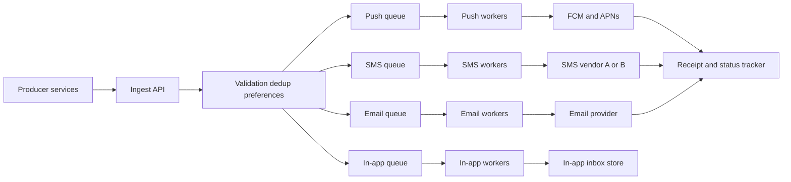
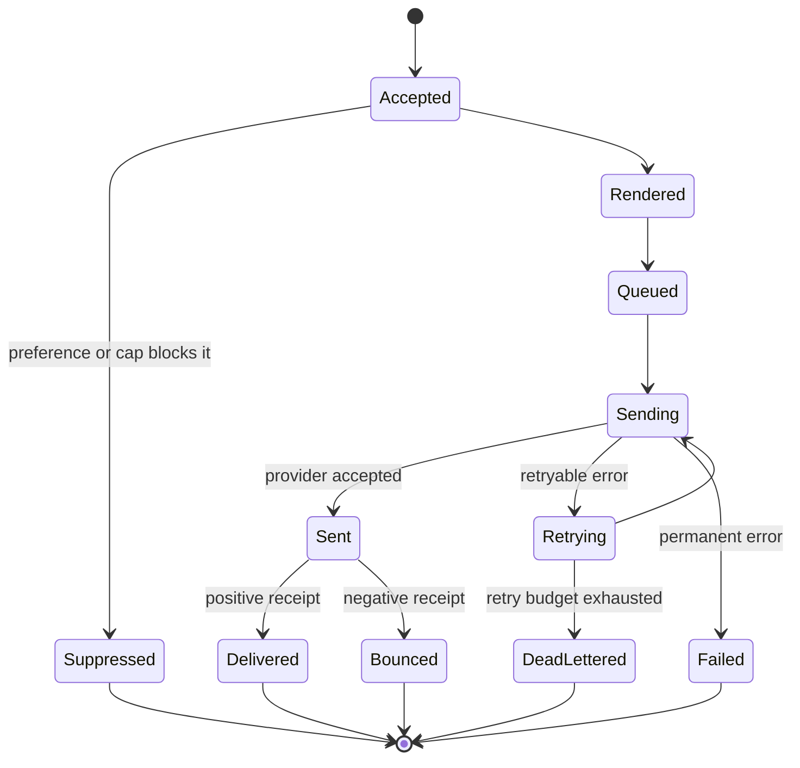

# Design a Notification Service

A notification service is the platform component every product team calls instead of integrating FCM, APNs, SMS vendors, and email providers themselves. It accepts "send this to this user," then handles everything that makes that hard: channel routing, templating, user preferences and legal opt-outs, deduplication, retries against flaky third-party providers, and proving delivery afterward. If you work in a service-oriented backend — especially fintech, where an OTP SMS arriving twice-or-never is a support ticket or a compliance issue — this problem is closer to your day job than any other in this module. Its architecture is a textbook application of async messaging ([[Why Async Messaging Exists]]).

## Requirements clarification

**Functional:**

- **Multi-channel**: push (FCM for Android, APNs for iOS), SMS, email, and in-app notifications; one logical notification may fan out to several channels.
- **Priority tiers** (confirm): transactional/critical (OTP, payment alerts — seconds matter) vs promotional/bulk (campaigns — minutes are fine). These must never share a queue fate: a 5M-user campaign must not delay a single OTP.
- **Templates**: callers send a template ID + variables, not raw strings — centralizes copy, localization, and per-channel rendering.
- **User preferences and opt-out**: per-user, per-channel, per-category settings; honoring unsubscribe is a *legal* requirement (CAN-SPAM/GDPR for email, TRAI DND rules for SMS in India), not a nice-to-have.
- **Delivery status tracking**: callers and support can query what happened to a notification.

**Non-functional:**

- **At-least-once delivery with dedup** — never silently drop an OTP; never send a payment alert twice. "Exactly-once to a phone" is unachievable end-to-end ([[Exactly-Once Delivery Is a Lie]]), so the design goal is at-least-once *attempt* + idempotent suppression of duplicates.
- **Latency**: critical tier delivered to the provider within ~1–2 seconds; bulk tier is throughput-optimized.
- **Soft real-time, absorb spikes**: campaign sends create 1000x bursts; the system buffers rather than falls over.
- **Provider independence**: any single vendor outage must not stop the channel.

**Out of scope** (say it): the marketing campaign builder UI, content recommendation, client-side rendering of in-app inboxes.

## Back-of-envelope estimation

Assume **10M notifications/day** (a mid-size consumer app), of which 20% critical, 80% bulk/promotional.

- **Average rate**: 10,000,000 ÷ 86,400 s ≈ **116/sec**. Modest!
- **Peak**: campaigns dominate. A campaign to 5M users enqueued over 10 minutes = 5,000,000 ÷ 600 s ≈ **8,300/sec** sustained burst on the bulk path — ~70x the average. The design must decouple ingest rate from provider send rate: this single calculation justifies the queues.
- **Channel mix sets every number after this one.** *Assume* push 70%, email 20%, SMS 8%, in-app 2% — and ask for the real split in the interview, because the channels differ by orders of magnitude in cost and throughput. That gives 7M push, 2M email, **800K SMS**, 200K in-app per day. SMS averages 800,000 ÷ 86,400 ≈ **9/sec**: by far the smallest channel, and still the one that will page you.
- **Why the smallest channel is the bottleneck**: if the vendor account is capped at, say, 100 messages/sec, a full day's SMS volume needs 800,000 ÷ 100 = 8,000 s ≈ **2.2 hours** of continuous sending. A 1M-message promotional SMS campaign therefore cannot be "sent at 9am" — it drains over 1,000,000 ÷ 100 = 10,000 s ≈ **2.8 hours**. That window is a product fact the campaign tool must surface, not an implementation detail; and it is why the design needs outbound pacing (deep dive 6), not just inbound queues.
- **Worker sizing — concurrency, not CPU**: *assume* a provider API call takes ~200 ms round trip. One in-flight call therefore completes 1 ÷ 0.2 = **5 sends/sec**, so sustaining 1,000 sends/sec requires 1,000 ÷ 5 = **200 concurrent in-flight calls** — say 4 worker pods × 50 threads, or far fewer threads on a non-blocking client. These workers are I/O-bound: they sit at near-zero CPU while saturated, so autoscaling them on CPU under-provisions them badly. Scale on queue depth or age instead.
- **Storage**: a status record per notification ≈ 1 KB (ids, channel, state transitions, timestamps, provider receipts) → 10M × 1 KB = **10 GB/day**; keep 90 days hot = **~900 GB** — one sharded collection; archive older to object storage.
- **Status-store write rate — the tier everyone forgets**: each notification *persists* roughly 4 transitions (accepted, queued, sent, delivered — the render and sending steps in the state diagram below need not each be durable), so 10M × 4 = 40M writes/day ÷ 86,400 ≈ **460 writes/sec** average, bursting with the same ~70x factor during a campaign. The status store takes four times the write traffic the ingest API takes, and asynchronous provider receipts arrive on their own schedule rather than yours.
- **Provider throughput reality-check**: SMS vendors commonly cap throughput per account/sender-id to tens–hundreds of messages/sec; this — not your own infrastructure — is usually the bottleneck, and is why per-provider rate control and multiple vendors exist in the design.
- **Cost shape** (name it; interviewers and finance both care): push and in-app are effectively free per message, email is cheap per message, SMS is billed per message. So your infrastructure cost barely moves with campaign size while the **vendor bill scales linearly with it** — which reframes per-user caps and preference suppression as cost controls, not only as UX politeness.

## High-level design

**Flow**: producer calls `POST /notifications` with `{idempotencyKey, userId, templateId, variables, channels?, priority}` → ingest validates, resolves the user's **preferences/opt-outs** and device tokens/addresses, renders via the **template service**, dedups on the idempotency key — then enqueues one message **per channel** onto that channel's queue. **Channel workers** consume, apply provider rate limits, and call the **provider gateways**. Provider callbacks/receipts flow into a **status tracker** that updates the notification's lifecycle record (`accepted → queued → sent → delivered | failed | suppressed`).

Why **a queue per channel** (and per priority tier within a channel): channels fail and throttle independently — an SMS vendor outage must back up only the SMS queue while push and email drain normally; a bulk campaign fills the bulk queues while the critical queues stay empty and fast. This is queue-as-bulkhead ([[Bulkheads and Isolation]], [[Message Queues vs Event Logs]]).

**The channels are not interchangeable**, and the differences are what the per-channel abstraction exists to hide from callers:

| Channel | Typical delivery latency | What "delivered" can mean | Marginal cost | Dominant failure | Regulatory weight |
|---|---|---|---|---|---|
| Push — FCM, APNs | Sub-second when the device is online and reachable | The platform accepted it; genuine device delivery is only knowable later, and not always | Effectively free | Dead or unregistered tokens; devices offline for days | Low — the OS permission prompt is the real gate |
| SMS | Seconds to minutes, operator-dependent | An operator delivery receipt, often delayed and sometimes never sent at all | Billed per message — the expensive channel | Vendor throughput caps; degraded operator routes | High — consent and do-not-disturb regimes, sender-ID registration |
| Email | Seconds to minutes | Delivered, bounce, and complaint webhooks from the provider | Cheap per message | Sender reputation and spam filtering; hard vs soft bounces | High — unsubscribe handling is mandatory |
| In-app inbox | Immediate on next app open | Exact — you own the read model | Free | None external; it is your own datastore | Low |

Two consequences fall straight out of the table. First, **"sent" and "delivered" are different states on every channel where a third party owns the last mile**, which is why the status model in deep dive 5 keeps them apart. Second, the channel you send least of is the one with the highest unit cost, the tightest throughput cap, and the heaviest compliance load — so SMS gets disproportionate design attention relative to its 8% share.

## Deep dives

### 1. Deduplication — idempotency at two layers

Duplicates enter twice: **callers retry** the ingest API (network timeout after a successful enqueue), and **workers redeliver** (crash after provider call, before ack — the at-least-once window).

- **Ingest layer**: require an **idempotency key** per logical notification (e.g. `payment-alert:{txnId}:{userId}`). Store it with a unique constraint (or Redis `SET NX` with TTL); a replayed key returns the original notification ID instead of enqueueing again ([[Idempotency]]).
- **Worker layer**: before calling the provider, atomically check-and-set the notification's state to `sending` keyed by notification ID + channel; a redelivered message that finds state `sent` is acked and dropped. The small honest gap: a crash *between* provider accept and state write can still double-send — shrink it (write-ahead state, provider-side idempotency keys where supported, e.g. email providers accept them) and accept that true exactly-once to a phone does not exist. Saying this plainly is worth points.

### 2. Retries, provider failover, and the DLQ

Providers fail constantly: rate-limit responses, 5xx, timeouts, and *per-message permanent* errors (invalid token, unreachable number). The worker's decision tree:

1. **Classify**: retryable (timeout, 429, 5xx) vs permanent (invalid recipient, unregistered device token → also *prune the token*, since the platform told you in that very response that the device is gone and every further attempt is wasted work against your provider quota).
2. **Retry with [[Timeouts Retries and Exponential Backoff|exponential backoff + jitter]]**, budgeted per priority: an OTP gets 3 fast attempts within seconds (a 10-minute-late OTP is useless — better to fail fast and let the user re-request); bulk gets patient hourly retries.
3. **Fail over the provider**: each channel has an ordered provider list (SMS vendor A → vendor B) with health tracked per provider; a [[Circuit Breakers|circuit breaker]] trips on error-rate and routes traffic to the secondary. This is why the gateway abstraction exists — workers speak "send SMS", not "call vendor A's API".
4. **Exhausted → [[Dead Letter Queues and Poison Messages|DLQ]]** with full context (payload, attempts, last errors). DLQs are *monitored and drained*, not graveyards: alert on depth, support replay-after-fix. Critical-tier DLQ entries page a human.

**What this looks like at 3am** (the shape of the page, not a specific history). The alert does not come from your monitoring — it comes from support, as a cluster of "I never received my OTP" tickets. Your dashboards are green and they are not lying: the SMS workers are succeeding, the vendor returns an accepted response for every message, the error rate is zero and the queue is draining at its normal rate. The signal lives one layer further out, in the **ratio of delivery receipts to accepted sends**, broken down by vendor *and* by destination operator. A degraded route shows up there and nowhere else: acceptance holds at 100% while the delivered fraction collapses for one operator and the others stay flat. You confirm by reading the receipt status codes for the failing slice rather than by counting your own errors — your side recorded no errors to count. Mitigation is the failover already in the design, but it only fires if the [[Circuit Breakers|circuit breaker]] is keyed on **delivery rate**, not on your HTTP error rate; for OTP-class traffic the product-level fallback to another channel is what actually rescues the user. The transferable lesson: wherever a third party owns the last mile, **provider acceptance is not delivery**, and an availability SLO computed from your own responses will report perfect health straight through a total outage.

### 3. Per-user rate limiting — the anti-spam guard

Without a guard, a buggy producer loop sends one user 500 pushes in a minute — users uninstall, Apple/Google may throttle your app, SMS budgets evaporate. Enforce **per-user, per-channel caps** (e.g. ≤2 promotional pushes/day, SMS daily caps) and **quiet hours** at the validation stage, with counters in Redis (same sliding-window machinery as [[Design a Rate Limiter]]). Two policy classes: **suppress** (drop promotional overflow, record state `suppressed` — it's not an error) vs **always-deliver** (OTPs and security alerts bypass caps). Fintech nuance worth saying: regulatory/transactional messages are *mandatory* deliveries; promotional ones are the rate-limited class — conflating them is a compliance bug.

### 4. Preferences, opt-out, and compliance

The preference service answers "may we send this user this category on this channel?" — consulted **synchronously at validation time** (a stale cached "yes" after an unsubscribe is a legal exposure, so cache briefly or invalidate on write). Model: per-user matrix of channel × category + global unsubscribe + DND windows. Email unsubscribe links and SMS STOP keywords write back into it. Keep an **audit trail of consent changes** — in regulated domains you must be able to prove you had permission at send time. Suppressed-by-preference is a terminal tracked state, distinct from failure.

### 5. Delivery receipts and status tracking

Each notification's lifecycle is an append-style state record:

Read the diagram for what is *missing*: there is no arrow out of `Sent` for the common case where the provider simply never sends a receipt. That is not an oversight to fix with another state — it is the truth of the system, and it means any metric phrased as "delivery rate" must define its denominator and its waiting period explicitly ("receipts observed within 15 minutes of acceptance"), or it will quietly drift as provider behaviour changes. The receipt channels are not uniform, and conflating them is a common slip. SMS delivery receipts and email delivered/bounce/complaint events arrive as **provider webhooks** — asynchronous, minutes-delayed, sometimes absent entirely. Push is the opposite shape: APNs' HTTP/2 provider API and FCM report a **dead token synchronously in the send response** (APNs returns 410 with reason `Unregistered` and the timestamp the token died; FCM returns `UNREGISTERED`), so token pruning is a same-call reaction, not a webhook. What push does *not* give you is genuine device delivery — the platform tells you it accepted the message, and whether it ever reached a handset is largely unknowable. Apple's old asynchronous feedback service belonged to the retired binary API and is not something to design around today.

Write states to a store keyed by notification ID ([[MongoDB Architecture|document store]] fits: one evolving document per notification), expose `GET /notifications/{id}` and per-user history. Because receipts are webhooks from the public internet, they are themselves at-least-once and out-of-order: a `delivered` callback can arrive before your own `sent` write lands. Make the state write a **monotonic update** — only advance along the diagram, never regress — so a late-arriving earlier state cannot overwrite a later one. Aggregate receipts into per-provider delivery-rate metrics; this is the signal that drives failover and vendor negotiations. Be honest about finality: "delivered" means the provider says so, and "seen by a human" is only approximated by open/click tracking.

### 6. Pacing — rate-limiting yourself on the provider's behalf

The estimation showed the vendor cap, not your fleet, is the ceiling. That makes **outbound rate limiting** a first-class component: every worker must share one global budget per provider. A local limiter in each worker cannot do it — with k replicas each permitting 100/sec, the real rate is k × 100, the vendor starts rejecting, and you have converted free pacing into paid retries that consume more of the cap. So the token bucket lives in Redis, updated atomically by a Lua script: the same machinery as [[Rate Limiting]] and [[Design a Rate Limiter]], pointed outward instead of inward.

Three details separate a working pacer from a plausible-sounding one:

- **Key it by what the vendor actually meters** — usually provider + sender ID, sometimes per destination operator. A single global bucket across two sender IDs under-uses one cap and overruns the other.
- **Reserve capacity for the critical tier.** Separate queues do *not* separate the vendor cap: bulk workers and OTP workers draw on the same 100/sec. If bulk is allowed to consume all of it, a campaign delays OTPs even with perfect queue isolation — the bulkhead leaks through the shared downstream. Give the critical class its own slice of the cap (say 20% reserved, with the right to burst into unused bulk capacity) so an OTP never waits on a marketing send.
- **Decide what a token-starved worker does with the message it is holding.** Blocking while holding an un-acked message burns the broker's visibility timeout and gets the message redelivered to a second worker, which then also blocks — the queue appears to be working while nothing drains. Either extend the visibility timeout deliberately while waiting, or return the message for redelivery with a delay. On SQS this is explicit (`ChangeMessageVisibility` versus letting it expire); on any broker it is a decision you must make rather than inherit.

## Scaling and failure handling

- **Every tier scales horizontally**: stateless ingest behind the [[API Gateway]]; workers scale per queue depth ([[Autoscaling]] on lag, not CPU); queues partition by userId if ordering per user matters, else freely ([[Consumer Groups and Rebalancing]]).
- **Backpressure**: the queues absorb campaign bursts (that 8,300/sec peak) while workers drain at provider-permitted rates; monitor queue age — if bulk lag exceeds hours, add workers or negotiate provider throughput ([[Backpressure and Flow Control]]).
- **Queue/broker down**: ingest fails fast with 503 and callers retry with their idempotency keys — no silent loss. Critical producers (OTP) can hold a tiny local outbox as a last resort ([[The Outbox Pattern]]).
- **Provider down**: circuit breaker → secondary vendor; if all SMS vendors are down, the SMS queue buffers and — for OTP-class messages — the product can fall back to another channel (voice call, email), a *product* decision to pre-agree.
- **Poison messages** (malformed payload crashes workers): attempt caps + DLQ prevent one bad message from wedging a partition.
- **Hot user** (one user receiving mass notifications) is naturally bounded by the per-user rate limiter — the anti-spam guard doubles as a [[Hot Key Problem|hot-key]] guard.
- **Honest single-replica note**: if workers for a channel run at one replica (cost-pinned), a crash pauses that channel until restart — the queue preserves the messages, so the failure mode is delay, not loss. That is precisely the graceful degradation queues buy, and it is a defensible trade for bulk channels. Three caveats follow from it honestly. **Detection replaces redundancy**: with no peer to pick up the slack, the only thing standing between a crash-loop and a two-hour OTP outage is the alert, so the critical-tier queue's *oldest-message age* must be a paging alert with a threshold measured in minutes — pod health tells you nothing, because a pod that is up but wedged looks identical to a healthy one. **Deploys are outages in miniature**: a rolling restart of a one-replica consumer leaves the queue with zero consumers for the restart window, which is survivable for bulk and visible for OTP; where the critical tier matters, that alone justifies a second replica for *that* consumer even if every other service stays pinned. **In-flight messages need graceful shutdown** — finish or deliberately return the message in hand rather than letting it time out, or every restart adds a visibility-timeout's worth of delay to whatever was being sent ([[Graceful Shutdown and Deployment Safety]]).
- **Signals that catch each failure.** Queue *age*, not depth, is the primary health metric — depth is ambiguous because a large campaign and a stalled consumer look the same. Per-channel sent-to-delivered ratio catches silent last-mile failure. DLQ arrival *rate* catches poison messages and newly-permanent provider errors. Suppressed-count by reason catches preference bugs in either direction: a sudden drop means you may be sending what you should suppress, a sudden spike means a cap is misconfigured and real notifications are vanishing into a state nobody alerts on.

## Common mistakes

- **Designing a synchronous send path** — ingest calling FCM inline. One slow provider then stalls callers; the 70x campaign burst becomes an outage. The queue *is* the design.
- **One shared queue for everything** — the OTP behind 5M promotional messages. Per-channel, per-priority queues are the point; this is the most commonly probed flaw.
- **No idempotency story** — "we retry on failure" without dedup means duplicate payment alerts; in fintech interviews this is close to disqualifying.
- **Forgetting opt-out/compliance** — a notification system that can't prove consent or honor STOP is legally broken regardless of its throughput.
- **Treating provider errors as one class** — retrying an invalid phone number forever, or not pruning dead device tokens.
- **No DLQ / no answer for poison messages**, or a DLQ nobody monitors.
- **Ignoring that providers, not you, are the bottleneck** — scaling workers 100x against a vendor cap of 100 SMS/sec just moves the queue outside your system.
- **Collapsing "sent" into "delivered"** — reporting success the moment the provider returns 200, which makes every last-mile outage invisible to your own dashboards and leaves support discovering it before you do.
- **Autoscaling the workers on CPU** — they are I/O-bound against provider latency and sit near-idle while fully saturated; scale on queue age, and size the thread pool from the concurrency arithmetic.

## Check yourself

> [!question]- Q: Explain in 60 seconds why this system is queue-centric rather than a synchronous API fan-out.
> Three mismatches between ingest and delivery: rate (campaigns burst to ~70x average — queues buffer what providers can't absorb), reliability (providers fail independently — queues isolate each channel's failures and hold messages through outages), and latency (callers need a fast ack, not to wait on APNs). Queues give temporal decoupling, per-channel bulkheads, and at-least-once redelivery for worker crashes — the three properties the requirements demand. The cost is eventual delivery and the dedup machinery at-least-once forces.

> [!question]- Q: A worker crashes after the SMS vendor accepted the message but before acking the queue. What happens, and what did you design so the user doesn't get two SMSes?
> The broker redelivers the message to another worker — the at-least-once window. That worker first does the atomic state check: the notification's record was set to sending/sent (written before or around the provider call), so the redelivered copy is recognized as already-processed, acked, and dropped. The residual gap — crash after vendor accept but before any state write — can still double-send; it's shrunk by writing state ahead of the call and using provider-side idempotency keys where offered, and acknowledged as irreducible otherwise.

> [!question]- Q: Why must the preference check be effectively fresh at send time, and what does that mean for caching it?
> Opt-out honoring is a legal obligation (email unsubscribe, SMS STOP/DND): sending promotional content after a user unsubscribed is a violation with fines, not just annoyance. A preference cached for an hour can authorize a send a user revoked 59 minutes ago. So the preference lookup is synchronous at validation, with either a very short TTL cache or write-through invalidation on preference change — and consent changes are audit-logged so you can prove permission existed at send time.

> [!question]- Q: Show the math for why a 5M-user campaign needs the bulk/critical split.
> Campaign: 5,000,000 notifications enqueued over 10 minutes = 5,000,000 ÷ 600 ≈ 8,300/sec. Baseline critical traffic: 20% of 10M/day = 2M ÷ 86,400 ≈ 23/sec. If both share one queue drained at, say, 1,000/sec of provider capacity, the campaign creates a backlog of (8,300 − 1,000) × 600 ≈ 4.4M messages — over an hour of lag — and every OTP enqueued during that window waits behind it. Separate queues mean the OTP path stays at 23/sec against dedicated capacity: seconds, not hours.

> [!question]- Q: Scenario — you built separate critical and bulk SMS queues exactly as designed. A campaign starts, and OTP delivery still slows to minutes. The queues are confirmed independent. What did you miss?
> The queues are isolated; the **vendor throughput cap is not**. Both sets of workers draw from the same account-level send rate — say 100/sec — so bulk workers racing through a campaign consume the whole budget and the OTP workers receive rate-limit rejections, back off, and retry, which consumes yet more of the cap. The bulkhead leaked through a shared downstream resource that lives outside your system entirely. Fix: a shared outbound token bucket keyed by provider and sender ID, split by priority class with a reserved slice for critical traffic — say 20% reserved, allowed to burst into unused bulk capacity. The general lesson is worth stating plainly: isolating queues isolates *your* contention, not your provider's, and a bulkhead is only as good as the narrowest shared resource behind it.

> [!question]- Q: Scenario — a provider's delivery receipts stop arriving entirely, but the provider is still accepting and genuinely delivering messages. What happens to a circuit breaker keyed on delivery rate, and what does that tell you about the metric?
> The delivery rate collapses to zero even though delivery is perfect, so a breaker keyed on it trips and fails every message over to the secondary vendor — a full, unnecessary migration of traffic, possibly to a worse or more expensive route, triggered by a webhook outage rather than a delivery outage. That is the failure mode of the previous answer's advice, and both are real: your own error rate is blind to last-mile failure, and the receipt rate is blind to the difference between "not delivered" and "not reported". The resolution is not to pick one signal but to distinguish them — treat a receipt rate that drops to *exactly* zero across all destinations as a telemetry failure and alert on it separately, while a partial collapse confined to one operator or one route is the delivery failure the breaker should act on. Every derived metric has a failure mode of its own; name it before you wire it to an automated action.

> [!question]- Q: Variant drill — extend the design to scheduled and recurring notifications ("remind me at 9am daily").
> Add a scheduler store (notifications with due-times, indexed by time bucket) and a sweep/timer service that enqueues them onto the normal channel queues when due — delivery machinery unchanged. Hard parts: timezone-correct recurrence (store the user's zone, not a UTC offset — DST shifts it), exactly-once *firing* per occurrence (claim each due row atomically — e.g. conditional update marking it claimed — so two scheduler replicas don't double-enqueue; the idempotency key becomes scheduleId + occurrenceTime), misfire policy after downtime (send late vs skip — product decision per category), and cancellation/edit before firing. The scheduler is a second producer, not a second delivery system.

## Sources

- *System Design Interview Vol. 1* (Alex Xu) — chapter "Design a Notification System"; the per-channel queue-and-worker shape follows it.
- AWS Builders' Library — "Timeouts, retries, and backoff with jitter" (the retry discipline applied at the provider gateways).
- Apple Developer Documentation (APNs provider API) and Firebase Cloud Messaging documentation — token lifecycle, the `Unregistered`/`UNREGISTERED` responses that drive token pruning, and what each platform will and will not tell you about delivery.
- Uber engineering blog — "Uber's Real-Time Push Platform" and its gRPC successor. Note what this is and is not: RAMEN delivers messages to *connected app clients* over long-lived streams, so it covers the in-app channel only, not the SMS/email/push-provider fan-out this note is mostly about. Read it for connection management and delivery-at-scale mechanics, not for the multi-channel gateway shape.
- *Designing Data-Intensive Applications* (Kleppmann), ch. 11 — stream processing and the at-least-once + idempotence argument.
