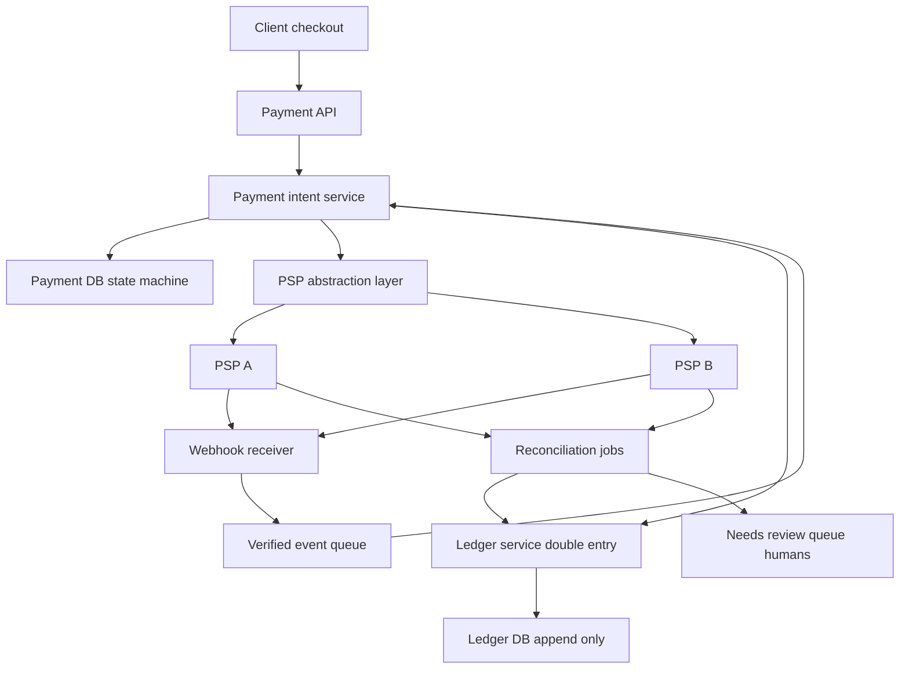
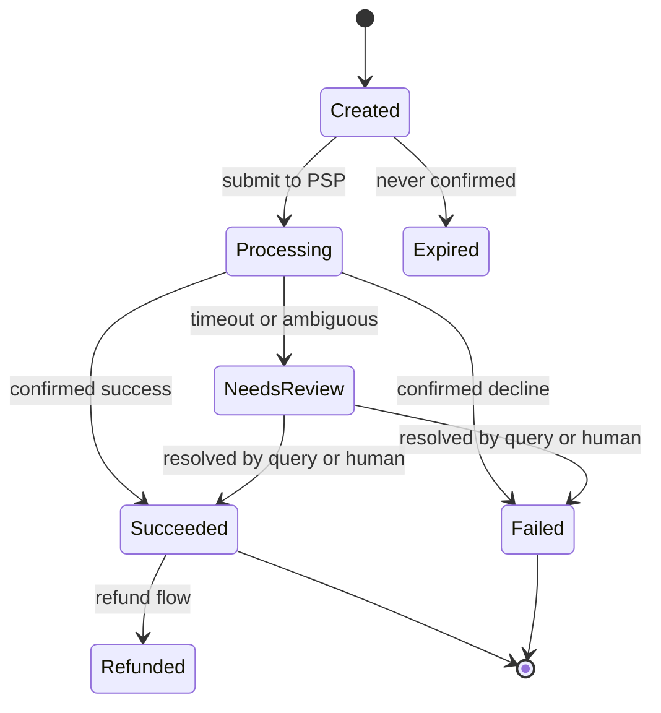

# Design a Payment System

This is your home turf, so the bar is higher: the interviewer expects not just the architecture but the *discipline* — why money systems never UPDATE a balance, why every ambiguous state parks in `needs_review` instead of auto-failing, why reconciliation jobs exist at every fintech on earth. The core insight to lead with: a payment system is **not** a system that moves money — the PSPs and banks move money — it is a system that *records intent, tracks truth across unreliable third parties, and guarantees its records eventually match reality*. Structure with [[The System Design Interview Framework]]; [[Stripe and Payment System Design]] is the canonical case study behind everything here.

## Requirements clarification

**Functional**
- Accept payments: a client (checkout page, app) initiates a payment; we charge via external **PSPs** (payment service providers — Stripe/Adyen/Razorpay-class) and record the result.
- Payouts/refunds (clarify scope; refunds usually in, merchant payouts often out).
- A queryable, auditable **ledger**: every money movement explainable, forever.
- Webhook consumption from PSPs; reconciliation against PSP settlement reports.
- Multi-PSP from day one (resilience and cost routing) — clarify, because it drives the abstraction layer.

**Non-functional**
- Scale: payments are *small* by throughput standards — even 1M payments/day ≈ 12/s average, ~100/s peak. **Correctness, not throughput, is the entire game.**
- Zero tolerance for double-charges or lost money; ambiguity must surface, never be guessed away.
- Durability and auditability: regulators and auditors read this system's output ([[ACID Transactions]] territory, not eventual consistency).
- PCI-DSS scope must be minimized — see deep dive; this shapes the architecture, not just compliance paperwork.
- Availability honesty: it is better to be briefly *down* (fail closed) than to be up and uncertain about money.

## Back-of-envelope estimation

- 1M payments/day ÷ 86,400 s ≈ **11.6/s average**; peak ×10 (sale events) ≈ **~120/s**. Any single Postgres instance handles this write rate — say so, and redirect the design effort from throughput to correctness.
- Ledger growth: each payment ≈ ~5 ledger entries (auth, capture, fee, net, settlement) × ~500 B ≈ 2.5 KB → 1M/day × 2.5 KB = **2.5 GB/day ≈ ~900 GB/year** — years of ledger fit on one well-indexed database with archival tiering; immutability makes archival safe.
- Webhook ingest: PSPs send ~2–5 events per payment → ~5M events/day ≈ **~60/s average** — trivial rate, but each one must be verified, deduplicated, and reordered correctly, which is where the effort goes.
- The estimation *conclusion* interviewers want: this system is small in ops/sec and huge in consequence-per-op — the inverse of a feed or crawler — so every design choice trades throughput headroom you don't need for correctness guarantees you absolutely do.

## High-level design

- **Payment intent service** — owns the payment's state machine and the single source of truth for "what are we trying to do and where does it stand".
- **PSP abstraction layer** — a uniform internal interface over heterogeneous PSP APIs; routing, failover, and per-PSP adapters live here.
- **Webhook receiver** — verifies, dedups, and re-orders PSP callbacks into clean internal events.
- **Ledger service** — append-only double-entry record of every money effect; balances are *derived*, never stored as mutable truth.
- **Reconciliation** — batch jobs comparing our records against PSP settlement reports; mismatches park in a human-triaged review queue.

## Deep dives

### 1. Payment intent flow and the state machine

The flow is intent-first: **create the durable record before touching the PSP.**

1. Client asks to pay → API creates a **payment intent**: `{intent_id, amount, currency, order_id, state: created}` written to the payment DB *first*. The intent exists before any external call, so there is never PSP activity with no local record.
2. Client confirms (with tokenized card data — see PCI dive) → intent service calls the PSP through the abstraction layer → state `processing`.
3. Outcome arrives — synchronously, via webhook, or *never* (timeout) → state advances to `succeeded`, `failed`, or parks in `needs_review`.

The load-bearing rule: **never auto-fail an ambiguous money movement.** A timeout calling the PSP does *not* mean the charge failed — the request may have landed and the response died in transit ([[Network Partitions and Timeouts]] — the two-generals situation is the daily reality here). Marking it `failed` and letting the user retry is how double-charges happen. The only safe moves from ambiguity: query the PSP's API for the authoritative status, retry idempotently, or park in `needs_review` for reconciliation/humans. **Fail closed**: when uncertain, block this payment's progress, never guess.

### 2. Idempotency end-to-end

Every hop can retry, so every hop needs [[Idempotency]] — a chain, not a feature:

- **Client → API**: the client generates an idempotency key per payment attempt (UUID minted when the pay button renders, not when clicked). A double-click or network retry sends the same key; the API returns the original result instead of creating a second intent. Keys + responses stored with a TTL (~24 h) — Stripe's exact model.
- **API → PSP**: the abstraction layer sends a per-PSP idempotency key *derived from the intent ID* (e.g., `{intent_id}:attempt:{n}`). If our call times out and we retry, the PSP sees the same key and does not charge twice. Every serious PSP supports this; a design that omits it is wrong, not simplified.
- **Webhook → internal**: PSP event IDs dedup inbound events (below).
- Key discipline details worth saying aloud: the key must be stored **atomically with** the operation's result (same transaction), not checked-then-written (a race window); and a *different* amount under the same key is an error, not a replay.

This chain is how you get **exactly-once *effect* from at-least-once delivery** — the honest formulation of [[Exactly-Once Delivery Is a Lie]]: messages and requests may arrive multiple times; the *charge* happens once because every layer collapses duplicates.

### 3. The double-entry ledger

The ledger is the system's memory of money, and it follows accounting's 700-year-old invariant:

- **Every movement is a transaction of ≥2 entries that sum to zero**: a ₹1,000 customer payment with a ₹20 PSP fee writes: debit `psp_receivable` ₹980, debit `psp_fees_expense` ₹20, credit `merchant_payable` ₹1,000. Nothing appears from nowhere; nothing vanishes.
- **Entries are immutable — no UPDATEs on money, ever.** Corrections are new *reversing* entries. A mutable balance column can silently absorb a bug; an append-only ledger makes every state reachable by replaying history, and makes the audit trail the data itself rather than a bolted-on log. This is [[Event Sourcing]] in its oldest form — the ledger *is* the event log, balances are the projection.
- **Balances are derived**: `SUM(entries)` per account, materialized via running snapshots (balance as of midnight + today's entries) so reads are O(recent) not O(all history). The materialized balance is a cache of the ledger, never an independent truth — any mismatch resolves in the ledger's favor, by definition.
- Implementation notes that show seniority: amounts in **integer minor units** (paise/cents — never floats), currency on every row, the zero-sum invariant enforced by the writing transaction (and continuously verified by an async checker), and idempotent ledger writes keyed by the triggering event so a replayed event cannot double-post.

### 4. PSP abstraction and failover

- Each PSP adapter translates one provider's API, auth, error vocabulary, and webhook format into the internal contract: `authorize / capture / refund / query`, uniform error taxonomy (`declined_hard`, `declined_retryable`, `provider_unavailable`, `ambiguous`).
- **Routing policy** sits above adapters: choose PSP by method/currency/cost/health. **Failover**: if PSP A returns `provider_unavailable` (or trips a [[Circuit Breakers|circuit breaker]]), route *new* intents to PSP B. 
- The failover trap to name: an **ambiguous** failure on PSP A (timeout) must **not** fail over to PSP B for the *same attempt* — A may have charged. Ambiguity resolves (query A / webhook / reconciliation) before any re-charge path opens. Only confirmed-failed attempts may retry on another PSP, as a *new* PSP-level attempt under the same intent.
- Per-PSP state (their IDs, their status vocabulary) is recorded on an **attempt** entity under the intent — one intent, possibly several attempts, at most one success; the state machine enforces "at most one" at the intent level.

### 5. Webhooks: verify, dedup, reorder

PSP webhooks are at-least-once, unordered, and arrive from the public internet — treat them accordingly:

- **Verify signatures** (HMAC with per-endpoint secret, timestamp-bound against replay) before parsing anything. An unverified webhook endpoint is an open "mark this paid" API.
- **Dedup** on the PSP's event ID: store processed IDs (unique constraint); duplicates ack and drop. Ack fast (2xx), process async off a queue — a slow handler causes PSP retry storms that your own dedup then has to absorb.
- **Out-of-order safety**: `capture.succeeded` can arrive before `authorization.created`. Never apply events blindly — feed them to the state machine, which accepts only legal transitions; an early event parks until its predecessor lands, or better, each event triggers "query current authoritative status and advance accordingly" (making event payloads hints rather than truth — strictly more robust).
- Webhooks are a *push accelerant*, not the only path: a poller queries the PSP for intents stuck in `processing` beyond a threshold, so a dropped webhook delays truth, never loses it.

### 6. Reconciliation — the daily fintech reality

Everything above is real-time truth-tracking; reconciliation is the **batch proof** that it worked:

- PSPs publish daily **settlement reports** (every transaction they processed, fees, net paid out). Reconciliation jobs load each report and three-way match: **our ledger vs PSP report vs bank statement** (money actually received).
- Matches confirm the ledger. Mismatches classify: in-ours-not-theirs (phantom success? webhook never came?), in-theirs-not-ours (charge we don't know about — the scariest class, often a lost intent write or an engineer's console action), amount/fee mismatches (currency conversion, fee schedule drift).
- Every mismatch → `needs_review` queue with evidence attached; resolution writes *new* ledger entries (adjustments), never edits. Metrics on mismatch rates per PSP are an early-warning system — a rising unmatched rate catches silent integration breakage days before customers do.
- Say it plainly in the interview: **every payment company runs reconciliation**, because PSPs, networks, and banks disagree in small ways constantly. A design without reconciliation claims the system makes no mistakes — that claim is the mistake. This maps to your daily world: the audit-evidence and fail-closed norms of RBI-regulated money movement are exactly this discipline institutionalized.

### 7. PCI scope minimization: tokenization

- **PCI-DSS** applies to every system that stores, processes, or transmits cardholder data. Full compliance is brutally expensive — so the design goal is for card numbers (**PANs**) to *never touch your servers*.
- Mechanism: the checkout page loads a PSP-hosted field/SDK; card data goes **browser → PSP directly**; the PSP returns a **token**; your backend only ever sees and stores the token. Tokens are useless outside your PSP account — stealing your database yields no cards.
- Your PCI scope collapses to the lowest self-assessment tier; the architecture is the compliance strategy. Never log full PANs, never accept them into your API "temporarily" — scope is contagious: one service that touches PANs drags its whole connected surface into audit.
- Multi-PSP wrinkle: PSP-native tokens lock you in; network tokens or a token vault (itself PCI-scoped, often outsourced) restore portability — name the trade-off rather than hand-waving it.

## Scaling and failure handling

- Throughput needs are modest (hundreds/s) — scale is not the risk. Partition by merchant/intent ID if ever needed ([[Sharding]]); payments are shard-friendly (no cross-payment transactions; the ledger's zero-sum invariant is per-transaction, not per-shard).
- **Payment DB and ledger**: synchronous replication, point-in-time recovery, tested restores ([[Replication]], [[Disaster Recovery]]). RPO for a ledger is zero — state it.
- **PSP outage**: circuit breaker per PSP → route new intents elsewhere; in-flight ambiguous attempts freeze until resolvable. Whole-PSP-fleet outage → fail closed: reject new payments with honest errors ([[Load Shedding and Graceful Degradation]] — a queued "we'll charge you later" surprise is worse than a clean failure at checkout).
- **Webhook flood or drought**: queue absorbs floods ([[Backpressure and Flow Control]]); the stuck-intent poller covers droughts.
- **Audit trail**: append-only ledger + immutable event log of every state transition with actor and timestamp; auditors replay, never trust a summary. Access to review-queue actions is itself logged — who resolved what, with what evidence.
- **Humans are a component**: the `needs_review` queue has an SLA, staffing, and tooling; an unmonitored review queue is where ambiguous money goes to die.

## Common mistakes

- Auto-failing timeouts ("PSP didn't answer in 5 s → mark failed, let user retry") — the double-charge factory.
- Mutable balance columns — `UPDATE accounts SET balance = balance - 100` with no ledger behind it; unexplainable money after the first bug or crash mid-transaction.
- Idempotency at one layer only (API but not PSP calls, or vice versa) — the chain is only as idempotent as its weakest hop.
- Trusting webhooks: no signature verification, no dedup, applying events in arrival order.
- No reconciliation ("our records are correct because we wrote them carefully") — every real payment system reconciles.
- Failing over an *ambiguous* PSP attempt to another PSP — charging twice via two providers.
- Letting PANs touch the backend "just to pass them through" — full PCI scope acquired instantly.
- Designing for 100K TPS — spending the interview on throughput the problem doesn't have, at the cost of the correctness it entirely consists of.

## Check yourself

> [!question]- Q: Explain why balances are derived from the ledger rather than stored as the source of truth.
> A stored balance is a destructive summary: after `balance = balance - 100`, the history of *why* is gone, and a bug, crash, or race that corrupts it leaves nothing to recover from. An append-only double-entry ledger keeps every movement; the balance is just `SUM(entries)` — recomputable, auditable, and bug-recoverable (a wrong entry is visible and reversible with a correcting entry). Materialized balances are fine as *caches* of that sum; the design error is making the cache the truth. The zero-sum invariant also gives continuous corruption detection: if all entries don't sum to zero, you know something broke — a mutable column fails silently.

> [!question]- Q: Your call to the PSP times out after 10 seconds. Enumerate every safe next step and the one forbidden one.
> Safe: (1) retry the same call with the *same* idempotency key — the PSP collapses duplicates, so this is free; (2) query the PSP's status API for the attempt — authoritative resolution; (3) park the intent in `needs_review`/pending and let the stuck-intent poller or inbound webhook resolve it; (4) tell the user "payment processing, we'll confirm shortly" — honest ambiguity. Forbidden: marking it failed (or charging via another PSP) — the original request may have succeeded server-side, and both paths manufacture a double charge. Timeout means *unknown*, and unknown money fails closed.

> [!question]- Q: A PSP webhook arrives twice, and a `refund.succeeded` for a payment arrives before the `payment.succeeded`. What does each layer do?
> Duplicate: the webhook receiver verifies the signature, then hits the unique constraint on the PSP event ID — second copy acks 2xx and drops; no state transition fires twice (and even if dedup missed, the state machine would reject the repeated transition — defense in depth). Out-of-order: the refund event proposes a transition the intent's current state (`processing`) doesn't allow; the state machine refuses it. The event parks for redelivery/retry, or better, triggers a status query to the PSP, which returns the full truth (payment succeeded AND refunded) and the state machine advances through both legal transitions in order. Nothing is applied on arrival-order faith.

> [!question]- Q: Design the variant — UPI-style instant account-to-account payments (no cards, bank rails, regulator-operated switch).
> PCI/tokenization drops out; in its place come bank/switch integrations with their own idempotency vocabulary (retrieval reference numbers), *hard latency expectations* (user waits in-app for seconds, not for T+1), and a regulator-defined state machine including `deemed` outcomes — UPI transactions can be ambiguous at the switch itself, so the pending/needs-review discipline gets *more* central, not less. Reconciliation becomes settlement-file-driven against NPCI-style reports with mandated timelines for reversals and dispute (chargeback-equivalent) flows. The ledger, idempotency chain, fail-closed ambiguity handling, and append-only audit trail carry over unchanged — which is the point: rails change, discipline doesn't. New regulatory scope (RBI oversight, data-localisation of payment data) must be named as part of the design, not discovered later.

## Sources

- Alex Xu, *System Design Interview Vol. 2*, chapter "Payment System" — intent/ledger/reconciliation structure.
- Stripe engineering: "Designing robust and predictable APIs with idempotency" (Brandur Leach) and Stripe API docs on idempotency keys and webhooks — see [[Stripe and Payment System Design]].
- *Designing Data-Intensive Applications* (Kleppmann), ch. 7 (transactions) and ch. 12 (correctness, exactly-once effects).
- PCI Security Standards Council — PCI-DSS scoping and tokenization guidance.
- Double-entry bookkeeping: any accounting primer; in engineering form, Square/Stripe ledger blog posts (e.g., Square's "Books, an immutable double-entry accounting database service").
