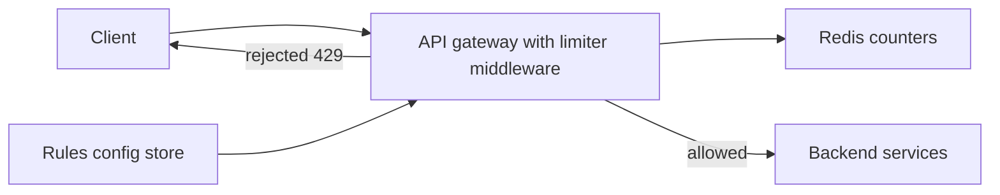

# Design a Rate Limiter

A rate limiter decides, for every incoming request, "has this client exceeded its allowance?" — and it must decide in a millisecond or two, across a fleet of servers, millions of times per second. The interview looks small but is dense: it tests algorithm knowledge ([[Rate Limiting]]), distributed-state reasoning (counters shared across nodes), and judgment calls (what happens when the limiter itself is down?). It is also one of the most realistic problems in this module — you are effectively designing a feature of [[API Gateway|Kong]].

## Requirements clarification

**Functional:**

- Limit requests **per client key** — user ID, API key, or IP — with rules like "100 requests/minute per user".
- **Different limits per endpoint/tier** (confirm): login gets 5/min, reads get 1,000/min; paid tiers get more.
- Rejected requests get an informative response (status code + headers telling the client when to retry).
- Rules configurable without redeploys (confirm whether a rules-management UI is in scope — usually out).

**Non-functional:**

- **Minimal added latency** — the limiter runs on *every* request; its budget is ~1–2 ms. It must be far cheaper than the work it protects.
- **Distributed correctness**: the limit must hold across all gateway/app nodes, not per node — 10 nodes each allowing 100/min is a 1,000/min limit.
- **Accuracy vs cost**: slight over-admission at window edges is usually acceptable; say so and confirm.
- **The fail-open vs fail-closed decision** — if the limiter's store is unreachable, do we admit traffic unprotected (fail-open) or reject everything (fail-closed)? For a general API, **fail-open**: the limiter protects quality of service, and it must not become a worse availability risk than the abuse it prevents. For money movement or login brute-force protection, **fail-closed** — the limit *is* a security boundary. Asking this question unprompted is a strong senior signal; the answer depends on what is being limited.

**Out of scope**: DDoS scrubbing at the network layer (that belongs to the edge/CDN), bot detection, billing.

## Back-of-envelope estimation

Assume a mid-size API platform: **10M daily active clients**, averaging 50 requests/day each.

- **Throughput**: 10M × 50 = 500M requests/day ÷ 86,400 ≈ **5,800 checks/sec** average; × 3 peak ≈ **17,000 checks/sec**. Every one of these is a read-modify-write on a counter.
- **State size**: one counter per active client per rule. 10M clients × ~2 active rules × ~100 bytes (key + counter + timestamps + Redis overhead) ≈ **2 GB** — fits comfortably in one Redis node's RAM; a small [[Redis Cluster and Sentinel|cluster]] gives headroom and failover.
- **Latency budget**: an intra-VPC Redis round trip is ~0.5–1 ms ([[Latency Numbers Every Engineer Should Know]]) — one round trip per check fits the 1–2 ms budget; two or three round trips do not. Conclusion: the check must be **one atomic Redis call**, which is exactly why Lua enters the design.

## High-level design

The limiter sits **in the gateway** ([[API Gateway]] — Kong implements this as a plugin), in front of all services: reject early, before any business logic spends resources. Shared counter state lives in Redis so that all gateway nodes enforce one global limit.



**Flow**: request arrives → middleware builds the key (`rate:{userId}:{ruleId}`) → one atomic Redis operation increments/checks the window → allow (forward) or reject. Rules (limits per endpoint/tier) are cached in gateway memory and refreshed periodically from a config store.

**What a rejection returns** — be specific, it's cheap and graded:

- Status **`429 Too Many Requests`**, with **`Retry-After: <seconds>`**.
- Rate-limit headers on *every* response so well-behaved clients can self-throttle: `X-RateLimit-Limit`, `X-RateLimit-Remaining`, `X-RateLimit-Reset` (the IETF draft standardizes these as `RateLimit-*`).
- Distinguish 429 (client over quota) from 503/load shedding (server over capacity) — different causes, different client behavior ([[Load Shedding and Graceful Degradation]]).

## Deep dives

### 1. Algorithm choice — sliding window counter wins

The candidates, from [[Rate Limiting]], one line each on why they fall short here:

| Algorithm | Verdict for a distributed limiter |
|---|---|
| **Fixed window counter** | Cheapest, but allows ~2x bursts at window boundaries (100 at 11:59:59 + 100 at 12:00:01) |
| **Sliding window log** | Exact (stores every request timestamp), but memory is O(requests) per key — 1,000/min keys get expensive |
| **Token bucket** | Great semantics (steady rate + burst allowance); needs two values (tokens, last-refill) updated atomically |
| **Leaky bucket** | Smooths output to a constant rate; queues requests — adds latency, wrong fit for an API gateway check |
| **Sliding window counter** | Two counters per key, O(1) memory, smooths the boundary burst — the pragmatic default |

**Sliding window counter** keeps a counter for the current and previous fixed windows and estimates the rolling count by weighting the previous window by its remaining overlap:

```
estimate = current_count + previous_count × (overlap fraction of previous window)
e.g. 25s into a 60s window: estimate = curr + prev × (35/60)
```

The estimate assumes requests were spread evenly across the previous window — an approximation, but Cloudflare measured this scheme on production traffic and found boundary error small in practice (they reported only ~0.003% of requests wrongly allowed/blocked across 400M sampled requests). State per key: two integers. That accuracy-for-O(1)-memory trade is the answer interviewers want *compared against alternatives*, not asserted.

Token bucket is the equally respectable alternative (it is what many real gateways implement) — offer it when the requirement includes "allow short bursts."

### 2. Atomicity — the race condition and the Lua fix

The naive check is read-then-write: `GET` the counter, compare, `INCR` if allowed. Two gateway nodes doing this concurrently at count 99 of 100 both read 99, both allow, both increment → 101 admitted. Under real concurrency the limit leaks badly — a **check-then-act race** on shared state.

Fixes, worst to best:

1. **Lock per key** — correct but adds a round trip and serializes the hot path; a distributed lock for a counter is overkill ([[Distributed Locking]]).
2. **Plain `INCR` then check** — atomic increment, reject if the result exceeds the limit. Works for fixed windows (`INCR` + `EXPIRE` on first hit), but multi-step logic (two windows, computing the weighted estimate, setting TTLs) is still multiple commands.
3. **Lua script via `EVALSHA`** — the standard answer. Redis executes a Lua script **atomically** (single-threaded event loop, nothing interleaves — [[Redis Internals]]): read both window counters, compute the weighted estimate, increment-and-allow or reject, set expiries — all in **one round trip, one atomic unit**. This simultaneously solves the race *and* the latency budget (one network hop). Mention `EVALSHA` (script cached by hash) so you're not resending the script body per request.

### 3. Local token caches — when even one Redis hop is too much

At very high throughput (or if Redis strains), stop paying a network round trip per request: each gateway node **claims a batch of quota** from Redis (e.g. atomically decrement the global allowance by 50) and serves decisions from that **local in-memory token cache**, refetching batches as it drains. This is the same batching idea as the key-pool in [[Design a URL Shortener]].

The cost is accuracy at the margins: tokens stranded in a node that crashes or goes idle are temporarily unavailable (slight under-admission), and a client spraying requests across nodes right at the limit can briefly exceed it (slight over-admission until batches reconcile). The trade is **strict global accuracy vs per-request latency and Redis load** — name it explicitly, and note that for abuse-prevention limits (coarse protection), approximate is fine; for billed quotas, it may not be.

### 4. Multi-datacenter wrinkle

With gateways in two regions, where does the counter live? Synchronously checking one global Redis from the far region adds **~50–150 ms WAN latency** to every request — instantly blowing the budget; a limiter must never cost more than it protects. Realistic options:

- **Per-region limits** (each region enforces `limit / regions` or a locally tuned share): simple, zero WAN cost; a client routed across regions can exceed the global number — usually acceptable for abuse protection.
- **Local enforcement + async aggregation**: regions enforce locally and replicate counts in the background (e.g. CRDT-style merged counters); the global limit converges within seconds rather than holding instantaneously.
- **Sticky routing** by client key (DNS/geo affinity) so one client's traffic lands in one region, making the local counter effectively global for that client.

The honest summary: **exact global rate limiting across datacenters is not worth its latency**; pick approximate-and-local, and say why.

## Scaling and failure handling

- **Scale the counter store** by sharding keys across a Redis Cluster — keys hash well (millions of clients), so no inherent [[Hot Key Problem]]; one abusive client hammering a single key is bounded by the limiter itself rejecting them at the limit.
- **Redis down** → the fail-open/fail-closed policy from requirements executes. Fail-open with a circuit breaker ([[Circuit Breakers]]) and an alert; optionally degrade to node-local in-memory limiting with a conservative share (`limit / node_count`) — crude, but keeps *some* protection while the store recovers.
- **Gateway nodes are stateless** (batch caches are a soft optimization, safe to lose) — autoscale freely ([[Stateless vs Stateful Services]]).
- **Rule changes** propagate via periodic refresh or pub/sub push; stale-by-30-seconds rules are fine — say so rather than building a config consensus system.
- **Monitor**: rejection rate per rule (a spike means attack or a mis-set limit), limiter latency p99, Redis health. The limiter protects your SLOs, so it needs its own [[SLA SLO SLI and Error Budgets|SLO]].
- **Clock skew**: window math uses Redis's own time (`TIME` inside the Lua script) or a single authority, never each gateway node's local clock — skewed nodes would otherwise disagree about window boundaries.

## Common mistakes

- **Designing the single-node algorithm only** — token bucket pseudocode on one server, no story for ten gateway nodes sharing a limit. The distribution *is* the problem.
- **Read-then-write to Redis without atomicity** — presenting the race condition as the solution. If you draw `GET` then `INCR`, expect the interviewer to pounce.
- **No fail-open/fail-closed position.** "Redis is down" must have a decided answer, and "depends on what's limited — here's the split" is the best one.
- **Forgetting the response contract** — returning bare 429 with no `Retry-After`/`RateLimit-*` headers turns well-meaning clients into accidental retry storms ([[Timeouts Retries and Exponential Backoff]]).
- **Global synchronous counters across regions** — importing 100 ms of WAN into every API call to make a rate limit exact.
- **Treating sliding-window-counter's estimate as exact** — it assumes uniform distribution in the previous window; know that it's an approximation and that the measured error is small.

## Check yourself

> [!question]- Q: Explain in 60 seconds why the sliding window counter is the default algorithm for a distributed limiter.
> Fixed windows allow ~2x bursts at boundaries; sliding window log is exact but costs memory per request; token bucket is good but carries two mutable values. Sliding window counter keeps just two integers per key — current and previous window counts — and estimates the rolling rate by weighting the previous window by its overlap fraction. O(1) memory, one-command-friendly, smooths the boundary burst, and Cloudflare measured its real-world error as tiny. It trades exactness for constant cost, which is the right trade for abuse protection.

> [!question]- Q: What exactly goes wrong with GET-then-INCR, and how does Lua fix it — including why it also fixes the latency budget?
> Two nodes at count 99/100 both GET 99, both decide "allowed", both INCR → 101 admitted: a check-then-act race on shared state, leaking worse as concurrency grows. A Lua script runs atomically inside Redis's single-threaded loop — read counters, compute the window estimate, conditionally increment, set TTLs — with no interleaving possible. And because all steps execute server-side in one EVALSHA call, the whole decision costs one network round trip (~0.5–1 ms), fitting the 1–2 ms budget that three separate commands would blow.

> [!question]- Q: Scenario — Redis becomes unreachable for 90 seconds at peak. Walk through what your design does for (a) a general read API and (b) the login endpoint.
> (a) Fail-open: the circuit breaker on the Redis client trips, the gateway admits traffic unlimited (optionally falling back to node-local limiting at limit/N), and an alert fires. Rationale: the limiter guards quality of service; rejecting all reads because the guard is sick is worse than 90 seconds of unprotected traffic. (b) Fail-closed (or heavily degraded local limits): login limiting is brute-force protection — a security boundary — so unprotected admission is the worse failure. Same outage, opposite policies, decided per rule in advance.

> [!question]- Q: Why do rate-limit headers on successful responses (not just 429s) matter?
> They let clients self-regulate before hitting the wall: a client seeing X-RateLimit-Remaining: 3 can back off voluntarily instead of slamming into 429s and triggering retry logic. That converts the limiter from a punishment mechanism into a flow-control protocol, reduces wasted rejected requests, and is why the IETF is standardizing the headers.

> [!question]- Q: Variant drill — the product team wants a billed quota ("10,000 calls/month per paid API key") on top of abuse limiting. What changes?
> Accuracy stops being optional: over-admission is now revenue leakage and under-admission is a billing dispute, so the batch/local-cache optimization and per-region approximations are no longer acceptable for this rule. Use exact atomic counters (Lua on a single owning shard per key, sticky-routed), persist monthly counters durably (Redis AOF plus an async ledger write — a billing record outlives cache restarts), make decrements idempotent against retries ([[Idempotency]]), and keep the cheap approximate limiter for abuse protection as a separate layer. One system, two rules, two correctness standards.

## Sources

- *System Design Interview Vol. 1* (Alex Xu) — chapter "Design a Rate Limiter"; the algorithm comparison and counter architecture follow it.
- Cloudflare blog — "How we built rate limiting capable of scaling to millions of domains" (the sliding window counter approximation and its measured accuracy).
- Stripe engineering blog — "Scaling your API with rate limiters" (token bucket in Redis, limiter taxonomy in production).
- Redis documentation — `EVAL`/`EVALSHA` atomicity guarantees and Lua scripting.
- IETF draft — "RateLimit header fields for HTTP" (the standardized `RateLimit-*` headers).
