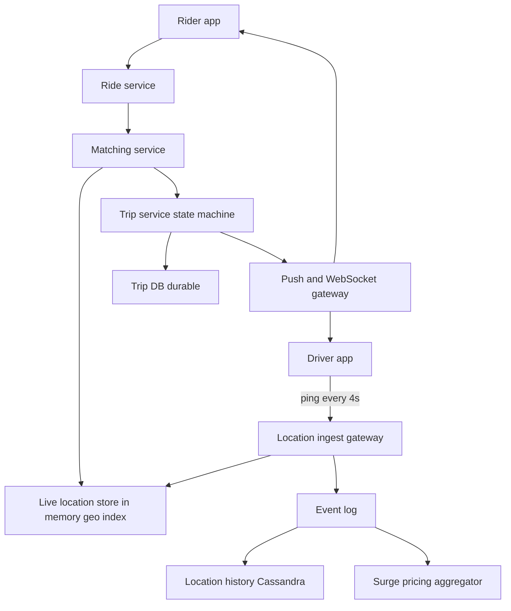
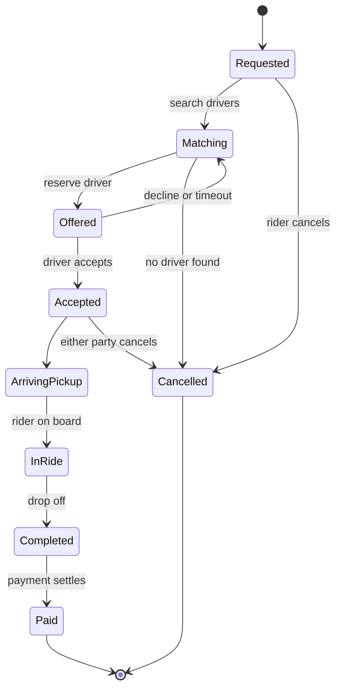

# Design a Ride Sharing Service

"Design Uber" combines four distinct sub-systems: a **write-heavy location firehose** (every driver's phone pings constantly), a **geo-index** answering "who is near this rider right now", a **matching service** that must hand each ride to exactly one driver despite concurrency, and a **trip state machine** that moves money and people through a strict lifecycle. The interview rewards recognizing that these have different shapes — the location stream is ephemeral high-volume data, while trips are low-volume, correctness-critical records. Drive the hour with [[The System Design Interview Framework]]; [[Uber Architecture]] is the production reference behind this note.

## Requirements clarification

**Functional**
- Riders request a ride from A to B; nearby drivers are found and offered the trip; one accepts.
- Both parties see live location and trip status in real time.
- Trip lifecycle: request → match → pickup → in-ride → completion → payment (payment itself delegated — see [[Design a Payment System]]).
- Surge pricing by area (clarify whether pricing detail is in scope; usually a deep-dive option).
- Driver and rider apps are both first-class clients.

**Non-functional**
- Scale anchors to agree: **1M concurrent online drivers**, ~10M ride requests/day.
- Matching latency: a rider should see a driver assigned within a few seconds.
- Location freshness: displayed driver positions at most a few seconds stale.
- Trip state and money events must be durable and auditable; location pings may be lossy — **stating that asymmetry is the design insight interviewers look for**.

## Back-of-envelope estimation

**Location ingestion — the write-heavy core**

- 1M online drivers × 1 ping / 4 s = 10⁶ / 4 = **250,000 location writes/s** sustained — before riders (whose apps also report location during trips; add roughly half again at peak → ~350–400K/s).
- Each ping ≈ 100 B (driver ID, lat/lng, heading, speed, timestamp) → 250K × 100 B = **25 MB/s** of ingest — trivial bandwidth, brutal write *rate* for any disk-backed per-row store. Conclusion: current locations live **in memory**, keyed by driver, and the durable system only samples the stream.
- Location *history* (for safety, disputes, analytics): 250K/s × 86,400 ≈ **21.6 billion points/day** ≈ 2.2 TB/day at 100 B — an append-only, time-ordered workload, which is exactly the write-optimized shape [[Cassandra and Wide-Column Stores]] / LSM engines ([[B-Tree vs LSM-Tree]]) are built for.

**Matching volume**

- 10M requests/day ≈ 115/s average, peak ~5× in commute hours → **~600 matches/s** — three orders of magnitude below location ingest. Matching is not a throughput problem; it is a *correctness-under-concurrency* problem.

## High-level design

- **Location ingest gateway** — terminates driver connections, validates, stamps, and fans pings to the live store and the event log. Stateless, horizontally scaled.
- **Live location store** — in-memory geo-index of current driver positions + status (available / on-trip). The queryable "where is everyone *now*"; rebuilt from the ping stream after any loss, because pings keep arriving — self-healing by nature.
- **Event log** ([[Kafka Architecture|Kafka]]-class) — the same ping stream consumed by history writers, surge aggregation, and analytics ([[Message Queues vs Event Logs]]).
- **Matching service** — finds candidate drivers, runs the offer/accept protocol, guarantees single assignment.
- **Trip service** — owns the trip state machine and the durable trip record; the correctness-critical core.
- **Push gateway** — persistent channels ([[WebSockets Server-Sent Events and Long Polling|WebSockets]] or mobile push) to both apps for offers, status changes, and peer location.

## Deep dives

### 1. Geo-indexing: cells, not coordinates

"Drivers within 2 km of this point" on raw lat/lng requires a 2-D range scan — hostile to hash and B-tree indexes alike. The standard move: **discretize the world into cells** and index drivers by cell ID.

- **Geohash** interleaves lat/lng bits into a string; longer prefix = smaller cell; nearby points *usually* share prefixes. Cheap and index-friendly, but cells are rectangles that distort with latitude, and prefix adjacency fails at cell boundaries (two adjacent points can have very different geohashes), so you must always query the cell *and its 8 neighbors*.
- **H3** (Uber's open-source system — [[Uber Architecture]]) uses **hexagonal cells** in a hierarchy of resolutions. Hexagons have uniform neighbor distance (6 equidistant neighbors, no corner-adjacency weirdness), which makes ring queries ("this cell plus k rings") clean — exactly the nearby-driver query. Uber built H3 for this and for surge zone aggregation.
- Live index structure: `cell ID → set of driver IDs` plus `driver ID → current cell, position, status`, both in memory (Redis or an in-process store on sharded match nodes). A driver's ping updates position and, occasionally, moves them between cell sets — two cheap map operations per ping, which is how 250K writes/s stays feasible.
- **Nearby search**: compute the rider's cell at a resolution where a cell ≈ 1–2 km, gather drivers from the cell + k rings, then *re-rank the candidates by estimated time of arrival* (road-network ETA from a routing service), not straight-line distance — a river between rider and driver makes Euclidean ranking wrong; say this unprompted.

### 2. Matching without double-dispatch

The race: two concurrent ride requests find the same nearest driver; both offer; both "assign". One rider's car never comes. The design must make **assignment exclusive** without global locks.

Offer/accept protocol:

1. Matcher ranks candidates (ETA, rating, driver acceptance history).
2. **Reserve**: atomically flip the driver's status `available → offered` (a compare-and-set in the live store — atomic because each driver's state lives on exactly one shard and the operation is single-key, [[Distributed Locking|no distributed lock needed]]). A driver already `offered`/`on-trip` fails the CAS and the matcher moves to the next candidate.
3. Offer pushed to the driver app with a **timeout** (~10–15 s).
4. Accept → trip created, driver `on-trip`. Decline or timeout → CAS back to `available`, offer the next candidate. Timeout handling must be server-side (the driver's phone may be in a tunnel) — a reaper reclaims expired offers.
5. Idempotency throughout: the accept message carries the offer ID; a duplicate or late accept for an already-reassigned offer is rejected cleanly ([[Idempotency]]).

Sequential offers (one driver at a time) keep the invariant trivially; broadcast offers ("first to accept wins") raise acceptance speed but need the same single-winner CAS at trip creation — name the trade-off. Partitioning matchers **by city/region** keeps each driver's state and most races local to one shard ([[Sharding]]).

### 3. The trip state machine

Trips move money and carry legal weight — they get a durable, strict state machine, in contrast to the lossy location stream:

- Every transition is **validated against the current state** (no `Completed → InRide`), written transactionally to the trip DB, and emitted as an event for downstream consumers (receipts, analytics, driver earnings). Illegal transitions from buggy or delayed app messages are rejected, not applied — the server owns the state machine, clients merely propose transitions.
- Cancellation is the messy real-world path: it can race acceptance (rider cancels as driver accepts). Resolve races by serializing transitions per trip (single-row transaction / version check) and defining the tie-break in product terms (grace periods, cancellation fees) rather than pretending they can't happen.
- Payment transitions follow the pending-state discipline of [[Design a Payment System]] — `Completed` and `Paid` are separate states precisely because payment can fail independently of the physical trip.

### 4. Surge pricing

- Supply/demand per cell: consumers of the event log maintain, per H3 cell at a coarse resolution, counts of open requests vs available drivers over a sliding window.
- A surge multiplier function maps the imbalance to a price factor; smoothed over time and space (neighboring cells shouldn't differ 3×) to avoid flapping and boundary gaming.
- Surge is read at *quote* time and **frozen into the trip record** at request time — the price the rider accepted is the price, regardless of how surge moves during matching; an auditable pricing decision, not a live lookup.
- This is an [[CQRS|aggregate-and-read]] pipeline off the same stream as everything else — no new ingestion needed; cell-based aggregation is the second thing H3 buys you.

### 5. Channels to both parties

- Both apps hold a persistent channel: WebSocket when the app is foregrounded, platform push (FCM/APNs) as wake-up fallback — [[WebSockets Server-Sent Events and Long Polling]].
- Connection gateways are stateful (they hold sockets): a registry maps user → gateway node so services can route a message to the right node; gateway death drops sockets and clients reconnect to any node (state is server-side elsewhere, so reconnect is cheap — [[Stateless vs Stateful Services]] applied honestly: the *session* is sticky, the *data* is not).
- During a trip, the driver's pings are relayed to exactly one rider — a point-to-point forward through the gateway, not a pub/sub fan-out problem.

## Scaling and failure handling

- **Shard by geography** (city/region) end to end: location shards, matchers, surge aggregation all partition cleanly because riders and drivers interact only locally. Cross-shard concerns are rare (airport boundaries) and handled by querying two shards.
- **Live location loss is self-healing**: if a location shard dies, the next 4-second ping wave repopulates a replacement from scratch within seconds; only matching in that region degrades briefly. This is why keeping it in memory is safe — and why the *durable* stream (Kafka → Cassandra) exists separately for anything that must survive.
- **Trip DB** is the component that gets real durability engineering: synchronous replication, backups, per-trip serialization ([[Replication]]); 600 writes/s makes this easy — the correctness-critical core is deliberately the low-throughput one.
- **Matching under partition**: if the matcher can't reach the live store for a region, fail the request fast with a retry hint ([[Load Shedding and Graceful Degradation]]) rather than matching on stale positions — a stale match wastes a driver and strands a rider.
- **Offer reaper redundancy**: expired-offer reclamation must survive matcher crashes — leases with TTLs in the store itself, not timers in a process's memory.
- **Degraded modes**: surge unavailable → default multiplier 1.0 (lose revenue, keep rides); ETA service down → rank by distance (worse matches, still matches). Enumerate what degrades versus what stops: trips and money never run in degraded mode.

## Common mistakes

- Storing live driver locations as rows in a relational DB and querying with `WHERE lat BETWEEN … AND lng BETWEEN …` — both the write rate (250K/s) and the query shape kill it; cells + memory is the answer.
- Treating location pings and trip records with the same durability — over-engineering the firehose, under-engineering the money.
- Matching by straight-line distance with no ETA re-rank.
- No offer timeout, or client-side-only timeout — a driver in a tunnel freezes matching for that rider forever.
- Double-dispatch: no atomic reserve step; two riders assigned the same driver.
- Letting clients drive state transitions directly ("app says trip completed, so it is") instead of server-validated transitions.
- Forgetting geohash boundary adjacency (querying one cell, not cell+neighbors) — the rider standing near a cell edge sees "no drivers" while one idles 200 m away.

## Check yourself

> [!question]- Q: Explain why driver locations live in memory while trips live in a replicated transactional store — and why the reverse allocation would be wrong.
> Locations are high-rate (250K/s), ephemeral (superseded every 4 s), and self-healing (the stream repopulates any loss within one ping interval) — durability would buy nothing and cost everything at that write rate. Trips are low-rate (~hundreds/s), long-lived, legally and financially binding, and not reconstructible from thin air — they need transactions, replication, and audit trails. Reversed, you'd have a trip record that vanishes on a node restart (money lost, disputes unresolvable) and a location store grinding disks to durably record positions that are stale before the fsync completes.

> [!question]- Q: What happens if two ride requests arrive 50 ms apart and the same driver is the best candidate for both?
> Both matchers rank the driver first. Both attempt the reserve CAS on the driver's status key. The CAS is atomic on the single shard owning that driver: one request flips `available → offered` and proceeds to push the offer; the other's CAS fails (state is no longer `available`) and it immediately moves to its next-ranked candidate. No lock is held across the network; the loser lost microseconds, not seconds. If the first driver declines, they return to `available` and may legitimately be offered the second trip later.

> [!question]- Q: A region's live-location shard crashes at peak hour. Walk the next 30 seconds.
> Sockets and ping writes to that shard fail; the ingest gateway buffers briefly or drops (pings are lossy by contract). Matching in that region fails fast — riders see "finding drivers" slightly longer. A replacement shard (standby or respawned) starts empty; within one ping interval (~4 s) most online drivers have written their position into it; within ~10 s coverage is effectively full because every driver pings continuously. Matching resumes on fresh data. Trips in progress were never touched — their state is in the trip DB, and the driver/rider channels reconnect to gateways independently. Total user-visible damage: a few seconds of delayed matching in one region.

> [!question]- Q: Design the variant — food delivery (restaurant → courier → customer) on this same platform.
> Reuse: location ingest, geo-index, channels, surge-style demand signals. What changes: matching becomes **three-sided and time-shifted** — the courier must arrive when the food is ready, so you match against a *predicted* ready time (kitchen prep estimates become a core model, with its own feedback loop) and batching appears (one courier, two orders along a route) turning assignment into small-scale route optimization rather than nearest-available. The state machine grows states (order placed → kitchen accepted → preparing → ready → picked up → delivered) with more external failure modes (kitchen rejects, item unavailable). Trip pricing splits into customer fee, courier pay, restaurant commission — three ledgers. Name the structural shift: ride-sharing matches instantaneous supply to instantaneous demand; delivery schedules a courier to intercept a future event.

## Sources

- Alex Xu, *System Design Interview Vol. 2* (with Sahn Lam), chapter "Nearby Friends" and "Proximity Service" — cell-based geo-indexing patterns this design uses.
- Uber Engineering blog: "H3: Uber's Hexagonal Hierarchical Spatial Index" (2018) — why hexagons, surge aggregation per cell.
- Uber Engineering on dispatch (DISCO) and marketplace architecture — offer/accept matching in production; see [[Uber Architecture]].
- [[The Dynamo Paper]]-lineage stores for append-heavy location history: see [[Cassandra and Wide-Column Stores]].
