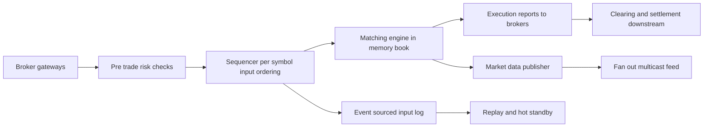

# Design a Stock Exchange

An exchange matches buy and sell orders. What makes it unlike every other problem in this module is the **physics**: matching decisions happen in **microseconds**, fairness is a legal obligation, and every event must be perfectly auditable and replayable. The general-purpose toolkit — load-balanced stateless services, a replicated database, a message broker — is *too slow and too nondeterministic* for the hot path; the design instead centers on a single-threaded, in-memory, event-sourced matching engine per symbol. Recognizing that this problem has different physics, and saying so early, is most of the interview. Frame it with [[The System Design Interview Framework]], then deliberately depart from the usual answers.

## Requirements clarification

**Functional**
- Clients (brokers/members) place, amend, and cancel **limit orders** (and market orders) for listed symbols.
- The exchange matches orders by **price-time priority**, producing executions (fills).
- **Market data**: every participant sees the order book and trades — in real time, and *fairly* (no one systematically sees data earlier).
- **Pre-trade risk checks**: reject orders violating limits (position, notional, fat-finger bands) before they reach the book.
- Post-trade: executions feed clearing and settlement (downstream — out of scope beyond the handoff; money-level discipline lives in [[Design a Payment System]]).

**Non-functional**
- Latency: order-to-ack and order-to-execution in **tens to hundreds of microseconds** at major venues (roughly — published figures vary); jitter matters as much as the mean, because variable latency is unfair latency.
- Throughput: ~1M+ orders/s exchange-wide at peak (large venues report this order of magnitude).
- **Determinism**: identical input sequence ⇒ identical output, always — the foundation of fairness, auditability, and HA.
- **Fairness**: strict arrival-order processing; no queue jumping by anyone, including the exchange's own systems.
- Zero data loss; complete audit trail; regulator-grade replayability.
- Availability: an exchange that is *up but wrong* is worse than down — fail closed, halt trading on doubt.

## Back-of-envelope estimation

Latency budget — this is where the "different physics" claim becomes arithmetic ([[Latency Numbers Every Engineer Should Know]]):

- Target: ~100 µs order-to-ack. Now price the usual suspects:
- One network hop within a datacenter ≈ 50–500 µs (kernel TCP stack) — **one ordinary hop can blow the entire budget**, which is why exchanges use kernel-bypass networking and brokers colocate.
- A single SSD write ≈ 50–100 µs; a replicated DB commit (network + fsync + ack) ≈ **1–10 ms = 10–100× the whole budget**. Any design with "write order to database, then match" is dead on arrival.
- Main-memory access ≈ 100 ns; an L2 hit ≈ 5 ns. Matching against an in-memory book costs **hundreds of nanoseconds to single-digit µs** — 100 µs is *generous* if and only if everything stays in memory and in one thread (no lock acquisition, no context switches — a contended lock or scheduler preemption costs 1–10+ µs each, i.e., several percent of budget per incident).

Throughput sanity:

- 1M orders/s ÷ ~10K active symbols is ~100/s per symbol on average, but volume is wildly skewed — a hot symbol may see **100K+ messages/s**. One modern core executing ~10⁸–10⁹ simple ops/s can process a book operation in well under 1 µs → a single-threaded engine comfortably sustains ~1M ops/s *per core*. Conclusion: **one thread per symbol (or symbol group) is not a compromise — it is faster than any locked multi-threaded alternative**, and it buys determinism for free.
- Audit log: 1M msgs/s × ~100 B ≈ 100 MB/s of append — easily sustained by sequential writes; ~8.6 TB/day per full-rate day, so retention tiers matter but the write path doesn't strain.

## High-level design

- **Gateways** terminate member sessions (binary protocols — FIX for breadth, native binary for speed), normalize, and timestamp on arrival.
- **Pre-trade risk** — synchronous, in-path, microsecond-budget checks (limits precomputed; the check is comparisons against cached numbers, never a DB call).
- **Sequencer** — assigns each symbol's messages a single, gapless sequence. *The sequence is the truth*: whatever order the sequencer assigns is, by definition, the order of the market.
- **Matching engine** — one single-threaded engine per symbol (partition — [[Sharding]] by symbol, the cleanest partition key imaginable: no cross-symbol matching exists by definition). Consumes its input sequence, mutates the in-memory book, emits executions and book deltas.
- **Input event log** — the sequenced input stream, durably appended: the event-sourced source of truth ([[Event Sourcing]]).
- **Market data publisher** — broadcasts book updates and trades on a separate path from order flow.
- **Hot standbys** — replicas consuming the same input log, reconstructing identical state by determinism.

## Deep dives

### 1. The order book: price-time priority

The **limit order book** per symbol holds resting orders on two sides:

- **Bids** (buys) sorted by price *descending*, **asks** (sells) ascending; within a price level, FIFO by arrival sequence — **price-time priority**: better price wins; at equal price, earlier order wins. This is the fairness rule, mechanized.
- Structure: a sorted container of **price levels** (array-backed or intrusive structures beat generic trees in practice — levels cluster near the touch and cache locality dominates at this scale), each level a FIFO queue of orders, plus a hash map `order_id → order` for O(1) cancel/amend — and cancels are a huge share of real flow (often the *majority* of messages), so cancel cost matters as much as insert.
- **Best bid/ask in O(1)** — top-of-book pointers maintained incrementally.
- Matching an incoming buy: while it has remaining quantity and the best ask price ≤ its limit price, fill against the ask queue head (trade price = *resting* order's price), pop exhausted orders, step to the next level; any remainder rests on the bid side. Market orders are the same loop without the price bound. Every step is pointer arithmetic on hot cache lines — this is where the sub-microsecond match comes from.

### 2. Single-threaded determinism: sequencing instead of locks

The move that organizes the whole design: **concurrency is eliminated, not managed.**

- All inputs for a symbol pass through the sequencer, which linearizes them into one numbered stream. The engine consumes that stream on **one thread**: no locks, no CAS retries, no interleavings — and therefore **no nondeterminism**. Given input events 1…n, the book state and every output are a pure function of the sequence.
- Why determinism is the prize: (a) **fairness** — order of processing equals the one publicly defined order of arrival-at-sequencer; no interleaving luck; (b) **audit** — a regulator asking "why did order X trade at Y?" gets a replay, not a theory; (c) **HA** — a standby replaying the same log *is* the engine (deep dive 4); (d) **testing** — replay a day's log against a code change and diff outputs byte-for-byte.
- Determinism's fine print: the engine must be *actually* pure — no wall-clock reads (time comes stamped in events), no hash-map iteration order leaking into decisions, no floating point where associativity varies; prices are integer ticks ([[Design a Payment System]]'s integer-minor-units rule, same reason).
- The pattern generalizes (LMAX "Disruptor" architecture popularized it): when correctness-per-event is everything and events are small, **a single thread with in-memory state and an input log beats a locked concurrent system on both speed and simplicity**. Mechanical sympathy: one thread pinned to one core keeps the book in L1/L2; locks and thread migration destroy exactly that.

### 3. Event sourcing — actually mandatory here

[[Event Sourcing]] is usually a trade-off; here it is the only design that satisfies the requirements:

- **The sequenced input log is the system of record.** Book state is a projection; executions are outputs of a deterministic function of the log. Persist the log (sequential append — the one disk pattern fast enough), and state needs no synchronous persistence at all.
- The audit requirement collapses to "keep the log": every historical market state is reconstructable by replay to sequence n. Regulators and surveillance teams consume replays and the derived streams.
- Snapshots (periodic book images) bound recovery time — standard event-sourcing practice: recover = load snapshot + replay tail.
- Contrast to state-persisting designs: a DB holding "current orders" with mutations loses the *ordering* and *causality* of events, cannot prove fairness, and its commit latency was already fatal in the estimation. Here the log isn't an audit *add-on* — it is the engine's input, so audit, recovery, and processing are the same artifact. Immutable, append-only, replayable — the audit-evidence discipline fintech requires, taken to its logical extreme.

### 4. HA by deterministic replay and hot standby

A single-threaded in-memory engine sounds like a single point of failure — determinism is what makes it highly available:

- **Hot standbys consume the identical sequenced log** and apply it to their own in-memory book. Determinism guarantees their state matches the primary's *exactly* at every sequence number — replication without replicating state, just the inputs ([[Replication]] in its leader-based form, where the replicated thing is the input log).
- Failover: standby detects primary death (or an arbiter does — [[Split Brain and Fencing|fencing]] so two engines never both emit), confirms it has consumed the log to the last acknowledged sequence, and takes over emitting from sequence n+1. Gap-free sequences make "where to resume" unambiguous.
- The engine only acknowledges/emits effects for events that are **durably logged and replicated** — the log write (to multiple log nodes in parallel) is the one synchronous durability point in the hot path, engineered to tens of microseconds with sequential appends and kernel-bypass networking.
- Recovery of a cold node: snapshot + tail replay, then join as standby. Disaster recovery: the log ships to a second site; the honest statement is that microsecond-synchronous cross-region replication is physically impossible (~ms of light-speed RTT), so inter-site failover accepts either a halt-and-verify pause or a defined exposure window — exchanges choose *halting* ([[Disaster Recovery]]: for a market, integrity > continuity; trading halts exist for exactly this reason).

### 5. Market data fan-out — separated from the order path

Thousands of participants want every tick; one slow consumer must never back-pressure matching ([[Backpressure and Flow Control]] solved by *isolation*, not throttling):

- The engine emits book deltas/trades to a **publisher on a separate path**; the matching thread never blocks on distribution.
- Classic distribution is **UDP multicast** within the venue: the switch replicates packets to all subscribers in hardware — one send, n deliveries, no per-subscriber state, and crucially **near-identical delivery time to all subscribers** — fairness at the physical layer. Reliability over multicast: gap detection by sequence number + a separate retransmission/snapshot service (consumers detect loss themselves — cheaper than per-subscriber TCP and fairer than serial sends).
- **Fairness and colocation honesty**: speed-of-light differences mean a colocated subscriber beats a remote one no matter what you do. Venues sell colocation and then normalize *within* it — equal cable lengths per rack, per-port switch monitoring — so fairness means *equal opportunity at the venue boundary*, not equal latency worldwide. Internal consumers (surveillance, the exchange's own systems) get the same feed with no early peek. Say this honestly; pretending fan-out can be globally simultaneous is a red flag.
- WAN distribution (vendors, retail) is a tiered, slower, often conflated feed — different product, different path, same source of truth.

### 6. Pre-trade risk — fast and in-path

- Every order passes risk checks *before* sequencing: per-member position and notional limits, price bands (reject limit prices absurdly far from last trade — fat-finger protection), rate limits per session, self-match prevention policy.
- Budget: single-digit µs ⇒ checks are comparisons against **precomputed, in-memory** limits, updated asynchronously from post-trade systems. No remote calls on the hot path, ever.
- Risk rejects are themselves logged events (audit covers refusals too — an auditor asks "why *didn't* this order trade" as often as why it did).
- Fail closed: a member whose risk state is unavailable gets rejected, not waved through — identical principle to [[Design a Payment System]], different timescale.

## Scaling and failure handling

- **Scale by symbol partitioning**: symbols are independent markets; engines scale horizontally with zero cross-engine coordination. Hot symbols get dedicated cores/hosts; cold symbols share an engine. Cross-symbol *products* (baskets, auctions) are deliberately special-cased off the continuous hot path.
- **Sequencer availability**: itself replicated with fenced failover — it is the fairness-critical component; its clock and admission order define the market.
- **Backpressure at the edge**: per-session input rate limits at gateways protect the sequencer; a misbehaving algo gets throttled/disconnected at its port, never inside the engine.
- **Failure honesty table**: gateway dies → its sessions drop, members reconnect to peers (session state minimal by protocol design); engine dies → standby promotion in milliseconds, sequence-gap-free; log quorum unreachable → **halt the symbol** (no acks without durability — fail closed); sequencer ambiguity/split-brain risk → halt, verify, resume. Exchanges *do* halt — a designed halt with clean state beats undefined behavior at microsecond speed, and the replay log makes resumption provably consistent.
- **Monitoring**: latency histograms at every hop (p99.9, not averages — jitter is the enemy), sequence-gap alarms, standby lag in sequence numbers, book-checksum comparisons between primary and standbys (continuous determinism verification — divergence is a sev-1 even with no visible failure).

## Common mistakes

- Reaching for the standard web stack: stateless services + shared DB + broker. Each adds milliseconds and nondeterminism; the estimation already showed one DB commit is 10–100× the latency budget.
- Multi-threading the book with locks "for performance" — slower under contention *and* nondeterministic: the worst of both worlds. Sequencing + single thread is the answer.
- Persisting state instead of inputs — losing replayability, fairness proof, and cheap HA in one decision.
- Market data on the order path (engine blocks on a slow subscriber) — matching latency now depends on the slowest consumer in the room.
- Floating-point prices/quantities — non-associative, rounding-dependent, audit-hostile; integer ticks and lots, always.
- Ignoring cancels — real books see more cancels than trades; a design with O(n) cancel melts under genuine flow.
- Pretending global fairness is achievable — the credible answer is measured, normalized fairness at the venue boundary plus equal internal treatment, stated plainly.
- Risk checks via a remote service call per order — the budget died at the first network hop.

## Check yourself

> [!question]- Q: Explain why a single-threaded matching engine outperforms a lock-based multi-threaded one — and what the single thread costs you.
> The book is one shared mutable structure with strict ordering semantics; threads would serialize on its locks anyway, so parallelism buys nothing while adding lock acquisition (µs-scale under contention), cache-line bouncing between cores, and context switches — pure overhead on a budget of ~100 µs. One pinned thread keeps the book hot in L1/L2 and processes an event in well under a µs: faster *and* deterministic, which multi-threading can never be (interleavings vary run to run, killing fairness proofs, replay, and standby equivalence). The cost: per-symbol throughput is capped at one core — mitigated because symbols partition perfectly — and the engine must stay rigorously non-blocking: one stray I/O call or allocation stall on that thread stalls the entire symbol.

> [!question]- Q: What happens when the primary engine for a symbol crashes mid-stream?
> Inputs were only acknowledged after durable, replicated log append, so nothing acknowledged can be lost. The hot standby has been consuming the same sequenced log; on failure detection it is fenced in as the only legitimate emitter ([[Split Brain and Fencing]]), finishes consuming to the last durable sequence, and resumes emitting from the next event. Determinism guarantees its book equals the dead primary's at that sequence — not approximately, byte-for-byte. Members may see a pause of milliseconds and possibly duplicate execution reports for the boundary events (reports carry sequence numbers; consumers dedup — [[Exactly-Once Delivery Is a Lie]] applies to the *reports*, never the matches). What is impossible by construction: a lost fill, a double fill, or two engines matching concurrently.

> [!question]- Q: Why must market data distribution be separated from the order/matching path? Walk the failure if it isn't.
> Coupled design: the engine writes each update to subscribers (or a broker) before processing the next order. One slow consumer — GC pause, saturated link — back-pressures the engine; matching latency for *everyone* now tracks the slowest subscriber, and an attacker can slow the market by subscribing badly. Jitter explodes, fairness dies (your fill time depends on someone else's consumer), and an outage in distribution halts matching. Separated: the engine appends to an in-memory handoff and moves on; the publisher multicasts best-effort with sequence numbers, and gap-recovery is the *consumer's* asynchronous problem. Matching performance becomes independent of consumption — isolation as the backpressure strategy.

> [!question]- Q: Design the variant — a crypto exchange running 24/7 with retail users and no colocation.
> Physics relax: users arrive over the public internet (ms-scale RTT), so microsecond internals stop paying — tens of ms budgets admit more conventional components, though the core remains (sequenced input, deterministic matching, event-sourced log — they're cheap and still buy audit + HA). What gets harder: **no maintenance window** — upgrades must be live (standby promotion as a deployment tool, replay-verified); **custody** — the exchange holds user assets, so an internal ledger with [[Design a Payment System]] discipline (double-entry, immutable, reconciled against on-chain state) becomes half the system; deposits/withdrawals interact with blockchain finality (park credits until n confirmations — fail closed); retail-grade risk (no margin calls on sleeping humans without circuit-breaker UX); and adversarial load (bot storms → aggressive edge rate-limiting). Fairness inverts from colocation normalization to *anti*-advantage measures: speed bumps, batch auctions per interval, and cancel-rate limits are legitimate design choices to name.

## Sources

- LMAX Disruptor / architecture write-ups (Martin Fowler, "The LMAX Architecture", 2011) — single-threaded in-memory matching with event sourcing at ~ms-to-µs scale.
- Alex Xu, *System Design Interview Vol. 2*, chapter "Stock Exchange" — matching engine, sequencer, and market-data structure.
- Jane Street / exchange-engineering talks and NASDAQ/NYSE technical overviews on matching, multicast market data (ITCH/OUCH protocol docs are public) — price-time priority and feed design.
- [[The Dynamo Paper]] is the *contrast* read: AP-style design for shopping carts vs CP-and-halt design for markets — comparing them sharpens both.
- *Designing Data-Intensive Applications* (Kleppmann), ch. 11 (streams, logs, determinism) — the log-as-truth foundation.
