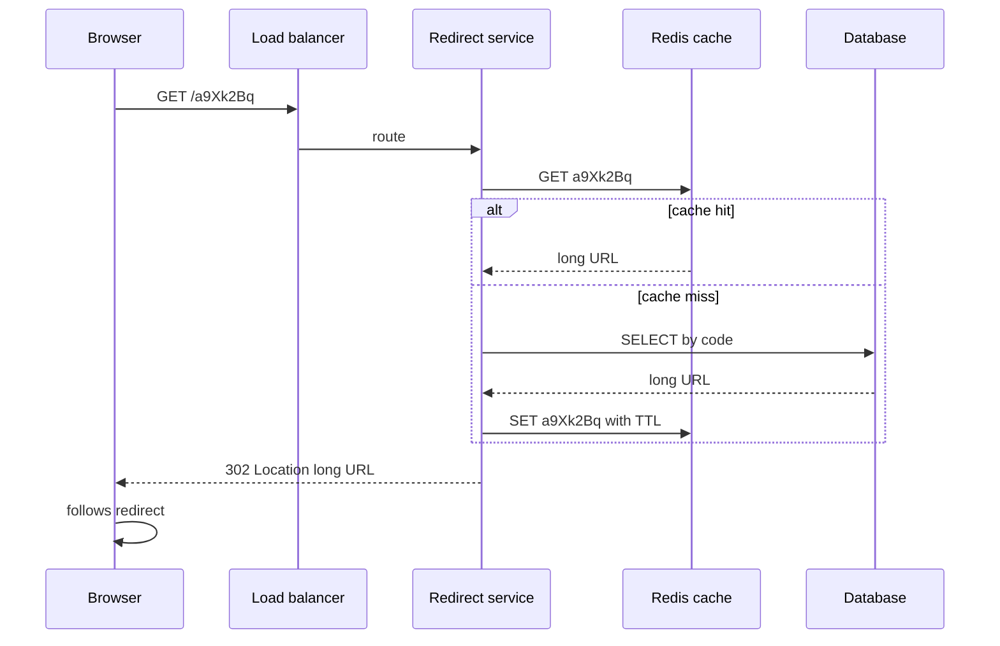

# Design a URL Shortener

The URL shortener (TinyURL, bit.ly) is the "hello world" of system design interviews: small enough to design completely in 45 minutes, yet it touches ID generation, caching, database choice, and an HTTP subtlety (301 vs 302) that most candidates get wrong. Interviewers use it to watch your *method* more than your knowledge — which makes it the ideal first drill for [[The System Design Interview Framework]]. The entire system is two operations: turn a long URL into a short code, and redirect the short code back, extremely fast, forever.

## Requirements clarification

**Functional:**

- **Shorten**: given a long URL, return a short one (e.g. `https://sho.rt/a9Xk2Bq`).
- **Redirect**: visiting the short URL sends the browser to the original long URL.
- **Custom alias** (confirm with interviewer): a user may request `sho.rt/kunal-resume` if free.
- **Expiry** (confirm): links may carry an optional TTL; default is permanent.
- **Analytics** — ask explicitly: "Do we need click counts per link?" The answer changes the redirect status code (see deep dives), so this is a question worth asking out loud.

**Non-functional:**

- **Read latency is the product.** A redirect should add low tens of milliseconds; it sits in front of every click.
- **High availability for redirects** — a down shortener breaks every link ever created. Favor availability over strict consistency ([[CAP Theorem]]): serving a redirect from a slightly stale replica is fine; failing to serve it is not.
- **Short codes must never collide** — two long URLs must never share a code.
- **Codes should not be trivially guessable/enumerable** (a soft security requirement worth mentioning).

**Out of scope** (state it): user accounts and dashboards, spam/malware URL scanning, link preview generation.

## Back-of-envelope estimation

Assume (and state) a bit.ly-class service: **100M new URLs per month**, read:write ratio **100:1** (links are written once and clicked many times).

- **Writes**: 100M / month ≈ 100,000,000 ÷ (30 × 86,400 s) = 100,000,000 ÷ 2,592,000 s ≈ **40 writes/sec** average; × 3 for peak ≈ **120/sec**. Tiny.
- **Reads**: 40 × 100 = **4,000 redirects/sec** average; peak ≈ **12,000/sec**. This is the number that drives the design — read-heavy, cache-friendly.
- **Storage**: keep links 5 years → 100M × 12 × 5 = **6 billion rows**. Each row ≈ 500 bytes (long URL averages ~200 bytes, plus code, timestamps, metadata) → 6 × 10⁹ × 500 B = **3 TB**. Comfortable for one replicated database; sharding is optional headroom, not a day-one need.
- **Bandwidth**: reads 4,000/sec × ~500 B ≈ **2 MB/sec** egress. Negligible — say so, and move on.
- **Key space**: Base62 (a–z, A–Z, 0–9) with 7 characters gives 62⁷ ≈ **3.5 trillion** codes — 580x our 6B need. Seven characters is the answer; six (62⁶ ≈ 57B) would work but leaves less headroom.

The sentence that earns the points: *"120 writes/sec is nothing; 12K reads/sec with strict latency means the design is really a cache with a database behind it."*

## High-level design

**API** (behind an [[API Gateway]]):

- `POST /api/urls` → body `{longUrl, customAlias?, ttl?}` → `201 {shortUrl}`
- `GET /{code}` → `301/302 Location: <longUrl>` (this is the hot path)
- `GET /api/urls/{code}/stats` → click counts (if analytics in scope)

**Data model** — one table/collection: `code (PK) | long_url | created_at | expires_at | user_id?`. Access pattern is a single key→value lookup by `code`; no joins, no scans.

Write path: `POST` → generate code → insert row → return. Read path: as diagrammed — cache first, database on miss. Get buy-in: "The interesting parts are key generation and the redirect semantics — which first?"

## Deep dives

### 1. Key generation — three approaches, compared

**(a) Counter + Base62.** Keep a global auto-incrementing counter; Base62-encode each value (`125` → `cb`). Encoding is a repeated divide-by-62: e.g. 11157 = 2×62² + 55×62 + 59 → `c3X` (0→`a` mapping). Collisions are impossible by construction, codes are short, generation is O(1). The catch: the counter itself is a single point of coordination — exactly the problem [[Design a Distributed ID Generator]] exists to solve (Snowflake-style IDs, or per-node counter ranges) — and sequential codes are **enumerable**: a scraper can walk `a9Xk2Bq`, `a9Xk2Br`, … and harvest every private link. Mitigation: bijectively scramble the counter value (fixed permutation) before encoding.

**(b) Hash + collision handling.** `code = first 7 chars of base62(MD5(longUrl))`. No coordination needed and the same URL maps to the same code (free dedup). But truncating a hash to 7 chars *will* collide eventually (birthday problem — with billions of keys, truncated-hash collisions are a certainty, not a risk), so every insert needs a collision check: insert with the code as a unique key; on conflict, append a salt and re-hash. Writes become retry loops under load.

**(c) Pre-generated Key Generation Service (KGS).** An offline job pre-generates random unique codes into a key pool; app servers fetch *batches* of keys (e.g. 10,000 at a time) and hand them out from memory. Generation cost is paid ahead of time, codes are random (non-enumerable), no runtime collision checks, and the batch model means the KGS is not on the hot path. Costs: one more component to operate, keys in a crashed server's in-memory batch are lost (acceptable — the space is vast), and the KGS needs its own replication.

| Approach | Collision-free | Coordination at write time | Enumerable codes | Extra moving parts |
|---|---|---|---|---|
| Counter + Base62 | Yes | Yes — the counter | Yes (unless scrambled) | ID generator |
| Hash + retry | No — must handle | No | No | None |
| Pre-generated KGS | Yes | No (batch fetch, off hot path) | No | KGS + key pool |

Recommended answer: **KGS or counter-with-scrambling**, and explicitly link the counter option to Snowflake IDs — it shows you see the shared sub-problem.

### 2. 301 vs 302 — and the analytics implication

- **301 Moved Permanently**: the browser **caches the mapping** and on future clicks goes straight to the long URL without touching your servers. Lowest latency and server load — but you are now **blind**: no request means no click counted, so per-link analytics are impossible, and you cannot later change or expire the mapping for that browser.
- **302 Found** (temporary): the browser comes back to you **every click**. Every click is countable, expiry and link-editing work — at the cost of serving every redirect yourself.

The business of real shorteners *is* the click data, so **bit.ly-style services use 302 (or 307)**. Say the trade-off aloud: "301 offloads traffic but forfeits analytics and control; if analytics are in scope, 302 is forced." This tiny question is the most reliable differentiator in this interview.

### 3. Caching the redirect path — and the viral link

With 100:1 skew, a small cache absorbs almost all reads: cache the `code → longUrl` mapping in Redis ([[Caching Strategies|cache-aside]], as diagrammed) with a TTL. Even caching only the ~20% hottest links serves the overwhelming majority of traffic ([[Why Caching Works]]).

The sharp edge: **a viral link is a textbook [[Hot Key Problem]]**. One code tweeted by a celebrity can draw tens of thousands of requests/sec — all hashing to one Redis shard, which melts while the rest of the cluster idles. Mitigations, in escalation order: an **in-process local cache** on each app server for the current top-N codes (immutable mappings make staleness harmless), key replication (`code#1..code#k` copies read round-robin), and [[CDN]]-edge caching of the redirect response itself. Mention also negative caching of known-missing codes to blunt enumeration scrapes hitting the DB.

### 4. Database choice

The workload is a pure key-value lookup at 6B rows / 3 TB, no relational queries, availability-biased. That shape fits a **key-value or document store** (DynamoDB, MongoDB, Cassandra) partitioned by `code` — random codes spread evenly, no [[Hot Partition Problem]] on storage (the *cache* absorbs read skew). A relational DB with a unique index on `code` is also perfectly defensible at 3 TB — the honest answer is "both work; I'd pick whatever the team operates best, leaning KV for the natural fit" ([[Choosing a Database]]). What matters in the interview is deriving the choice from the access pattern, not the brand name.

## Scaling and failure handling

- **Stateless redirect tier** behind a load balancer — scale horizontally at will ([[Stateless vs Stateful Services]]).
- **Database**: leader for writes (a trickle), read replicas for misses; [[Replication]] lag is harmless because mappings are immutable after creation. Shard by hash of `code` only when storage or read-miss volume demands it ([[Sharding]]).
- **Cache down**: 12K reads/sec suddenly hit the DB — survivable if replicas are sized with headroom, but guard against a [[Cache Stampede and Thundering Herd|stampede]] with request coalescing and jittered TTLs.
- **Expiry**: lazy deletion (check `expires_at` on read, return 404/410 if past) plus a background sweep — never a synchronous delete storm at expiry time.
- **Analytics without slowing redirects**: emit a click event asynchronously (queue → aggregator, [[Message Queues vs Event Logs]]) so counting never adds latency to the 302.
- **Multi-region**: redirects are read-mostly and immutable — replicate the store cross-region, serve reads locally, route writes to a home region. Mention it; don't build it unless asked.

## Common mistakes

- **Spending ten minutes on URL syntax or the web tier** and never reaching key generation — the actual problem.
- **Confidently picking 301 "because it's a redirect"** without surfacing the analytics consequence, or claiming 302 is cacheable by default.
- **Hash-truncation with no collision story** — "MD5 and take 7 chars" without the birthday-problem caveat is a correctness bug stated aloud.
- **Sharding a 3 TB dataset on day one** — the estimation you just did says one replicated node holds it; ignoring your own numbers is the anti-signal.
- **Forgetting codes are immutable** — candidates invent cache-invalidation machinery for mappings that never change.
- **No answer for the viral link** — the interviewer *will* ask "what if one link gets 50K clicks/sec?"; arrive with the hot-key ladder ready.

## Check yourself

> [!question]- Q: Explain the three key-generation approaches and which you'd pick, in 60 seconds.
> Counter + Base62: encode an incrementing ID; collision-free and short, but the counter needs distribution (Snowflake-style) and sequential codes are enumerable unless scrambled. Hash + truncate: no coordination, but truncation guarantees eventual collisions, so every write needs a check-and-retry. Pre-generated KGS: random unique keys made offline, fetched in batches — collision-free, non-enumerable, off the hot path, at the cost of one more service. I'd pick KGS, or scrambled counter if an ID generator already exists in the platform.

> [!question]- Q: What happens if you serve redirects with 301 and the product team later asks for per-link click counts?
> You can't deliver them for existing users: browsers that already followed a 301 cached the mapping and will never hit your servers again for that link, so those clicks are invisible and uncountable. You'd switch to 302 for future traffic, but historical reach is unmeasurable and cached 301s keep bypassing you until browser caches expire. This is why the status-code decision must be made from the analytics requirement, not after it.

> [!question]- Q: A link goes viral at 50,000 requests/sec. Walk through what breaks and your mitigation ladder.
> All 50K/sec hash to one Redis shard — a classic hot key; that shard's CPU/network saturates while others idle, latency spikes, and on cache failure the stampede hits the DB. Ladder: in-process local cache on every app server (safe because the mapping is immutable), then replicate the key across shards and read round-robin, then push the redirect response to the CDN edge. The database tier barely notices because the mapping is one cacheable row.

> [!question]- Q: Why is 7 the right code length, shown with the math?
> Base62 gives 62 symbols per character. 62⁶ ≈ 5.7 × 10¹⁰ (57 billion); 62⁷ ≈ 3.5 × 10¹² (3.5 trillion). At 100M new links/month for 5 years we need ~6 billion codes. Six characters covers it ~9x; seven covers it ~580x, leaving decades of headroom and slack for a KGS to discard or lose batches freely. Seven is the standard answer.

> [!question]- Q: Variant drill — design the shortener as multi-region active-active. What changes, and what is the one hard problem?
> Reads are easy: mappings are immutable, so replicate the store to every region and serve redirects locally from regional caches. The hard problem is write-time uniqueness: two regions must never issue the same code. Solutions: partition the keyspace (each region's KGS owns disjoint key ranges — cleanest), region-prefixed codes, or Snowflake IDs with a region/datacenter field ([[Design a Distributed ID Generator]]). Avoid synchronous cross-region coordination on the write path; it imports WAN latency into every shorten call for no user benefit.

## Sources

- *System Design Interview Vol. 1* (Alex Xu) — chapter "Design a URL Shortener"; the estimation shape and KGS discussion follow it.
- *Grokking the System Design Interview* (Design Gurus) — "Designing a URL Shortening Service like TinyURL", source of the KGS pattern's popularity.
- MDN Web Docs — HTTP `301 Moved Permanently` and `302 Found`, for the caching semantics.
- *Designing Data-Intensive Applications* (Kleppmann), ch. 5–6 — replication and partitioning reasoning applied here.
