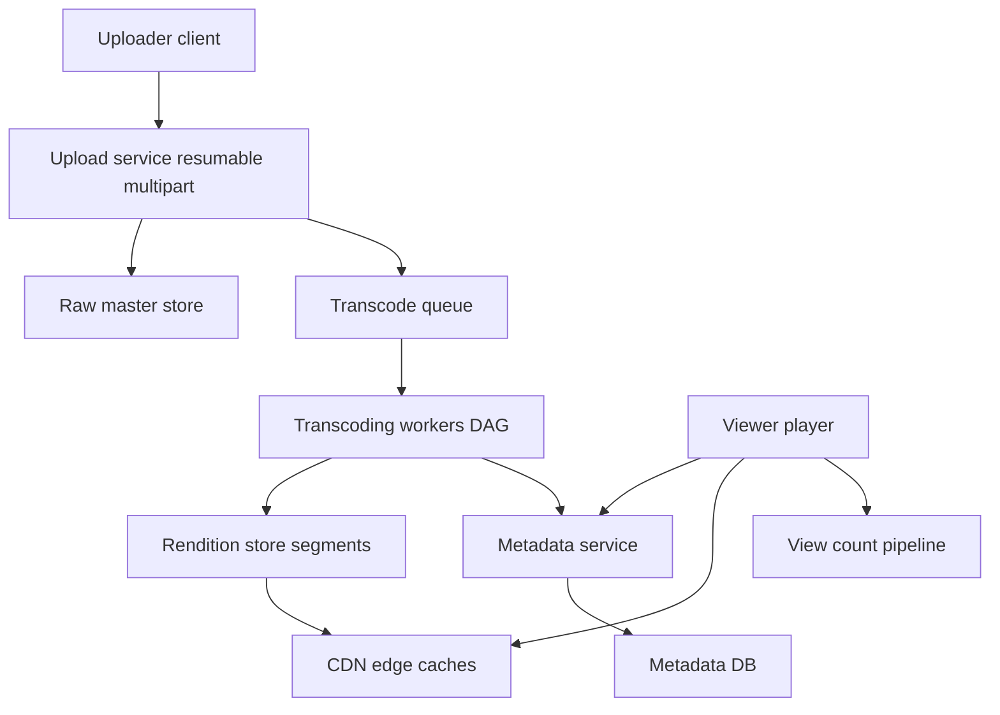

# Design a Video Streaming Service

"Design YouTube" is two nearly independent systems wearing one trench coat: an **ingestion pipeline** (upload → transcode → package) that is batch-like, async, and compute-heavy, and a **delivery system** (CDN + adaptive bitrate) that is read-heavy at planetary scale. The metadata sitting between them — titles, channels, view counts — is an ordinary web backend. Interviewers grade whether you keep these three separated and whether you know that **the CDN is the real delivery system and egress is the real cost**. Structure the hour with [[The System Design Interview Framework]].

## Requirements clarification

**Functional**
- Upload videos (large files — up to multiple GB; uploads must survive network drops).
- Watch videos: smooth playback on any device/network, seek, variable quality.
- Metadata: titles, descriptions, channels, search (clarify: search can be out of scope).
- View counts, likes; comments (often descoped).
- Clarify live streaming out of scope — it changes the transcoding and delivery design substantially.

**Non-functional**
- Scale anchor: roughly YouTube-class — **~500 hours of video uploaded per minute** (YouTube's publicly cited figure, roughly, as of ~2020s) and hundreds of millions of DAU watching.
- Playback must start fast (< ~2 s to first frame) and never rebuffer on a stable connection — smoothness beats fidelity.
- Durability of uploaded masters: a creator's original must never be lost.
- Cost-awareness is a stated requirement at this scale: delivery egress and transcoding compute dominate; the design should name and attack both.

## Back-of-envelope estimation

**Ingest volume**

- 500 hours/min = 500 × 60 = **30,000 minutes of video per minute** of wall-clock time.
- Assume source uploads average ~10 Mbps bitrate: 1 minute of source ≈ 10 Mbps × 60 s = 600 Mb = **75 MB**.
- Ingest rate ≈ 30,000 min/min × 75 MB/min = 2.25 × 10⁶ MB/min = **~2.25 TB/min ≈ 37.5 GB/s** of raw upload traffic.
- Daily raw storage: 2.25 TB/min × 1,440 min = **~3.2 PB/day** of masters, before renditions roughly double-to-triple it. Storage is petabytes/day — blob storage territory ([[How S3 Works]]), with cold tiering mandatory (most videos are rarely watched — long-tail skew).

**Transcoding compute**

- Every uploaded minute is transcoded into ~5–8 renditions (e.g., 240p…2160p). Rule of thumb: transcoding one minute of video into one rendition costs very roughly one minute of a CPU core (H.264, varies hugely by codec/preset — label it rough).
- 30,000 source-min/min × ~6 renditions ≈ **180,000 core-minutes per minute ≈ 180,000 cores busy around the clock** (order of magnitude). Conclusion: transcoding is a massive, elastic, *parallelizable* batch workload — perfect for spot/preemptible fleets, and it must be async.

**Egress — the number that dominates**

- Assume 1 billion watch-hours/day (YouTube has cited more; keep it round) at an average delivered bitrate of ~3 Mbps:
- 10⁹ h × 3,600 s/h × 3 Mbps = 1.08 × 10¹³ Mb. Convert: ÷ 8 = 1.35 × 10¹² MB = 1.35 × 10⁶ TB = **1.35 EB/day delivered**. Average egress rate = 1.35 × 10¹⁸ B ÷ 86,400 s ≈ **~15.6 TB/s ≈ 125 Tbps**.
- **The cost shape**: egress scales with *watch time × bitrate* — linearly with success. Transcode cost scales with *upload volume*; storage with *upload volume × retention*. Egress at commodity CDN pricing (even fractions of a cent per GB) on exabytes/day is why Netflix built Open Connect and YouTube peers directly with ISPs ([[Netflix Architecture]]): at this scale you build or barter your own delivery, because egress is the dominant line item and the only one that grows every time the product succeeds.

## High-level design

Three planes, deliberately separated:

- **Ingest plane**: upload service → raw store → transcoding pipeline → rendition store. Entirely asynchronous — the uploader gets an acknowledgment and a "processing" status, never waits for transcoding ([[Why Async Messaging Exists]]).
- **Delivery plane**: [[CDN]] serving immutable video segments; the origin (rendition store) is only touched on cache miss.
- **Metadata plane**: ordinary request/response services for video records, channels, playback tokens, counts — your familiar Spring-Boot-shaped world, kept strictly apart from the byte-pushing.

The **metadata vs bytes separation** is the load-bearing decision: the player first asks the metadata plane "what is video X" (gets title, available renditions, manifest URL, signed tokens) and then talks only to the CDN for the actual bits.

## Deep dives

### 1. Upload path: resumable multipart → raw storage → queue

- Multi-GB uploads over consumer networks *will* be interrupted; the API must be **resumable**: the client requests an upload session, splits the file into parts (e.g., 10 MB), uploads parts independently (parallelizable), and finalizes. The server tracks received parts; a reconnecting client asks "which parts do you have?" and sends the rest. S3 multipart upload is the canonical implementation — ride it rather than rebuilding it.
- Each part carries a checksum; finalize validates the assembled object. Upload sessions carry an [[Idempotency]] key so a retried finalize doesn't register the video twice.
- On finalize: write master to the raw store, write a metadata record in state `UPLOADED`, and enqueue a transcode job. Use the [[The Outbox Pattern|outbox pattern]] or write-then-enqueue with reconciliation — a master with no job, or a job with no master, are both bugs this ordering prevents.

### 2. Transcoding as a DAG of workers

Transcoding is not one job but a **DAG**: probe/validate → split source into segments → per-segment, per-rendition encode (the wide, parallel middle) → audio tracks → thumbnails/preview sprites → package into HLS/DASH → publish manifest → mark `READY`.

- **Split-and-parallelize is the key insight**: a 2-hour video encoded serially takes hours; split into ~10-second chunks, encoded in parallel on hundreds of workers, wall-clock time collapses to minutes. This works because video is independently encodable between keyframes.
- Orchestrate with a workflow engine or a queue-per-stage: each stage's workers are stateless, pull jobs, write outputs to blob storage, emit completion events. Failures retry per-segment, not per-video ([[Dead Letter Queues and Poison Messages]] for the genuinely broken uploads).
- Priorities: a new upload from a 10M-subscriber channel transcodes before a zero-view archive re-encode — priority queues, and cheap renditions (360p) first so the video is watchable early, high renditions landing later.
- The fleet is elastic and interruption-tolerant (per-segment retry makes spot instances safe) — this is where the 180K-core estimate gets paid for.

### 3. Adaptive bitrate: segments, manifests, and the player

**Adaptive bitrate (ABR)** is why playback survives wobbly networks:

- Each rendition is cut into **segments** of ~2–10 seconds (HLS or DASH). A **manifest** lists renditions and their segment URLs.
- The *player*, not the server, picks quality: it measures recent download throughput and buffer level, and requests the next segment from whichever rendition fits — shifting quality mid-stream with no server coordination.
- Design consequences: every segment is an **immutable, independently cacheable HTTP object** — exactly what a [[CDN]] wants; "streaming" is really sequential HTTP GETs, so no stateful streaming servers exist in the serving path; and seek is just "fetch segments from offset t".
- Mention codecs as a cost lever without drowning in them: H.264 baseline for compatibility, VP9/AV1 cut bitrate ~30–50% for the same quality — at 125 Tbps of egress, a 30% bitrate saving is the single largest cost action available, which is why YouTube transcodes popular videos into AV1 (compute spent once to save egress forever — the compute/egress trade follows directly from the cost shape above).

### 4. CDN as the real delivery system

- Segments are served ~entirely from [[CDN]] edges; with long-tail skew, the popular head (a small fraction of videos) serves the overwhelming majority of watch time — edge hit ratios are very high, and the origin only sees misses and the long tail.
- [[Netflix Architecture]]'s **Open Connect** is the reference: appliances inside ISP networks, *pre-pushed* overnight with predicted-popular content — push beats pull when you can predict demand and the catalog is finite. YouTube's equivalent (Google Global Cache) sits in ISPs too. For an interview: name pull-through caching as the default, push for predictable hits.
- Signed URLs / tokens gate access (the metadata plane issues them; edges validate) so private/paid videos don't leak via shareable segment URLs.
- Origin shielding: a regional cache tier between edges and blob storage prevents a miss storm from hammering the origin ([[Cache Stampede and Thundering Herd]]).

### 5. View counts at scale

A naive `UPDATE views SET count = count + 1` on a viral video is a textbook [[Hot Key Problem|hot key]] — millions of increments/s on one row.

- **Buffer**: players emit view events to a log ([[Kafka Architecture|Kafka]]-class); nothing writes the DB per view.
- **Aggregate**: stream processors window and sum per video (e.g., per 10 s), writing *one* increment per video per window — turning 1M writes/s into dozens.
- **Shard the counter** if even windowed increments are hot: N sub-counters, read = sum — the classic sharded-counter pattern.
- Accept and state the consistency consequence: counts are **eventually consistent and approximate in real time**, exact in daily batch reconciliation — fine for views, and the same pipeline feeds analytics and creator dashboards. (Fraud filtering — bots inflating views — runs in this pipeline too; worth one sentence in an interview.)

## Scaling and failure handling

- **Ingest**: upload service is stateless behind a load balancer; raw store durability is S3-class 11-nines; the transcode queue absorbs bursts (upload spikes don't require instant transcode capacity — the queue *is* the shock absorber, [[Backpressure and Flow Control]]).
- **Transcoding**: per-segment retries; a dead worker's lease expires and another picks up the segment; poison inputs (corrupt video) go to a dead-letter path with human/automated triage rather than retry loops.
- **Delivery**: CDN failure handling is multi-CDN or multi-POP failover via DNS/anycast; the player itself retries alternate edge hosts from the manifest — the client is part of the resilience design.
- **Metadata**: cache-heavy reads (video records are read millions of times per write) — Redis in front of the DB, [[Caching Strategies|cache-aside]], with the stampede protections of [[Cache Stampede and Thundering Herd]] for viral videos.
- **Partial failure honesty**: if transcoding lags, uploads still succeed (status "processing"); if counts lag, playback is unaffected; if metadata is up but CDN tokens fail, nothing plays — token issuance is on the critical path and deserves the availability budget.

## Common mistakes

- **Streaming bytes through your own app servers** — the single biggest error; the design collapses without CDN-served immutable segments.
- Synchronous transcoding in the upload request, or one-job-per-video transcoding with hours of wall-clock latency — missing the DAG/segment parallelism.
- No resumable upload story for multi-GB files on consumer networks.
- Ignoring cost shape: never naming that egress scales with watch time and dominates — at this scale the interviewer expects the economics, stated as *what scales with what*.
- Per-view database increments on viral videos — the hot-key classic.
- Conflating VOD with live streaming — different latency budget, different packaging (LL-HLS), different fan-out; scope it out explicitly.
- Treating the player as dumb — ABR, retry, and failover logic live client-side; a design that puts quality selection on the server reinvents what HLS/DASH already solved.

## Check yourself

> [!question]- Q: Explain why "streaming" video requires no stateful streaming servers in the serving path.
> Because ABR packaging turns a video into a manifest plus thousands of small immutable segment files served over plain HTTP. The player holds all session state (position, buffer, chosen rendition) and issues ordinary GETs for successive segments; any edge or origin node can serve any segment. The server side is therefore a static-file CDN problem — stateless, cacheable, horizontally trivial — and seek, quality switching, and resume all become client-side manifest arithmetic.

> [!question]- Q: What happens if the transcoding fleet falls behind by 6 hours during an upload surge?
> Uploads are unaffected (masters land in the raw store; jobs queue). New videos sit in "processing" longer — a product-visible latency, so priority queues matter: fresh uploads from active channels jump the backlog, low-priority re-encodes yield. The queue depth is the backpressure signal that autoscales the worker fleet ([[Autoscaling]] on queue lag, not CPU); because workers are per-segment and stateless, scale-out converts the backlog to throughput almost linearly. What must NOT happen: upload rejection or job loss — the queue absorbing the surge is the design working as intended.

> [!question]- Q: A video goes from 10 views/day to 10M views/hour after a celebrity shares it. Trace every system that feels it and how each copes.
> CDN: edges miss initially; origin shield absorbs the miss storm; within minutes the segments are hot at edges worldwide and origin traffic drops back to noise. Metadata: the video record becomes a hot cache key — served from Redis with stampede protection; DB sees almost nothing. View counts: the event pipeline windows millions of events into per-window increments; sharded counters absorb the write; the displayed count lags by seconds-to-minutes, by design. Token issuance scales statelessly. The master/renditions don't change at all — immutability means popularity is purely a caching event.

> [!question]- Q: Design the variant — live streaming for 1M concurrent viewers of a single event.
> Ingest becomes a continuous contribution feed (RTMP/SRT) to redundant ingest points; transcoding becomes a real-time pipeline (encode each rendition with a fixed small latency budget, no DAG backfill); packaging shifts to short segments or LL-HLS/chunked transfer for lower glass-to-glass latency (~5–15 s typical; sub-second needs WebRTC — a different architecture, name the fork). Delivery is still CDN segments — but all viewers want the *same newest* segment within the same seconds, so edge-request collapsing/origin shielding is existential, not an optimization. No long-tail storage problem; instead a single white-hot object. DVR/rewind = retaining the segment history. State the key inversion: VOD's problem is breadth of catalog; live's problem is depth of simultaneity on one object.

## Sources

- Alex Xu, *System Design Interview Vol. 1*, chapter "Design YouTube" — upload/transcode/serve structure and the DAG framing.
- [[Netflix Architecture]] / Netflix TechBlog: Open Connect overview and "Per-Title Encode Optimization" — CDN economics and bitrate-as-cost-lever.
- Apple HLS specification (RFC 8216) and MPEG-DASH (ISO/IEC 23009-1) — segments, manifests, client-driven ABR.
- YouTube engineering talks on transcoding at scale and AV1 rollout (Google I/O / blog posts, ~2020s) — compute-vs-egress trade.
- Jeff Dean-style estimation discipline: [[Back of the Envelope Estimation]].
