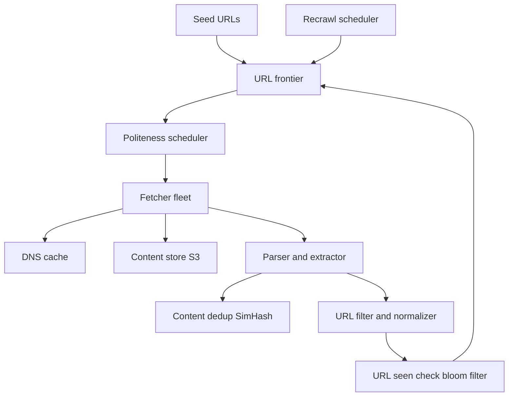

# Design a Web Crawler

A web crawler downloads pages from the web, extracts the links in them, and follows those links to download more pages — the engine behind every search index. The interview tests whether you can design a system that is **massively parallel yet deliberately slow per target**: you want thousands of fetches per second in aggregate, but you must never hammer any single website. That tension — plus deduplicating URLs at billions scale — is what makes this a classic. Work it with [[The System Design Interview Framework]]: the clarification step matters more than usual here because "crawler" can mean a search-engine crawler, a price scraper, or a compliance archiver, and they have different freshness and coverage needs.

## Requirements clarification

**Functional**
- Start from a set of **seed URLs**, fetch pages, extract links, and keep crawling.
- Store page content for downstream indexing (we store; indexing is out of scope).
- Only crawl HTML (clarify: no images/PDFs for v1); follow redirects.
- Respect **robots.txt** and per-site rate limits — politeness is a functional requirement, not a nicety: a crawler that ignores it gets IP-banned and may cause real harm to small sites.
- Recrawl pages periodically so the stored copy stays fresh.

**Non-functional**
- Scale: **1 billion pages per month** (agree this number with the interviewer — all estimation flows from it).
- Robustness: the web is hostile — malformed HTML, infinite URL spaces ("spider traps"), slow servers, redirect loops. The crawler must survive all of it.
- Extensibility: adding new content types or per-domain rules later should not require a redesign.
- Politeness: bounded request rate per domain, honoring `Crawl-delay` where specified (a non-standard directive — not in RFC 9309; some crawlers honour it, Google ignores it).

## Back-of-envelope estimation

Fetch rate from the target:

- 1 billion pages / month. Seconds per month = 30 days × 86,400 s/day = **2,592,000 s ≈ 2.6 × 10⁶ s**.
- Average fetch rate = 10⁹ / 2.6 × 10⁶ ≈ **385 pages/s**.
- Peak at ~2× average → design for **~800 pages/s**.

Storage:

- Average HTML page ≈ 100 KB (roughly — varies widely; state the assumption).
- 10⁹ pages × 100 KB = 10¹⁴ B = **100 TB/month** of raw content.
- Keeping 5 years of history ≈ 100 TB × 60 ≈ **6 PB** — clearly blob storage ([[How S3 Works]]), not a database.

Bandwidth:

- 385 pages/s × 100 KB = 38.5 MB/s ≈ **~310 Mbps** sustained inbound. Comfortably within a small fleet's capacity; the bottleneck will be politeness-limited concurrency, not bandwidth.

Metadata: 1B URLs × ~500 B of URL + state ≈ **500 GB** — fits a sharded datastore easily; the challenge is lookup rate, not size.

## High-level design

Components:

- **URL frontier** — the queue of URLs waiting to be fetched. Not a plain FIFO: it must encode both *priority* (fetch important pages first) and *politeness* (never release two URLs for the same domain too close together). This is the heart of the design — see deep dive.
- **Fetcher fleet** — stateless workers ([[Stateless vs Stateful Services]]) that take a URL, resolve DNS, download the page, and hand content to the parser. Each worker runs many concurrent fetches because fetching is I/O-bound waiting on remote servers.
- **DNS cache** — a crawler resolving millions of hostnames will melt public resolvers and add 10–100 ms per fetch. Run a local caching resolver; respect TTLs ([[How DNS Works]]).
- **Parser/extractor** — parses HTML, extracts outlinks, normalizes them, and emits candidate URLs.
- **Content dedup** — detects pages whose *content* was already seen (mirrors, boilerplate duplicates).
- **URL-seen check** — detects URLs already crawled or already enqueued, at billions scale.
- **Content store** — blob storage for raw pages; metadata (URL, checksum, fetch time, status) in a sharded store.
- **Recrawl scheduler** — re-enqueues known URLs on a freshness schedule.

## Deep dives

### 1. The frontier: priority and politeness together

The naive design — one global queue — fails two ways: it lets one giant site monopolize the crawl, and it fires rapid back-to-back requests at a single domain the moment several of its URLs cluster in the queue.

The classic structure (from the Mercator crawler design) is **two stages of queues**:

- **Front queues implement priority.** A prioritizer scores each URL (PageRank-ish importance, change frequency, depth from seed) and places it in one of k front queues; higher-priority queues are drained more often.
- **Back queues implement politeness.** There are many back queues, each holding URLs of **exactly one domain**. A mapping table tracks domain → back queue. A min-heap keyed by "earliest next allowed fetch time per queue" tells workers which queue may be served next. After a worker fetches from a queue, that queue's next-allowed time is set to `now + delay` (delay = robots `Crawl-delay`, or a default like a few seconds, or adaptive: some multiple of the server's observed response time).

This gives a hard guarantee: at most one in-flight request per domain, spaced by the politeness delay — regardless of how many workers exist.

**robots.txt**: fetch and cache it per domain (cache for ~24 h), evaluate every candidate URL against it *before* enqueueing. Treat an *unreachable* robots.txt (5xx or network error) conservatively — don't crawl, retry later, fail closed, as RFC 9309 requires; a 4xx such as 404 means no rules exist and the site may be crawled.

### 2. URL dedup at billions scale — and bloom filter honesty

Every extracted link must be checked against "have I seen this URL before?" At ~385 pages/s with say 50 outlinks per page, that is ~20K lookups/s against a set of billions of URLs.

- **Exact set** (hash of each URL in a sharded key-value store): 10⁹ × 16-byte hash ≈ 16 GB plus overhead — actually feasible in a sharded Redis or RocksDB tier, at the cost of a network hop per check.
- **Bloom filter**: a 10⁹-element bloom filter at 1% false-positive rate needs ~10 bits/element ≈ **1.2 GB** — fits in RAM on every worker. But be honest about the semantics: a bloom filter's **false positive means the crawler believes it has already seen a URL it has not — that page is silently never crawled**. There are no false negatives, so the filter never causes a double-crawl; *coverage* is what you sacrifice. At 1% FP rate across billions of candidate URLs, you are knowingly dropping millions of pages.
- **Production answer**: bloom filter as a cheap first-pass filter, with "probably seen" results verified against the exact store. That makes a genuinely new URL (bloom says no) a pure in-memory check, and only bloom hits pay the network lookup — be honest that in a mature crawl most extracted links point at pages already seen, so the exact store still absorbs most of the ~20K/s; the bloom filter's job is to keep coverage loss at zero while sparing new URLs the hop. Also note bloom filters don't support deletion, which collides with recrawling — recrawl is driven by the scheduler from the metadata store, not by re-entering the frontier through the dedup check.

### 3. URL normalization traps

Dedup is only as good as normalization — the same page hides behind many spellings:

- Case: scheme and host are case-insensitive (`HTTP://Example.COM` → `http://example.com`); paths are **not** (don't lowercase paths).
- Default ports (`:80`, `:443`), trailing slashes, dot-segments (`/a/./b/../c` → `/a/c`).
- Fragment removal (`#section` never reaches the server).
- Query-parameter ordering (`?a=1&b=2` vs `?b=2&a=1`) — sortable, but beware: some sites are parameter-order sensitive. Session IDs and tracking params (`utm_*`, `jsessionid`) should be stripped by rule lists or every visitor gets a "unique" URL.
- **Spider traps**: calendars that link to the next day forever, faceted search generating unbounded query combinations. Mitigations: max URL length, max path depth, max pages per domain, and detecting high URL-count/low content-novelty domains.

### 4. Content dedup: checksums and SimHash

Roughly 25–30% of web pages are near-duplicates of other pages (mirrors, print views, boilerplate wrappers — widely reported in crawl literature; treat the exact figure as approximate).

- **Exact dedup**: MD5/SHA-256 of the body. Catches mirrors byte-for-byte; defeated by a single changed timestamp in the footer.
- **Near-dup dedup**: **SimHash** — hash shingled features of the document into a 64-bit fingerprint such that similar documents produce fingerprints differing in few bits; near-duplicates are fingerprints within Hamming distance ~3. Google's crawler used exactly this (Manku et al., WWW 2007). Store fingerprints in permuted sorted tables to make "find all fingerprints within distance 3" fast.
- On detecting a duplicate: store a reference, skip re-storing content, and optionally down-prioritize the duplicate site's frontier entries.

### 5. Freshness and recrawl scheduling

The web changes at wildly different rates — news homepages hourly, academic pages yearly. Recrawling everything on one period either wastes most of your fetch budget or serves stale content.

- Track per-URL **observed change rate**: on each recrawl, compare checksums; estimate change frequency (a Poisson model is the textbook approach).
- Schedule next crawl proportional to estimated change rate, with floor and ceiling (e.g., no more than hourly, at least yearly).
- Important pages (high-traffic, high-rank) get boosted even if rarely changing — stale popular pages cost more than stale obscure ones.
- The recrawl scheduler reads the metadata store and feeds the frontier through the same politeness machinery as new URLs.

## Scaling and failure handling

- **Partition the frontier by hash of domain** ([[Consistent Hashing]] over frontier nodes). This is the key coordination decision: all URLs of a domain land on the same frontier partition, so **politeness state stays local** — no distributed lock or cross-node coordination is needed to guarantee one-at-a-time per domain. Each frontier partition feeds its own pool of fetchers.
- **Fetchers are stateless and crash-safe**: a fetch is leased, not dequeued-and-forgotten — if a worker dies mid-fetch, the lease expires and the URL is re-issued (at-least-once; the dedup/metadata layer absorbs an occasional double fetch — [[Exactly-Once Delivery Is a Lie]]).
- **Checkpoint the frontier**: it is the crawl's state; losing it means restarting from seeds. Back it by a durable log or periodic snapshots.
- **Slow/dead sites must not clog workers**: aggressive timeouts ([[Timeouts Retries and Exponential Backoff]]), retry with backoff a bounded number of times, then park the URL with an error state.
- **Geo-distribution** (stretch): crawl sites from nearby regions to cut RTT; partitioning by domain hash extends naturally — assign domain ranges to regions.
- **Honesty about monitoring**: the top operational metrics are per-domain error rates (detect bans), frontier depth (detect stalls), and fetch-rate vs target.

## Common mistakes

- **Ignoring politeness entirely**, or bolting it on with a global rate limiter — [[Rate Limiting]] per domain is the requirement, and the partition-by-domain frontier is what makes it cheap.
- Claiming a bloom filter solves URL dedup **without naming the false-positive cost** (silently missed pages) — interviewers probe exactly this.
- One global frontier queue with distributed workers coordinating via locks — a [[Distributed Locking]] bottleneck that the domain-hash partitioning design eliminates.
- Storing page content in the metadata database instead of blob storage — 100 TB/month does not belong in MongoDB.
- Forgetting DNS: at hundreds of fetches/s, uncached DNS resolution is both a latency tax and a hostile load on resolvers.
- No defense against spider traps — the crawl silently converges to infinite calendars.
- Treating recrawl as "run the crawler again from seeds" instead of a scheduler over known URLs.

## Check yourself

> [!question]- Q: Explain why the frontier is partitioned by hash of domain rather than hash of URL.
> Politeness is a per-domain constraint: at most one in-flight request per domain, spaced by a delay. If URLs of one domain were spread across partitions (as URL-hashing would do), enforcing that constraint would require coordination between partitions — a distributed lock or shared rate-limit state per domain. Hashing by domain puts all of a domain's URLs in one partition, so the politeness state (next-allowed-fetch time per domain) is a local variable. The trade-off is skew: a huge domain makes one partition hot — acceptable, because that domain's fetch rate is politeness-capped anyway.

> [!question]- Q: What happens if the bloom filter's false-positive rate drifts up as the crawl grows — and how would you detect it?
> A bloom filter sized for 1B elements degrades as insertions exceed design capacity: the FP rate climbs, meaning ever more genuinely-new URLs are wrongly classified as seen and never crawled. Symptom: discovery rate of new URLs falls while the web clearly has more to offer; frontier starves. Detection: sample "seen" verdicts and verify against the exact store — the measured FP rate tells you when to rotate to a bigger filter (bloom filters can't be resized in place; you rebuild from the exact store).

> [!question]- Q: A site returns HTTP 200 with an error page body for every URL. What does this do to your crawler, and what defends against it?
> Every fabricated URL "exists", so link extraction on those error pages (which often contain links) can expand the frontier with garbage, and content storage fills with identical bodies. Content dedup is the defense: identical checksums/SimHash fingerprints across many URLs of one domain flag it as low-novelty; the crawler caps pages-per-domain and down-prioritizes it. This is why content dedup feeds back into frontier prioritization rather than only deduplicating storage.

> [!question]- Q: Design the variant — a crawler for price monitoring of 50,000 known product pages, refreshed every 15 minutes.
> The problem inverts: no discovery, no frontier growth, no URL dedup — the URL set is fixed and small. 50,000 pages / 900 s ≈ 56 fetches/s — tiny. What dominates instead: per-domain politeness still applies (a few retailers host most pages — the politeness delay may make 15-minute freshness per domain *infeasible*; compute pages-per-domain × delay and surface the conflict), change *extraction* (parse price out of HTML → structured records, versioned), anti-bot defenses (the sites actively resist you — a legitimacy/ToS question to raise, not silently engineer around), and alerting on parse failures, since a layout change silently breaks extraction. Scheduling becomes a cron-like per-URL timer, not a priority frontier.

## Sources

- Alex Xu, *System Design Interview — An Insider's Guide, Vol. 1*, chapter "Design a Web Crawler" — the frontier/politeness structure this note follows.
- Heydon & Najork, "Mercator: A Scalable, Extensible Web Crawler" (1999) — origin of the front/back-queue frontier design.
- Manku, Jain & Das Sarma, "Detecting Near-Duplicates for Web Crawling" (WWW 2007) — SimHash in Google's crawl pipeline.
- *Introduction to Information Retrieval* (Manning, Raghavan, Schütze), chapter 20 — crawling and the URL frontier.
- Bloom filter math: any standard reference; 10 bits/element ≈ 1% FP is the canonical sizing rule.
