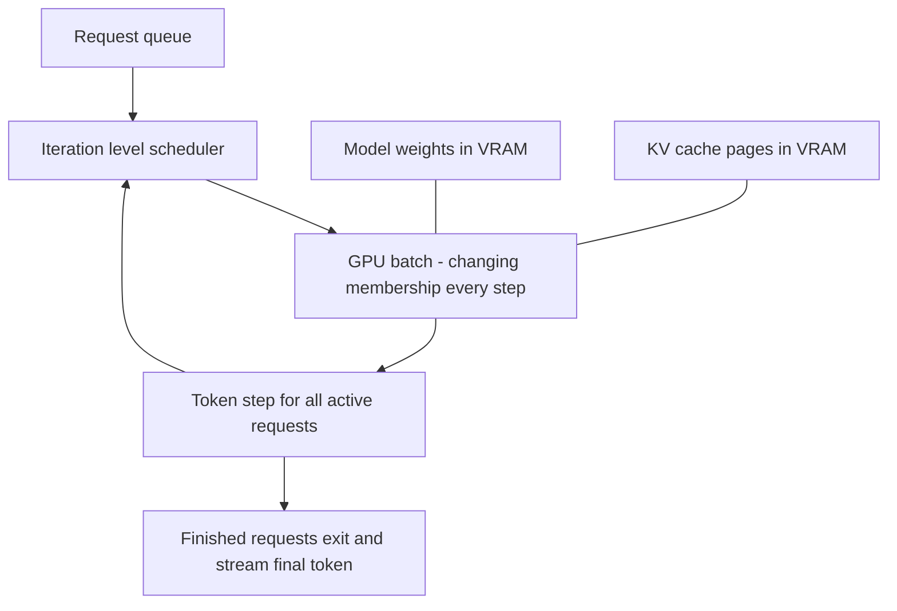

# LLM Serving Infrastructure

Serving an LLM looks like serving any API — request in, response out — until you notice that a single request runs for *seconds*, generates its output one token at a time, and competes for a resource (GPU memory) that behaves nothing like CPU or RAM in a web tier. Almost every standard web-service instinct — small stateless requests, batch for throughput, autoscale on CPU, rate-limit by request count — is either wrong or needs rethinking here. This note covers what actually changes, which is exactly what 2026 interviews probe: not how transformers work, but whether you can reason about the serving system around them.

## The problem that created it

An LLM generates text **autoregressively**: it produces one **token** (roughly a word fragment, ~4 characters of English) at a time, and each token requires a full forward pass through the model using everything generated so far. A 500-token answer is 500 sequential model passes. There is no "compute the whole response at once" — the output is inherently a loop, so a single request occupies the server for seconds to minutes, not milliseconds. Your p99-latency intuition from [[Latency Numbers Every Engineer Should Know]] needs a new row: "LLM generates one token: ~10–50 ms; a full answer: seconds."

The second break is the bottleneck. Web services bottleneck on CPU, connections, or downstream I/O. LLM serving bottlenecks on **GPU memory**: the model weights alone consume tens of GB of scarce, expensive VRAM, and — the part people miss — *each in-flight request consumes additional GPU memory that grows with its length* (the KV cache, below). Concurrency is capped not by threads or sockets but by how many requests' working state fits in VRAM alongside the weights. GPUs are also brutally expensive, so utilization isn't a nice-to-have; it's the difference between a viable cost per request and an absurd one.

Early serving stacks treated the model like a normal RPC handler — one request per model invocation, or **static batching** (collect N requests, run them together, return when *all* finish). Both wasted most of the GPU. The fixes below are what turned LLM serving into its own discipline around ~2022–2023.

## What it solves

A modern serving stack (vLLM and its peers, or the serving layers inside managed providers) exists to:

- **Maximize tokens generated per GPU-hour** — the real unit of cost.
- **Keep time-to-first-token low under load** — the user-perceived latency metric.
- **Stop memory fragmentation from wasting VRAM** — more concurrent requests on the same card.
- **Make seconds-long, incrementally-produced responses deliverable** to ordinary HTTP clients.

## How it works

### KV cache — why memory is the bottleneck

During generation, the model must "attend to" every previous token. Recomputing that from scratch for each new token would be quadratic waste, so the serving engine caches each token's intermediate attention state — its key and value tensors — in GPU memory: the **KV cache**. It makes generation fast, and it is the memory hog: the cache grows linearly with sequence length (prompt + everything generated so far) for every in-flight request, and for large models it can run to the order of a gigabyte per long request. The per-token cost is `2 (K and V) x layers x kv_heads x head_dim x bytes_per_element`, which is why **grouped-query attention** — standard in open-weight models since ~2023 — is an infrastructure fact and not an ML detail: sharing key/value heads across query heads cuts that cache several-fold and buys concurrency for free. VRAM therefore holds: model weights (fixed, huge) + the sum of all active requests' KV caches (variable, grows as they generate). When the sum hits the ceiling, no new request can start — *memory*, not compute, caps concurrency.

### Continuous batching — the throughput unlock

GPUs want batches: during decode, running 32 requests through the model costs little more than running 1 — not because the arithmetic is free, but because each decode step must read the *entire* weight matrix out of GPU memory to produce one token, and that read is the bottleneck. A batch of 32 amortises one weight read across 32 tokens, which is nearly free right up until the batch grows large enough to turn compute-bound. But **static batching** — wait, collect a batch, run it to completion as a unit — has a fatal flaw with autoregressive output: requests finish at different times (one asked for a haiku, one for an essay), and finished slots sit idle until the *longest* request in the batch completes. Utilization craters, and new arrivals queue behind the whole batch.

**Continuous batching** schedules at the *iteration* level instead: after every single token-generation step, completed requests leave the batch and queued requests join it. The batch is a constantly-churning population rather than a fixed cohort. Mind the names — the technique is Orca's *iteration-level scheduling* (OSDI 2022); "continuous batching" is the label popularised by a 2023 Anyscale write-up, and NVIDIA ships the same idea as "in-flight batching". The GPU stays full, short requests aren't held hostage by long ones, and throughput improves by integer multiples over naive serving — the single biggest serving-side win, and pure scheduling, no ML involved.

Be equally clear about what it does **not** do, because interviews probe exactly here: it does not make any individual request generate faster (a fuller batch makes each request slightly *slower*), and it does not create KV-cache capacity — that is paged attention's job, which is why the two are always named together. It also has a cost of its own: admitting a new request means running its prefill, which stalls every active request's decode for that step, which is in turn why serving engines chunk a long prefill into pieces interleaved with decode.

**Paged attention**, one line: vLLM's trick of managing the KV cache in small fixed-size pages with an indirection table — virtual memory for GPUs — eliminating the fragmentation that pre-allocating one contiguous max-length buffer per request causes, so many more requests fit in the same VRAM.

Two refinements worth one line each:

- **Prefill vs decode**: processing the *prompt* (prefill) is one big parallel pass — compute-bound and it determines TTFT; generating *output* tokens (decode) is the sequential loop — memory-bandwidth-bound and it determines tokens/sec. They stress the hardware differently, which is why some large deployments split them onto separate GPU pools (disaggregated serving).
- **Prefix caching**: requests sharing a common prompt prefix (the same system prompt, the same few-shot examples) can reuse that prefix's KV cache instead of recomputing it — a cache hit measured in GPU-seconds, and a real reason to keep shared prompt prefixes byte-identical across requests.

### Streaming tokens to clients

Since tokens are produced one at a time over seconds, holding the response until completion both wastes the incremental output and makes the app feel broken. Production systems stream. Among the options in [[WebSockets Server-Sent Events and Long Polling]], **SSE (Server-Sent Events) is the standard choice** — the flow is strictly server→client, SSE is plain HTTP (passes proxies, gateways, and LBs without protocol upgrades), and every major LLM API ships SSE streaming. WebSockets buy bidirectionality nobody needs here at the cost of connection-management complexity. One operational note: seconds-long open connections mean your gateway/LB idle-timeout settings and per-node connection limits suddenly matter — and the defaults are hostile, since both an ALB's idle timeout and Kong's upstream `read_timeout` ship at 60 seconds. Raise them above your worst-case generation time or streams die mid-answer.

### The metrics that matter

| Metric | What it measures | Who cares |
|---|---|---|
| **TTFT** (time to first token) | Queue wait + prompt processing; the "it's responding" moment | Users — this is perceived latency |
| **Tokens/sec per request** | Generation speed after the first token; must beat reading speed | Users — smoothness |
| **Throughput** (total tokens/sec per GPU) | Fleet efficiency under continuous batching | Your infra bill |
| **Cost per 1K tokens** | Unit economics, input and output priced separately | Finance, pricing |

TTFT and throughput *trade against each other* — the [[Latency vs Throughput vs Bandwidth|latency-vs-throughput]] tension in its purest form: packing batches fuller raises throughput but queues new arrivals (worse TTFT). You tune the scheduler to a TTFT SLO and take the throughput that remains. A useful target for tokens/sec per request: comfortably above human reading speed — and do that conversion rather than guessing at it, because 200–300 words per minute is only 3–5 words/sec, and at roughly ¾ of a word per token that lands at just **~5–7 tokens/sec**. Much faster than that buys little UX, so surplus capacity is better spent on batch size.

### Routing, rate limiting, autoscaling

- **Small-model-first cascades**: route every request to a small cheap model and escalate to the large expensive one only when needed (low confidence, task class, explicit user tier). Most traffic is easy; this is tiered serving, the same shape as cache-then-database. **Provider fallback**: multi-provider routing with health checks and [[Circuit Breakers|circuit breakers]], because LLM APIs have outages and rate limits like any dependency — same playbook as any third-party integration, plus latency/cost-aware routing between equivalents.
- **Rate limit by tokens, not requests**: one request can cost 100 tokens or 100,000 — request-count limits ([[Rate Limiting]]) are meaningless when unit cost varies by three orders of magnitude. Providers enforce tokens-per-minute budgets (often separate input and output budgets, since output tokens cost more compute); your own gateway should meter the same way. It's still token-bucket mechanics — the "tokens" are just literal now.
- **Scale on the right signal**: GPU "utilization" percentages mislead — `nvidia-smi`'s `utilization.gpu` reports only the fraction of *time* during which at least one kernel was resident, not how much of the card that kernel used, so a barely-loaded GPU happily reads 100% — and CPU is irrelevant. The honest scaling signals are **queue depth**, **TTFT against its SLO**, and **KV-cache occupancy** — the same lesson as [[Autoscaling]]'s "CPU is often the wrong signal", only more so.
- **GPU autoscaling pain**: a new GPU node must be provisioned (scarce instance types, sometimes capacity-unavailable), pull a tens-of-GB image/weights, and load the model into VRAM — **cold starts measured in minutes**, versus seconds for a stateless pod ([[Autoscaling]]). Reactive scaling on a traffic spike arrives after the spike. Realistic options: overprovision a warm pool (pay for idle), queue requests and let TTFT degrade ([[Backpressure and Flow Control]]), shed low-priority load ([[Load Shedding and Graceful Degradation]]), or push spiky workloads to a managed provider and keep only baseline on your own GPUs.

## Trade-offs

| You gain | You pay |
|---|---|
| Continuous batching: multi-x throughput per GPU | Scheduler complexity; TTFT vs throughput tuning |
| Paged attention: far less VRAM waste | Tied to a serving engine (vLLM-class) and its ops |
| Streaming: responsive UX for seconds-long requests | Long-lived connections through every proxy hop |
| Cascades/fallback: cost and availability wins | Routing logic becomes a correctness surface |
| Self-hosting: data control, unit cost at high volume | GPU capacity planning, minutes-long cold starts |

## Failure modes

- **KV cache exhaustion under load.** VRAM fills with active requests' caches; new requests queue (TTFT spikes) or the engine must preempt/evict running requests (dropped or recomputed work). Symptom: throughput fine, TTFT p99 exploding. Mitigation: admission control by token budget, shorter max-generation limits, more replicas.
- **Head-of-line blocking by long prompts.** A handful of 100K-token-context requests monopolize memory and stall the queue — the elephant-flows problem. Mitigation: separate pools or priority classes by context size.
- **Mid-stream failures.** The connection or the engine dies at token 350 of 500. Clients see a half answer; naive retries regenerate from scratch (paying full cost, possibly producing a *different* answer — generation isn't deterministic by default). Design client retry UX deliberately; [[Idempotency]] of billing/audit records matters even when the text differs.
- **Retry amplification on an overloaded fleet.** Slow generation → client timeouts → retries → more load: the classic [[Timeouts Retries and Exponential Backoff|retry storm]], worse because each retry is seconds of GPU time. Stream early (a flowing response resets human and client timeouts), cap retries, shed load explicitly.
- **Provider rate-limit cliffs.** Your aggregate traffic hits the provider's token budget and everything 429s at once. Mitigation: client-side token metering *below* the provider's limit, spillover routing to a second provider, request queues with priority.
- **Cost run-away.** No per-tenant token caps → one bugged client loop burns the monthly budget in hours. Token metering per caller is a reliability *and* a finance control.

## When NOT to use it

- **Don't self-host GPUs by default.** Below sustained high volume, managed APIs win on cost (no idle GPUs), capability, and ops burden. Self-hosting earns its keep with data-residency requirements, predictable high utilization, or unit economics at scale — do the cost-per-1K-token math both ways first.
- **Don't use an LLM where a deterministic system answers.** Classification a regex solves, lookups a database answers, math a calculator does — an LLM is the most expensive, least predictable way to do any of these.
- **Don't put an LLM on the synchronous critical path of money movement or compliance decisions.** Seconds of latency, nondeterminism, and no correctness guarantee — use it to draft/extract/explain beside the path, with deterministic validation owning the decision (fail closed).
- **Don't build cascades/fallback/semantic routing before you have traffic.** One provider behind a thin abstraction is the right v1; routing sophistication is earned by volume.

## In your stack

- **Consume, don't host, first.** For a Niyo-scale LLM feature (support summarization, document extraction), a managed API behind Kong is the right v1 — the serving concepts above still matter because they explain the provider's pricing, rate limits, and latency behavior you must design against.
- **SSE through your edge**: streaming responses traverse CloudFront/ALB/Kong — audit idle timeouts and response buffering at each hop (a buffering proxy silently turns streaming into "nothing for 20 seconds, then everything", destroying TTFT).
- **Token metering at the gateway**: per-service and per-tenant token budgets in Kong/Redis (same counters as your existing [[Rate Limiting]] infra), both to stay under provider limits and to cap cost blast radius. Log token counts with the `x-correlation-id` so cost is traceable per flow.
- **The 1-replica habit doesn't transfer**: a single GPU-backed replica with minutes-long cold start means any pod eviction is a multi-minute, user-visible outage — for any self-hosted model, 1 replica is not a cost optimization, it's an availability decision ([[Availability Reliability Durability]]).
- **Not everything needs streaming**: offline work (nightly ticket summarization, document extraction backfills) belongs on your existing queue infrastructure — SQS/Redis Streams feeding workers that call the LLM with retries and a DLQ ([[Why Async Messaging Exists]]). Providers' discounted batch APIs exist precisely for this traffic; reserve the latency-sensitive streaming path for humans waiting on answers.
- **Regulatory note**: sending customer data to an external LLM provider creates data-processing and localisation scope (RBI world) — flag it when proposing the integration; it may decide managed-vs-self-hosted by itself.
- **Cost shape**: managed APIs scale with *tokens processed* (input + output, output pricier); self-hosting scales with *GPU-hours provisioned* regardless of use — spiky traffic favors APIs, flat high volume favors (well-utilized) own GPUs.

## Interview angle

- The screening question is some form of "how is serving an LLM different from serving a normal API?" Strong answers name, unprompted: autoregressive seconds-long requests, GPU memory (KV cache) as the concurrency cap, continuous batching as the throughput unlock, and SSE streaming. Bonus signal: TTFT vs tokens/sec as distinct metrics, and token-based rate limiting.
- **60-second version**: "LLMs generate token by token, so requests run for seconds and the bottleneck is GPU memory: weights plus a per-request KV cache that grows with sequence length. Static batching wastes the GPU because requests finish at different times, so modern engines use continuous batching — requests join and leave the batch every iteration — with vLLM's paged attention managing KV memory like virtual memory to kill fragmentation. Responses stream over SSE. You track TTFT for user experience, tokens/sec per GPU for cost, and you rate-limit by tokens because request count is meaningless. Autoscaling hurts: GPU cold starts take minutes, so you overprovision warm capacity, queue, or shed. For routing, small-model-first cascades and provider fallback are the standard patterns."
- Classic follow-ups: "Why does batching help so much on GPUs?" (parallel hardware — batch 32 costs little more than batch 1); "Why is TTFT separate from throughput?" (they trade off via batch packing); "How do you handle a provider outage?" (fallback provider, circuit breaker, degrade features); "Why not WebSockets?" (one-directional flow; SSE is plain HTTP and proxy-friendly); "What would you autoscale on?" (queue depth or TTFT SLO, never CPU — and admit the minutes-long cold start means autoscaling alone can't absorb spikes).
- A favorite closer: "How would you cut LLM cost 10x?" — cascade to a small model for easy traffic, cache aggressively (semantic cache, byte-identical prompt prefixes for prefix-cache hits), move offline work to discounted batch APIs, and rerank-then-trim context so you stop paying for tokens the model didn't need. Every lever is already in this note; the question tests whether you connect them.

## Check yourself

> [!question]- Q: Explain why GPU memory, not CPU, caps concurrency on an LLM server — and what the KV cache has to do with it.
> Each in-flight request keeps a KV cache in VRAM — the attention keys/values of every token in its sequence so far — growing linearly as it generates and reaching large fractions of a GB for long sequences on big models. VRAM must hold the model weights (fixed tens of GB) plus every active request's cache, so the number of simultaneous requests is capped by remaining memory, not by compute or threads. When VRAM is full, new requests wait regardless of idle compute — which is why paged attention (reducing cache waste) directly increases concurrency.

> [!question]- Q: What happens under static batching when one request in a batch of 16 generates 2,000 tokens and the rest average 150?
> The 15 short requests finish early, but their batch slots sit idle while the long one grinds through ~1,850 more sequential steps; meanwhile new arrivals queue behind the entire batch. Effective utilization collapses and TTFT for queued requests balloons. Continuous batching fixes exactly this: finished requests exit after any iteration and queued ones take their slots immediately, keeping the batch full and decoupling short requests' latency from long ones.

> [!question]- Q: Your product team wants request-per-minute rate limits for the new LLM endpoint. Argue the correct alternative.
> Requests vary from ~100 to ~100K tokens — three orders of magnitude of GPU cost — so RPM limits either throttle cheap traffic absurdly early or admit a handful of huge requests that exhaust capacity. Meter tokens: a tokens-per-minute budget per caller (ideally separate input/output budgets, as output tokens cost more), implemented with the same token-bucket mechanics as normal [[Rate Limiting]]. This simultaneously protects capacity, maps to provider limits upstream, and caps the cost blast radius of a misbehaving client.

> [!question]- Q: Mini design prompt — add an AI assistant to the support dashboard: 2K requests/day today, possible 50x spike after launch, answers must feel responsive. Sketch the serving decisions.
> Managed provider, no GPUs: 2K/day is far below self-hosting economics, and a 50x spike is exactly what GPU cold starts can't absorb. SSE streaming end-to-end with gateway timeouts raised above max generation time and proxy buffering disabled — TTFT is the UX metric, so measure it client-side. Small-model-first: a cheap model for classification/drafting, escalation to a larger one on low confidence or agent request. Token metering per team in Redis at the gateway, set below the provider's budget, with queued spillover and a second provider behind a circuit breaker for outages. RAG grounding per [[RAG Architecture]]; correlation IDs and token counts logged per request for cost attribution.

## Sources

- Kwon et al., "Efficient Memory Management for Large Language Model Serving with PagedAttention" (SOSP 2023) — the vLLM paper: paged KV cache and its throughput results.
- Yu et al., "Orca: A Distributed Serving System for Transformer-Based Generative Models" (OSDI 2022) — the origin of iteration-level/continuous batching.
- vLLM official documentation — continuous batching, paged attention, prefix caching, and serving metrics in practice.
- NVIDIA TensorRT-LLM documentation — the other major serving engine; its "in-flight batching" is the same continuous-batching idea under a different name.
- Anyscale engineering blog, "How continuous batching enables 23x throughput in LLM inference" (~2023) — accessible walkthrough of static vs continuous batching (treat the specific multiple as workload-dependent).
- Anthropic and OpenAI API documentation — SSE streaming formats, token-based rate limits, batch APIs, and input/output token pricing.
- *Designing Data-Intensive Applications*, Kleppmann — ch. 1 (latency/throughput framing) remains the right lens; LLM serving changes the constants, not the vocabulary.
