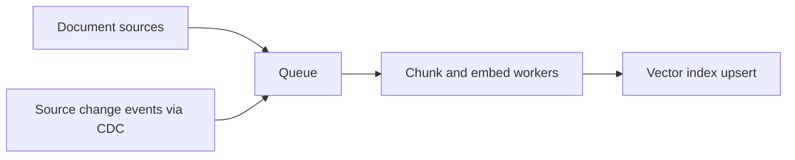
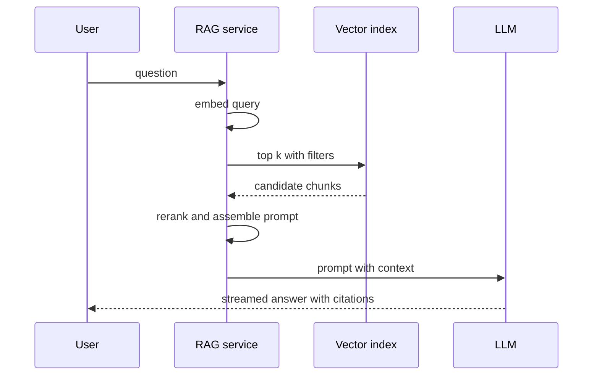

# RAG Architecture

**RAG (Retrieval-Augmented Generation)** makes an LLM answer questions using *your* data: instead of hoping the model memorized your docs, you fetch the relevant passages at query time and paste them into the prompt as context. Strip away the AI vocabulary and RAG is two familiar systems glued together — an **async ingestion pipeline** (documents in, searchable index out) and a **low-latency read path** (query in, retrieved context + generated answer out). Everything hard about it is system design, not ML: pipeline reliability, index freshness, cache strategy, and evaluation. This note treats it that way.

## The problem that created it

An LLM only "knows" what was in its training data — frozen at a cutoff date, public-internet flavored, and with zero access to your internal wiki, policy documents, or customer records. Ask it about *your* refund policy and it will produce a fluent, confident, plausible answer that may be entirely wrong (**hallucination** — the model generates likely-sounding text, not verified facts).

The first instinct — fine-tune the model on company data — is slow, expensive, must be repeated whenever data changes, and still doesn't reliably stop hallucination or let you *cite* where an answer came from. It also can't do per-user access control: a fine-tuned model can't "forget" a document for users who shouldn't see it.

The working fix came from an older idea: open-book beats closed-book. Retrieve the relevant documents at query time, hand them to the model in the prompt, and instruct it to answer *from the provided context*. Data changes propagate by updating an index, not retraining a model; answers carry citations; access control happens at retrieval time with ordinary filters. The term comes from the RAG paper (Lewis et al., NeurIPS 2020); the production pattern took off alongside chat LLMs around 2023 and is now a standard 2026 interview topic — precisely because the hard parts are classic infrastructure.

## What it solves

- **Grounding**: answers draw from retrieved, current, private documents instead of model memory — with citations a user (or auditor) can check.
- **Freshness without retraining**: update the index, not the model; data changes propagate in minutes.
- **Access control**: retrieval-time filters (tenant, role) decide what context a user's query may touch — impossible to enforce inside model weights.
- **Cost control**: a small general model + good retrieval often beats a huge model guessing from memory.

## How it works

Two halves, two very different performance profiles.

### The ingestion pipeline (write path, async)

Documents don't go into the index whole. The pipeline is: **extract → chunk → embed → upsert**.

1. **Extract** text from sources (wiki pages, PDFs, tickets, DB rows).
2. **Chunk** it into retrieval-sized pieces. This is the most underestimated decision in the system. Chunks must be small enough to be *specific* (retrieval returns chunks, and the prompt budget is finite) but large enough to be *self-contained*. Common strategies: fixed-size with overlap (simple, risks cutting mid-thought), structure-aware (split on headings/paragraphs — usually the right default), and semantic chunking (split where topic shifts). Overlapping windows hedge against answers straddling a boundary.
3. **Embed** each chunk via the embedding model ([[Vector Databases and Similarity Search]]) — a batchable, rate-limited, GPU-or-API-priced call.
4. **Upsert** vector + chunk text + metadata (source, tenant, timestamps, embedding model version) into the vector index.

This is a textbook async pipeline — the same shape as any event-driven ingestion you've built ([[Why Async Messaging Exists]]): a queue between source and workers for load leveling, retries with [[Idempotency|idempotent]] upserts (keyed on chunk ID, so redelivery is harmless — [[Delivery Semantics]]), a [[Dead Letter Queues and Poison Messages|DLQ]] for the PDF that crashes the parser, and [[Backpressure and Flow Control|backpressure]] when the embedding API rate-limits you.

### The query path (read path, latency-sensitive)

1. **Embed the query** with the same model version used at ingestion.
2. **Retrieve top-k** chunks from the vector index (k typically 5–50), with metadata filters applied (tenant, permissions).
3. **Optional rerank**: a second, more accurate (and slower) model scores the candidates against the query and reorders them — a cheap-recall-then-precise-precision funnel, the same two-stage shape as any search or feed-ranking system.
4. **Assemble the prompt**: system instructions + top chunks + the user's question, within the model's context budget.
5. **Call the LLM** and stream the answer ([[LLM Serving Infrastructure]]).

**Hybrid search**, one line: run keyword search (BM25) *and* vector search in parallel, then merge with **reciprocal rank fusion** — score each document as the sum of `1 / (k + rank)` over every list it appears in, where the constant `k` (60 in the original paper) is the actual trick: it damps the pull of any one list's top hit, and because the formula consumes only *ranks*, you never have to reconcile a BM25 score with a cosine distance — lexical search catches exact identifiers and rare terms that embeddings blur, vector search catches paraphrases; together they beat either alone.

Two numbers dominate the read path's latency budget (rough orders of magnitude, not benchmarks): retrieval (tens of milliseconds) and the LLM call (seconds). That asymmetry is why adding a rerank stage — tens of milliseconds for a small local cross-encoder, a couple of hundred for a hosted rerank API, in exchange for noticeably better context — is usually worth it against an LLM call measured in seconds, and why optimizing the vector query below ~50 ms is effort spent on the wrong term of the sum.

### Freshness

A RAG index is **derived data**; the question is how it learns the source changed. Batch re-crawls are simple but leave hours of staleness. The clean answer is event-driven: [[Change Data Capture]] on the source database emits change events, the pipeline re-chunks and re-embeds affected documents, and deletes propagate as index deletions (forgetting a revoked document is a *compliance* requirement, not a nicety). This is the [[Cache Invalidation]] problem wearing a new hat — and the dual-write temptation ("update the DB, then call the vector index") has the same answer it always has: [[The Outbox Pattern]] or CDC, not two independent writes.

### Evaluation and caching

- **Evaluation basics**: before judging answer quality, measure retrieval alone — **hit rate** (did the chunk containing the answer appear in top-k?) over a golden set of question→source pairs. Most "the LLM is bad" complaints are retrieval misses; the generation step can't cite what retrieval never fetched. Track hit rate like an SLI ([[SLA SLO SLI and Error Budgets]]).
- **Caching layers**: embeddings cache (same text → same vector, classic [[Caching Strategies|cache-aside]] in Redis), retrieval cache for hot queries, and a **semantic cache** in one line: cache answers keyed by query *embedding*, serving a stored answer when a new query lands within a similarity threshold — with the obvious risk that "near enough to hit the cache" is not always "same question".

## Trade-offs

| You gain | You pay |
|---|---|
| Grounded, citable, current answers | An entire ingestion pipeline to operate |
| Update data without touching the model | Two-system consistency (source vs index) |
| Retrieval-time access control | Latency: embed + retrieve + rerank + LLM in series |
| Smaller/cheaper models become viable | Quality ceiling set by chunking and retrieval, tuned empirically |
| Auditable provenance per answer | Evaluation infrastructure you must build yourself |

## Failure modes

- **Stale index.** Source changed, index didn't — the system confidently cites a superseded policy. Worse than no answer, because it looks authoritative. Detect: freshness lag metric (source update timestamp vs index timestamp). Mitigate: CDC-driven updates, TTL-based re-crawl as a safety net, "as of" timestamps surfaced in answers.
- **Deleted-but-retrievable documents.** The delete event was dropped, so revoked content remains searchable — an access-control hole, and in a regulated shop a reportable one. Treat deletes as the highest-priority event class; reconcile index against source periodically.
- **Chunk boundaries splitting answers.** The question's answer spans two chunks; each half retrieves poorly alone and the model sees neither in full. Classic symptom: retrieval hit rate fine on short factual questions, terrible on procedural "how do I" questions. Mitigate: overlap, structure-aware chunking, or retrieving neighboring chunks of each hit.
- **Context overflow.** Too many/too large chunks exceed the model's context window — the assembler truncates, often silently dropping the one chunk that mattered, or costs balloon (you pay per token). Mitigate: token budgeting in prompt assembly, rerank-then-trim to the few best chunks.
- **Retrieval misses blamed on the model.** The LLM answers from its own memory when context is irrelevant — hallucination *reintroduced* by a retrieval failure. Detect with hit-rate evaluation, not vibes.
- **Embedding version skew** between query path and ingestion path — covered in [[Vector Databases and Similarity Search]]; in RAG it manifests as sudden across-the-board retrieval collapse after a "harmless" model upgrade.

## When NOT to use it

- **The question isn't answered by documents.** "What's my current balance?" is an API call to a system of record, not retrieval over text. Don't RAG what a query answers exactly.
- **Structured analytics.** "Total refunds last quarter by product" wants SQL over a warehouse — retrieval of prose passages cannot aggregate.
- **The corpus is tiny and static.** If everything fits in one prompt (tens of pages), skip the pipeline and put the documents in the prompt directly; long-context models make small-corpus RAG pure overhead.
- **Zero tolerance for wrong answers with no human check.** RAG reduces hallucination; it does not eliminate it. For regulated outputs (financial advice, compliance decisions), the LLM may draft and cite, but a deterministic rule or a human owns the decision — fail closed.

## In your stack

- The ingestion pipeline is your home turf: SQS (or Redis Streams, post-migration) between sources and embedding workers, idempotent upserts keyed on chunk ID, DLQ for poison documents — the same patterns as every async flow you run, plus an `x-correlation-id` from source event to index write so a stale answer is traceable to the event that should have fixed it.
- MongoDB as source of truth fits the derived-index model: CDC from Mongo change streams drives re-embedding — noting that change streams require a replica set or sharded cluster (they do not exist on a standalone `mongod`) and that a `delete` event carries only the `documentKey` (the `_id`, plus the shard key on a sharded collection) unless pre-images are enabled (6.0+), so the pipeline must map document id to chunk ids itself; the vector index stays rebuildable, never authoritative.
- Redis covers two layers: embedding/retrieval cache (plain cache-aside) and, if adopted, the semantic cache — keep the similarity threshold conservative; in fintech, serving user A's cached answer shape to user B's "similar" question must never leak tenant data, so scope cache keys per tenant.
- An internal support-agent assistant over policy documents is the realistic first RAG system at a fintech: human-in-the-loop by construction, citations mandatory, revoked-policy deletion treated as a compliance event.
- **Cost shape**: ingestion cost scales with *corpus churn × embedding price* (recurring, not one-time); query cost scales with *QPS × (retrieval + LLM tokens)* — and the LLM term dominates, which is why rerank-then-trim and caching pay for themselves.

## Interview angle

- The signal interviewers want: you decompose RAG into **a write pipeline and a read path** unprompted, and you talk about freshness, idempotency, and evaluation instead of model choice. Naming "chunking strategy" and "retrieval hit rate" as the two highest-leverage quality levers marks real understanding.
- **60-second version**: "RAG grounds an LLM in private data: an async ingestion pipeline extracts, chunks, embeds, and upserts documents into a vector index; the query path embeds the question, retrieves top-k with permission filters, optionally reranks, assembles a token-budgeted prompt, and streams the answer with citations. Hybrid search — BM25 plus vectors merged with reciprocal rank fusion — beats either alone. Freshness is CDC from the source of truth; the index is derived data, rebuildable, never authoritative. You evaluate retrieval hit rate against a golden set before blaming the model, and the classic failure modes are stale index, chunk boundaries splitting answers, and context overflow."
- Classic follow-ups: "How does the index learn a document changed?" (CDC/outbox, never dual-write); "How do you evaluate it?" (retrieval hit rate first, then answer quality); "How do you handle permissions?" (retrieval-time metadata filters — and test the delete path); "Why not just fine-tune?" (cost, staleness, no citations, no per-user access control).

## Check yourself

> [!question]- Q: Explain why RAG is "two systems", and why their performance profiles differ.
> The write half is an async ingestion pipeline (extract → chunk → embed → upsert) — throughput-oriented, batchable, tolerant of minutes of lag, built on queues with idempotent consumers. The read half is a latency-sensitive serial path (embed query → retrieve → rerank → prompt → LLM) where every stage adds user-visible milliseconds-to-seconds. They share only the index. Designing them with the same mindset fails in both directions: a synchronous ingestion blocks sources on embedding APIs; a sloppy read path stacks four network hops in front of an already-slow LLM call.

> [!question]- Q: What happens if a document is deleted from the source but the delete event is lost before reaching the vector index?
> The chunk remains retrievable: queries keep surfacing content the organization decided to revoke — stale at best, an access-control/compliance breach at worst (a withdrawn policy, a right-to-be-forgotten request). Because retrieval still "works", nothing errors. Defenses: treat deletes as the highest-priority event class with at-least-once delivery and idempotent tombstoning, plus periodic reconciliation comparing index contents against the source of truth — the derived-data equivalent of an audit.

> [!question]- Q: Retrieval hit rate is 95% on short factual questions but 60% on multi-step "how do I" questions. What's the likely cause and fix?
> Chunk boundaries. Procedural answers span multiple paragraphs; fixed-size chunking splits the procedure so no single chunk matches the query well, and each fragment ranks poorly. Fixes: structure-aware chunking (split on headings so procedures stay whole), chunk overlap, or neighbor-expansion at query time (retrieve a hit's adjacent chunks). Re-measure on the same golden set — this is an index-shape problem, not a model problem.

> [!question]- Q: Mini design prompt — internal assistant over 200K policy/wiki pages for support agents, sources update daily, answers must cite sources and respect team-level permissions. Sketch the design.
> Ingestion: CDC/change feed from the wiki and policy stores → queue → workers doing structure-aware chunking with overlap → embeddings → upsert into a vector index (pgvector-scale corpus; ~200K pages → low millions of chunks) with metadata {source URL, team ACL, updated_at, model_version}; deletes tombstone immediately; DLQ + reconciliation job. Query: embed → hybrid retrieval (BM25 + vector, RRF) filtered by the agent's team → rerank top-50 to top-5 → token-budgeted prompt demanding citations → streamed answer. Eval: golden set of 200 real agent questions, retrieval hit rate tracked per release. Caching: embedding cache in Redis; semantic cache only per-team. Freshness SLO: p95 source-to-index lag under 15 minutes, alarmed.

## Sources

- Lewis et al., "Retrieval-Augmented Generation for Knowledge-Intensive NLP Tasks" (the RAG paper — arXiv May 2020, published NeurIPS 2020).
- Cormack, Clarke & Buettcher, "Reciprocal Rank Fusion Outperforms Condorcet and Individual Rank Learning Methods" (SIGIR 2009) — the RRF method and the k = 60 default every implementation inherited; shipped in OpenSearch/Elasticsearch hybrid search.
- Robertson & Zaragoza, "The Probabilistic Relevance Framework: BM25 and Beyond" (Foundations and Trends in Information Retrieval, 2009) — the lexical half of hybrid search.
- Anthropic and OpenAI official RAG/embeddings guides — current practical defaults for chunking and retrieval (vendor docs, updated frequently; check current versions).
- *Designing Data-Intensive Applications*, Kleppmann — ch. 11–12 (stream processing and derived data: the correct frame for the entire ingestion half).
