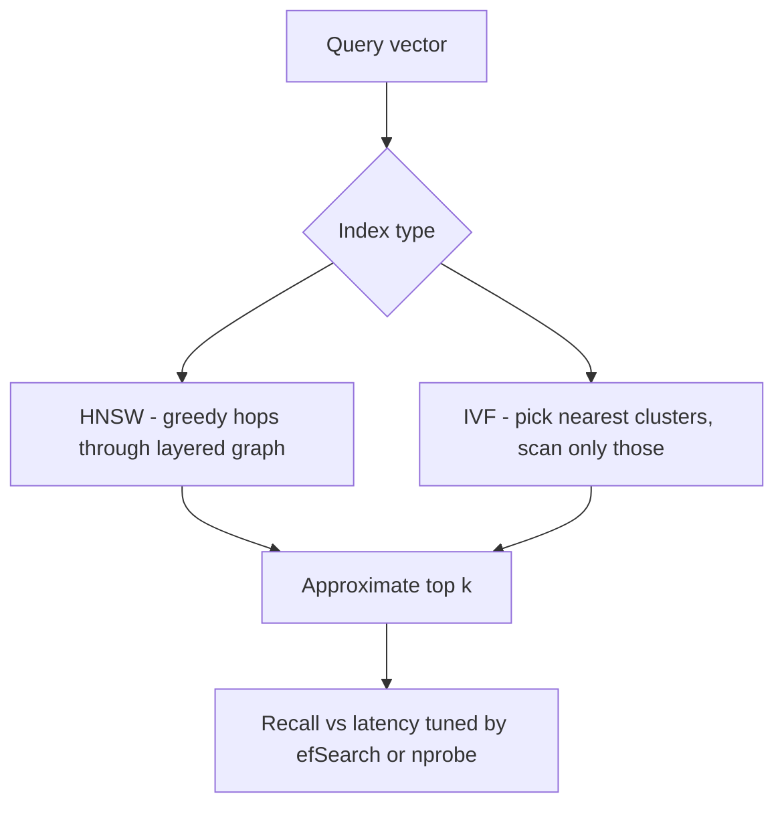

# Vector Databases and Similarity Search

A vector database stores **embeddings** — lists of numbers that represent the *meaning* of a piece of text, an image, or a user — and answers one query shape fast: "give me the stored items most similar to this one." No ML knowledge is required to design around them: an embedding model is a black box that turns content into coordinates, and everything after that is a classic system design problem — indexing, recall-vs-latency trade-offs, filtering, and operational cost. The 2026-interview-relevant insight is that this is a *database indexing* problem wearing an AI costume, and most of your existing intuitions from [[Database Indexes]] transfer.

## The problem that created it

Start with a product need that predates LLMs: "find things *like* this thing." Similar support tickets, similar products, near-duplicate images, documents relevant to a question. Keyword search ([[RAG Architecture|BM25-style]]) matches literal words, so "my card is blocked" never finds a document titled "debit freeze resolution" — same meaning, zero shared terms.

Embedding models fixed the representation problem. An embedding model maps content to a point in a high-dimensional space (typically 384–3072 dimensions) such that **semantically similar content lands close together**. "Card blocked" and "debit freeze" become nearby points. Similarity is now geometry: compute the distance (usually **cosine similarity** or dot product) between two vectors, and closer means more related. You don't need to know how the model does this — treat it as a deterministic function `embed(text) -> float[1536]` and design around its output.

That created a new database problem. The query is **k-nearest-neighbor (kNN)**: given a query vector, return the k closest stored vectors. The naive implementation compares the query against *every* stored vector — a full scan. At 10,000 vectors that's fine. At 100 million vectors × 1536 dimensions, every query has to stream ~600 GB of float32 through the CPU (100M × 1536 × 4 bytes); latency is seconds and the CPU bill is absurd. And the trusty B-tree can't help: B-trees index *one ordered dimension*, and there is no single ordering of points in 1536-dimensional space that preserves "closeness" (this is the **curse of dimensionality** — in very high dimensions, classic spatial indexes like R-trees degrade toward full scans too).

So a new index family was needed: one that answers "what's near this point?" in sublinear time, by giving up a little correctness.

## What it solves

- **Semantic retrieval at scale**: meaning-based search over millions to billions of items with single- to double-digit-millisecond latency.
- **The retrieval half of RAG**: every [[RAG Architecture]] pipeline needs exactly this query served fast; the vector index is its hot path.
- **Recommendation and deduplication**: "users like you", "near-duplicate KYC document detection" — any *similarity* problem, not just chat-with-your-docs.
- **A tunable accuracy dial**: unlike a B-tree (always exact), ANN indexes let you trade recall for latency per query — a knob most databases never give you.

## How it works

The core move is **approximate nearest neighbor (ANN)** search: return *mostly* the true top-k, much faster. The quality metric is **recall@k** — what fraction of the true k nearest neighbors the index actually returned. Production systems typically run at 0.9–0.99 recall; the application decides how much approximation it can tolerate.

One practical preliminary: the **distance metric** is part of the contract. Cosine similarity (angle between vectors — the usual choice for text embeddings), dot product, and Euclidean distance rank neighbors differently; the index is built for one metric, and it must match what the embedding model was trained for (most text-embedding models publish "use cosine"). Many systems sidestep the cosine-vs-dot distinction by storing vectors **normalized to unit length**, where the two become equivalent. Getting this wrong doesn't error — it just quietly ranks results worse, a recurring theme in this note.

Two index families dominate; both are worth knowing at concept level only.

### HNSW — the graph approach (the modern default)

**HNSW (Hierarchical Navigable Small World)** builds a graph where each vector is a node connected to its near neighbors, organized in layers like a skip list: the top layer has few nodes with long-range links, lower layers get denser and more local. A query enters at the top, greedily hops toward the target ("which of my neighbors is closest to the query?"), and drops a layer each time it can't improve — coarse navigation first, fine navigation last. Search cost grows roughly logarithmically with collection size.

- **Knob**: `efSearch` — how many candidate nodes to explore during a query. Higher = better recall, more latency. This is the recall-vs-latency dial, settable *per query*.
- **Character**: excellent recall/latency; graph *and* vectors must be memory-resident to hit those latencies (dedicated engines hold the index in RAM outright; pgvector keeps index pages in the buffer pool and falls off a cliff once they stop fitting), so memory is the cost driver; inserts are supported but deletes/updates degrade the graph over time and may need periodic rebuilds.

### IVF — the clustering approach

**IVF (Inverted File index)** partitions vectors into clusters up front (k-means over the dataset), each cluster owning a centroid. A query finds the few nearest centroids and scans only those clusters' members — like [[Sharding|sharding]] the vector space by region and querying only the relevant shards.

- **Knob**: `nprobe` — how many clusters to scan. More clusters = better recall, more latency. Same dial, different mechanism.
- **Character**: far cheaper and faster to build, and there is no neighbour graph to store — but be precise about the memory claim: plain IVFFlat keeps the *same* full vectors, so it saves the graph overhead, not the data. The real memory win comes from pairing it with compression (**product quantization**, which shrinks each vector lossily to fit billion-scale datasets in RAM or on disk); recall is more sensitive to data distribution, and the clustering must be retrained if the data drifts.

**Rule of thumb**: HNSW for best recall/latency when the dataset fits in memory (most workloads); IVF + quantization when it doesn't. Both are configuration details behind the same contract: approximate top-k with a tunable dial.

A sizing instinct worth carrying: raw vectors cost `count × dimensions × 4 bytes` (float32). Ten million 1536-dimensional vectors ≈ 61 GB before the graph overhead — which is why quantization (compressing each vector to a fraction of its size, trading a little recall) and dimension choice are capacity decisions, not tuning trivia, and why "just put it all in HNSW" stops being an answer somewhere in the tens of millions. Past RAM entirely, disk-resident ANN designs (the DiskANN family) keep a compressed sketch in memory and fetch full vectors from SSD — the by-now-familiar RAM-vs-SSD cost trade, applied to vector search.

### The write path — builds, inserts, deletes

Reads get the attention, but the write path shapes operations. HNSW supports incremental inserts (each new vector wires itself into the graph), so streaming upserts work — but **deletes are soft**: the node is tombstoned, still occupying memory and still visited during traversal, so a high-churn corpus degrades until a periodic rebuild compacts the graph. IVF must *train* its clusters on representative data before serving, so it naturally fits a bulk-build-then-serve lifecycle, with retraining when the data distribution drifts. Either way, the operational pattern for big changes is the same as [[Rebalancing Partitions]]: build the new index alongside the old, verify recall on a golden set, cut over, drop the old.

### Metadata filtering — the pre- vs post-filter problem

Real queries are never pure similarity: "nearest documents *where tenant_id = 42 and lang = 'en'*." Combining a structural filter with an ANN index is genuinely awkward:

- **Post-filtering**: run ANN first, then drop results failing the filter. Simple, but if the filter is selective (say it matches 1% of data), your top-100 may contain zero survivors — you return too few results or must re-query with a much larger k.
- **Pre-filtering**: apply the filter first, then search only matching vectors. Correct results, but the ANN index was built over *all* vectors — a graph traversal restricted to a sparse subset keeps hitting excluded nodes and degrades toward a scan of the filtered set.

Dedicated engines invest heavily here (filter-aware HNSW traversal, per-tenant segmenting/partitioning); this is a genuine differentiator to probe when [[Choosing a Database|choosing]]. Compare [[Secondary Indexes on Sharded Data]] — it's the same "two access paths that don't compose cheaply" problem.

## Trade-offs

| You gain | You pay |
|---|---|
| Sublinear semantic search at huge scale | Approximate results — recall < 100% by design |
| Per-query recall/latency dial | RAM-heavy indexes (HNSW); index build time on bulk loads |
| Meaning-based matching keyword search can't do | A new stateful system to operate (if dedicated engine) |
| Filterable, hybrid-capable retrieval | Pre/post-filter complexity; worst cases on selective filters |
| | **Embedding-model coupling** — see failure modes |

The honest market take, as of ~2026:

- **Modest scale (≤ a few million vectors, moderate QPS): use an extension of the database you already run.** **pgvector** (Postgres), MongoDB's `$vectorSearch`, Redis's vector search (the Redis Query Engine), OpenSearch/Elasticsearch kNN — all give you HNSW inside an engine your team already operates, with its existing backups, access control and on-call rota. One fewer system, one fewer consistency boundary. Two caveats people state too loosely: transactional guarantees vary enormously across that list (Postgres gives you real ACID; a search engine does not), and filtering is still the pre-/post-filter problem above rather than a free `WHERE` clause.
- **Large scale (tens of millions to billions, high QPS, heavy filtering, multi-tenant): dedicated engines earn their keep** — the Pinecone / Milvus / Qdrant / Weaviate class. They offer segment-based scaling, filter-aware indexes, quantization options, and separation of index building from serving.
- The failure pattern interviewers like to hear named: teams adopt a dedicated vector DB at 50K vectors "for the future", inheriting a second datastore, a second [[Replication|replication]] story, and a dual-write consistency problem ([[The Outbox Pattern]] territory) that pgvector would have made a non-issue.

## Failure modes

- **Embedding version skew — the hidden operational trap.** Vectors are only comparable if produced by the *same model version*. Upgrade or switch your embedding model and every stored vector is silently incompatible with new query vectors — distances become meaningless, retrieval quality collapses *without errors in any log*. The fix is a **full re-embed and reindex** of the corpus: for 100M documents that's a large batch job with real GPU/API cost and hours-to-days of runtime, usually run as a dual-index blue/green cutover (like [[Rebalancing Partitions]], but you must also recompute every value). Tag every vector with its model version and treat model upgrades as migrations, not config changes.
- **Silent recall degradation.** ANN quality drifts as data grows or distribution shifts (IVF centroids go stale; HNSW accumulates delete tombstones). Nothing errors — relevance just gets worse. Mitigation: a golden set of queries with known-correct neighbors, evaluated continuously, exactly like a latency SLO ([[SLA SLO SLI and Error Budgets]]).
- **Filtered-query starvation.** A selective filter plus post-filtering returns 3 results where the user expected 50. Detected by monitoring result-set sizes per filter class; mitigated by pre-filter support or partitioning by tenant.
- **Memory blowouts.** HNSW RAM ≈ vectors + graph edges; growth is linear in corpus size and people forget the graph overhead. OOM on the index node takes retrieval down entirely.
- **Slow recovery after restart.** The HNSW graph lives in RAM; after a node restart it must be reloaded from a persisted snapshot — or, if nobody persisted it, *rebuilt from scratch*, which at tens of millions of vectors is minutes to hours of degraded or absent retrieval. Persist the built index and measure reload time; "rebuild on boot" is not a recovery plan.
- **Dual-store drift.** When the source of truth (your document DB) and the vector index are separate systems, missed updates leave the index serving deleted or stale content — see [[RAG Architecture]] freshness and [[Change Data Capture]].

## When NOT to use it

- **Exact or keyword lookup suffices.** "Find invoice by number" or "filter transactions by status" is B-tree work. Don't embed what an exact index answers.
- **Tiny corpora.** Under ~100K vectors, brute-force exact kNN is cheap enough to skip the ANN index and its recall complications entirely — though do the arithmetic rather than repeating the folklore: 100K × 1536 dims is ~0.6 GB scanned per query, so *tens* of milliseconds on a single core, dropping to a few with SIMD across a multi-core node or at smaller dimensions.
- **Hard correctness requirements.** If missing a true match is unacceptable (compliance screening, sanctions matching), approximate retrieval alone is the wrong tool — use it as a *candidate generator* in front of an exact verification step, never as the authority. In a fintech context this is a fail-closed rule.
- **As your primary datastore.** Vector engines are retrieval indexes, not systems of record: weak or absent transactions, limited query languages. Keep the source of truth in a real database and treat the vector index as derived data (rebuildable from the source).

## In your stack

- **Start with what you run — but check your versions first.** Both MongoDB and Redis moved vector search out of their managed-only products: **Redis 8** (GA May 2025) folded the Query Engine (formerly the separate RediSearch module) into core open source, and MongoDB Search and Vector Search for self-managed Community and Enterprise shipped as a public preview with **server 8.2** (September 2025) and went GA in June 2026 — running on a separate `mongot` search process beside `mongod`. Both capabilities are therefore version-gated — an older `mongod` (or an 8.2 one with no `mongot` deployed), or a plain Redis 6/7 without the module, has nothing — so confirm what your clusters actually run before designing around it; otherwise pgvector is the realistic first step. A dedicated engine is a new stateful system on EKS or a new SaaS vendor — justify it with scale numbers, not fashion.
- **Fintech similarity use cases** are mostly candidate generation: similar support tickets for agents, near-duplicate KYC document detection, transaction-description clustering. Each one tolerates approximate recall because a human or a deterministic rule verifies downstream — which is exactly where ANN belongs under an RBI-regulated correctness bar.
- **Treat the vector index as derived data.** Source of truth stays in MongoDB; the index rebuilds from it. That one decision defuses the scariest failure modes (drift, version skew) into "rerun the pipeline" instead of "restore the database".
- **Cost shape**: HNSW cost scales with *corpus size × dimensions* (RAM), query cost with *QPS × efSearch*; re-embedding cost scales with *corpus size × model price* and recurs on every model upgrade. Name all three in any proposal.

## Interview angle

- Interviewers probe whether you know **why kNN needs a special index** (no total ordering in high dimensions — B-trees don't apply) and whether you say the word **recall** unprompted. "ANN trades recall for latency, tunable per query" is the sentence that signals understanding.
- **60-second version**: "Embeddings turn content into points where distance means semantic similarity. Exact nearest-neighbor is a full scan, so at scale we use approximate indexes: HNSW navigates a layered neighbor graph — the default, great recall, RAM-hungry; IVF clusters the space and scans only nearby clusters — far faster to build, and pairs with quantization to reach billion scale. Both expose a recall-vs-latency knob. Metadata filtering is the awkward part — pre-filter degrades the index, post-filter starves selective queries. At modest scale I'd use pgvector or an existing-DB extension; dedicated engines earn their complexity at tens of millions of vectors or heavy filtered multi-tenant load. The hidden trap is embedding versioning: a model upgrade means re-embedding the entire corpus."
- Classic follow-ups: "Why not a B-tree?" (one-dimensional ordering); "What happens when you change embedding models?" (full reindex — have a migration plan); "How do you filter by tenant?" (pre vs post, filter-aware indexes); "How do you *measure* retrieval quality?" (recall@k against a golden set).
- A sizing follow-up worth pre-computing: "How much RAM for N vectors?" — `N × dims × 4 bytes` for float32 vectors, plus roughly `2 × M × 4 bytes` per vector of neighbour ids at the base graph layer (~128 B at pgvector's default M = 16 as of 2026, which is noise next to a 1536-dim vector but ~8% on top of a 384-dim one); doing the arithmetic aloud (the [[Back of the Envelope Estimation]] habit) is the strongest signal you've operated one rather than read about one.

## Check yourself

> [!question]- Q: Explain to a backend engineer why nearest-neighbor search can't use a B-tree, and what HNSW does instead.
> A B-tree needs one ordered dimension — it answers range and equality queries over a sort key. Points in 1536-dimensional space have no single ordering that preserves closeness, so no sort key exists ("curse of dimensionality"). HNSW instead builds a layered graph of neighbor links: queries enter a sparse top layer, greedily hop toward the target, and descend into denser layers — coarse-to-fine navigation, roughly logarithmic cost, returning *approximately* the nearest neighbors with a tunable candidate-exploration parameter (efSearch) controlling recall vs latency.

> [!question]- Q: What happens if the team upgrades the embedding model but only applies it to newly ingested documents?
> The index now mixes two incompatible coordinate systems. New queries (embedded with the new model) measure meaningless distances against old vectors, so old documents effectively vanish from results — and vice versa. No error is thrown anywhere; retrieval quality silently craters, usually noticed via user complaints or a golden-set recall drop. The fix is a full re-embed of the corpus with a versioned, blue/green reindex and an atomic cutover.

> [!question]- Q: A query filters on `tenant_id` matching 0.5% of a 50M-vector corpus. Why do both pre- and post-filtering struggle, and what do engines do about it?
> Post-filter: ANN returns the global top-k, of which ~0.5% survive the filter — top-100 yields ~0 results, forcing huge-k re-queries. Pre-filter: restricting an HNSW traversal to 250K scattered nodes breaks graph connectivity and degrades toward brute force. Engines solve it structurally: filter-aware traversal (skip-but-route-through excluded nodes), or partitioning/segmenting the index by tenant so each tenant searches its own small index — the [[Sharding]] instinct applied to vector space.

> [!question]- Q: Mini design prompt — semantic search over 2M support tickets, 50 QPS, must filter by product line, team already runs Postgres and MongoDB. Pick the storage and justify.
> pgvector in the existing Postgres: 2M vectors × ~1536 dims is ~12 GB of raw vectors plus graph overhead — one well-specced node — and HNSW gives millisecond ANN at 50 QPS. Be precise about the filter, though, because this is where people overclaim: Postgres does **not** fuse a B-tree and a vector index into one plan. It either scans the HNSW index and applies `product_line` afterwards (which can return fewer rows than your `LIMIT`) or falls back to an exact scan of the filtered rows. pgvector **0.8.0** (2024) added *iterative index scans*, which keep pulling candidates until the filter is satisfied, and that — along with `hnsw.ef_search` and, for a low-cardinality column like product line, partial indexes — is the knob you actually tune. A dedicated engine still adds a second stateful system, a dual-write consistency problem, and new ops burden for zero capability the workload needs. Revisit only if the corpus grows ~50×, QPS grows an order of magnitude, or filtered recall measurably degrades. Plan the re-embed path (model version column, rebuildable from source of truth) from day one.

## Sources

- Malkov & Yashunin, "Efficient and Robust Approximate Nearest Neighbor Search Using Hierarchical Navigable Small World Graphs" (the HNSW paper — arXiv:1603.09320, 2016; published in IEEE TPAMI vol. 42 no. 4, April 2020. The DOI carries a misleading `2018`, which is its early-access date, not the publication year).
- FAISS documentation (Meta AI) — IVF, product quantization, and the practical index-selection guidelines.
- Subramanya et al., "DiskANN: Fast Accurate Billion-point Nearest Neighbor Search on a Single Node" (NeurIPS 2019) — the disk-resident ANN approach.
- pgvector project documentation — HNSW and IVFFlat index options inside Postgres. Read the CHANGELOG, not just the README: filtered-query behaviour changed materially at 0.8.0 (October 2024); the current release is 0.8.7 (October 2026), and HNSW indexes the `vector` type only up to 2,000 dimensions (`halfvec` to 4,000).
- Pinecone learning center — accessible HNSW and ANN explainers (vendor, but technically solid).
- Qdrant and Milvus official documentation — filterable HNSW and segment-based architecture; useful for seeing how dedicated engines attack the pre-filter problem.
- *Designing Data-Intensive Applications*, Kleppmann — ch. 3 (indexing fundamentals this note contrasts against) and ch. 12 (derived data — the right mental bucket for a vector index).
