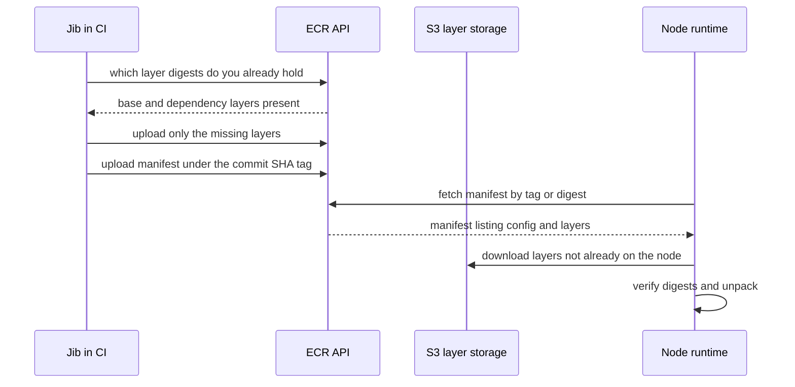
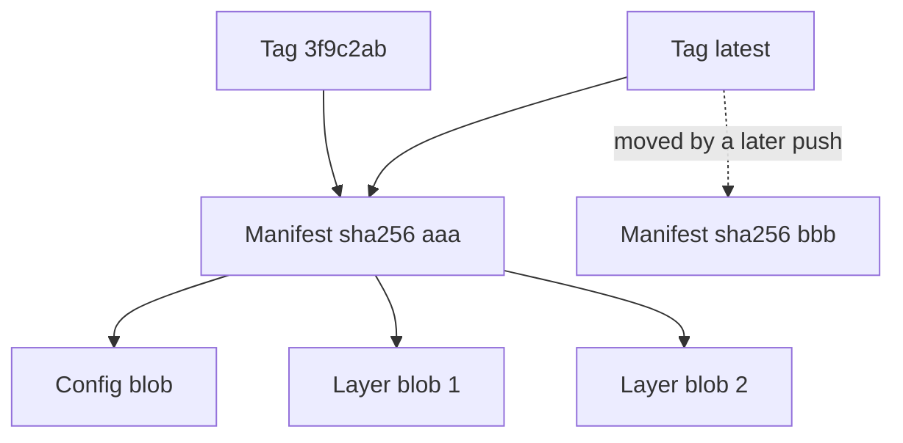

# Container Registries and ECR

A **container registry** is the server between "Jib builds the image" and "EKS runs it": CI pushes an image to it once, and every node that ever runs that version pulls it from it. **ECR** (Elastic Container Registry) is AWS's managed registry, the "image pushed to ECR" hop in your pipeline ([[The Deployment Pipeline]]). It is easy to treat as a folder in the sky. It is better understood as three things at once: a content-addressed blob store, an index that maps human names to those blobs, and the **durable record of exactly what you shipped**. This note tells the story from the registry's side: what a node asks it, what it promises, and what can quietly disappear. The SHA-tag discipline and `imagePullPolicy` defaulting are told from the pipeline's and the Deployment's side in [[The Deployment Pipeline]] and [[Kubernetes Workloads]]; image anatomy is in [[Docker and Container Images]].

## The problem that created it

1. **The machine that builds is not the machine that runs.** CI builds an image once; then N nodes, whose number changes by the minute with autoscaling, must each obtain exactly those bytes. Copying a tarball around gives no deduplication (a new release is mostly the same layers as the last), no resume, no naming, and no access control. Transfer has to work per layer, addressed by content.
2. **Many versions are alive at once.** Production runs one version, uat another, and a rollback needs the previous one on demand. Humans need names that mean something; machines need identifiers that cannot be confused.
3. **Pushing and pulling are privileged acts.** A push credential is write access to what production will run; a pull credential is read access to your compiled code and anything baked into it. A shared password is not an answer; the registry needs the same identity model as the rest of the platform.
4. **A regulated system needs a durable record.** "What exactly ran in production at 14:02 on Tuesday?" must have an answer that outlives the pod, the node and the pipeline run. The registry holds the artefact whose digest sits in the release record; deleting it deletes evidence.
5. **Third-party registries are a production dependency you did not choose.** If base images or sidecars are pulled from a public registry, its rate limits, outages and moved tags become your outages.

## What it solves

- **Distribution by layer.** Only layers the registry or the node lacks are transferred ([[Docker and Container Images]] explains why layers are content-addressed).
- **Naming and identity.** Tags give humans a handle; digests give machines an unambiguous identity.
- **Access control with the platform's own identity system.** In ECR that is IAM, with short-lived tokens instead of stored passwords.
- **A single source of truth for deployables,** from which any environment, any region and any rollback can be served.
- **Retention and hygiene.** Lifecycle rules stop storage growing forever; scanning finds known vulnerabilities in what you stored.
- **Resilience to upstream problems.** Replication and pull-through caches keep your pulls independent of other people's uptime.

## How it works

### A registry is a blob store plus a manifest index behind one HTTP API

The **OCI distribution specification** defines the protocol, so a Docker client, containerd and Jib all speak the same one ([[Docker and Container Images]] covers OCI). A **repository** is a namespace (`<name>` in the URL); inside it live **blobs** (layers and the config JSON, each addressed by digest) and **manifests** (addressed by tag or digest, listing which blobs make up an image). The core endpoints are few:

| Operation | Endpoint (OCI distribution-spec 1.1) |
|---|---|
| Pull a manifest | `GET /v2/<name>/manifests/<tag-or-digest>` |
| Pull a blob | `GET /v2/<name>/blobs/<digest>` |
| Start a blob upload | `POST /v2/<name>/blobs/uploads/` |
| Push a manifest | `PUT /v2/<name>/manifests/<tag-or-digest>` |

**Push.** The client first asks which of the image's layer digests the registry already holds; ECR's documentation describes this check as the reason an already-uploaded layer is skipped. It uploads only the missing layers, then the config, and **the manifest last**: the tag appears only when the manifest is accepted, so a push that dies halfway leaves nothing pullable behind. ECR recomputes the manifest's digest and rejects a mismatch (`ImageDigestDoesNotMatchException`). [[Jib]] performs exactly this sequence with no Docker daemon.

**Pull.** The node's runtime fetches the manifest by tag or digest, picks the platform-specific manifest if it was given an image index, then fetches the config and every layer it does not already hold locally, verifies the digests, and unpacks. In ECR the manifest comes from the ECR API, while layer downloads are served from S3 (the VPC endpoint documentation notes ECR stores layers in S3); the quota documentation counts one `GetDownloadUrlForLayer` call per uncached layer.

### Tags are movable pointers, digests are identities

A **tag** is a row the registry keeps: name to manifest digest. Pushing the same tag again just rewrites the row. A **digest** is the SHA-256 of the manifest's bytes, and the manifest contains the digests of the config and every layer, so one digest pins every byte transitively: change a single byte anywhere and the digest changes. That is why a digest is an identity and a tag is only a label.

Two ways to make "this name always means these bytes" true, enforced in different places:

| | Immutable SHA tag | Digest reference |
|---|---|---|
| Readable, and `git show` works on it | Yes | No |
| Enforced by | The registry, at push time | The kubelet and runtime, at pull time |
| Survives someone flipping the repository back to mutable | No | Yes |
| Multi-architecture caveat | The tag resolves to an index | The digest may be the index's or one platform's; record the one you deploy |
| Extra plumbing | None | The pipeline must carry the digest ([[Jib]] writes `target/jib-image.digest`) |

If a Kubernetes reference carries both tag and digest, only the digest is used (Kubernetes docs), so `repo:tag@sha256:...` keeps the readable name and the guarantee. A sensible default: immutable SHA tags for people, plus the digest recorded in the release record for audit. Immutability stops an *overwrite*; whether delete-then-recreate of the same tag is also stopped is something to test in a scratch repository (inference from how tags attach to manifests), so restrict `ecr:BatchDeleteImage` as well.

### ECR: what AWS adds

**Shape and quotas.** One private registry per account per region, at `<account-id>.dkr.ecr.<region>.amazonaws.com`, with one repository per image or service. Default quotas (AWS service-quota page, read October 2026; treat as approximate and check Service Quotas): 100,000 repositories per region and 100,000 images per repository (both adjustable), 1,000 tags per image, a maximum **layer** size of 52,000 MiB, at most 50 rules and 30,720 characters in a lifecycle policy. ECR publishes a per-layer cap, not a per-image one. API rate defaults are per region and adjustable, for example `BatchGetImage` 2,000 per second, `GetDownloadUrlForLayer` 3,000 per second and `PutImage` 10 per second, which matters for a very large node scale-up or a big CI fleet.

**Authentication.** The Docker CLI cannot do IAM natively, so ECR exchanges IAM credentials for a registry token: `GetAuthorizationToken` returns a token valid **12 hours** (AWS docs, 2026) whose scope equals the calling principal's permissions, with the fixed username `AWS`. The usual form is `aws ecr get-login-password | docker login --username AWS --password-stdin <registry>`; the ECR credential helper, which Jib can use, fetches tokens on demand instead. Pushing needs the token action plus the layer-check, layer-upload and `PutImage` actions; pulling needs `BatchGetImage` and `GetDownloadUrlForLayer`.

**How EKS nodes pull.** The pull happens before any container of the pod exists, performed by the node's kubelet and runtime with the **node instance role**, not the pod's identity. The EKS node-role documentation lists `AmazonEC2ContainerRegistryPullOnly` for this (older guides name `...ReadOnly`), and on EKS the kubelet runs an `ecr-credential-provider` plugin that turns the node role into a registry token, so no `imagePullSecret` is needed for same-account ECR. Consequence: every pod on a node has the same pull access. **IRSA does not govern image pulls**; it hands AWS credentials to the running application's SDK calls, after the image has already been pulled. There is a newer, opt-in per-pod route: Kubernetes added service-account-token support for kubelet credential providers as alpha in 1.33 and beta in 1.34, and the AWS containers blog (22 September 2026) says full `ecr-credential-provider` support is in EKS 1.35 and later, using a role named in a service-account annotation (`eks.amazonaws.com/ecr-role-arn`) so a pull can be scoped to a workload, with fallback to the node role.

Three kubelet-side terms, defined once. **`imagePullPolicy`** decides when the kubelet goes to the registry: `IfNotPresent` (the default for a non-`latest` tag) only if the image is not on the node, `Always` on every container start, `Never` never ([[Kubernetes Workloads]] has the `latest` defaulting rule). **`imagePullSecret`** is a reference to a Secret of registry credentials; for ECR a static one expires within 12 hours, which is why the credential provider exists. **`ErrImagePull`** then **`ImagePullBackOff`** are the states of a pod whose pull is failing and being retried with growing delays; the event text says why (not found, unauthorized, timeout).

**Immutable tags.** A repository setting. Pushing an existing tag then returns `ImageTagAlreadyExistsException`; it applies to all tags unless you set exclusion filters (`IMMUTABLE_WITH_EXCLUSION` in the CLI, with wildcard patterns, and a mutable-with-exclusions counterpart). The `PutImage` reference lists *two* distinct errors: `ImageTagAlreadyExistsException` (tag exists, repository immutable) and `ImageAlreadyExistsException` (the same manifest already pushed, nothing changed). Which one a byte-identical CI retry meets is not spelled out in AWS's `PutImage` reference (read October 2026), so test it before designing retry logic. Pull-through cache repositories should stay mutable so ECR can refresh them.

**Lifecycle policies.** JSON rules that expire (or archive) images. All rules are evaluated, then applied by priority (a lower number wins); an image is expired by at most one rule; rules select by `tagStatus`, tag prefix or wildcard pattern, and by count (`imageCountMoreThan`, ordered by push time) or age (`sinceImagePushed`). Expiry happens within about 24 hours of an image meeting its criteria (AWS docs, 2026), and the console offers a **preview** to run first; actions are logged in CloudTrail. A newer storage class lets rules *archive* images (for example `sinceImagePulled`), and an archived image must be restored, which AWS says to expect within 20 minutes. The policy sees only registry metadata: push time, pull time, tags. It has no idea what any Deployment references.

**Scanning.** *Basic* scanning uses AWS-native technology and a CVE database to check operating-system packages, on push or manually. *Enhanced* scanning integrates Amazon Inspector for continuous scanning of OS and programming-language packages. AWS recommends configuring scanning at the registry level, and switching between the two makes earlier scan results unavailable. Scanning reports known CVEs in what is installed; it does not know that a jar your runtime needs is missing.

**Replication.** Registry-level rules copy images to other regions or accounts. Only content pushed *after* the rule exists is replicated; most images arrive within 30 minutes, rarely longer (AWS docs); repository permissions and lifecycle policies are not replicated; deletes are not replicated; and if tag immutability is on and the replicated tag already exists there, the image arrives *untagged*. The repository name stays the same, but the registry hostname contains the region, so a cluster in another region needs its own image references. See [[Disaster Recovery]].

**Pull-through cache.** A rule makes your ECR a caching proxy for an upstream registry: ECR Public, the Kubernetes registry and Quay need no credentials; Docker Hub, GitHub, GitLab, Azure and Chainguard registries need credentials in Secrets Manager. A cached image is revalidated upstream at least once every 24 hours, and if the upstream is unreachable the last cached copy is still served (AWS docs).

**Network path and cost.** Storage is about $0.10 per GB-month for private repositories; transfer to EC2, Lambda or Fargate in the same region is free; cross-region transfer is about $0.09 per GB (AWS pricing page, read October 2026; approximate). Because layers come from S3, nodes without a NAT path need the `ecr.api` and `ecr.dkr` interface endpoints *and* an S3 gateway endpoint (AWS docs); if pulls instead go through a NAT gateway, per-GB NAT gateway data-processing charges apply. **Cost shape:** storage scales with distinct layers retained times retention times regions replicated to; transfer with cross-region and internet pulls; pull volume with nodes times deploys, mostly free in-region.

## Trade-offs

| | ECR | Docker Hub | GHCR | Artifactory |
|---|---|---|---|---|
| Auth | IAM, 12-hour tokens | Docker accounts and tokens | GitHub identities and tokens | Its own users, tokens, SSO |
| Natural fit | Workloads on AWS | Public and base images | Source and CI on GitHub | One repository manager for every package type, with proxy caching |
| Main cost | Region-scoped; quotas | Pull rate limits | Tied to GitHub | Another system to run or buy |

| You get | You pay |
|---|---|
| IAM-native auth, in-region pulls free to EC2 | Region scoping: cross-region means replication and per-region image references |
| Immutability, scanning, lifecycle built in | Lifecycle is a deletion tool pointed at your audit trail and rollback targets |
| No registry to operate | A hard dependency: no registry, no new pods that need a pull |
| Digest-level provenance | Pipeline and manifests must carry the digest, or you only have tags |

## Failure modes

- **Public pull limits hit production on a scale-up.** Docker Hub's own page (read October 2026) lists 100 pulls per six hours per IPv4 address or IPv6 /64 for anonymous pulls and 200 for a free authenticated account, returning HTTP 429. Docker's 8 April 2025 blog dropped a planned tightening and kept these limits, promising six months' notice of any change; treat the numbers as a snapshot and check the page. A fleet of private-subnet nodes behind one NAT gateway presents one public address (reasoning, not a quote), so a scale-up pulling Hub base images or add-ons can exhaust it and strand pods in `ImagePullBackOff` exactly when you need capacity. Fix: pull-through cache or mirror the images into ECR, and authenticate.
- **A mutable `latest` makes rollback silently deploy something else.** The pod template still says `latest`, so a rollback re-applies the same string while the bytes behind it moved. With `Always` (the default for `latest`) each container start goes to the registry; with `IfNotPresent`, nodes holding old bytes keep them while fresh nodes pull new ones, so the fleet runs two versions under one name. Immutable SHA tags remove the ambiguity ([[The Deployment Pipeline]]).
- **Expired credentials.** A CI job that runs `docker login` once and then works for hours past the 12-hour token fails at push after a green build; a static `imagePullSecret` created from `get-login-password` breaks every *new* pod after it expires while old pods keep running. Fetch tokens just in time or use the credential helper or provider.
- **Lifecycle expires an image a Deployment still references.** Running pods are unaffected, because the bytes are on the node. The break comes at the next reschedule, node replacement, scale-out or rollback: a node without the layers gets `not found` and the pod sits in `ImagePullBackOff`, while a node that happens to hold the image starts fine, so the symptom is intermittent and arrives days after the deletion. The kubelet's own image garbage collector also removes unused images, oldest first, when disk use passes its high threshold, so "cached on a node" is not durable. Two traps: a count-based rule on *any* tag counts every branch build, so a busy week can push the production image out of the newest N; and a rule keyed to last *pull* sees a long-running service whose pods never restart as unused (inference from the documented behaviour). An archived image needs about 20 minutes to restore, which is no help mid-rollback. Mitigation: retention longer than your rollback window and `revisionHistoryLimit` (default 10), rules that spare promoted tags, previews before applying, and an alert on lifecycle events.
- **A region outage with no replication.** Running pods keep running; everything that needs a pull stops: new nodes, rescheduled pods, scale-out, deploys and rollbacks, and CI cannot push a hotfix (follows from where the bytes live). Replication helps only for images pushed after it was configured and arrives asynchronously, and the failover cluster must be pointed at the other region's hostname.
- **Immutable tags meet pipeline retries.** Re-running a pipeline for the same commit tries to push an existing tag and meets one of the two errors above. Decide the behaviour deliberately ([[Jib]] builds are reproducible only if all inputs are fixed).

## When NOT to use it

- **Workloads outside AWS.** Cross-cloud pulls pay for egress and need extra credentials; a neutral registry may fit better.
- **Non-container artefacts.** Maven jars and npm packages want a package repository (AWS CodeArtifact, Artifactory), not an image registry.
- **An organisation standardised on one repository manager** for everything, with a single supply-chain policy, gains little from a second system.
- **Cross-region replication for a service that can wait out a regional outage.** It adds storage, transfer cost and per-region image references; weigh that against how often you would need a pull during an outage.
- **Deploying by digest alone with no human-readable trail** trades audit convenience for protection you already get from immutable tags.

## In your stack

- **Jib pushes to ECR tagged with the commit SHA,** and writes `target/jib-image.digest`; keep that digest in the pipeline's release record next to the SHA ([[Jib]]). Facets renders the image reference into the Helm chart, so confirm in the rendered pod spec that it carries the SHA (or digest), never `latest`.
- **EKS nodes pull with the node instance role,** needing the ECR pull policy on that role; the pod's IRSA role is for the application's own calls, such as `MONGODB-AWS` auth, and plays no part in the pull.
- **Turn immutable tags on.** It makes the SHA tag a registry-enforced fact: rollbacks pull what was tested, and an audit can trust the tag-to-digest mapping. The price is the retry question above: since Jib builds are reproducible, a pipeline could compare its `jib-image.digest` with `aws ecr describe-images` for that tag and treat a match as success (a design suggestion, valid only when inputs such as the base-image tag are pinned).
- **Replicas are pinned at 1, so a registry dependency lands exactly when the only pod moves.** There is no second pod serving while the replacement pulls; a lifecycle gap or ECR outage at that moment is an outage. Set retention against the rollback window.
- **Lifecycle policy is audit-evidence policy.** For an RBI-regulated service the retention period for deployed artefacts comes from compliance, not from storage cost; a rule that expires an image deletes the artefact behind a release record. Flag any change to retention as a regulatory-scope question, and check whether your repositories are replicated.

## Interview angle

The 60-second version: *"A registry is a content-addressed blob store plus a manifest index speaking the OCI distribution API. CI pushes layers the registry lacks, then the manifest last; nodes pull the manifest, then only the layers they do not hold. A tag is a movable pointer; a digest is the hash of the manifest, which transitively pins every layer, so it identifies the artefact. Production should therefore run an immutable tag or a digest, never `latest`. In ECR, auth is IAM-derived: the Docker CLI trades credentials for a 12-hour token, and EKS nodes pull using the node instance role through the kubelet's credential provider, not IRSA. Lifecycle policies expire by count or age, and ECR does not know what a Deployment references, so an over-eager rule breaks the next reschedule or rollback. For resilience you replicate across regions and cache upstream registries so you do not depend on Docker Hub's rate limits."*

Classic follow-ups: "Tag vs digest?" (movable label versus content hash); "Why did the rollback deploy the wrong thing?" (a mutable tag moved); "How do nodes authenticate to ECR?" (node role via the credential provider; IRSA is for the app); "What does a lifecycle policy put at risk?" (rollback targets and audit evidence); "What happens in a registry outage?" (running pods continue, anything needing a pull fails).

Senior tell: separating "enforced by the registry" (immutable tags) from "enforced by the consumer" (digest), and saying that lifecycle expiry is a deferred outage rather than an immediate one.

## Check yourself

> [!question]- Q: Explain why a digest identifies an image while a tag does not, and what you would record in a release record for an audit.
> A tag is a registry-side row mapping a name to a manifest digest, and a later push can rewrite it. A digest is the SHA-256 of the manifest, which lists the digests of the config and every layer, so changing any byte anywhere changes it. For an audit, record the commit SHA, the SHA tag and the digest of what was deployed; the digest proves the bytes, the tag gives people a handle, and with immutable tags the mapping between them cannot be rewritten in place. Record the digest your tooling deploys, since an image index and a per-platform manifest have different ones.

> [!question]- Q: Scenario — a cluster-autoscaler consolidation moves a service's pod to another node. It goes to `ImagePullBackOff` with `not found` for an image tag deployed five weeks ago, and nobody changed anything. Diagnose it, and say why other services are fine.
> A lifecycle rule most likely expired the image once it fell outside the retention count or age. The old pod kept running because the bytes were on its node; the new node has no copy and the registry no longer has the manifest. Check the repository for the tag or digest and CloudTrail for the lifecycle expiry event. Services that did not move, or whose nodes still cache the image, appear healthy, which is why this surfaces late and intermittently. Immediate fix: rebuild and redeploy a current tag (an expired image cannot be restored unless it was archived rather than expired). Lasting fix: keep retention longer than the rollback window, exclude promoted tags from expiry, avoid counting branch builds, and alert on lifecycle events.

> [!question]- Q: Scenario — during a traffic spike the node group scales out, and the new nodes' pods stick in `ImagePullBackOff` with `429 Too Many Requests` on an `eclipse-temurin` base image pulled from Docker Hub. Explain the mechanism and give two fixes.
> Docker Hub limits pulls per source address (100 per six hours for anonymous pulls per its documentation read in October 2026), and nodes in private subnets behind one NAT gateway share one public address, so a burst of fresh nodes exhausts the allowance. Fixes: authenticate the pulls (a higher limit) or, better, remove the dependency by mirroring the base images into ECR or adding a pull-through cache rule so nodes pull from your registry in-region; the cache keeps serving the last copy if Hub is down.

> [!question]- Q: Scenario — a nightly pipeline step runs `docker login` to ECR and then does a four-hour build and push. It fails at the push with an authorisation error after the build is green. Separately, `kubectl create secret docker-registry` built from `get-login-password` worked on Monday and new pods fail on Tuesday. Same cause?
> Yes: ECR authorization tokens are valid for 12 hours. The pipeline's token was fetched at the start of a job that outlived it, and the Kubernetes Secret holds a static token that expired. Fix the pipeline by fetching the token (or using the ECR credential helper) immediately before the push; fix the cluster by not using a static `imagePullSecret` for same-account ECR at all, since the node role and the kubelet's `ecr-credential-provider` obtain fresh tokens automatically.

> [!question]- Q: Mini-design — design the registry setup for 60 Spring Boot services on EKS in one region at a regulated fintech: repositories, auth, tags, lifecycle, scanning, resilience.
> One private repository per service, created with immutable tags; Jib pushes `<repo>:<commit-sha>` from CI using a role limited to push on that repository path, and the pipeline stores the digest in the release record. Nodes pull with the node instance role (pull-only policy); per-pod pull roles only if teams must be isolated. Lifecycle: keep at least the last N pushed images where N exceeds the rollback window and `revisionHistoryLimit`, spare promoted tags, push only from main so branch builds do not displace production images, preview before applying, expire untagged images, and set retention for deployed images from the compliance requirement. Scanning at registry level (enhanced if Inspector is available) with findings routed to owners. Resilience: a pull-through cache for every public base image, replication to a second region for critical services with that region's hostname ready in the deployment config, and restricted `BatchDeleteImage`. Monitor the pull error rate and ECR API throttling.

## Sources

- AWS documentation for Amazon ECR (read October 2026): service quotas; image tag mutability; lifecycle policies and the evaluation rules; archiving and restoring images; private registry authentication; private image replication; pull through cache; image scanning; interface VPC endpoints (layers stored in S3); `PutImage` API reference; pricing page.
- AWS documentation for Amazon EKS: the node IAM role (`AmazonEC2ContainerRegistryPullOnly`).
- AWS Containers Blog, "Implement per-pod image pull permissions with ECR repository policies on Amazon EKS" (22 September 2026); KEP-4412 README in kubernetes/enhancements and the Kubernetes v1.33 release blog (service-account tokens for kubelet credential providers: alpha 1.33, beta 1.34).
- OCI Distribution Specification 1.1 (endpoints, tags and digests); Kubernetes documentation: Images (tag plus digest, `imagePullPolicy` defaulting, avoiding `latest`), node-level garbage collection of images (oldest last-used first), and Deployments (`revisionHistoryLimit` default 10).
- Docker documentation: Docker Hub pull usage and limits (read October 2026); Docker blog, "Revisiting Docker Hub Policies: Prioritizing Developer Experience" (8 April 2025).
