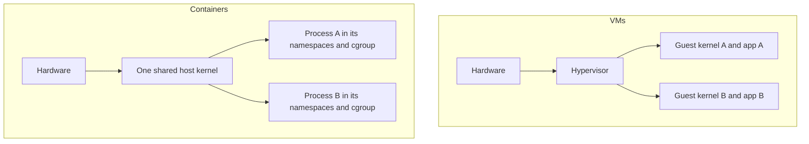
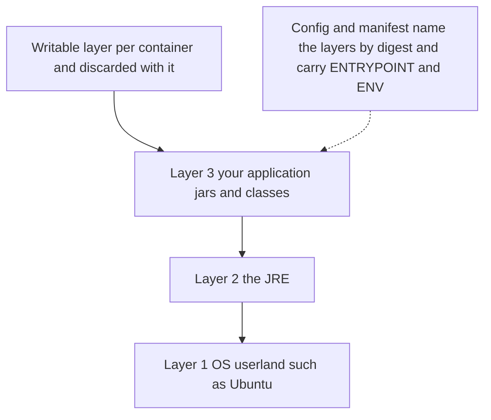

# Docker and Container Images

A **container** is an ordinary Linux process that the kernel has been told to lie to: it sees its own process tree, its own network, its own filesystem, and it is held to a CPU and memory budget. An **image** is the frozen, layered filesystem that process starts from. Together they are the middle of your pipeline ([[The Deployment Pipeline]]): the thing that travels from CI to production is not a jar, it is an image, and everything Kubernetes does afterwards (schedule, restart, roll back) is done to containers started from it. Most engineers carry a picture of containers as "small VMs", which is wrong in exactly the ways that matter in interviews and in incidents. This note rebuilds the picture from the kernel up. It stops where the cluster begins ([[Kubernetes Architecture]]) and where the image's address begins ([[Container Registries and ECR]]).

One word, four meanings, worth separating up front: **Docker** the company, **Docker Engine** (the CLI plus the `dockerd` daemon), the **image format** Docker popularised (now an open standard, OCI), and the **Dockerfile** build recipe. Your nodes run neither the company's product nor its engine, your pipeline has no Dockerfile ([[Jib]]), and the one meaning you depend on at every step is the image format.

## The problem that created it

1. **Environment drift.** A Spring Boot jar is not self-contained. It needs a JRE of one particular major version, operating-system libraries beneath that (libc, the CA certificate bundle, timezone data, fonts if you render PDFs), environment variables and file paths. Laptop, CI runner, uat and prod each differ in a few of these, and the bug that appears only in production lives in the difference. Shipping the jar ships a fraction of the environment. "Works on my machine" is a statement that the other machines are different.
2. **The VM answer works but is heavy.** A virtual machine ships the whole machine: a hypervisor presents virtual hardware and each application brings a complete guest operating system with its own kernel, init system and drivers. The artefact is gigabytes, the start-up is an operating-system boot (order of tens of seconds to minutes, varying widely), and every VM reserves memory for an OS that does nothing for the business. One VM per service across 60 services is 60 operating systems to patch.
3. **Linux already had the parts.** The kernel could already give a process a private view of the system (namespaces) and a resource budget (cgroups). What was missing was packaging. Docker, released by dotCloud and first demoed publicly at PyCon on 15 March 2013, contributed the product around those parts: a build recipe, a layered image format, a way to share images, and one command to run them. The kernel features were the engine; the image and tooling were what developers adopted. Since OCI (2015) the pieces are standardised, so the product, the format and the runtime can be swapped independently, which is why Kubernetes could drop Docker without breaking a single image.

## What it solves

- **One artefact, identical everywhere.** The OS userland, the JRE and the application travel together as one image; dev, CI, uat and prod run the same bytes, with only configuration differing ([[The Deployment Pipeline]]).
- **Start-up measured in process time.** There is no OS to boot; a container starts as fast as its main process does, which is what makes rolling deploys, autoscaling and fast restarts practical.
- **Density.** Many containers share one kernel, so a node's memory goes to applications, not to guest operating systems.
- **Resource isolation by budget.** A cgroup limit stops one noisy service from starving its neighbours.
- **Immutability.** Layers are read-only and content-addressed, so "what is running" can be answered with a hash instead of a guess, and a rollback is "run the old image".
- **Cheap shipping and storage.** Layers shared between images are stored and transferred once.
- **A uniform unit for schedulers.** Kubernetes can place, restart and scale anything that arrives as an image, whatever language is inside.

## How it works

### A container is a process wearing blinders

When a container starts, a runtime asks the kernel to create a process inside a fresh set of **namespaces**, each of which gives that process a private view of one kind of system resource, and places it in a **cgroup**, which limits what it may consume. There is no hypervisor and no guest OS; the process is visible to the host as a normal process.

| Namespace | What the process gets its own copy of |
|---|---|
| `pid` | Process-ID numbering. The first process is PID 1 and cannot see the host's other processes. |
| `net` | Network interfaces, IP address, routing table and port space. Two containers can both listen on 8080. |
| `mnt` | The mount table, hence the root filesystem it sees: this is where the image's layers appear. |
| `uts` | Hostname. |
| `ipc` | System V IPC objects and POSIX message queues. |
| `user` | User and group ID mappings, so uid 0 inside can be an unprivileged uid outside. |

The kernel defines two more, `cgroup` (Linux 4.6) and `time` (Linux 5.6), per namespaces(7); the six above are the ones to recite. **cgroups** are the budget side: the kernel's accounting and limiting of CPU, memory, process count and I/O for a group of processes. A CPU limit throttles the group; a memory limit is enforced by the kernel's OOM killer, which kills a process in the group with SIGKILL (exit status 137, `OOMKilled` in Kubernetes). cgroup v2 has been stable in Kubernetes since 1.25, and Kubernetes 1.35 deprecated cgroup v1: a kubelet no longer starts on a v1 node unless `failCgroupV1: false` is set (Kubernetes docs, read October 2026). Check a node with `stat -fc %T /sys/fs/cgroup/`; `cgroup2fs` means v2.



The consequence to hold onto: **every container on a host shares that host's one kernel.**

- A container cannot bring its own kernel, kernel modules or drivers; `uname -r` inside any container prints the host's kernel version. On a Mac, Docker Desktop runs containers inside a Linux VM (Docker docs), so your laptop's kernel is not a production node's kernel.
- The isolation boundary is the kernel's system-call surface, not a hypervisor. A flaw in the kernel or the runtime is a host escape: runc CVE-2019-5736 (2019) and CVE-2024-21626 (2024, "Leaky Vessels", affecting runc up to 1.1.11) both let a container process reach the host. VM escapes exist too, but a hypervisor's attack surface is generally smaller than a kernel's.
- You can buy the stronger boundary. EKS Fargate gives every pod a dedicated kernel (EKS docs, 2026), at the price of no DaemonSets and no privileged containers there.
- Root inside a container is uid 0 on the host unless a user namespace remaps it. Kubernetes pod user namespaces (`hostUsers: false`) went stable in 1.36 (Kubernetes docs, 2026), and remain opt-in per pod.

### An image is a stack of read-only layers plus metadata

An image has three parts. **Layers**: each is a tarball of filesystem changes (files added, modified, deleted) relative to the layer beneath. A **config** JSON: entrypoint, default command, environment, working directory, user, exposed ports, and the hashes of the layers. A **manifest**: a small JSON naming the config and each layer by digest and size. "Content-addressed" means every piece is named by the SHA-256 of its bytes (OCI image spec), so an identical layer is stored once however many images use it, a pull can skip layers already on the node, and any changed byte produces a new name. The hash of the manifest is the image's identity, the `sha256:...` in `repo@sha256:...`.

Layers are stacked by a **union filesystem**. In Docker's classic `overlay2` driver (OverlayFS), read-only image layers are the `lowerdir`, a writable `upperdir` sits on top, and the container sees the merged view. The first write to a file from a lower layer triggers a *copy-up* of the whole file (OverlayFS works at file level). When a container starts, it gets a fresh, thin writable layer; that layer dies with the container, and in Kubernetes a restarted container starts with a new one, so anything worth keeping must live in a volume or a datastore ([[Stateless vs Stateful Services]]). Docker's containerd image store page (read October 2026) says Docker Engine 29.0 and later default to the containerd image store on *fresh* installs, while upgraded daemons keep the legacy overlay2 graph driver until switched; the layering idea is the same.



One image reference may hide several images. A **tag** (`:1.4.2`) is a movable label held by the registry; a **digest** (`@sha256:...`) is the immutable hash. A single manifest is built for one CPU architecture; a multi-architecture tag points at an **image index** that maps each platform to its own manifest. An arm64 image on an amd64 node fails at start with `exec format error`, a classic result of building on an Apple Silicon laptop. If a Kubernetes reference carries both tag and digest, only the digest is used for the pull (Kubernetes docs). The registry's side of tags and digests is in [[Container Registries and ECR]].

### Dockerfile: instructions, cache order, multi-stage

A Dockerfile is a recipe whose instructions produce layers. This is the model of what [[Jib]] emits without one.

```dockerfile
# Stage 1: build. JDK and Maven wrapper live here and are discarded afterwards.
FROM eclipse-temurin:21-jdk AS build
WORKDIR /src
COPY .mvn/ .mvn/
COPY mvnw pom.xml ./
RUN ./mvnw -B dependency:go-offline
COPY src/ src/
RUN ./mvnw -B -DskipTests package

# Stage 2: runtime. JRE only: no compiler, no Maven, no source.
FROM eclipse-temurin:21-jre
RUN groupadd --system --gid 10001 app && useradd --system --uid 10001 --gid 10001 app
WORKDIR /app
COPY --from=build /src/target/service.jar service.jar
USER 10001:10001
EXPOSE 8080
ENV JAVA_TOOL_OPTIONS="-XX:MaxRAMPercentage=60.0"
ENTRYPOINT ["java", "-jar", "/app/service.jar"]
```

The tags are illustrative (pin the base by digest in real use; the trade-off is in [[Jib]]) and `service.jar` assumes the POM sets the final name. `dependency:go-offline` is a widely used approximation of "resolve dependencies now", not a guarantee for every plugin. The instructions:

- `FROM` picks the base image and starts a stage. `WORKDIR` sets the directory later instructions run in.
- `COPY` brings files from the build context into a layer; `RUN` executes a command at build time and keeps the resulting filesystem changes as a layer.
- `ENV` sets environment variables baked into the image config. `USER` sets the user the process runs as.
- `EXPOSE` documents the intended port and nothing else: Docker's reference states it does not publish the port. In Kubernetes the Service and container port settings decide reachability.
- `ENTRYPOINT` is the executable that defines what this container is; `CMD` supplies default arguments, replaced by whatever is passed at run time. Only the last of each in a Dockerfile counts, and with both in exec form the `CMD` is appended to the `ENTRYPOINT`. In a pod spec, `command` replaces `ENTRYPOINT` and `args` replaces `CMD`. **Always use exec form** (the JSON array). Shell form runs your program as a child of `/bin/sh -c`, which does not pass signals (Failure modes).

**Why order decides cache hits.** Each instruction becomes a layer, and when a layer changes, every layer after it must be rebuilt (Docker docs). So order instructions from slowest-changing to fastest-changing: base image, system packages, dependency manifest and resolution, then source. In the example, `pom.xml` is copied and dependencies resolved *before* `src/`, so a code-only commit reuses the dependency layer. A `.dockerignore` keeps `.git`, `target/` and `.env` out of the build context, so they neither bust the cache nor leak into a `COPY . .`. The generic failure is `COPY app.jar`: dependencies and code in one file, so every commit rewrites the whole layer. [[Jib]] fixes this by splitting layers by change frequency.

**Multi-stage builds** (Docker 17.05, May 2017) let one Dockerfile contain several `FROM` stages and `COPY --from=` only the artefact forward. The final image carries the JRE and the jar, not Maven, the compiler or the source. BuildKit, the default builder for Docker Desktop and Docker Engine (Docker docs), builds only the stages the target needs.

### OCI and the runtime chain

The **Open Container Initiative** was launched on 22 June 2015 by Docker, CoreOS and others, under the Linux Foundation, to stop one company owning the format. It publishes three specifications:

| Spec | Defines | Facts worth knowing |
|---|---|---|
| runtime-spec | How to run an unpacked filesystem bundle | `runc` is the CLI that implements it on Linux |
| image-spec | Manifest, layers, config | 1.1.0 released 15 February 2024 |
| distribution-spec | The registry HTTP API | v1.0 in May 2021; 1.1.0 on 15 February 2024 added a `subject` field and referrers API, so signatures and attestations can attach to an image |

On a modern node, the chain is: the kubelet calls a high-level runtime over **CRI** (a gRPC interface); **containerd** (or **CRI-O**) pulls the image, unpacks the layers and manages the container; it calls **runc**, which makes the kernel calls that create the namespaces and cgroups and starts your process. containerd was originally extracted from Docker Engine, joined CNCF on 29 March 2017 and graduated on 28 February 2019; CRI-O graduated on 19 July 2023 (CNCF project pages). "Docker" as a product is the CLI, `dockerd`, containerd, runc and BuildKit bundled for developers; a Kubernetes node needs only the bottom half.

Kubernetes shipped a built-in adapter, **dockershim**, so the kubelet could drive Docker Engine. It was deprecated in 1.20 and removed in 1.24 (3 May 2022). Docker-built images kept working because Docker's format is OCI-compliant (Kubernetes blog). EKS followed: its optimized AMIs have containerd as the only runtime from 1.24. Use `crictl`, not `docker ps`, on a node.

### Image size and base images

Size is a latency and attack-surface question. Every node must pull and unpack an image before its first pod there starts, so scale-ups and rollouts wait on it ([[Latency Numbers Every Engineer Should Know]] explains why network and disk dominate); registries bill storage; and every package in the image is code that can carry a CVE. Most of an image is the base, not your layer.

| Base | You get | The catch |
|---|---|---|
| Full distro (Ubuntu, Debian) | Shell, package manager, glibc, easy debugging | Largest; most packages to scan and patch |
| Alpine | Tiny (Docker Hub puts the base at about 5 MB); uses musl libc, not glibc | The JDK supports musl since JEP 386 (JDK 16, 2021) and Temurin publishes `-alpine` tags, but native (JNI) libraries compiled against glibc may fail to load or behave differently |
| Distroless | Application and runtime only: no shell, no package manager; Debian 13 based, with Java 17, 21 and 25 images, `:nonroot` and `:debug` tags, cosign-signed (README, October 2026) | No `kubectl exec ... sh`; use the `:debug` busybox variant or an ephemeral debug container |
| `scratch` | Empty | Static binaries only; not the JVM |

## Trade-offs

| You get | You pay |
|---|---|
| One immutable artefact across environments | A weaker isolation boundary than a VM: one shared kernel |
| Process-speed start-up, high density | A runtime, a registry and an orchestrator to operate |
| Layer sharing, cheap incremental pushes | Cache-order craft in the Dockerfile, or a tool like [[Jib]] to do it for you |
| Reproducible "what is running" | Every base layer is third-party code you now patch |
| Uniform unit for schedulers | Debugging by SSH is gone; shell-less images need other tooling |

**Cost shape:** pull time scales with image size times the number of nodes that have not cached it; registry storage scales with distinct layers retained; build time scales with the layers that changed; patching effort scales with the number of distinct bases, not the number of services, if services share one.

## Failure modes

- **Running as root.** With no `USER`, the process is uid 0, and with a shared kernel that is the starting position of any escape. Set a numeric non-root user (the kubelet cannot verify a user given by name under `runAsNonRoot`, as [[Jib]] shows) and consider `hostUsers: false`. The Java 17, 21 and 25 Temurin JRE images declare no `USER` (Adoptium's Dockerfiles for those images, read October 2026; see [[Jib]]), so a Dockerfile on them is root by default too.
- **`latest` and other movable tags.** The same string can mean different bytes tomorrow; Kubernetes' own docs advise avoiding `latest` in production. Rollback, reproducibility and audit all weaken. See [[Container Registries and ECR]].
- **Secrets baked into layers.** Layers are append-only: `COPY .env .` followed by `RUN rm .env` leaves the file in the earlier layer, recoverable by anyone who can pull the image. Build arguments and `ENV` values persist in the image too (Docker docs). Use `RUN --mount=type=secret` (BuildKit) so the secret exists only during that instruction; inject runtime secrets from Kubernetes at start ([[Kubernetes Configuration and Resources]]).
- **PID 1 is special.** The kernel delivers signals to PID 1 from inside its namespace only if it installed a handler; SIGKILL and SIGSTOP from an ancestor namespace are forced; orphans are reparented to it; and if it exits, the kernel kills everything left in the namespace (pid_namespaces(7)). Three consequences. (1) Shell-form `ENTRYPOINT java -jar app.jar` makes `/bin/sh` PID 1, it does not pass SIGTERM on (some shells optimise a lone final command into an `exec`; do not depend on that), nothing drains, and the pod waits out its grace period and is SIGKILLed (exit 137): the real cause of "graceful shutdown is on but deploys still drop requests" ([[Graceful Shutdown and Deployment Safety]]). Use exec form, or `exec java ...` in a wrapper script. (2) Exec-form `java` works because the JVM installs its own SIGTERM handler and runs shutdown hooks; exit status 143 (128+15) after a SIGTERM is a clean exit, not a crash. (3) A JVM does not reap children it never waited on, so an app that forks helpers can accumulate zombies; `docker run --init` injects a small init that forwards signals and reaps, a pod spec has no `--init` equivalent, so bake an init such as tini into the image if you fork. `shareProcessNamespace: true` makes the pod sandbox's `/pause` PID 1 but exposes every container's processes to the others.
- **JVM sized for the wrong box.** HotSpot reads cgroup limits (container support has been on by default since JDK 10 and was backported to later Java 8 updates; cgroup v2 detection arrived in JDK 15 and in 11.0.16 and 8u372 for the older lines, per Red Hat's 2022 container-awareness article, so confirm your exact build). For limits above about 512 MB the default maximum heap is 25% (`MaxRAMPercentage`; Microsoft Learn's JVM ergonomics table), so a 1 GiB pod gets a heap near 256 MiB. Set it too high and the opposite happens: metaspace, thread stacks, the code cache and direct buffers sit outside the heap, so the kernel OOM-kills the container with the heap under its maximum and no `OutOfMemoryError` in the log, because SIGKILL gives the JVM no chance to write one. A JVM too old to read cgroup v2 on a v2 node sizes itself from the node's RAM. Small pods also change the collector: under 2 CPUs or about 1.75 GiB, ergonomics pick Serial, not G1 (Microsoft Learn, Java in containers). Check what the JVM chose with `java -XX:+PrintFlagsFinal -version`.
- **Wrong architecture.** An arm64 image scheduled on amd64 nodes, or the reverse, dies with `exec format error`; build for the node group's architecture.
- **Writing to the container filesystem.** It is ephemeral and consumes node disk; the data vanishes on restart.
- **A pinned base that never gets patched.** Digest pinning trades drift for staleness ([[Jib]]); it needs a scheduled bump.

## When NOT to use it

- **Hostile or multi-tenant code.** Running untrusted code next to your own on a shared kernel is the case VMs, or a per-pod kernel such as Fargate, exist for.
- **Workloads that need their own kernel, modules or drivers.** A container cannot supply them.
- **One small app and a team that does not run infrastructure.** A managed platform that takes your source or jar may cost less than operating a registry, a runtime and a cluster; this is the [[EKS vs ECS]] question one level down.
- **Per-environment images.** Building a different image for uat and prod defeats the point; build once, configure per environment.
- **A Dockerfile where Jib already fits.** For a JVM-only fleet in unprivileged CI, hand-maintained Dockerfiles are copy-pasted drift ([[Jib]] has the comparison).

## In your stack

- **You do not write a Dockerfile.** Jib builds the image from the Maven build with no daemon and pushes it to ECR; the Dockerfile above is the model for reading what it produced: layers by change frequency, an exec-form `java` entrypoint so the JVM is PID 1, and a user that is root unless you set one.
- **There is no Docker on your nodes.** EKS nodes run containerd under the kubelet, so a `docker` command works on your laptop (inside Docker Desktop's Linux VM) and `crictl` is the node-side tool.
- **An image faithfully freezes the build's mistakes.** `MONGODB-AWS` auth under IRSA needs `aws-java-sdk-sts` on the classpath and no source file imports it; drop it and the image still builds, pushes and scans clean, then every Mongo-backed endpoint returns 500. Test the image, not just the code.
- **JVM as PID 1 and the grace period.** Exec form gets SIGTERM to the JVM; how long it then has to drain, and the Facets spelling trap for that budget, are in [[Graceful Shutdown and Deployment Safety]].
- **The memory limit the JVM reads is the one in the rendered pod spec.** Verify it there, and set `MaxRAMPercentage` against it deliberately.
- **Replicas pinned at 1 make pull time your rollout window on a deploy and your outage window on a reschedule.** The new pod's schedule, image pull, JVM start and readiness are the whole gap, and a pull is only as small as the layers that node already holds; the deploy-side treatment of that gap is in [[Graceful Shutdown and Deployment Safety]].
- **Audit chain for an RBI-regulated service.** The image digest is what ties a running pod to a commit; keep the commit-SHA tag and the digest as pipeline evidence ([[The Deployment Pipeline]]). Confirm your node group's CPU architecture matches what CI builds.

## Interview angle

The 60-second version: *"A container is not a small VM. It is a normal Linux process that the kernel isolates with namespaces, which give it a private view of PIDs, network, mounts, hostname, IPC and users, and limits with cgroups, which cap CPU and memory. Every container on a host shares one kernel, which is why containers start in process time and pack densely, and also why the isolation boundary is weaker than a VM's: a kernel or runc bug is an escape, which is why you run non-root and why multi-tenant untrusted code gets a VM boundary. An image is an immutable stack of content-addressed layers plus a config, mounted through a union filesystem with a thin writable layer on top. Dockerfile order matters because a changed layer invalidates everything after it, so you copy the dependency manifest before the source. The format is an OCI standard, so Kubernetes dropped dockershim in 1.24 and talks to containerd and runc directly while still running Docker-built images."*

Classic follow-ups: "Containers vs VMs?" (shared kernel versus guest kernel: speed and density versus isolation); "CMD vs ENTRYPOINT?" (what the container is versus its default arguments); "Why does my Java service ignore SIGTERM?" (shell form puts `sh` at PID 1); "Container memory limit versus heap?" (heap is only part of the footprint; 25% default); "Why did Kubernetes drop Docker?" (it kept the runtime interface and dropped an adapter; images are unaffected); "Is a container secure?" (only as much as the shared kernel, the runtime and non-root make it).

Senior tell: volunteering that PID 1 has special signal semantics and that the JVM heap is not the container's memory.

## Check yourself

> [!question]- Q: A colleague says "a container is a lightweight VM". Correct them using what actually happens at `docker run`, and state one consequence for security and one for speed.
> The runtime asks the kernel to start an ordinary process inside new namespaces (pid, net, mnt, uts, ipc, user) and a cgroup that caps its resources; there is no hypervisor and no guest OS, and the image's layers are mounted as its root filesystem. Speed: start-up is just process start, so there is no OS boot, and many containers pack onto one node. Security: all containers share the host kernel, so the isolation boundary is the kernel's system-call surface; a kernel or runc flaw (CVE-2019-5736, CVE-2024-21626) can reach the host, which is why you run non-root and use a VM-level boundary such as Fargate for untrusted tenants.

> [!question]- Q: Scenario — a Spring Boot pod has `server.shutdown=graceful`, yet every deploy drops in-flight requests and `kubectl describe` shows the old pod exiting with 137 after the full grace period. The Dockerfile says `ENTRYPOINT java -jar /app/app.jar`. Diagnose it.
> That is shell form, so most likely the process tree is `/bin/sh -c java -jar ...` with the shell as PID 1. The shell does not forward SIGTERM to the JVM, so the JVM never starts its shutdown hooks and graceful shutdown never runs; the pod sits until `terminationGracePeriodSeconds` expires and the kubelet sends SIGKILL, exit status 137. Confirm by reading `/proc/1/cmdline` in the container: if PID 1 is `sh`, that is the bug. Fix: exec form `ENTRYPOINT ["java", "-jar", "/app/app.jar"]` (or `exec java ...` in a wrapper), so the JVM is PID 1 and its own SIGTERM handler runs. A clean exit would show 143, not 137. Verify with a kill test under load.

> [!question]- Q: Scenario — a pod with a 1 GiB memory limit and `-XX:MaxRAMPercentage=90` is repeatedly `OOMKilled` (exit 137), but the logs show no `OutOfMemoryError` and heap graphs never reach the maximum. Explain and fix.
> The heap is only part of the process's memory: metaspace, thread stacks, the code cache, direct buffers and GC structures sit outside it. At 90% heap there is no room for them, so total usage crosses the cgroup limit and the kernel OOM killer sends SIGKILL, which gives the JVM no chance to throw or log anything. Fix: lower `MaxRAMPercentage` to leave headroom (tune it against measured non-heap use), or raise the limit; check the rendered pod spec's limit, and confirm the JDK reads cgroup limits (cgroup v2 support arrived in JDK 15 and in the 11.0.16 and 8u372 backports).

> [!question]- Q: Scenario — a Dockerfile does `COPY .env /app/.env`, then `RUN ./setup.sh`, then `RUN rm /app/.env`. A reviewer says the secret is safe because it is deleted. Are they right, and what is the correct approach?
> No. Layers are immutable and stacked: the `COPY` layer still contains `.env`, and the `rm` only adds a later layer that hides it in the merged view. Anyone who can pull the image can extract the earlier layer, and registries keep it. Build arguments and `ENV` values persist in the image metadata too. Correct approach: use BuildKit `RUN --mount=type=secret` so the secret is mounted only for that instruction and never written to a layer, keep `.env` out of the context with `.dockerignore`, rotate the exposed credential, and inject runtime secrets from Kubernetes rather than the image.

> [!question]- Q: Mini-design — specify the image and runtime posture for a new Spring Boot service on EKS: build method, base image, user, entrypoint, tagging, and memory settings.
> Build with Jib in CI (no daemon) or a multi-stage Dockerfile with the dependency manifest copied before source. Base: a JRE-only image pinned by digest with a scheduled bump (distroless `:nonroot` if the team can live without a shell, otherwise a Temurin JRE), on the architecture of the node group. A numeric non-root user. Exec-form entrypoint so the JVM is PID 1; a small init only if the app forks. Tag with the commit SHA, record the digest, and never use `latest`. Memory: set the pod limit, then `MaxRAMPercentage` deliberately (well below 100) and confirm with `-XX:+PrintFlagsFinal`; allow at least 2 CPUs and roughly 1.75 GiB or more if you want G1 rather than Serial. Verify the grace period in the rendered pod spec, and test by killing a pod under load.

## Sources

- Linux man-pages: namespaces(7) (namespace types, introduction versions) and pid_namespaces(7) (PID 1 signal and reaping semantics).
- Docker documentation (read October 2026): Dockerfile reference (ENTRYPOINT, CMD, EXPOSE), build cache, multi-stage builds, BuildKit, build secrets, `docker container run` (`--init`), OverlayFS storage driver (file-level copy-up), containerd image store (default on fresh Docker Engine 29.0 installs), and "What is a container".
- Docker Engine 17.05 release notes (multi-stage builds, May 2017); Docker blog, "Docker: Nine Years Young" (first public demo, PyCon, March 2013).
- Open Container Initiative: overview (founded 22 June 2015; runtime, image and distribution specs); distribution-spec v1.0 announcement (4 May 2021); OCI image and distribution 1.1 release announcement (15 February 2024); runc README; GitHub advisory GHSA-xr7r-f8xq-vfvv (CVE-2024-21626, runc 1.0.0-rc93 to 1.1.11).
- Kubernetes documentation: dockershim FAQ and removal in 1.24; Images (tag plus digest); cgroup versions (v2 stable 1.25, v1 deprecated 1.35); pod user namespaces (stable 1.36); shared process namespaces; CNCF project pages for containerd and CRI-O.
- AWS documentation: Amazon EKS Fargate considerations (a dedicated kernel per pod); EKS dockershim end of support.
- GoogleContainerTools/distroless README (October 2026); Docker Hub official pages for Eclipse Temurin (Alpine and musl); OpenJDK JEP 386.
- Red Hat Developer, "Java 17: what's new in OpenJDK's container awareness" (2022); OpenJDK JDK-8146115 (container detection, JDK 10, backported to 8u191); Microsoft Learn, "Containerize your Java applications" (JVM default GC and heap table, updated June 2026); Red Hat security bulletin RHSB-2024-001 (CVE-2024-21626); Tenable write-up of CVE-2019-5736.
