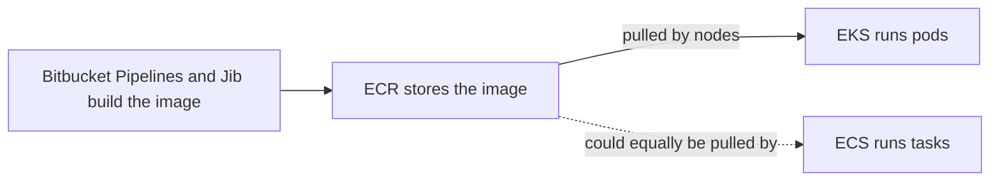
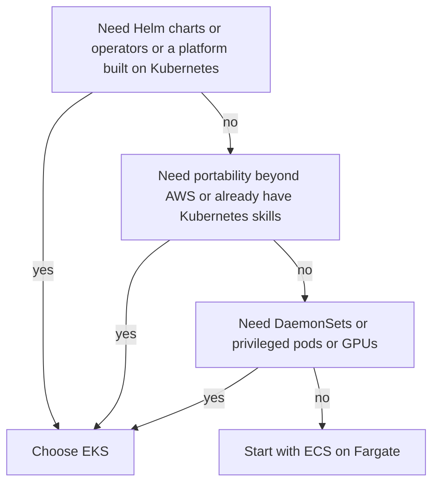

# EKS vs ECS

**ECR is the image registry; ECS and EKS are two different orchestrators; you run on EKS.** The three names differ by one letter and sit side by side in the AWS console, so "image pushed to ECS, then deployed with EKS" is an easy way to write a sentence that is right in spirit: the image is stored in **ECR** ([[Container Registries and ECR]]) and **EKS** is what runs it. One letter fixes it. **ECS** is the road your fleet did not take — AWS's own, simpler orchestrator, which could pull from the very same ECR repository. This note explains what the two orchestrators are, what each takes off your hands, and why a Helm-based platform layer like Facets puts you on EKS. The idea Kubernetes is built on is [[Kubernetes Architecture]]; this note is about the AWS decision around it.

## The problem that created it

An image is not a running service. Production needs N containers on M machines placed, restarted, replaced, scaled, rolled out and found by their callers — the chores [[Kubernetes Architecture]] lists — and a human with SSH does not scale to that. Something has to be the orchestrator, and the real question is who runs *its* brain and how many concepts you must hold to use it.

AWS answered twice, for different reasons. Amazon ECS was announced in November 2014 (as Amazon EC2 Container Service) and became generally available in April 2015: a proprietary scheduler designed around AWS's own primitives — EC2, load balancers, IAM. Kubernetes was open-sourced in 2014 and became the industry's common API; customers then wanted Kubernetes on AWS, but running it yourself means owning a highly available API server and etcd. Amazon EKS was announced at re:Invent in November 2017 and went generally available in June 2018: a Kubernetes control plane that AWS operates for you. So ECS asks "how little orchestrator can we give you that still covers the common needs, fully AWS-native?" and EKS asks "how do we give you the Kubernetes everyone's tooling targets without making you run its brain?" Fargate adds a third axis that cuts across both: who runs the *machines*.

## What it solves

- **EKS: a conformant Kubernetes API without operating etcd.** AWS runs and replaces the control plane across Availability Zones behind an SLA; you keep Helm, operators and the wider ecosystem ([[Kubernetes Architecture]]).
- **ECS: orchestration with fewer concepts and no control plane to see.** No cluster software to version, upgrade or pay for; IAM, load balancers and logging are first-class.
- **Fargate: no node layer.** Each pod or task runs in its own isolated VM boundary, so there is no AMI to patch or bin to pack, on either orchestrator.
- **Both: ECR, IAM and VPC networking.** The registry choice is independent of the orchestrator choice, so changing one later does not move the images.

## How it works

### EKS: AWS runs the brain, you choose the hands

AWS operates the API server and etcd ([[Kubernetes Architecture]] has the structure and the node-failure behaviour). You pay a flat per-cluster fee: $0.10 per cluster-hour on a standard-support Kubernetes version and $0.60 on an extended-support one (AWS list price, 2026) — about $73 versus about $438 per 730-hour month, by arithmetic on those rates. AWS's SLA for a standard control plane is a 99.95 percent monthly uptime commitment on the Kubernetes API endpoint (AWS also sells provisioned control-plane tiers with a 99.99 percent commitment, 2026); it covers that endpoint, not your nodes or pods.

You choose where pods run. **Managed node groups** are EC2 instances AWS provisions and drains for upgrades, though you start the upgrade. **Self-managed nodes** are your AMIs and your scaling. **Karpenter** is a self-run autoscaler that launches right-sized instances for pending pods. **EKS Auto Mode** (launched at re:Invent 2024) has AWS run the node layer too, charged as an extra amount per managed instance on top of the EC2 price. **Fargate** runs each pod in its own VM boundary with nothing for you to patch. **Hybrid Nodes** put on-premises machines under an EKS control plane, billed per vCPU-hour. Except for Auto Mode and Fargate, the nodes are ordinary EC2 instances in your account, so node patching stays yours.

Fargate on EKS gives each pod its own kernel, CPU, memory and network interface, and bills requested vCPU and memory from image pull to pod termination, rounded to the second with a one-minute minimum (AWS pricing, 2026). The cost of that isolation is a list of things you cannot do (AWS docs, 2026): no DaemonSets, privileged containers, HostPort or HostNetwork; no GPUs; no EBS volumes (EFS works); private subnets only; EFS only with static provisioning; no instance metadata, so IAM access must come through IRSA, because Pod Identity does not run on Fargate; no Fargate Spot; and AWS patches Fargate pods periodically, deleting any it cannot evict gracefully.

The version treadmill is the price of Kubernetes' pace. A new minor version appears about every four months. EKS gives each version 14 months of standard support, then 12 months of extended support at the higher control-plane rate — 26 months in all (AWS docs, 2026). In October 2026: **1.34, 1.35, 1.36 and 1.37 are in standard support** (1.37 reached EKS on 1 October 2026; 1.34's standard support ends 2 December 2026) and **1.31, 1.32 and 1.33 are in extended support** — 1.31's extended support ends 26 November 2026, after which AWS upgrades those control planes on its own schedule. A cluster's upgrade policy defaults to EXTENDED, so a cluster that simply falls behind starts billing six times the standard rate with no action from you; when extended support ends AWS upgrades the control plane automatically and leaves self-managed and managed-node-group nodes where they were. Upgrades go one minor version at a time — control plane, then nodes, then add-ons (VPC CNI, CoreDNS, kube-proxy) — and an in-place control-plane upgrade can be rolled back within 7 days. Kubelets may trail the API server by up to three minor versions, which is a tolerance, not a plan. Each hop can remove deprecated APIs your charts still use; EKS upgrade insights scans for them.

### ECS: no control plane to run

ECS has no cluster software for you to see: no API server to upgrade, no etcd, no version window. AWS states there is no additional charge for ECS orchestration; you pay for the compute underneath (AWS pricing, 2026). The price is vocabulary and a ceiling — it is AWS's own model, not a portable API. The words map roughly onto Kubernetes ones:

| ECS term | Nearest Kubernetes idea | Where the analogy breaks |
|---|---|---|
| Task definition | A pod spec: containers, CPU and memory, roles, network mode | Each change registers a new numbered revision; config and secrets are fields inside it, not separate objects |
| Task | A pod: one running instance of a task definition | Can run once and stop (batch) or be managed by a service |
| Service | A Deployment plus a Service: keeps N tasks running, replaces failures, rolls out revisions, registers tasks with a load balancer | One object covers what Kubernetes spreads across several |
| Cluster | A cluster | A logical grouping of capacity and services; nothing for you to operate inside it |
| Capacity provider | A node pool plus its autoscaler | Links a cluster to a source of compute — Fargate, Fargate Spot, an EC2 Auto Scaling group or Managed Instances — and a strategy splits tasks across them |
| Task role and execution role | A ServiceAccount with IRSA, and the node's image-pull access | The task role is your app's AWS permissions; the execution role lets ECS pull the image, write logs and fetch injected secrets |

Capacity comes in four forms: **Fargate** (serverless), **EC2** (you manage instances and the ECS agent, usually via an Auto Scaling group capacity provider), **ECS Managed Instances** (AWS manages the EC2 fleet, with a management fee on top of EC2 charges), and **ECS Anywhere** for your own on-premises machines. Tasks commonly use the `awsvpc` network mode, which gives each task its own network interface and VPC address — the same "workloads are first-class VPC citizens" model as the EKS VPC CNI, with the same IP-planning homework ([[Kubernetes Networking]]). The **task role** hands containers short-lived credentials from a container credential endpoint; there is no OIDC provider or annotation, the trust principal is `ecs-tasks.amazonaws.com`, and CloudTrail records which task the credentials were issued to (AWS docs, 2026) — simpler than IRSA. `secrets` entries in the task definition inject values from Secrets Manager or Parameter Store as environment variables at task start, and AWS's docs say a changed secret needs a forced new deployment to be picked up: the same frozen-at-start behaviour as a Kubernetes env var ([[Kubernetes Configuration and Resources]]).

Finding peers is the same problem on both, solved with different parts. Kubernetes gives each Service a DNS name and an endpoint list fed by readiness probes ([[Health Checks and Service Discovery]]). ECS services are reached through a load balancer target group, or by name through ECS Service Connect or Cloud Map-based service discovery. Neither is better in the abstract; the Kubernetes pieces are platform primitives, the ECS ones are AWS products you wire in.

ECS now has deployment strategies built in. Beyond rolling updates, AWS added built-in blue/green in July 2025 for services behind ALB, NLB or Service Connect, then linear and canary in October 2025 for ALB and Service Connect, extended to NLB in February 2026 — all with lifecycle hooks and bake time. In Kubernetes those come from add-ons or a mesh, because a core Deployment offers only rolling update and recreate ([[Kubernetes Workloads]], [[Deployment Strategies]]).

A deploy step shows the shape difference. On EKS the pipeline changes the image in a Deployment's pod template (typically through a Helm release), the Deployment controller creates a new ReplicaSet and the loops converge ([[Kubernetes Workloads]]). On ECS the pipeline registers a new task definition revision carrying the new image and updates the service to use it, and the service scheduler replaces tasks according to its deployment configuration. The mechanism is the same idea — a declared desired state and a controller walking to it — but on ECS that controller is AWS's and invisible, which is both its simplicity and its ceiling.

### Side by side

| Dimension | EKS | ECS |
|---|---|---|
| What it is | Managed Kubernetes control plane; you pick the compute | AWS-proprietary orchestrator; no control plane to see |
| Portability | The Kubernetes API and Helm charts move across clouds and on-premises; the load balancers, IAM and volumes behind them do not | Task definitions and ECS APIs work only with ECS; ECS Anywhere extends it to your machines but ECS still manages them |
| Learning curve | Steep: pods, Deployments, Services, Ingress, RBAC, CNI, operators | Gentler: a handful of concepts and one task model |
| Ecosystem | Helm, operators and CRDs, service meshes, GitOps controllers, a vendor-neutral tool market | AWS-native integrations (ALB, CloudWatch, Service Connect); a smaller third-party surface |
| Networking | Flat pod network, VPC CNI pod addresses, Services, Ingress, NetworkPolicy | `awsvpc` task interfaces, load balancer target groups, Service Connect |
| IAM integration | IRSA or Pod Identity (Pod Identity not on Fargate); per-ServiceAccount roles | Task role, one concept on every compute type |
| Cost shape | Flat per-cluster fee, plus nodes (the sum of pod requests plus headroom) or Fargate per pod; Auto Mode adds a per-instance charge | No orchestration fee, plus tasks: Fargate per requested vCPU and memory, or EC2 instances |
| Operational burden | A version upgrade every few months, add-on and node management, deprecation hunting | AMI and agent updates on EC2; none on Fargate; no cluster version to chase |
| Wins when | You need portability, Helm, operators, a mesh, existing Kubernetes skills, or a platform layer built on Kubernetes | A small AWS-only team wants the fewest moving parts and has no need for the Kubernetes ecosystem |

### Fargate on both, and an honest way to choose

Fargate is neither orchestrator; it is the compute engine both can use, so "who owns the nodes" separates from "which scheduler". On both it means one workload per isolated VM boundary, billing by requested vCPU and memory, and no node patching. They differ at the edges: ECS supports Fargate Spot for interruption-tolerant tasks (a discount of up to 70 percent against on-demand, AWS pricing, 2026) where EKS does not, and EKS Fargate carries the Kubernetes constraint list above, so check each platform's Fargate limits rather than assuming parity. In either, a pod or task is billed for its whole requested size whether it uses it or not, so right-sizing is the lever. Fargate is generally priced higher per vCPU-hour than equivalent EC2 capacity — an assumption not pinned to figures here, so compare current prices — which means it buys operational simplicity, not a discount.

What is portable between the two is the real switching cost. The image is portable: ECR serves both unchanged, and a container that follows the usual habits (config from the environment, logs to stdout, SIGTERM handling) runs on either. Everything around the image is not — the deploy descriptor (Helm chart versus task definition), the IAM wiring (IRSA versus task role), secret injection, health checks, autoscaling objects and the traffic path from the edge. A migration is a rewrite of the delivery layer, not a recompile, which is why the decision deserves one careful look up front and then should be left alone.

The honest guidance: ECS is often the better answer for a small team that does not need the Kubernetes ecosystem. EKS wins when you need portability, Helm charts, operators, a mesh, or a platform layer like Facets that is itself built on Kubernetes.

## Trade-offs

Choosing EKS over ECS:

| You get | You pay |
|---|---|
| The Kubernetes API: Helm, operators, GitOps, meshes, portable skills | A concept load an ECS service never asks of you |
| An AWS-run control plane across Availability Zones with an SLA on the API endpoint | A flat per-cluster fee, about $73 a month at 2026 list price, that does not shrink with fewer services — and six times that if a cluster slips into extended support |
| A choice of compute: nodes, Karpenter, Auto Mode, Fargate | The node-layer decision, and node patching unless you pick Auto Mode or Fargate |
| An ecosystem that targets Kubernetes first | An upgrade roughly every four months and the add-on and API-deprecation work behind it |
| A base that platform layers such as Facets can build on | Another layer whose silent behaviours you must verify |

Name the cost shape, not just the verdict. EKS has two meters. The control-plane meter counts *clusters*: $0.10 per cluster-hour is about $73 a month at 2026 list price, so separate clusters for prod, uat and dev are about $219 a month before a single node runs. The compute meter counts the *sum of pod requests*, plus headroom on nodes or exactly the requested size on Fargate. ECS has one meter, the compute one, counted as the sum of task sizes. Read the arithmetic as a cost-per-cluster signal: the fee matters when you run many small clusters, and beside the compute bill of one busy cluster it is small — an inference from the numbers, to check against your own spend. The larger EKS premium is people-time for upgrades and concepts, which no price page shows.

## Failure modes

- **EKS: falling behind on versions.** The cluster silently moves to extended support at six times the control-plane rate, then is force-upgraded at the end of the window with nodes left behind, which is how kubelet skew and surprise API removals arrive together.
- **EKS: a managed control plane is not a managed cluster.** AWS runs the API server and etcd; node operating systems, add-ons, autoscalers, ingress controllers and everything you installed with Helm stay yours. The SLA excludes worker nodes, so the API can be up while your ingress controller is broken.
- **EKS: an upgrade hop breaks something.** A chart still uses a removed API version, an add-on was not bumped, or nodes lag the control plane. Rollback exists only for 7 days after an in-place upgrade; after that you migrate to a new cluster.
- **EKS: subnet IP exhaustion.** Pods consume VPC addresses ([[Kubernetes Networking]]); an upgrade needs up to five free addresses in the cluster subnets, and a full subnet fails it.
- **EKS: node-layer disruption on single-replica services.** An AMI roll, an Auto Mode node replacement (which respects PodDisruptionBudgets) or Fargate OS patching removes the only pod; the orchestrator choice does not change that arithmetic ([[Graceful Shutdown and Deployment Safety]]).
- **EKS Fargate: pods outlive the upgrade.** Fargate pods do not upgrade with the control plane; they pick up the new kubelet version only when redeployed, and a Completed Job's pods keep billing until cleaned up.
- **ECS: capacity and sizing.** On EC2, a task that fits no instance cannot be placed; on Fargate, tasks are sized from a fixed menu of vCPU and memory combinations, so a task is rounded up to the next valid size and billed for it.
- **ECS: task role versus execution role.** A task that cannot pull its image or fetch an injected secret is missing execution-role permissions; an application that gets AccessDenied calling S3 is missing task-role permissions. Mixing the two up sends you debugging the wrong role.
- **ECS: rotated secrets are not picked up.** The value was injected at task start; AWS's docs say to force a new deployment.
- **ECS: lock-in shows up at migration time.** Task definitions and ECS APIs do not port, so leaving later means rewriting deployment tooling rather than re-pointing it, and Helm charts and operators published for Kubernetes do not apply.
- **ECS on EC2: you patch the AMI and agent.** The "no control plane" saving does not extend to the instances.

## When NOT to use it

- **Do not pick EKS for a small, AWS-only team with a few services and no Helm or operator need.** You would pay the cluster fee, the concept load and a four-monthly upgrade for ecosystem you do not use; ECS on Fargate is the lighter default ([[Monolith vs Microservices]] makes the same point about premature machinery).
- **Do not pick ECS if a platform layer, Helm charts or operators are a hard requirement**, or if portability beyond AWS or on-premises is real rather than aspirational. You would be rebuilding those pieces as task definitions.
- **Do not put workloads on Fargate that need DaemonSet agents, privileged mode, HostNetwork, GPUs or EBS volumes (EKS Fargate), or whose steady high utilisation makes node bin-packing cheaper.** Compare costs with your own numbers.
- **Do not treat Kubernetes as a multi-cloud strategy by itself.** It is a portable API, not portable infrastructure: load balancers, volumes and IAM stay cloud-specific ([[Kubernetes Architecture]]).
- **Do not run both orchestrators without a reason.** Two operational models, two IAM shapes and two deploy paths double the on-call surface.

## In your stack

- **The pipeline, hop by hop.** Bitbucket Pipelines runs CI; Jib builds the image ([[Jib]]); the image is pushed to ECR; EKS pulls it onto nodes and runs it as pods ([[The Deployment Pipeline]]). Nothing in that chain involves ECS, so if a runbook or chat says "push to ECS", read it as ECR.
- **Why EKS plus Facets.** Facets renders Helm charts over EKS, and Helm is a Kubernetes packaging tool: its releases are Kubernetes objects. A platform layer built that way presupposes the Kubernetes API, and ECS has neither Helm nor that API, so for your fleet the orchestrator question is largely answered by the platform choice. The decision record is not verified here; this is the structural reason, not the history. The same layer is where the quiet behaviours live — snake_case-only `app_chart` values on `flavor: "deployment"`, a hardcoded probe `failureThreshold` of 10, the PodDisruptionBudget at `spec.release.disruption_policy` — Kubernetes concepts you inherit with EKS and verify in the rendered pod spec ([[Kubernetes Configuration and Resources]]).
- **What the control-plane fee buys.** A flat charge per cluster buys an API server and etcd that AWS runs across Availability Zones and replaces on failure ([[Kubernetes Architecture]]), plus a 99.95 percent monthly commitment on the API endpoint. It does not buy node patching, add-on or version upgrades, or anything on the request path: Kong to Service to pod keeps working through a control-plane brownout. It scales with the number of clusters, not services or replicas, so consolidating clusters is the lever. Inference: for a fleet of more than a few nodes the fee is small beside the node bill — check Cost Explorer rather than trust that.
- **Replicas pinned at 1 is a cost decision that ignores the orchestrator.** On EKS the bill is nodes sized by the sum of requests, and one replica per service minimises it. On ECS a service with a desired count of one has the same gap, since no peer exists. Neither orchestrator closes the node-drain gap; only a second replica does.
- **Check which versions your clusters run.** `aws eks describe-cluster` shows a cluster's version and `aws eks describe-cluster-versions` the support dates. In October 2026 a cluster on 1.31–1.33 is in extended support and billing six times the standard fee, one on 1.31 faces a forced control-plane upgrade after 26 November 2026, and one on 1.34 leaves standard support on 2 December 2026. Not verified here: which versions your clusters actually run.
- **Credentials plumbing differs by orchestrator.** `MONGODB-AWS` under IRSA needs `aws-java-sdk-sts` on the classpath or every Mongo endpoint returns 500 at runtime while builds stay green. MongoDB's Java driver docs state the AWS-SDK-on-classpath requirement for the web identity path (what IRSA uses) and list ECS container credentials and EC2 metadata as separate sources — moving orchestrators changes credential plumbing, not just YAML. The same goes for the edge: Kong routes to Kubernetes Services, and the ECS equivalent would be a load balancer target group or Service Connect.

## Interview angle

**"Why Kubernetes?" in 60 seconds:** *"Running containers at scale is a control problem: placement, restarts, rollouts, scaling, discovery, config. Kubernetes solves it with one idea — a declarative API plus reconciliation loops — which gives self-healing, rolling updates and rollbacks, bin-packing, and an extension model of CRDs and operators that a whole ecosystem targets: Helm, meshes, GitOps, autoscalers. The price is real: many concepts, an upgrade every few months, a control plane to run or pay for. So I choose it for the ecosystem or portability, not by default."*

**"ECS vs EKS" in 60 seconds:** *"Both orchestrate containers pulled from ECR. ECS is AWS's own orchestrator: no control plane to see, no orchestration fee, a small vocabulary of task definitions, tasks and services, a simple task role for IAM, and built-in blue/green, linear and canary deployments. EKS is managed Kubernetes: AWS runs the API server and etcd for a flat per-cluster fee, you get the Kubernetes API, Helm and operators, and you take on version upgrades roughly every four months. Fargate is orthogonal — a serverless compute option on both. For a small AWS-only team I'd start with ECS on Fargate; I'd choose EKS when I need portability, the Helm and operator ecosystem, or a platform layer built on Kubernetes."*

Classic follow-ups: "Is ECR the same as ECS?" (no: registry versus orchestrator); "What does the EKS fee actually buy?" (the control plane and its SLA, not nodes, upgrades or add-ons); "What happens if we don't upgrade EKS?" (extended support at six times the rate, then forced control-plane upgrade); "Is Fargate cheaper?" (it removes node work; compare per-unit prices and idle requested size); "Can ECS do canary?" (yes, built in since October 2025).

Senior tell: separating three independent choices — the registry, the orchestrator and the compute engine — and refusing to call Kubernetes "portable" without saying what is not.

## Check yourself

> [!question]- Q: A colleague writes "the image is pushed to ECS and then deployed with EKS". Straighten it out in a minute, and say why the slip is understandable.
> ECR is the registry that stores the image; ECS and EKS are two different orchestrators that run images pulled from a registry, and your fleet runs on EKS — so the sentence should read "pushed to ECR, deployed on EKS". The slip is understandable because the three names differ by one letter, appear together in the console, and ECS and EKS do the same broad job (running containers) while ECR does not. The practical consequence of keeping them separate is that the registry choice does not constrain the orchestrator: ECS could pull the same ECR image.

> [!question]- Q: Scenario — in October 2026 a cluster on Kubernetes 1.32 has a control-plane line item six times higher than its peers. Explain it, and say how you would fix it and what to watch on the way.
> 1.32's standard support ended on 23 March 2026, and a cluster's upgrade policy defaults to EXTENDED, so it rolled into extended support at $0.60 per hour against $0.10 (AWS list price, 2026) with no action. Fix: upgrade to a standard-support version, one minor at a time — 1.33 (itself already extended), then 1.34, preferably on to 1.35 or later for runway since 1.34's standard support ends 2 December 2026. Each hop is control plane, then nodes, then add-ons; scan upgrade insights for removed APIs first, and remember in-place rollback exists for only 7 days. Do not wait: extended support for 1.32 ends 23 March 2027, after which AWS upgrades the control plane on its own schedule and leaves nodes behind.

> [!question]- Q: Scenario — a four-engineer team runs six Spring Boot services, AWS only, behind an ALB, and asks whether to adopt EKS. What do you recommend, and what would change your answer?
> Start with ECS on Fargate: no control plane to upgrade or pay for, a small vocabulary, a task role for IAM, built-in blue/green and canary deployments, and no node patching — fewer moving parts for a team with no Kubernetes ecosystem need. What flips it to EKS: Helm charts or operators the team genuinely needs, a platform layer built on Kubernetes, a portability requirement that is real (hybrid or multi-cloud), existing Kubernetes skills, or workloads that need DaemonSets, privileged mode or GPUs. State the cost shape either way: ECS has no orchestration fee and tasks scale with requested size; EKS adds a flat per-cluster fee plus nodes sized by the sum of requests.

> [!question]- Q: Scenario — someone proposes moving a cluster's workloads onto Fargate profiles: a log-shipping DaemonSet, a StatefulSet on EBS volumes, and a pod needing HostNetwork. What breaks, and what is the fix for each?
> All three hit documented Fargate-on-EKS limits (AWS docs, 2026). DaemonSets are not supported, so the shipper must become a sidecar in each pod (with the per-pod resource cost that implies) or stay on nodes; EBS volumes cannot be mounted, so the StatefulSet must use EFS or stay on nodes; HostNetwork and HostPort are not allowed, so the pod must be redesigned or stay on nodes. Also check IAM: instance metadata is unavailable on Fargate, so access must come through IRSA, as Pod Identity does not run there. The usual answer is a mixed cluster: Fargate for plain stateless pods, nodes for the rest.

> [!question]- Q: Mini-design — 40 Spring Boot services, each run at a single replica to save cost, on EKS. Compare node groups, Auto Mode and Fargate for the compute layer, naming the cost shape of each and what the single replica does to it.
> Nodes (managed node groups, with Karpenter or another autoscaler): cost is the flat cluster fee plus instances sized by the sum of pod requests plus headroom, so right-sized requests are the lever and bin-packing is efficient; you patch nodes, and each node roll takes out whichever single-replica pods sit on it. Auto Mode: the same node economics plus a per-instance charge on top of EC2, with AWS patching and replacing nodes while respecting PodDisruptionBudgets — less toil, same single-replica gaps. Fargate: each pod is billed for its requested vCPU and memory for its whole life with no headroom to carry, but at a generally higher per-unit price (compare current prices) and with the Fargate constraints, and AWS patching can delete a pod that will not evict, which at one replica is an outage window. The control-plane fee is flat in all three. A defensible choice is nodes or Auto Mode for the steady fleet and Fargate only for spiky or isolated workloads, decided with measured requests rather than guesses.

## Sources

- AWS documentation: "Understand the Kubernetes version lifecycle on EKS" (standard and extended support, release calendar, rollback, version FAQs); "Update existing cluster to new Kubernetes version" (one minor at a time, order, IP requirement); AWS Fargate considerations for Amazon EKS; "Learn how EKS Pod Identity grants pods access to AWS services"; IAM roles for service accounts. Checked October 2026.
- Amazon EKS pricing page and Amazon EKS Service Level Agreement (standard and provisioned control plane, Auto Mode and Hybrid Nodes charging basis); Amazon ECS pricing page (no orchestration charge, Fargate, Fargate Spot, Managed Instances fee). Rates and percentages are 2026 list figures; verify before budgeting.
- Amazon ECS Developer Guide: "What is Amazon Elastic Container Service?" (capacity options, core concepts), "Amazon ECS task IAM role", "Pass sensitive data to an Amazon ECS container".
- AWS What's New: "Amazon ECS enables built-in blue/green deployments" (July 2025) and "Amazon ECS now supports built-in Linear and Canary deployments" (October 2025); "Amazon ECS adds Network Load Balancer support for Linear and Canary deployments" (February 2026). AWS News Blog: "Amazon EKS Now Generally Available" (June 2018); "Amazon EC2 Container Service is Now Generally Available" (April 2015).
- MongoDB Java driver documentation: AWS IAM authentication (credential sources, AWS SDK v1 or v2 required for web identity).
