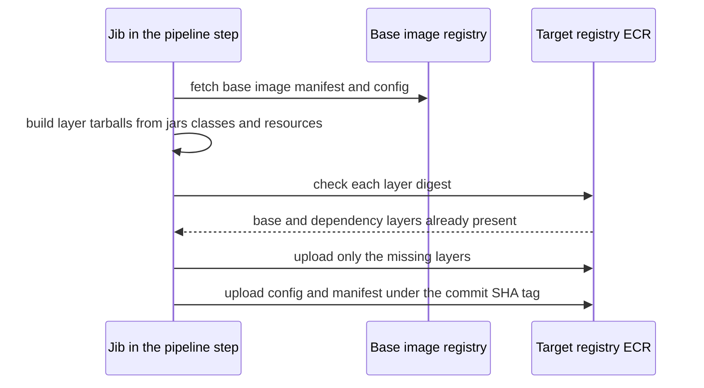
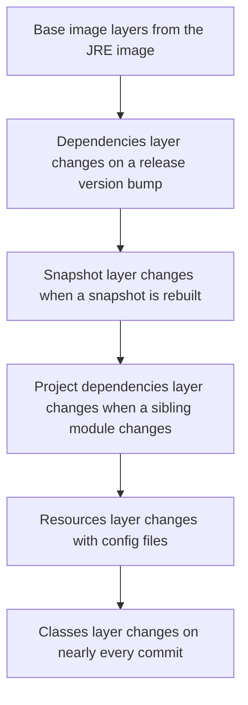

# Jib

**Jib** is a Google-built plugin for Maven and Gradle (plus a Java library and a CLI) that turns a Java application into a container image without a Dockerfile and without a Docker daemon, then pushes it straight to a registry. It is the "Jib builds the image" hop in your pipeline ([[The Deployment Pipeline]]). Most engineers run `jib:build` as a black box; the box does three non-obvious things worth knowing: it splits your application into layers by *how often each part changes*, it writes fixed timestamps so the same inputs give the same image, and it speaks the registry's HTTP API itself. Every claim about defaults below is from Jib's own documentation as read in October 2026, when the Maven plugin's current release was 3.5.2 (3.5.0 added the Java 25 default base image).

## The problem that created it

Building a Java image with a plain Dockerfile has four recurring costs.

1. **It needs a Docker daemon.** `docker build` is a client talking to a privileged background service. CI jobs already run *inside* containers, so building images there means Docker-in-Docker or handing the job access to a daemon, with the privileges and memory that implies — in Bitbucket Pipelines, the Docker service runs beside your build container and gets 1 GB of memory by default (Bitbucket docs, 2026). Builders that avoid the Docker daemon exist (Buildah, and Kaniko — though Google archived the Kaniko repository on 3 June 2025 and only forks, such as Chainguard's, are maintained now), so "needs a daemon" describes the default `docker build` path rather than a law.
2. **Whole-application layers.** The naive Java Dockerfile ends in `COPY app.jar`. A Spring Boot jar bundles every dependency *and* your code into one file, so a one-line change produces a new layer containing every dependency again, and all of it goes over the wire. Docker's layer cache keys each layer on its instruction and everything before it, and an ephemeral CI container starts with no cache anyway.
3. **Root by default.** A Dockerfile with no `USER` instruction runs as root, and nothing forces you to write one.
4. **Hand-written multi-stage files.** A *correct* Java Dockerfile is a small program: a build stage with JDK and Maven, the trick of copying the `pom.xml` first so dependencies cache separately from source, a JRE-only runtime stage, an exec-form entrypoint so the JVM receives signals, a non-root user. Every repo copy-pastes it, then drifts.

The underlying insight: **the build tool already knows the shape of the project** — which jars are dependencies, which are `SNAPSHOT`s, where the compiled classes and resources are. A Dockerfile has to rediscover all of that from outside; a plugin running *inside* Maven simply uses it.

## What it solves

- **No daemon** — the build needs only a JDK, Maven and network access to the registry, so it runs in an ordinary unprivileged CI container.
- **Fast incremental builds and cheap pushes** — only layers whose contents changed are rebuilt, and only layers the registry lacks are uploaded.
- **Reproducibility** — identical inputs produce an identical image digest.
- **One declaration instead of a Dockerfile per repo** — configuration lives in the `pom.xml` (or a shared parent), where it can be reviewed and inherited.
- **Safe launch defaults** — the entrypoint is exec-form `java` with a computed classpath, so the JVM is the container's main process and receives SIGTERM.
- **Non-root as a one-liner** — not a default, but a single `<user>` setting rather than a Dockerfile edit (see the base-image section).

## How it works

### An image is blobs plus a manifest, and Jib builds them itself

[[Docker and Container Images]] covers the theory; the one fact needed here is that a registry stores **blobs** (each layer is a tarball, plus a small JSON config) addressed by the SHA-256 of their contents, and a **manifest** that lists them. `docker build` asks a daemon to produce those and `docker push` uploads them. Jib has no daemon: it writes the layer tarballs and config in Java and talks to the registry API directly. Because blobs are content-addressed, one that the registry already holds is simply not uploaded again.

### The layer split

Jib divides a Java application into layers (Jib FAQ): all other dependencies; snapshot dependencies; project dependencies (sibling modules in a multi-module build); resources; classes; and one layer per configured extra directory. On disk in the image they sit under `/app/libs`, `/app/resources` and `/app/classes`. The ordering principle is **slowest-changing first**:

A code-only commit changes just the classes (and perhaps resources) layer; the dependencies layer is byte-identical to last build, the registry already has it, and it is never rebuilt or re-uploaded. Jib builds each layer from its *own* set of files and reuses an unchanged layer whole — it is not the Dockerfile model where a changed early step invalidates everything after it. `SNAPSHOT` jars get a separate layer deliberately, "so that a frequently changing SNAPSHOT will not force the entire dependency layer to rebuild itself" (Jib FAQ). The economics follow: CI uploads only the small changed layers instead of the whole app, and registry storage grows by roughly one small layer per code-only build rather than one whole application.

One Spring Boot detail: the plugin's `containerizingMode` defaults to `exploded`, which containerizes individual class and resource files and lists the dependency jars, so Jib does **not** ship the repackaged Spring Boot fat jar. Setting it to `packaged` puts the single built JAR into the image instead, and Jib's FAQ lists the cost: any source change recreates and re-pushes the whole layer holding the JAR, and with a fat or shaded JAR the embedded dependencies are pushed repeatedly even when unchanged.

### Reproducible builds, and why the image is from 1970

*Reproducible* means the same inputs give the same output. It matters because an image is identified by a **digest** of its contents and metadata, and registries, caches and Kubernetes treat two images with different digests as different images. If a build stamped "now" into the config or into file modification times, every build would yield a new digest even with zero code change: layers would look new and get re-pushed, and tooling would see a "different" image where nothing differs. So Jib adds files in a consistent order with consistent permissions, sets the **image creation time to the Unix epoch** (`creationTime`, default `EPOCH`, 1970-01-01 UTC) and file modification times to one second past it (`filesModificationTime`, default `EPOCH_PLUS_SECOND`). Hence `docker images` or a registry console shows an image "created" about 56 years ago in 2026. That is correct, not a bug.

Two practical consequences. To learn when something was built, use the *registry's* push timestamp, or follow the commit-SHA tag back to the commit and pipeline run — never the image's creation field. And `creationTime: USE_CURRENT_TIMESTAMP` buys a friendlier date at the price of a new digest every build. One caveat on the promise itself: a build is reproducible only if **all** its inputs are fixed, and an unpinned base-image tag or a floating dependency range is an input. Same commit, rebuilt next week, can yield a different digest.

### The base image, the user, and what changed over time

Jib's default base image has changed twice (Jib changelog and docs, 2026). Through the 2.x line it was Google's **Distroless** Java image, which has no shell. Jib 3.0 (2021) switched to `adoptopenjdk` JRE images, and since 3.2 (January 2022) the default has been the official **`eclipse-temurin`** JRE image from Docker Hub (Temurin is the successor of AdoptOpenJDK: the move to the Eclipse Foundation was announced in June 2020 and completed in 2021), with the README listing tags for Java 8, 11, 17, 21 and 25 (confirm in your build log which one Jib resolved). WAR projects default to `jetty`. Three consequences. The default Temurin-based image includes a shell, so `kubectl exec` into it works (a debugging convenience and a bigger attack surface; the second part is inference). The default tag is **unpinned**: Jib's own FAQ says it "can point to different images over time", and Jib contacts Docker Hub on every build to check for updates unless you pin by digest — which is also how CI hits Docker Hub's `429 TOOMANYREQUESTS` pull limits. And the user: `container.user` defaults to *nothing*, so the container inherits whatever the base declares. The Adoptium Dockerfiles for the Java 17, 21 and 25 JRE images on Ubuntu Noble (read October 2026) have no `USER` line, so **a default Jib image runs as root**. Compare Spring Boot's `build-image`, which per its docs builds and runs as non-root by default. With Jib, non-root is opt-in: set `<container><user>`, ideally as a numeric `uid:gid`, because with `runAsNonRoot: true` and no numeric `runAsUser` in the pod spec, the kubelet refuses to start an image whose user is a name: "image has non-numeric user ..., cannot verify user is non-root" (kubelet source, 2026).

### Entrypoint, JVM flags, ports

Unless you set an entrypoint, Jib launches basically `java -cp <computed classpath> <main class>` in **exec form, with no shell** (Jib Maven README). The JVM is therefore PID 1 and receives SIGTERM directly, which Spring Boot's graceful shutdown depends on ([[Graceful Shutdown and Deployment Safety]]). The main class is taken from the jar configuration or inferred by scanning.

| Need | Setting | Note |
|---|---|---|
| JVM flags | `<container><jvmFlags>` | Baked into the entrypoint at build time |
| Flags without a rebuild | env `JAVA_TOOL_OPTIONS` (or `JDK_JAVA_OPTIONS`, JDK 9+) | Read by the JVM (`JDK_JAVA_OPTIONS` by the `java` launcher), so no shell is needed; the FAQ warns many JVMs cap `JAVA_TOOL_OPTIONS` at 1024 characters |
| Program arguments | `<container><args>` | Arguments to `main` by default |
| Environment variables | `<container><environment>` | Baked into the image |
| Ports | `<container><ports>` | Metadata like `EXPOSE`; it opens nothing |
| Run as | `<container><user>` | Defaults to the base image's user |
| Image format | `<container><format>` | `Docker` (V2.2) by default; `OCI` is opt-in |

JVM sizing is separate: Jib sets no memory flags, so the JVM's own container-aware defaults apply. HotSpot detects the container limit (`UseContainerSupport`, on by default on Linux) and sizes the maximum heap at `MaxRAMPercentage`, 25% of it by default (JDK 25 `java` documentation, 2026; confirm in your image with `java -XX:+PrintFlagsFinal -version | grep MaxRAMPercentage`), which surprises people who set a 512 MiB limit and expect most of it for heap.

### Goals, outputs, authentication

| Goal | Result | Needs a Docker daemon? | Use for |
|---|---|---|---|
| `jib:build` | Builds and pushes to a registry | No | CI |
| `jib:dockerBuild` | Loads the image into a local Docker daemon | Yes (`docker` CLI on `PATH`) | Running locally with `docker run` |
| `jib:buildTar` | Writes `target/jib-image.tar` | No | Scanning, offline transfer, `docker load` later |

Every build also writes `target/jib-image.digest` and `target/jib-image.id`, which give the pipeline the exact digest it pushed — a ready-made provenance record, and the input for deploying by digest.

For registry **authentication** Jib tries, in order (per its `DefaultCredentialRetrievers` source, 2026): explicit `<auth>` or `-Djib.to.auth.*` properties; a configured credential helper such as `docker-credential-ecr-login` (set with `<credHelper>ecr-login</credHelper>`; the helper must be on `PATH`); Maven `settings.xml`; then Docker configuration files (containers `auth.json` locations, `$DOCKER_CONFIG/config.json`, `$HOME/.docker/config.json`); then well-known helpers by host, which for any `amazonaws.com` registry means trying `docker-credential-ecr-login` with no configuration at all if it is on `PATH`; and last Google application-default credentials. The README calls explicit passwords a last resort because they sit in plain text; for ECR the username is `AWS` and the password is an ECR token, valid 12 hours (AWS docs). A log line such as "Using credentials from ..." tells you which source won, and base image and target image are authenticated separately.

### Jib, a multi-stage Dockerfile, and Buildpacks, honestly

| | Jib | Multi-stage Dockerfile | Buildpacks via `spring-boot:build-image` |
|---|---|---|---|
| Docker daemon | Not needed | Needed for plain `docker build` | Needed (Spring Boot docs: the goal requires one) |
| Languages | JVM only | Anything | Spring Boot plugin: Java apps |
| Layering effort | Automatic | You engineer it by hand | Automatic, using Spring Boot's layers |
| Arbitrary build-time commands | Not supported (FAQ): use a custom base image | Full control | Via the builder and its buildpacks |
| Default user | Whatever the base image says (root for Temurin) | Root unless you write `USER` | Non-root (Spring Boot docs) |
| Who owns the OS layer | You, by choosing and bumping the base | You | The builder image; the default is `paketobuildpacks/builder-noble-java-tiny:latest` (Spring Boot 4.1 docs, 2026) |

Jib wins for a Java-only fleet building in unprivileged CI that cares about push speed. A Dockerfile wins when you need OS packages or native libraries, run several languages, or want one build path company-wide that image linters and policy tools already understand. Buildpacks win when a platform team wants to own base images and patching centrally so service teams write no build logic — paid for with a daemon and a builder you must pin yourself.

## Trade-offs

| You get | You pay |
|---|---|
| No daemon, small unprivileged CI footprint | JVM only; no `RUN`, so OS packages mean maintaining a custom base image |
| Fast incremental builds, tiny pushes | Jib's layering strategy, not yours; finer control needs its extension framework |
| Reproducible digests | Creation time is useless for "when was this built?"; you need another source |
| Configuration in the `pom.xml`, inheritable | Image details change only with a code-repo change and rebuild |
| Working defaults out of the box | Unpinned base, a Docker Hub check on each build, and root unless you set `user` |

**Cost shape:** CI time scales with the *changed* layers plus Maven's own build; registry storage with the number of *distinct* layers (one small classes layer per code-only build, a whole dependency layer per dependency change); and base-image upkeep with the number of distinct base images you pin and their patch cadence — not with the number of services, if they share one.

## Failure modes

- **Base image not pinned by digest.** Builds silently drift: the same commit rebuilt a week later can carry a different JRE and OS layer, so "tested" and "shipped" differ even with SHA tags. Unpinned builds also check Docker Hub every time, and a CI fleet sharing an IP hits `429 TOOMANYREQUESTS`. Pinning fixes both but creates the opposite risk: a pinned digest never receives OS security patches until someone bumps it, so a pin needs a scheduled bump.
- **JVM flags set in the Dockerfile mental model but ignored.** Three mechanisms. (1) A custom `<entrypoint>` makes `jvmFlags`, `mainClass`, `extraClasspath` and `expandClasspathDependencies` ignored (README). (2) In a Dockerfile, `ENV JAVA_OPTS` plus `java $JAVA_OPTS -jar` works because a shell expands the variable; Jib's default entrypoint has no shell, and the JVM itself does not read `JAVA_OPTS` — it is only a convention of launcher scripts — so the variable is inert. `JAVA_TOOL_OPTIONS` works because the JVM reads it directly. (3) A shell wrapper like `sh -c "java ..."` without `exec` makes the JVM a child process, so SIGTERM stops at the shell and graceful shutdown quietly disappears; Jib's docs call the PID 1 choice one to make carefully.
- **The large dependency layer is rewritten.** Any change to a *release* dependency version rewrites and re-pushes the whole dependencies layer, because it is one tarball of every non-snapshot, non-project jar; a Spring Boot or BOM bump touches nearly all of them. A snapshot bump is *not* the culprit, since snapshots live in their own layer. The real traps run the other way: a large, constantly rebuilt SNAPSHOT re-uploads its own layer every build, and an internal library versioned with a rolling scheme that is not marked `-SNAPSHOT` lands in the big dependency layer (inference: Jib classifies by the SNAPSHOT marker). Batch dependency bumps, and measure layer sizes in the registry before guessing.
- **Registry auth in CI.** `401 UNAUTHORIZED` usually means Jib found no usable credentials (helper not on `PATH`, wrong file, typo); `403 DENIED` usually means it authenticated but the role may not push to that repository; a token cached past 12 hours fails the same way; and if the base image is in a private registry you need `from` credentials as well as `to`.
- **`packaged` mode with a Spring Boot fat jar** — layering benefit gone, with no error to tell you.
- **Assuming "non-root".** Nothing fails; a container-escape or file-permission review later finds a root-run JVM. Check with `docker inspect` (an empty `Config.User` means root).
- **Faithfully packaging a wrong classpath.** Jib ships exactly what Maven resolved. A missing runtime-only dependency produces a green build, a successful push, and a failure only at runtime (see the next section).

## When NOT to use it

- **Non-JVM services**, or a company that wants one build path for every language — a Dockerfile (or Buildpacks) is the common denominator.
- **You need OS packages, native libraries or build-time commands.** Jib does not support running commands during the build; the documented workaround is your own base image, at which point you are maintaining a Dockerfile anyway.
- **Fine-grained layer or file-ownership control.** Jib's extension framework (for example a layer-filter extension) can do it, but once you are writing extensions, compare the cost with a plain Dockerfile.
- **Platform policy mandates Buildpacks or Dockerfile-based scanning and linting** — follow the platform's paved path rather than fighting it.
- **The image must be built outside Maven or Gradle** — the separate Jib CLI (jar and war modes) exists for that, but it is a different tool with its own defaults.

## In your stack

- **Bitbucket Pipelines running `jib:build` to ECR.** The build step needs a JDK-plus-Maven image and network access to ECR; it does not need the Docker service, so that service's 1 GB default allotment (Bitbucket docs, 2026) is irrelevant to it. Tag the push with `$BITBUCKET_COMMIT` and keep the resulting `target/jib-image.digest` as a pipeline artifact. Credentials should come from an OIDC-assumed role and an ECR token (or the `ecr-login` helper installed in the build image, which Jib tries automatically for ECR hosts), never a password written into YAML ([[Container Registries and ECR]]).
- **What to pin, and why.** (1) The *base image by digest* (`eclipse-temurin:<n>-jre@sha256:...`), for reproducibility and immunity to Docker Hub limits, plus a calendar reminder to bump it for security patches. (2) The *Jib plugin version* in the `pom.xml`, because its defaults have changed across releases (the base-image switches at 3.0 and 3.2), so an implicit version is a hidden build input. (3) The *pipeline step's own build image* (JDK and Maven). (4) The *tag*: commit SHA, in a repository with immutable tags. (5) `container.user` as a numeric non-root user. Leave `creationTime` at the epoch default.
- **JVM flags, signals and the grace period.** Jib's exec-form entrypoint makes the JVM PID 1, so SIGTERM reaches Spring Boot; do not wrap it in `sh -c` without `exec`. How long it has to drain is a Facets setting that fails quietly; the spelling trap and the drain budget are in [[Graceful Shutdown and Deployment Safety]]. Set heap explicitly (`-XX:MaxRAMPercentage` through `jvmFlags`, or `JAVA_TOOL_OPTIONS` if your chart exposes environment variables) rather than relying on the 25% default.
- **Green build, dead endpoints.** `MONGODB-AWS` auth under IRSA needs `com.amazonaws:aws-java-sdk-sts` on the classpath, and no source file imports it. Narrow the fat `aws-java-sdk` bundle to `aws-java-sdk-s3` and the jar disappears from the resolved classpath: Jib packages what Maven resolved, the image builds and pushes, the pipeline is green, and every Mongo-backed endpoint returns 500 at runtime. Jib did nothing wrong. Leave a comment on the dependency declaration, and make the post-deploy smoke test call a Mongo-backed endpoint through Kong with a unique `x-correlation-id`.
- **Replicas pinned at 1 make layer reuse matter more.** A rollout's duration is scheduling, image pull, JVM boot and readiness, and with one replica that whole window is your overlap. Because layers are content-addressed, a node that already holds the dependencies layer pulls only the new classes layer on a code-only deploy (a consequence of how layers work; measure it on your nodes).

## Interview angle

The 60-second version: *"Jib is a Maven and Gradle plugin from Google that builds a container image for a Java app without a Dockerfile and without a Docker daemon, and pushes it straight to a registry. The trick is layering: it already knows which jars are dependencies, which are snapshots, and which are your classes, so it makes them separate layers ordered by how often they change. A code-only change rebuilds and pushes only the small classes layer, which keeps CI fast and registry storage cheap. It is also reproducible: the image creation time is fixed at the Unix epoch and file times at one second past it, which is why images show as created in 1970, so the same inputs give the same digest. The defaults I would not trust blindly: Docker image format unless you ask for OCI; a Temurin JRE base that is unpinned, so pin it by digest; and it runs as root unless you set a user. The entrypoint is exec-form java, so the JVM gets SIGTERM. It loses when you need OS packages or a non-Java service."*

Classic follow-ups: "Why no daemon?" (it writes layers and talks to the registry API itself); "Why 1970?" (fixed timestamps keep the digest stable, so unchanged inputs are not seen as a new image); "Jib or Dockerfile?" (Java-only, unprivileged CI, fast pushes vs OS packages and one company-wide path); "My `JAVA_OPTS` is ignored — why?" (no shell expansion, the JVM does not read it; use `jvmFlags` or `JAVA_TOOL_OPTIONS`); "If you pin the base by digest, how do CVE patches arrive?" (a deliberate, scheduled bump — pinning trades drift for staleness).

Senior tell: stating the pin-versus-patch tension unprompted, and knowing that "reproducible" holds only when every input, including the base tag, is fixed.

## Check yourself

> [!question]- Q: Explain why a one-line code change in a Jib-built service uploads a small layer, while the same change with `COPY app.jar` in a Dockerfile uploads the whole application.
> Jib splits the app into layers ordered by change frequency (dependencies, snapshots, project dependencies, resources, classes), builds each from its own file set, and the registry is content-addressed. The dependencies layer is byte-identical to the previous build, so its digest already exists in the registry and is not uploaded; only the classes layer is new. A fat-jar `COPY` puts dependencies and code in one file, so any change yields one new, whole-application layer with a new digest.

> [!question]- Q: Scenario — someone sets `JAVA_OPTS=-Xmx512m` on the Deployment of a Jib-built service and heap behaviour does not change. Why, and what are two working alternatives?
> `JAVA_OPTS` is a convention read by launcher scripts through shell expansion, not by the JVM, and Jib's default entrypoint is exec-form `java` with no shell, so the variable is inert. Working options: `<container><jvmFlags>` in the `pom.xml` (baked in at build time, but ignored if a custom `<entrypoint>` is set), or `JAVA_TOOL_OPTIONS` (or `JDK_JAVA_OPTIONS`, JDK 9+) on the container, which the JVM (or, for the latter, the `java` launcher) reads itself and which needs no rebuild; mind the 1024-character truncation warning in Jib's FAQ.

> [!question]- Q: Scenario — a colleague files a bug: the ECR console says the latest image was created about 56 years ago. What is going on, and where do you find the real build time?
> Not a bug: Jib sets the image creation time to the Unix epoch by default so identical inputs yield an identical digest. Real build time comes from the registry's push timestamp or by following the commit-SHA tag to the commit and the pipeline run. `USE_CURRENT_TIMESTAMP` would give a real date but a new digest on every build, defeating reproducibility and layer reuse.

> [!question]- Q: Scenario — after bumping the Spring Boot version, pipeline push time and ECR storage both jump, though only one line of code changed. Explain, and say why a `SNAPSHOT` bump would not have done this.
> A release dependency version change rewrites the whole dependencies layer: it is a single tarball of every non-snapshot, non-project jar, and a Spring Boot bump changes almost all of them, so a new multi-jar layer is built and uploaded and the old one stays in the registry until retention removes it. Snapshots live in their own layer by design, so a snapshot bump only invalidates that layer. Mitigation: batch dependency bumps, and compare layer sizes in the registry.

> [!question]- Q: Mini-design — specify the Jib configuration and pipeline step for a Spring Boot service on EKS pushed to ECR, covering base image, user, tags, auth and outputs.
> Base image pinned by digest (`eclipse-temurin:<n>-jre@sha256:...`) with a scheduled bump; Jib plugin version pinned in the `pom.xml`; `container.user` set to a numeric non-root `uid:gid`; `creationTime` left at the epoch; JVM flags via `jvmFlags` including an explicit `MaxRAMPercentage`; no custom entrypoint, so the JVM stays PID 1. The step runs `mvn -B verify jib:build` with `jib.to.image` set to `<ecr-repo>:$BITBUCKET_COMMIT` in an immutable-tag repository. Auth through an OIDC-assumed role and an ECR token or `ecr-login` helper, never a password in YAML, with `from` credentials added only if the base image is private. Store `target/jib-image.digest` as an artifact for provenance and digest-based deploys, and follow the push with a post-deploy smoke test.

## Sources

- Jib project documentation (GitHub: GoogleContainerTools/jib), read October 2026: the main README, `docs/faq.md`, `docs/default_base_image.md`, the `jib-maven-plugin` README and changelog (3.5.2), and `DefaultCredentialRetrievers.java` plus `CredentialRetrieverFactory.java` for credential order and the well-known ECR helper.
- Spring Boot documentation (4.1, 2026): the Maven plugin's `build-image` goal — Docker daemon requirement, non-root default, default builder.
- Adoptium container images (github.com/adoptium/containers): the Java 17, 21 and 25 JRE Ubuntu Noble Dockerfiles, read October 2026, for the absence of a `USER` instruction.
- AWS documentation for Amazon ECR: private registry authentication (12-hour authorization token) and image tag immutability.
- Atlassian Bitbucket Cloud documentation (2026): pipes and the Docker service memory default, variables.
- Kubernetes documentation: Images (digests, `imagePullPolicy`); kubelet source (`security_context_others.go`) for the `runAsNonRoot` numeric-user check.
- JDK 25 `java` tool documentation (`MaxRAMPercentage`, `UseContainerSupport`, `JDK_JAVA_OPTIONS`) and JDK 9's, which introduced `JDK_JAVA_OPTIONS`; Adoptium blog (2020, 2021) on the AdoptOpenJDK-to-Temurin move; GoogleContainerTools/kaniko repository archive notice (June 2025).
- OCI Image Format Specification (github.com/opencontainers/image-spec) and reproducible-builds.org, which Jib's FAQ cites for the reproducibility goal.
