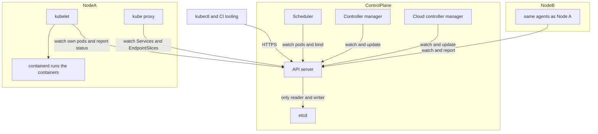
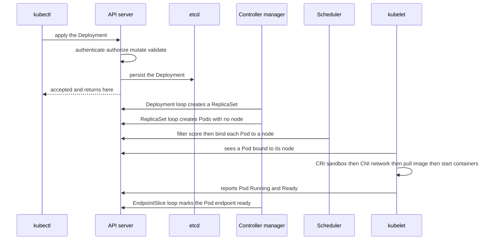

# Kubernetes Architecture

Kubernetes is, at its core, a database of *desired state* plus a crowd of small programs that each watch one slice of it and push the real world toward it. That sentence is the whole architecture; the named components below are just the database and the programs. Your code reaches it at the end of [[The Deployment Pipeline]]: once the image is built and pushed, a deploy step changes one object in the Kubernetes API, and everything after that — which machine runs the container, what happens when it crashes, how traffic finds it — is these components reacting. Understand why they are shaped this way and the individual behaviours (a pod stuck `Pending`, a dead node that takes six minutes to be written off) become predictions instead of trivia.

## The problem that created it

A container ([[Docker and Container Images]]) solves "run this process, with its dependencies, on one machine". Production is **N containers on M machines**, and the chores multiply: *placement* (which machine has room, under CPU and memory limits), *restarts* when a process dies, *rescheduling* when a whole machine dies and takes its containers with it, *scaling* copies up for peak and down after, *discovery* (the copies' addresses keep changing — [[Health Checks and Service Discovery]]), *rollouts* without downtime ([[Deployment Strategies]]), and *config and secrets* differing per environment. A human with SSH and shell scripts manages ten containers; nobody manages a thousand, and the machines die at 3 a.m.

The first automation attempt is imperative scripts — "start three copies on hosts A, B, C" — and it fails for a structural reason: a script encodes steps for the world *as it was when the script ran*. Between step two and step three a host died, the script's picture of the world is now wrong, and it has no way to notice. What works instead is **declarative** control: state the end state ("three copies of this image, each reserving half a CPU") and run a permanent process that keeps measuring the gap between that statement and reality and closing it — a thermostat, not a recipe. Google ran this model internally in Borg for years (described publicly in a 2015 EuroSys paper), open-sourced Kubernetes in 2014, and reached 1.0 in July 2015 with its donation to the newly formed CNCF; the "Borg, Omega, and Kubernetes" retrospective (ACM Queue, 2016) lays out which lessons from those systems shaped the design — pods, labels and the controller model among them.

## What it solves

- **One mechanism, many features.** Self-healing, scaling, rollouts and rescheduling are not separate subsystems; they are the *same reconciliation loop* applied to different objects. This is the thesis the rest of the note keeps cashing out.
- **Placement.** A scheduler bin-packs pods onto machines against the CPU and memory each pod *declares* it needs, so you stop assigning containers to hosts by hand.
- **Self-healing at two speeds.** A crashed container is restarted by the agent on its own node (with growing back-off if it keeps failing); a pod on a *lost* node is recreated on another one after a timeout you can read off the defaults (see Failure modes).
- **Rollouts and rollbacks as state transitions.** Changing a Deployment's pod template *is* declaring a new end state; the loop walks from old to new. Mechanics live in [[Kubernetes Workloads]].
- **A uniform, extensible API.** Pods and Services are objects, but so are your own: a CRD teaches the API a new noun and an operator is a controller for it. The AWS Load Balancer Controller, autoscalers and mesh control planes are all loops built on the same machinery.
- **A shared vocabulary across clouds** — honestly, a portable *API*, not portable infrastructure: the load balancers, disks and IAM behind it are still your cloud's.

## How it works

### The one idea: a reconciliation loop over desired state

Every object in the API has two halves: a **spec** (what you want, written by you or by another controller) and a **status** (what is observed, written by whichever component is responsible for reality). A **controller** is a loop: watch objects of some kind, work out what the world should look like, compare with what it does look like, issue the API calls that shrink the difference, repeat. Crucially it reacts to *current state*, not to a stream of events ("level-triggered", as opposed to "edge-triggered"), so a controller that crashes and restarts needs no record of what it missed — it re-reads the world and rediscovers the gap. This is why the system survives the failure of its own parts, and why every action must be safe to repeat ([[Idempotency]]): the loop will say "create the pod" again and again until it observes the pod exists.

Controllers, the scheduler and the kubelets never call one another; the API server is the hub, and its few calls outward (to kubelets for `logs` and `exec`, to admission webhooks) are the exceptions. Each opens a **watch** — a long-lived streaming connection — to the API server for the kinds it cares about, caches them locally, and writes its output back as changes to *other* objects. The path from "I want three copies" to a running process is therefore a relay in which each stage reads the previous stage's output: the Deployment controller turns a Deployment into a ReplicaSet; the ReplicaSet controller turns that into Pod objects with no node assigned; the scheduler assigns a node; the kubelet on that node turns the bound pod into running containers and reports status; the EndpointSlice controller lists the pod's IP and flips its endpoint to ready once the kubelet reports the pod Ready, so Services route to it. No conductor coordinates this — it is choreography in the sense of [[Communication Patterns Between Services]]. The glue is two mundane things: **labels and selectors** (how a ReplicaSet finds "its" pods) and **owner references** (how deleting a Deployment cascades to its ReplicaSets and pods). Writes use optimistic concurrency — each object carries a version (`resourceVersion`), an update built on a stale version is rejected, and the loser re-reads and retries — so two loops never silently overwrite each other.

### Control plane: the brain

**kube-apiserver — the hub.** Every other component, every `kubectl` call and every CI deploy talks to it and to nothing else, and it is the *only* component that talks to etcd. A request passes a fixed pipeline: **authentication** (who are you — on EKS an IAM-derived token via the kubeconfig's exec plugin, inside the cluster a ServiceAccount token), **authorization** (may you do this verb on this kind — normally RBAC: a Role or ClusterRole lists permitted verbs on resource kinds, a RoleBinding attaches it to a user or ServiceAccount), then **admission**, run by the API server's admission controllers: *mutating* ones may rewrite the object (inject defaults, credentials, a mesh sidecar), the object is checked against its schema, *validating* ones may reject it (quotas, policy), and only then is it persisted. On EKS the IRSA mechanism rides this pipeline: a mutating webhook adds a role ARN and a projected token file to pods whose ServiceAccount is annotated, and the AWS SDK trades that token for IAM credentials (EKS Pod Identity is AWS's newer alternative: no OIDC provider, a per-node agent hands out the credentials). The server is stateless, so you run several; under overload, API Priority and Fairness (stable since 1.29, December 2023) queues request classes separately so one runaway controller cannot starve the rest.

**etcd — the memory.** A strongly consistent key-value store replicated with Raft ([[Consensus and Raft]]): a write is acknowledged only after a majority of members have persisted it, so 3 members survive 1 loss, 5 survive 2, and an even count buys nothing (4 tolerates the same single loss as 3). Choosing consistency over availability — CP in [[CAP Theorem]] terms — is deliberate: the API's value is being the one agreed truth, and two schedulers acting on two truths would double-place pods. It holds object definitions and status, not your application data, logs or metrics. Every commit is fsynced, so it is sensitive to disk latency, and it has a space quota (2 GiB by default, 8 GiB suggested maximum in etcd's docs): exceed it and etcd raises a cluster-wide alarm and accepts only reads and deletes until space is reclaimed.

**kube-scheduler — the matchmaker.** Watches for pods whose `spec.nodeName` is empty and runs two phases. *Filtering* removes nodes that cannot take the pod: not enough *allocatable* CPU or memory once the **requests** of pods already there are summed, a taint it does not tolerate, a nodeSelector or affinity mismatch, a port or volume conflict, a topology-spread rule it would break. *Scoring* ranks the survivors (spreading pods, preferring nodes that already hold the image, honouring soft preferences) and the winner is recorded by writing a Binding that sets the pod's node. It starts nothing. Two consequences: it reasons from *declared requests*, never live usage, so a node can be "full" at 20% real CPU (which is why requests are the cost lever — [[Kubernetes Configuration and Resources]]); and it decides once, so it does not rebalance pods already placed.

**kube-controller-manager — the loops.** One binary hosting many controllers: Deployment, ReplicaSet, StatefulSet, Job, node lifecycle, EndpointSlice, ServiceAccount and more. In a highly available control plane several copies run, but they contend for a **Lease** object and only the holder acts; the scheduler does the same. **cloud-controller-manager** hosts the loops that need the cloud's API: a *node* loop (is the VM behind this Node still alive in the cloud?), a *route* loop, and a *service* loop that creates and updates cloud load balancers for Services of type LoadBalancer.

### Data plane: the hands on every node

**kubelet — makes pods real.** It watches the API for pods bound to its node and drives them to the described state through the **CRI**, a gRPC interface to the container runtime: create the pod *sandbox* (the shared network namespace — [[Sidecar Pattern]] explains why that matters), call the **CNI** plugin to give it an IP (on EKS the VPC CNI hands pods real VPC addresses — [[Kubernetes Networking]]), mount volumes via **CSI** drivers, pull images ([[Container Registries and ECR]]), start containers, then **run the probes** ([[Health Checks and Service Discovery]]) and restart failed containers per `restartPolicy`. It reports pod status back (`ImagePullBackOff`, `CrashLoopBackOff` and `OOMKilled` are the kubelet's reports). It also protects its own node: when memory, disk or process IDs run short it fails pods itself, which then show as `Evicted`, and it does so without consulting PodDisruptionBudgets (which pods go first follows QoS class — [[Kubernetes Configuration and Resources]]). It proves its node is alive by renewing a Lease about every 10 seconds. It can also run **static pods** straight from manifest files on its own disk with no API server at all — the bootstrap trick by which kubeadm starts the control plane itself. The **container runtime** underneath is normally **containerd**, which launches containers through an OCI runtime (runc by default); Kubernetes' built-in Docker bridge, dockershim, was removed in 1.24 (2022).

**kube-proxy — makes Services true.** It watches Services and EndpointSlices and writes kernel packet-forwarding rules so a Service's virtual IP lands on one of its ready pods; in the default modes the kernel forwards the packets and kube-proxy only maintains the rules. Modes as of the 1.37 docs (2026): `iptables` is still the default, with a future release slated to switch it to `nftables`; `nftables` went GA in 1.33 (April 2025), and `ipvs` was deprecated in 1.35 (late 2025), slated to be disabled by default from 1.40 and removed in 1.43. Some CNIs replace kube-proxy entirely. The full Service story is [[Kubernetes Networking]].

### What a node is, and how pods are steered

A **node** is a machine — in the cloud a VM — running a kubelet that has registered a Node object with the API, reporting **capacity** and **allocatable** (capacity minus what the OS and kubelet reserve; allocatable is what the scheduler spends). A **cluster** is one control plane (one API, one etcd) plus its nodes; a **namespace** partitions names, RBAC and quotas *inside* a cluster and is an administrative boundary, not by itself a network or security one. Nodes come in **pools** with a shared shape — on EKS managed node groups, self-managed nodes, Karpenter (which skips node groups and launches right-sized instances directly for pending pods), or Fargate and EKS Auto Mode where AWS runs more of the node layer. Steering is four tools: a **taint** on a node says "keep out unless you tolerate me" (NoSchedule and PreferNoSchedule affect placement; NoExecute also evicts running pods that do not tolerate it); a **toleration** on a pod *permits* a tainted node but never attracts it; **node affinity** and `nodeSelector` pull pods toward nodes with given labels; **pod anti-affinity** and **topology spread** keep replicas apart across nodes or zones. A dedicated pool therefore needs *both* a taint (keep others off) and affinity (pull yours on). The documented large-cluster limits (1.37 docs, 2026) — up to 5,000 nodes, 150,000 pods, 300,000 containers and 110 pods per node — are far above a fleet like yours; the shape matters more than the numbers.

### On EKS: who runs what

AWS runs the control plane: per its docs, at least two API server instances and three etcd instances across three Availability Zones, replaced automatically if one falters, behind a published API-endpoint SLA. You never reach those machines, but you pay for the seam: EKS places 2–4 network interfaces in your subnets, and they carry control-plane-to-node traffic (including `kubectl exec` and `logs`, which go through the kubelet API). You run — or delegate — the data plane: node groups, Karpenter, self-managed nodes, Fargate, or Auto Mode. Version skew is yours to manage: the kubelet may never be newer than the API server and may lag it by up to three minor versions (two for kubelets older than 1.25). Upgrades are also on a clock: per AWS's docs each minor version gets 14 months of EKS standard support, then 12 months of extended support at a higher hourly charge (in October 2026, 1.34–1.37 are standard and 1.31–1.33 extended; 1.31 leaves extended support on 26 November 2026 and 1.34 leaves standard on 2 December 2026). The ownership split is the substance of [[EKS vs ECS]].

### The apply walk, as a picture

The line that matters is the fourth: `apply` returns when the desired state is *recorded*, not when anything is *running*. Everything below it is asynchronous loops, each of which can stall independently — and each stall has a distinct, readable symptom.

## Trade-offs

| You get | You pay |
|---|---|
| Drift is corrected automatically, forever | Everything is eventually consistent: "accepted" is not "running", and debugging means finding which loop stalled by reading status and events |
| One extensible API for every resource | Many moving parts, and every extension (operator, webhook) is another loop or gate that can fail |
| Bin-packing and rescheduling across machines | The scheduler trusts your declared requests; wrong numbers mean wasted nodes or noisy neighbours |
| A portable vocabulary across clouds | The real infrastructure behind it — load balancers, volumes, IAM — is not portable |
| A managed control plane on EKS | A flat per-cluster hourly charge — $0.10 per cluster-hour on a standard-support version, $0.60 on an extended-support one (AWS list price, 2026) — plus node patching and upgrades on you — cost shape: the control plane scales with *clusters*, nodes scale with the *sum of requests* |

## Failure modes

- **etcd loses quorum.** With 3 members, losing 2 means no majority: the API server cannot commit writes and the control plane is effectively frozen, while running pods are untouched (next bullet). Permanent quorum loss is catastrophic — recovery means restoring from a snapshot. Slow disks and a hit space quota produce the same "API is read-only or slow" symptom with all members alive. On EKS this is AWS's problem to prevent, but you still see its effect as API timeouts.
- **API server unavailable — existing pods keep running.** This is true for two reasons and both are the interview answer. First, the data plane needs the control plane only for *changes*: the kubelet holds the pod specs it already knows, containerd owns the running processes, and kube-proxy's last-programmed rules stay in the kernel, so traffic keeps flowing. Second, what freezes is everything that *depends on the API*: no scheduling, no scaling, no rollouts — and, because the node-lifecycle controller also works only through the API, no evictions either. It also freezes information: a pod that fails readiness during the outage cannot be marked not-ready in its EndpointSlice, so traffic keeps reaching it. The practical rule: a control-plane outage is not an application outage until something *else* breaks during it. A single-replica service that crashes its node in that window has nobody to replace it.
- **Node goes NotReady — the six-minute chain.** The kubelet renews its Lease about every 10 s; the node controller checks every 5 s; after `node-monitor-grace-period` (50 s by default since 1.32, 2024 — it was 40 s before) it sets the node's Ready condition to Unknown and adds `node.kubernetes.io/unreachable` with the NoExecute effect. Every pod carries a default toleration for it of **300 s**, injected at admission by the DefaultTolerationSeconds plugin (apiserver flags `--default-not-ready-toleration-seconds` and `--default-unreachable-toleration-seconds`, both defaulting to 300), and the docs likewise quote 5 minutes between marking Unknown and the first eviction. Total: roughly 50 + 300 ≈ **6 minutes** before the pod is even evicted (deleted), then the replacement must be scheduled, pull its image and boot. A ReplicaSet does not count a pod with a deletion timestamp as active, so the replacement starts at once while the old object lingers `Terminating`; a StatefulSet deliberately waits (at-most-one), which is why its pods hang on dead nodes. Eviction is rate-limited per zone: if a large share of a zone's nodes (55% by default) look unhealthy, eviction slows — and stops in clusters of 50 nodes or fewer — yet a zone whose nodes are *all* unhealthy is evicted at the normal rate so its pods can move to healthy zones; only if every node in the cluster looks unhealthy does it evict nothing, on the assumption that the control plane is the partitioned party. A pod can set its own `tolerationSeconds`; that is the lever you own.
- **Pod stuck `Pending`.** `Pending` covers two stalls: not yet scheduled, and scheduled but containers not yet started (an image pull is still Pending — `ImagePullBackOff` lives here). Check `spec.nodeName` first. If it is empty, the scheduler found no node passing every filter — insufficient allocatable CPU or memory against requests, untolerated taints, an affinity or topology-spread rule, an unbound volume — and it keeps retrying forever, because "unschedulable" is a valid state of the loop, not an error. `kubectl describe pod` shows `FailedScheduling` events naming the failed filters. Autoscalers treat Pending pods as their trigger ([[Autoscaling]]), so a Pending pod on an autoscaled cluster may simply be waiting for a node to boot.
- **Kubelet cannot authenticate (certificate expiry).** On kubeadm and other self-managed clusters, kubeadm's leaf certificates last one year and its CA ten years and the kubelet client certificate is meant to rotate itself (stable since 1.19, 2020); if rotation is off or broken, the kubelet's credentials lapse, its heartbeats are rejected, and the node goes NotReady while its containers keep running, orphaned from the control plane. On EKS, AWS operates the cluster CA and nodes authenticate with their IAM node role rather than certificates you issue, so the nearest cousin is the node role's mapping being removed or broken — its access entry (type `EC2_LINUX` for self-managed Linux nodes, which maps it to `system:node:` users; EKS creates the entry itself for managed node groups and Fargate profiles) or its legacy `aws-auth` ConfigMap entry.
- **A gate or loop in the control plane breaks.** An admission webhook whose backend is down and whose failure policy is `Fail` blocks every create or update it matches, including new pods; a stalled controller shows as an object whose status never moves. Both are diagnosed from the object's events, not from the node.

## When NOT to use it

- **A handful of services, one team, nobody to own a platform.** The real price of Kubernetes is the knowledge to run it, not the instances; ECS, a PaaS, or compose on a VM does the job with fewer concepts ([[EKS vs ECS]]).
- **Running your own control plane on a cloud that offers a managed one.** You inherit etcd backup and restore, certificate rotation and upgrade choreography for no product benefit; do it only for a hard compliance or locality reason.
- **Using the API as an application database.** Etcd is sized for small control objects with a 2 GiB default quota; ConfigMaps and CRDs are configuration, not records.
- **Writing a custom controller where a Job, a CronJob or a queue worker would do.** An operator is long-lived code you own, with its own failure modes.
- **Putting the Kubernetes API on a request path.** Per-request calls to the API server make your latency and availability depend on the control plane, which the design deliberately keeps *off* the data path.

## In your stack

- **Where Kubernetes starts in your pipeline.** The pipeline hands over an image tag in ECR ([[The Deployment Pipeline]], [[Jib]]); the Kubernetes part begins when the pod template in a Deployment changes. Facets renders the Helm chart and the result is ultimately API writes — so everything in "How it works" starts from that one write, and the API object, not the Facets JSON, is the truth: **verify in the rendered pod spec** (`kubectl get pod -o yaml`).
- **Silent drops are invisible to the loops.** A Facets key spelled the wrong way for its flavor is dropped before it reaches the API (the grace-period example is in [[Graceful Shutdown and Deployment Safety]]). Kubernetes never sees the key you thought you set; reconciliation can only converge on what reached the API.
- **Replicas pinned at 1 make the six-minute chain personal.** A node dying under a single-replica Bharat service means ~6 minutes of default eviction wait plus schedule, pull and JVM boot before a replacement exists — unless the rendered pod spec overrides the 300 s toleration (check it). A second replica is the only real fix. The same fact decides the PDB shape ([[Graceful Shutdown and Deployment Safety]]); architecturally, PDBs are enforced at the API server's eviction endpoint, which is why a wrong one is accepted at apply time and only surfaces when a drain stalls.
- **The probe loop runs on the node.** The kubelet decides unreadiness and the EndpointSlice loop acts on its report, so removal waits the full probe budget — on Facets a hardcoded `period × 10`, with the readiness-at-one-replica rules in [[Health Checks and Service Discovery]].
- **"Running and Ready" is not "correct".** The loops guarantee the declared state, nothing more. With `authMechanism=MONGODB-AWS` under IRSA, a missing `aws-java-sdk-sts` jar leaves the pod Running, Ready and green in CI while every Mongo endpoint returns 500 — Kubernetes had no declaration that could notice. Symptom alerting, not pod status, catches it.
- **The control plane is not on your request path.** Traffic that reaches a pod through a Service rides kube-proxy rules already in the kernel (a gateway or ALB that registers pod IPs directly skips even that step); `x-correlation-id` rides your HTTP headers across those hops, and nothing in this note's components reads or alters it. That is also why a control-plane brownout does not drop requests.

## Interview angle

**The 60-second version — "what happens when you `kubectl apply` a Deployment?"** "kubectl reads the current context in my kubeconfig, authenticates — on EKS with an IAM-derived token — and sends the object to the **API server**. It runs authentication, RBAC authorization, mutating admission, schema validation, validating admission, then persists to **etcd**, which commits through Raft. **At that point `apply` returns: the desired state is recorded, nothing is running.** The **Deployment controller**, watching through the API server, creates a **ReplicaSet**; the **ReplicaSet controller** creates **Pod** objects with no node. The **scheduler** sees them unbound, filters nodes on requests, taints and affinity, scores the rest, and writes a binding. The **kubelet** on the chosen node sees a pod bound to it, asks containerd through the **CRI** to create the sandbox, calls the **CNI** for an IP, pulls the image, starts containers and runs probes, and reports status. When the pod is ready, the **EndpointSlice controller** marks its endpoint ready and **kube-proxy** on every node updates its rules so the Service routes to it. No component calls another — each is a loop reading the previous one's output."

Follow-ups: "What if the API server dies mid-way?" (running pods unaffected, nothing new happens); "Why etcd only through the API server?" (one place for authn, admission, validation and versioned concurrency); "How is a dead node handled?" (the 50 s plus 300 s chain, with the rate limits); "Controller versus operator?" (an operator is a controller for your own CRD).

Senior tell: volunteering that "accepted" differs from "running", and that Kubernetes enforces *declared* state — it cannot know your app is wrong.

## Check yourself

> [!question]- Q: Explain why Kubernetes controllers are "level-triggered", and what that buys you when the controller-manager is down for ten minutes and then restarts.
> A level-triggered controller acts on the *current* state of the objects it watches, not on a stream of events. When it restarts it lists everything, compares each object's spec to reality, and issues whatever calls close the gaps — so it needs no durable record of what it missed. Ten minutes of missed pod deaths, deleted Deployments and new Jobs are all rediscovered in one pass. The price is that every action must be idempotent, because the loop will re-issue "create the pod" until it sees the pod; and the controllers cannot guarantee *when*, only *eventually*.

> [!question]- Q: Scenario — the API server is unreachable for 20 minutes during evening peak. What keeps working, what does not, and what is the sneaky failure?
> Traffic and running pods keep going: kubelets hold the specs they know, containerd owns the processes, and kube-proxy rules are already in the kernel. Frozen: scheduling, scaling (an autoscaler cannot react to the peak), rollouts, `kubectl`, and also evictions, since the node controller works only through the API. The sneaky failure is stale information: a pod that becomes unready during the outage stays marked ready in its EndpointSlice so traffic keeps hitting it, and a node that dies is not written off. A single-replica service whose node fails in that window gets no replacement until the API returns.

> [!question]- Q: Scenario — at 02:00 a node loses power under a single-replica service. Give the timeline, then say what you would change.
> The kubelet's last Lease renewal is at most ~10 s old; about 50 s after the last heartbeat (the `node-monitor-grace-period` default since 1.32) the node controller marks the node Unknown and adds the NoExecute `unreachable` taint. The pod's default 300 s toleration expires, the pod is deleted, the ReplicaSet creates a replacement, and the scheduler, image pull and JVM boot follow — so roughly six minutes plus boot of zero capacity. Changes: a second replica spread across nodes or zones (the only real fix); a shorter per-pod `tolerationSeconds` on not-ready and unreachable if you accept faster, sometimes needless, rescheduling; and alert on endpoint count, not just pod count.

> [!question]- Q: A new Deployment's pods sit in `Pending` for ten minutes. Walk your diagnosis from the architecture.
> First split the two meanings of Pending: if `spec.nodeName` is set, the pod is bound and the kubelet is stuck (image pull, volume mount) — read its events. If it is empty, the scheduler is the suspect. Run `kubectl describe pod` and read the `FailedScheduling` event, which lists how many nodes each filter rejected: insufficient CPU or memory *requests* against allocatable, an untolerated taint, a node-affinity or topology-spread rule, or an unbound PersistentVolumeClaim. If requests are the cause, check whether you over-requested — the scheduler ignores live usage. If the cluster autoscales, Pending is the signal that triggers a new node, so also check the autoscaler's own events for a stuck node launch.

> [!question]- Q: Mini-design — your team wants one EKS cluster per product line instead of one shared cluster with namespaces. What do you weigh, and what is the cost shape?
> For separate clusters: a smaller blast radius for a bad admission webhook, a bad upgrade or an API-server overload; independent upgrade cadence; cleaner RBAC and compliance scoping. Against: each cluster has its own flat control-plane charge and its own add-ons, ingress and observability stack to run and upgrade; bin-packing efficiency drops because spare capacity is stranded per cluster instead of pooled. Namespaces give name, RBAC and quota separation but share one API server, one etcd and one set of node pools, so isolation is administrative, not hard. Cost shape: control-plane cost scales with cluster *count*; node cost scales with the *sum of requests* plus stranded headroom per cluster. A defensible middle: shared cluster per environment tier (prod versus non-prod), namespaces per team, and a dedicated cluster only where compliance demands it.

## Sources

- Kubernetes documentation: Cluster Architecture, Components, Nodes (heartbeats, node controller, eviction rate limits), Controllers, Leases, Taints and Tolerations, API Priority and Fairness, Virtual IPs and Service Proxies (kube-proxy modes), EndpointSlices (endpoint conditions), Version Skew Policy, Considerations for Large Clusters, Certificate Rotation, kubeadm certificate management. Kubernetes source: node-lifecycle controller defaults and kubelet config types; CHANGELOG 1.32 (node-monitor-grace-period raised to 50 s), 1.33 (nftables mode GA), 1.35 (ipvs mode deprecated) and 1.37 (`KubeProxyIPVS` gate added); KEP-5495 (ipvs default-off 1.40, removal 1.43); Pod Lifecycle (what the Pending phase includes).
- etcd documentation: FAQ (quorum, odd cluster sizes), Maintenance (space quota and the NOSPACE alarm), limits (2 GiB default quota).
- AWS documentation: "Amazon EKS architecture" (control plane composition, node types), "View Amazon EKS networking requirements for VPC and subnets" (cluster network interfaces), "Understand the Kubernetes version lifecycle on EKS" (standard and extended support windows), access entries (node-role entry types), EKS Pod Identity; Amazon EKS pricing page (2026 per-cluster rates).
- Verma et al., "Large-scale cluster management at Google with Borg" (EuroSys 2015); Burns, Grant, Oppenheimer, Brewer, Wilkes, "Borg, Omega, and Kubernetes" (ACM Queue, 2016).
- Ongaro and Ousterhout, "In Search of an Understandable Consensus Algorithm" (Raft, 2014) — the replication protocol under etcd.
