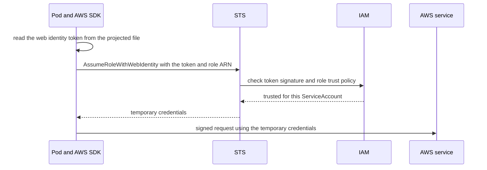
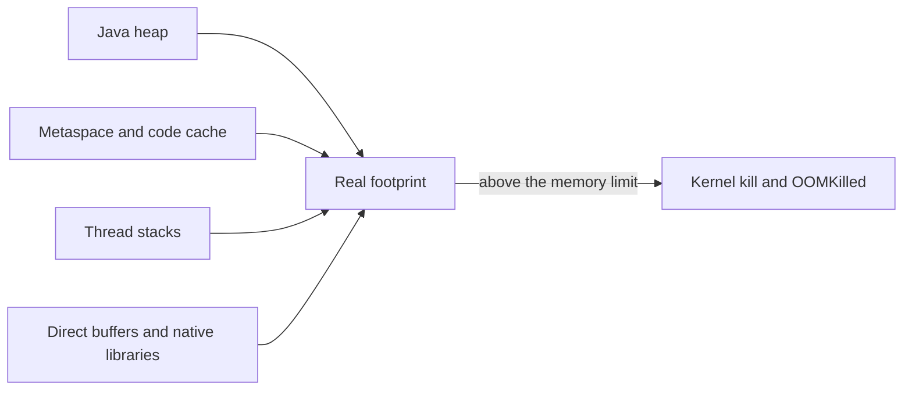

# Kubernetes Configuration and Resources

A container image is deliberately inert: the same bytes are meant to run in dev, uat and prod, because [[The Deployment Pipeline]] builds once and promotes. That leaves two things that must arrive from *outside* the image when a pod starts. The first is **what differs** — which database to call, which credential to present, which AWS permissions to hold. The second is **how big it may be** — how much CPU and memory the process may reserve and may never exceed, so dozens of services can share nodes without one starving the rest. Kubernetes answers both the same way: declare it in an object and let a component enforce it. This note stops where its neighbours start: how pods come to exist is [[Kubernetes Workloads]], the API server's authentication and admission pipeline is [[Kubernetes Architecture]], and how replica counts react to load is [[Autoscaling]].

## The problem that created it

The naive way to make a service behave differently per environment is a different image per environment — bake `application-prod.yml` into the build. Three things go wrong together. The artifact you tested is no longer the artifact you ship (a rebuild can pick up a moved base-image tag or a newer dependency). Every config change becomes a full build, push and rollout. And anything secret inside an image layer is readable by anyone who can pull the image ([[Docker and Container Images]], [[Container Registries and ECR]]), including from every older tag you already pushed. The Twelve-Factor App methodology stated the fix as a rule — keep config in the environment, apart from code — and Kubernetes turns the rule into objects: a **ConfigMap** and a **Secret** hold the values outside the image, and the pod spec says how to hand them in.

Secrets create a second-order problem. A pod that calls AWS needs credentials, and the lazy answer — an access key stored in a Secret — is a long-lived, copyable credential that works from anywhere and must be rotated by hand. The other lazy answer, the node's own instance role, gives *every* pod on that node the same permissions. What is wanted is a credential that is per-workload, short-lived and issued only to the pod that should hold it. That is what IRSA provides.

The other half is arithmetic. A node has a fixed amount of CPU and memory, and the scheduler must decide how many pods fit using only numbers the pods *declare*, never live usage ([[Kubernetes Architecture]]). Once pods are packed together, a leaking process can eat the node's memory and the kernel's out-of-memory killer will pick a victim; without guidance the victim may be a neighbour that did nothing wrong ([[Bulkheads and Isolation]] is the general principle). Two numbers per container fix this, and they do different jobs: a **request** (reserve this much for me, so packing is honest) and a **limit** (never let me take more than this, so the kernel can fence me in). Namespaces, RBAC and quotas answer the human version of the same question: who may create and read what, and how much of the cluster one team may consume.

## What it solves

- **Build once, configure per environment.** One image tag, many ConfigMaps and Secrets; promotion changes references, not bytes.
- **Credentials that are not in the image or the repo** — with the caveats below: a Secret is only as safe as the RBAC, encryption and consumption path around it.
- **Keyless AWS access.** IRSA replaces a copied access key with a short-lived credential tied to one ServiceAccount, with the role assumption recorded in CloudTrail.
- **Honest bin-packing.** Requests let the scheduler fill nodes without overcommitting what pods have reserved, and they are the denominator under HPA percentages ([[Autoscaling]]).
- **Contained failure.** Limits turn "one leaking pod takes the node" into "one container is killed"; QoS decides who dies first when a node still runs short.
- **Per-team guardrails.** Namespaces scope names and RBAC; ResourceQuota and LimitRange cap what a namespace may consume and give unsized pods defaults.

## How it works

### ConfigMap and Secret: one shape, two ways in

Both are namespaced objects holding key-value pairs, each capped at 1 MiB — a deliberate brake on using the API, and the etcd behind it, as a data store. A ConfigMap value is plain text. A Secret's `data` values are base64, an encoding that makes binary safe inside YAML and **nothing more**; the write-only `stringData` field just lets you submit plain text and have the API server encode it. A pod consumes either as **environment variables** or as **files** in a mounted volume (code can also read a ConfigMap straight from the Kubernetes API and watch it). The choice is a real trade-off, not a style preference:

| | Environment variable | Mounted file |
|---|---|---|
| When it is read | Once, as the container starts | Files exist before start; the kubelet refreshes them afterwards |
| When the object changes | **Never updates**; a new pod is required | **Eventually** updates: up to the kubelet sync period plus a cache delay (the default cache is a watch) |
| Exception | — | A `subPath` mount never receives updates |
| Exposure | Process environment: visible in `/proc`, crash dumps and debug endpoints, inherited by child processes | File permissions; readable by anything in the container that can open the path |
| Spring Boot fit | Relaxed binding maps `SPRING_DATASOURCE_URL` to `spring.datasource.url` | `spring.config.import=configtree:` reads a mounted directory, one file per property (Boot 2.4, November 2020, onward) |

"Eventually" hides a second trap: a file that changed on disk is not a bean that changed in memory. The JVM parsed `application.yml` at startup into objects, and nothing re-reads it unless the application watches the file. For a plain Spring Boot service a mounted update therefore means the disk is new and the process is old. The robust pattern is to make a config change a *deploy*: mark ConfigMaps and Secrets **immutable** (stable since Kubernetes 1.21, 2021; it also saves the kubelet a watch per object), give each version a new name, and reference that name from the pod template. A change is then a template change, so pods roll, the new values arrive atomically with the new pods, and — because the reference lives in the template — a rollback restores the old config along with the old image, provided the old object still exists. A mutable in-place edit never rolls back, which is the gap [[Kubernetes Workloads]] describes. The common Helm spelling of the same idea stamps a checksum of the rendered config into a pod-template annotation, so any content change alters the template.

### Secrets: base64 is not protection

The upstream documentation is blunt. Secrets are stored unencrypted in etcd by default; anyone with API access can read or modify them, and so can anyone with access to etcd; and anyone allowed to create a pod in a namespace can read every Secret in that namespace through it (creating a Deployment counts). Three layers close that, each against a different threat. **RBAC** with least privilege decides who may `get` a Secret through the API. **Encryption at rest** — the API server encrypting objects before they reach etcd, ideally with a key held in a KMS (envelope encryption: a data key encrypts the object, a KMS key encrypts the data key) — protects a stolen disk or backup. On EKS clusters running Kubernetes 1.28 or later AWS does this by default for all API data, via KMS provider v2 with an AWS-owned key unless you bring your own (AWS docs, 2026); it does not stop an authorised API read, which returns plaintext. And **the consumption path** decides what leaks next: env vars spread into dumps and debug output, files are narrower.

For anything that needs rotation, audit or per-secret access control, the stronger move is to keep the source of truth outside the cluster in a store such as AWS Secrets Manager and bring values in. Two bridges are common. The **External Secrets Operator** is a controller that polls the store at an interval you set and creates or updates an ordinary Kubernetes Secret — convenient, but the value is back in etcd and, if consumed as an env var, frozen at pod start again. The **Secrets Store CSI Driver** with AWS's provider mounts the secret as a file at pod start using the pod's own IAM identity (next section), so access is governed by IAM as well as Kubernetes RBAC, and the value need not become a Kubernetes Secret unless you ask for that. Neither removes the "app must re-read" problem; they change where the value comes from.

### IRSA: AWS permissions without static keys

IRSA — IAM Roles for Service Accounts — lets a pod obtain AWS credentials with no stored key. Five pieces cooperate. The cluster publishes an **OIDC issuer**, registered once per cluster as an IAM OIDC identity provider. An **IAM role** has a trust policy that trusts that provider and, in the standard pattern, only for one ServiceAccount's namespace and name. The **ServiceAccount** carries an annotation naming the role (`eks.amazonaws.com/role-arn`). A mutating webhook sees a pod using that ServiceAccount and injects two environment variables, `AWS_ROLE_ARN` and `AWS_WEB_IDENTITY_TOKEN_FILE`, plus a projected volume holding a short-lived signed token at `/var/run/secrets/eks.amazonaws.com/serviceaccount/token`; the kubelet refreshes it once it is older than 80 percent of its lifetime or older than 24 hours. Finally the **AWS SDK**, whose default credential chain checks those variables first, exchanges the token at STS.

Read it as identity federation: Kubernetes vouches for "this is ServiceAccount `payments` in namespace `prod`", AWS decides what that identity may do, and nothing long-lived is copied anywhere. Two cautions from AWS's own docs: containers are not a security boundary, and unless access to the node's instance-role credentials is restricted a pod can still reach them — IRSA narrows exposure but does not by itself remove node-role access. **EKS Pod Identity**, the newer option ([[Kubernetes Architecture]]), swaps the OIDC provider for a per-node agent and one trust principal, `pods.eks.amazonaws.com`; it supports Linux EC2 nodes only, so pods on Fargate must use IRSA (AWS docs, 2026; see [[EKS vs ECS]]).

### Namespaces and RBAC

A **namespace** is the unit of multi-tenancy inside a cluster: it scopes names, RBAC, quotas and (with a CNI that enforces them) network policies. It is an administrative boundary, not a security or network one by itself, because nodes and the control plane are shared. **RBAC** in one paragraph: a **ServiceAccount** is *who* a pod is; a **Role** lists permitted verbs on resource kinds inside one namespace (`get` and `list` on `secrets`, say); a **RoleBinding** attaches the Role to a ServiceAccount or user; ClusterRole and ClusterRoleBinding do the same cluster-wide or for non-namespaced kinds. Every namespace has a `default` ServiceAccount that pods use unless told otherwise, and its short-lived token is mounted into each pod unless you set `automountServiceAccountToken: false` — most application pods never call the Kubernetes API, so turning it off removes a credential for free. Keep the two identities apart: what the Kubernetes API lets a ServiceAccount do (RBAC) and what AWS lets its IRSA role do (IAM) are unrelated permission sets that merely share an object. For roles versus attributes in general see [[RBAC vs ABAC]].

### Requests and limits: a reservation and a ceiling

CPU is measured in cores (`500m` is half a core) and memory in bytes (`Mi` is 2^20, `M` is 10^6 — a roughly 5 percent slip). A **request** is a reservation the scheduler subtracts from the node's allocatable resources when placing the pod; it never looks at actual usage, so a node can be "full" at 20 percent real CPU. At runtime the CPU request becomes a weight — under contention, larger requests get proportionally more CPU time — while the memory request is mostly a scheduling number. Requests are also the denominator of every utilisation percentage: an HPA target of 70 percent CPU means 70 percent *of the request* ([[Autoscaling]]), so a wrong request distorts scaling as well as packing. A **limit** is a ceiling the kernel enforces through cgroups. Set a limit with no request and Kubernetes copies the limit into the request, unless an admission-time default such as a LimitRange (below) supplied one.

The two limits are enforced in opposite ways, and the reason is physics. **CPU is compressible**: a process can be denied the processor for a few milliseconds and given it back later, so the kernel throttles it — slower, but nothing is lost. **Memory is incompressible**: once a page is handed out, taking it back means discarding data the process still needs, and nodes normally run with swap off, so the only way to enforce a memory ceiling is to kill. Over the CPU limit you get slow; over the memory limit you get dead (`OOMKilled`, exit code 137 — diagnosis is in [[Kubernetes Workloads]]). The docs add that memory limits are enforced reactively: a container may overshoot briefly and is killed when the kernel notices pressure.

Throttling works by time budget. The kernel gives the container's cgroup a quota of CPU time per window — by default a 100 ms period, so a `500m` limit is 50 ms of CPU per 100 ms — and the quota is shared by *all* threads in the container. A JVM with eight busy threads (request handlers, GC workers, JIT compiler threads at startup) burns 50 ms of quota in about 6 ms of wall-clock time, then every thread stalls for the remaining ~94 ms of that window. Average CPU over a minute still looks modest while individual requests absorb tens of milliseconds of dead time: **slow with low utilisation**. The tell is the throttling counter, not the usage graph — `container_cpu_cfs_throttled_periods_total` divided by `container_cpu_cfs_periods_total` in Prometheus-style metrics ([[Logs Metrics and Traces]]).

Whether to set CPU limits at all is a live argument, not a settled rule. Setting them gives predictable per-pod performance and stops a runaway loop from taking a node, at the cost of throttling below what the node could spare. Omitting them (keep the request, drop the limit) lets pods use idle CPU and shares the rest by request weight, at the cost of noisier neighbours and a pod that can no longer be Guaranteed. Memory is the opposite: leave it unbounded and a leak takes the node, so memory limits are close to universal. A common stance — a reasoned heuristic, not a standard — is memory request equal to memory limit, CPU request near typical usage, and the CPU limit generous or absent; measure before choosing. Changing sizes normally means a new pod template and therefore a rollout; in-place pod resize, stable since Kubernetes 1.35 (late 2025), can change CPU without a restart, but the docs note memory changes often need a container restart because many runtimes cannot adjust memory live, and a JVM fixes its heap at start.

### The JVM sizes itself from what it sees

A JVM makes its own sizing decisions at startup from what the container shows it. Container-aware JDKs read the **memory limit** from the cgroup — never the request — and by default cap the heap at 25 percent of it (`MaxRAMPercentage`); the JDK-version history is in [[Kubernetes Workloads]]. Two consequences follow. With **no memory limit** the JVM sees the node's RAM: a request-only pod on a 64 GiB node targets a 16 GiB heap, far above its reservation, and becomes an eviction candidate when the node tightens. And the heap is only part of what the kernel counts against the limit.

The process footprint is heap **plus** metaspace (class metadata), the JIT code cache, thread stacks (by default up to 1 MiB each on Linux x64 and 2 MiB on Linux AArch64 such as Graviton, per the JDK 25 docs, counted as pages are touched), direct and mapped buffers (Netty-based clients use them heavily), GC bookkeeping and native libraries. Illustratively — assumed numbers, not measurements — a 1 GiB limit with the heap allowed to reach 75 percent leaves 256 MiB for everything else; if the non-heap parts of a busy Spring Boot service add up to 300 MiB, the pod dies the first time the heap fills near its cap, usually the traffic peak, hours after the deploy looked healthy. **Setting the limit equal to the heap is wrong by construction** (`-Xmx` equal to the limit, or `MaxRAMPercentage=100`): the footprint exceeds the limit the moment the heap fills, and the kill is silent — a SIGKILL from the kernel, with no `OutOfMemoryError`, no heap dump and no stack trace. The default 25 percent errs the other way and wastes three quarters of the memory you pay for. The right value is found by measuring: run with `-XX:NativeMemoryTracking=summary`, read `jcmd <pid> VM.native_memory summary`, and choose a heap percentage that leaves the measured non-heap total plus a margin. Small limits need a lower percentage, because the fixed overheads are a larger share of them.

The same blindness applies to CPU. The JVM derives its processor count from the CPU **limit** (quota divided by period, rounded up); since JDK 19 (2022) it no longer uses the CPU request (cgroup shares) for that count, and with no CPU limit it sees every core on the node. That count sizes GC threads, the common fork-join pool and similar defaults. On JDK 26 and earlier — which covers every current LTS line, 17, 21 and 25 — it also picks the collector: a JVM that sees fewer than two CPUs or less than 1792 MB of memory is not a "server-class machine" and falls back to the Serial collector instead of G1 unless you choose one explicitly. JDK 27 (September 2026, JEP 523) drops that rule and selects G1 everywhere. On the LTS lines a `500m` limit therefore changes both the GC and the pool sizes of your service without any flag. If you have measured a need, pin them (`-XX:+UseG1GC`, `-XX:ActiveProcessorCount`) rather than inheriting whatever the container shape implies.

### QoS classes and eviction: two mechanisms, not one

Kubernetes classifies every pod from its requests and limits: **Guaranteed** if *every* container has CPU and memory requests equal to limits, **BestEffort** if *no* container sets any request or limit, **Burstable** for everything between. "Every container" includes sidecars ([[Sidecar Pattern]]): one proxy container without limits drops the whole pod out of Guaranteed. Two different mechanisms then use the class, and mixing them up is the usual confusion.

| Class | Rule | Kernel `oom_score_adj` | Typical rank when the node is short |
|---|---|---|---|
| Guaranteed | Every container: requests equal limits, CPU and memory | -997 | Last: usage never exceeds requests |
| Burstable | Some requests or limits, not Guaranteed | Between 2 and 999; lower the larger the memory request is relative to node memory | Middle: evicted once usage exceeds requests |
| BestEffort | No requests or limits | 1000 | First: any usage exceeds a request of zero |

**Mechanism one is the kernel OOM killer.** When a container's cgroup reaches its memory limit, or the node itself runs out of memory before the kubelet reacts, the kernel kills a process; in the node-wide case it ranks processes by memory share plus the `oom_score_adj` the kubelet set from the QoS class — the one place the class is used directly. Symptom: container `OOMKilled`, restarted in place. **Mechanism two is kubelet node-pressure eviction.** When `memory.available` falls below a threshold (hard default 100 MiB) the kubelet evicts whole pods, ranking them by whether usage exceeds requests, then PriorityClass, then usage relative to requests. The Kubernetes docs say explicitly that the kubelet does not use the QoS class itself and that QoS is a good *predictor* of the order — so "BestEffort first, Guaranteed last" is true in practice without being the rule. Symptom: pod phase `Failed`, reason `Evicted`, replacement created elsewhere. Node-pressure eviction never honours PodDisruptionBudgets ([[Graceful Shutdown and Deployment Safety]]), and a hard threshold also skips `terminationGracePeriodSeconds` with a 0 s grace period (a soft one uses `eviction-max-pod-grace-period`): it is an unplanned kill, not a drain.

### LimitRange, ResourceQuota and storage claims

Two namespace-level objects stop sizing from being left to each developer. A **ResourceQuota** caps the *totals* in a namespace — summed CPU and memory requests and limits, plus object counts such as pods or Secrets; a request that would exceed it is rejected with `403 Forbidden`, and once a quota covers CPU or memory pods must state them or may be rejected. A **LimitRange** sets per-object rules: minimum and maximum per container or pod, a maximum limit-to-request ratio, and *default* requests and limits injected into pods that specify none — which is how a quota-governed namespace still accepts an unsized pod. Both act only at admission: tightening them changes nothing for pods already running. Requests are the cost lever, since nodes scale with the *sum of requests* ([[Kubernetes Architecture]]); a quota on requests is a budget in all but name ([[Capacity Planning]]).

One more thing a pod is configured with is storage. A **PersistentVolumeClaim** is a pod's request for storage of a given size and access mode; a **StorageClass** names a kind of storage and the provisioner that creates it on demand, so a claim becomes a real volume without an administrator pre-creating one. On EKS block storage is EBS through the EBS CSI driver — zonal, so the pod is pinned to the volume's availability zone ([[Kubernetes Workloads]]) — while EFS gives shared file storage across pods and, per AWS's docs, is the one of the two usable on Fargate, with static provisioning only.

## Trade-offs

| You get | You pay |
|---|---|
| One artifact for every environment, config outside the image | A mis-set value passes the build and fails at runtime; config drift between environments becomes a new bug class |
| Env vars: simple and universal | Frozen at pod start; they leak into dumps and debug output |
| Files and external stores: rotatable | The app must re-read; an operator or CSI driver is one more component to run and trust |
| IRSA: no stored AWS keys, auditable | A per-cluster OIDC provider and trust policies to maintain; the SDK must support it, with runtime-only dependencies |
| Requests near real usage: dense, cheap nodes | Under-requesting brings throttling, eviction risk and noisy neighbours |
| Generous requests: a safe feeling | Nodes scale with the sum of requests, so idle reservation is billed |
| Guaranteed QoS: last to be evicted, predictable | Peak is reserved at all times, so fewer pods fit per node |

## Failure modes

- **OOMKilled because the limit is below the real JVM footprint** — heap plus metaspace, stacks, direct buffers and native memory. Restarts with exit 137 and nothing in the application log; the evidence is `Last State` in `kubectl describe pod` ([[Kubernetes Workloads]]). Measure with Native Memory Tracking before moving the limit.
- **No memory limit, so the JVM sizes from the node.** A request-only pod targets 25 percent of node RAM as heap, grows far past its reservation, and is evicted first when the node tightens.
- **CPU throttling makes a service slow at low utilisation.** Shared quota across threads, GC and JIT bursts, and slow startup under a tight limit; latency tails rise while the CPU graph looks calm. Check the throttled-period ratio, then raise or drop the limit.
- **A Secret rotated, pods still hold the old value.** An env var was read once at start; the mounted file may have updated while the app kept its parsed copy. The failure arrives later, at the next connection re-creation, as an authentication error nobody connects to the rotation.
- **A ConfigMap changed and nobody restarted anything.** Same cause; a `subPath` mount makes it permanent. Fix by making config changes template changes (immutable, versioned names, checksum annotation).
- **Missing requests produce BestEffort pods.** They are first in line under pressure, and because their reservation is zero the scheduler thinks the node is empty and over-packs it; an HPA also cannot compute utilisation against a missing request.
- **Requests inflated "to be safe".** Pods sit `Pending` with "insufficient cpu" while nodes are nearly idle, and the node bill rises with the sum of requests.
- **A quota blocks the surge pod.** A rolling update needs headroom for the extra pod; if the namespace quota counts the old and new pod together and cannot fit both, the new ReplicaSet cannot create its pod and the rollout stalls (an inference from how quota and surge interact; the event shows an exceeded-quota message).
- **IRSA mis-wired.** A trust policy that names the wrong namespace or ServiceAccount fails at STS with an access error; and AWS's docs warn that without restricting node-role credentials a pod may still reach the node's permissions — silent over-permission.
- **Over-broad RBAC and mounted tokens.** Anyone who can create pods can read every Secret in the namespace; a `default` ServiceAccount bound to a powerful role hands that power to every pod that never asked for it.

## When NOT to use it

- **Secrets in a ConfigMap.** Nothing marks a ConfigMap value as sensitive: `kubectl describe configmap` prints it, and the Secret-specific controls above do not apply. Anything you would not paste into a ticket belongs in a Secret or an external store.
- **Kubernetes objects as a database.** The 1 MiB cap is a signal; feature flags that flip per request, large blobs and rotating lookup data belong in a datastore.
- **Env vars for values that rotate or must reload live.** Use files plus a reader that re-reads, or accept a restart as the reload mechanism and say so.
- **A cluster Secret as the system of record when rotation and audit matter.** Use an external store and treat the Secret as a cache.
- **Static AWS keys where IRSA or Pod Identity exists.** A stored key is the credential you were avoiding.
- **Reflexive CPU limits, and Guaranteed everywhere.** Both trade density or latency for predictability you may not need; decide per service from measurements.
- **LimitRange defaults as a substitute for sizing.** Defaults stop BestEffort pods; they do not make 500m the right number for your service.

## In your stack

- **Facets renders the pod spec; verify the result.** On `flavor: "deployment"` the `app_chart` values are snake_case, and a camelCase spelling is silently dropped back to the chart default (`terminationGracePeriodSeconds` renders as 30 unless spelled `termination_grace_period_seconds`). The failure to fear here is a resources or env key spelled for the wrong flavor: it renders as nothing, and nothing is exactly BestEffort. Check the live object — `kubectl get pod <name> -o jsonpath='{.status.qosClass}'` and the container `resources` — never the Facets JSON.
- **Replicas are pinned at 1, so every kill is an outage.** An OOMKill or an eviction removes the only pod until a replacement is scheduled, boots and passes readiness; a forced restart to pick up a rotated Secret is a deploy-shaped gap ([[Graceful Shutdown and Deployment Safety]]). Requests are your cost lever (nodes scale with their sum) and with no second replica to average over, size them from observed p95 usage, not a guess ([[Capacity Planning]]).
- **A tight CPU limit and a JVM boot interact with probes.** Facets hardcodes probe `failureThreshold: 10`, so the startup budget is period times 10; size it against boot time *under the limit*, not on a laptop, and remember a throttled pod can miss a 1 second readiness timeout at low average CPU ([[Health Checks and Service Discovery]]). Readiness must not gate on Mongo or Redis at one replica.
- **IRSA plus `MONGODB-AWS`.** Under IRSA the Mongo driver authenticates through the web identity token, and the credential exchange needs `aws-java-sdk-sts` on the classpath. No source file imports it, so builds stay green while every Mongo-backed endpoint returns 500 at runtime, with the pod Running and Ready. MongoDB's Java driver docs say the project must include v1 or v2 of the AWS SDK for web identity auth. Dated flag: AWS SDK for Java 1.x reached end of support on 31 December 2025, so as of 2026 this path rests on an unsupported SDK line. The same driver documents AWS SDK v2 (`software.amazon.awssdk:auth`) as supported, so a migration path exists — but the v2 artifacts are equally runtime-only dependencies that nothing imports, so the same green-build, 500-at-runtime trap applies and the classpath must be verified after any switch.
- **Audit shape (RBI).** "Which workload read this credential?" is answered by per-ServiceAccount IAM roles and CloudTrail, not by a shared node role or a copied key. Treat moving credentials into an external store, or adding an operator or CSI driver, as an audit-visible change and record it.
- **Not verified here:** your namespace layout, any ResourceQuota or LimitRange, and whether non-prod shares a cluster with prod. `kubectl get resourcequota,limitrange -A` and `kubectl get ns` answer it.

## Interview angle

The 60-second version, requests versus limits: *"A request is what the scheduler reserves: it sums requests against a node's allocatable resources to place pods, and it is the denominator for HPA utilisation percentages, so it drives both packing and cost. A limit is a ceiling the kernel enforces through cgroups, and it is enforced differently by resource: CPU is compressible, so exceeding the limit gets you throttled — slow, with low utilisation, because the quota is shared across threads in a 100 ms window — while memory is incompressible, so exceeding it gets the container OOM-killed. For Java that matters twice: the JVM reads the cgroup limit, not the request, so with no limit it sizes the heap off the node, and the heap is only part of the footprint — metaspace, thread stacks and direct buffers sit on top — so a limit equal to heap gets killed with no OutOfMemoryError. The three QoS classes fall out of the numbers: Guaranteed when requests equal limits, BestEffort when unset, Burstable between, and under node pressure the kubelet evicts pods using more than they requested first."*

Classic follow-ups: "Why is CPU throttled but memory killed?" (compressible versus incompressible); "A service is slow but CPU shows 15 percent" (throttling counter, shared quota); "Env var or mounted file for a rotating secret?" (files update eventually, env never — and the app must re-read either way); "Are Secrets encrypted?" (base64 is encoding; etcd encryption is a cluster setting, on by default on EKS 1.28 and later; RBAC still decides reads); "How does a pod get AWS permissions without keys?" (IRSA: annotated ServiceAccount, projected token, AssumeRoleWithWebIdentity).

Senior tell: separating the two out-of-memory mechanisms — the kernel killing a container at its limit versus the kubelet evicting a pod under node pressure — and saying which symptom belongs to which.

## Check yourself

> [!question]- Q: Explain why exceeding a CPU limit and exceeding a memory limit produce such different outcomes, and what that means for sizing a Java service.
> CPU is compressible: the kernel can deny a process the processor for a few milliseconds and give it back, so over-limit usage is throttled against a quota (a share of each 100 ms window, shared by every thread in the container) — the process just runs slower. Memory is incompressible: a page already handed out cannot be taken back without destroying data, nodes run without swap, so the only enforcement is a kill (`OOMKilled`, exit 137). For a JVM, size the memory limit from the real footprint — heap plus metaspace, stacks, direct buffers and native memory, measured with Native Memory Tracking — and set `MaxRAMPercentage` to leave that room. Heap equal to the limit means a silent kernel kill with no `OutOfMemoryError`; no limit at all means the JVM sizes itself from the node's RAM.

> [!question]- Q: Scenario — a node runs short of memory and hosts three pods: a BestEffort batch pod, a Burstable API pod using more than its request, and a Guaranteed payments pod. Which goes first, and by which mechanism? Then say what changes if the cause is one container hitting its own limit instead.
> If the kubelet evicts under node pressure, it ranks by usage over requests, then PriorityClass, then relative usage: the BestEffort pod (any usage exceeds a request of zero) and the over-request Burstable pod go before the Guaranteed one, in priority order, and the symptom is pod phase `Failed` with reason `Evicted`, replaced elsewhere. The docs stress this ranking is not the QoS class itself, only well predicted by it. If the node runs out faster than the kubelet reacts, the kernel OOM killer picks by memory share plus `oom_score_adj` (1000 for BestEffort, -997 for Guaranteed), which is the one place QoS acts directly. If instead one container hits its own cgroup limit, neither ranking matters: the kernel kills inside that container, the symptom is `OOMKilled` and an in-place restart, and the other pods are untouched.

> [!question]- Q: Scenario — the database password is rotated in Secrets Manager and synced into a Kubernetes Secret by the External Secrets Operator. Twenty minutes later some pods fail to authenticate and others do not. Explain it and fix it.
> The operator updated the Kubernetes Secret on its refresh interval, but pods that consume it as an environment variable read the value once at start and never see the change; pods with the Secret mounted as a file got the new file eventually (kubelet sync plus cache delay) but only the ones whose application re-reads it benefit, and a `subPath` mount never updates. The failures appear when a connection pool opens a new connection with the stale password. Fix: decide the reload mechanism up front — roll pods on rotation (versioned immutable Secret names or a checksum annotation, so rotation is a deploy), or use a mounted file plus a reader that re-reads; and during rotation keep both old and new credentials valid so a rolling restart has an overlap window. With a single replica the roll itself is a short gap.

> [!question]- Q: Scenario — a Spring Boot service on a `500m` CPU limit shows 18 percent average CPU, yet p99 latency spikes and the pod is slow to pass readiness after each deploy. What do you look at, and what are two fixes?
> Look at throttling, not utilisation: the ratio of `container_cpu_cfs_throttled_periods_total` to `container_cpu_cfs_periods_total`. The `500m` limit is 50 ms of CPU per 100 ms window shared by all threads; request handling, GC workers and JIT compilation at startup exhaust it in a few milliseconds and everything stalls for the rest of the window, which also slows boot and can make a 1 second readiness probe time out. Check also what the JVM inferred: under two CPUs a JDK 26-or-earlier JVM, LTS lines included, may have chosen the Serial collector, and every version sizes its pools small. Fixes: raise the CPU limit or drop it while keeping a realistic request (accepting the noisy-neighbour trade-off); give the startup probe a budget sized to boot under the limit; and pin GC and processor-count flags deliberately instead of inheriting them.

> [!question]- Q: Mini-design — a new Spring Boot service on EKS must read a Mongo credential, call S3 and SQS, and sit in a namespace shared with other teams. Specify its configuration, identity and resource settings.
> Config: non-secret settings in a versioned immutable ConfigMap referenced from the pod template, so a change is a rollout and a rollback restores it. Credentials: the Mongo secret from an external store (Secrets Manager) via the Secrets Store CSI Driver as a mounted file read with `configtree:`, or via the External Secrets Operator into a versioned Secret; RBAC limits `get` on Secrets to the people and controllers that need it. Identity: a dedicated ServiceAccount, `automountServiceAccountToken: false` since it never calls the Kubernetes API, annotated with an IRSA role scoped to exactly that S3 bucket and SQS queue, with the trust policy bound to that namespace and ServiceAccount; for Mongo IAM auth confirm the AWS SDK web-identity dependency is on the runtime classpath. Resources: memory request equal to limit sized from Native Memory Tracking with `MaxRAMPercentage` leaving measured headroom; CPU request at typical usage, limit generous or absent per measured throttling; explicit GC choice if the CPU limit is under two cores. Namespace: confirm a ResourceQuota that leaves surge headroom and a LimitRange so an unsized pod cannot become BestEffort.

## Sources

- Kubernetes documentation: ConfigMaps; Secrets and "Good practices for Kubernetes Secrets"; Resource Management for Pods and Containers; Pod Quality of Service Classes; Node-pressure Eviction (eviction ranking, `oom_score_adj` table, default hard threshold); Limit Ranges; Resource Quotas; Service Accounts; Resize CPU and Memory Resources assigned to Containers (checked against the 1.37 docs, October 2026); Kubernetes blog, "Kubernetes 1.35: In-Place Pod Resize Graduates to Stable" (19 December 2025).
- Amazon EKS documentation: IAM roles for service accounts; "Configure Pods to use a Kubernetes service account"; EKS Pod Identity; "Default envelope encryption for all Kubernetes API data"; Fargate considerations; AWS Secrets Manager integration with EKS (AWS Secrets and Configuration Provider for the Secrets Store CSI Driver).
- External Secrets Operator documentation (refresh interval, synced Kubernetes Secret); Secrets Store CSI Driver documentation.
- MongoDB Java driver documentation: AWS IAM authentication (AWS SDK v1 or v2 as a dependency for web identity). AWS Developer Tools Blog: "Announcing end-of-support for AWS SDK for Java v1.x on December 31, 2025".
- OpenJDK JDK-8281181 ("Do not use CPU Shares to compute active processor count", JDK 19); Oracle JDK 25 HotSpot GC Tuning Guide, "Ergonomics" (server-class: two or more processors and at least 1792 MB) and the JDK 25 `java` man page (`MaxRAMPercentage` 25, `ThreadStackSize` defaults); JEP 523, "Make G1 the Default Garbage Collector in All Environments" (delivered in JDK 27, GA 15 September 2026). Checked October 2026.
- Spring Boot 2.4.0 release notes (November 2020) — `spring.config.import` and configuration trees. The Twelve-Factor App, factor III (config in the environment).
