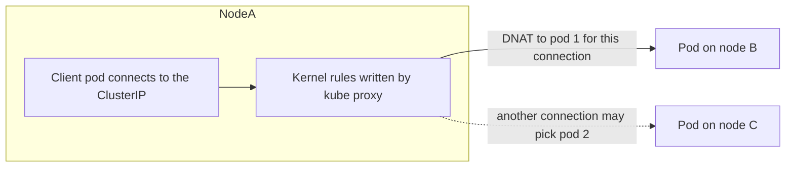
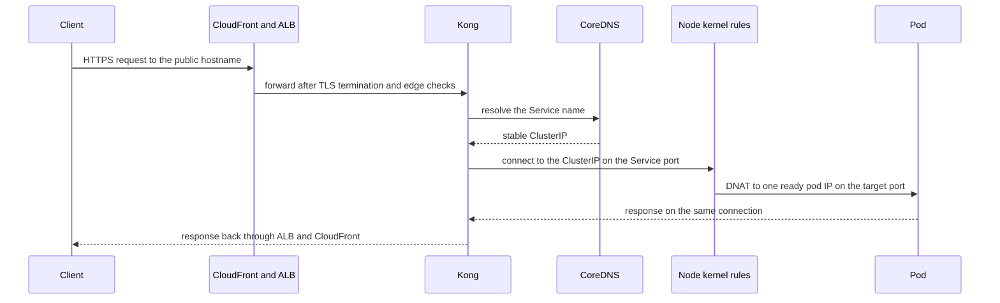

# Kubernetes Networking

Every deploy replaces your pods, and every replacement pod gets a new IP address. So the question "how does anything find my service?" cannot be answered with an address — it needs a layer that stays still while the pods behind it churn. Kubernetes builds that layer in four steps: a flat network where every pod has a routable IP, a **Service** that gives a stable virtual IP and DNS name to a changing set of pods, **Ingress** (and its successor, the Gateway API) for HTTP routing from outside, and **NetworkPolicy** to restrict who may talk to whom. This note builds them in that order, then walks one request from the internet to a pod. The pods being addressed are the subject of [[Kubernetes Workloads]]; the readiness detail that decides which pods are eligible is in [[Health Checks and Service Discovery]].

## The problem that created it

[[Kubernetes Workloads]] ends on a fact that breaks naive networking: a pod's IP is assigned when the pod is created and disappears when it does. A rolling update replaces *every* pod, so every address changes on every deploy. Four separate problems fall out of that.

1. **Pods need a network they can all use without ceremony.** The older container model (Docker's default bridge) hides containers behind their host's IP and maps container ports to host ports through NAT. At fleet scale that means port-allocation bookkeeping and every service learning translated addresses. Kubernetes instead requires an **IP per pod**: each pod has its own address and port space, so a Spring Boot app can listen on 8080 in every pod without collision.
2. **Callers need a stable target.** If service A caches one of B's pod IPs, it is wrong after B's next deploy. Discovery has to be a lookup that always returns something current ([[Health Checks and Service Discovery]] tells this story from the discovery side).
3. **Load must spread over replicas that come and go**, and only over those that are ready.
4. **Traffic from outside the cluster** has to enter somewhere, and what is allowed to talk to what inside the cluster has to be controllable.

The Kubernetes network model is the answer to the first, and Service, Ingress, and NetworkPolicy answer the rest.

## What it solves

- **A stable name and address for an unstable set of pods**, so callers never track individual pods.
- **Automatic membership**: pods enter and leave the target set as they are created, become Ready, or die — no registration code, no registry to run.
- **Spread of connections** across the ready replicas, with no extra hop at the application layer.
- **Name-based discovery** in every pod via cluster DNS, in any language.
- **One entry point per external hostname** for HTTP routing, TLS, and path rules, instead of one load balancer per service.
- **Declarative segmentation**: "only these pods may reach the database pods" becomes an object you can review.

## How it works

### The network model, and what the VPC CNI makes of it

Kubernetes states three requirements: every pod gets its own IP; any pod can reach any other pod on any node **without NAT**; and node-level agents can reach pods on their node. Kubernetes itself implements none of this. A **CNI plugin** (Container Network Interface) does, running on every node and wiring each new pod into the network when the kubelet creates it. Containers *inside* one pod share a network namespace and reach each other over `localhost` ([[Sidecar Pattern]]).

On EKS the default plugin is the **Amazon VPC CNI**, which runs as the `aws-node` DaemonSet. Its defining choice: pods get **real VPC IP addresses**, taken as secondary private IPs on elastic network interfaces (ENIs) attached to the node, from the node's subnet. There is no overlay network; a pod's address is routable inside the VPC, visible to security groups and flow logs, and reachable directly by a load balancer. The cost of that elegance is **IP exhaustion**, which is a design constraint rather than a bug:

- Every pod consumes one address from a VPC subnet. AWS reserves five addresses in each subnet, so a `/24` has 251 usable, and nodes and warm spares draw from the same pool.
- Pods per node are capped by the instance type's ENI limits: AWS's formula is ENIs × (IPs per ENI − 1) + 2, since each ENI's primary IP is not handed to pods and the `+ 2` covers host-network pods such as `aws-node` and `kube-proxy` (AWS publishes a max-pods calculator); a node can be out of pod slots while CPU is idle.
- By default (a `WARM_ENI_TARGET` of 1) the CNI keeps a spare ENI's worth of addresses attached for fast pod start, so a node holds more subnet IPs than it has pods.
- Relief valves: larger or additional subnets, a secondary CIDR with custom networking, **prefix delegation** (assigning whole `/28` blocks per ENI slot, added in VPC CNI 1.9.0 in August 2021 — more pods per node, but IPs reserved in 16-address chunks), and IPv6 clusters.

Service virtual IPs (next section) come from a **separate** service CIDR chosen at cluster creation, not from your subnets.

### Service: a stable virtual IP over a label selector

A **Service** selects pods by label and gives them one stable **ClusterIP** and one DNS name. Three port fields trip people up: `port` (what callers dial on the Service), `targetPort` (what the *pod* listens on — a number or a named container port), and the container's own declared `containerPort` (mostly informational, but a *named* one is what a named `targetPort` resolves to). A Service on 80 forwarding to `targetPort: 8080` is the common Spring Boot shape.

| Type | What it does | Use when |
|---|---|---|
| **ClusterIP** (default) | Virtual IP reachable only inside the cluster | Service-to-service traffic — most Services |
| **NodePort** | Also opens the same high port (default range 30000–32767) on every node | Rarely directly; it is the building block under LoadBalancer |
| **LoadBalancer** | Asks the cloud to provision an external load balancer in front | Exposing a non-HTTP or single service externally |
| **ExternalName** | Returns a DNS CNAME to an outside name; no proxying, no selector | Giving an external dependency an in-cluster name |
| **Headless** (`clusterIP: None`) | No virtual IP; DNS returns the ready pods' own IPs | Client-side discovery, StatefulSet per-pod DNS |

**LoadBalancer on EKS** is worth being exact about. With the **AWS Load Balancer Controller** installed, a Service of type LoadBalancer that opts in — `loadBalancerClass: service.k8s.aws/nlb` or the annotation `service.beta.kubernetes.io/aws-load-balancer-type: external` — is satisfied by an **NLB** (a layer-4 balancer), while an **Ingress** is satisfied by an **ALB** (layer 7). A Service that does not opt in is still handled by the legacy AWS cloud provider load balancer controller, which creates a Classic Load Balancer by default and, per AWS, now receives only critical bug fixes. The controller can register targets in `instance` mode (the LB hits a NodePort, then kube-proxy forwards to a pod, a possible second hop) or `ip` mode (the LB targets pod IPs directly — possible only because the VPC CNI gives pods VPC addresses). Details of draining targets are in [[Graceful Shutdown and Deployment Safety]].

### How kube-proxy makes a virtual IP real

A ClusterIP is not assigned to any interface and no process listens on it. It is a number that exists only in **rules**. On every node, **kube-proxy** watches the API server for Services and their endpoints and programs the node's kernel so that a packet addressed to `ClusterIP:port` is rewritten (**DNAT**, destination network address translation) to the address of one chosen ready pod. The rewrite happens on the *caller's* node, before the packet leaves it, so the ClusterIP never travels the network.

The default mode on Linux is **iptables**: a chain of rules per Service, with probabilistic selection among endpoints. **IPVS** mode uses a kernel load-balancing table but is **deprecated since Kubernetes 1.35** (December 2025), with KEP-5495 planning default-off in 1.40 and removal in 1.43 (a schedule, so check the current docs), so do not choose it for a new cluster; an **nftables** mode reached general availability in 1.33 (2025), and upstream says a future release will make it the default (as of 1.37, 2026, the default is still iptables). Once a connection's first packet is rewritten, the kernel's connection-tracking table (conntrack) remembers the choice, so the rest of that connection follows the same path. That is the crucial property: **balancing is per connection, not per request.** A client that opens one long-lived connection and multiplexes everything over it — HTTP/2, and therefore gRPC ([[HTTP 1.1 vs HTTP 2 vs HTTP 3]]) — sends all its traffic to one pod, whatever the replica count. Pooled HTTP/1.1 clients ([[Connection Pooling]]) are only slightly better: each pooled connection is pinned to whichever pod it landed on. Both mean that **scaling out does not automatically move load onto the new pods.** Fixes sit at the client or the layer above: client-side load balancing over a headless Service, server-side connection-age limits that force periodic reconnects, or an L7 proxy ([[Load Balancers]], [[Service Mesh]]).

### Cluster DNS and the ndots trap

Cluster DNS is **CoreDNS**, run as a Deployment in `kube-system` and reached through a Service. Each Service gets the name `<service>.<namespace>.svc.cluster.local` (`cluster.local` is the default cluster domain), and a pod's resolver is configured so short names work: within a namespace `payments` resolves, across namespaces `payments.other-ns` does. A pod's `/etc/resolv.conf` points at the cluster DNS Service, lists search domains (`<ns>.svc.cluster.local`, `svc.cluster.local`, `cluster.local`, plus any inherited from the node, on EKS typically a regional VPC domain), and sets **`options ndots:5`**.

That last line is the trap. `ndots:5` means: if a name has **fewer than five dots**, try it with every search domain appended *first*, and only try it as written afterwards. A lookup of `api.partner.com` (two dots) therefore goes through several guaranteed-to-fail queries — `api.partner.com.<ns>.svc.cluster.local`, `...svc.cluster.local`, `...cluster.local`, and so on — each sent for both A and AAAA records, before the real one succeeds. Fixes: write the name as a fully qualified name with a **trailing dot** (`api.partner.com.`), lower `ndots` through the pod's `dnsConfig`, or run **NodeLocal DNSCache** so repeated lookups stay on the node. AWS adds a limit of its own: each network interface can send at most 1,024 packets per second to link-local services — the VPC DNS resolver, shared with instance metadata and time sync traffic — so a CoreDNS pod concentrating a node's external lookups can be throttled. The JVM adds a cache on top ([[Health Checks and Service Discovery]] covers `networkaddress.cache.ttl`); background on resolution itself is in [[How DNS Works]].

### EndpointSlices: the data behind a Service

A Service's membership is stored as **EndpointSlice** objects: the control plane watches pods matching the selector and writes their IPs, ports, and **conditions** (`ready`, `serving`, `terminating`) into slices of up to 100 endpoints by default. kube-proxy and cluster DNS read the slices, not the pods. EndpointSlices have been stable since Kubernetes 1.21 (2021), and the older `Endpoints` API was **deprecated in 1.33 (2025)**; kube-proxy has read slices instead of it since 1.19 (2020, default) and 1.22 (2021, stable), so scripts reading `Endpoints` should move to slices. How readiness feeds those conditions is in [[Health Checks and Service Discovery]] — here, just know that `kubectl get endpointslices -l kubernetes.io/service-name=<svc>` is the ground truth of "what can this Service send to right now".

### Ingress and the Gateway API: L7 from outside

A Service routes by connection. Real traffic needs routing by **host and path**, TLS, and one entry point shared by many services. **Ingress** (`networking.k8s.io/v1`) is the object for that — host and path rules mapping to Services — but an Ingress object is only a declaration: nothing happens unless an **ingress controller** is running to read it and configure a real proxy. On EKS the natural controller is the AWS Load Balancer Controller, which turns Ingress objects into ALBs (several Ingresses can share one ALB through an ingress group) and terminates TLS there with a certificate from ACM ([[TLS and HTTPS]]). The community **ingress-nginx** controller was the long-time default elsewhere; its retirement was announced in November 2025, best-effort maintenance ended in March 2026, and it gets no releases or security fixes after that, so it is no longer a sensible starting point for new work (existing installs keep running, unpatched).

Ingress has structural limits: HTTP and HTTPS only, simple host-and-path rules, and everything else (rewrites, timeouts, auth) smuggled in through controller-specific annotations that do not port between controllers. The Kubernetes project froze the Ingress API, which remains generally available with no removal planned. The successor is the **Gateway API**: separate objects for the class of gateway (`GatewayClass`), the listener instance (`Gateway`), and the routes attached to it (`HTTPRoute`, plus others), so platform owners and application teams can own different pieces. Its core resources reached general availability in **October 2023** (v1.0; v1.6.0 shipped in June 2026 and v1.7 was in release candidate by October 2026), and it is the direction upstream recommends. The AWS Load Balancer Controller declared its Gateway API support generally available in v3.0.0 (January 2026) — HTTPRoute and GRPCRoute on an ALB, TCP, UDP and TLS routes on an NLB — so the version you run decides whether it is available.

### Where Kong sits

[[API Gateway]] gives your edge order: CloudFront ([[CDN]]) to ALB to **Kong** to EKS services. Kong therefore occupies the position an ingress controller would — the L7 router between the external load balancer and your Services — and it does that job with its own routes and plugins rather than being merely a proxy behind a separate Ingress. The vault does not record whether Kong runs as pods inside the cluster or outside it, nor whether its routes come from declarative files or from Kubernetes objects; both are facts to confirm (see In your stack). What matters here is the last hop: to reach a backend, Kong needs either a Service's cluster DNS name (then kube-proxy chooses the pod, per connection, while Kong's pooled upstream connections reuse that choice) or the pod IPs themselves (then Kong balances per request).

### NetworkPolicy in one paragraph

By default every pod can talk to every other pod. A **NetworkPolicy** selects pods and restricts their ingress and/or egress by pod labels, namespaces, IP blocks, and ports. The rule that surprises people: selecting a pod flips it to **deny-by-default for that direction**, and policies are purely additive allow-lists. The two limits that matter: policies are layer 3 and 4 only (no hostnames or HTTP paths), and **the API object does nothing unless the CNI enforces it** — a cluster whose plugin does not enforce policy accepts the objects silently. Amazon VPC CNI added native enforcement in August 2023 (VPC CNI 1.14, on EKS 1.25 and later, off by default when it launched); as of 2026 AWS documents VPC CNI 1.21.0 or later for both standard policies and its cluster-wide admin `ClusterNetworkPolicy`, enforced on EC2 Linux nodes only — not Fargate or Windows. Calico and Cilium are the alternatives.

### One request, end to end

This walk assumes Kong runs inside the cluster and targets a Service name. If Kong sits outside the cluster, or targets pod IPs directly, the middle steps change shape: there is no ClusterIP to rewrite, and Kong itself picks the pod per request. Which of the two you have is one of the facts to confirm in the In your stack section.

## Trade-offs

| You get | You pay |
|---|---|
| A stable virtual IP over churning pods | The VIP is a kernel rule: not pingable, invisible to ordinary tools, harder to debug than a real hop |
| Zero-code, language-agnostic discovery via DNS | Every lookup hits CoreDNS; ndots multiplies queries; the VPC resolver has a per-interface packet limit |
| Per-connection balancing with no extra hop | Long-lived connections pin to one pod; scale-out does not rebalance existing load |
| Real VPC IPs for pods (no overlay, direct LB targets) | Pods consume subnet IPs; per-node pod limits; subnet planning becomes capacity planning |
| One shared L7 entry (an Ingress, a Gateway, or an API gateway) for many services | One more control point to run and secure; annotations and policies that differ per controller |
| Declarative segmentation with NetworkPolicy | Enforcement depends on the CNI; L3 and L4 only; policy sprawl without discipline |

## Failure modes

- **A Service with no endpoints.** Callers see connection refused quickly rather than a hang, because kube-proxy installs a reject rule for a Service that has no ready backends. Diagnose from the Service outward: `kubectl get endpointslices -l kubernetes.io/service-name=<svc>` (empty?), then compare the Service's `selector` against `kubectl get pods --show-labels` (a selector typo, a label that changed in the Deployment template, or the wrong namespace), then check whether the pods exist but are **not Ready** — present in the slice yet excluded from traffic. A close cousin: endpoints exist but `targetPort` does not match what the app listens on, so connections are accepted by the node and refused by the pod.
- **DNS timeouts and slow lookups from ndots.** Symptom: external calls with occasional latency clusters at multiples of about five seconds (the resolver's default timeout after a dropped UDP packet), while the same host resolves instantly from your laptop. Check `/etc/resolv.conf` in the pod, count dots in the hostname, watch CoreDNS metrics, and on AWS check the network-interface DNS-throttling counter. Fix with FQDNs, lower `ndots`, or NodeLocal DNSCache.
- **gRPC or HTTP/2 load imbalance.** After scaling from 2 to 6 replicas, two pods still carry nearly everything and CPU on the new four is idle: connections were opened before the scale-out and stay pinned. Per-pod request metrics reveal it. Fix at the client (round-robin over a headless Service, connection age limits) or with an L7 proxy; a mesh is a heavy fix for a problem client configuration often solves.
- **IP exhaustion on the VPC CNI.** New pods stick in `ContainerCreating` with `FailedCreatePodSandBox` events about assigning an address, or the scheduler reports "Too many pods" while CPU is free. Check free addresses per subnet (`AvailableIpAddressCount` from `aws ec2 describe-subnets`), the `aws-node` logs, and the instance type's pod cap. It bites hardest during rollouts and scale-out, because both temporarily need *more* addresses at the moment the subnet is under pressure.
- **LoadBalancer stuck `<pending>`.** Nothing is satisfying the Service. On EKS, in rough order: the Load Balancer Controller is not installed or the Service lacks the class or annotation that tells it to act; the controller's IAM role lacks permission; the subnets lack the discovery tags (`kubernetes.io/role/elb` for public, `kubernetes.io/role/internal-elb` for internal); there are no free IPs in the chosen subnets. `kubectl describe svc` Events and the controller's logs name the cause.
- **Traffic still routed to a terminating pod.** Endpoint removal and SIGTERM race; the fix is the preStop and drain choreography in [[Graceful Shutdown and Deployment Safety]], not a networking change.

## When NOT to use it

- **NodePort as a production entry point.** It opens a high port on every node and leaves you to manage the load balancer and security groups in front; it is a building block, not a front door.
- **One LoadBalancer Service per service.** Cost shape: each exposed Service gets its own load balancer, so load-balancer count (and its standing charge) grows linearly with the number of exposed services. A shared ALB or an API gateway amortizes one entry across many.
- **Headless Services when you only wanted load balancing.** You give up the stable VIP and inherit DNS caching staleness and client-side balancing duty.
- **ExternalName for anything that checks hostnames.** The client connects using the in-cluster name, so TLS or Host-header expectations about the real name can break.
- **A second L7 router in front of your API gateway.** If the gateway already does host, path, and policy routing, adding Ingress rules that duplicate it creates two sources of truth.
- **Starting new work on ingress-nginx**, per its retirement above; and conversely do not migrate a working Ingress to the Gateway API purely for fashion.
- **A service mesh to fix connection pinning.** Try client-side balancing and connection-age limits first ([[Service Mesh]] works out the real cost).
- **NetworkPolicy as your only security control**, or at all where the CNI does not enforce it — an unenforced policy is false assurance.

## In your stack

- **Edge and Kong.** Your path is CloudFront to ALB to Kong to Service (per [[API Gateway]]). Confirm the two open facts directly: `kubectl get pods -A | grep -i kong` (in-cluster or not) and `kubectl get ingress -A` (are Ingress objects in use at all, or only Kong's own routes). Then check what Kong's upstream is: a Service DNS name means kube-proxy picks the pod per connection; pod IPs mean Kong balances.
- **`x-correlation-id` is your hop-by-hop debugger.** Every inter-service call carries it, so when a request disappears between Kong, service A, and service B, search the id in each pod's logs; the last log line that saw it tells you which hop dropped it — faster than reading kernel rules.
- **Facets renders the chart, including the Service.** (This is an inference: an application chart almost certainly includes one.) Facets silently drops misspelled keys ([[Graceful Shutdown and Deployment Safety]]), so confirm the Service's actual `port`, `targetPort`, and selector with `kubectl get svc <name> -o yaml` rather than trusting the Facets JSON. Facets' hardcoded probe threshold also sets how long a sick pod stays marked ready in the EndpointSlice and keeps receiving traffic — the arithmetic is in [[Health Checks and Service Discovery]].
- **At one replica, a Service has exactly one endpoint.** Replicas are pinned at 1 in Bharat, which has two consequences. An unready pod empties the Service, and kube-proxy's reject rule turns that into connection-refused — the reason readiness must not gate on Mongo or Redis there ([[Health Checks and Service Discovery]]). And the gRPC-pinning problem is dormant — there is nothing to balance — until a service is scaled out, when it wakes up.
- **VPC CNI sizing.** A fleet of single-replica services uses few pod IPs, but rollouts add a surge pod each, and node warm pools hold extras; check `AvailableIpAddressCount` on the node subnets before a large simultaneous deploy or a scale-out.
- **Datastore hostnames and ndots.** Count the dots in the Mongo and Redis hostnames your pods use; any with fewer than five pay the search-domain tax whenever the JVM's DNS cache misses.
- **NetworkPolicy.** [[API Gateway]] assumes network policy keeps non-Kong traffic away from services. Verify the CNI actually enforces policy and that policies exist; for audit purposes, enforced policy manifests are deterministic evidence of "which workloads can reach the payments service", which a diagram is not.

## Interview angle

**The 60-second "how does a request reach a pod" walk:** "The client resolves the public hostname and hits CloudFront, then the ALB, which terminates TLS, then an API gateway, which applies auth and routing policy and picks a backend Service. It resolves that Service's cluster DNS name through CoreDNS to a stable ClusterIP. That IP is not a real interface; kube-proxy has programmed iptables rules on the node so the kernel rewrites the destination to one ready pod's IP, chosen per connection and remembered in conntrack. On EKS that pod IP is a real VPC address from the VPC CNI, so the packet routes straight to the pod's node and into the container's port. Which pods are eligible is the Service's EndpointSlice, which only lists pods that are Ready."

Classic follow-ups: "What is a ClusterIP, physically?" (a rule, not a device — DNAT on the caller's node); "Why does my gRPC traffic hit one pod?" (balancing is per connection and HTTP/2 multiplexes one connection); "Ingress versus Service type LoadBalancer?" (L7 host and path routing sharing one entry, versus one L4 balancer per Service); "Ingress versus Gateway API?" (Ingress is frozen and annotation-driven; the Gateway API separates roles and went GA in 2023); "How do pods find each other?" (cluster DNS plus Services, with the ndots caveat).

Senior tell: knowing that nothing balances *requests* by default, and naming both the symptom (idle new pods after scale-out) and the fix layer.

## Check yourself

> [!question]- Q: Explain what a ClusterIP is, physically, and why you cannot meaningfully ping one in the default iptables mode.
> A ClusterIP is a virtual address that no interface owns and no process listens on; it exists only as rules that kube-proxy programs into each node's kernel. Those rules match traffic to the Service's declared port and protocol and rewrite (DNAT) the destination to a chosen ready pod IP on the caller's node, before the packet leaves it. Ping is ICMP to the bare address, which matches no rule, so it goes nowhere useful — a reminder that the IP is bookkeeping, and a hint that debugging means reading endpoints and rules, not probing the IP.

> [!question]- Q: Scenario — you create a Service for a new Spring Boot app and every call to it gets connection refused immediately. Walk through your diagnosis in order.
> Refused fast, not a timeout, suggests kube-proxy's reject rule for a Service with no ready endpoints. First run `kubectl get endpointslices -l kubernetes.io/service-name=<svc>`: if empty, compare the Service `selector` with the pods' actual labels (a typo or a template label change) and check the namespace; if the pods are there but listed not Ready, the readiness probe is failing and that is the real fault. If the slice has addresses, check `targetPort` against the port the app really listens on — endpoints present but port wrong gives a refusal from the pod itself.

> [!question]- Q: Scenario — a gRPC service is scaled from 2 to 6 replicas to relieve load, yet the original two pods stay saturated and the four new pods are idle. Explain and fix.
> kube-proxy balances per connection, and gRPC runs over long-lived HTTP/2 connections that multiplex all calls; clients opened their connections before the scale-out and each is pinned to the pod it first reached, so new pods only receive new connections, of which there are few. Confirm with per-pod request counts. Fix at the client (round-robin over a headless Service so each client holds connections to all pods), by having servers cap connection age so clients reconnect and rebalance, or by putting an L7 proxy in the path. Scaling alone cannot fix it.

> [!question]- Q: Scenario — calls to an external partner API show p99 latency spikes clustered near five seconds, though the partner is fast. What do you suspect and what would you change?
> DNS. With `ndots:5`, a hostname with fewer than five dots is tried against each cluster search domain first, with A and AAAA queries for each, multiplying load on CoreDNS; any dropped UDP packet then costs the resolver's default five-second timeout. Inspect the pod's `/etc/resolv.conf`, CoreDNS metrics, and on AWS the interface-level `linklocal_allowance_exceeded` counter (a limit of 1,024 packets per second per interface to link-local services, the VPC resolver included). Fix by using a trailing-dot FQDN, lowering `ndots` in the pod's `dnsConfig`, or adding NodeLocal DNSCache — and remember the JVM's own cache shapes how often lookups happen.

> [!question]- Q: Mini-design — expose 12 Spring Boot services to the internet on EKS with the fewest load balancers, and say what you would watch regarding IPs and cost.
> Keep every service a ClusterIP Service, and put one shared entry in front of all of them — an API gateway behind a single ALB, or an ALB shared across Ingress objects — routing by host and path; avoid 12 LoadBalancer Services, because each provisions its own balancer and cost grows linearly with exposed services. Terminate TLS once at the ALB. Add NetworkPolicies so only the gateway can reach the services, after confirming the CNI enforces them. Watch subnet free-IP counts and per-node pod caps because rollouts surge extra pods, and keep readiness shallow so a datastore blip does not empty a Service's endpoints.

## Sources

- Kubernetes documentation: Cluster Networking, Service, Virtual IPs and Service Proxies, DNS for Services and Pods, EndpointSlices, Ingress, Ingress Controllers, Gateway API, and Network Policies.
- Kubernetes blog, "Gateway API GA" (October 2023); "Ingress NGINX Retirement: What You Need to Know" (November 2025); and "Endpoints deprecation" (April 2025, Kubernetes 1.33).
- Kubernetes enhancement proposal KEP-3866 (nftables kube-proxy backend) — alpha 1.29, beta 1.31, stable 1.33; Kubernetes "Virtual IPs and Service Proxies" reference (IPVS deprecated in 1.35); the Kubernetes 1.21 release notes (EndpointSlice stable); and the `EndpointSliceProxying` feature-gate entry (beta 1.19, stable 1.22).
- AWS Load Balancer Controller v3.0.0 release notes (January 2026, Gateway API GA); Amazon VPC user guide, "Understanding Amazon DNS" (1,024 PPS link-local quota); AWS containers blog, "Amazon VPC CNI increases pods per node limits" (prefix delegation, 2021).
- Amazon EKS best practices guide: Amazon VPC CNI (warm pools, prefix delegation, IP exhaustion) and Cluster Services (CoreDNS and the VPC resolver packet limit).
- AWS announcement, "Amazon VPC CNI now supports Kubernetes NetworkPolicy enforcement" (August 2023); Amazon EKS user guide, "Limit Pod traffic with Kubernetes network policies" (checked 2026-10: VPC CNI 1.21.0+, EC2 Linux nodes only); kubernetes-sigs/gateway-api GitHub releases (v1.6.0, June 2026).
- AWS Load Balancer Controller documentation — NLB for Services, ALB for Ingress, instance versus ip targets.
