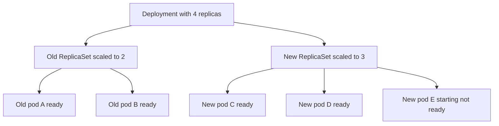

# Kubernetes Workloads

A **workload** is a Kubernetes object that says "keep this many copies of this program running, and here is how to change them". Your pipeline ends by handing Kubernetes an image; a workload object is what turns that image into running, supervised, replaceable processes. This note builds the stack from the bottom — pod, ReplicaSet, Deployment — by asking at each level what the level below could not do, then covers the four other shapes (StatefulSet, DaemonSet, Job, CronJob) that exist because "N identical interchangeable copies" is the wrong model for some work. How the pods then get addresses and traffic is [[Kubernetes Networking]]; what the control plane does behind the scenes is [[Kubernetes Architecture]].

## The problem that created it

A container ([[Docker and Container Images]]) is a process with a fence around it, and nothing more. Run one on one machine with `docker run` and you have exactly one copy, on exactly one host, supervised by nobody. Production asks three things of that process that the container itself cannot answer:

1. **"Keep N copies running."** One copy is a single point of failure and a capacity ceiling. Something has to know the number you want and keep reality at that number.
2. **"Replace them when they die."** Processes crash, nodes lose power, spot capacity is reclaimed. A container whose host vanished does not restart itself elsewhere; somebody has to notice the absence and create a replacement.
3. **"Update them without downtime."** Replacing version 1 with version 2 by hand means stop-then-start, which is an outage by construction. Doing it safely means starting new copies, waiting until they are actually ready, and only then removing old ones — a procedure, not a command.

Kubernetes' answer is not a smarter container. It is a stack of **controllers**: small programs that run in a loop comparing the **desired state** you declared ("3 copies of this pod template") with the **observed state** of the cluster ("2 exist") and acting to close the gap — creating a pod, deleting one, waiting. This reconcile-forever idea is the whole design; every workload object is a different desired state paired with a controller that enforces it. The lineage is Google's internal Borg and Omega systems, which the Kubernetes designers described publicly in 2016 as the ancestry of the pod (Borg's "alloc"), labels (a lesson from Borg's numbered tasks, not a Borg feature), and the reconcile-loop controller.

The stack grew in layers, each fixing what the previous could not. A **pod** gives you a co-scheduled unit — but a pod alone dies and stays dead. A **ReplicaSet** keeps N pods alive — but cannot change them: edit its template and the running pods are untouched. A **Deployment** manages ReplicaSets so a template change becomes a controlled handover from an old set to a new one. (The original controller was the ReplicationController; ReplicaSet replaced it with richer selectors, and the `apps/v1` Deployment API reached general availability in Kubernetes 1.9, December 2017.) The other four kinds exist because Deployment's model quietly assumes replicas are anonymous, long-running, and one-per-service — assumptions databases, node agents, and batch work break.

## What it solves

- **Self-healing at the pod level**: a pod that disappears for any reason is replaced to restore the declared count, without a human or a script.
- **Declarative scale**: you change a number (`replicas`) or a template, not a procedure; the controller works out the steps.
- **Safe change**: updates move through a new ReplicaSet while the old one stays intact, so a bad release is a re-pointing, not a rebuild.
- **Right model per workload**: identity and storage for stateful replicas, one-per-node for agents, run-to-completion for batch — instead of forcing everything through "N anonymous copies".
- **Inspectable history**: revisions, rollout status, and conditions are objects you can query, so "what changed and is it done?" has an answer in the API.

## How it works

### The pod: smallest schedulable unit

A **pod** is one or more containers that Kubernetes always places on the same node and runs together, sharing a network namespace (one IP, one port space, `localhost` between them) and optionally volumes. Kubernetes schedules pods, not bare containers, because some helpers must be co-located with the app — that is the whole argument in [[Sidecar Pattern]]. Most pods have one app container; regular init containers run to completion, in order, before it starts (the exception is a native sidecar — an init container with `restartPolicy: Always`, stable since Kubernetes 1.33 in 2025 — which keeps running; see [[Sidecar Pattern]]).

Three properties matter more than the syntax:

- **A pod is bound to one node for its entire life.** It never moves. "Rescheduling" always means a *new* pod — new name, new UID, new IP — created by a controller. The IP is assigned when the pod is created and dies with it, which is why nothing should address a pod directly (the problem [[Kubernetes Networking]] solves).
- **Container restart is not pod replacement.** If a container exits, the kubelet (the node's agent) restarts it *in place* — same pod, same IP, same node — according to the pod's `restartPolicy` (`Always` by default, or `OnFailure`, or `Never`). A Deployment only allows `Always`; Jobs require `OnFailure` or `Never`.
- **A bare pod has no supervisor above the kubelet.** If its node dies, the pod is simply gone. Controllers exist to supply that missing supervisor.

The pod's `status.phase` is a coarse summary and is less informative than people expect:

| Phase | Meaning | What it hides |
|---|---|---|
| Pending | Accepted by the API server, but not yet running — waiting for a node, pulling images, creating containers | "Stuck Pending" is usually scheduling (no node fits) or image pull; read the Events |
| Running | Bound to a node and at least one container running or starting or restarting | A crash-looping pod is still phase Running |
| Succeeded | All containers exited 0 and will not restart | Only run-to-completion pods reach it |
| Failed | All containers ended, at least one in failure | Evicted pods land here too |
| Unknown | The node could not be reached, so state is unknown | Usually a node problem, not a pod problem |

What `kubectl get pods` prints in the STATUS column (`CrashLoopBackOff`, `Terminating`, `ImagePullBackOff`, `Completed`) is *derived* from container states and metadata, not the phase. The detail lives per container in one of three **states**: `Waiting` (with a reason such as `ContainerCreating`, `ImagePullBackOff`, `CrashLoopBackOff`), `Running`, or `Terminated` (with a reason such as `Completed`, `Error`, `OOMKilled`, plus an exit code). Kubernetes keeps the *previous* termination in `lastState`, which is the single most useful field when debugging a restart loop. Separately, the pod's `Ready` **condition** is what Services watch (see [[Health Checks and Service Discovery]]).

### The ReplicaSet: N matching pods, nothing more

A **ReplicaSet** has three fields that matter: a label **selector**, a pod **template**, and a **replicas** count. Its controller counts pods whose labels match the selector; too few, it creates pods from the template; too many, it deletes some. That is its entire job. It identifies "its" pods by label match plus an owner reference, which is why overlapping selectors across controllers cause confusing fights.

Two limits explain everything above it. First, it **does not update existing pods**: change the template and only *future* pods use it. Second, its replacement is only as fast as the signal it receives. When a node goes silent, the control plane marks it unreachable and, by documented default, pods get a 300-second toleration before eviction (an admission controller adds it), so a replacement for a pod on a dead node can take on the order of five minutes unless the cluster tunes that. You almost never create a ReplicaSet by hand.

### The Deployment: declarative updates by swapping ReplicaSets

A **Deployment** owns ReplicaSets. Each distinct pod template gets its own ReplicaSet, named `<deployment>-<hash of the template>`, and the pods it creates carry a `pod-template-hash` label so ReplicaSets never claim each other's pods. Only a change to `.spec.template` triggers a rollout; changing `replicas` just scales the current ReplicaSet.

A rollout, for the default `RollingUpdate` strategy, is a controlled handover. The controller scales the **new** ReplicaSet up and the **old** one down in alternating steps, bounded by two knobs:

- **`maxSurge`**: how many pods *above* the desired count may exist during the rollout. Default 25%, rounded **up**.
- **`maxUnavailable`**: how many pods *below* the desired count may be not-available. Default 25%, rounded **down**.

Either can be an absolute number or a percentage of `replicas`, and they cannot both be zero. The other strategy, `Recreate`, kills every old pod before creating any new one — an outage by design, useful only when two versions must never coexist. A new pod counts toward availability only once it is **Ready** (and, if set, has stayed ready for `minReadySeconds`, default 0), which is how readiness gates a rollout.

Read the picture as a snapshot mid-rollout with 4 replicas and the defaults: surge allows 5 pods in total (4 + 1), and unavailability allows 1 below target, so at least 3 must be Ready. Here 4 are Ready, one above the floor of 3, so the controller may remove one more old pod straight away (4 pods, 3 Ready: at the floor, one under the cap) and scale the new ReplicaSet to its full 4; after that it is at both the floor and the cap, and must wait for new pods to report Ready before going further. The single-replica rounding consequences — default percentages become surge 1 and unavailable 0, and the explicit `maxUnavailable: 1, maxSurge: 0` alternative is a planned outage — are worked through in [[Graceful Shutdown and Deployment Safety]] and [[Deployment Strategies]]; they are not repeated here.

**History and rollback.** Old ReplicaSets are not deleted when superseded; they are scaled to zero and kept, up to `revisionHistoryLimit` (default 10). `kubectl rollout history` lists them, `kubectl rollout status` watches a rollout, and `kubectl rollout undo` (optionally `--to-revision=N`) performs a **rollback**. Understand what that really is: not a time machine, but another rollout whose *target template happens to equal an old ReplicaSet's*. The Deployment's template is set back to that old template, the controller finds the matching ReplicaSet (still holding its definition), and scales it up while scaling the current one down at the same `maxSurge` and `maxUnavailable` pace. The re-activated ReplicaSet gets a new, higher revision number. Three consequences follow: only template changes roll back (not `replicas`, not a ConfigMap, not a database migration — see the expand-and-contract discussion in [[Deployment Strategies]]); the old image must still exist in the registry; and with `revisionHistoryLimit: 0` there is nothing to roll back to. `kubectl rollout restart` forces a rollout with no template edit by stamping an annotation into the template.

If a rollout stops making progress for `progressDeadlineSeconds` (default 600), the Deployment's `Progressing` condition flips to `False` with reason `ProgressDeadlineExceeded`. **Kubernetes does not roll back automatically**; it reports the failure and leaves the half-finished state for you or your pipeline to act on.

### StatefulSet: stable identity and storage per replica

A Deployment's pods are **fungible**: any pod can be replaced by any other, and a new pod starts with an empty slate. That is exactly wrong for a database node or a Kafka broker, where "broker 2" owns specific data and other nodes address it by name. A **StatefulSet** supplies what those need:

- **Stable names**: pods are `name-0`, `name-1`, `name-2`, and a replacement for `name-1` is again `name-1`.
- **Stable storage**: a `volumeClaimTemplates` section creates one PersistentVolumeClaim per pod, re-attached to the same ordinal after rescheduling. Scaling down or deleting the StatefulSet does not delete these volumes by default, because data safety outranks tidiness. On EKS, an EBS-backed volume lives in **one availability zone**, so the pod can only be scheduled in that zone.
- **Stable network identity**: paired with a **headless Service** (named in `serviceName`), each pod gets its own DNS name — see [[Kubernetes Networking]].
- **Ordered operation**: with the default `podManagementPolicy: OrderedReady`, pods start in ascending order, each waiting for the previous to be Running and Ready; **rolling updates always proceed in reverse ordinal order** (highest first), one pod at a time by default; a StatefulSet `maxUnavailable` field (beta since 1.35, December 2025; on by default in 1.37 (2026) after being switched off again for 1.35.4 through 1.36, so check your version) can widen that. A `partition` setting holds back lower ordinals for staged rollouts.

A StatefulSet gives *identity*, not *replication*: it will faithfully keep `mongo-1` and its disk together, but making `mongo-1` a correct replica of `mongo-0` is the database's job ([[Consensus and Raft]], [[Replication]]). That gap is why running a datastore by hand on a StatefulSet is a real operational commitment, and why teams use an operator or a managed service ([[Stateless vs Stateful Services]] has the principle).

### DaemonSet: one pod per node

A **DaemonSet** keeps exactly one pod on every node (or every node matching a selector), and adds one automatically when a node joins. It is the right shape when the thing is about the *node*, not the *app*: log shippers ([[Logs Metrics and Traces]]), node metrics agents, and the networking plumbing itself — on EKS, `aws-node` (the VPC CNI) and `kube-proxy` run as DaemonSets in `kube-system` on EC2 nodes (not on Fargate). [[Sidecar Pattern]] makes the cost argument for a per-node agent over a per-pod sidecar.

### Job and CronJob: run to completion

A **Job** runs pods until a required number finish successfully, then stops; its pod template must use `restartPolicy: OnFailure` or `Never`. `backoffLimit` (default 6) caps retries, with an exponentially growing delay between failed attempts capped at six minutes; `activeDeadlineSeconds` caps total runtime; `ttlSecondsAfterFinished` cleans up. Exceeding `backoffLimit` marks the Job failed rather than retrying forever.

A **CronJob** creates Jobs on a cron schedule. `concurrencyPolicy` decides what happens when a run is still going at the next tick: `Allow` (default, overlapping runs), `Forbid` (skip the new run), or `Replace` (kill the old, start the new). Its `timeZone` field (stable since Kubernetes 1.27, 2023) pins the schedule's clock; without it the schedule follows the controller manager's local time. Per the Kubernetes docs, a CronJob can in some circumstances create more than one Job for a scheduled time, or none — so the work inside must be idempotent ([[Idempotency]]).

### Choosing

| Workload | Replicas are | Reach for it when | Example |
|---|---|---|---|
| Deployment | Interchangeable and anonymous | Stateless service; any replica serves any request | A Spring Boot API |
| StatefulSet | Individually named, each with its own disk | Each copy has identity or its own data | A self-run Kafka or database node |
| DaemonSet | One per node | The workload is about the node | Log shipper, CNI, node metrics agent |
| Job | Run to completion | Finite batch work | A backfill or one-off migration |
| CronJob | Jobs on a schedule | Recurring finite work | A nightly reconciliation |

## Trade-offs

| You get | You pay |
|---|---|
| Self-healing and declarative scale | Convergence is eventual and takes time; a replacement for a lost node is not instant |
| Rollback is cheap (an old ReplicaSet is kept) | Rollback covers the pod template only — config, data, and schema do not roll back |
| Zero-downtime updates *if* readiness is honest | Rollout safety is only as good as the readiness probe; a Ready-but-broken pod completes the rollout |
| Right-shaped objects for stateful, per-node, and batch work | More object kinds, each with distinct update, failure, and immutability rules |
| Rollout pace tunable with two knobs | Surge needs spare cluster capacity for the extra pods; a rollout can stall on scheduling, not just on your code |
| One uniform API for all of it | Immutable fields (selectors, volume claim templates) turn some "small edits" into delete-and-recreate |

## Failure modes

- **CrashLoopBackOff.** This is a container *Waiting* reason, not a phase: the container started, exited, and the kubelet is waiting before the next restart. The documented back-off is exponential — 10s, 20s, 40s, up to a cap of five minutes — reset after the container runs 10 minutes without trouble. Two feature gates change this (2025): `KubeletCrashLoopBackOffMax` (beta and on by default since 1.35) lets a node cap the delay lower, and the alpha `ReduceDefaultCrashLoopBackOffDecay` (since 1.33) shortens the curve to 1s-to-60s — so confirm what your nodes run. Diagnose in order: `kubectl get pod` (RESTARTS count), `kubectl logs --previous` (the *crashed* instance's output, which the current instance does not have), `kubectl describe pod` (`Last State`, `Reason`, `Exit Code`, and Events). Exit code 1 is the application dying; 137 is SIGKILL; 143 is SIGTERM; 126 or 127 usually mean the entrypoint cannot be executed or found.
- **OOMKilled versus a liveness kill.** Both can show exit code 137, so the code alone does not tell you which. `OOMKilled` as the *reason* means the kernel killed the container for exceeding its memory limit — a cgroup limit, not `java.lang.OutOfMemoryError`, which is the JVM running out of *heap* and is a different failure (see [[Kubernetes Configuration and Resources]] for limits). A liveness kill shows up in Events as a failed liveness probe, with the container then terminated by SIGTERM and, if it ignores that past the grace period, SIGKILL. Fix the first by sizing memory (or capping heap below the limit); fix the second by loosening or correcting the probe ([[Health Checks and Service Discovery]]).
- **Rollout stuck because the new pod never becomes Ready.** The Deployment keeps old pods per `maxUnavailable`, so users usually keep being served, but `kubectl rollout status` hangs and, after `progressDeadlineSeconds`, reports `ProgressDeadlineExceeded` with no automatic rollback. Find where the new pod stopped: `Pending` with "Insufficient cpu/memory" in Events means the surge pod has nowhere to run (cluster growth is [[Autoscaling]]); `ImagePullBackOff` means a wrong tag or no registry access; `CrashLoopBackOff` means it starts and dies; Running-but-not-Ready means the readiness probe never passes.
- **Selector immutability surprises.** A Deployment's `.spec.selector` cannot be changed after creation (`apps/v1`), and the pod template's labels must match it. The classic trap: a Helm chart change adds a label (a version, a release name) to the *selector*, and `helm upgrade` fails with a "field is immutable" error. The fix is delete-and-recreate (with downtime planning) or a new Deployment alongside. Conversely, two controllers with overlapping selectors fight over pods, and relabeling a live pod detaches it from its ReplicaSet, which promptly creates a replacement.
- **A StatefulSet that will not roll.** With `OrderedReady`, if the updated pod never becomes Ready the rollout stops and waits — deliberately, to protect quorum. The catch from the Kubernetes docs: reverting the template is *not* enough, because the controller keeps waiting on the broken pod; you must also delete the pods that ran the bad configuration so they are recreated from the good one. StatefulSets have no `progressDeadlineSeconds`, so nothing times out and nothing alerts unless you wire it.
- **Failed pods piling up.** Node-pressure evictions leave pods in phase Failed until garbage-collected; the controller has already replaced them. Noise, not an outage — but it confuses anyone reading `kubectl get pods` cold.
- **CronJob overlap and double-processing.** With the default `Allow`, a run that outlasts its interval is joined by the next one. For work that must not run twice concurrently (settlement files, reconciliation), set `Forbid` and make the job idempotent — the scheduler guarantees neither exactly-once nor never-twice.

## When NOT to use it

- **A bare pod** for anything that must keep running — it has no supervisor. Reasonable only for a one-off debugging session.
- **A ReplicaSet directly** — you lose rolling updates and rollback for nothing. Use a Deployment.
- **A Deployment for work with identity or per-replica storage.** Two "replicas" of a database sharing a Deployment get no stable names and no stable disks.
- **A StatefulSet when a managed service exists.** If you do not have a strong reason to run the datastore yourself, a StatefulSet buys you the full operational burden — backups, upgrades, zonal volumes, quorum repair — for no product value.
- **A DaemonSet for per-app work** — it scales with nodes, not load, and runs wherever the nodes are.
- **A CronJob for exactly-once, sub-minute, or dependency-ordered work.** Schedules fire approximately and can duplicate; use a queue consumer ([[Why Async Messaging Exists]]) or a workflow engine, with the idempotent handler regardless.
- **A Job for a long-lived consumer.** A queue consumer that should run forever is a Deployment, not a Job that never completes.

## In your stack

- **A Spring Boot service on a Deployment at one replica** is the normal Bharat shape — replicas are pinned at 1 as a cost decision. A rollout there: your pipeline ([[The Deployment Pipeline]]) pushes the image to ECR and the Deployment's image changes, which changes the pod template and creates a new ReplicaSet. The surge pod needs spare node capacity for a second copy, an image pull, a JVM boot, and a passing readiness probe; if it never gets Ready, the old pod keeps serving and you see `ProgressDeadlineExceeded` rather than an outage. Whether the old pod really waits depends on the strategy — the one-replica rounding is in [[Graceful Shutdown and Deployment Safety]] — so check the rendered object with `kubectl get deploy <name> -o jsonpath='{.spec.strategy}'`.
- **Facets renders the Deployment; the object in the cluster is output, not source.** Facets produces the Helm chart that creates the Deployment, and it silently drops misspelled keys and fixes the probe threshold — the spellings and the PodDisruptionBudget rule are in [[Graceful Shutdown and Deployment Safety]], the `period × 10` probe arithmetic in [[Health Checks and Service Discovery]]. What that arithmetic means for a *rollout* is two separate clocks: a container that fails its startup or liveness probe is killed once its probe budget is spent, while a pod that merely never turns Ready is left running and unready until `progressDeadlineSeconds` marks the rollout failed. The rule for workloads: read the live objects (`kubectl get deploy <name> -o yaml`, `kubectl get pdb`), never trust the Facets JSON.
- **`imagePullPolicy`.** The default is `IfNotPresent`, except that a tag of `:latest` (or no tag) defaults to `Always`. With unique tags per build (a commit SHA or build number — confirm in [[The Deployment Pipeline]] and [[Container Registries and ECR]]), `IfNotPresent` is correct and fastest. If a tag is ever reused, `IfNotPresent` can start a stale cached image, `Always` still resolves the tag each start (layers are cached, so it is cheap), and pinning a digest is the robust fix. And a reused tag changes nothing in the pod template, so no rollout happens at all until `kubectl rollout restart`.
- **A "successful" rollout does not mean a working service.** The Deployment controller knows only that the new pod passed readiness. Your readiness is deliberately shallow at one replica (it must not gate on Mongo or Redis), so a build that is missing `aws-java-sdk-sts` — needed for `authMechanism=MONGODB-AWS` under IRSA, and imported by no source file — yields a pod that is Running, Ready, rollout complete, and returning 500 on every Mongo-backed endpoint. Builds stay green too. The only catch is a post-deploy check that exercises a Mongo-backed endpoint; at one replica, the deploy *is* the canary ([[Deployment Strategies]]).
- **OOMKilled on a JVM.** Container-aware JDKs read the memory limit from cgroups: JDK 10 and 8u191 (2018) did so for cgroup v1 only, and cgroup v2 support needs JDK 15, 11.0.16 or 8u372 (2020–2023) — which matters if your nodes run Amazon Linux 2023, where cgroup v2 is the default (confirm your node AMI family; EKS stopped publishing AL2 AMIs in November 2025). On a container-aware JDK the default maximum heap (`MaxRAMPercentage` 25) is a quarter of the container's memory limit, and heap is not the whole process (metaspace, thread stacks, direct buffers also count), so a service can be killed by the kernel while the heap looks fine. Flags such as `-XX:MaxRAMPercentage` can be injected without rebuilding the image through the `JAVA_TOOL_OPTIONS` environment variable. Check `Last State` in `kubectl describe pod` before touching any code.
- **Stateful pieces.** Which of your datastores run in-cluster as StatefulSets versus as managed services outside it is a fact to confirm (`kubectl get statefulsets -A`), not assume; the Spring Boot services themselves are stateless Deployments.

## Interview angle

**The 60-second version, Deployment vs StatefulSet:** "A Deployment manages stateless, interchangeable pods: it creates a ReplicaSet per pod template, rolls out by scaling the new set up and the old set down within `maxSurge` and `maxUnavailable`, and rolls back by re-activating an old ReplicaSet. Pods get random names and new IPs, any pod can serve any request, and storage is ephemeral or shared. A StatefulSet is for replicas that are not interchangeable: stable names like `db-0`, a PersistentVolumeClaim per pod that follows the ordinal, a headless Service for per-pod DNS, and ordered start and reverse-ordered rolling updates. The trade is that StatefulSets update slowly, can wedge when a pod is unhealthy, and give you identity but not replication — the database still has to replicate itself. Default to a Deployment, and use a StatefulSet only when each replica genuinely owns something."

Classic follow-ups: "What does a rollback actually do?" (re-points the Deployment at an old ReplicaSet's template; only the template reverts); "Why does a Deployment manage ReplicaSets rather than pods directly?" (a ReplicaSet cannot change its pods, and keeping the old one around makes rollback and gradual handover possible); "My pod is in CrashLoopBackOff — what do you do?" (`logs --previous`, then `describe` for exit code and reason); "What happens at one replica on rollout?" (surge-first handover with the defaults, but verify the strategy); "Why can't I change a Deployment's selector?" (immutability; selectors define ownership).

Senior tell: separating three layers on sight — the container restarting in place, the ReplicaSet replacing a pod, and the Deployment replacing a ReplicaSet — and saying which one is acting when something fails.

## Check yourself

> [!question]- Q: Explain why a Deployment owns ReplicaSets instead of one controller that edits pods in place.
> A ReplicaSet only maintains a count of pods matching a selector and never updates pods that already exist, so a template change cannot be applied to it in place. The Deployment solves this by giving each distinct pod template its own ReplicaSet and shifting replicas from the old one to the new within `maxSurge` and `maxUnavailable`, gating each step on pods becoming Ready. The old ReplicaSet is kept at zero replicas, which is what makes rollback a re-scaling rather than a rebuild.

> [!question]- Q: Scenario — you run `kubectl rollout undo` after a bad release, but the pods go into ImagePullBackOff. What happened, and what class of mistake caused it?
> Rollback re-activates the previous ReplicaSet, which still references the previous image; the pods are new and must pull that image again. If the registry no longer has it — for example a lifecycle policy expired old images, or the tag was overwritten or deleted — the pull fails. The mistake is treating rollback as self-contained: it restores the pod template, not the artifacts the template points to. Registry retention must outlive your rollback window ([[Container Registries and ECR]]), and unique, immutable tags make the old image reliably recoverable.

> [!question]- Q: Scenario — a Spring Boot pod restarts every few hours with exit code 137, and the team wants to "fix the memory leak". What do you check first, and what two different causes share that exit code?
> Run `kubectl describe pod` and read `Last State`. Exit 137 means SIGKILL, which has two sources: the kernel OOM killer (reason `OOMKilled`, a container memory-limit breach — heap plus metaspace, threads, and direct buffers, not necessarily a Java heap leak) or the kubelet escalating after a failed liveness probe and an ignored SIGTERM (reason `Error`, with a liveness failure in Events). The first calls for memory sizing or a lower heap cap; the second for a probe fix. Only after the reason is known does a leak investigation make sense.

> [!question]- Q: Scenario — you upgrade a StatefulSet with a bad image. Pod `db-2` (the first to be updated) never becomes Ready, so you revert the image, but nothing happens. Why, and what do you do?
> With `OrderedReady` the controller updates the highest ordinal first and will not move on until that pod is Running and Ready, and it keeps waiting on the broken pod even after the template is reverted — a documented limitation. Nothing times out, because StatefulSets have no progress deadline. The fix is manual: after reverting the template, delete the pod that ran the bad configuration so it is recreated from the good template, then let the ordered rollout continue. The deliberate pause is protecting quorum; the cost is that recovery needs a human.

> [!question]- Q: Mini-design — choose the workload type for each of these on your cluster: a Spring Boot payments API, a nightly settlement-file reconciliation, a log shipper, and a three-node Kafka cluster. State one setting that matters for each.
> Payments API: Deployment, with a readiness probe that does not gate on shared datastores at one replica and a surge-first rollout. Nightly reconciliation: CronJob with `concurrencyPolicy: Forbid`, an explicit `timeZone`, a `backoffLimit`, and an idempotent handler because the schedule can duplicate or skip. Log shipper: DaemonSet, so there is one per node rather than one per pod. Three-node Kafka: StatefulSet with `volumeClaimTemplates` and a headless Service — or, better, a managed service unless you have a reason to carry the zonal-volume and quorum-repair burden; if run in-cluster, spread across zones and mind that each EBS volume pins its pod to one zone.

## Sources

- Kubernetes documentation: Pods, Pod Lifecycle, ReplicaSet, Deployments, StatefulSets, DaemonSet, Jobs, CronJob, and Images (`imagePullPolicy`).
- Kubernetes documentation: "Taint-based eviction" (default 300-second toleration) and "Debug Running Pods" (exit codes, `lastState`).
- Brendan Burns, Brian Grant, David Oppenheimer, Eric Brewer, John Wilkes, "Borg, Omega, and Kubernetes" (ACM Queue, 2016) — lineage of pods (Borg allocs), labels, and the reconcile-loop controller model.
- Kubernetes 1.9 release announcement (December 2017) — workloads `apps/v1` general availability.
- Kubernetes blog and release notes for 1.27 (2023) — CronJob `timeZone` stable; Kubernetes feature-gate reference (checked 2026-10 against 1.37) for `KubeletCrashLoopBackOffMax`, `ReduceDefaultCrashLoopBackOffDecay`, `MaxUnavailableStatefulSet` and `SidecarContainers`.
- OpenJDK JDK-8146115 (container support, JDK 10 and 8u191) and JDK-8230305 (cgroup v2, JDK 15, 11.0.16, 8u372); Amazon EKS user guide, "Upgrade from Amazon Linux 2 to Amazon Linux 2023" (cgroup v2, AL2 AMIs ended November 2025).
- Amazon EKS documentation — EBS CSI driver and zonal volume behavior; VPC CNI (`aws-node`) as a DaemonSet.
