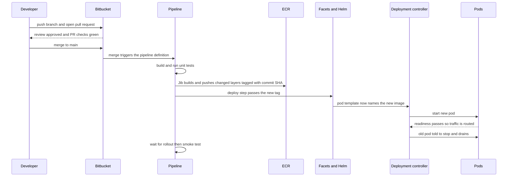
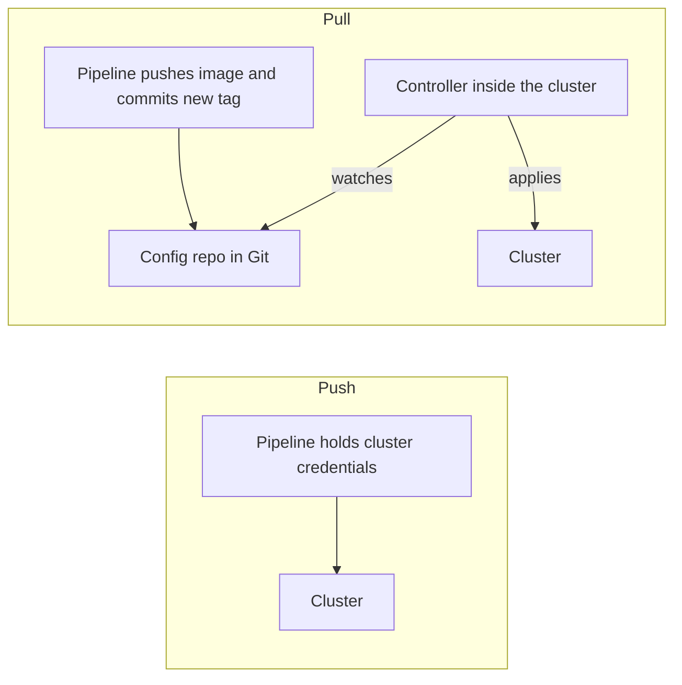

# The Deployment Pipeline

A **deployment pipeline** is the automated path that carries one commit from a developer's branch to pods serving real traffic. The tools are the least interesting part; the *shape* is what to learn: a sequence of gates, each of which turns "some code" into a more trustworthy and less changeable artifact, until the thing that finally runs is byte-for-byte the thing that was tested. Your pipeline is commit, Bitbucket Pipelines, Jib, ECR, EKS. This note is the spine of Module 17: it traces one commit through all of it and points at the notes that zoom into each hop ([[Jib]], [[Container Registries and ECR]], [[Kubernetes Workloads]]).

## The problem that created it

The pipeline is the end of a story with four acts, and each act is a disaster that a later stage of the pipeline exists to prevent.

1. **The laptop release.** Someone builds the JAR on their own machine — their JDK, their half-updated local Maven repository — copies it to a server, and restarts the service by hand. Nobody can reproduce that build, nobody can say exactly what is running, and the release is stressful enough that it happens rarely. Rare releases mean big releases, big releases carry more risk, and more risk makes people release even less. That loop is the real enemy, not any single bad deploy.
2. **Integration hell.** Branches live for weeks, nobody knows whether the combination of everyone's work compiles, and merging is an event. **Continuous integration** is the answer: merge small and often into one shared line of code, and have a machine build and test every merge so "main is broken" is discovered in minutes rather than at release time.
3. **The manual tail.** Once builds are automated, the *deploy* is still a runbook: SSH, `kubectl` from someone's laptop with whichever credentials they happen to hold. In a regulated fintech that is an audit problem before it is an engineering one — who changed production, when, and what exactly did they put there? **Continuous delivery** closes it: every merge yields a deployable, versioned artifact, and deploying it is a repeatable action by a machine, not a ritual by a person.
4. **Automation ships bad changes faster.** A pipeline can push a broken build to production quicker than any human could. So the real design work is in three properties: **gates** (tests, review, readiness checks stop bad changes), **immutability** (what was tested is exactly what runs), and **reversibility** (undoing a bad release is quick and rehearsed). The term *deployment pipeline* was popularised by Humble and Farley's *Continuous Delivery* (2010); it is those three properties made cheap.

## What it solves

- **Reproducibility** — the same commit builds the same way on a clean machine that is not yours, so "works on my machine" stops being a defence.
- **Provenance** — every running pod can be traced to an image tag, a commit, a pull request, an approver and a pipeline run. In a regulated business that chain is evidence, not decoration.
- **Small, boring releases** — frequent small changes have a small blast radius and a short list of suspects when something breaks.
- **Gates that don't get tired** — tests, review and checks run every time, including at 2 a.m. on a Friday.
- **Credential hygiene** — production access lives in one controlled system with an audit log, not on forty laptops.
- **A rehearsed rollback** — a deploy path that runs daily is a deploy path known to work, so the emergency path is the everyday path.

## How it works

### Vocabulary: CI, delivery, deployment

**CI** (continuous integration) means merge and automatically build and test. **Continuous delivery** means every change that passes is *releasable*, and a human decides when to release. **Continuous deployment** removes the human: every passing change goes to production. People say "CD" for both and mean different things; ask which one is meant. Teams that move money usually choose delivery to production with a recorded approval, and deployment (no human) for lower environments — a design choice to settle with whoever owns change management, not a rule.

### One commit, end to end



**1. Branch, pull request, review.** Machines check *behaviour*; only a reviewer checks *intent* — whether this is the change the system should have. The PR is also where cheap checks run before merge: Bitbucket Pipelines has a `pull-requests` section, which merges the destination branch into the PR branch before it runs (Bitbucket docs, 2026), so tests see the code as it will look after the merge and `main` stays green. Repository settings can make approvals and a passing build *required* for merge (merge checks, set under the repository's branch restrictions) — but on Bitbucket Cloud, actually *blocking* the merge ("Prevent a merge with unresolved merge checks") is a Premium-plan feature; on other plans the checks only warn (Bitbucket docs, 2026). A gate that is optional is not a gate, so know which plan you are on.

**2. The pipeline definition.** A file named `bitbucket-pipelines.yml` at the repository root declares what runs on which event. Six concepts cover almost everything in it (Bitbucket docs, 2026). A **pipeline** is one run, started by an event: a push to a branch (`branches`), a pull request (`pull-requests`), a tag (`tags`), the catch-all `default`, or by hand on demand (`custom`). A **step** is a unit of work, and each step starts in a *fresh container* from the Docker image you name and a fresh clone of the repo (shallow, depth 50 by default), so steps share nothing implicitly — isolation on purpose, so a step cannot pass only because an earlier step left debris behind. A **cache** is a directory saved after a step and restored in later runs to skip re-downloading, such as the local Maven repository; it is *only an optimisation* (1 GB compressed, expires after 7 days of inactivity, may be cleared at any time), so a pipeline that works only with a warm cache is broken. An **artifact** is a file a step produces and hands to later steps of the same run (1 GB each): caches are for things you download, artifacts are for things you build. A **pipe** is a prepackaged script in a Docker container, invoked with `pipe:` and a version, that wraps a task like pushing to a registry; Atlassian's own pipes are public, so pin the version and read the source of what you are handing your credentials to. A **deployment environment** (`deployment:` on a step) gives the step that environment's own variables and deploy history.

```yaml
# Illustrative shape only, not your real file. deploy.sh and the smoke script are placeholders.
definitions:
  caches:
    m2: ~/.m2/repository
pipelines:
  pull-requests:
    '**':
      - step:
          name: Test
          caches: [m2]
          script:
            - mvn -B verify
  branches:
    main:
      - step:
          name: Test, build image, push
          caches: [m2]
          script:
            - mvn -B verify jib:build -Djib.to.image="$ECR_REPO:$BITBUCKET_COMMIT"
      - step:
          name: Deploy to staging
          deployment: staging   # environment names are defined in repository settings
          script:
            - ./deploy.sh staging "$BITBUCKET_COMMIT"
            - ./wait-and-smoke-test.sh staging
```

**3. Build and unit tests.** Compile and test *before* building an image, so a red build never produces a registry entry that someone could mistake for a candidate. Putting tests and image build in one step is simplest; splitting them gives cleaner logs and retries but means passing `target/` as an artifact.

**4. The image.** Production needs a unit that carries the application *and* its runtime — JRE, OS libraries — so what ran in test is what runs in prod ([[Docker and Container Images]]). [[Jib]] builds that image from the Maven build with no Docker daemon and pushes only the layers the registry does not already hold.

**5. Tag by commit SHA.** The tag is the *identity* of what you ship. Bitbucket exposes the commit hash as `BITBUCKET_COMMIT`; tagging with it means `git show <tag>` answers "what code is this?" with no lookup table. Contrast `latest` or `v1`: **tags are movable labels**, whereas a **digest** (`sha256:...`) is a hash of the image's contents and cannot point at anything else (Kubernetes docs). Registry mechanics are in [[Container Registries and ECR]].

**6. Deploy is an edit to desired state.** Kubernetes is declarative: you never "run the new version", you change the Deployment's *pod template* so that its `image:` names the new tag, and the platform converges. A rollout starts if and only if `.spec.template` changes (Kubernetes docs) — scaling replicas does not trigger one. Three common ways the edit gets made: the pipeline runs `kubectl set image` with cluster credentials; the pipeline hands the tag to a templating layer that re-renders and applies a Helm release (your case: the deploy step passes the new tag to Facets, which renders the chart — the exact call is in the last step of your own pipeline file); or the pipeline commits the tag to a Git repo and a controller in the cluster applies it (GitOps, below).

**7. Rolling rollout.** The Deployment controller creates a new ReplicaSet for the new template and shifts pods across within `maxSurge` and `maxUnavailable` (both default to 25%, Kubernetes docs); mechanics are in [[Kubernetes Workloads]], what those percentages round to at one replica is in [[Deployment Strategies]], and why the surge-first shape matters at one replica is in [[Graceful Shutdown and Deployment Safety]].

**8. Readiness gates traffic.** A new pod receives requests only after its readiness probe passes ([[Health Checks and Service Discovery]]). A deploy step that ends at "manifest applied" is lying green: the honest end is `kubectl rollout status`, which waits for the rollout and exits non-zero if the Deployment exceeds its progress deadline.

**9. Old pods drain.** Once the new pod is ready, the old one is stopped: SIGTERM, drain in-flight requests, exit — the choreography in [[Graceful Shutdown and Deployment Safety]]. A rollout that ends here and then smoke-tests the new version is a finished deploy; one that ends earlier is a guess.

### Build once, promote the same image

Environments (dev, uat, prod) should differ in **configuration**, never in the image. If prod gets a *rebuilt* image, what was tested in uat is not what runs in prod even from the identical commit — a rebuild can pick up a moved base-image tag or a newer dependency. So the artifact is built once, tagged by SHA, and *promoted*: each environment's configuration references the same tag (ideally the same digest). Per-environment values — URLs, credentials, feature flags — are injected at deploy time ([[Kubernetes Configuration and Resources]]). Between environments sits a gate: automated (smoke tests pass) or a recorded human approval for prod. In Bitbucket terms that is a `deployment:` environment per stage, with `trigger: manual` on the prod step (or an on-demand `custom` pipeline) as the human gate. Manual steps run only in order, only after the previous step succeeded, only by users with write access, and never as a pipeline's first step; and because artifacts expire after 14 days, a manual step left waiting longer than that can no longer run (Bitbucket docs, 2026).

### CI and CD are different jobs

CI answers "is this commit good?" — a pure function of the code, safe to run unlimited times, needing read access to source and write access to a registry. CD answers "should this version run *there*, *now*?" — stateful, touching real environments, needing cluster credentials, ordering and approvals. They can be adjacent steps in one YAML file and still be separate concerns, and the seam between them is the image reference. Keeping the seam clean buys real things: re-deploy an old image without rebuilding, confine production credentials to one deploy identity, deploy in a change window, roll back without involving the build system.

### GitOps: pull instead of push



In **push-based** deploys the CI system holds credentials to the cluster and applies changes. That makes CI a high-value target (steal the pipeline, own production) and leaves nothing watching afterwards — if someone edits the cluster by hand, nothing notices. **GitOps** inverts it. The OpenGitOps principles (v1.0.0) are four: desired state is *declarative*; it is stored *versioned and immutable*; software agents *pull* it automatically; and agents *continuously reconcile* actual state toward it. In practice a controller inside the cluster — **Argo CD** and **Flux** are the two mainstream ones, both CNCF Graduated since late 2022 (Flux in November, Argo in December) — watches a Git repo of manifests or Helm values and makes the cluster match, undoing manual drift. A deploy becomes "merge a commit that changes the image tag", rollback becomes `git revert`, Git history *is* the deploy audit log, and cluster credentials never leave the cluster. The costs are real: a config repo (or path) to maintain beside the code repo, a controller to run and secure, and *indirect* feedback — the pipeline commits and moves on, so "did it actually deploy?" must be read back from the controller's sync status.

### Rollback is a roll-forward

`kubectl rollout undo` re-applies the pod template of a previous ReplicaSet — which exists only if it is still retained (`revisionHistoryLimit` keeps 10 by default). Read what that implies: it is a **new rollout** with the same mechanics and the same readiness wait as a forward deploy, so rollback is exactly as slow as deploying; it reverts only the pod template (not ConfigMaps, not database schema — migration ordering is in [[Deployment Strategies]]); and where a templating layer or GitOps controller owns desired state, a hand-run `undo` is a temporary override that the next render or sync can overwrite (an inference from how those layers work — check yours). The durable rollback is therefore the boring one: run the normal deploy path again with the *previous SHA*. That only works if immutable SHA tags still exist in the registry, which is why registry retention policies matter.

### Secrets never live in the pipeline file

The YAML is in Git: permanent history, visible to everyone who can read the repository, copied into every branch. Secrets enter at runtime instead. **Secured variables** (Bitbucket docs, 2026) are encrypted, masked in logs, and scoped by precedence — pipeline, then deployment, then repository, then workspace — so a production credential can exist *only* in the production deployment environment. Better still is *no stored secret*: with `oidc: true` a step receives a short-lived signed identity token (`BITBUCKET_STEP_OIDC_TOKEN`), and AWS exchanges it through `AssumeRoleWithWebIdentity` for temporary credentials for an IAM role whose trust policy can be narrowed to one repository or to deployment steps only. Compare a pasted IAM access key: it never expires, rotates by hand, and leaks through any log line. Masking works on the secret's text in log output (the docs mention URL-encoded variants), so other transformations such as base64 may print unmasked — an inference, so test it before relying on it. Application secrets such as database passwords should not travel through CI at all; the pod receives them at runtime.

## Trade-offs

| You get | You pay |
|---|---|
| Reproducible, auditable deploys | The pipeline becomes production-critical: when it is down you cannot ship the fix |
| Red build in minutes, not at release time | Build minutes, a test suite to maintain, and the flaky-test tax |
| One image proven across environments | Discipline: *every* environment difference must be external configuration |
| Credentials centralised in one place | That place is now a prime target; narrow roles and OIDC become mandatory |
| GitOps: drift correction, Git as audit log | A second repo, a controller to run, feedback that is indirect |
| Frequent small releases | Rollout safety and observability must be strong, because releases are cheap and constant |

**Cost shape:** pipeline cost scales with *runs × build minutes* (so with team size, test-suite duration and cache hit rate), registry storage with *builds × bytes in changed layers* (the reason [[Jib]]'s layering matters), and GitOps adds a fixed controller cost per cluster regardless of deploy volume.

## Failure modes

- **Flaky tests.** If 50 independent tests each fail spuriously 1% of the time, a run is green only about 0.99^50 ≈ 60% of the time. People respond by re-running until green, which teaches the team that red means nothing, and real failures get re-run away. Quarantine and fix flaky tests; never make "retry until green" the policy.
- **Image push auth.** Fails at the push, after the build is already green, in three flavours. No credentials found: 401 (Jib's FAQ: credential not picked up or misconfigured). Credentials valid but not permitted: 403/DENIED, typically a role missing one of the push actions. Expired credentials: an ECR authorization token is valid for 12 hours (AWS docs), so a login cached on a long-lived runner dies half a day later. With OIDC, a trust-policy `sub` condition that does not match the repository or deployment environment (the claim is `{repository UUID}[:{environment UUID}]:{step UUID}`, Bitbucket docs, 2026) fails earlier, at assume-role.
- **Mutable tag: prod runs something other than what was tested.** Three routes. The tag is moved after testing (`latest`, `v1`, a re-push). Or the tag is never re-pulled: for any tag other than `latest`, `imagePullPolicy` defaults to `IfNotPresent` and is fixed when the object is created (Kubernetes docs), so a node holding old bytes under that name keeps running them while a fresh node pulls the new ones — the "mix of old and new code" the docs warn about. Or each environment rebuilds. Fixes: SHA tags, ECR tag immutability (a re-push of an existing tag returns `ImageTagAlreadyExistsException`, AWS docs; since July 2025 a repository can also be `IMMUTABLE_WITH_EXCLUSION` with wildcard filters, so check that no exclusion matches your SHA tags), and deploying by digest where the platform allows it. One corollary to test rather than assume: re-running a failed pipeline for the same SHA against an immutable repository may fail on the push step.
- **A rollout that never becomes ready.** Crash loop, `ImagePullBackOff`, a probe that never passes. The Deployment's `progressDeadlineSeconds` defaults to 600, after which Kubernetes only *reports* `ProgressDeadlineExceeded` — it takes no action and keeps retrying. Whether users notice depends on whether the old pod is still serving (see [[Graceful Shutdown and Deployment Safety]] for the one-replica case). The pipeline must wait on `kubectl rollout status` and fail loudly; automatic rollback is something you build deliberately, not a default.
- **Rollback that is a roll-forward.** Covered above; the sharp version is a rollback of code onto a database schema that has already moved forward, or a previous tag that a retention policy already deleted.
- **Green pipeline, broken service.** A passing build proves it compiled and the unit tests passed; it does not prove runtime wiring (missing runtime-only dependency, wrong config, broken route). Gate on a post-deploy smoke test that exercises real behaviour.
- **Out-of-order deploys.** Two merges land minutes apart, two pipelines run concurrently, the older commit finishes last and overwrites the newer. Bitbucket's deployment concurrency control *pauses* a later pipeline that targets an environment with a deploy already in progress, to be resumed or rerun afterwards, and the `concurrency-group` step keyword (June 2025) runs steps sharing a group one at a time, first in first out (Bitbucket docs, 2026). Both prevent *overlap*, not *reordering*: the docs promise nothing about commit order, so a paused older run resumed later can still overwrite a newer one. Make the deploy step refuse a SHA older than what is live, or use GitOps, where order is Git order.
- **The pipeline as supply-chain target.** Unpinned pipe versions, base images and plugins mean yesterday's green build is not today's. PR-triggered pipelines run code from the branch under review, so they should not hold production-capable credentials; scope those to deployment steps, which OIDC trust policies can enforce.

## When NOT to use it

- **A multi-stage promotion ladder for a tiny system.** One service, one environment: a single-step pipeline is already a pipeline. Approvals and extra stages are cost; add one only when it prevents a failure you have actually seen.
- **GitOps controllers for a small fleet.** One push pipeline with a narrow OIDC role is a smaller attack surface than a controller plus a config repo. Reach for Argo CD or Flux for drift correction, many clusters, or when the Git audit trail is itself a requirement.
- **Full continuous deployment to production for money-moving services** where your change process expects a recorded approval. Choose delivery with a human gate; the automation still does all the work, and the approval is the evidence.
- **Slow world-dependent tests in the merge-blocking path.** Tests calling real partner sandboxes flake and slow every merge. Run them after deploy to uat, where a failure blocks promotion rather than merging.

## In your stack

- Your trace is commit, Bitbucket Pipelines, Jib, ECR, EKS, and **Facets** sits between the last pipeline step and the cluster: it renders the Helm chart in which the new image tag becomes a changed pod template. This note did not read your `bitbucket-pipelines.yml`, so which call hands Facets the tag is for you to read from the last step of that file; everything below is about what happens after it.
- Facets silently drops camelCase `app_chart` keys on `flavor: "deployment"` services (the grace-period example is in [[Graceful Shutdown and Deployment Safety]]). The pipeline consequence: "the pipeline deployed" does not prove "the settings I intended are live", so a good deploy step reads the *rendered* Deployment back and asserts the fields that matter.
- Facets' probe budgets are `period × 10`, not `× 3` ([[Health Checks and Service Discovery]]). That governs how long a new pod takes to be declared ready or failed, and therefore how long your pipeline's wait must be: longer than JVM boot plus readiness, but short enough that you fail in minutes rather than idling to the 600-second progress-deadline default (a sizing judgement, not a rule).
- Bharat replicas are pinned at 1, so every deploy is the one-replica rollout from [[Graceful Shutdown and Deployment Safety]] (PDB settings included): old and new pods briefly overlap and there is no long-lived second replica to absorb a failure. The pipeline-specific consequence of the readiness rule in [[Health Checks and Service Discovery]]: a readiness probe that gates on Mongo or Redis lets a datastore blip during a rollout stall the deploy on a wobble that has nothing to do with your change.
- **Green build does not mean working service.** The `aws-java-sdk-sts` case in [[Jib]] is the canonical example: a dependency nothing imports disappears, the build stays green, and every Mongo endpoint returns 500 at runtime. Your post-deploy smoke test should call a Mongo-backed endpoint *through Kong*, not just a health URL, and carry a unique `x-correlation-id` so that exact request can be found in logs. Kong routes are separate from the pod, so going through the gateway also catches route and plugin problems that pod health cannot see.
- Promotion dev to uat to prod should reference the same SHA-tagged image in each environment's configuration; confirm that is how your environments are wired rather than assuming it. For an RBI-regulated service, keep the chain intact: pull request approval, commit SHA, image digest, rollout record. A hand-run `kubectl edit` in production breaks that chain and, with Facets owning the chart, would likely be overwritten by the next render anyway (inference).

## Interview angle

The 60-second "walk me through a deploy" answer: *"A developer pushes a branch and opens a pull request; review plus a PR pipeline running the unit tests gate the merge. Merging to main triggers Bitbucket Pipelines, which builds the service, runs the tests, and uses Jib to build a layered container image from the Maven build with no Docker daemon. The image is pushed to ECR tagged with the commit SHA, so the tag says exactly which code is inside. The deploy step changes the image reference on the Deployment — through Facets, which renders our Helm chart; elsewhere that could be kubectl set image or a GitOps commit. That changes the pod template, so the Deployment controller does a rolling update: it starts the new pod, readiness keeps traffic away until it is ready, then the old pod gets SIGTERM and drains. The same image is promoted through dev, uat and prod rather than rebuilt, secrets are injected at deploy time and never live in the pipeline file, and rollback means deploying the previous SHA through the same path. The pipeline waits for the rollout and smoke-tests it, because a green build only proves it compiled."*

Classic follow-ups: "Why tag with the SHA?" (movable tags, `imagePullPolicy`, provenance); "CI vs CD?" (is the commit good vs should it run there now; the image reference is the seam); "Push vs pull deploys?" (credentials in CI and no reconciliation, vs a controller in the cluster and Git as the log); "How do you roll back?" (a new rollout of an earlier tag, same speed as forward, only the pod template, and migrations don't un-run); "How do you know a deploy worked?" (rollout status plus a smoke test through the gateway, not just exit code zero); "Where do secrets live?" (secured variables per environment, ideally OIDC and no stored secret).

Senior tell: volunteering that the pipeline definition is itself production code — reviewed, versioned, pinned — and that the deploy step's honest end condition is the rollout *finished and verified*, not the manifest *applied*.

## Check yourself

> [!question]- Q: Explain why images are tagged by commit SHA rather than `latest`, and give two distinct ways a mutable tag makes production run something other than what you tested.
> A tag is a movable label, while the commit SHA is a stable identity you can resolve with `git show`. Mutable tags fail in at least two ways. (1) The tag is moved or re-pushed after testing, so the same name now points at different bytes. (2) Kubernetes decides pulls from `imagePullPolicy`, which defaults to `IfNotPresent` for any non-`latest` tag and is fixed when the object is created, so a node that already holds the old image under that name keeps running it while a fresh node pulls the new one — a mixed fleet from one tag. A digest or an immutable SHA tag (ECR can reject re-pushes with `ImageTagAlreadyExistsException`) removes both.

> [!question]- Q: Scenario — the pipeline is green, the deploy step ran `kubectl set image`, but 25 minutes later users still see the old behaviour and nothing alerted. Diagnose it.
> The deploy step most likely ended at "applied" instead of waiting for the rollout. The new pod is probably stuck (`ImagePullBackOff`, crash loop, or a readiness probe that never passes), and with surge-first rolling updates the old pod keeps serving, so there is no outage to alert on. Kubernetes only reports `ProgressDeadlineExceeded` after `progressDeadlineSeconds` (default 600) and takes no action. Check the Deployment's conditions and the new ReplicaSet's pod events. Fix the pipeline: run `kubectl rollout status` (non-zero exit on exceeded deadline) and a smoke test, and fail the step on either.

> [!question]- Q: A teammate says "if prod breaks we'll just run kubectl rollout undo." Give three reasons that may not be the rollback you wanted.
> (1) It is a new rollout, so it takes as long as a forward deploy and needs the previous ReplicaSet to still exist (`revisionHistoryLimit`, default 10). (2) It reverts only the pod template — not ConfigMaps and not a database schema that already migrated forward, so old code may now face a new schema. (3) If Helm, Facets or a GitOps controller owns desired state, the next render or sync can overwrite the manual undo, silently re-deploying the bad version. The durable rollback is deploying the previous SHA through the normal path, which requires that image to still be in the registry.

> [!question]- Q: Compare push-based deploys with GitOps pull-based deploys: what does each risk, and what does GitOps give up?
> Push: CI holds cluster credentials, so a compromised pipeline can reach production, and nothing continuously compares the cluster to an intended state, so manual drift goes unnoticed. Pull: a controller inside the cluster (Argo CD or Flux) watches Git and reconciles toward it, so credentials stay in the cluster, drift is reverted, Git history is the audit log, and rollback is `git revert`. It gives up simplicity and immediacy: a second repo or path and a controller to operate, and the pipeline gets only indirect feedback, so it must read the sync status back to know the deploy actually happened.

> [!question]- Q: Mini-design — a new payment service, one replica, three environments, RBI-regulated. Lay out the pipeline and say which gates are automated and which are human.
> PR pipeline runs build and tests on every branch; merge requires a review approval and a green build. On merge to main: test, Jib build, push to ECR tagged with the commit SHA (immutable-tag repository). Auto-deploy to dev and then uat with `rollout status` and a smoke test that calls a datastore-backed endpoint through the gateway with a unique correlation id. Prod is a deliberate, recorded approval followed by the same image referenced by the same SHA — never a rebuild. Credentials come from OIDC roles scoped to deployment steps, not stored keys; secrets are injected at runtime. Retain the evidence chain (approval, SHA, digest, rollout record), deploy serialised per environment, keep previous tags in the registry for roll-forward, and note that at one replica every deploy is a brief overlap whose safety rests on readiness and drain rather than redundancy.

## Sources

- Atlassian Bitbucket Cloud documentation (read 2026): pipeline start conditions, git clone behaviour, caches, artifacts, variables and secrets, manual steps, deployment concurrency control, merge checks, pipes, and deploying to AWS with OpenID Connect; Atlassian blog on concurrency groups and environments (June 2025).
- Kubernetes documentation: Deployments (rollout trigger, rolling update defaults, `progressDeadlineSeconds`, `revisionHistoryLimit`, `rollout undo`) and Images (digests, `imagePullPolicy` defaulting).
- AWS documentation for Amazon ECR: image tag immutability (including exclusion filters) and private registry authentication (12-hour authorization token).
- OpenGitOps principles v1.0.0 (opengitops.dev); CNCF project pages for Argo and Flux.
- Jez Humble and David Farley, *Continuous Delivery* (2010) — origin of the deployment-pipeline idea.
- Jib documentation (GitHub: GoogleContainerTools/jib) — see [[Jib]] for the image-build detail.
