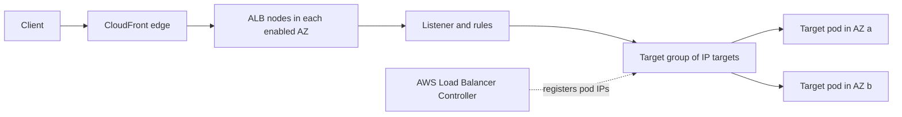
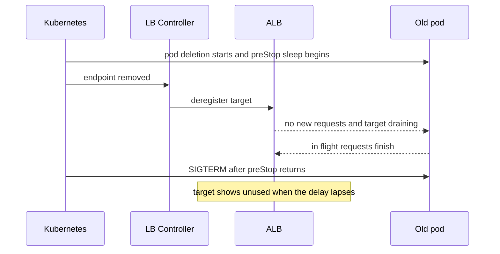

# ALB and NLB

Elastic Load Balancing (ELB) is the managed-AWS side of [[Load Balancers]]: that note teaches the layer-4-versus-layer-7 split, the algorithms, health checks and draining in general; this one teaches the products AWS built from them, their vocabulary (listener, rule, target group, LCU), their limits, and the failure modes that exist only here. Two products matter to you — the **Application Load Balancer (ALB)**, an L7 HTTP balancer, and the **Network Load Balancer (NLB)**, an L4 balancer — and the whole design question is which layer you want AWS to terminate. On EKS the AWS Load Balancer Controller turns Kubernetes objects into both, so you rarely create either by hand.

## The problem that created it

In a data centre the balancer was an appliance or a pair of HAProxy or NGINX boxes you owned: capacity bought for peak, firmware windows to schedule, and the balancer itself the one component nobody balanced. The cloud broke the other assumption too: the backend is not a fixed list. Auto Scaling groups, rolling deploys and Spot reclaims change membership every few minutes, so the balancer has to learn membership from the platform, spread across Availability Zones, and scale itself without a ticket.

AWS launched Elastic Load Balancing in 2009 as one product doing basic L4 and L7. The two jobs pull apart: an L7 balancer parses every request (rules, TLS, authentication, WAF) and is billed on how much of that work you cause, while an L4 balancer forwards flows with almost no state and is billed on connections and bytes. So the family split — ALB in 2016, NLB in 2017, Gateway Load Balancer in 2020 — and the original became the "Classic" load balancer.

## What it solves

- **Membership and health from the platform** — targets register and deregister through an API (the controller does it for pods) and unhealthy ones leave rotation ([[Health Checks and Service Discovery]]).
- **A balancer that is itself a fleet** — AWS runs one balancer node per enabled AZ and scales them; the DNS name resolves to the node addresses with a 60-second TTL ([[Route 53]] aliases to it).
- **TLS with managed certificates** — an ACM certificate attaches to a listener and renews without you ([[WAF and ACM]], [[TLS and HTTPS]]).
- **L7 routing as configuration (ALB)** — host, path, header, query-string, method and source-IP conditions pick the target group; weighted target groups give canary releases without touching DNS.
- **Edge controls at the balancer** — AWS WAF attaches to an ALB; OIDC, Cognito or JWT verification can run at the listener before your code sees the request; access logs land in S3.
- **Static addresses and flow-level speed (NLB)** — one IP per AZ, optional Elastic IPs, source-IP preservation, and non-HTTP protocols.

## How it works

*Figures in this section are AWS-documented values as of October 2026: "default" marks an editable setting, "fixed" or "hard" one AWS will not change for you. Re-check the linked user guide before quoting one in a design review.*

### The family

| | ALB | NLB |
|---|---|---|
| Layer and protocols | L7: HTTP, HTTPS, HTTP/2 to clients, gRPC, WebSocket | L4: TCP, UDP, TLS, and QUIC passthrough (since November 2025) |
| Decides on | listener rules: host, path, header, query string, method, source IP | listener port, then a flow hash picks a target per connection |
| Addresses | a DNS name only; node IPs change | one static IP per AZ, optional Elastic IP |
| Client IP at the target | the ALB node's address; the real one in `X-Forwarded-For` | preserved for instance targets; off by default for IP targets on TCP or TLS |
| WAF | attaches | does not attach |
| TLS | terminates on an HTTPS listener | terminates on a TLS listener, or passes through on a TCP listener |
| Typical job | HTTP front door, host and path routing | non-HTTP, static IPs, an ingress proxy such as Kong or Istio |

**Gateway Load Balancer** is a different animal: a transparent layer-3 hop that steers traffic through a fleet of firewall or inspection appliances using GENEVE encapsulation; you meet it only if a security team inserts appliances. **Classic Load Balancer** is the 2009 original; it still runs, and it is what the legacy in-tree Kubernetes provider creates by default, but nothing new should target it.

### Anatomy of an ALB

An ALB is a set of nodes, one in each AZ you enable (it requires at least two). A **listener** (protocol and port) holds ordered **rules**; each rule is a priority, conditions and an action. The usual action is *forward* to a **target group**; the others are redirect, fixed-response (a 403 for "not from CloudFront"), authenticate (OIDC or Cognito) and JWT verification (added November 2025, HTTPS listeners only). A target group is the pool plus its own health check, algorithm, stickiness and deregistration settings — which is why most tuning lives on the target group, not the balancer. HTTP/2 reaches clients only over HTTPS listeners (a fixed 128 parallel requests per connection) and targets speak HTTP/1.1 unless the target group's protocol version says HTTP/2 or gRPC. WebSocket upgrades are native, but after the upgrade listener rules and WAF no longer apply to that connection ([[WebSockets Server-Sent Events and Long Polling]]). Header limits are hard: 16 KB per request line, 16 KB per header, 64 KB for the whole request header, 32 KB for the whole response header. The ALB adds `X-Forwarded-For`, `-Proto` and `-Port`, and an `X-Amzn-Trace-Id` — but never your own correlation header.

### Timeouts: the numbers that cause incidents

- **Idle timeout, default 60 seconds (range 1 to 4000).** It applies to the client connection and the target connection: silent in both directions for that long and the ALB closes it. HTTP/2 PING frames do not reset it.
- **There is no separate response timeout.** A target that stays silent for longer than the idle timeout gets a 504 even though its health check is green, so 60 seconds is also the practical ceiling for a silent request.
- **Target connect timeout, fixed at 10 seconds.** A connection that cannot be established in that time is a 504 (a security group, a NACL, or a pod not listening).
- **Client keepalive duration, default 3600 seconds (range 60 s to 7 days).** After it, the ALB sends `Connection: close` (HTTP/1.x) or a GOAWAY (HTTP/2) on the next response — a graceful cut, not an error.
- **The hop-chain rule.** AWS's guidance is that the application's idle timeout must be *larger* than the load balancer's, otherwise the target can close a connection at the instant the ALB reuses it and the client gets a 502. Generalised: every server's keep-alive must outlive the idle timeout of the client in front of it, hop by hop.

### Health checks, routing algorithms, stickiness

Every ALB node sends an HTTP GET to every target. API defaults: path `/`, interval 30 s (range 5 to 300), timeout 5 s, healthy threshold 5, unhealthy threshold 2 (both range 2 to 10), success code 200 (any range inside 200 to 499 is allowed), so detection takes interval times unhealthy threshold, 60 s by default (the Kubernetes controller sets its own defaults, 15 s and healthy threshold 2, so read the live target group). The probe's `Host` header is the target's private IP and its user agent is `ELB-HealthChecker/2.0`. If every target is unhealthy the ALB **fails open** and sends traffic to all of them; target-group health requirements (a minimum healthy count or percentage) set when a zone is pulled from DNS or routing falls back ([[Health Checks and Service Discovery]]).

The algorithm is round robin by default; *least outstanding requests* suits uneven request cost; *weighted random* adds automatic anomaly mitigation (the detection behind it needs at least three healthy targets). Slow start ramps a new target's share and cannot be combined with the other two. **Stickiness** binds a client to a target with a cookie (`AWSALB`, duration 1 second to 7 days, default 1 day) or your application cookie; it needs cross-zone on, cannot be combined with weighted random, and a client whose target is draining or gone is re-pointed to a healthy one.

### How NLB differs

An NLB node receives a TCP connection, hashes protocol, addresses, ports and the TCP sequence number to pick a target, and pins that connection to it for life. There is no per-request decision, so one long-lived HTTP/2 connection is one target's load — the per-connection lesson from [[Kubernetes Networking]]. Each AZ gets one IP (optionally your Elastic IP), and an NLB can have security groups (the controller attaches them from v2.6.0). A TLS listener terminates with an ACM certificate; a TCP listener on 443 passes encrypted bytes through untouched. Because it never parses HTTP it is the low-overhead, high-connection-rate option, and the usual front for a proxy such as Kong or Istio that does its own L7 work. The TCP idle timeout defaults to 350 s, configurable from 60 to 6000 s (as of 2026), and TCP data arriving after expiry gets an RST; a TLS listener's is fixed at 350 s, and UDP flow state is fixed at 120 s, after which the next packet is treated as a new flow and may land on a different target.

**Source IP.** With instance targets the client address is preserved. With **IP targets over TCP or TLS it is not** by default: a pod sees the NLB node's private address, which breaks per-client rate limits and allow-lists. Turn on client IP preservation (target in the same VPC, or a peered VPC in the same Region) or Proxy Protocol v2 (the receiver must parse the header, or health checks fail with 400s). With preservation off, an NLB supports about 55,000 simultaneous connections, or about 55,000 per minute, to each unique target IP and port before port-allocation errors become likely — a real ceiling if a single Kong pod were the only target behind an NLB. AWS's documented remedy (2026) is the load-balancer attribute that adds secondary IPs per subnet (0 to 7, and it cannot be lowered once set), or more targets. An NLB can also take an **ALB as its target**: static IPs in front of L7 features, the NLB preserving the client IP and the ALB appending it to `X-Forwarded-For`.

### Seeing what the balancer sees

Two signals separate "the balancer failed" from "the app failed". CloudWatch splits metrics into `HTTPCode_ELB_5XX_Count` (generated by the ALB: 502, 503, 504) and `HTTPCode_Target_5XX_Count` (returned by your targets) — alarm on both ([[CloudWatch]]). **Access logs** (off by default, delivered to S3 in five-minute files, best effort) give per request `elb_status_code`, `target_status_code` (`-` when no target answered), the three processing times (`request_`, `target_` and `response_processing_time`, -1 when the target never answered), the target address and the `trace_id`. Health-check logs (to S3) and a CloudWatch Logs delivery option (to CloudWatch Logs, Firehose or S3) are newer companions; the legacy S3 access log still works. The first question on any 5xx is always: which of the two counters moved.

### Target types, and why IP targets matter on EKS

Targets are registered by **instance** (the node plus a NodePort), by **IP** (a private address, which on EKS is the pod itself), by **alb** (NLB only) or **lambda** (ALB only). Instance mode adds a hop: the balancer hits a NodePort, kube-proxy picks any pod, possibly one in another AZ, and the health check tests the node rather than the pod. Because the VPC CNI gives every pod a real VPC address ([[Kubernetes Networking]]), the controller can register **pod IPs directly**: no NodePort, no second hop, no second cross-AZ leg, and target health becomes pod health. The EKS best-practices guide recommends it.

With the controller installed, a Service of type LoadBalancer carrying `spec.loadBalancerClass: service.k8s.aws/nlb` (or the annotation `service.beta.kubernetes.io/aws-load-balancer-type: external`) becomes an NLB and an Ingress becomes an ALB; from controller v2.5 a webhook can also claim un-annotated LoadBalancer Services by default (Helm value `enableServiceMutatorWebhook`). Without the controller, the legacy in-tree provider builds a Classic LB. Controller defaults that bite: `target-type` defaults to **`instance`** (set `alb.ingress.kubernetes.io/target-type: ip`, or `service.beta.kubernetes.io/aws-load-balancer-nlb-target-type: ip`), the scheme defaults to **`internal`**, and `alb.ingress.kubernetes.io/group.name` lets many Ingresses share one ALB. The controller itself needs IAM permissions to call the ELB APIs, via IRSA ([[IAM]]).

### Draining, and its pairing with pod termination

Deregistering a target puts it in `draining`: no new requests, in-flight ones may finish, for up to the **deregistration delay** (default 300 s, range 0 to 3600). If it has no in-flight requests and no active connections, deregistration completes immediately, though the console shows `draining` until the timer runs out. A request still running when the delay lapses is cut, and the client sees a 502. Three clocks must line up: the controller notices the pod is going away and calls the ELB API (asynchronous, and it can lag the SIGTERM), the balancer drains, and the pod keeps serving through a `preStop` sleep and its shutdown. [[Graceful Shutdown and Deployment Safety]] owns the pod arithmetic; the ELB-side invariant is: delay at least your longest legitimate request, and a pod that stays alive long enough (`preStop` plus drain) for deregistration to propagate and those requests to finish. On the way *in*, the controller's **pod readiness gate** (namespace label `elbv2.k8s.aws/pod-readiness-gate-inject=enabled`, IP targets only) stops a rolling update killing old pods until the new pods' targets are healthy in the target group.

### Cross-zone load balancing

Each balancer node serves one AZ. With cross-zone **on**, a node spreads its share across targets in every enabled AZ; **off**, only its own. The AWS example: 2 targets in AZ A, 8 in AZ B, each node taking half the clients — cross-zone on gives every target 10%; off gives each A target 25% and each B target 6.25%. **ALB** has it always on at the balancer level (you may switch it off per target group, and then an AZ with no targets answers 503); **NLB** has it off by default, and turning it on incurs EC2 cross-AZ data-transfer charges.

### Cost shape

- **Per balancer-hour (the floor).** Every balancer bills hourly, partial hours rounded up, at zero traffic — order of magnitude (us-east-1 list, as of 2026, approximate) a couple of US cents an hour, so roughly $15–20 a month per idle ALB or NLB before any LCU; other Regions, ap-south-1 included, may differ. An internet-facing one also carries the hourly public IPv4 charge per public address (at least one per enabled AZ; about half a US cent per address-hour, as of 2026, approximate). Count rises with every Service of type LoadBalancer or un-grouped Ingress ([[Kubernetes Networking]]).
- **Per LCU-hour (ALB).** An LCU (dimensions as published in 2026; under a US cent per LCU-hour in us-east-1, as of 2026, approximate) measures the *highest* of four dimensions: 25 new connections per second, 3,000 active connections per minute (1,500 with mutual TLS), 1 GB per hour processed for EC2, container or IP targets (0.4 GB for Lambda targets), or 1,000 rule evaluations per second (first 10 rules free). **NLB** bills NLCUs per protocol: TCP 800 new connections per second, 100,000 active per minute, 1 GB per hour; TLS only 50 new connections per second and 3,000 active — a TLS-terminating NLB costs far more per connection than a TCP one. Optional **LCU reservation** pre-buys capacity for known spikes (reserved plus overage).
- **Worked example (assumed traffic).** 500 req/s with about 6 KB of request and response each is about 3 MB/s, near 10.8 GB per hour, so about 11 LCUs on bytes; connections reused via keep-alive add well under one. If every request opened a *new* connection, 500 ÷ 25 = 20 LCUs — connections now dominate, nearly double the bill. Keep-alive is a cost control as well as a latency one.
- **Transfer.** Internet egress per GB as usual; cross-AZ transfer from NLB only with cross-zone on; ALB-to-target traffic over private IPs in the same VPC has historically been exempt from data-transfer charges even across AZs — not re-confirmed against a live AWS page in October 2026, so check the EC2 data-transfer pricing before relying on it ([[AWS Cost Shape]] keeps the arithmetic). Access logs cost S3 storage only.

## Trade-offs

| You gain | You pay |
|---|---|
| Managed fleet: no balancer patching, capacity or HA | Per-hour floor per balancer plus a usage meter that follows traffic shape, not just volume |
| L7 rules, WAF, auth and TLS in one place (ALB) | Another config surface that can disagree with your API gateway's routing |
| Static IPs, source-IP preservation, any protocol (NLB) | No WAF, no path routing, TLS costs more NLCU than plain TCP |
| Direct pod targeting (IP mode), health equals pod health | Pods consume VPC IPs; controller and IAM become infrastructure to run |
| Deregistration delay and readiness gates for safe deploys | Three timers plus the pod's timers to keep consistent |

## Failure modes

- **Unhealthy targets from a probe that needs auth or routing.** *Signal:* targets stuck `unhealthy` with `Target.ResponseCodeMismatch` while the app serves traffic. The probe is an unauthenticated GET with `Host` set to the target's private IP: an auth-protected path returns 401 or 403, a Kong route matched on hostname returns 404, a Spring Security chain that does not permit the health path returns 401. *Fix:* a dedicated unauthenticated health route reachable by IP. Remember fail-open — when every target is unhealthy you do not get "no targets", you get traffic to sick ones.
- **502 from idle-timeout mismatch.** *Signal:* intermittent 502s at a low steady rate, healthy targets, worse on quiet traffic. The target closed an idle keep-alive connection at the moment the ALB reused it. *Confirm:* in the access log, a 502 the ALB generated has `target_status_code` `-`; a 502 that Kong returned shows 502 in that field too. *Fix:* order the chain — ALB idle 60 s, then Kong's server keep-alive above it; Kong's `upstream_keepalive_idle_timeout` (default 60 s) below Spring's `server.tomcat.keep-alive-timeout`. Equal values are the race.
- **504: upstream slower than the ALB allows.** *Signal:* a slow export or report fails at about 60 s with healthy targets; a 460 in the log means the client gave up first. The shortest timeout in the chain wins (CloudFront's origin timeout, the ALB's, Kong's), so raise them together or move long work off the request path ([[Why Async Messaging Exists]]). A 504 after exactly 10 s is the connect timeout.
- **Sticky sessions and rolling deploys.** The ALB survives the deploy — it re-points the cookie to a healthy target — but any state held in the old pod's memory is lost, and after a scale-out existing sessions stay on the old pods, leaving new ones idle ([[Stateless vs Stateful Services]]). Shorten the stickiness duration to rebalance.
- **Targets in one AZ only.** With ALB defaults it still works, but losing that AZ is a full outage; with cross-zone off on the target group, nodes in empty AZs return 503, and empty subnets expose zonal IPs that do the same. On NLB (cross-zone off by default) an empty zone counts as unhealthy and is pulled from DNS.
- **Cut in-flight requests on deploy.** A deregistration delay shorter than the longest request, or a pod that exits before propagation finishes, yields 502s on every rollout. Verify with load, not by reading config.

## When NOT to use it

- **One balancer per microservice.** Each carries a floor; share an ALB through an ingress group, or put one API gateway behind a single entry ([[API Gateway]]).
- **A second routing layer duplicating your gateway.** If Kong already routes by host and path, keep the ALB thin: TLS, WAF, health.
- **An ALB for non-HTTP traffic, or an NLB when you need WAF, path rules or HTTP retries.**
- **Per-request balancing of long-lived internal connections** — an NLB or a ClusterIP pins whole connections; use an L7 proxy or client-side balancing ([[Load Balancers]]).
- **Classic Load Balancer** for anything new.

## In your stack

- **Edge chain:** CloudFront to ALB to Kong to services, in ap-south-1 (RBI data localisation), one set per account — uat and prod each pay their own floors. The ALB's target group is, by the vault's picture of your stack, **Kong** (inferred; check the target group and `kubectl get pods -A | grep -i kong`), so ALB health means "Kong is up", not "payments is up" — a dead 1-replica service behind Kong is invisible to it.
- **Lock the ALB to CloudFront:** CloudFront adds a secret origin header, a listener rule forwards only requests carrying it, the default action returns a fixed 403, and the security group can use the CloudFront managed prefix list — which narrows the network but admits every CloudFront customer, so the secret header is what ties the ALB to *your* distribution; VPC origins keep the ALB in private subnets ([[CloudFront]]).
- **Probe path:** the probe sends `Host: <pod IP>`, so route health on a path any host answers, outside auth and outside Kong's hostname matching.
- **Timeout chain to inventory:** CloudFront origin timeout, ALB idle timeout, Kong's keep-alive and read timeouts, Spring's `server.tomcat.keep-alive-timeout`. Confirm each value on the running system; none is known to the vault.
- **Pairing at 1 replica:** a rolling update with no peer is a gap unless you use `maxSurge` with the readiness gate; and your Bharat notes warn that Facets silently drops camelCase keys on `flavor: "deployment"` (`termination_grace_period_seconds`) — verify the grace period in the rendered pod spec. Facets' hardcoded probe `failureThreshold` of 10 means Kubernetes notices a sick pod after period times 10. The ALB independently detects a sick *Kong* pod after interval times unhealthy threshold (2 by default); the services behind Kong get no ALB check at all, only their Kubernetes probe.
- **Controller:** it runs with an IRSA role; a Service stuck `<pending>` is usually that role, missing subnet discovery tags, or no free IPs in the subnets ([[Kubernetes Networking]]).
- **Tracing:** the ALB injects only `X-Amzn-Trace-Id`; Kong is the first place `x-correlation-id` can be stamped. Log `trace_id` from the ALB access log to join the two.
- **Access logs:** off by default; they land in S3 with the request line, so keep personal data out of query strings and keep the bucket in Mumbai. Cross-region log storage would be new regulatory scope; confirm with compliance.
- **Static IPs for partner allow-lists (inference):** a bank that allow-lists your inbound address wants NLB Elastic IPs — NLB with an ALB target keeps WAF and rules behind them.

## Interview angle

The 60-second version: *"ELB is AWS's managed balancer family. ALB is layer 7: it terminates TLS, reads each HTTP request and routes by host, path or header to target groups, with WAF, authentication, WebSocket and gRPC support, and a DNS name only. NLB is layer 4: a flow hash pins each connection to a target, it gives a static IP per AZ, preserves the source IP and handles any TCP, UDP or TLS. ALB bills per hour plus LCUs — the highest of new connections, active connections, bytes and rule evaluations; NLB bills per hour plus NLCUs. On EKS the Load Balancer Controller creates them, and you want IP targets so the balancer hits pods directly. Deploy safety is the deregistration delay paired with a preStop sleep, and the classic bugs are idle-timeout mismatches and unauthenticated health paths."*

- "ALB or NLB for your Kong?" — ALB for TLS, WAF and health at the edge; NLB if you need static IPs or Kong must see raw TCP; NLB-to-ALB gets both.
- "Why 502s with healthy targets?" — keep-alive race; compare timeouts hop by hop, read `target_status_code`.
- "Why IP targets?" — one hop fewer, pod-level health, readiness gates.
- "How do you canary?" — weighted target groups at the ALB, or weighted DNS ([[Route 53]]).

## Check yourself

> [!question]- Q: Explain why registering pod IPs instead of node ports changes both latency and health semantics on EKS.
> In instance mode the balancer targets a node's NodePort, kube-proxy then selects any ready pod, possibly in another AZ, so there are extra hops and a second cross-AZ leg, and the health check tests the node. With IP targets the VPC CNI's real pod addresses let the controller register pods directly: the packet goes balancer to pod, the health check is answered by the pod, and "unhealthy" means that pod is unhealthy. It also unlocks readiness gates.

> [!question]- Q: Users see a 502 on about 1 request in 2,000, mostly after quiet periods, while all targets are healthy. The ALB idle timeout is 60 s and Kong's upstream keepalive idle timeout is 60 s. Diagnose.
> Idle keep-alive connections are being closed by one side just as the other reuses them. Read the access log: `target_status_code` of `-` means the ALB generated the 502 (the target closed first — Kong's server-side keep-alive is not above 60 s); a target code of 502 means Kong generated it, and the Spring Boot keep-alive (`server.tomcat.keep-alive-timeout`) is not above Kong's 60 s. Equal timeouts are the race. Raise each server's keep-alive above its client's idle timeout, in order, and re-test.

> [!question]- Q: A report endpoint takes 75 s. Through CloudFront (whose origin response timeout has already been raised above 75 s) and the ALB it fails at about 60 s, though the pod finishes the work. Why, and what are the options?
> The ALB closed the connection after the target stayed silent for the 60 s idle timeout and returned a 504; the pod was healthy, so no health check noticed. Options: raise the idle timeout and every other timeout in the chain together (CloudFront's origin timeout and Kong's read timeout are separate limits and the shortest wins), stream some bytes before each interval, or — better — return 202 immediately and deliver the result through a queue or polling ([[Why Async Messaging Exists]]).

> [!question]- Q: Each rolling deploy produces a burst of 502s. List what to check on the ELB side and the pod side.
> ELB side: deregistration delay below the longest request (the request is cut when it lapses), and target type — in instance mode the node stays registered, so pod churn is invisible to the balancer. Pod side: no `preStop` sleep, so the pod stops listening while the controller's asynchronous deregistration is still propagating; grace period shorter than sleep plus drain; and no readiness gate, so old pods die before new targets are healthy. At 1 replica also use `maxSurge` of 1 with `maxUnavailable` of 0. Confirm by killing a pod under synthetic load.

> [!question]- Q: Mini-design — a partner bank will call a webhook on your API only if it allow-lists fixed IPs. Keep WAF and host routing, in ap-south-1.
> Public NLB with one Elastic IP per enabled AZ (the allow-listed addresses), a TCP listener on 443 forwarding to an ALB-type target group, so the ALB terminates TLS with an ACM certificate, applies WAF and rules, and forwards to Kong. The NLB preserves the client IP and the ALB appends it to `X-Forwarded-For`. Cost shape: two balancer floors, NLCUs plus LCUs, public IPv4 per address, and cross-AZ transfer if cross-zone is enabled on the NLB. Cross-zone can stay off on the NLB, because the ALB target is already reachable in every enabled AZ and the ALB's own cross-zone is always on. This is an inference about how the bank filters; confirm its requirement first.

## Sources

- AWS Elastic Load Balancing User Guide — "How Elastic Load Balancing works" (nodes, cross-zone behaviour, routing algorithms, headers, header limits), pricing page (LCU and NLCU dimensions, LCU reservation, hourly rates; checked October 2026); AWS Networking and Content Delivery blog, "Exploring Data Transfer Costs for Classic and Application Load Balancers" (2023).
- User Guide for Application Load Balancers — load balancer attributes (idle timeout, client keepalive duration), target group attributes (deregistration delay, routing algorithms, slow start, stickiness, cross-zone, automatic target weights), health checks, listeners, troubleshooting (502, 503, 504, 460), access logs.
- User Guide for Network Load Balancers — target groups and attributes (client IP preservation, Proxy Protocol v2, deregistration, cross-zone), idle timeout, ALB as a target.
- Amazon EKS Best Practices Guide — "Load Balancing" (IP versus instance targets, readiness gates, graceful shutdown, deregistration).
- AWS Load Balancer Controller documentation — Ingress annotations, NLB Service configuration, pod readiness gate.
- Amazon CloudFront Developer Guide — "Restrict access to Application Load Balancers".
- Kong Gateway configuration reference — `upstream_keepalive_idle_timeout`.
- AWS What's New, November 2025 — "AWS Network Load Balancer now supports QUIC protocol in passthrough mode" and "Application Load Balancer now supports client credential flow with JWT verification"; Amazon EKS User Guide — "Route TCP and UDP traffic with Network Load Balancers" (in-tree controller creates Classic LBs; checked October 2026).
