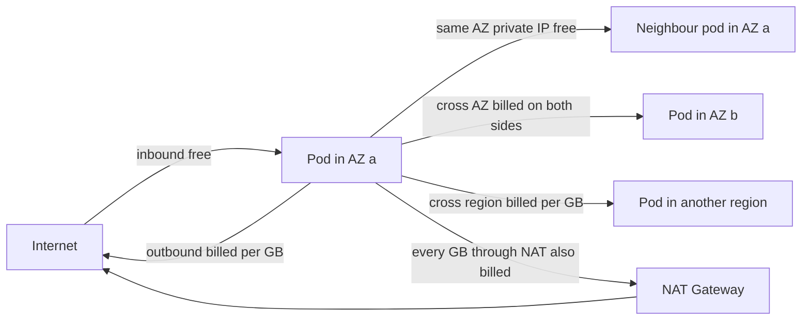
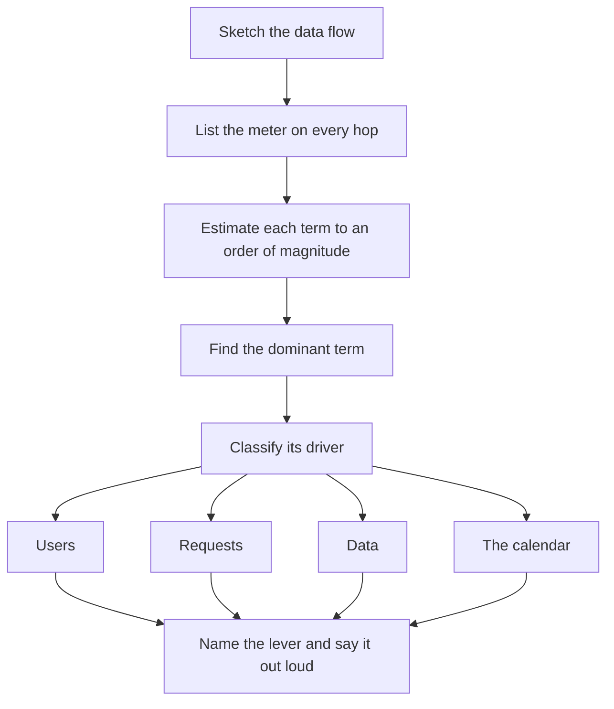

# AWS Cost Shape

Every other note in this module teaches a service; this one teaches the meter underneath all of them. It is the money half of [[Capacity Planning]] and [[Back of the Envelope Estimation]]: those tell you how much load a design carries, this tells you which AWS meter that load turns, and therefore what the bill scales with. A **cost shape** is that answer — hours, requests, gigabytes stored, gigabytes moved, or just the calendar. Your org's written rule is to name it for every infrastructure recommendation; this note is the skill taught once. All rates are US list prices checked against AWS's public pricing pages in October 2026 and are *order of magnitude, as of 2026, approximate*: regional rates differ (read the Mumbai column before quoting one) and discounts bend the invoice, so re-derive any number before it goes into a review.

## The problem that created it

Before cloud, cost was a purchasing event: someone approved a server order once and engineers never saw a meter. On AWS every design choice starts a meter that runs until someone stops it, yet the invoice goes to a different person, monthly, grouped by service, long after the commit that caused it. A debug log line, a call that crosses an Availability Zone, an S3 write per event: each is invisible at review time and anonymous on the bill ("CloudWatch is up 40%"). The feedback loop that makes latency and availability reviewable never closes for cost.

Second, cost does not track the *size* of a system; it tracks a handful of **shapes** — what the meter counts. A design that is entirely correct can sit on the wrong shape and cost several times its equivalent: ten terabytes of backups routed through a NAT Gateway is billed per gigabyte processed, while the same bytes through an S3 gateway endpoint cost nothing. The engineer who reasons in shapes asks "what does this scale with?" the way a performance engineer asks about Big-O: no exact prices needed, just which term grows with what, and which one dominates.

## What it solves

- **Cost becomes a design-time property**, reviewed like latency and availability instead of discovered monthly and attributed to nobody.
- **Finds the dominant term fast.** A few terms usually carry most of a bill and the rest is rounding; naming the one that dominates is most of the answer.
- **Separates fixed floors from variable terms.** Some meters run at zero traffic (cluster-hours, NAT-hours, load-balancer-hours); others grow with load. The split tells you what the bill does at 10x traffic and at 0.1x.
- **Exposes the price of every correctness choice.** Multi-AZ, replicas, DR regions and verbose logs each carry a cost term; naming it lets availability be bought deliberately instead of by accident.
- **Gives cost incidents a vocabulary.** A runaway Lambda loop or a forgotten environment is a meter failure; knowing the shape tells you which graph to open first.

## How it works

The bill is a sum over meters of quantity times rate. AWS owns the rate; you own the quantity, and the *shape* is what drives it. For each component ask two questions: what is the meter, and does its quantity move with time, requests, bytes at rest, bytes in motion, or the count of things.

### Cost shape

Eight shapes cover almost everything you deploy. Read the table left to right: the first column is what you chose, the third is the driver you did not think about.

| Shape | Meter | What scales it | Where it bites |
|---|---|---|---|
| Compute-hours | Instance-hour, billed per second | Node count, which follows pod requests, not usage | EKS managed node groups, self-managed Redis |
| Fixed floor | Per cluster-hour, NAT-hour, load-balancer-hour, public-IPv4-hour | Count of clusters, AZs and environments | EKS control plane, NAT per AZ, ALBs |
| Per request | Per thousand or million calls | Traffic times amplification from retries and fan-out | Lambda, S3, CloudFront, SQS |
| Per GB stored | GB-month by class | Bytes retained times time kept | S3 tiers, EBS, snapshots, CloudWatch Logs |
| Per GB processed | GB through a managed hop | Bytes through the hop, whatever they are | NAT, ALB LCUs, interface endpoints |
| Per GB transferred | GB crossing a boundary | Topology: which boundary the bytes cross | Internet egress, cross-AZ, cross-region |
| Per resource per month | Flat fee per thing | Count of things | Secrets, custom metrics, WAF rules, hosted zones |
| Managed premium | Node-hours above raw EC2 | Fleet size, not traffic | ElastiCache, MSK |

A design's cost shape is its list of meters, each tagged with a driver, with the dominant one circled. Fixed floors are paid at zero traffic; variable terms grow with load. Everything below is the detail behind a row.

### Compute hours and the commitment ladder

EC2 bills per second while an instance runs, at any utilisation: a node at 10% CPU costs what it costs at 90%. EKS managed node groups add no fee of their own — you pay for the EC2 instances, EBS volumes and public IPv4 addresses beneath them — so the compute bill follows **node count**, and node count follows the sum of pod *requests*, because the scheduler packs by what pods ask for, not what they use ([[Kubernetes Configuration and Resources]], [[Autoscaling]]). Over-requested pods are paid-for idle capacity. The VPC CNI gives every pod a VPC IP and an instance type's network-interface limits cap pods per node, so a node can be full on IPs while its CPU idles ([[Kubernetes Networking]]). The ladder, dearest to cheapest: **on-demand** with no commitment; **Savings Plans** (below), a committed dollars-per-hour for one or three years; **Spot**, spare capacity advertised (as of 2026) at up to 90% off that AWS can reclaim on short notice.

*Worked example (as of 2026, approximate):* a 4 vCPU / 16 GB general-purpose node costs on the order of 20 cents an hour, about $146 a month; ten nodes is roughly $1,460. Trimming over-requested pods so the same workload fits on seven nodes saves about $440 a month with no commitment and no risk — often more than a commitment on the original fleet would. Right-size first, commit second.

**When is Spot safe?** When losing the node is a capacity dip, not an outage: restartable idempotent work (SQS consumers — an interrupted message reappears after its visibility timeout, see [[SQS and SNS]]), batch and CI jobs, and stateless services at two or more replicas spread across nodes and drawn from several instance types so one dried-up pool does not take everything. It is unsafe for datastores and brokers, for any service at one replica (a reclaim is an outage), and for anything holding in-flight money movement without idempotency.

### The control-plane fee

EKS charges per cluster-hour regardless of cluster size (US list, as of 2026, approximate): $0.10 on standard support, about $73 a month. Under EKS's 2026 version policy a Kubernetes version gets 14 months of standard support, then 12 more months of *extended* support at $0.60 — six times the fee, about $438 a month, for the sole offence of not upgrading. Extended support is on by default (upgrade policy `EXTENDED`); disabling it means an automatic control-plane upgrade at the end of standard support instead. The optional Provisioned Control Plane tiers for very large clusters add a much larger hourly fee on top. The shape is cluster count: the fee argues for fewer clusters, isolation (uat and prod in separate accounts) argues for more. It is small against nodes but it is the purest drift tax on the bill, and no Savings Plan discounts it — plans cover the EC2 beneath EKS, not the EKS charge itself.

### Per request

Rates as of 2026, approximate: Lambda ($0.20 per million invocations plus duration billed in GB-seconds, memory times time, for standard event functions; Lambda's newer billing models price differently), S3 ($0.005 per thousand PUT or LIST, $0.0004 per thousand GET), CloudFront, SQS and API Gateway also meter calls, and a function behind API Gateway pays both meters on every request. Idle costs almost nothing; the bill scales with traffic times *amplification* — retries, fan-out, polling. Against an hour-billed alternative there is a crossover. *Worked example (as of 2026, approximate):* a 512 MB function averaging 200 ms costs roughly $2 per million invocations all-in, so 50 requests/s (about 130 million a month) is roughly $250 a month, while two small always-on pods serving the same load are about $75 of node share. At 0.5 requests/s Lambda is about $2.50 and the pods are still $75. Neither is cheaper in general: Lambda has no floor, containers have a lower slope ([[Lambda]]); [[SQS and SNS]] derives the same crossover against a broker. CloudFront is the exception that changed shape: alongside pay-as-you-go it now sells flat-rate monthly plans with no overage charges, where requests blocked by WAF or DDoS protection do not count against the allowance — a calendar-shaped meter in place of a request-shaped one ([[CloudFront]]).

### Per GB stored

As of 2026, approximate: S3 Standard is on the order of 2 cents per GB-month and the archive classes a small fraction of that — a twentieth or so for Deep Archive; floors and retrieval fees are in [[How S3 Works]]. EBS bills the *provisioned* size whether or not it is used, and unattached volumes and snapshots keep billing; a PersistentVolume with a Retain reclaim policy outlives its claim. CloudWatch Logs charges $0.50 per GB of raw bytes once at ingestion (Standard class, custom logs; Infrequent Access class: half; AWS-vended logs get volume tiers above 10 TB a month) and then $0.03 per GB-month stored, measured after compression, and a log group's default retention (as of 2026) is indefinite. Shape: bytes times time. Only deletion or tiering stops the meter, so retention is the lever and forgetting is the cost.

### Per GB processed

The meters that surprise (US list, as of 2026, approximate). **NAT Gateway** — $0.045 per hour *and* $0.045 per GB through it, whatever the bytes are. **ALB** — $0.0225 per hour plus $0.008 per LCU-hour, where an LCU is the *highest* of four dimensions (25 new connections/s, 3,000 active connections/min, 1 GB/hour processed for instance or IP targets, 1,000 rule evaluations/s, where the first 10 rules processed per request are free (as of 2026) and a listener with 10 or fewer rules never bills on this dimension), so a chatty small-payload API can be billed on connections — or, past 10 rules, on rules — rather than bytes ([[ALB and NLB]]). **Interface endpoints (PrivateLink)** — $0.01 per AZ-hour plus $0.01 per GB: under a quarter of NAT's per-GB rate, with a floor per AZ. **Gateway endpoints for S3 and DynamoDB** — free ([[VPC and Networking]]).

*Worked example (as of 2026, approximate):* a backup job in private subnets writes 10 TB a month to S3. Through NAT: 10,000 GB at $0.045 is about $450 a month of pure processing — S3 ingest itself is free — on top of the gateway's roughly $33 hourly floor. Through an S3 gateway endpoint: $0. ECR image pulls follow the same path: layers are served from S3, so a gateway endpoint plus ECR interface endpoints takes a node scale-up's image pulls off the NAT meter ([[Container Registries and ECR]]).

### Per GB transferred — the asymmetry

Traffic *into* AWS is free; traffic *out* to the internet is billed per GB after a small monthly allowance (100 GB as of 2026, aggregated across services and Regions), at tiered rates. Inside a region, the same AZ over private IPs is free, but crossing an AZ boundary costs (as of 2026, approximate) $0.01 per GB on the sending side and $0.01 on the receiving side — about two cents per gigabyte that crosses. Between regions you pay per GB leaving the source region at a rate set by the region pair. Two exceptions: ALB-to-target traffic inside a VPC over private IPs is free even across zones, so the load balancer is not where your cross-AZ bill comes from; and AWS-origin-to-CloudFront transfer is free ([[CloudFront]]). Shape: *topology* — the bill depends on which boundary the bytes cross, which is why placement is a cost decision.

### Per resource per month

Flat fees per *thing* (US list, as of 2026, approximate). Secrets Manager: $0.40 per secret-month plus $0.05 per 10,000 API calls. WAF: $5 per web ACL-month, $1 per rule-month and $0.60 per million requests inspected at the default capacity, more per request for web ACLs above 1,500 WCUs or with larger body inspection ([[WAF and ACM]]). CloudWatch: $0.30 per custom metric-month at the first tier, $0.10 per standard alarm-month, $3 per dashboard-month. Route 53: $0.50 per hosted zone-month for the first 25 and $0.10 after, and a basic health check is $0.50 a month against an AWS endpoint — the first 50 against AWS endpoints in the same account are free — or $0.75 against a non-AWS one, more with optional features ([[Route 53]]). A public IPv4 address: $0.005 per hour, about $3.65 a month, in use or idle. Public ACM certificates used with integrated services such as ALB and CloudFront are free — exportable public certificates are charged per domain on issuance and again on renewal — and standard Parameter Store parameters carry no per-parameter fee ([[Secrets Manager Parameter Store and KMS]]). Individually trivial, multiplied by fleet size. *Worked example (as of 2026, approximate):* tagging one metric with a per-merchant dimension across 5,000 merchants creates 5,000 distinct metrics — every dimension combination is its own metric — about $1,500 a month for a single gauge, against $0.30 without the tag ([[CloudWatch]]).

### Managed premium: moving cost off the payroll

ElastiCache charges node-hours at a premium over the equivalent raw EC2 instance — as of 2026, approximate, roughly 1.5x to 2x the same instance size, with Valkey nodes priced below Redis OSS; MSK charges broker-hours plus storage. What the premium buys is operations: provisioning, engine patching, automatic failover, backups, node replacement and metrics — the pager hours of running [[Redis Cluster and Sentinel]] or [[Kafka Operations]] yourself. It does not buy key design, hot-key handling or client tuning ([[ElastiCache for Redis]]). The honest framing: the bill rises but the *total* cost can fall, because engineer-hours and incident-hours are not on the AWS invoice. The premium is linear in fleet size while people cost is closer to a step, so self-hosting starts to pay only with many identical clusters and a team to amortise the on-call. One MSK billing detail: AWS does not charge for replication traffic between brokers, so what remains is standard transfer rates on client traffic — producers and consumers in another AZ from the broker pay the cross-AZ rate. On self-managed brokers across three AZs every replicated byte pays it on both sides.

### The five surprises

Every engineer meets these. Each is a correct design sitting on an unwatched meter.

1. **NAT data processing.** Anything in a private subnet that reaches outside the VPC without an endpoint goes through NAT: image pulls, OS and package updates, third-party API calls (bank, KYC and payment vendors), S3 and DynamoDB traffic lacking a gateway endpoint, and — the sneaky one — service-to-service calls made through *public* hostnames, which resolve to public IPs and leave via NAT instead of staying on private addresses. Fix: gateway endpoints (free), interface endpoints for chatty AWS APIs once volume beats their hourly fee, private names for east-west traffic. One NAT per AZ triples the hourly floor but avoids cross-AZ hops and a single-AZ dependency; a regional NAT gateway spanning several AZs is still billed the hourly rate per AZ, so the floor arithmetic is the same.
2. **Cross-AZ chatter between a service and its datastore.** *Worked example (as of 2026, approximate):* a service makes 1,000 calls/s to a datastore at 20 KB request-plus-response each — 20 MB/s, about 52 TB a month. If two-thirds of calls land in another AZ, that is about 35 TB crossing at roughly $20 per TB, near $700 a month for *one* service pair; multiply by services, cache lookups, replicas and brokers. Kubernetes Services spread calls across AZs by default; topology-aware routing can prefer same-zone endpoints when they exist ([[Kubernetes Networking]]).
3. **CloudWatch log ingestion from debug logging.** *Worked example (as of 2026, approximate):* debug logging at about 1 MB/s is 2.6 TB a month at $0.50 per GB — near $1,300 of ingestion, against at most about $80 to store that month's data (storage is billed after compression, so usually less), so ingestion is more than 15x the storage line. At INFO with 5% of the volume it is about $65. Add never-expire retention and storage compounds: a year later roughly 31 TB of raw logs is at most about $930 a month, less after compression. The meter is *bytes written*, so the lever is log level and sampling ([[Logs Metrics and Traces]]).
4. **Unbounded S3 request counts from a hot path.** *Worked example (as of 2026, approximate):* a GET per request at 2,000 req/s is about 5.2 billion GETs a month at $0.0004 per thousand — roughly $2,000 — for config an in-process cache serves free. A PUT per event at 500/s is about 1.3 billion PUTs at $0.005 per thousand — roughly $6,500 — while the stored bytes are trivial. Fix: cache, batch events into larger objects, keep hot small records in a datastore ([[How S3 Works]]).
5. **Idle load balancers and NAT gateways in dead environments.** *Worked example (as of 2026, approximate):* a forgotten environment with 3 NAT gateways (about $99 a month), 2 ALBs (about $33), an EKS control plane (about $73) and roughly 9 public IPv4 addresses (about $33) costs near $240 a month with zero pods and zero traffic. That is the fixed-floor shape: paid for nothing.

### Reasoning about a design's cost

This is the interview skill.

Draw the data flow, write the meter on each hop, estimate every term to an order of magnitude with the numbers from [[Back of the Envelope Estimation]], find the dominant term and classify what drives it. Four drivers: **users** (per-tenant things — secrets, metric dimensions, hosted zones), **requests** (per-request meters, multiplied by retries), **data** (bytes retained, processed or moved) and **the calendar** (hour-billed floors, paid at zero traffic). Then ask what the bill does at 10x and at 0.1x: floors dominate at 0.1x, variable terms at 10x, and the crossover between them is the interesting number. Finish by naming the lever — lifecycle policy, cache hit ratio, log level, an endpoint, a replica count — out loud.

**Commitments.** Savings Plans (discount ceilings as AWS advertised them in 2026) trade a committed dollars-per-hour for one or three years against a discount. Compute Savings Plans (advertised up to 66%) apply to EC2 regardless of family, size or Region and also cover Fargate and Lambda; EC2 Instance Savings Plans (up to 72%) are tied to an instance family in a Region and do not cover Fargate or Lambda; reserved instances and reserved nodes are the older per-resource form. Database Savings Plans (announced December 2025: one-year term, up to 35% on serverless usage but up to 20% on provisioned instances) extend the dollars-per-hour model to RDS, Aurora, DynamoDB, ElastiCache and other managed databases — the pricing page lists ElastiCache for Valkey, not Redis OSS, and does not list MSK, so check engine eligibility before assuming a discount. Three rules: right-size first or you commit to waste; commit to the *floor* you will certainly run all year, not the peak, leaving bursts on on-demand or Spot; and a commitment is paid whether used or not, so it taxes any later migration. A fleet pinned at one replica has a flat, predictable floor — a good commitment target.

**Visibility.** Cost data is only as useful as its labels. Activate your tags (environment, team, service) as *cost allocation tags* in Billing — untagged spend is anonymous — and remember the AWS account is the strongest tag you get free: separate uat and prod accounts attribute cost with no tagging discipline at all. In Cost Explorer, group by service and then by *usage type*: names such as `NatGateway-Bytes` and `DataTransfer-Regional-Bytes` (cross-AZ, plus same-Region traffic sent to public or Elastic IPs — the public-hostname leak again) point straight at surprises 1 and 2. Set AWS Budgets alerts and Cost Anomaly Detection so a spike surfaces in days rather than on the invoice, and export the Cost and Usage Report to S3 for Athena when you need per-resource detail.

## Trade-offs

| You gain | You pay |
|---|---|
| Availability from spreading across AZs and replicas | Replica compute multiplied; per-AZ NAT, endpoints and ALB nodes multiplied; a cross-AZ transfer meter that did not exist at one AZ |
| Zero transfer cost and lower latency from same-AZ placement | One failure domain: cheap and fast and fragile together |
| A lower bill from commitments or Spot | Flexibility (commitments), interruption engineering (Spot) |
| Less engineering time from managed services | A premium on the bill; less control when the service misbehaves |
| Debuggability from verbose logs and rich metrics | Ingestion, storage and cardinality meters that grow with volume |
| Offload from CloudFront caching | Cache-key and invalidation complexity ([[CDN]]) |

**Cost vs availability.** Multi-AZ multiplies every hour-billed term by the number of AZs or replicas and *adds* the cross-AZ meter, so availability is never free — but the cost of downtime is not on the AWS bill either, and in a regulated fintech it includes regulator attention and customer trust. Price both columns in the same review ([[Availability Reliability Durability]]) and decide per service which side of the line it sits on. **Cost vs latency.** Same-AZ calls are free and usually faster; pinning a chatty pair to one zone cuts the transfer meter and the latency together, at the price of concentrating failure. [[Disaster Recovery]] is the region-scale version of the same trade.

## Failure modes

Cost failures are incidents with no outage to page on, so each needs a deterministic brake, not vigilance.

- **Runaway Lambda loop.** A function writes to the bucket or queue that triggers it, or error retries redeliver forever; billing is per invocation times duration, so spend climbs at machine speed. *Signal:* invocation count goes vertical, anomaly alert. *Brake:* set reserved concurrency to 0 to stop it instantly; bounded retries plus a DLQ to prevent it; Lambda's recursion detection stops a chain after about 16 invocations for loops through SQS, SNS, S3, EventBridge custom buses or Lambda itself (as of 2026), but misses loops through other services such as DynamoDB, so it is not a substitute for a concurrency ceiling ([[Lambda]]).
- **Log group with infinite retention.** The default is to keep forever, so storage grows monotonically. *Brake:* set retention at creation, by environment, in infrastructure code; archive to S3 deliberately if a regulation needs longer.
- **Forgotten uat environment at prod size.** A separate account means a separate bill, and nodes follow pod requests, not traffic. *Signal:* uat spend close to prod's with a fraction of the load. *Brake:* per-account budget alert, tags with an owner, node groups scaled down outside working hours.
- **NAT gateway in the path of an S3 backup or ECR pulls.** *Signal:* `NatGateway-Bytes` dominant in Cost Explorer. *Brake:* gateway endpoint for S3, interface endpoints for ECR.
- **Retry amplification.** Per-request meters multiply by retry count; a client without backoff turns a partial outage into a several-fold request bill ([[Timeouts Retries and Exponential Backoff]]).
- **Version drift into extended support.** The EKS version passes 14 months and the control-plane fee becomes six times larger with nothing broken. *Brake:* an upgrade calendar and an alert on versions approaching the boundary.
- **Orphans.** EBS volumes from retained PVs, old snapshots, unattached public IPv4 addresses, noncurrent S3 versions and abandoned multipart uploads ([[How S3 Works]]).
- **Metric cardinality explosion.** A user or request identifier used as a metric dimension mints one billable metric per value. *Brake:* put high-cardinality identifiers in logs and traces, not metric dimensions ([[CloudWatch]]).

## When NOT to use it

- **When the constraint is compliance, not price.** RBI-regulated data stays in India, so you cannot shop for a cheaper region; cost shape tells you what the mandated design costs, not whether to build it. A proposal that moves a regulated copy outside India creates new regulatory scope — flag it, do not optimise it.
- **When the saving is smaller than the effort.** A $40-a-month line is not worth a day. Rank by dominant term, fix the top one or two, ignore the long tail.
- **Before the design is correct.** Shape arithmetic on a wrong design prices the wrong thing. Do not cut a second replica, an audit log or encryption on the money path to hit a number; those are availability and audit decisions with a price, not waste.
- **As a forecast.** List-price arithmetic ranks terms and compares designs; it does not predict the invoice, which discounts, free tiers, credits and commitments all bend. After launch, usage-type data in Cost Explorer is the truth.
- **As a price-table recital in an interview.** Interviewers want the dominant term and its driver, not memorised rates.

## In your stack

- **The edge chain meters at every hop.** CloudFront (per request, per GB out), WAF (per ACL, rule and million requests inspected), ALB (hourly plus LCUs), Kong (runs on your nodes, so compute-hours with no per-request AWS fee), then pods. The CloudFront hit ratio is the single lever that cuts several terms at once: a hit never reaches the ALB, Kong or a pod.
- **Compute follows pod requests.** Managed node groups add no fee beyond the EC2, EBS and IPv4 beneath them, so audit requests against real usage ([[Kubernetes Configuration and Resources]]) before buying any commitment, and keep the VPC CNI per-node IP ceiling in mind.
- **A 1-replica fleet is a cost decision with an availability price — name both.** The cost side: each service pays for one pod's requests, a second replica costs another pod's worth of node share plus a cross-AZ meter, and the flat floor is an easy commitment target. The availability side: every node drain, deploy, crash or AZ loss is an outage for that service until it reschedules, Spot is off the table, and synchronous chains multiply — five single-replica services at 99.9% each give about 99.5% in series, near 3.6 hours a month (illustrative arithmetic, see [[Availability Reliability Durability]]). Price the second replica for the money path first — payments, ledger, auth — leave the long tail at one, and write the saving down as an accepted risk.
- **Cross-AZ on every byte.** A 1-replica pod in one AZ calling a Mongo primary in another pays both directions on every call, and with a single endpoint there is no same-zone choice for topology-aware routing to make. Reading secondaries in-zone cuts transfer but trades freshness — never for money-path reads. ElastiCache clients in another AZ from their node pay less: as of 2026 the node side of cross-AZ traffic is free, so only the application side is billed at the standard regional rate ([[ElastiCache for Redis]]).
- **uat and prod are separate accounts.** The account is free cost attribution, but every fixed floor is paid twice: EKS fee, NAT, ALBs, public IPv4. Size uat to uat traffic and scale it down at night.
- **Mumbai is a compliance choice, not a price choice.** Cross-region DR must stay in India; the in-country second region is ap-south-2 (Hyderabad), an opt-in Region that must be enabled per account, and each dependency should be confirmed available there before it is costed. DR adds: replicated storage (every byte twice, plus replication requests), cross-region transfer billed per GB out of Mumbai, a second copy of every fixed floor, and standby compute by tier — storage only for backup-restore, a minimal core for pilot light, a scaled-down stack for warm standby, roughly double for active-active ([[Disaster Recovery]]). A regulated copy outside India is new regulatory scope: flag it.
- **The broker history is a shape change.** Moving from MSK to SQS swapped a 24/7 broker-hour floor for per-request pricing ([[Kafka Operations]], [[Choosing a Message Broker]]); fixed floors dominate at low volume and variable terms at high.
- **`x-correlation-id` separates retry amplification from organic growth** when a per-request bill jumps: the same id repeated is a retry, a new id is traffic.

## Interview angle

The 60-second version, with an example. *"I'd name the shape first. Take a statement-download service: two million PDFs a month at 2 MB. That is 4 TB of new data a month and, retained ten years, about 480 TB — no 3x replication multiplier, because S3's price already includes its redundancy. At roughly 2 cents per GB-month in S3 Standard — as of 2026, approximate — that is on the order of $10k a month at the end. Requests are noise — two million PUTs at half a cent per thousand is about $10. Egress is maybe a TB a month through CloudFront, order of a hundred dollars. So the dominant term is retained bytes; it scales with data, not users or requests; and the lever is a lifecycle policy that tiers to an archive class after 90 days, cutting that term by roughly an order of magnitude. I'd watch retrieval fees and minimum-duration floors if audits hit the cold tier, and I'd call every rate approximate."* The structure is the answer: dominant term, driver, lever, runner-up terms, what to watch.

Classic probes:

- "Why is our NAT bill high?" — it bills per GB processed in both directions; find what flows through it (image pulls, vendor APIs, S3, public-hostname calls) and take it off with endpoints.
- "Serverless or containers, which is cheaper?" — per-request versus per-hour: Lambda has no floor and a steeper slope, so it wins at low or spiky utilisation and loses at sustained load; do the crossover arithmetic.
- "How would you cut an EKS bill?" — right-size requests so fewer nodes run, then commit the floor, then Spot for the tolerant tier, then fix transfer, NAT and logs. Commitments last, not first.
- "What does multi-AZ cost?" — replicas and per-AZ fixed items multiply, and a cross-AZ transfer meter appears.

## Check yourself

> [!question]- Q: Why can a NAT Gateway cost more than the servers behind it, and what are the two kinds of fix?
> It bills twice (as of 2026, approximate): a flat hourly fee (about $33 a month) and about $0.045 per GB processed, whatever the bytes are. The hourly part is trivial; the per-GB part scales with every byte from private subnets to anywhere outside the VPC — image pulls, vendor API calls, S3 traffic, calls made through public hostnames. Ten TB a month is about $450 of processing. Fix one is to move bytes off NAT: free gateway endpoints for S3 and DynamoDB, interface endpoints (about $0.01 per GB plus an hourly fee per AZ) for chatty AWS APIs, private names for east-west calls. Fix two is to send fewer bytes: cache, compress, pull less. Diagnose first with `NatGateway-Bytes` in Cost Explorer and flow logs to see destinations.

> [!question]- Q: After a release the bill is up about 40%, mostly CloudWatch. Walk through your diagnosis.
> Split CloudWatch by usage type into log ingestion, log storage and metrics. If ingestion, find the log group whose `IncomingBytes` jumped and line it up with the release: a level left at DEBUG, a new line in a hot loop, or an error loop spamming on every retry. Ingestion is billed per GB written, so the fix is log level, sampling and de-duplicating the loop, then a retention policy so the storage line stops compounding. If it is metrics, look for a new high-cardinality dimension — each value is a separate billable metric. Add an alarm on `IncomingBytes` so the next one pages before the invoice does.

> [!question]- Q: The uat account's bill is nearly as large as prod's, yet it serves about 2% of the traffic. What do you check, in order?
> Floors and sizing, because neither follows traffic. First compute: node groups at prod's count and instance size, since nodes follow pod requests. Second the duplicated fixed floors — EKS fee, a NAT per AZ, ALBs, public IPv4 addresses — roughly $240 a month per environment before a pod runs (as of 2026, approximate). Third logs: debug level and indefinite retention. Fourth stateful extras: ElastiCache replicas, EBS volumes, snapshots. Fifth orphaned environments. The fix is sizing uat to uat traffic, scaling nodes down outside working hours, short retention and a per-account budget alert. Keep enough fidelity to test what matters, such as a second replica where you test failover.

> [!question]- Q: A teammate wants a three-year Compute Savings Plan sized to the fleet's current peak spend. What is wrong with that, and what would you buy?
> A commitment is paid whether used or not, and peak includes over-requested pods and bursts. Any later right-sizing, migration or scale-down leaves you paying for capacity you no longer run, for three years. Sequence it: right-size first, observe the minimum hourly spend over several months, commit only to that floor — a one-year term for part of it first — and leave bursts on on-demand or Spot. A Compute plan over an EC2 Instance plan if instance families may change, because it follows the spend across families, Regions, Fargate and Lambda. A fleet pinned at one replica has a flat floor, which makes it a good candidate.

> [!question]- Q: Mini-design — in-country DR for the ledger service with RPO 15 minutes and RTO 4 hours. Name the cost terms and the tier you would quote.
> The second region must stay in India: ap-south-2 (Hyderabad), an opt-in Region, after confirming every dependency exists there. Terms: continuous replication of the datastore — a second copy of storage plus cross-region transfer billed per GB out of Mumbai, scaling with write rate; S3 replication of documents and ECR image replication, same shape; a second set of fixed floors (EKS fee, NAT, ALB, IPv4, replicated secrets); then standby compute — near zero for pilot light, a scaled-down always-on stack for warm standby, roughly double for active-active. An RPO of 15 minutes forces continuous asynchronous replication, not nightly backups; an RTO of 4 hours can be met by a rehearsed pilot light, so quote that, with replicated data transfer and storage as the dominant terms. Move to warm standby only if rehearsal shows 4 hours is missed. Flag that any copy outside India is new regulatory scope.

## Sources

- AWS pricing pages, checked October 2026 (US list prices; rates are order of magnitude, as of 2026): EC2 On-Demand (data transfer section), Amazon VPC (NAT Gateway, public IPv4, gateway endpoints), AWS PrivateLink, Amazon EKS, Elastic Load Balancing, Amazon S3, Amazon CloudWatch, Amazon Route 53, AWS Lambda, AWS Secrets Manager, AWS WAF, Amazon MSK, Savings Plans (Compute and EC2 Instance), EC2 Spot.
- Pricing pages re-checked 2026-10-05 and re-verified 2026-10-14: https://aws.amazon.com/eks/pricing/, https://aws.amazon.com/vpc/pricing/, https://aws.amazon.com/privatelink/pricing/, https://aws.amazon.com/elasticloadbalancing/pricing/, https://aws.amazon.com/lambda/pricing/, https://aws.amazon.com/s3/pricing/, https://aws.amazon.com/cloudwatch/pricing/, https://aws.amazon.com/cloudfront/pricing/, https://aws.amazon.com/route53/pricing/, https://aws.amazon.com/secrets-manager/pricing/, https://aws.amazon.com/waf/pricing/, https://aws.amazon.com/certificate-manager/pricing/, https://aws.amazon.com/systems-manager/pricing/, https://aws.amazon.com/msk/pricing/, https://aws.amazon.com/savingsplans/compute-pricing/, https://aws.amazon.com/savingsplans/database-pricing/, https://aws.amazon.com/ec2/spot/pricing/, https://aws.amazon.com/elasticache/pricing/, https://aws.amazon.com/cloudfront/pricing/pay-as-you-go/; AWS price-list JSON behind those pages (b0.p.awsstatic.com meteredUnitMaps) for the S3, ELB, CloudWatch, WAF, Route 53, VPC, Secrets Manager, ElastiCache and EC2 rows; Savings Plans types (EKS charges not covered): https://docs.aws.amazon.com/savingsplans/latest/userguide/plan-types.html; Database Savings Plans launch post (serverless up to 35%, provisioned up to 20%): https://aws.amazon.com/blogs/aws/introducing-database-savings-plans-for-aws-databases/.
- Lambda Developer Guide — recursive loop detection: https://docs.aws.amazon.com/lambda/latest/dg/invocation-recursion.html; AWS Regions list (ap-south-2 opt-in): https://docs.aws.amazon.com/global-infrastructure/latest/regions/aws-regions.html.
- AWS Architecture Blog — "Overview of Data Transfer Costs for Common Architectures"; AWS Networking and Content Delivery Blog — "Exploring Data Transfer Costs for Classic and Application Load Balancers".
- Amazon CloudWatch Logs User Guide — working with log groups and log streams (default indefinite retention, per-log-group tagging): https://docs.aws.amazon.com/AmazonCloudWatch/latest/logs/Working-with-log-groups-and-streams.html.
- Amazon EKS documentation — Kubernetes version lifecycle and extended support: https://docs.aws.amazon.com/eks/latest/userguide/kubernetes-versions.html.
- AWS Billing documentation — cost allocation tags, Cost Explorer usage types, AWS Budgets, Cost Anomaly Detection, Cost and Usage Reports.
- AWS Well-Architected Framework — Cost Optimization pillar; FinOps Foundation, *FinOps Framework*.
