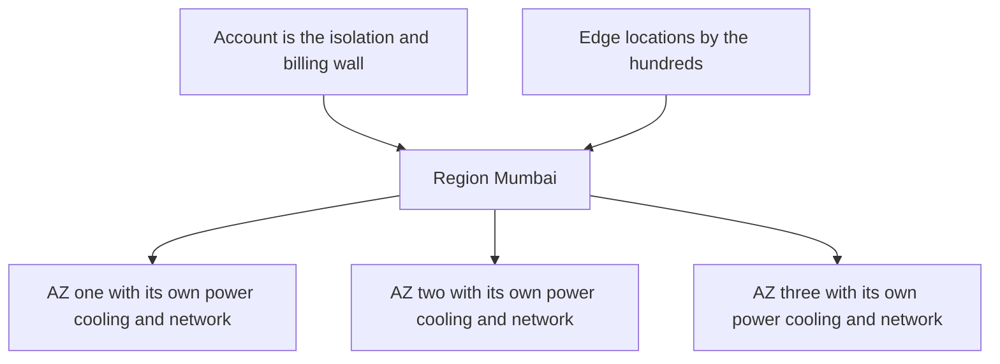
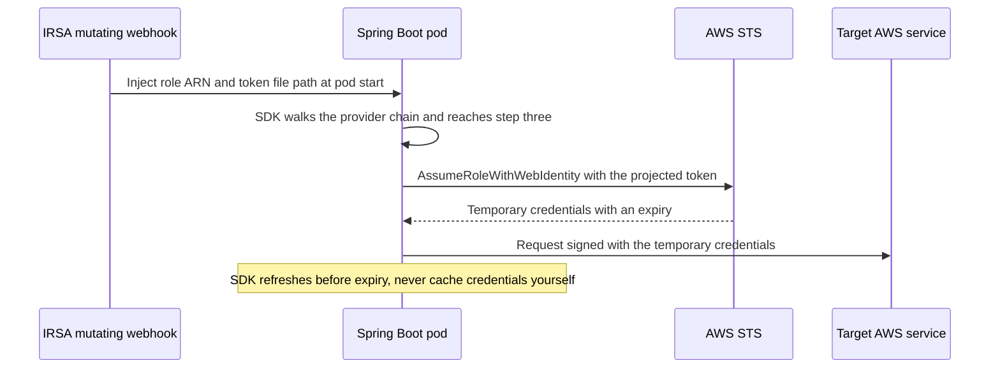

# AWS Foundations

This is the managed-AWS side of two ideas the vault already teaches: **failure domains** — redundancy only helps when the copies fail independently ([[Availability Reliability Durability]]) — and **blast-radius containment** ([[Bulkheads and Isolation]]). AWS turns both into catalogue items with exact names. An **Availability Zone** is a failure domain you rent by the hour, a **Region** is a larger one that is also a legal geography, and an **account** is the wall that stops one mistake from reaching everything else. Every other note in this module assumes this vocabulary, so the time spent here is repaid on every page after it.

## The problem that created it

Before cloud, a failure domain was something you built. One data centre is one set of shared fates — one utility feed, one cooling plant, one carrier, one flood plain — and a second site is a capital project in another city with leased fibre between them. Most companies ran one site, or ran a second as an expensive standby that was rarely exercised ([[Disaster Recovery]]). EC2 launched in 2006 in a single location; Availability Zones arrived in March 2008 and further Regions after that, because customers renting servers by the hour still needed to say "not in the same building as that one" — and needed a vocabulary precise enough for AWS to promise it.

The second problem is one a private data centre never had: **tenancy**. Very many unrelated customers share the same hardware fleet and the same API, so a network perimeter cannot answer "who may touch what, and who pays". The **account** became the unit of ownership — its own identity namespace, its own quotas, its own bill. The three boundaries answer three different questions: *what fails together* (AZ, Region), *what may act on what* (account), and *where does the data legally live* (Region).

## What it solves

- **Failure-domain choice as a purchase.** One AZ, three AZs, two Regions — you buy exactly the independence you need and no more, in minutes, with an API call instead of a construction project.
- **Placement for latency and law.** Region choice decides how far the user is and which jurisdiction the bytes sit in; both are properties you pick, not properties you inherit.
- **Blast-radius containment and attribution.** A leaked key, a wildcard IAM policy, a runaway autoscaler or a quota exhaustion stays inside one account, enforced by default-deny rather than team discipline — and every resource has exactly one owner, one invoice line and one audit scope.
- **A precise line of responsibility.** The shared responsibility model says which controls AWS operates and which are yours — the sentence an auditor and an incident review both need.

## How it works

### Regions, Availability Zones and edge locations

A **Region** is a geographic area containing a cluster of AZs, named by a code like `ap-south-1` (Mumbai). Regions are designed to be independent: separate infrastructure, separate quotas, and no resource crosses a Region boundary unless you copy it there. AWS documents a minimum of three AZs per Region; Mumbai has three, Hyderabad (`ap-south-2`) has three, and a few older Regions are the exception (US West, N. California, shows two AZs to newer accounts). AWS's infrastructure page listed 39 Regions and 124 AZs in October 2026, while its Regions reference lists 34 open to a standard commercial account (the rest sit in other partitions) — treat it as an order of magnitude, since the number only grows.

An **Availability Zone** is one or more discrete data centres with redundant power, networking and connectivity, with independent power, cooling and physical security. AZs in a Region are separated by many kilometres — far enough that a fire, flood or grid failure takes out one — but all within roughly 100 km of each other, close enough that the links between them are fast enough for **synchronous replication**. The vault's own table puts a same-Region cross-AZ round trip at about 0.5–2 ms and a cross-Region one at 50–250 ms ([[Latency Numbers Every Engineer Should Know]]). That one latency gap explains a lot of AWS product design: managed databases offer a synchronous standby in another AZ but only asynchronous replicas in another Region, so crossing an AZ costs you nothing in durability and crossing a Region costs you a nonzero RPO ([[Replication]]).

**AZ names are not physical.** `ap-south-1a` in your uat account and `ap-south-1a` in your prod account may be different buildings: AWS maps names to physical zones randomly per account, to spread load instead of piling everyone into "a". The stable identifier is the **AZ ID** (`aps1-az1`), the same physical zone in every account. Anything that must agree on physical placement across accounts — shared subnets, cross-account private connectivity, traffic you want to keep inside one AZ — has to use AZ IDs.

**Edge locations** are a separate fleet of points of presence, far more numerous than Regions (750+ CloudFront PoPs and 15 regional edge caches on AWS's infrastructure page, October 2026), that serve CloudFront caches and Route 53 DNS answers close to users ([[CDN]], [[CloudFront]], [[Route 53]]). They are not places you run your services; they are why "the data lives in the Region" carries a footnote — a cached response can sit at an edge location outside India.

What you must place yourself depends on a service's **scope**:

| Scope | Examples | Who survives an AZ loss |
|---|---|---|
| Zonal | EC2 instance, EBS volume, subnet, one ElastiCache node | You — you chose the AZ, so you must put copies in others |
| Regional | S3, SQS, SNS, DynamoDB, the EKS control plane, an ALB across the subnets you give it | AWS spreads it across AZs; your job is to use the regional endpoint and not pin it |
| Global | IAM, Route 53, CloudFront, Organizations | One control plane in a single Region, a data plane distributed worldwide |

### Why three AZs, and what multi-AZ costs

Three is not arbitrary. Lose one of three and two remain — a **majority**, the arithmetic behind every quorum system ([[Consensus and Raft]], [[Quorum Reads and Writes]]). Lose one of two and the survivor cannot tell a dead AZ from a partition, which is the [[Split Brain and Fencing]] problem. That is why clustered stores such as Kafka on MSK ([[Kafka Operations]]) are normally spread over three AZs.

The capacity price is real arithmetic. To keep serving full peak after losing one of **k** AZs, every survivor must absorb 1/(k−1) of the load, so you provision **k/(k−1) × peak** in total. Two AZs need 2.0 × peak (each safe to run at 50%), three need 1.5 × (67%), four need 1.33 × (75%). So three AZs is *cheaper* in headroom than two, which is why it is the default. This capacity must exist **before** the failure: AWS's own guidance (static stability) is not to rely on launching replacements during the event, because every other tenant in the surviving AZs is doing the same thing ([[Autoscaling]] reacts in minutes, and it cannot conjure capacity that does not exist). AWS backs the pattern with its SLA (terms as of 2026): the EC2 region-level commitment of 99.99% (about four minutes a month) applies only when instances run across two or more AZs; the instance-level commitment is 99.5% (about 3.6 hours a month). An SLA is a service-credit policy, not a promise ([[SLA SLO SLI and Error Budgets]]).

### Global vs regional services

"Global" does not mean "has no home". For IAM, Organizations, Route 53, CloudFront (and its WAF and ACM certificates) the **control plane** — the APIs you use to create and change things — lives in one Region, `us-east-1`, while the **data plane** — the part that answers traffic and checks permissions — is distributed worldwide or per Region. Some control-plane operations on regional services also lean on `us-east-1`: creating a load balancer, an ElastiCache cluster or an EKS control plane involves Route 53 record creation, and S3 bucket creation checks global name uniqueness there.

The rule that follows: **run on data planes, change on control planes, and never make recovery depend on a control-plane call.** Steady-state traffic keeps flowing when `us-east-1` is unhealthy; creating a new certificate, editing a DNS record or minting an IAM role may not. The anti-patterns AWS lists are exactly the ones teams improvise during an outage: editing Route 53 records to fail over, creating IAM resources mid-failover, provisioning load balancers in the DR Region after the fact. STS follows the same pattern: SDK for Java 2.x already targets the regional STS endpoint once a Region is configured, but with no Region set its `AssumeRoleWithWebIdentity` falls back to the global endpoint — so set the Region, and credential exchange stays in Mumbai.

### Accounts and Organizations

An **account** is the container for resources, its own root user, its own IAM users and roles, its own quotas and its own invoice line. Across account boundaries the default is deny: nothing in account A can touch account B unless B explicitly grants it (typically a role that A's principals may assume — [[IAM]]). **AWS Organizations** groups accounts into a tree: a management account at the root, organizational units below, **consolidated billing** across all of them, and **service control policies (SCPs)** attached to OUs or accounts. An SCP never grants anything — it sets the maximum permissions available to principals in member accounts, including their root users, and a deny at any level above wins whatever the account's own administrator attaches. SCPs do not apply to the management account at all, which is why that account should run no workloads.

Why prod gets its own account:

1. **Blast radius.** uat engineers typically hold broad permissions to iterate; those permissions are simply not valid in prod's account. A credential leaked from uat reaches uat.
2. **Quotas and API throttles are per account.** A load test or runaway autoscaler in uat cannot consume prod's headroom.
3. **Audit scope.** Regulated data lives in one account, so RBI and PCI evidence is collected about one account and one OU of guardrails, not about every engineer's sandbox.
4. **Separation of duties.** Different roles, different approvers, different humans — visible in the account boundary itself.
5. **Billing clarity.** The prod invoice is the prod invoice.

The honest cost is duplication: each account needs its own network baseline, its own roles, its own images or cross-account pull permissions ([[Container Registries and ECR]]), and its own copy of every guardrail. Account sprawl is a real failure mode in the other direction.

### Shared responsibility

AWS is responsible for **security of the cloud** — facilities, hardware, the virtualisation layer, and the software of the managed services themselves. You are responsible for **security in the cloud** — your data and its classification, encryption choices, identities and permissions, configuration, and everything you run on top. The line moves with abstraction: on EC2 you patch the guest OS; on a managed service AWS patches more and you keep data, access and configuration.

| Layer | EC2 you run | EKS managed node groups | S3, SQS, SNS |
|---|---|---|---|
| Facility, hardware, hypervisor | AWS | AWS | AWS |
| Kubernetes control plane | n/a | AWS | n/a |
| Node OS and AMI rollout | You | You trigger the update, AWS orchestrates the drain | AWS |
| Pod config, images, network policy | n/a | You | n/a |
| Data classification, encryption choice, IAM policies | You | You | You |

The same split applies to **resilience**: AWS owns resilience *of* the cloud (the AZs really are independent); you own resilience *in* it. A single-replica pod in one AZ is your design decision, however good the AZ is. And the split does not move your regulatory accountability: RBI's outsourcing rules, as generally read (confirm with compliance), leave the regulated entity responsible for what it outsources, and AWS gives you only its side of the evidence (AWS Artifact hosts AWS's compliance reports). Your side — CloudTrail, access reviews, configuration history — you must produce.

### Everything is an API: console, CLI, SDK, Terraform

Every capability is an HTTP API. The console, the CLI, the SDKs and infrastructure-as-code tools are four clients of the same surface. Each request is signed (SigV4) with credentials, authorised by IAM, and recorded by CloudTrail — management events appear in a free, per-Region 90-day event history by default (as of 2026) and in a trail you configure for longer retention. Consequence: anything a human can click, a pipeline can do and an auditor can replay.

**Terraform** at concept level, since Facets sits on it: you declare the *desired* resources; a **provider** translates them into AWS API calls; a **state** file records which real resource each declaration owns; `plan` diffs desired against state against reality, and `apply` issues the API calls. **Drift** is reality moving without the code — a console click — and the next plan either reverts it or fails. The practical lesson from your own Facets work: the declaration you wrote is not the resource that exists, so read the result back from the API (the rendered pod spec, not the JSON you submitted).

Every API is also **rate-limited**, per account per Region, often as a token bucket. Fifty pods restarting after a node drain each call STS and Secrets Manager in the same second; the SDK retries, and without jitter the retries synchronise ([[Timeouts Retries and Exponential Backoff]]).

### How a Java service authenticates: the credential provider chain

AWS SDK for Java 2.x walks a fixed list and stops at the first provider with complete configuration:

1. Java system properties (`aws.accessKeyId`, `aws.secretAccessKey`)
2. Environment variables (`AWS_ACCESS_KEY_ID`, `AWS_SECRET_ACCESS_KEY`)
3. **Web identity token** (`AWS_WEB_IDENTITY_TOKEN_FILE` plus `AWS_ROLE_ARN`) — the IRSA path
4. Shared profile files (`~/.aws/credentials` and `config`) — the laptop path
5. Container credentials (`AWS_CONTAINER_CREDENTIALS_*`) — ECS, and EKS Pod Identity
6. EC2 instance profile via the metadata service (IMDS) — the node-role path

**IRSA** (IAM Roles for Service Accounts) in words: EKS publishes an OIDC identity for the cluster; IAM trusts it; a Kubernetes service account is annotated with a role ARN; a webhook injects the two environment variables and a short-lived signed token into pods that use that account; the SDK trades the token to STS for temporary credentials scoped to that one role. No long-lived key exists anywhere. (EKS Pod Identity is the newer alternative that moves the association into the EKS API; [[IAM]] covers both.)

The **order is the whole failure model**. A stray `AWS_ACCESS_KEY_ID` in a Deployment beats IRSA silently, because step 2 comes before step 3 — and IRSA in turn beats an EKS Pod Identity association on the same pod, because step 3 comes before step 5, so remove the annotation when you migrate. A typo in the service-account annotation means step 3 finds nothing, and the chain falls through to step 6 — the *node's* role, reachable from pods unless IMDS access is restricted. The service then either "works" with far broader permissions than intended or fails with an `AccessDenied` that names the node role instead of its own: that mismatch is the diagnostic tell. The SDK resolves the **Region** through a similar chain, so set it explicitly rather than hoping.

### Service quotas

Every service has limits, and they are **per account per Region** unless a quota says otherwise. Some are **adjustable** — you request an increase through the Service Quotas console or API, and AWS may approve, deny or partly approve it, taking real time — and some are fixed. Categories that bite: EC2 vCPUs per instance family, VPCs and load balancers per Region, IAM roles per account, Lambda concurrency, and API request rates. No numbers here: defaults change, new accounts often start lower than old ones, and the Service Quotas console is the only authority. Instance-type limits such as ENIs and IPs per node are not quotas at all but cap pod density under the VPC CNI ([[Kubernetes Networking]], [[EC2]]). The failure shape is always the same: the limit is invisible until the day you scale into it, and it is invisible *per account*, so a quota raised in uat tells you nothing about prod. Alarm on utilisation, and raise quotas before launches and load events ([[Capacity Planning]]), not during them.

### Region choice and RBI data localisation

Four factors: distance to users, legal residency, whether the Region has the services and instance types you need, and price (rates differ by Region). For regulated data in India the first two collapse into one answer: **Mumbai (`ap-south-1`)**, enabled by default, with **Hyderabad (`ap-south-2`)** as the second India Region — it is an opt-in Region you must enable per account, which makes it a DR candidate that needs enabling *before* the day you want it.

RBI's 6 April 2018 circular on storage of payment system data requires the entire data to be stored in systems only in India (the foreign leg of a cross-border transaction may also be stored abroad); RBI's FAQs add that processing abroad is allowed if the data is deleted there and brought back within one business day or 24 hours, whichever is earlier. AWS states it will not move or replicate your content outside your chosen Regions without your agreement, so data leaves India only when *you* send it: cross-Region replication or backup, logs and metrics shipped to a non-India SaaS, a CloudFront edge cache holding a response, a developer laptop pulling a prod dump. Two deterministic guardrails beat vigilance: an SCP that denies actions outside the approved Regions (with exemptions for global services), and a config rule that flags any bucket, key or database outside them. What counts as payment system data for a product is a compliance determination, not an engineering one — this note teaches the mechanism, not the legal answer.

### Cost shape

Four meters sit under every service's bill; [[AWS Cost Shape]] teaches the skill in full.

| Driver | The meter counts | Typical surprise | Lever |
|---|---|---|---|
| Compute hours | Instance, node or container time while it exists, busy or idle | Idle uat clusters; over-provisioned nodes | Right-size, schedule down, commitments |
| Storage GB-months | Bytes retained × time | Old snapshots, "keep logs forever", versioned buckets | Lifecycle and retention rules |
| Requests | API calls and operations | Millions of tiny S3 writes, empty queue polls, chatty metrics | Batch, long-poll, aggregate |
| Data transfer | GB moved: out to the internet, between Regions, between AZs | Cross-AZ chatter in a multi-AZ design | Keep traffic in-AZ, in-Region; CDN; endpoints |

Data transfer is where foundations meet the bill (shape as of 2026; rates vary by Region, so read the pricing page rather than memorising a figure): inbound from the internet is free; egress to the internet and between Regions is billed per GB; traffic between AZs in a Region is billed per GB on **both** sides of the crossing (about a cent per GB each way, as of 2026, approximate); traffic inside one AZ over private IPs is free. Fixed hourly or monthly fees (EKS cluster-hours, load-balancer-hours, hosted zones, secrets) form a floor that runs at zero traffic, and each extra account duplicates its own floor.

## Trade-offs

| You gain | You pay |
|---|---|
| Independent failure domains in minutes | k/(k−1) capacity headroom, cross-AZ transfer on both sides, about a millisecond per crossing |
| Account walls: blast radius, audit scope, quotas | A duplicated baseline per account, cross-account plumbing, promotion pipelines |
| Region as legal geography you control | Feature and price variance by Region; opt-in Regions; DR options constrained by law |
| Everything scriptable and auditable | Everything rate-limited, quota-capped, IAM-gated; click-ops drift |

## Failure modes

- **Multi-AZ on paper, single-AZ in practice.** Nodes span three AZs but the service has one replica, or its EBS volume is pinned to one zone. *Signal:* an AZ event takes the service down although "we are multi-AZ". *Confirm:* map pods to the `topology.kubernetes.io/zone` label of their node. *Fix:* two or more replicas spread by topology constraint; replicate stateful data across AZs at the application layer.
- **The surviving-AZ crunch.** An AZ degrades, every tenant launches replacements in the other two, and instance launches fail for lack of capacity. *Fix:* static stability — pre-provisioned headroom, not reactive scaling.
- **AZ-name mismatch across accounts.** uat and prod place "the same AZ" in different buildings, so cross-account private traffic crosses AZs unseen and is billed. *Fix:* compare AZ IDs.
- **Quota ceiling at peak.** Node scale-out fails with a vCPU-limit error at exactly the moment you need it. *Fix:* utilisation alarms and pre-event raises.
- **Control-plane dependence in the recovery path.** The October 2025 `us-east-1` event — an empty DNS record on the regional DynamoDB endpoint, fixed in under three hours, followed by almost twelve more hours of cascading EC2, NLB and Lambda recovery per AWS's post-event summary — showed how regional services share fate with their dependencies, and global control planes sit in that Region. *Fix:* pre-provision DR resources and fail over through data-plane mechanisms ([[Failure Modes in Distributed Systems]]).
- **Credential-chain surprises.** Static env keys outrank IRSA; a misconfigured service account falls through to the node role. *Fix:* no static keys in Deployments, restrict IMDS from pods, alert on node-role API activity.
- **Region drift.** A bucket created in the wrong Region because the console selector or SDK default said so. *Fix:* the Region-deny SCP and a config rule.

## When NOT to use it

- **Multi-Region active-active as a default.** It doubles the stack and brings data-conflict problems for a risk a multi-AZ design plus tested backups mostly covers; climb the [[Disaster Recovery]] ladder only as far as the RTO and RPO demand.
- **Full multi-AZ for throwaway environments.** A scratch sandbox can sit in one AZ. Beware the opposite error — a uat topology unlike prod hides prod's cross-AZ behaviour.
- **An account per microservice for a small team.** Sprawl multiplies baselines and cross-account roles. Start with prod and uat plus a management account, and split when a blast-radius or audit-scope reason appears.
- **The default Region by habit.** Tutorials use `us-east-1`; regulated Indian data does not.

## In your stack

- **uat and prod are separate accounts**, so each has its own quotas, roles and guardrails. Promotion of images crosses the boundary through ECR cross-account permission or replication, and any placement that must match across them uses AZ IDs.
- **ap-south-1 holds regulated data.** `ap-south-2` is the in-India Region if a DR copy is ever needed (opt-in, enable it early). Adding any non-India Region or non-India log destination for payment data creates new regulatory scope under RBI localisation — flag it before building, per the org rule.
- **Managed node groups are zonal EC2; the EKS control plane is regional** ([[Kubernetes Architecture]], [[EKS vs ECS]]). With many services at 1 replica, an AZ loss takes those pods down until they reschedule onto nodes in surviving AZs — minutes, not zero — and the parallel-availability gain of [[Availability Reliability Durability]] needs a second replica in a different AZ. Spreading nodes still buys fast rescheduling, and the regional dependencies (SQS, SNS, S3, the control plane) survive.
- **Hops cross AZs by default.** CloudFront to ALB to Kong to pod to Redis or Mongo: with pods spread evenly over three AZs, about two thirds of random hops cross a zone, each billed on both sides and about a millisecond slower, and a four-hop chain multiplies it. At 1 replica most callers have no same-AZ endpoint to prefer.
- **Pods authenticate through IRSA**, and Mongo's `MONGODB-AWS` mechanism needs `aws-java-sdk-sts` on the classpath for the web-identity exchange. That is an SDK v1 dependency, and SDK v1 reached end of support at the end of 2025; MongoDB's driver docs describe supporting either SDK generation from driver 4.8, so check your driver version when you next upgrade.
- **The CloudFront certificate lives in `us-east-1`** while everything else is in Mumbai (the ALB certificate stays in `ap-south-1`) — expected, not a mistake ([[WAF and ACM]]). Terraform or Facets changes to CloudFront, Route 53 or IAM are control-plane calls that could stall in a `us-east-1` event while traffic keeps flowing.
- **Log AWS request IDs** beside your `x-correlation-id`; every AWS API response carries one, and support cases need it. When the network bill moves, inspect cross-AZ transfer and NAT processing first.

## Interview angle

The 60-second "what is an AZ" answer: *"An Availability Zone is one or more data centres in a Region with their own power, cooling and network, separated by kilometres — far enough that one fire or grid failure takes out one — but within about 100 km, so the links between them are fast enough for synchronous replication. A Region is a cluster of at least three AZs and is independent of other Regions, which is why it is also the unit of data residency. We deploy across AZs because it is the baseline HA move: an AZ-scale event is the failure class AWS expects you to plan for, and surviving one is cheap. It is not free: you provision k over k minus one times peak capacity, pay per GB for cross-AZ traffic on both sides, and add about a millisecond per crossing. Three AZs is the default because losing one leaves a majority, and needs only 1.5 times peak."*

Probes:

- "Why three AZs, not two?" — quorum, and 1.5× versus 2× headroom.
- "Is multi-AZ disaster recovery?" — no: same Region, same account, same control plane. It covers an AZ, not a Region outage, a bad deploy or a deleted database ([[Disaster Recovery]]).
- "How does a pod call S3 without keys?" — IRSA: projected token, STS exchange, temporary credentials; walk the provider chain and say what outranks it.
- "Your Region is Mumbai and `us-east-1` is down — what breaks?" — mostly control-plane changes, not traffic.

## Check yourself

> [!question]- Q: Explain to a junior engineer why AZs are "kilometres apart but within 100 km", and what that buys and costs.
> Far enough apart that a localised event (fire, flood, grid failure) hits one AZ; near enough that round trips stay around a millisecond, so a synchronous standby in another AZ is practical and loses no committed data. The cost of distance shows up as a roughly millisecond hop and cross-AZ transfer charged per GB on both sides. Between Regions the gap becomes tens to hundreds of milliseconds, so replication turns asynchronous and you accept a nonzero RPO.

> [!question]- Q: A service runs one replica on a node group spanning three AZs. The team says "we are multi-AZ". What is true, what is false, and what happens when that pod's AZ fails?
> True: the infrastructure is multi-AZ, regional dependencies survive, and nodes exist in other AZs. False: the service is not highly available — one pod is one failure domain. When its AZ fails, the pod dies and the scheduler must start it on a surviving node, so the outage lasts roughly the detection, scheduling and startup time. To genuinely tolerate an AZ loss, run two or more replicas spread across zones and size so the remainder carries peak. Arithmetic: if peak needs 6 nodes, three AZs need 3 each, 9 in total (1.5 ×), so that losing an AZ leaves 6.

> [!question]- Q: A pod calling S3 gets AccessDenied, and the error names the node instance role, not the service's own role. Diagnose it.
> The SDK did not find web-identity configuration, so the credential chain fell through to the instance profile. Check the service-account annotation for the role ARN (typo, wrong namespace or account), that the pod uses that service account, that the webhook injected `AWS_ROLE_ARN` and `AWS_WEB_IDENTITY_TOKEN_FILE`, and that the role's trust policy matches the service account's namespace and name. Also check for static `AWS_ACCESS_KEY_ID` variables, which outrank IRSA. Then restrict IMDS from pods so a fall-through fails loudly instead of silently borrowing the node role.

> [!question]- Q: You run entirely in ap-south-1 and us-east-1 has a long incident. What should keep working, what might break, and what should you avoid doing?
> Keep working: steady-state traffic on regional data planes — pods, ALB, SQS, ElastiCache — and the data planes of IAM and Route 53 answering permission checks and DNS. At risk: control-plane changes — new CloudFront distributions or certificates, Route 53 record edits, IAM role creation, creating new load balancers or buckets. Avoid: any recovery plan that edits DNS or creates IAM resources mid-incident. Pre-provision, and prefer health-checked records already in place.

> [!question]- Q: Mini-design — lay out accounts, Regions and guardrails for a regulated fintech with uat and prod.
> Organizations tree with an empty management account; a security/logging account for CloudTrail archives; OUs for workloads, with prod and uat as separate member accounts. SCPs on the workloads OU deny actions outside `ap-south-1` and `ap-south-2` (global-service exemptions), deny disabling CloudTrail, and deny public S3. Primary Region Mumbai across three AZs; Hyderabad enabled in advance as the in-India DR Region, with cross-account, cross-Region backup copies. Pods use IRSA, no static keys. CloudTrail trail to a locked bucket in the logging account; quota-utilisation alarms per account. Cost shape: fixed floor per account and Region, plus cross-AZ transfer.

## Sources

- AWS Global Infrastructure "Regions and Availability Zones" and AWS documentation "Regions" (AZ counts, opt-in Regions); AWS RAM User Guide "Availability Zone IDs"; Amazon EC2 SLA and on-demand pricing (data transfer).
- AWS whitepaper "AWS Fault Isolation Boundaries" (zonal, Regional and global services; control plane vs data plane); AWS Builders' Library "Static stability using Availability Zones"; AWS Well-Architected Reliability Pillar (shared responsibility for resiliency); AWS "Shared Responsibility Model" page and AWS Artifact; AWS Data Privacy FAQ.
- AWS Organizations User Guide (service control policies); Service Quotas User Guide; AWS SDK for Java 2.x Developer Guide "Default credentials provider chain"; Amazon EKS User Guide "IAM roles for service accounts"; MongoDB Java driver docs, AWS IAM authentication.
- Re-verified 2026-10-05: aws.amazon.com/about-aws/global-infrastructure/regions_az/ ; docs.aws.amazon.com/global-infrastructure/latest/regions/aws-regions.html ; aws.amazon.com/compute/sla/ ; docs.aws.amazon.com/whitepapers/latest/aws-fault-isolation-boundaries/global-services.html ; docs.aws.amazon.com/sdk-for-java/latest/developer-guide/credentials-chain.html ; docs.aws.amazon.com/sdkref/latest/guide/feature-sts-regionalized-endpoints.html ; docs.aws.amazon.com/eks/latest/userguide/pod-id-how-it-works.html ; aws.amazon.com/blogs/architecture/overview-of-data-transfer-costs-for-common-architectures/ ; aws.amazon.com/message/101925/ ; rbi.org.in/Scripts/FAQView.aspx?Id=130.
- Re-verified 2026-10-14 (Region and AZ counts, SLA terms, credential chain, STS fallback, Pod Identity precedence, SCP scope, CloudTrail event history, outage timeline): the same pages, plus docs.aws.amazon.com/ram/latest/userguide/working-with-az-ids.html ; docs.aws.amazon.com/organizations/latest/userguide/orgs_manage_policies_scps.html ; docs.aws.amazon.com/awscloudtrail/latest/userguide/view-cloudtrail-events.html ; AWS Price List API, AWSDataTransfer ap-south-1 offer published 2026-09-16 (intra-region cross-AZ USD 0.010 per GB) ; aws.amazon.com/about-aws/global-infrastructure/global-network/faqs/ ; rbi.org.in/Scripts/NotificationUser.aspx?Id=11244.
- AWS post-event summary, Amazon DynamoDB service disruption in the Northern Virginia (`us-east-1`) Region, 19–20 October 2025; RBI circular DPSS.CO.OD.No.2785/06.08.005/2017-18 (6 April 2018) "Storage of Payment System Data" and the RBI FAQs.
