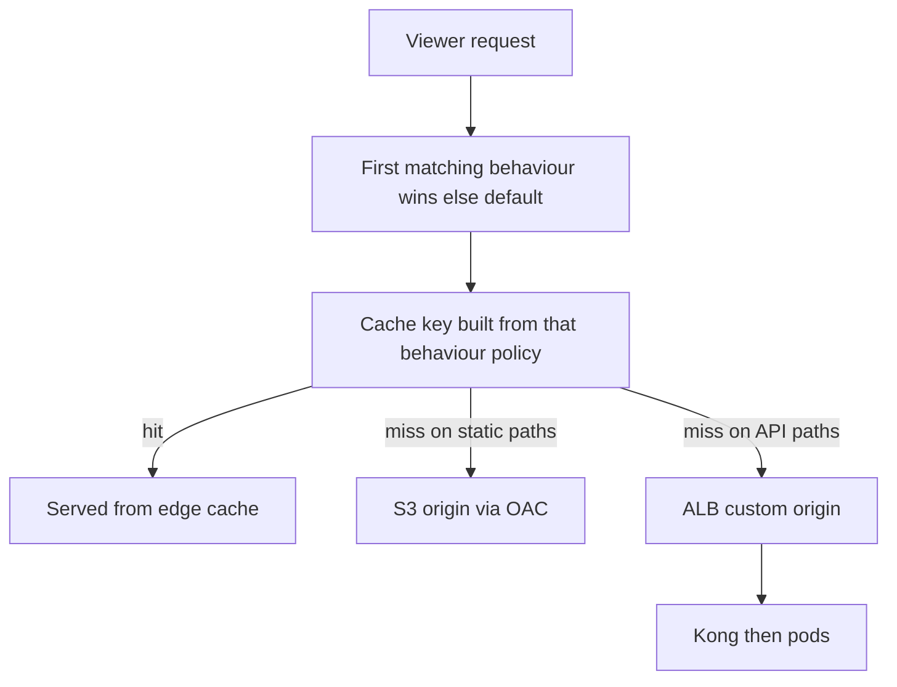
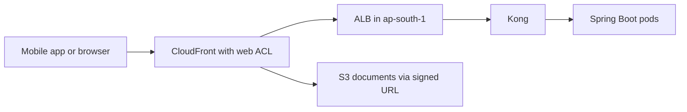

# CloudFront

CloudFront is the managed-AWS side of [[CDN]]. That note teaches the model — PoPs, the cache hierarchy, pull versus push, TTLs, signed URLs — and this one assumes it. What follows is only what is specific to CloudFront: its objects (distribution, origin, behaviour, policy), its knobs, its limits and its bill. One sentence to carry through: in CloudFront the **cache key is the product**. Almost every saving and almost every incident below is a decision about what goes into it.

## The problem that created it

Before CloudFront launched in 2008, a CDN meant a sales call, a contract, a separate dashboard and configuration that lived outside your infrastructure. AWS customers already had S3 for bytes and EC2 for compute; the missing piece was edge caching as an API call, billed per use, authenticated with the IAM, certificates and DNS they already had. CloudFront is that — a CDN you declare in the same Terraform or CloudFormation as the load balancer behind it.

The second problem matters more for a stack like yours. A regional load balancer is a *regional* front door: every client crosses the planet to its public endpoint, and every flood, scraper and exploit probe lands on capacity you pay for by the hour. CloudFront became the place AWS hangs edge protection — Shield Standard on by default, a WAF web ACL attachable per distribution — so unwanted traffic is dropped before it costs an ALB, a Kong node or a pod ([[WAF and ACM]]).

## What it solves

- **Everything in [[CDN]]** — latency, origin offload, spike absorption — as configuration rather than a vendor relationship.
- **Origin lock-down the AWS way**: S3 reachable only through the distribution (OAC), ALB or EC2 in *private* subnets reachable only by CloudFront (VPC origins).
- **Edge TLS with ACM-managed certificates** and one place to attach WAF, response headers (CORS, HSTS) and geo rules.
- **A cheap origin hop** — transfer from AWS origins into CloudFront is free, so the miss path costs compute and requests, not egress (see *Cost shape*).
- **One hostname, many origins**: static paths to S3, API paths to an ALB, chosen by path pattern.
- **Small edge programs** (rewrites, redirects, header injection, token checks) without servers.

## How it works

### Distribution, origin, behaviour

A **distribution** is the top-level config object: a `*.cloudfront.net` name, optional **alternate domain names** (your `api.example.com`, which the certificate must cover), a list of **origins**, and an ordered list of **cache behaviours**. An origin is an S3 bucket, a **custom origin** (any HTTP server — in practice an ALB), a **VPC origin** (an internal ALB, NLB or EC2 instance in a private subnet), a Lambda function URL, or an API Gateway endpoint. A **behaviour** binds a **path pattern** to one origin plus its policies: allowed methods, viewer protocol policy, cache policy, origin request policy, response headers policy, edge function associations, and optional signed-URL enforcement.

CloudFront evaluates behaviours **in the order listed** and uses the **first match**; the final `*` is the default behaviour. Order is therefore security-relevant: a broad pattern above a narrow one silently wins, and the docs warn that an earlier unsigned behaviour matching a path leaves content reachable without a signature.

### Cache policy versus origin request policy

The default cache key is just the **distribution domain plus URL path**. A **cache policy** widens it: which headers, cookies and query strings are included, whether normalised `Accept-Encoding` is included (so gzip and Brotli variants are cached separately), and the TTL triple. Everything in the cache key is *also* forwarded to the origin. An **origin request policy** is the other half: values forwarded to the origin that are **not** in the key. The split exists so the origin can receive what it needs without fragmenting the cache.

Why an everything-in-the-key policy destroys your hit ratio: the key is the object's identity, so every distinct value is a distinct cached object. `User-Agent` has thousands of variants; `Authorization` or a session cookie is unique per user. Put `Authorization` in the key and 1,000 users requesting the same URL make 1,000 origin fetches and store 1,000 copies — the hit ratio is roughly zero, nothing visibly breaks, and you pay CloudFront's per-request fee *on top of* full origin load. The rule: include a value in the key only if it changes the response bytes; if the origin merely wants to see it (analytics, a correlation header), use an origin request policy. If the response differs per user, it should not be cached at all.

Managed policies cover most needs. **CachingDisabled** has min, default and max TTL of 0 and an empty key. **CachingOptimized** has a 1-second minimum, 24-hour default and 365-day maximum, an empty key apart from normalised `Accept-Encoding`. **UseOriginCacheControlHeaders** has min 0 and default 0 so the origin decides, but keys on `Host`, `Origin` and the `X-HTTP-Method` override headers plus all cookies. **AllViewer** forwards every viewer header, cookie and query string to the origin without touching the key; **CORS-CustomOrigin** forwards just `Origin`.

### TTL interplay with origin headers

| Origin sends | Min TTL = 0 | Min TTL > 0 |
|---|---|---|
| `Cache-Control: max-age=N` (or `s-maxage`) | cached for the lesser of N and max TTL | N clamped between min and max TTL |
| nothing | default TTL | greater of min TTL and default TTL |
| `no-store`, `no-cache` or `private` | respected, not cached | **stored for the min TTL anyway** (see below) |

`s-maxage` governs CloudFront while `max-age` governs browsers, so they can differ. A viewer's own `Cache-Control` request header is ignored. `stale-while-revalidate` and `stale-if-error` are supported, bounded by the max TTL — `stale-if-error` serves the last good copy when the origin errors or is unreachable, a real resilience lever for cacheable reads. The last table cell is the sharpest edge in the service, and the docs' own warning says how it bites: while the origin is reachable CloudFront still fetches and returns the origin's response, but when the origin is unreachable it serves the stored copy (unless the origin sends `stale-if-error=0`). Separately, concurrent requests that share a cache key are **collapsed** onto one origin fetch and all receive its response; only CachingDisabled, or a minimum TTL of 0 plus `no-store` or `private` from the origin, prevents that. *Failure modes* returns to both.

### Invalidation versus versioned URLs

An invalidation evicts by path (a `*` wildcard counts as **one** path) or, since April 2026, by **cache tag** (the origin returns tags in a header you configure; you invalidate `#tag`). The first 1,000 paths a month are free across the whole account (as of 2026); beyond that you pay per path regardless of how many objects it removes, and a tag counts as one path. CloudFront's own guidance is to prefer **versioned file names**: they beat invalidation on cost, on browser and corporate-proxy caches that an invalidation cannot reach, on log analysis, and on rollback — see [[Cache Invalidation]]. Invalidation is for emergencies, not the deploy pipeline.

### Private S3 origins: OAC, and signed URLs

**Origin Access Control (OAC)** makes CloudFront sign its S3 requests with SigV4 as the service principal `cloudfront.amazonaws.com`. The bucket policy allows only that principal, conditioned on `AWS:SourceArn` equal to your distribution's ARN — so the bucket is private and no *other* distribution, even in another account, can borrow access. OAC supports SSE-KMS (the key policy must also admit the distribution) and PUT and DELETE; it replaces the legacy OAI. The bucket must be a normal S3 endpoint, not a website endpoint. S3 itself is in [[How S3 Works]] and [[S3 Deep Dive]].

For per-user private content, use **signed URLs** (one object) or **signed cookies** (many). The AWS-specific machinery is the **trusted key group**: you upload a public key (RSA 2048 or ECDSA 256), put it in a key group and attach the group to a behaviour; CloudFront then rejects any request without a valid signature. Key groups are managed through the API and IAM, unlike the legacy root-account key pairs, so they can be automated and rotated. A **custom policy** adds a start time and an IP range; a canned policy only an expiry. CloudFront validates at the edge, without a call to your origin. This is not an S3 presigned URL, which S3 validates against an IAM principal.

### HTTPS: two certificates in two regions

Viewer-facing TLS needs an ACM certificate in **us-east-1** that covers your alternate domain names — CloudFront is global, and the docs state the viewer certificate must be requested or imported there. The CloudFront-to-origin hop is a separate TLS session: with an ALB origin the origin certificate can live in *any* region (yours is in ap-south-1), but one of its names must match the origin domain name or CloudFront returns **502**. Use origin protocol policy HTTPS only and forward `Host` (the `AllViewer` policy does). SNI is the default and carries no extra fee; dedicated-IP custom SSL is an optional add-on billed monthly. Renewal and CAA details are in [[WAF and ACM]]; handshakes are in [[TLS and HTTPS]].

### Edge functions: CloudFront Functions versus Lambda at Edge

| | CloudFront Functions | Lambda at Edge |
|---|---|---|
| Runtime | JavaScript, ES 5.1-compliant core | Node.js and Python |
| Runs at | edge locations | regional edge caches |
| Events | viewer request, viewer response | viewer and origin, request and response |
| Duration | sub-millisecond | up to 30 s on every event (2026 quota) |
| Limits (2026 quotas) | 10 KB code, 2 MB memory, both fixed | 50 MB package; 128 MB memory on viewer events, up to 10 GB on origin events |
| Network, file system, request body | none | yes |
| Authored in | CloudFront | us-east-1, replicated out |

Use Functions for key normalisation, redirects, header injection and cheap token checks (a JWT signature is the doc's example); use Lambda at Edge when you need a network call, a library or the body. Functions are cheaper per invocation and have no duration charge — as of 2026, approximate, about $0.10 per million invocations against Lambda at Edge's $0.60 per million plus GB-seconds. A third, newer type, **Connection Functions**, runs during the TLS handshake for viewer mTLS; it is out of scope here. The event carries `context.requestId`, a string identifying the CloudFront request, so a viewer-request function can mint an `x-correlation-id` when the client sent none.

### Origin Shield, geo-restriction, and CloudFront in front of an API

**Origin Shield** adds one more cache layer, in a region you pick (ap-south-1 is supported), through which all regional caches funnel so misses collapse into one origin fetch. Billing is per request through the layer. The docs call it a poor fit for dynamic content proxied to the origin, and they count `POST`, `PUT`, `PATCH`, `DELETE` and any `GET` or `HEAD` with a TTL under 3,600 seconds or caching disabled as *dynamic* — for those it is a pure added layer.

**Geo-restriction** is a country allow or deny list for a whole distribution; blocked viewers get 403. It uses a third-party IP database, and if the location cannot be determined CloudFront **serves the content**. Finer rules belong in WAF geo match.

**In front of an API** it caches nothing yet still buys four things: TLS and TCP setup happen at a nearby edge instead of across the planet (the point for long-RTT mobile users); the edge reuses warm connections to the origin (keep-alive defaults to 5 seconds and is configurable up to 300 on custom and VPC origins — 2026 default quota); WAF and Shield act before your ALB; and the origin can be hidden. It does not speed up your compute, and only `GET`, `HEAD` and `OPTIONS` are cacheable. The origin response timeout defaults to 30 seconds and is configurable from 1 to 120 as a 2026 default quota, higher only on request; longer calls need asynchrony. After a read timeout CloudFront retries `GET` and `HEAD` up to the connection-attempts setting but does **not** retry `POST`, `PUT`, `PATCH`, `DELETE` or `OPTIONS` — the client must resubmit, which is why write endpoints need [[Idempotency]].

### Cost shape

The bill scales with **per GB out to the internet by viewer region** (tiered downward with volume; the always-free tier, as of 2026, is 1 TB, 10 million requests and 2 million CloudFront Functions invocations a month) plus **per request** (per 10,000, HTTPS dearer than HTTP, rates vary by region) plus **per GB for data sent *to* your origin** (request bodies). Transfer from AWS origins (S3, ALB, EC2) *into* CloudFront is free; a non-AWS origin pays its own egress. That is why fronting an AWS origin is usually cheaper than serving the same bytes straight to the internet: direct egress pays the regional internet-egress rate on every byte, while behind CloudFront the origin leg costs nothing and only CloudFront's own, tiered rate (with its free first TB) applies. Smaller meters: invalidation paths past the free 1,000, **Origin Shield per 10,000 requests**, edge functions (Functions per invocation; Lambda at Edge per request plus GB-seconds), real-time log lines. **Price classes** drop the most expensive edge locations from your fleet; as of 2026 Price Class 100 covers North America, Europe and Israel and *excludes India*, which is in Class 200, so choosing it for an India-heavy base lowers the rate but serves Indian viewers from a farther edge — pick Class 200 or All. Since November 2025 CloudFront also sells flat-rate monthly plans without overage charges — tiers from free to about $1,000 a month as of 2026, approximate, bundling WAF, DNS and logging allowances ([[AWS Cost Shape]] covers that shift).

For a small-payload API the **request** meter dominates, not the GB meter. Worked example, order of magnitude, as of 2026 and approximate: 1,000 requests a second sustained is about 2.6 billion requests a month; at roughly 1 cent (US) to 1.2 cents (India) per 10,000 HTTPS requests that is on the order of $2.6k to $3.1k in request fees, while 1 KB responses add only about 2.6 TB of transfer, of which the first TB is free — low hundreds of dollars. Check your region's column before quoting. The lever is the **hit ratio**: a hit never reaches the ALB, Kong or a pod.

## Trade-offs

| You gain | You pay |
|---|---|
| Edge TLS, DDoS absorption, WAF attachment, origin hiding | A per-request fee on every call, cacheable or not, plus one more hop and one more config surface |
| Origin offload proportional to hit ratio | A cache key you must design; a wrong key is either no savings or a data leak |
| Free transfer from AWS origins; one hostname for many origins | Region-specific certificate rules; global config changes take minutes to propagate |
| Declarative edge behaviour (headers, redirects, tokens) | Behaviour-order and policy interactions that fail silently |

## Failure modes

- **Cache key includes `Authorization` or a session cookie, so nothing caches.** *Signal:* hit ratio near 0 on a path you thought was cached, origin request count equal to viewer request count. *Fix:* remove it from the cache policy; if the response is per-user, use CachingDisabled deliberately.
- **The opposite failure — a policy minimum TTL above 0 overrides `no-store` and `private`.** CachingOptimized has a 1-second floor. CloudFront strips `Authorization` from `GET` and `HEAD` by default, so on its own the origin would answer 401 and nothing personalised would be cached; the leak needs CachingOptimized paired with an origin request policy that forwards `Authorization` (AllViewer, or the header listed individually). Then the key has no identity: concurrent requests for the same path are collapsed onto one user's origin fetch and all receive that user's response, and while the origin is unreachable (a restarting single-replica pod) the stored copy is served to whoever asks next. The docs warn that forwarding `Authorization` without keying it lets CloudFront serve the same cached response to authorised and unauthorised viewers. *Fix:* CachingDisabled on every behaviour that can return a personalised body, and never CachingOptimized by default. This is the real fintech data-leak path.
- **Behaviour order routes an API path to the S3 origin.** An API path that misses its pattern (a new `/v2/` prefix) falls to the default `*` behaviour and S3 answers with an XML `AccessDenied` body. *Signal:* S3-shaped error pages from API calls. *Fix:* make the default behaviour the safe one and keep patterns reviewed like code.
- **Invalidation storm on every deploy.** A pipeline that invalidates every changed file burns paths — 200 files, 15 deploys a day, 22 days is about 66,000 paths a month, roughly $325 past the free tier at half a cent a path (as of 2026) — and each purge sends a miss wave at the origin. *Fix:* fingerprinted asset names plus a short-TTL HTML shell.
- **CORS headers stripped.** The origin only emits `Access-Control-Allow-Origin` when it *sees* `Origin`; if neither policy forwards it, or the first cached response lacked CORS headers, browsers fail only via CloudFront while the direct ALB works. *Fix:* forward `Origin` (CORS-CustomOrigin) and include it in the key, or set CORS in a **response headers policy** — consistent with the rule that CORS lives at the edge ([[CORS]]).
- **Stale deploy because the HTML was cached.** With no `Cache-Control` the default TTL applies (24 hours in CachingOptimized), so the shell keeps pointing at old bundles. *Fix:* `no-cache` or a short TTL on HTML, `immutable` on fingerprinted assets.
- **Origin reachable around the edge.** A public ALB DNS name lets an attacker skip CloudFront and its WAF. *Fix:* VPC origin on an internal ALB, or the CloudFront managed prefix list in the security group plus a secret custom header the listener requires. The prefix list alone only narrows the network: it admits *every* CloudFront customer's distribution, so the secret header (or the VPC origin's service-managed security group, which admits only your distributions) is what binds the ALB to yours.
- **502 from a certificate mismatch** between the origin domain name and the ALB certificate. On cacheable behaviours CloudFront also caches error responses (10 seconds by default as of 2026; not under CachingDisabled), so a transient 5xx can briefly outlive the fault.

## When NOT to use it

- **Purely internal services** — traffic from inside the VPC or over private links gains nothing from an internet edge ([[VPC and Networking]]).
- **When caching is the only reason and nothing is cacheable** — you would pay the request fee for no offload; keep it only if edge security or origin hiding justifies it.
- **Regulated responses you may not replicate** — cached bytes sit in edge locations wherever viewers are, not only Mumbai. Keep them `no-store` and ask compliance rather than assume; this is possible new regulatory scope for data-localisation, not a legal conclusion.
- **Very long-running synchronous calls** beyond the origin response timeout.

## In your stack

- **Default to not caching.** For an API distribution like yours, make the default behaviour CachingDisabled with an origin request policy that forwards what Kong needs, and opt specific public paths *in*. Cache: fingerprinted app assets, app-download binaries, genuinely public JSON (feature flags, JWKS with a short TTL so key rotation propagates). Never cache: anything carrying `Authorization`, account, KYC, balance or transaction data, login and OTP calls, and every `POST`. Confirm the origin also sends `Cache-Control: no-store`.
- **Statements and KYC documents**: S3 with OAC, delivered through short-expiry signed URLs; the app authenticates, performs the ownership check, then signs. Keep the signing key in [[Secrets Manager Parameter Store and KMS]].
- **Close the ALB.** Allow only the CloudFront prefix list in its security group and require a secret header at the listener (rotated, stored in Secrets Manager), or move to a VPC origin. Anything else makes the edge WAF optional.
- **Client IP and correlation**: at the TCP layer Kong sees the ALB node's address. The viewer is in `X-Forwarded-For`, which ends `viewer, CloudFront edge` (CloudFront appends the viewer to whatever the client sent, then the ALB appends the edge), so the viewer is second from last and anything earlier is client-supplied. Verify Kong's trusted-proxy and real-IP settings, or per-IP limits key on the wrong address. Edge hits and blocks never reach Kong, so inject `x-correlation-id` once — in a viewer-request function or at Kong, not both. Every request that does miss already carries an `X-Amz-Cf-Id` header (a unique CloudFront request identifier), which Kong can log alongside your own ID to join the two traces.
- **One replica**: CloudFront cannot mask a restarting pod for uncacheable calls, but `stale-if-error` keeps cacheable public reads alive through a pod restart.
- **Separate accounts**: uat and prod each need their own us-east-1 viewer certificate, distribution and web ACL; Origin Shield, if used, belongs in ap-south-1.

## Interview angle

The 60-second answer to *"why CloudFront in front of an API that serves no static files?"*: *"Not for caching — for the edge. First, connection setup: TLS and TCP handshakes terminate at a nearby edge instead of crossing the planet, and the edge keeps warm connections to my origin, which matters most for mobile users on long, lossy paths. Second, security: a WAF web ACL and Shield Standard act at the edge, so floods and bots are dropped before they spend ALB capacity or a single-replica pod, and the origin can be hidden with a VPC origin or a prefix list plus secret header. Third, one front door: certificates, hostnames, CORS and security headers, and path routing to S3 and the API live in one place. Fourth, option value: a few public GETs can be cached with stale-if-error. The cost is a per-request fee on every call and a cache key I must get right, so API behaviours are explicitly CachingDisabled so nothing personalised is stored."*

Probes: *what is in the cache key and why does it matter* (identity of the object; minimal); *invalidate or version* (version; first 1,000 paths free, wildcard is one path); *Functions or Lambda at Edge* (sub-millisecond viewer-only versus network and body); *why us-east-1* (global service, viewer certificate lives there; the ALB certificate does not).

## Check yourself

> [!question]- Q: Explain why adding `Authorization` and `User-Agent` to the cache key "to be safe" is harmful, and what to use instead.
> The cache key is the object's identity, so each distinct header value creates a separate cached copy. `Authorization` is unique per user and `User-Agent` has thousands of variants: 1,000 users fetching one URL cause 1,000 origin fetches and 1,000 stored copies — a hit ratio near zero, full origin load, and the per-request fee on top. Include only values that change the response bytes; if the origin merely wants to read a header, forward it with an **origin request policy**, which does not touch the key. If the response is per-user, do not cache it at all (CachingDisabled).

> [!question]- Q: After moving the API behaviour to CachingOptimized "for performance", a user reports briefly seeing another customer's balance. How can that happen, and what is the fix?
> The precondition is CachingOptimized paired with an origin request policy that forwards `Authorization` (for example AllViewer); CloudFront strips `Authorization` from `GET` and `HEAD` by default, so without that pairing the origin would return 401 and nothing personalised would be cached. CachingOptimized has a 1-second minimum TTL, and a minimum TTL above 0 makes CloudFront store the response for at least that long *even when the origin sends `no-store` or `private`*. With an empty cache key (no identity in it), concurrent requests for the same path are collapsed onto the first user's origin fetch and all receive that response, and if the origin becomes unreachable the stored copy is served to the next viewer. Fix: CachingDisabled on every behaviour that can return personalised data, a minimum TTL of 0 anywhere else, and a check that the origin still sends `no-store`. Treat it as a reportable data-exposure incident and purge.

> [!question]- Q: The web app fails with a CORS error through `api.example.com` but works when you hit the ALB directly. Where do you look?
> At what CloudFront forwards and caches. The origin emits `Access-Control-Allow-Origin` only when it receives an `Origin` header; if no policy forwards `Origin`, the origin never emits it, and a response cached without CORS headers is then served to everyone. Check the cache and origin request policies, forward `Origin` and include it in the key (CORS-CustomOrigin), or add CORS headers in a response headers policy at CloudFront. Also confirm the behaviour's allowed methods include `OPTIONS` for preflights.

> [!question]- Q: Why does an HTTPS distribution in front of an ALB need two certificates, and where does each live?
> There are two independent TLS sessions. Viewer to CloudFront presents the certificate for your alternate domain name, which must be an ACM certificate requested in **us-east-1**. CloudFront to the ALB presents the ALB's certificate, which can be in any region — ap-south-1 for yours — but must contain a name matching the origin domain name, or CloudFront returns 502. Origin protocol policy should be HTTPS only, with `Host` forwarded.

> [!question]- Q: Mini-design — a fintech serves a single-page app (S3), a JSON API (ALB to Kong), and monthly PDF statements (S3, private). Sketch the distribution.
> One distribution, three behaviours in order. (1) `/statements/*`: S3 origin with OAC, trusted key group so only signed URLs work, a short-expiry signature minted by the app after the ownership check. (2) `/api/*`: ALB custom origin (or VPC origin), CachingDisabled, an origin request policy that forwards `Authorization` (CloudFront strips it from `GET` and `HEAD` otherwise; list it individually or use AllViewer), `Origin` and the viewer headers Kong needs, all methods allowed, response headers policy for CORS and HSTS. (3) Default `*`: the SPA bucket with OAC, CachingOptimized, fingerprinted assets, short-TTL `index.html` — remembering that an API prefix which misses its pattern lands here, so test the API patterns in CI. Web ACL on the distribution; ALB locked to CloudFront; Price Class 200 or All for India. Cost levers: hit ratio on statics, no per-file invalidation, no Origin Shield on the API.

## Sources

- Amazon CloudFront Developer Guide — "Control the cache key with a policy", "Understand the cache key", managed cache policies and managed origin request policies, "Manage how long content stays in the cache (expiration)", "Invalidate files to remove content", "Invalidating content by cache tags" (What's New, April 2026), "Pay for file invalidation".
- Amazon CloudFront Developer Guide — "Restrict access to an Amazon S3 origin" (OAC), "Restrict access to Application Load Balancers", "Restrict access with VPC origins", signed URLs and cookies and trusted key groups, "Requirements for using SSL/TLS certificates with CloudFront", Origin Shield, geographic restrictions, CloudFront Functions event structure, "Differences between CloudFront Functions and Lambda@Edge", Connection Functions, "Request and response behavior for custom origins", and Quotas.
- Amazon CloudFront pricing pages (pay-as-you-go dimensions, free tier, price classes, flat-rate plans announced November 2025) — figures quoted only as orders of magnitude, as of 2026.
- AWS WAF Developer Guide — "AWS WAF logging" and the web ACL association notes, for how CloudFront and WAF interact (detail in [[WAF and ACM]]).
