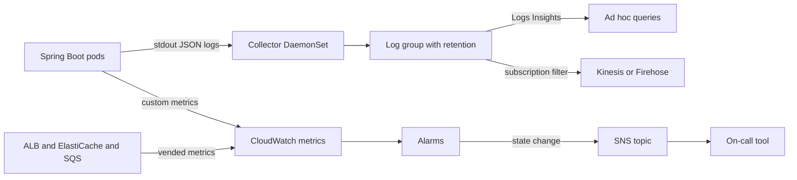
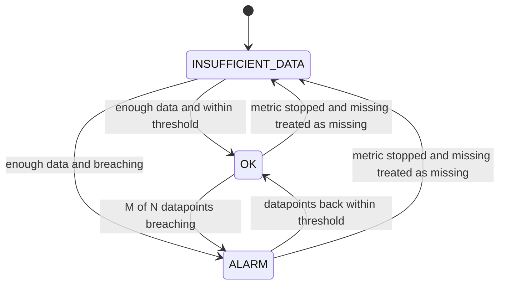

# CloudWatch

CloudWatch is the managed-AWS side of [[Logs Metrics and Traces]] (the three telemetry signals) and [[Alerting and On-Call Design]] (turning signals into the right page for the right person). It is a metrics store, a log store and an alarm engine behind one name, plus dashboards, a query language and the glue to everything else AWS runs. Most AWS services write to it with no agent, which is why it exists. The generic notes say what to measure and when to page; this note covers what is AWS-specific — how its data model is shaped, where it quietly costs money, and the ways its alarms lie by omission.

## The problem that created it

You cannot install an agent on an ALB, a managed Redis node or an SQS queue. For managed services the provider has to push telemetry *out*, to somewhere with an identity model, a retention model and an alarm engine you do not run. CloudWatch was that sink: services publish metrics into it per Region, under IAM, and the default metrics for AWS resources are generally free of charge. It then grew outward — your own metrics, container logs, a query language, alarms whose actions reach Auto Scaling and SNS.

That convenience created the second problem. CloudWatch meters in units nobody sees at review time — bytes logged, distinct metric series, bytes scanned by a query — so the bill grows with *habits*, not with traffic ([[AWS Cost Shape]]).

## What it solves

- **Telemetry for things you cannot instrument** — ALB, ElastiCache, SQS, RDS and the rest emit metrics on their own ([[ALB and NLB]], [[ElastiCache for Redis]]).
- **One regional place for logs and metrics**, encrypted with KMS and governed by IAM, with no cluster to run ([[IAM]]).
- **An alarm engine with actions** — notify an SNS topic, trigger Auto Scaling, run a Lambda or open a Systems Manager item.
- **Ad hoc log queries** without standing up a search cluster (Logs Insights).
- **Container telemetry on EKS** through one add-on.
- **What it does not solve** — it does not decide what is worth alerting on, does not make high-cardinality analytics affordable, and is not an application audit trail.

## How it works



### Metrics

A metric is a time series identified by a **namespace**, a **name** and a set of **dimensions**. AWS services publish under `AWS/<service>` (`AWS/ApplicationELB`, `AWS/ElastiCache`, `AWS/SQS`); your own metrics need a namespace you choose. Dimensions are name/value pairs that are part of the metric's identity — up to 30 per metric (fixed limit, as of 2026) — and CloudWatch treats each unique combination as a separate metric. Two consequences define the service:

- **Cardinality is the bill.** Tag a latency timer with `merchantId` and you have not added a label to one metric; you have created one billable metric per merchant. Custom metrics are charged per metric per month, so a high-cardinality dimension — user id, request id, a pod name that churns — is the classic CloudWatch trap. Per-request identifiers belong in logs and traces (the vendor-neutral cardinality model is in [[Logs Metrics and Traces]]).
- **No automatic roll-up for custom metrics.** CloudWatch does not aggregate across dimensions for your own metrics: you can only query combinations you published. A "total across all services" series must be published as its own series — more cardinality.

**Resolution and retention.** Standard metrics have one-minute granularity; high-resolution custom metrics are stored at one second, and alarms on them can use a 10- or 30-second period at a higher alarm price (as of 2026). Data is rolled up as it ages: sub-minute points live 3 hours, one-minute points 15 days, five-minute points 63 days, hourly points 455 days (15 months), as of 2026. A graph of last quarter is therefore hourly averages and a short spike is simply gone. Metrics are per Region.

**Percentiles.** Some AWS metrics support them (ALB `TargetResponseTime` accepts `pNN.NN`); for custom metrics you get percentiles only if you publish raw data points. Pre-aggregated statistic sets (min, max, sum, count) cannot produce a p99, so a team that pre-aggregates to save API calls has quietly deleted its tail.

**Publishing from the JVM.** Three routes. The SDK's `PutMetricData` (Micrometer's CloudWatch registry batches it, mapping tags to dimensions). **Embedded metric format (EMF)**: the service writes a structured JSON log line carrying a metrics declaration and CloudWatch extracts the metrics asynchronously — it needs only permission to write logs, bills the log ingestion *and* the extracted custom metrics, and has the same cardinality trap. And, now also documented as a recommended path, OpenTelemetry metrics ingestion (labels instead of dimensions, up to 150 per metric as of 2026, PromQL queries and PromQL alarms, billed per GB ingested rather than per series).

### Logs

A **log group** is the unit of retention, encryption and access control; a **log stream** is a sequence of events from one source, such as a container. Points that matter:

- **Retention — the default is never expire.** A log group keeps data until you set a period; storage is billed per GB-month, so forgotten groups cost more every month. Physical deletion after expiry is lazy (typically up to 72 hours, as of 2026), but events marked for deletion stop counting toward storage charges at once — the lag matters for a compliance "deleted by" date, not for the bill. Set it in infrastructure code at creation; for regulated data it is a compliance number, not a cost knob.
- **Log classes.** Standard is full-featured. Infrequent Access has a lower ingestion price but no subscription filters, metric filters, Live Tail, EMF, anomaly detection, field indexing or `GetLogEvents`/`FilterLogEvents`, and it cannot receive Container Insights or Lambda Insights logs; the class cannot be changed after creation, and storage and query charges are the same as Standard.
- **Logs Insights** is a pipe-delimited query language — `fields`, `filter`, `stats`, `sort`, `limit`, `parse`, `dedup`, with newer `join`, `lookup` and sub-queries, plus OpenSearch PPL and SQL dialects. JSON logs are auto-discovered into fields, so a structured line with `correlationId` is directly filterable (example below). Queries are billed by data scanned, so narrow the log groups and the time range — and remember a dashboard widget that runs a query re-runs it on every refresh.

```
fields @timestamp, level, message
| filter correlationId = "7f3c-example" and level = "ERROR"
| sort @timestamp desc
| limit 50
```

- **Subscription filters** stream matching events in near real time (usually under three minutes) to Kinesis Data Streams, Firehose or Lambda, and onward to OpenSearch. Delivery is at-least-once, up to five filters per log group (non-adjustable quota, as of 2026), Standard class only. Retryable errors are retried for up to 24 hours; a non-retryable one (a revoked permission) disables the filter for up to ten minutes and events in that window are skipped (both windows as of 2026).
- **Metric filters** turn log patterns into metrics without code — handy for legacy services, but the output is again a custom metric. **Data protection policies** can mask sensitive fields at ingestion for an extra per-GB charge; the better control is never logging KYC data ([[Logs Metrics and Traces]]).

### Alarms

A classic metric alarm watches one metric (or a metric-math expression); newer alarm types evaluate a Metrics Insights, PromQL or log query and can track many series as separate contributors. Every alarm sits in one of three states: `OK`, `ALARM`, `INSUFFICIENT_DATA`. Four settings define it: the statistic and **period** (the aggregation window), the **threshold**, **evaluation periods** (N recent periods to look at) and **datapoints to alarm** (M of them must breach, not necessarily consecutively). "3 of 5 one-minute periods with p99 above 500 ms" is an M-of-N alarm — the way to ignore a blip without waiting for N in a row. For periods of a minute or longer, evaluation runs every minute over a sliding window by default (a wall-clock-aligned window is an option), and the period should not be shorter than the metric's resolution.



**Actions fire on sustained state changes, not on a state.** Entering `ALARM` notifies once; staying there does not re-notify — Auto Scaling actions are the exception and keep firing while the state holds. Targets include an SNS topic (fan-out to email, chat, incident tooling or an SQS queue — [[SQS and SNS]]), Auto Scaling policies, Lambda and Systems Manager. **Composite alarms** combine other alarms with `AND`, `OR`, `NOT` — `ALARM("HighErrorRate") AND ALARM("HighP99")` — so you page on the combination, not on each ingredient; that is CloudWatch's noise-reduction tool. Anomaly-detection alarms compare a metric to a learned band instead of a fixed threshold.

**Missing data is the part that surprises people.** Each point is breaching, not breaching, or missing, and *treat missing data* decides how missing ones count: `missing` (the default — if every point in the range is missing the alarm goes to `INSUFFICIENT_DATA`; `AWS/DynamoDB` alarms are the exception and default to `ignore`), `notBreaching`, `breaching`, or `ignore` (hold the current state). Choose by what the metric means: a heartbeat or request counter that should always flow wants `breaching`; a counter published only when errors occur wants `notBreaching`.

### On EKS: Container Insights and log shipping

The AWS-supported route is the `amazon-cloudwatch-observability` add-on, which runs per-node collectors as a DaemonSet. As of 2026 it has two configurations of the same add-on. **Enhanced Container Insights (Classic)**: CloudWatch agent for metrics in CloudWatch (EMF) format plus Fluent Bit for logs, now in maintenance mode — security patches only. **OTel Container Insights** (the docs' recommended option; preview April 2026, launched 23 June 2026 in most commercial Regions including Mumbai): one OpenTelemetry Collector for both signals, metrics at 30-second granularity with their original Prometheus-style names, queryable with PromQL; it needs EKS 1.28 or later and add-on v6.2.0 or later, and must be enabled explicitly. Either way the collector's permissions come from the `CloudWatchAgentServerPolicy` managed policy on a role assumed through IRSA, which needs the cluster's OIDC provider. Logs land in a group such as `/aws/containerinsights/<cluster>/application` — and the add-on's documented default is to **collect container logs from all pods**, into log groups that never expire unless you set retention.

**Agent vs Fluent Bit**, in one line: the CloudWatch agent is the general-purpose collector for metrics (it can ship host logs too); Fluent Bit is the lightweight log forwarder you can also run alone, with filters that drop noise before ingestion; the OTel mode replaces both with one Collector. Each is a DaemonSet — a pod on every node, spending requests and a slot of the node's pod capacity ([[Kubernetes Networking]], [[Kubernetes Configuration and Resources]]).

### Tracing and audit companions

**X-Ray** is AWS's tracing backend; [[Distributed Tracing]] has the generic model of spans stitched by a trace id and sampled. Its SDKs and daemon entered maintenance mode on 25 February 2026 (security fixes only, no new features), and AWS recommends OpenTelemetry instrumentation (ADOT or native) feeding X-Ray and CloudWatch Application Signals — so new Spring Boot instrumentation should be OpenTelemetry. The ALB stamps `X-Amzn-Trace-Id` on requests: log it beside your own `x-correlation-id`, not instead of it.

**CloudTrail** is the audit log of the AWS control plane and, optionally, parts of the data plane — *who called which AWS API, from where, when*: an IAM change, a `DeleteSecret`, a security-group edit, an `AssumeRoleWithWebIdentity` from a pod's IRSA role. The last 90 days of management events are viewable free and immutable in Event history (per Region, as of 2026); for longer, create a trail delivering to S3 (and optionally CloudWatch Logs), or use CloudTrail Lake. One copy of management events to S3 carries no CloudTrail charge (S3 storage still bills); data events and Insights events are separate and priced. Log file integrity validation produces signed digest files so tampering is detectable. This is the RBI-relevant one, and it is not your application's audit trail: "who approved this payment" lives in your service and database.

### Cost shape

What the bill scales with, roughly most to least dominant for an EKS shop — shapes, not prices (worked numbers in [[AWS Cost Shape]]):

- **Log ingestion, per GB written.** Billed once when the line is written, whether or not anyone ever reads it. Order of magnitude: tens of cents per GB for Standard, about half that for Infrequent Access, against a few cents per GB-month to store — so ingestion per GB runs more than ten times the monthly storage rate (us-east-1 list prices, as of 2026, approximate; Mumbai differs). The meter is *bytes written*; the levers are log level, sampling and what the add-on ingests.
- **Log storage, per GB-month** — retained bytes times time, which retention controls. The never-expire default makes it compound.
- **Custom metrics, per metric per month** — tens of cents each at the first tier, tiered down at very high volume (as of 2026, approximate): cardinality times time. Alarms are per alarm-month, around ten cents for a standard alarm with high-resolution, composite and anomaly-detection alarms costing a few times more; custom dashboards are billed per dashboard-month beyond three free (as of 2026).
- **Queries and API calls.** Logs Insights per GB scanned — about a hundredth of the per-GB ingestion price (as of 2026, approximate), but multiplied by every wide time range and dashboard refresh; metric reads beyond a free allowance; `PutMetricData` at a tiny per-request price; vended logs (WAF, VPC flow) per GB ingested; data-protection masking per GB scanned; Classic enhanced Container Insights per observation (tens of cents per million) and OTel Container Insights per GB of metrics ingested (cents per GB), both as of 2026, approximate. The add-on also turns on Application Signals by default, billed per inbound and outbound request — switch it off if you do not use it.
- **CloudTrail**: first management-event copy to S3 free; further copies and data events per 100,000 events; Insights per event analysed; Lake per GB ingested and scanned.

What blows up: debug logging at scale, collecting every pod's stdout, high-cardinality custom metrics (directly or through EMF), auto-refreshing dashboards full of Insights widgets, forgotten uat log groups. It shows up only as "CloudWatch is up 40 percent"; tag log groups so cost has an owner.

## Trade-offs

| You gain | You pay |
|---|---|
| Every AWS service already emits into it | Regional silos; cross-Region and cross-account views need extra setup |
| IAM, KMS and SNS wired in; no servers | A cost model that punishes verbosity and cardinality |
| Logs Insights without a search cluster | Per-GB-scanned queries; less flexible than a purpose-built log store |
| Metrics kept 15 months, rolled up automatically | Resolution decays with age; spikes vanish from long views |
| Composite and anomaly-detection alarms | Alarm semantics (missing data, M of N) are easy to get silently wrong |

Against self-hosted Prometheus, Grafana and a log stack: those are cheaper per series at high cardinality and have richer queries, but you operate them. CloudWatch is the right default for AWS-managed resources and the wrong place for per-customer analytics.

## Failure modes

- **Alarm in INSUFFICIENT_DATA because the metric stopped.** The default `missing` treatment turns "no data" into `INSUFFICIENT_DATA`, which pages nobody unless you attach an action to that state. At one replica, a crashed pod stops emitting request metrics and the alarm goes quiet exactly when you need it. ALB reports nothing at all when no requests flow, so quiet uat or off-hours alarms drift the same way. Fix: `breaching` for heartbeat-style metrics, an action on the `INSUFFICIENT_DATA` transition for critical alarms, and an unhealthy-host alarm alongside. The mirror image: error counts published only when errors occur want `notBreaching`.
- **A log group with no retention costing more than the service.** Container Insights and ad hoc groups default to forever, ingestion was paid once and storage compounds. Fix: retention as code and an alarm on `IncomingBytes`; storage billing stops when events are marked for deletion, though physical deletion can lag up to 72 hours.
- **A dashboard that nobody can read.** Sixty widgets with no hierarchy hide the one that matters, and Insights widgets re-run queries on refresh. Fix: one top-level dashboard of symptoms (errors, latency percentile, saturation) with drill-downs, owned and reviewed like code ([[Alerting and On-Call Design]]).
- **Alarms on averages hiding tail latency.** An average over a bimodal distribution stays calm while the slow tail hurts users ([[Latency vs Throughput vs Bandwidth]]). Alarm on `pNN` of `TargetResponseTime` or a published raw-data custom metric, tied to an objective ([[SLA SLO SLI and Error Budgets]]); statistic sets cannot give you that.
- **A page that fired once and was lost.** Actions fire on the transition; an unconfirmed SNS subscription or a muted channel means a stuck `ALARM` nobody knows about. Test the notification path, and have an escalation owner.
- **A log pipeline silently dropping.** A subscription filter disabled for up to ten minutes after a permission error skips events; an Infrequent Access group cannot have one at all.
- **Metrics in the wrong Region.** CloudFront publishes its metrics to us-east-1, and alarms on them must be created there; ALB and ElastiCache metrics live in ap-south-1. A dashboard for one request path spans two Regions.
- **Off-clock timestamps.** Custom metrics stamped with other than the current UTC time can leave alarms in `INSUFFICIENT_DATA` or delay them.

## When NOT to use it

- **Per-customer or other high-cardinality analytics** — use logs queried on demand or an analytics store ([[Time Series and Analytics Stores]]).
- **Fine-grained metric history beyond 15 months**, or exact recall of old spikes.
- **A business audit trail or immutable evidence** — a log group is not write-once storage; use object storage with Object Lock and your database ([[How S3 Works]]).
- **Heavy full-text search over very large log volumes** — stream to S3 or OpenSearch and query there.
- **A single pane across clouds.**

## In your stack

- **Kong behind an ALB**: the ALB's target is Kong, so `TargetResponseTime`, target 5xx counts and `UnHealthyHostCount` describe Kong's health, not any one service's. Per-service signals must come from application metrics, Kong's own telemetry, or Container Insights. AWS suggests alarming on a non-zero `Minimum` of `UnHealthyHostCount` across more than one data point.
- **1-replica services**: add pod-restart and running-pod signals from Container Insights to the alarm set, use `breaching` on heartbeat metrics, and alarm on the `INSUFFICIENT_DATA` transition — a dead only-pod looks like silence ([[Health Checks and Service Discovery]]).
- **`x-correlation-id` in JSON logs** makes Logs Insights your cross-service tracer: one `filter correlationId = ...` across several log groups, over a narrow time range.
- **IRSA roles**: the collector gets `CloudWatchAgentServerPolicy`; an application gets only what it publishes (EMF needs log-write permission only, the SDK route needs `cloudwatch:PutMetricData`) ([[IAM]]).
- **uat and prod are separate accounts**: build alarms and dashboards as code per account. CloudWatch offers cross-account views and log centralisation, but for regulated logs keep the target inside ap-south-1; a centralisation Region outside India is an RBI data-localisation decision before it is an operations convenience.
- **Logs can hold KYC data**: that makes them regulated data. Keep them in Mumbai, set retention from compliance policy, mask where you can, and never subscribe a destination in another Region.
- **Dependency alarms** that pay off: SQS `ApproximateAgeOfOldestMessage` and DLQ depth ([[SQS and SNS]]); ElastiCache engine CPU, memory, evictions and replication lag ([[ElastiCache for Redis]]); WAF logs and VPC flow logs as vended logs, which bill per GB ingested ([[WAF and ACM]], [[VPC and Networking]]).
- **CloudTrail**: an organization trail across prod and uat, multi-Region, to a bucket in a separate log-archive account with Object Lock and KMS — and it records the IRSA role assumptions that show which pod identity touched what.
- Filter probe and health-check noise out of container logs before ingestion; at your volumes that is the cheapest saving available.

## Interview angle

The 60-second version of *how would you know your service is unhealthy on AWS*: *"Symptoms first, causes second. At the edge, CloudFront and ALB metrics — error rate and p99 `TargetResponseTime`, not averages — alarmed M-of-N so a blip does not page. Inside, application metrics from Micrometer or EMF for the golden signals, with dimensions kept low-cardinality. Then dependencies: SQS age of the oldest message and DLQ depth, ElastiCache engine CPU and evictions, Mongo. Then the platform: pod restarts and node pressure from Container Insights. Heartbeat metrics get treat-missing-as-breaching so a dead pod is an alarm, not silence. Composite alarms page once per incident through SNS to the on-call tool. For diagnosis, JSON logs with a correlation id in Logs Insights and traces through OpenTelemetry; CloudTrail answers what changed. Retention and log level are set deliberately because ingestion is the bill."*

Classic probes:

- "Why is my alarm in INSUFFICIENT_DATA?" — metric stopped or never emitted; missing-data treatment; wrong Region or timestamp.
- "Average vs p99 alarm?" — averages hide the tail; percentile needs raw data points.
- "Why did the CloudWatch bill jump?" — ingestion bytes, cardinality, retention; find the log group or metric namespace that moved.
- "CloudWatch or Prometheus?" — AWS-managed resources and zero ops vs cardinality economics and query power.

## Check yourself

> [!question]- Q: Explain "3 of 5, one-minute period" on an alarm and what each alarm state means.
> The alarm looks at the last 5 one-minute data points (evaluation periods = 5) and goes to `ALARM` when at least 3 of them breach (datapoints to alarm = 3), not necessarily consecutive — so a one-minute blip does not page but a sustained problem does. `OK` means within threshold; `ALARM` means breaching; `INSUFFICIENT_DATA` means the alarm is new or there are not enough data points to decide, which with the default `missing` treatment is also what happens when the metric stops flowing.

> [!question]- Q: A prod service at one replica crashes at 02:00. The request-count alarm never pages and shows INSUFFICIENT_DATA. Why, and what do you change?
> The dead pod stopped emitting the metric, every point in the evaluation range is missing, and the default `missing` treatment sets `INSUFFICIENT_DATA`, which has no action attached. Make the alarm treat missing data as `breaching` (it is a heartbeat), attach an action to the `INSUFFICIENT_DATA` transition for critical alarms, add an unhealthy-host or pod-restart alarm that does not depend on the pod being alive, and add a synthetic check for the quiet period. Where the metric is only published on errors, use `notBreaching` instead.

> [!question]- Q: A developer adds a `merchantId` tag to a Micrometer timer and the next bill jumps. Explain and fix it.
> Micrometer tags become CloudWatch dimensions, and each unique dimension combination is a separate billable custom metric, so one timer becomes one metric per merchant — and more if histogram or percentile series multiply it. CloudWatch also will not aggregate across the dimension, so you could not even query the total without publishing it. Remove the tag from the metric, keep merchant id in the JSON log line and query it with Logs Insights, and add a low-cardinality dimension such as service and outcome. Alarm on the metric count if you want early warning.

> [!question]- Q: Your p99 latency is awful but the "average latency" alarm never fires. How do you alarm properly, and what trap awaits custom metrics?
> Averages hide the tail. Alarm on a percentile statistic: ALB `TargetResponseTime` supports `pNN.NN` directly. For an application metric, publish raw data points — pre-aggregated statistic sets cannot produce percentiles. Choose the percentile and threshold from an objective ([[SLA SLO SLI and Error Budgets]]), use M-of-N to ignore blips, and confirm the metric has enough samples per period for the percentile to mean something.

> [!question]- Q: Mini-design — observability and alerting for a payments service on EKS in Mumbai at one replica behind Kong, ALB and CloudFront. Keep the cost shape in mind.
> Metrics: ALB and CloudFront edge signals (CloudFront alarms in us-east-1), plus Micrometer metrics with low-cardinality dimensions; raw data points for percentiles. Alarms: p99 latency and 5xx rate M-of-N, heartbeat with `breaching`, `INSUFFICIENT_DATA` action, pod-restart and DLQ-depth alarms, a composite that pages on the user-impact pair and notifies on the rest, through SNS to the on-call tool. Logs: JSON with `x-correlation-id`, INFO in prod, probe noise filtered, log groups in ap-south-1 with retention from compliance policy and PII not logged. Traces: OpenTelemetry. Audit: an organization CloudTrail to a log-archive account with Object Lock and integrity validation. Cost: ingestion by log level, metrics by cardinality, so cap both.

## Sources

- AWS CloudWatch User Guide — "Metrics concepts" (namespaces, dimensions, resolution, retention tiers, percentiles): https://docs.aws.amazon.com/AmazonCloudWatch/latest/monitoring/cloudwatch_concepts.html
- AWS CloudWatch User Guide — "Alarm evaluation" and "Configuring how alarms treat missing data": https://docs.aws.amazon.com/AmazonCloudWatch/latest/monitoring/alarm-evaluation.html and https://docs.aws.amazon.com/AmazonCloudWatch/latest/monitoring/alarms-and-missing-data.html
- AWS CloudWatch User Guide — "Create a composite alarm", "Embedded metric format", "Container Insights on Amazon EKS" (OTel and Classic): https://docs.aws.amazon.com/AmazonCloudWatch/latest/monitoring/
- AWS CloudWatch Logs User Guide — log groups and retention, log classes, Logs Insights query syntax, subscriptions: https://docs.aws.amazon.com/AmazonCloudWatch/latest/logs/
- AWS CloudWatch pricing page (structure of metric, alarm, dashboard, Logs and Container Insights charges; checked October 2026): https://aws.amazon.com/cloudwatch/pricing/
- AWS Elastic Load Balancing User Guide — "CloudWatch metrics for your Application Load Balancer": https://docs.aws.amazon.com/elasticloadbalancing/latest/application/load-balancer-cloudwatch-metrics.html
- AWS CloudFront Developer Guide — "Monitor CloudFront metrics with Amazon CloudWatch" (metrics in us-east-1): https://docs.aws.amazon.com/AmazonCloudFront/latest/DeveloperGuide/monitoring-using-cloudwatch.html
- AWS CloudTrail User Guide — "How CloudTrail works" (Event history, trails, Lake, integrity validation): https://docs.aws.amazon.com/awscloudtrail/latest/userguide/how-cloudtrail-works.html
- AWS X-Ray Developer Guide — SDK and daemon support timeline and OpenTelemetry migration: https://docs.aws.amazon.com/xray/latest/devguide/xray-sdk-daemon-timeline.html
- AWS CloudWatch User Guide — "Compare Container Insights approaches" (Classic maintenance mode, OTel prerequisites): https://docs.aws.amazon.com/AmazonCloudWatch/latest/monitoring/container-insights-eks-compare.html ; What's New, April 2026, OTel Container Insights preview: https://aws.amazon.com/about-aws/whats-new/2026/04/cloudwatch-otel-container-insights-eks/ ; What's New, 23 June 2026, OTel Container Insights announcement: https://aws.amazon.com/about-aws/whats-new/2026/06/amazon-cloudwatch-otel-amazon-eks/ ; add-on defaults (Fluent Bit collects all pods' logs, Application Signals on): https://docs.aws.amazon.com/AmazonCloudWatch/latest/monitoring/install-CloudWatch-Observability-EKS-addon.html
- AWS CloudWatch User Guide — "Alarm actions" (action types, Auto Scaling exception, Metrics Insights, PromQL and log alarms): https://docs.aws.amazon.com/AmazonCloudWatch/latest/monitoring/alarm-actions.html
- AWS CloudWatch Logs quotas (subscription and metric filters per log group): https://docs.aws.amazon.com/AmazonCloudWatch/latest/logs/cloudwatch_limits_cwl.html ; AWS CloudTrail pricing: https://aws.amazon.com/cloudtrail/pricing/
- Beyer et al., *Site Reliability Engineering* (Google), ch. 6 "Monitoring Distributed Systems" (symptoms over causes, percentiles over averages)
