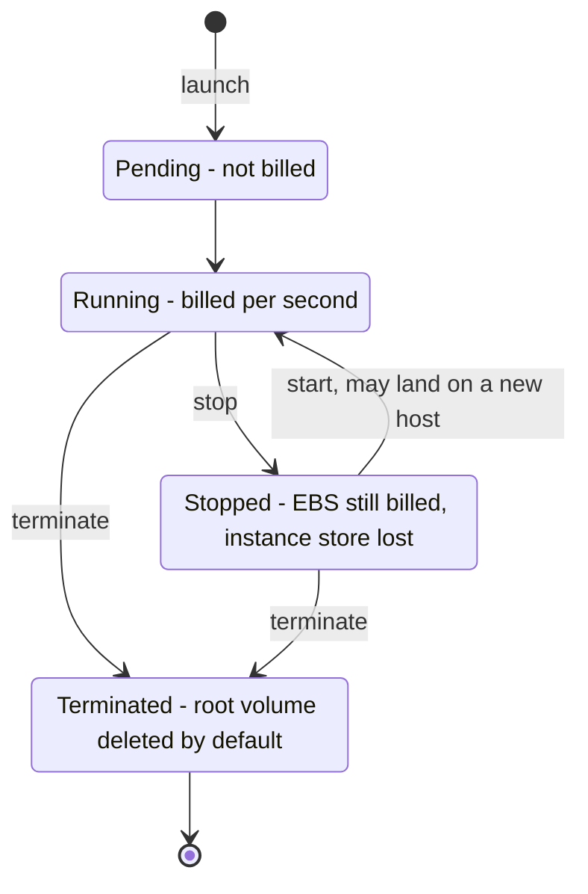
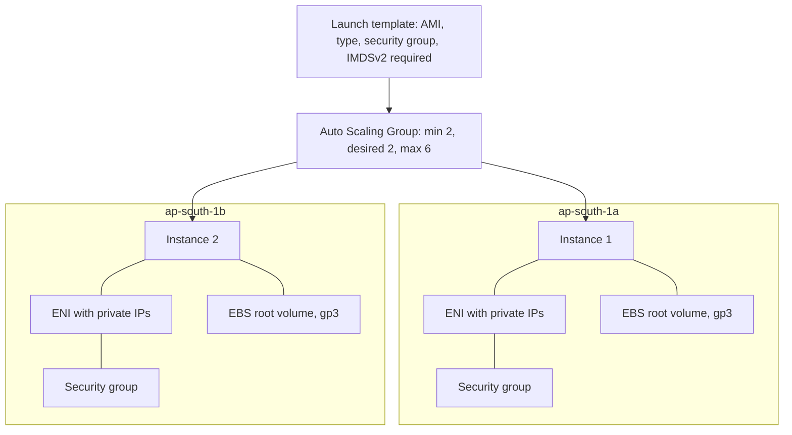

# EC2

EC2 (Elastic Compute Cloud) is the raw virtual machine underneath nearly everything else on AWS: you pick a CPU-and-memory shape, an image and a disk, and minutes later you have a Linux box billed by the second. Your EKS nodes **are** EC2 instances in an Auto Scaling Group — [[Kubernetes Architecture]] explains what a node does, [[EKS vs ECS]] explains why you rarely touch the VM — so an engineer who never runs `aws ec2 run-instances` still pays for EC2 on every bill and still fails on it whenever a node dies. It is [[Vertical vs Horizontal Scaling]] made literal: a bigger instance type is the vertical dial, more instances in a group the horizontal one. The price of that control is that patching, capacity and failure handling are yours.

## The problem that created it

Before 2006, capacity meant a purchase order: buy servers, wait weeks for delivery, rack and cable them, install an OS, and size the lot for peak because returning a server was not an option. Compute was a capital decision with a multi-week lead time, so teams over-bought for the worst day and were still caught short on the next one. EC2 (beta in 2006) replaced that with a contract that still defines it: a virtual machine in minutes through an API, billed for the time it runs (per second for most Linux instances today, with a one-minute minimum), returned the moment you stop needing it. The design consequence is that everything is built from **disposable, replaceable parts** — instances are launched from an image, not nursed — which is why AMIs, launch templates and Auto Scaling Groups exist at all.

## What it solves

- **Capacity on demand** — minutes instead of weeks, no capital outlay, and no need to guess next year's peak ([[Capacity Planning]] becomes a tuning exercise, not a purchase).
- **Pay for time, not ownership** — scale down and the compute bill falls the same hour (EBS volumes and commitments keep billing, see Cost shape).
- **A full machine, not a sandbox** — root access, any OS, kernel modules, any licence: the escape hatch when no managed service fits.
- **A menu of shapes** — hundreds of instance types: compute-heavy, memory-heavy, local NVMe, GPUs. You buy the CPU-to-memory ratio your workload actually has.
- **Failure isolation by construction** — Availability Zones plus a group that replaces dead instances turn a hardware failure into a routine event.
- **A foundation for the managed layer** — EKS, ECS, RDS, ElastiCache and MSK all run on instances; knowing EC2 explains their bills and their failure modes.

## How it works

### Instances: reading the name and picking a shape

`m6g.large` decodes, in AWS's own terms, as **series** `m` (general purpose), **generation** `6`, **options** `g` (Graviton; others include `i` Intel, `a` AMD, `d` instance store, `n` network and EBS optimised), then after the dot the **size** `large` (each step up roughly doubles vCPU and memory); `m6g` together is the *instance family*. The series fixes the memory-per-vCPU ratio, which is the number that matters:

| Family | Memory per vCPU (rough) | Fits |
|---|---|---|
| M, T (general) | ~4 GiB | API tiers, the default starting point |
| C (compute) | ~2 GiB | CPU-bound: crypto, encoding, tight loops |
| R, X (memory) | ~8 GiB and up | caches, in-memory stores, memory-heavy JVM fleets |
| I, D (storage) | local NVMe / dense HDD | self-run databases, Kafka, search needing local IOPS |
| G, P (GPU) | accelerators | inference, training |

Newer generations of a family are usually cheaper or faster at the same size — check what ap-south-1 offers before standardising. As of 2026, Graviton4 powers the 8th-generation `g` families (`m8g`, `c8g`, `r8g`), and Graviton5 arrived in 2026 as `m9g`/`m9gd` and `c9g`/`c9gd` (June) and `r9g`/`r9gd` (31 August), in a handful of US, EU and Asia Pacific Regions — not Mumbai as of October 2026. A **vCPU** on Intel and older AMD instances (`m6a` and before) is one hardware thread of a two-thread core; on Graviton and on AMD from the 7th generation (`m7a` onward) every vCPU is a full physical core, so equal vCPU counts are not equal compute.

**Graviton (ARM) and Java.** The JVM runs portable bytecode, so a Spring Boot jar runs unchanged on ARM, usually at lower cost per unit of work. What breaks is native code: a JNI library, or a container image published only for amd64. Verify the image is **multi-arch** (an ECR manifest list with both `linux/amd64` and `linux/arm64`); a single-arch image on an ARM node dies at start with `exec format error`, and a mixed-architecture cluster needs node selectors so pods land on the right kind of node.

**Burstable `t` instances — the classic trap.** A t-class has a *baseline* share of each vCPU, earns **CPU credits** while below it and spends them above it (one credit is one vCPU at 100% for one minute). A service idling at 5% looks perfect for months; then a retry storm, a restart wave or a sustained load drains the balance and in **standard mode** the CPU is throttled to baseline — latency climbs, health checks time out, and no code has changed. **Unlimited mode** (the default on T3, T3a, T4g and the newer T8i; T2 defaults to standard) removes the cliff by spending surplus credits, but if average CPU over 24 hours exceeds baseline the excess is billed at a flat per-vCPU-hour rate, so a hot t-class node can cost more than the m-class it was meant to undercut. Use t-class only for genuinely idle-with-spikes work (bastions, dev tooling); watch `CPUCreditBalance` and `CPUSurplusCreditsCharged`.

**AMIs, user data, placement.** An **AMI** is the boot image: a root-volume snapshot plus launch permissions and a block-device map. **Amazon Linux** is the default (AL2023 is the current generation, supported to 2029; Amazon Linux 2 reached end of support on 30 June 2026); EKS publishes **EKS-optimised AMIs** (AL2023 and Bottlerocket variants; EKS stopped publishing AL2 node AMIs in November 2025, Kubernetes 1.32 being the last) with kubelet and containerd preinstalled, and managed node groups select the right one for your cluster version. A **golden AMI** is one your pipeline bakes (Packer or EC2 Image Builder) with hardening and patches applied, so every instance boots identical and fast — but an AMI is frozen at bake time, so an old golden image is an unpatched fleet unless you rebuild on a schedule. **User data** is a script or cloud-init config run at launch (by default first boot only); on EKS it carries the node bootstrap (`nodeadm` config on AL2023; `bootstrap.sh` was the retired AL2 path). Never put secrets in user data or an AMI — both are readable from inside the instance. **Placement groups** steer physical placement: *cluster* packs instances close for lowest latency, *spread* puts each on distinct hardware to limit correlated failure, *partition* spreads groups across racks for self-replicating stores like Kafka or Cassandra. **Tenancy** is shared by default; dedicated hosts give a whole server, for per-socket licensing or compliance, not for speed.

**The Instance Metadata Service and why IMDSv2 exists.** Every instance can reach an HTTP endpoint at a link-local address (`169.254.169.254`) serving its own facts and, crucially, the **temporary credentials of its IAM role**. That makes it the prize in a well-known attack class, told here defensively: a server-side request forgery (SSRF) bug lets an attacker make your application fetch a URL of their choosing; aim it at the metadata address and, under **IMDSv1** (a bare `GET`), the response hands over role credentials, which the attacker then uses from outside. That mechanism is at the centre of the widely reported 2019 Capital One breach. **IMDSv2** makes access session-oriented: the caller first sends a `PUT` with a TTL header to obtain a token, then presents it as a header on every read. A typical SSRF primitive can only issue a `GET` and cannot set arbitrary headers, so it cannot open the session; a configurable hop limit also stops the token response crossing a proxy or container boundary. The fix is configuration: `HttpTokens: required` in the launch template. Defaults have moved (as of 2026): AL2023 and console Quick Start launches are IMDSv2-only, instance types released from mid-2024 default to IMDSv2-only, an AMI flagged `ImdsSupport: v2.0` forces it, and since March 2024 an account-level per-Region default (plus optional enforcement that fails IMDSv1 launches) exists. But precedence is launch template, then account, then AMI, so an older AMI with nothing set still launches token-optional — require it explicitly. On EKS, pods should get credentials through IRSA or Pod Identity, not the node role, and a hop limit of 1 keeps pod traffic from getting a token while 2 (what a `v2.0` AMI sets) lets containers through — check what your node group's launch template actually sets.

### Storage: EBS, snapshots and instance store

**EBS** is a **network-attached block device**: the instance sees an NVMe disk, but the bytes live on storage servers across the network, replicated within one AZ. Two properties define it. It **survives the instance** (stop it, terminate it, re-attach the volume elsewhere), and it is **pinned to one AZ** — which is why a Kubernetes pod with an EBS-backed volume can only reschedule inside its AZ. Its durability is also far below S3's: AWS documents annual failure rates on the order of 0.1 to 0.2% for general-purpose and HDD volumes (io2 is designed for 99.999%) against S3's eleven nines in [[How S3 Works]], which is why snapshots are not optional ([[Availability Reliability Durability]]).

| Type | Media | Behaviour | Use |
|---|---|---|---|
| gp3 | SSD | size, IOPS and throughput are **separate dials**; 3,000 IOPS and 125 MiB/s included at any size, up to 80,000 IOPS and 2,000 MiB/s, about 20% cheaper per GiB than gp2 (as of 2026) | default for almost everything |
| gp2 | SSD | IOPS tied to size (3 per GiB, as of 2026) plus burst credits | legacy — migrate to gp3 |
| io2 | SSD | provisioned IOPS, sub-millisecond latency, 99.999% durability; every io2 volume is Block Express since April 2025, up to 256,000 IOPS on Nitro (as of 2026) | latency-critical databases |
| st1 / sc1 | HDD | throughput-optimised / cold; cannot be boot volumes | large sequential scans, cold data |

The gp3 insight is that **IOPS stopped being a function of size**. On gp2 the only way to buy IOPS was to buy gigabytes: a 100 GiB volume had a 300 IOPS baseline and could burst to 3,000 only from a credit bucket (documented as 5.4 million I/O credits). Under sustained load the bucket drains at 3,000 − 300 = 2,700 per second, so it lasts 5,400,000 ÷ 2,700 = 2,000 s, about 33 minutes, after which the volume silently falls back to 300 IOPS. A 100 GiB gp3 has 3,000 flat. Also: each instance type has its own EBS bandwidth and IOPS ceiling, so provisioning more on the volume than the instance can drive buys nothing. [[How Databases Store Data]] explains why this matters — page reads, WAL fsyncs and checkpoints are IOPS- and latency-bound, so a database on EBS is only as fast as its provisioned I/O.

**Snapshots** are incremental, block-level copies stored in S3 (AWS-managed; you do not see the objects): the first copies used blocks, later ones only changed blocks, and deleting an old one never breaks a newer one. They are the backup, the way to move a volume across AZs or Regions, and the source of AMIs. A volume restored from a snapshot loads blocks lazily from S3, so first reads are slow until warmed (fast snapshot restore, or a paid provisioned initialisation rate, avoids that). **Instance store** is NVMe on the host: the lowest latency and highest IOPS available, no per-GB charge, but **ephemeral** — it survives a reboot, not a stop, a terminate or a hardware failure. Right for caches, scratch and shuffle data; wrong for anything you cannot regenerate. **Delete on termination**: the root volume defaults to deleted with the instance while volumes attached afterwards are kept, and forgotten kept volumes bill forever — check the flag. Turn on EBS encryption by default per Region; under RBI it is baseline.

### Networking: ENIs, IPs and the pod-density ceiling

Every instance has at least one **ENI** (elastic network interface): a virtual NIC carrying a primary private IP, optional secondary IPs and a MAC. **Security groups attach to ENIs**, not to instances (stateful, allow-only rules). An auto-assigned public IP is released on stop; an **Elastic IP** is a static address you own, and since 2024 AWS bills every public IPv4 address, in use or idle, so prefer private instances behind a load balancer ([[VPC and Networking]], [[Load Balancers]]). Modern types use the ENA for **enhanced networking** (high bandwidth, low latency, no setup), and small sizes advertise "up to" bandwidth that is burstable, not guaranteed. AZ names like `ap-south-1a` are mapped per account, so your uat and prod accounts may mean different physical zones — compare by AZ ID (`aps1-az1`).

**Why ENIs cap pods per node.** On EKS the default VPC CNI gives each pod a real VPC IP drawn from the secondary IPs on the node's ENIs. Each instance type allows a fixed number of ENIs and a fixed number of IPv4 addresses per ENI, so max pods ≈ ENIs × (IPs per ENI − 1) + 2. With illustrative numbers of 3 ENIs and 10 addresses each, that is 3 × 9 + 2 = 29 pods on a node with CPU and memory to spare; small types run out of IPs long before they run out of compute. Look up your type's real numbers in the published ENI table, and note that managed node groups on the EKS AMI also cap max-pods at 110 below 30 vCPUs (250 above) whatever the formula says. Prefix delegation (a /28 block per slot) raises the ceiling at the cost of burning subnet space ([[VPC and Networking]]).

### Auto Scaling Groups

An **Auto Scaling Group** keeps N instances alive from a recipe. The recipe is a **launch template** (AMI, one or several instance types, security groups, instance profile, block devices, user data, metadata options; launch configurations are the deprecated predecessor). The group has `min`, `desired` and `max`, spans subnets in several AZs and balances across them, and continuously reconciles actual against desired: a dead instance is replaced, so "terminate it and let it come back" is the standard repair.

- **Health checks decide what "dead" means.** The default, always on, is the **EC2 status checks and scheduled events**: the VM and host are up. A hung JVM on a healthy VM passes it forever. Opt in to the **ELB check** so a target the load balancer marks unhealthy is replaced ([[Health Checks and Service Discovery]]); VPC Lattice, EBS and custom checks are the other sources, and EC2 *application status checks* (an HTTP probe defined in EC2, tagged to the group) now cover the hung-app case without a load balancer. Set a grace period longer than boot plus app start so slow starts are not killed in a loop.
- **Scaling policies.** *Target tracking* (hold a metric near a target, like average CPU at 50%) is the default choice; *step* maps alarm thresholds to capacity changes; *scheduled* handles known peaks (or shrinking uat at night); predictive scaling learns from history. Warm-up stops the group scaling on metrics from instances not yet serving.
- **Instance refresh** rolls an AMI or launch-template change through the group in batches, keeping a minimum-healthy percentage (90% by default), with optional checkpoints, skip-matching and auto-rollback — by default replacing instances rather than patching them ([[Deployment Strategies]]); a newer replace-root-volume strategy swaps only the root disk on the running instance for groups whose mixed-instances policy pins an AMI per type.
- **A managed node group is an ASG** that EKS creates and updates for you; its rolling update cordons and drains nodes and honours PodDisruptionBudgets. The Kubernetes Cluster Autoscaler works by changing the ASG's desired count, because the scheduler places pods by *requests* and ASG-level CPU tracking never sees a pending pod. Karpenter bypasses ASGs and launches instances directly through EC2 APIs, choosing types per pending pod ([[Autoscaling]]).

### Purchasing options

| Option | Shape | Use when |
|---|---|---|
| On-Demand | pay per second, no commitment | unknown, spiky or new load |
| Savings Plans | commit to a fixed spend per hour for 1 or 3 years in exchange for a discount; Compute plans flex across family, size and Region and also cover Fargate and Lambda, EC2 Instance plans are tied to a family in a Region | the steady baseline you are sure of |
| Reserved Instances | older commitment on a specific type; zonal ones also reserve capacity; AWS now recommends Savings Plans instead | legacy estates |
| Spot | spare capacity at a steep discount, reclaimable | stateless, interruption-tolerant, batch |
| Capacity Reservation | hold capacity in an AZ at On-Demand rates, used or not | guaranteed availability for critical events |

Commitments discount the *bill*, not the *capacity* (only zonal Reserved Instances and Capacity Reservations hold seats). **Spot** charges a price EC2 sets per type and AZ and adjusts gradually on long-term supply and demand (no bidding), is not covered by Savings Plans, and lets AWS reclaim the instance with a **two-minute interruption notice**, delivered best-effort through the metadata service and EventBridge; a *rebalance recommendation* signal can arrive earlier. It is safe when losing a node costs nothing: stateless pods at 2+ replicas spread across AZs and instance types, SQS workers whose messages reappear after the visibility timeout ([[SQS and SNS]]), CI runners, batch. It is not safe for a 1-replica service: two minutes is less than image pull plus JVM start plus readiness, so every reclaim is an outage. Diversify across many types and AZs (the `price-capacity-optimized` allocation strategy) and handle the notice so pods drain instead of dying.

### Cost shape

- **Instance-seconds (dominant):** hourly rate of the type × instances × time, so monthly compute ≈ nodes × rate × ~730 hours. Node count follows the *sum of pod resource requests* divided by allocatable per node, so inflated requests buy real instances.
- **EBS:** per GB-month of *provisioned* size (used or not, instance running or not), plus provisioned IOPS and throughput above the gp3 baseline. It scales with what you asked for, not what you stored.
- **Snapshots:** per GB-month of changed blocks retained; they pile up silently without a lifecycle retention policy.
- **Data transfer:** inbound is free, internet egress is per GB, and **cross-AZ** traffic carries a small per-GB charge each way (about a cent per GB per direction, as of 2026) — trivial per request, material for chatty microservices spread over three AZs.
- **Public IPv4 and Elastic IPs:** per hour each, attached or idle (half a cent per address-hour since February 2024). A stopped instance stops compute billing but not its volumes or addresses.
- **Commitments** are fixed spend per hour — you pay them even if the fleet shrinks below them. Orders of magnitude, as of 2026: Compute Savings Plans up to 66% off On-Demand, EC2 Instance plans up to 72%, Spot up to 90%. [[AWS Cost Shape]] puts the neighbouring lines (load balancer, NAT, EKS control plane) alongside.

Illustrative sizing (labelled assumptions): 40 single-replica JVM services each requesting 1 GiB is 40 GiB. If a 16 GiB node offers ~13 GiB allocatable after kubelet, OS and DaemonSet reservations (inferred — read `kubectl describe node`), that is 40 ÷ 13 ≈ 3.1, so **4 nodes** before any rolling-deploy headroom. Halving each request to 512 MiB (if the heap fits) halves the node count; changing the instance type changes the multiplier, not the shape.

## Trade-offs

| You gain | You pay |
|---|---|
| Full control: kernel, OS, any software, any licence | You own patching, AMI hygiene, hardening and capacity |
| Best price per unit of compute at steady load, with commitments | Idle capacity bills; commitments punish shrinking |
| Hardware menu: local NVMe, GPUs, huge memory | A wrong shape is silent waste or silent throttling (t-class) |
| Predictable performance, no cold starts | You are the failure domain: retirements, AZ capacity, node loss |
| Foundation for EKS, RDS and the rest | The abstraction leaks: ENI limits, AZ-pinned volumes, IMDS |

**Versus containers and serverless.** Containers on EC2 nodes ([[EKS vs ECS]]) trade whole-VM management for bin-packing: many pods share one instance, so utilisation and cost improve, but you still own the nodes. Lambda removes the node entirely and bills per invocation: no idle cost and no patching, at the price of cold starts and per-request limits. The steadier and hotter the load, the more EC2 wins on cost; the spikier and idler, the more serverless wins.

## Failure modes

- **t-class CPU-credit exhaustion.** *Signal:* latency creeps up with CPU pinned flat at baseline. *Confirm:* `CPUCreditBalance` at zero (standard) or `CPUSurplusCreditsCharged` climbing (unlimited). *Fix:* move steady workloads to a fixed-performance family.
- **gp2 burst-balance exhaustion on a database volume.** *Signal:* healthy for weeks, then I/O latency collapses after sustained load. *Confirm:* the `BurstBalance` metric reaches zero. *Fix:* convert to gp3 online with explicit IOPS (volumes can be modified without detaching).
- **Instance retirement and scheduled events.** Degrading hardware produces a notice (Health events, EventBridge). On an EBS-backed instance a stop-and-start lands on a new host (a reboot does not); instance-store data is gone. Act on the event by replacing the node through the group rather than waiting for it to die.
- **Spot interruption taking out a 1-replica pod.** The two-minute notice cannot be absorbed by a service with no peer: downtime is reschedule plus image pull plus JVM start plus readiness. *Fix:* no Spot under single-replica prod services.
- **IMDSv1 left enabled.** Invisible until an SSRF bug exists. *Confirm:* instance metadata options show `HttpTokens: optional`, and the `MetadataNoToken` metric counts v1 calls. *Fix:* require tokens in the launch template, then run an instance refresh.
- **Out of ENIs or IPs on a node.** *Signal:* scheduling failures reading `Too many pods` (the kubelet's max-pods follows the ENI formula), or pods stuck `ContainerCreating` with CNI "failed to assign an IP" errors, while CPU and memory are free. *Confirm:* pods-per-node versus the ENI formula, and free IPs in the subnet. *Fix:* larger types, prefix delegation, bigger subnets.
- **EC2-only ASG health check.** A hung application on a healthy VM is never replaced. *Fix:* ELB, application status or custom health checks; for nodes, Kubernetes-aware repair (EKS node auto repair, usable with managed node groups and Karpenter, and stronger with the node monitoring agent).
- **AZ capacity unavailable for a type.** `InsufficientInstanceCapacity` on scale-out, often exactly when an AZ-wide event sends everyone looking for the same seats. *Fix:* a mixed-instances policy with several types, all AZs, and a Capacity Reservation for the critical floor ([[Failover]]).

## When NOT to use it

- **Almost always prefer the managed layer above it.** EKS or ECS for containers, Lambda for short event-driven work, managed databases and caches for state — each one removes a patching and failure responsibility you would otherwise own.
- **Reach for raw EC2 when you need a VM-level thing:** a custom kernel or modules, per-socket licensing (dedicated hosts), legacy software that will not containerise, GPU training boxes, unusual hardware shapes, or a self-run stateful system where you knowingly accept the operations ([[Kafka Operations]] is that trade, spelled out).
- **Do not run pets.** An SSH-and-fix instance is a snowflake; if you must have shell access, use SSM Session Manager — no open port 22, IAM-authorised, session logs for audit — instead of keypairs.
- **Do not run sporadic, mostly-idle work on always-on instances** — that is Lambda or Fargate territory.

## In your stack

- Your EKS **managed node groups in ap-south-1 are ASGs of EC2 instances** spread across the Region's Availability Zones, one set per account (uat and prod are separate accounts, so separate groups, separate bills, and differently-mapped AZ names).
- **Instance family (typical, not verified against your fleet):** a Spring Boot pod is often a small CPU request with a ~1 GiB memory request (heap plus metaspace, thread stacks and native buffers). Pods bin-pack on both dimensions, so on a 4 GiB-per-vCPU m-class node memory fills first and CPU is stranded, and an r-class at ~8 GiB per vCPU can win. Test it: sum requested memory ÷ sum requested CPU across the cluster; above ~4 GiB per vCPU favours r-class, and Graviton variants add cost savings if your images are multi-arch.
- **Node failure is how a 1-replica service goes down.** With no peer, the sequence on a dead node is detection, then eviction (Kubernetes' default `tolerationSeconds` of 300 on the not-ready taint can mean minutes before the pod is even rescheduled — check your cluster), then image pull, JVM boot and readiness. The same gap appears on every drain, retirement and Spot reclaim ([[Graceful Shutdown and Deployment Safety]]).
- **PDB trap at one replica:** `minAvailable: 1` on a single-replica Deployment allows zero disruptions and stalls the node group's rolling update; `maxUnavailable: 1` lets the drain proceed, and the gap is the honest cost of one replica.
- **Spot belongs in uat first** — interruptions there cost nothing — and in prod only for multi-replica stateless or SQS-draining workloads, never under a single-replica service on the money path.
- **IMDS and credentials:** require IMDSv2 in the node launch template and give pods IRSA or Pod Identity so a compromised pod cannot borrow the node role.
- **RBI data localisation:** keep volumes, snapshots and AMIs that contain payment or KYC data in Indian Regions (ap-south-1, with ap-south-2 for in-country copies); a snapshot copied to an overseas Region is a compliance event, not a backup. Confirm scope with compliance.
- **Cost levers, in order:** right-size pod requests, then family and Graviton, then Savings Plans on the baseline, then Spot for the tolerant tail.

## Interview angle

The 60-second version: *"EC2 is AWS's rent-by-the-second virtual machine: you choose an instance type — family sets the CPU-to-memory ratio, generation and size the rest — an AMI to boot from, and EBS volumes for disks that outlive the instance. Instances are disposable: a launch template describes one and an Auto Scaling Group keeps N alive across AZs, replacing unhealthy ones. EKS is built on exactly that — a managed node group is an ASG of EC2 instances running kubelet, and the cluster autoscaler or Karpenter adds nodes when pods go pending. You buy the steady baseline with Savings Plans, spiky work On-Demand, and interruption-tolerant work on Spot. The traps are silent: burstable CPU credits, gp2 burst balances, per-instance ENI limits capping pods per node, and IMDSv1."*

Classic probes:

- "Spot or On-Demand?" — name the trade: a deep discount for revocability on a two-minute notice. Safe when state is off the node and replicas are spread across pools (workers, batch, CI); unsafe for a 1-replica or stateful service. Strong answer: an On-Demand floor plus Spot above it in one mixed-instances group.
- "Why did my t3 service slow down after months of being fine?" — CPU credits: baseline versus burst, balance hits zero, throttling; unlimited mode trades the cliff for a bill; move steady load to m-class.
- "gp2 versus gp3?" — IOPS coupled to size with burst credits versus independent IOPS and throughput with a flat baseline, and cheaper per GB; migrate online.
- "Why does my node hit a pod limit with CPU free?" — the ENI and IPs-per-ENI formula; prefix delegation or bigger types.
- "What is IMDSv2 protecting against?" — SSRF to role-credential theft; the PUT-token session defeats a GET-only primitive.

## Check yourself

> [!question]- Q: A service on a t3 node ran fine for three months, then a retry storm leaves it crawling with CPU flat at a low ceiling. Diagnose and fix.
> CPU credits: the node spent more than it earned, the balance reached zero, and in standard mode the instance is throttled to its baseline share of each vCPU — hence flat CPU and rising latency with no code change. Confirm with `CPUCreditBalance` at zero. In unlimited mode there is no throttle but `CPUSurplusCreditsCharged` shows you paying for the overage. Fix: steady JVM workloads belong on a fixed-performance family (m or r), with t-class reserved for idle-with-spikes tooling.

> [!question]- Q: Which of these may run on Spot, and why? (a) the only replica of a payments API, (b) an SQS-draining worker, (c) a CI runner, (d) a stateless service at 3 replicas across 3 AZs.
> (b), (c) and (d). Spot is safe when losing a node costs nothing: SQS messages reappear after the visibility timeout, a CI job reruns, and (d) keeps two replicas serving through a reclaim, provided it is diversified across instance types and AZs. (a) fails because the two-minute notice is shorter than image pull plus JVM start plus readiness, so every reclaim is a full outage with no peer to absorb it.

> [!question]- Q: A 200 GiB gp2 database volume is fine all day but crawls for most of the nightly batch. Why, and when does it start crawling?
> Baseline IOPS is 3 per GiB (as of 2026), so 600; the volume bursts to 3,000 from a bucket of about 5.4 million I/O credits (documented figure). Under sustained batch load it drains at 3,000 − 600 = 2,400 per second: 5,400,000 ÷ 2,400 = 2,250 s, about 37 minutes, then the volume falls back to 600 IOPS and queries stall. `BurstBalance` at zero confirms it. Fix: convert to gp3 online and provision IOPS to the batch's real need, which no longer requires buying extra gigabytes.

> [!question]- Q: A node with 16 GiB of free memory and idle CPUs refuses another pod — events say `Too many pods`, or new pods stick in `ContainerCreating`. Where do you look?
> The ENI and IP ceiling: with the VPC CNI each pod consumes a VPC IP from the node's ENIs, and max pods ≈ ENIs × (IPs per ENI − 1) + 2 — with 3 ENIs of 10 addresses, 3 × 9 + 2 = 29. `Too many pods` means the kubelet's max-pods (set from that formula) is reached; `ContainerCreating` with CNI errors means the node or its subnet is out of IPs. Check the node's pod count against the formula and free IPs in the subnet. Fix: larger instance types, prefix delegation, or bigger subnets.

> [!question]- Q: Mini-design — a nightly 2-hour reconciliation batch, interruption-tolerant but with a hard 6 a.m. deadline, on EKS in ap-south-1. Choose the capacity.
> Spot-heavy node group in a mixed-instances policy (several families and sizes, all three AZs, `price-capacity-optimized`), with a small On-Demand base so the job always makes progress, and checkpointed work so a reclaim loses minutes, not the run. Use gp3 or instance store for scratch, and keep it scaled to zero outside the window via scheduled scaling or Karpenter. Cost shape: instance-seconds for two hours a night at a discount rather than a 24-hour reservation; any Savings Plan covers only the always-on baseline. Keep snapshots and outputs in Indian Regions.

## Sources

- Amazon EC2 User Guide — instance types and naming, burstable performance instances (CPU credits, unlimited mode), instance metadata and IMDSv2, placement groups, Spot Instances and interruption notices, instance lifecycle, network interfaces and per-type ENI limits.
- Amazon EBS User Guide — volume types (gp3, gp2 I/O credits and burst balance, io2, st1/sc1), snapshots, volume durability and annual failure rate, Elastic Volumes.
- Amazon EC2 Auto Scaling User Guide — launch templates, health checks, scaling policies, instance refresh, mixed instances policies and Spot allocation strategies.
- Amazon EKS User Guide and EKS Best Practices Guides — managed node groups, EKS-optimised AMIs, maximum pods per ENI and prefix delegation, IMDS and IAM roles for service accounts, Karpenter documentation.
- AWS Security Blog, "Add defense in depth against open firewalls, reverse proxies, and SSRF vulnerabilities with enhancements to the EC2 Instance Metadata Service" (2019).
- AWS pricing pages for EC2, EBS and data transfer, the public IPv4 charge announcement (2024), the Savings Plans User Guide (plan types, maximum discounts, "we recommend Savings Plans over Reserved Instances") and the Spot best-practices page — figures quoted only as orders of magnitude, as of 2026.
- Amazon Linux 2 FAQ (end of support 2026-06-30), EKS AL2 AMI transition guide, and the AWS News Blog post "Amazon EC2 Instance Metadata Service IMDSv2 by default" (2023).
- AWS Well-Architected Framework — Reliability and Cost Optimization pillars.
