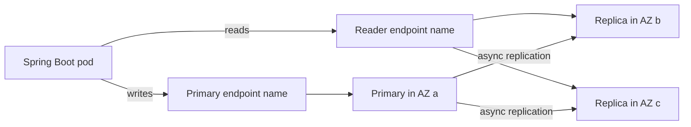
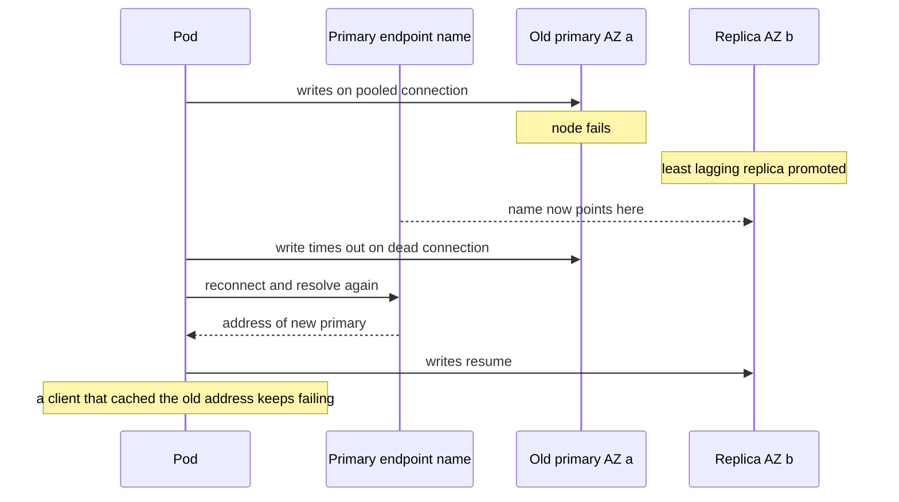

# ElastiCache for Redis

ElastiCache is the managed-AWS side of two notes the vault already teaches: [[Redis Internals]] (the single-threaded engine, data structures, persistence, memory model) and [[Redis Cluster and Sentinel]] (how replicas, failover and sharding work when you operate them yourself). It is the same engine — and since 2024 a choice of two, Redis OSS or Valkey — with AWS running the machines, the failover orchestration, the patching and the snapshots. This note does not re-teach Redis. It teaches what is AWS-specific: the vocabulary (replication group, shard, endpoint, parameter group), the knobs, the limits of the managed promise, the failure modes that exist only because AWS sits in the loop, and the cost shape.

## The problem that created it

Redis gives you mechanisms, not operations. [[Redis Cluster and Sentinel]] explains quorum, replica promotion and slot migration — but someone still has to place hosts in three AZs, notice a dead one, replace it, patch its OS, take snapshots without blowing the memory budget, rotate certificates and watch the metrics. For a cache in front of a database ([[Why Caching Works]]) these chores are pure undifferentiated risk: a stalled failover is a cold cache, and a cold cache is a stampede on the database ([[Cache Stampede and Thundering Herd]]). ElastiCache began in the early 2010s as managed Memcached, with Redis following; the proposition was always "keep the data-structure server, hand the fleet to AWS".

Two later events reshaped the choice. **Serverless** (generally available November 2023) removed capacity planning for teams who wanted it gone. And the **March 2024 Redis licence change** split the ecosystem, which is why ElastiCache now runs Valkey too (see Engines below).

## What it solves

- **Replacement and failover as a service** — a dead node, a dead AZ, a retired host: ElastiCache detects it, promotes the least-lagging replica and rebuilds the missing node ([[Failover]]). No quorum to size, no operator to upgrade.
- **Patching on a schedule you choose** — a weekly maintenance window; engine-version upgrades on node-based clusters are initiated by you, not imposed.
- **Snapshots to S3** without managing volumes, and a restore path.
- **Security wiring** — VPC placement (node-based clusters are VPC-only), security groups, TLS, AUTH and ACL users, IAM authentication, encryption at rest with KMS ([[IAM]], [[Secrets Manager Parameter Store and KMS]]).
- **Metrics by default** — engine and host metrics reach CloudWatch every 60 seconds with no exporter to run ([[CloudWatch]]).
- **Scale operations as API calls** — add replicas, change node type, add or remove shards (resharding a cluster-mode-enabled cluster is online).
- **What it does not solve** — key design, hot keys ([[Hot Key Problem]]), TTL discipline, invalidation ([[Cache Invalidation]]), client timeouts and pooling ([[Connection Pooling]]). The premium buys operations, not application correctness.

## How it works

### Two deployment shapes

**Node-based clusters**: you choose the node family and size, the number of shards and replicas, and AZ placement. You get parameter groups, Global Datastore, reserved pricing and the most control. **Serverless**: you name a cache and receive one endpoint; capacity follows load. Both can run Valkey; the rest of this section is node-based unless it says otherwise.

### Anatomy of a node-based cluster

The API calls the unit a **replication group**: one or more **shards** (called node groups in the API), each with one primary and up to five replicas (the per-shard maximum, as of 2026). The one decision that shapes everything downstream is the mode:

| | Cluster mode disabled | Cluster mode enabled |
|---|---|---|
| Shape | One shard: a primary plus replicas | N shards, keyspace split across them by hash slot |
| Endpoints | Primary endpoint, reader endpoint, per-node endpoints | One configuration endpoint, plus per-node endpoints |
| Client must | Send writes to the primary endpoint, optionally reads to replicas | Speak the cluster protocol and follow `MOVED` redirects |
| Write scale | Vertical only (bigger node) | Horizontal (more shards) |
| Multi-key operations | Anywhere | Only within one hash slot |

Three endpoint facts that the docs state and that bite later. The **primary endpoint** is a DNS name that always resolves to the current primary, so a promotion does not change it. The **reader endpoint** is not a load balancer — it is a DNS record that resolves to one replica round-robin, so balance happens per *connection*, and a pool that opens its connections once stays pinned to whichever replicas it got. **Node endpoints** are fixed per node; if you read from them directly you must track membership yourself.

Cluster mode enabled is a client-side commitment, not a toggle: the library must be cluster-aware (in Spring Data Redis, a cluster configuration rather than a standalone one), related keys need hash tags so multi-key commands share a slot, and the endpoints change. Decide it before the first deployment, and keep uat and prod in the same mode.

### Multi-AZ and automatic failover

Multi-AZ needs at least one replica in a different AZ from the primary; with it, a failed primary triggers promotion of the replica with the **least replication lag**, ElastiCache repoints the primary endpoint name, and it launches a replacement replica in the failed node's AZ. AWS documents writes resuming within a few seconds of promotion; that is the server side, not what your client sees (below). In cluster mode enabled, Multi-AZ is on by default and automatic failover cannot be disabled.

**What it guarantees:** a replica takes over without you doing anything, in seconds, and the endpoint name follows. **What it can still lose:**

- **Recent writes.** Replication is asynchronous ([[Replication]]); a promoted replica is the most current one, not a complete one, so writes the old primary acknowledged but had not shipped are gone. AWS's own limitation list concedes that some data can be lost to replication lag.
- **Replica availability right after promotion.** Surviving replicas resync from the new primary and are briefly inaccessible, which hits anything reading through the reader endpoint.
- **Everything, on a customer-initiated primary reboot.** Per the docs, rebooting the primary does *not* trigger failover; it returns empty and the replicas clear their copies. To move the primary, use the failover test operation, never a reboot.
- **Everything, with no replicas.** A single-node cluster that fails is replaced empty unless you restore a snapshot.

The 2026 exception: on **Valkey 9.0 and later, node-based with cluster mode enabled only** (not supported with cluster mode disabled, as of 2026), you can enable *durability* — writes go through a Multi-AZ transactional log; synchronous writes are designed for zero loss at single-digit-millisecond write latency, asynchronous writes keep microsecond latency but can lose up to ten seconds, and a primary that cannot persist for longer than that rejects writes until it can (`DurabilityBufferExceededErrorCount`). This is the one exception to the rule in [[Redis Cluster and Sentinel]] that a managed service does not change the replication model. Multi-AZ and the Redis AOF persistence option are mutually exclusive on Redis OSS.

### Replicas for read scale

Replicas serve reads, up to five per shard, and add AZ resilience. They do not add write capacity, and because replication is asynchronous a replica read can be stale — the [[Read Your Own Writes and Replica Lag Anomalies]] problem, measurable as the `ReplicationLag` metric. Reading money-path state from a replica is a design error; reading a product catalogue from one is fine.

### Parameter groups, maintenance, backups

- **Parameter groups** are named sets of engine settings attached to a cluster. The default group for each engine version cannot be modified, so create a custom group *before* launch. Administrative commands such as `CONFIG` are restricted, so this is the only way to tune the engine. Two that matter: `maxmemory-policy` (ElastiCache defaults it to `volatile-lru`, applied immediately — not upstream Redis's `noeviction`, see [[Cache Eviction Policies]]) and `reserved-memory-percent` (default 25, the slice of memory held back from data for forks, buffers and overhead; both defaults as of 2026).
- **Maintenance window.** Every cluster has a weekly window where system changes and any deferred modifications apply. If you set none, AWS picks a 60-minute window on a random weekday inside a per-Region eight-hour block (for Mumbai, 17:30 to 01:30 UTC, which is 23:00 to 07:00 IST, as of 2026); you can set a range up to 24 hours (as of 2026). Patching *does* restart nodes: on modern engines with automatic failover the replacement happens while the cluster keeps serving writes, but connections to the replaced node are dropped, and a standalone node is unavailable while its replacement syncs.
- **Backups** are snapshots stored in S3, automatic (a window plus a retention limit) or manual. Take them from a replica, because the fork behind a snapshot needs memory headroom. A restore always creates a **new cache with new endpoints**, so recovery is a cutover, not a toggle — rehearse it.

### Global Datastore

Cross-Region replication for node-based clusters: one primary Region accepts writes, secondary clusters in other Regions are read-only and fed asynchronously, and in a regional disaster you promote a secondary yourself. It is a disaster-recovery and local-read tool ([[Disaster Recovery]]), not active-active. Check the `GlobalDatastoreReplicationLag` metric, and treat the lag as your data-loss window.

### Engines: Redis OSS, Valkey and the licence story

Redis was BSD-licensed until March 2024, when its owner moved new releases to a dual source-available licence (RSALv2 or SSPLv1). The Linux Foundation forked the last BSD release (7.2.4) as **Valkey**, backed by AWS and others; Redis 8 added AGPLv3 as a further option in May 2025. ElastiCache announced Valkey support in October 2024 and prices it lower than Redis OSS — about 20 percent on node-based, 33 percent on Serverless (as of 2026, approximate). Redis OSS 7.1 is the last Redis OSS version ElastiCache offers; new engine versions land on Valkey (7.2, 8.0 to 8.2, 9.0 and 9.1 as of 2026). An existing Redis OSS replication group can be moved to Valkey in place by modifying it with the new engine; endpoint names stay, node IPs change, and on Redis OSS 5.0.6 or later the only write gap is a failover of a few seconds. Rollback is narrow: only Valkey 7.2 back to Redis OSS 7.1. Old Redis OSS lines now cost extra: v4 and v5 left standard support on 31 January 2026 and run on paid Extended Support, and v6 follows on 31 January 2027. Nothing here changes the wire protocol for ordinary clients.

### Security: network, authentication, encryption

- **VPC placement.** A node-based cluster lives in a subnet group inside your VPC with no public address; access is governed by security groups ([[VPC and Networking]]). Since Valkey 9.0, Serverless can also expose an optional public endpoint that requires IAM authentication and TLS 1.3 — for regulated data, leave it off. By default EKS pod traffic leaves with the *node's* security group, so the cache's group must admit the node group, unless you adopt security groups for pods ([[Kubernetes Networking]]).
- **TLS** (in-transit encryption): can be enabled on an existing replication group on Valkey 7.2 or later and Redis OSS 7 or later; there is no mutual TLS; AWS set 28 April 2026 as the cutover to a TLS 1.2 minimum for Valkey 7.2 and later and Redis OSS 6 and later — check old client stacks ([[TLS and HTTPS]]). Persist connections: handshakes are the cost.
- **Authentication**: a shared AUTH token (needs TLS), ACL users (RBAC), or **IAM authentication** (Valkey 7.2+ or Redis OSS 7+, needs TLS): the client signs a token with its IAM role, valid 15 minutes, and the connection is cut after 12 hours unless re-authenticated (both as of 2026).
- Cluster names appear in public Certificate Transparency logs once TLS is on — do not encode secrets or customer names into them.

### Serverless (generally available November 2023)

One endpoint behind a proxy layer; ElastiCache scales vertically and horizontally, replicates across AZs, and applies minor and patch upgrades without downtime. It always runs in cluster mode, always uses TLS, and carries a 99.99 percent availability SLA — the same figure AWS offers a node-based Multi-AZ configuration, so the SLA is not the differentiator. What you give up is the node-based control: engine parameter tuning, Global Datastore, node placement, durability. Design for cluster-mode semantics (hash tags for multi-key work).

### Cost shape

What the bill scales with — shapes, not prices (worked numbers live in [[AWS Cost Shape]]):

- **Node-based: per node-hour**, partial hours billed as full. Nodes = shards x (1 + replicas), each priced by node type, so the bill follows *provisioned memory*, not used memory, and every replica costs a full node even when idle. Reserved nodes (one or three years, size-flexible within a family and Region) trade commitment for up to about 55 percent off with all-upfront payment (as of 2026, approximate).
- **Backup storage: per GiB-month** of retained snapshots; no transfer fee for backing up or restoring.
- **Data transfer.** Node-based: same-AZ is free, and ElastiCache adds no charge on the node side, but cross-AZ traffic is billed on the *application* side at standard intra-Region rates. Serverless through its VPC endpoint has no in-Region transfer charge at all — an asymmetry worth modelling. Global Datastore adds a per-GB cross-Region replication charge plus a full second cluster.
- **Extended Support premium** on Redis OSS v4 and v5 since February 2026 (v6 from February 2027) — an engine upgrade to Valkey removes a line item.
- **Serverless: GB-hours stored plus ECPUs.** Storage is an hourly average with a per-cache minimum (100 MB on Valkey, 1 GB on Redis OSS, as of 2026). One ECPU buys roughly a 1 KB read or write; larger payloads and expensive commands consume proportionally more, so *value size x request rate* is the bill. Inference, not a documented rule: spiky or unknown load favours Serverless, steady high throughput favours sized nodes.

## Trade-offs

| You gain | You pay |
|---|---|
| Failover, patching, snapshots, replacement as a service | A per-node-hour premium over the same instance run yourself |
| Seconds-scale automatic failover across AZs | Asynchronous replication: recent writes can be lost; clients must handle reconnect |
| IAM, VPC, KMS, CloudWatch integration out of the box | A feature set AWS controls: versions, restricted commands, the module set it ships |
| Online resharding and replica changes | Cluster mode is a one-way client commitment |
| Serverless removes capacity planning | Less control, an ECPU meter that follows value size, no engine tuning |

**Managed vs your self-managed Redis on EKS**, honestly:

| Concern | ElastiCache | Self-managed on EKS |
|---|---|---|
| Node loss, AZ loss | Detected and replaced for you | Your operator or Sentinel plus pod rescheduling; EBS volumes pin a pod to one AZ |
| Patching | Maintenance window, restarts nodes | Node-group upgrades drain Redis pods — a failover you scheduled yourself |
| Failover tuning | AWS owns detection and promotion timing, documented as a few seconds | Full control of timeouts and quorum ([[Split Brain and Fencing]]) |
| Versions, modules, commands | What AWS ships | Anything you can run |
| Network | VPC-only for node-based, security groups | Cluster-internal Services; trivial in local dev |
| Cost | Node premium, linear in fleet size | Cheaper compute, plus engineer and on-call time |
| Portability | AWS only | Runs anywhere Kubernetes does |

The premium is linear in fleet size while people cost is closer to a step, so self-hosting starts to pay only with many identical clusters and a team to carry the pager ([[AWS Cost Shape]]).

## Failure modes

- **A client that keeps the old primary after failover.** The primary endpoint is a DNS name, and failover works by repointing it. Anything that resolved the name once and keeps the address — a JVM caching lookups (Java's `networkaddress.cache.ttl` is implementation-specific and short by default, but forever under a security manager or if someone set `-1`), a pool that never recycles connections, a config pinned to a node endpoint or IP — keeps talking to a dead or demoted node. Symptoms: timeouts, or `READONLY You can't write against a read only replica`. This is client behaviour, not an AWS defect; AWS also warns that replacement nodes may get different IP addresses. Fix: connect by name, short DNS TTL, pool validation and eviction, command timeouts ([[Timeouts Retries and Exponential Backoff]]), and rehearse with the failover test in uat.
- **Cluster mode enabled with a client that is not cluster-aware.** A standalone client pointed at the configuration endpoint surfaces `MOVED` and `CROSSSLOT` as errors — the slot mechanics are in [[Redis Cluster and Sentinel]]. The AWS-specific trigger is environment drift: uat on cluster mode disabled, prod (or a move to Serverless, which is cluster mode only) on enabled. Fix: a cluster client with topology refresh, hash tags such as `{user42}:cart`, and the same mode everywhere.
- **Memory pressure with the default eviction policy.** `volatile-lru` only evicts keys that carry a TTL. Sessions, counters or idempotency keys written without expiry leave nothing evictable: `Evictions` stays zero while `DatabaseMemoryUsagePercentage` climbs, and at the limit writes fail with `OOM command not allowed when used memory > 'maxmemory'`. Ignoring `reserved-memory-percent` shows as `SwapUsage` and latency spikes during snapshots. Fix: TTL on everything, or `allkeys-lru` or `allkeys-lfu` for a pure cache ([[Cache Eviction Policies]]); alarm on all three metrics.
- **A maintenance-window restart at peak.** The default window is random and, in Mumbai, overnight IST — not quiet for settlement and reconciliation. Even a write-uninterrupted replacement drops connections, and a pool that recovers badly turns it into an error spike. Fix: choose the window, subscribe to ElastiCache events through SNS ([[SQS and SNS]]), make clients reconnect.
- **Cross-AZ latency surprising a latency-sensitive path.** Replicas, and after a failover the primary, can sit in another AZ from your pod. A same-AZ round trip is a fraction of a millisecond; cross-AZ is slower by an amount you must measure ([[Latency Numbers Every Engineer Should Know]]) — harmless once, noticeable multiplied by a request's 20 sequential calls, and billed on the application side. Fix: pipeline, fewer round trips, same-AZ replica reads where stale is acceptable.
- **Reader endpoint stickiness.** Long-lived pooled connections stay on the replicas they first received, so one replica can run hot while another idles. Recycle connections or use node endpoints deliberately.
- **IAM tokens expiring.** Connections are cut at 12 hours; a client without a credentials provider fails on reconnect. `IamAuthenticationExpirations` counts it.

## When NOT to use it

- **As the system of record.** Asynchronous replication means failover can lose acknowledged writes; money and identity state belongs in a database ([[Availability Reliability Durability]]). Valkey 9 durability narrows the gap but is a deliberate choice, not a default.
- **When you need a command, module or version AWS does not offer** — or behaviour you must tune beyond parameter groups.
- **When portability matters** — multi-cloud or on-premises.
- **For the hottest keys of a read-heavy service** — an in-process cache in front removes the network hop entirely ([[Caching Strategies]]).
- **When fleet size and a real on-call team make the node premium the biggest line item.**

## In your stack

- **Redis Streams as the next broker.** If the planned move to [[Redis Streams]] lands on ElastiCache, asynchronous replication means a failover can drop acknowledged entries — exactly the loss SQS never had. Choose deliberately between staying on SQS, synchronous durability (Valkey 9 node-based), or idempotent consumers that tolerate loss and replay ([[Idempotency]]).
- **IRSA instead of a static token.** IAM authentication lets a pod authenticate with its pod role, so there is no shared AUTH token to keep in Secrets Manager and rotate. It inherits the IRSA caveat from the Mongo case: whatever signs the token must be able to resolve web-identity credentials — the same silent-failure class as `aws-java-sdk-sts` for `MONGODB-AWS`.
- **At 1 replica, keep ElastiCache out of readiness.** A cache blip must not deregister your only pod; treat Redis as a dependency behind a breaker with a fallback to Mongo, not a readiness gate ([[Circuit Breakers]], [[Health Checks and Service Discovery]]).
- **A cold cache lands on Mongo.** A no-replica node, a mishandled reboot or a restore means an empty cache and a stampede on the primary database — size the fallback.
- **Account and Region.** uat and prod are separate AWS accounts, so separate caches and no shared network path. Keep regulated data in ap-south-1; a Global Datastore secondary outside India is an RBI data-localisation decision before it is a DR decision. Hyderabad (ap-south-2) is a second Indian Region — confirm service availability and compliance sign-off before relying on it.
- **Security group source** is your managed node group's group (default VPC CNI behaviour), and every request should still carry `x-correlation-id` into the cache-miss path.
- **Your self-managed Redis** is the comparison point above: ElastiCache removes the operator and EBS-pinning work; it does not remove key design.

## Interview angle

The 60-second version of *managed vs self-hosted Redis*: *"ElastiCache is Redis or Valkey with the fleet run by AWS: replication groups, Multi-AZ failover that promotes the least-lagging replica and repoints a DNS endpoint in seconds, scheduled patching, snapshots to S3, VPC-only access with TLS and IAM auth. Cluster mode disabled is one shard with a primary and reader endpoint; enabled is sharded behind a configuration endpoint and needs a cluster-aware client. Replication is asynchronous, so failover can lose recent writes — it is a cache-grade guarantee unless you buy Valkey durability. You pay a node-hour premium and accept AWS's versions and restrictions; you save the operator, the patching and the 3 a.m. failover. I would default to managed, and self-host only for modules, versions or fleet scale where the premium exceeds the on-call cost."*

Classic probes:

- "What happens to your app during a failover?" — connections drop, DNS repoints, pooled clients must reconnect; writes in the lag window are lost.
- "Why is the reader endpoint not a load balancer?" — DNS round-robin per connection; pooled clients stick.
- "Cluster mode enabled — what changes for the client?" — cluster protocol, `MOVED`, hash tags, no cross-slot multi-key.
- "Why did writes fail while Evictions was zero?" — `volatile-lru` with TTL-less keys.

## Check yourself

> [!question]- Q: What does Multi-AZ failover guarantee, and what can it still lose?
> It guarantees automatic promotion of the least-lagging replica in another AZ, endpoint-name repointing and a replacement replica, with writes resuming server-side in seconds. It does not guarantee zero loss: replication is asynchronous, so acknowledged writes not yet shipped are lost; replicas are briefly unavailable while they resync; a customer-initiated primary reboot is not a failover and clears the data; a cluster with no replica is replaced empty. Valkey 9 durability is the opt-in exception. For a cache that is fine; for a source of truth it is not.

> [!question]- Q: After a failover, most pods recover but one keeps throwing timeouts and `READONLY` errors for minutes. Why, and what do you change?
> That pod is still attached to the old primary: it resolved the endpoint name earlier and either caches the address (JVM DNS caching, a pinned IP or node endpoint) or holds pooled connections that are never validated or recycled, so it keeps talking to a dead or now-demoted node. Fix on the client: connect by name only, short DNS TTL, validate and evict pool connections, set command and socket timeouts, and rehearse with the failover test in uat.

> [!question]- Q: A team moves a service to a cluster-mode-enabled ElastiCache and sees `MOVED` and `CROSSSLOT` errors. Explain both.
> Keys are spread across shards by hash slot. `MOVED` is the server telling a client the key lives on another shard; only a cluster-aware client follows it, so a standalone client pointed at the configuration endpoint fails. `CROSSSLOT` means a multi-key command, transaction or script touched keys in different slots. Use a cluster client with topology refresh and hash tags so related keys share a slot, and keep uat in the same mode as prod.

> [!question]- Q: Memory is at its limit, `Evictions` is zero, and writes fail with an OOM error. What is going on?
> The default `maxmemory-policy` is `volatile-lru`, which evicts only keys with a TTL. If the service writes keys without expiry, nothing is evictable, so the engine behaves like `noeviction` and rejects writes at `maxmemory`. Fix: TTLs on everything, or `allkeys-lru` or `allkeys-lfu` if it is a pure cache; leave `reserved-memory-percent` for snapshots; alarm on `DatabaseMemoryUsagePercentage`, `Evictions` and `SwapUsage`.

> [!question]- Q: Mini-design — a payments gateway at one app replica needs a Redis for rate-limit counters and idempotency keys. Sketch the ElastiCache setup.
> Node-based, cluster mode disabled (small keyspace, simple client), Valkey for the price, one primary and at least one replica in another AZ with Multi-AZ on, in ap-south-1. Custom parameter group with `noeviction`: this is not a pure cache, and silently evicting an idempotency key would let a duplicate payment through, so prefer loud write failures. Give every key a TTL, size memory for the full TTL window with headroom, and alarm early. TLS plus IAM authentication through the pod's IRSA role, security group admitting the node group. Clients connect by name with short DNS TTL, pool validation and timeouts; keep Redis out of the readiness probe and fall back to Mongo behind a breaker. Chosen maintenance window; alarms on engine CPU, memory, evictions and replication lag; a documented restore drill. Cost shape: two nodes' hours plus cross-AZ bytes. Idempotency keys that must survive failover also need a durable copy in Mongo.

## Sources

- AWS ElastiCache User Guide — "Minimizing downtime by using Multi-AZ" (automatic failover, limitations): https://docs.aws.amazon.com/AmazonElastiCache/latest/dg/AutoFailover.html
- AWS ElastiCache User Guide — "Finding connection endpoints" (primary, reader, configuration endpoints): https://docs.aws.amazon.com/AmazonElastiCache/latest/dg/Endpoints.html
- AWS ElastiCache User Guide — "Engine specific parameters" (maxmemory-policy, reserved-memory-percent, default parameter groups): https://docs.aws.amazon.com/AmazonElastiCache/latest/dg/ParameterGroups.Engine.html
- AWS ElastiCache User Guide — "How ElastiCache works", "Snapshot and restore", "Managing cluster maintenance", "Replacing nodes", "Global Datastore", "Durability in ElastiCache", "In-transit encryption", "Authenticating with IAM", "Which metrics should I monitor" (all under https://docs.aws.amazon.com/AmazonElastiCache/latest/dg/)
- AWS ElastiCache pricing page (node-hours, Serverless GB-hours and ECPUs, backup storage, data transfer, reserved nodes; checked October 2026): https://aws.amazon.com/elasticache/pricing/
- AWS ElastiCache User Guide — "Engine versions and upgrading" (Valkey versions, Redis OSS Extended Support schedule), "Upgrading engine versions including cross engine upgrades", "Choosing between deployment options" (Serverless public endpoints, SLA): https://docs.aws.amazon.com/AmazonElastiCache/latest/dg/engine-versions.html ; ElastiCache SLA: https://aws.amazon.com/elasticache/sla/
- AWS "What's New" — Amazon ElastiCache Serverless announcement, 27 November 2023: https://aws.amazon.com/about-aws/whats-new/2023/11/amazon-elasticache-serverless/
- AWS Open Source Blog — "Why AWS supports Valkey": https://aws.amazon.com/blogs/opensource/why-aws-supports-valkey/ ; Redis licence announcements (March 2024 RSALv2/SSPLv1, May 2025 AGPLv3 option)
- Kleppmann, *Designing Data-Intensive Applications*, ch. 5 (asynchronous replication and failover data loss)
