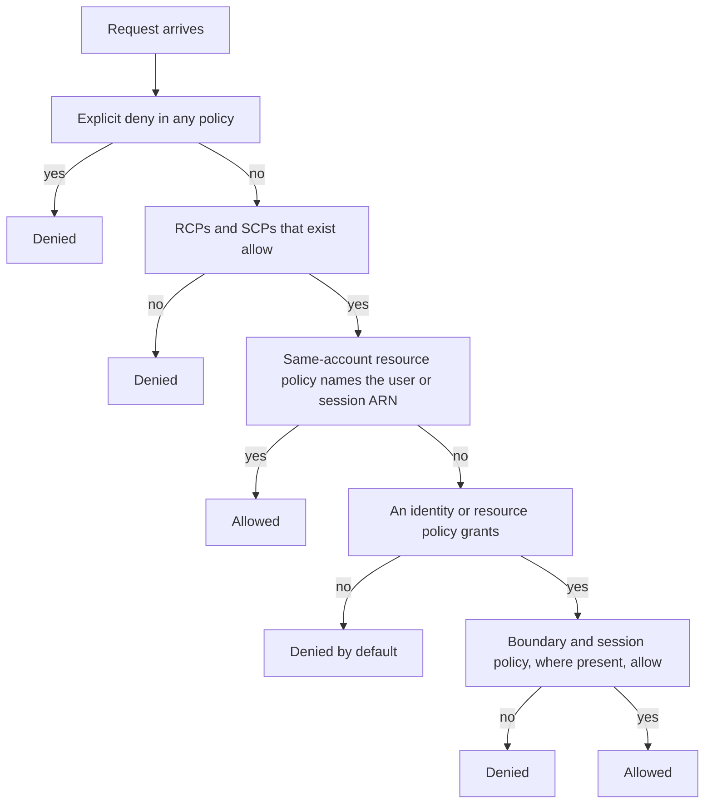
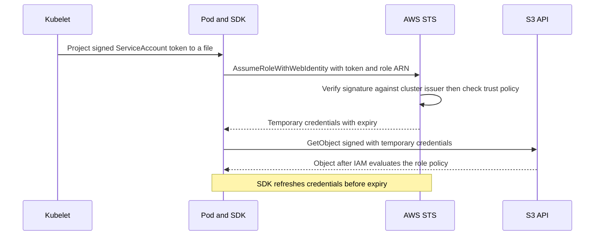

# IAM

AWS Identity and Access Management answers one question for every API call to AWS: *may this principal perform this action on this resource, right now?* It is **authorization for AWS's own APIs** — S3, SQS, KMS, Secrets Manager — and it is deliberately not the app-level auth the vault teaches elsewhere. [[RBAC vs ABAC]] and [[Designing an IAM Service]] are about deciding whether your *customer* may call *your* API; AWS IAM decides whether a *workload or an engineer* may call *AWS's*. The ideas rhyme (roles, attributes, policy documents, default deny), but the population is thousands of workloads rather than millions of users, and a careless wildcard here exposes a whole bucket, not a row.

## The problem that created it

An AWS account began life with a single identity: the root user, and account-wide keys that could do anything, including close the account. Every script, teammate and application shared that key pair. There was no way to say "this service may read this bucket and nothing else", a leaked key meant rotating it everywhere at once, and nobody could tell which of the sharers had done what. IAM (generally available May 2011) introduced separate identities with scoped permissions, but the deeper problem outlived it: **workloads need credentials, and any credential you store eventually leaks** — committed to git, baked into an image, printed in CI logs, left in an environment variable. The mature answer, built on roles and the Security Token Service, is to stop storing credentials and instead *issue short-lived ones to a workload that proves its identity by context*.

## What it solves

- **Least privilege per identity** — each service gets exactly the actions on exactly the resources it needs, written down and reviewable.
- **No stored long-lived secrets** — roles hand out temporary credentials, so there is nothing to rotate and a leaked one expires.
- **One decision point, one audit trail** — every call is authorized centrally and logged in CloudTrail with the calling role and session.
- **Guardrails above the account** — organization-level policies cap what any account can do, whatever its own administrators write.
- **Delegation across accounts and to outside identities** — roles let a pipeline, a person from the corporate directory, or a pod act in an account without a user being created there.

## How it works

### Principals: who is asking

- **Root user** — the identity created with the account, with complete access that IAM policies cannot restrict. Use it only for the few tasks that require it; give it MFA, no access keys, and never use it day to day. In an AWS Organization you can remove root credentials from member accounts centrally, and service control policies *do* restrict a member account's root user.
- **IAM users** — long-lived identity with a password and access keys. Legacy for workloads and for people (people belong in IAM Identity Center with short-lived sessions); keep them only where nothing else is supported.
- **IAM roles** — an identity with *no credentials of its own*, assumable by whoever the role trusts. This is the workhorse.
- **Federated identities** — people from a corporate directory or workloads presenting an OIDC token (IRSA below is exactly this).
- **Service principals** — AWS services themselves (`ec2.amazonaws.com`, `lambda.amazonaws.com`, `pods.eks.amazonaws.com`), including **service-linked roles** that a service owns on your behalf.

### Policies: Effect, Action, Resource, Condition

A policy is a JSON document of statements. Each has an **Effect** (`Allow` or `Deny`), an **Action** (`service:Operation`), a **Resource** (an ARN) and an optional **Condition**. A *resource-based* policy adds a **Principal**: who the statement is about.

```json
{
  "Version": "2012-10-17",
  "Statement": [
    {
      "Sid": "ReadKycObjects",
      "Effect": "Allow",
      "Action": "s3:GetObject",
      "Resource": "arn:aws:s3:::example-kyc-prod/kyc/*"
    },
    {
      "Sid": "ListOnlyTheKycPrefix",
      "Effect": "Allow",
      "Action": "s3:ListBucket",
      "Resource": "arn:aws:s3:::example-kyc-prod",
      "Condition": { "StringLike": { "s3:prefix": "kyc/*" } }
    }
  ]
}
```

Note the two different ARNs: reading an *object* names the object path, listing a *bucket* names the bucket itself. Much "mysterious" AccessDenied is exactly this mismatch. Conditions are where policies get precise: source network (`aws:SourceVpce`), organization membership (`aws:PrincipalOrgID`), request Region (`aws:RequestedRegion`), tags (the ABAC style of [[RBAC vs ABAC]]), and service-specific keys such as `s3:prefix`.

**Identity-based** policies attach to a user, group or role ("this role may do X"). **Resource-based** policies attach to the resource ("these principals may do X to me"): S3 bucket policies, SQS queue policies, KMS key policies, and the **trust policy** on a role, which is a resource-based policy saying who may assume it. A resource-based policy is also how a resource grants to a *different account* directly.

### Evaluation logic, stated precisely

For a request, AWS gathers every applicable policy. The documented order (IAM User Guide, as of 2026) is: explicit deny anywhere, then resource control policies, then service control policies, then resource-based policies, then identity-based policies, then the permissions boundary, then the session policy. In words:

1. **Explicit deny wins.** A `Deny` in *any* policy — identity, resource, SCP, RCP, boundary, session — ends the evaluation: denied, no override.
2. **Organization ceilings must allow.** If the account is in an Organization, the **resource control policies** on the resource's account and the **service control policies** on the principal's account must allow the action. Ceilings only cap; they never grant.
3. **Something must grant.** A resource-based or identity-based policy must explicitly `Allow`. Within one account either is enough for most services — except **role trust policies and KMS key policies**, which must name the principal themselves. Across accounts *both* sides must allow: the caller's identity policy and the target's resource policy.
4. **Principal-level ceilings must not cut it.** If the principal has a **permissions boundary** or was given a **session policy**, an identity-based grant must also fall inside them. The documented exception: a same-account resource-based grant that names a user ARN or a role *session* ARN is not limited by them, while a grant naming the role ARN is.
5. **Otherwise implicit deny.** Silence is denial: IAM is default-deny.



Details that earn interview points. A **permissions boundary** is a managed policy on a user or role that sets the *maximum* permissions its identity policies can grant; it grants nothing alone, and it exists so you can delegate role creation safely. **SCPs** apply to member accounts (including their root user), never to the management account or to service-linked roles, and never grant. **Resource control policies** (November 2024) are their resource-side counterpart, capping what can be done *to* resources in member accounts. The step-4 exception is the one most people get wrong; read the evaluation-logic page for the exact matrix rather than memorising it.

### Roles and STS: the pattern

A role has two policies: a **trust policy** (who may assume it) and a **permissions policy** (what it can do). To use it, a principal calls `sts:AssumeRole` (or a variant) and receives **temporary credentials** — access key ID, secret, session token and an expiry. Per the IAM docs as of 2026, the default session is one hour (minimum fifteen minutes); a role's maximum-session setting can be raised to twelve hours; and **role chaining** (a role assuming another role) is capped at one hour regardless. Why this is *the* pattern: nothing is stored or rotated by you, a leaked credential dies on its own, the workload's identity is proven by context (an instance, a signed token) rather than a secret, and CloudTrail records the role and session for every call. Use STS's **regional** endpoints. Since April 2025 the global endpoint is served in-Region for Regions enabled by default (ap-south-1 is one) when resolved through the Amazon DNS server, but AWS still recommends regional endpoints, and opt-in Regions still send global calls to us-east-1.

**Instance profiles** carry a role to an EC2 instance, whose SDK fetches credentials from the instance metadata service (IMDS). That is how **EKS node roles** work: the kubelet needs one to pull images from ECR and the CNI needs one to manage network interfaces. The danger is the same mechanism seen from a pod: unless you restrict it (IMDSv2 required with a hop limit of 1, or a block on the metadata address; host-network pods always reach it), any pod on a node can ask IMDS for the *node's* credentials. Nodes provisioned by eksctl or the official EKS CloudFormation templates get a hop limit of 2 precisely so pods *can* reach IMDS, so check yours rather than assume. The 2019 Capital One breach is the canonical story: a server-side request forgery flaw reached the metadata service, took role credentials and read S3.

### IRSA end to end

**IAM Roles for Service Accounts** gives each Kubernetes ServiceAccount its own role, via OIDC federation:

1. Every EKS cluster publishes an **OIDC issuer** URL, with signing keys that rotate. 
2. You register that issuer in IAM as an **OIDC identity provider** — once per cluster, per account.
3. You create a role whose **trust policy** names that provider as a federated principal, allows `sts:AssumeRoleWithWebIdentity`, and conditions on the token's audience (`sts.amazonaws.com`) and **subject** (`system:serviceaccount:<namespace>:<name>`).
4. You annotate the ServiceAccount with `eks.amazonaws.com/role-arn: <role ARN>`.
5. When a pod using that ServiceAccount is created, the **EKS Pod Identity Webhook** (a mutating admission webhook) injects `AWS_ROLE_ARN`, `AWS_WEB_IDENTITY_TOKEN_FILE` and a **projected volume** holding a signed, audience-scoped, short-lived token; the kubelet rotates it once it is older than 80 percent of its lifetime or 24 hours (EKS Best Practices Guide, as of 2026; see [[Kubernetes Configuration and Resources]] for projected volumes and ServiceAccounts, [[How JWT Works]] for what is in it).
6. The SDK's **default credential chain** reads the file and calls STS `AssumeRoleWithWebIdentity` — the token *is* the credential — then caches the temporary credentials and refreshes them before expiry.



```json
{
  "Version": "2012-10-17",
  "Statement": [{
    "Effect": "Allow",
    "Principal": { "Federated": "arn:aws:iam::111122223333:oidc-provider/oidc.eks.ap-south-1.amazonaws.com/id/EXAMPLED539D4633E53DE1B71EXAMPLE" },
    "Action": "sts:AssumeRoleWithWebIdentity",
    "Condition": { "StringEquals": {
      "oidc.eks.ap-south-1.amazonaws.com/id/EXAMPLED539D4633E53DE1B71EXAMPLE:aud": "sts.amazonaws.com",
      "oidc.eks.ap-south-1.amazonaws.com/id/EXAMPLED539D4633E53DE1B71EXAMPLE:sub": "system:serviceaccount:payments:payout-service"
    } }
  }]
}
```

Two SDK facts bite in practice. Credentials earlier in the chain win, so a stray `AWS_ACCESS_KEY_ID` in the pod silently beats IRSA. And the SDK must be new enough to know web identity, and on Java the **STS module must be on the classpath** (the AWS docs say so explicitly). The newer alternative is **EKS Pod Identity**: a node agent plus an association API links a role to a ServiceAccount, the role trusts the single principal `pods.eks.amazonaws.com`, no per-cluster OIDC provider is needed, and one role works across clusters unchanged. It needs Linux EC2 nodes (not Fargate), and its associations are eventually consistent. Both end at the same SDK chain; know both names.

### Least privilege in practice, and cross-account

Start with the narrowest `Action` and `Resource` that works, add conditions, and prove it from evidence. **CloudTrail** records API calls (management events in event history; data events such as S3 object reads are opt-in and billed per event). **IAM Access Analyzer** can generate a policy from up to 90 days (as of 2026) of a role's CloudTrail activity (it needs a trail, cannot see data-event actions, and does not track `iam:PassRole`), flags unused permissions (a paid per-role feature), reports resources shared outside your account or organization (free) and validates policy syntax. Observed use is evidence of need, not proof: a yearly job is invisible.

**Cross-account access** (your uat and prod accounts) is done with roles: a role in the *target* account whose trust policy names the *caller's* role ARN (no wildcard inside a Principal ARN), plus an identity policy on the caller allowing `sts:AssumeRole` on that target ARN — both halves are required. Alternatively a resource-based policy (bucket, queue) grants the foreign role directly, and `aws:PrincipalOrgID` lets it say "anyone in our organization" without listing accounts. An **external ID** is for third parties, not your own accounts.

### Cost shape

IAM itself is offered at **no additional charge** (IAM FAQ, as of 2026), and STS publishes no price of its own; there is no per-role or per-policy line. The cost is *indirect* and lands where over-broad permissions let something happen: a stolen credential launching compute in a Region you never use, deleting data, or copying a bucket out (internet egress is billed per GB). The adjacent meters are small and predictable: CloudTrail data events and extra trails per event delivered, Access Analyzer unused-access analysis per role or user per month, and KMS requests per call when a role decrypts ([[Secrets Manager Parameter Store and KMS]]). Shapes are collected in [[AWS Cost Shape]].

## Trade-offs

| You gain | You pay |
|---|---|
| Fine-grained, auditable least privilege per workload | Six policy types and one outcome: debugging an AccessDenied means checking every layer |
| No stored credentials; temporary ones expire by themselves | Credential refresh, session-length caps and role-chain limits become your edge cases |
| Organization-wide guardrails (SCPs) above every account admin | A bad SCP can lock a whole account out, root user included |
| Cross-account delegation without sharing keys | Two-sided grants: either half missing gives a confusing denial |
| Resource policies let a bucket or queue state its own rules | Policy size ceilings (a managed policy tops out at 6,144 characters excluding whitespace, a fixed limit as of 2026) and eventual consistency after a change |
| IRSA gives per-ServiceAccount identity | Trust policy tied to one cluster's issuer; Pod Identity trades that for a different set of limits |

## Failure modes

- **The AccessDenied that is really a missing resource ARN.** *Signal:* the policy "allows s3:*" yet `ListBucket` or `GetObject` is denied. *Confirm:* read the whole error — recent messages say whether no identity policy allowed it or an explicit deny fired — then compare the ARN: object versus bucket (`.../*` or not), a Secrets Manager secret ARN that ends in a hyphen plus six random characters (write `name-??????`), or a KMS-encrypted resource where the key needs its own permission. *Fix:* the exact ARN, not a wider wildcard.
- **A wrong trust policy, so AssumeRole fails.** *Signal:* "Not authorized to perform sts:AssumeRoleWithWebIdentity", every pod in a namespace at once. *Confirm:* the issuer in the trust policy still matches the cluster (a rebuilt cluster has a new issuer ID and needs a new provider), `sub` equals the real namespace and ServiceAccount, `aud` is present. *Fix:* correct the condition. The opposite error is worse: **omit the `sub` condition** and any ServiceAccount in the cluster can assume the role.
- **The node role used by every pod.** *Signal:* CloudTrail shows app-driven calls from `assumed-role/<node role>`. *Confirm:* IRSA never set up, the SDK too old to try web identity, or earlier credentials in the chain winning — the fallback is IMDS, the node's identity. *Fix:* one ServiceAccount and role per service; trim the node role to kubelet, ECR pull and CNI; require IMDSv2 with a hop limit of 1.
- **An expired STS token in a long-running batch.** *Signal:* `ExpiredToken` or 403s about an hour in; presigned URLs dying early. *Confirm:* credentials captured once instead of via a refreshing provider; role chaining's one-hour cap; a **presigned URL is only valid while the credentials that signed it are**, whatever expiry you asked for. *Fix:* build clients on the default provider chain; sign URLs shorter than the session; re-sign per chunk.
- **A wildcard resource in a money-touching service.** *Signal:* a policy review or an Access Analyzer validation warning on something like `sqs:*` on `*`. *Confirm:* what the role could reach if the pod were compromised: the payout queue, the KYC bucket, every secret. *Fix:* ARNs and prefixes, one role per service, an explicit `Deny` guardrail on the crown-jewel resources.
- **Missing the STS jar on Java.** Mongo-backed endpoints return 500 while builds stay green, because nothing imports it (see In your stack).
- **Eventual consistency.** A role created a moment ago may not be usable for a few seconds; retry rather than widen permissions.

## When NOT to use it

- **IAM users and long-lived access keys for workloads or people** — roles for workloads, Identity Center for people; users only where nothing else is supported, with MFA and rotation.
- **IAM as your customer-facing authorization** — never mint an IAM identity per end user; that is [[OAuth 2 and OpenID Connect]] and your own authorization layer.
- **Business rules such as maker-checker, transaction limits or dual approval** — IAM answers "may this service call this AWS API", not "may this approver release this payout".
- **IAM as the audit trail** — CloudTrail is the evidence; a policy only says what was possible.
- **Resource policies as the only guard** on something sensitive — a `Principal: "*"` held back only by a condition is one typo from public; prefer an explicit role grant.

## In your stack

- **Pods get AWS access through IRSA, never the node role.** One ServiceAccount and one role per service, trust policy pinned to `namespace:serviceaccount`, permissions on named ARNs only. The node role does kubelet work (ECR pull, CNI) and nothing an app needs; verify the node launch template requires IMDSv2 with a hop limit of 1. A `Deny` on the payout queue for every role except the payout service is cheap insurance.
- **MONGODB-AWS under IRSA** makes the role a *database identity*: the driver resolves credentials through SDK v1's `WebIdentityTokenCredentialsProvider`, which delegates the token exchange to the STS module, so `com.amazonaws:aws-java-sdk-sts` must be on the classpath though no source file imports it. Narrowing the fat SDK bundle to just S3 removes it silently; leave a comment on the dependency. Because MongoDB knows the caller by the role's ARN, whoever can assume that role can authenticate to the database, so its trust policy is effectively a database grant.
- **Money and KYC paths fail closed.** A missing permission yields a 403, not wrong data: the safe direction. Scope SQS to the queue ARN, S3 to the prefix, Secrets Manager to the secret ARN; presigned KYC URLs ([[How S3 Works]]) live only as long as the pod's IRSA session, so mint them short.
- **uat and prod are separate accounts.** Each has its own OIDC provider and roles; nothing in uat should be able to assume anything in prod. Cross-account access (a pipeline deploying into each) goes through a deploy role in each account trusting only the pipeline's role. Prod SCPs worth having: deny outside ap-south-1 (exempting global services and the few us-east-1 prerequisites such as ACM certificates for CloudFront, see [[WAF and ACM]]), deny disabling CloudTrail, deny creating IAM users. Test an SCP in a sandbox OU first, since it binds member-account root too.
- **People and CI:** engineers via Identity Center sessions, no personal access keys; the pipeline authenticates by OIDC federation and is the only principal that pushes images ([[Container Registries and ECR]]).
- **Audit and RBI:** an organization CloudTrail delivered to a separate log-archive account with S3 Object Lock gives immutable AWS-control-plane evidence ([[How S3 Works]]). It is the infrastructure half; app-level audit stays in the application ([[Designing an IAM Service]]). Join the two by timestamp and role session, since `x-correlation-id` lives at the HTTP layer.

## Interview angle

**How does a pod get permission to read S3, in 60 seconds:** *"Not through keys. The EKS cluster has an OIDC issuer registered in IAM as an identity provider. I create a role whose trust policy lets that provider assume it via AssumeRoleWithWebIdentity, conditioned on the token's subject being exactly namespace:serviceaccount, and whose permissions policy allows s3:GetObject on that bucket prefix. I annotate the ServiceAccount with the role ARN. When a pod starts, a webhook injects the role ARN and a projected, short-lived, audience-scoped token file. The SDK's default credential chain reads it, calls STS for temporary credentials, refreshes them before they expire, and signs the S3 calls. Result: per-service least privilege, nothing stored, and CloudTrail shows which role did what. The newer option is EKS Pod Identity — same idea without the per-cluster OIDC provider."*

Probes:

- "Allow in one policy, deny in another?" — deny wins; then Organization ceilings (RCP, SCP) must allow; then a grant; then boundary and session policy must not cut it; else default deny.
- "Identity-based versus resource-based?" — attached to the caller versus the resource; same account either suffices, cross-account both needed.
- "SCP versus permissions boundary?" — SCP caps a whole account from the Organization; a boundary caps one user or role; neither grants.
- "Why not access keys?" — they are stored, long-lived and leak; roles issue expiring credentials proven by context.
- "Policy says allow but it's denied?" — resource ARN mismatch, a ceiling or explicit deny, a missing KMS or resource-policy half, or propagation delay.

## Check yourself

> [!question]- Q: Walk through how AWS decides a request, and say what happens when an identity policy allows the action but an SCP does not mention it.
> Gather all applicable policies. Any explicit Deny, in any policy type, denies immediately. Then the Organization ceilings (resource control policies and SCPs) must allow. Then some resource-based or identity-based policy must grant (both sides across accounts; role trust and KMS key policies must name the principal even in one account). Then any permissions boundary or session policy must also allow an identity-based grant. Otherwise implicit deny. With an SCP that does not allow the action, the request is denied however generous the identity policy is: under an allow-list SCP strategy (the default `FullAWSAccess` replaced by named services) anything unlisted is outside the cap, and under a deny-list strategy an explicit Deny in the SCP ends evaluation at step one. SCPs never grant, they only cap, and an identity policy cannot lift the cap.

> [!question]- Q: A pod's role policy allows `s3:*` on `arn:aws:s3:::reports-prod/*`, yet `ListBucket` returns AccessDenied while `GetObject` works. Why, and what is the fix?
> `ListBucket` is a bucket-level action whose resource is the bucket ARN (`arn:aws:s3:::reports-prod`), not the object path. The `/*` ARN matches objects only, so `GetObject` is allowed and `ListBucket` falls through to implicit deny. Fix by adding the bucket ARN as a resource for `s3:ListBucket`, ideally with an `s3:prefix` condition. Do not "fix" it with `Resource: "*"`.

> [!question]- Q: After a cluster rebuild every pod starts failing AWS calls with "Not authorized to perform sts:AssumeRoleWithWebIdentity". What changed and how do you recover?
> A new cluster has a new OIDC issuer URL. The IAM OIDC provider registered for the old issuer does not match, and every role's trust policy names the old issuer in its Federated principal and in the `aud` and `sub` condition keys, so STS rejects the tokens. Recovery: register the new issuer as an identity provider and update each role's trust policy to it (keeping the exact `sub` condition), or automate that in provisioning code. This per-cluster coupling is a reason teams consider EKS Pod Identity, whose associations survive a rebuilt cluster.

> [!question]- Q: A nightly export job signs S3 presigned URLs with a 24-hour expiry, but recipients get 403 about an hour later. Why?
> The URLs were signed with temporary IRSA credentials, and a presigned URL is only valid while the credentials that signed it are, regardless of the requested expiry. The default session is about an hour, and role chaining caps at one hour. Fix: sign with an expiry shorter than the session and re-issue on demand, and build clients on the refreshing provider chain so the SDK renews credentials rather than reusing a snapshot. If a genuinely long-lived link is required, serve through CloudFront signed URLs ([[CloudFront]]), whose signing key is independent of any role session — never embed a long-lived access key to get there.

> [!question]- Q: Mini-design — a payout consumer in prod reads one SQS queue and one secret, and writes an audit file to an S3 bucket in a separate log-archive account. Specify the IAM.
> IRSA role in the prod account: trust policy with the cluster's provider, `aud`, and `sub` pinned to the payout ServiceAccount. Permissions on named ARNs only: `sqs:ReceiveMessage`, `sqs:DeleteMessage` and `sqs:ChangeMessageVisibility` on that queue; `secretsmanager:GetSecretValue` on the secret ARN with `-??????`; `kms:Decrypt` on the keys involved; `s3:PutObject` on the audit bucket's prefix. Cross-account needs both halves: that identity policy statement plus a bucket policy in the log-archive account granting `PutObject` to this role ARN, optionally with `aws:PrincipalOrgID`. Add Object Lock on the bucket and no delete permission anywhere. SCPs forbid leaving ap-south-1. Cost shape: IAM is free, so the cost is blast radius — which is why every grant above names an ARN.

## Sources

- AWS IAM User Guide — "How AWS enforcement code logic evaluates requests" (docs.aws.amazon.com/IAM/latest/UserGuide/reference_policies_evaluation-logic_policy-eval-denyallow.html), "Methods to assume a role" (session and role-chaining limits), "IAM and AWS STS quotas" (6,144-character managed policy), "AWS STS Regions and endpoints" (2025 global-endpoint change), "AWS account root user" (centralized root access), Access Analyzer policy generation; IAM Access Analyzer and CloudTrail pricing pages; IAM FAQ (no additional charge); AWS What's New, "AWS STS global endpoint now serves your requests locally" (April 2025). All checked October 2026.
- AWS Organizations User Guide — service control policies (not the management account, not service-linked roles, does bind member-account root); AWS announcement of resource control policies (13 November 2024).
- Amazon EKS User Guide — "Use IRSA with the AWS SDK" (Java must include the `sts` module) and "Learn how EKS Pod Identity grants pods access to AWS services" (Linux EC2 only, eventual consistency); EKS Best Practices Guide — Identity and Access Management (80 percent / 24-hour token rotation, hop limit, `sub` scoping).
- Amazon S3 User Guide — "Download and upload objects with presigned URLs" (a URL signed with temporary credentials expires with them).
- AWS Security Blog on trust policies; public post-incident reporting on the 2019 Capital One breach (metadata-service credential theft).
