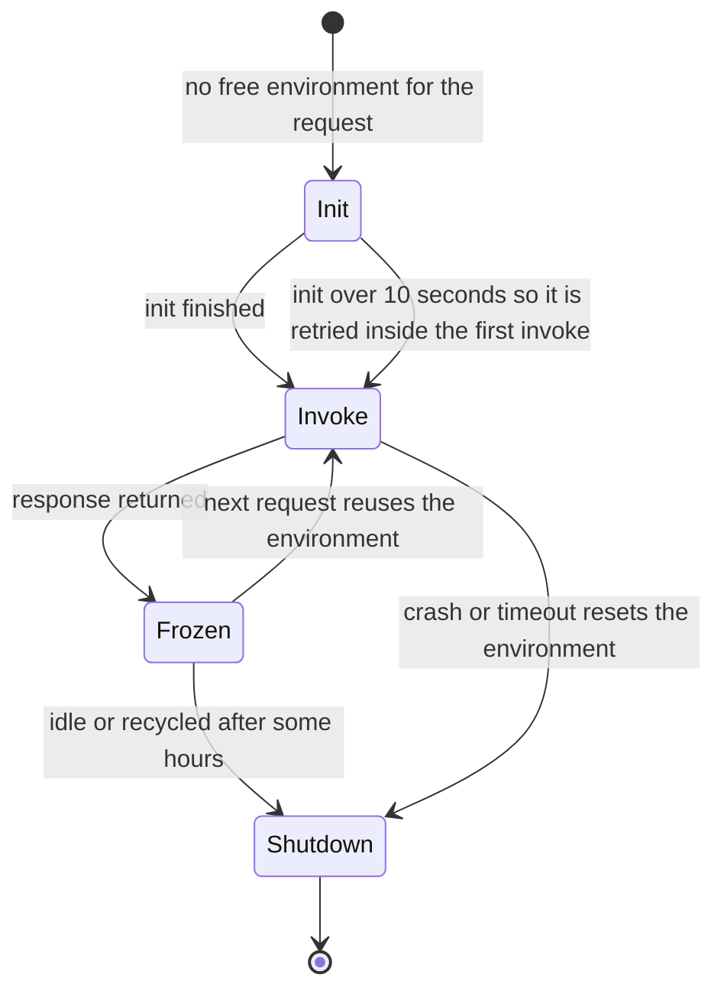

# Lambda

Lambda runs a function when an event arrives and bills you only for the time it runs. It is the managed-AWS side of [[Autoscaling]] pushed to its limit — scale to zero, scale out one concurrent request at a time — and the compute half of the event-driven design in [[Why Async Messaging Exists]]. You hand AWS a function; it owns the machines, the patching and the scaling. The price is a different execution model with sharp edges: cold starts, hard ceilings on time and payload, and concurrency that can overwhelm whatever the function talks to.

## The problem that created it

Some work does not deserve a service. Resize an uploaded image. Process one SQS message. Run a reconciliation that takes three minutes at 2 a.m. Rotate a database password once a quarter. Giving each of these a Deployment means an image, probes, a rollout pipeline, resource requests, and a pod holding about a gigabyte of JVM heap around the clock — to do three minutes of work. On a cluster full of services pinned at 1 replica, adding yet another always-on pod for a job that fires rarely is paying rent on an empty room.

Before Lambda (2014) the alternative was a cron box nobody patched, or a fleet sized for the peak of a spike that lasted seconds. Lambda made the *function* the unit of deployment and the *event* the unit of scale: AWS keeps no capacity for you when nothing happens, finds capacity when something does, and meters it by the millisecond. That is also why its limits exist — a model built to start and stop quickly cannot allow a process to run for ever or hold state between calls.

## What it solves

- **Scale to zero, scale out on demand** — no idle cost, no capacity planning for spiky or rare work.
- **No server operations** — no nodes, no OS patches, no Deployment, no HPA.
- **Native event wiring** — SQS, SNS, EventBridge, S3 and HTTP front doors invoke functions with no polling code of your own.
- **Isolation per invocation** — one request per execution environment, so no thread-safety or noisy-neighbour reasoning inside a function.
- **Cost proportional to work** — pay per request and per GB-second, with an always-free monthly allowance.

## How it works

### The unit: event, function, execution environment

A **function** is your code plus configuration (memory, timeout, role). An **execution environment** is an isolated runtime that runs it, and — the fact everything else follows from — it handles **one request at a time**. (That holds for standard functions, which AWS's 2026 docs now call *Event Functions*; Managed Instances and the newer Node.js-only *Web Functions* serve many requests per environment.) **Concurrency** is the number of requests in flight; scaling means creating more environments. The sizing formula is plain: concurrency = requests per second × average duration in seconds, so 100 requests a second at 200 ms needs about 20 environments. A function can add 1,000 new environments every 10 seconds (per-function scaling limit, as of 2026), so a sudden spike is absorbed by a fast ramp, not instantly.

There are three invocation styles, and the style decides who retries (payload limits are hard limits, as of 2026):

| Style | Examples | Who waits / retries |
|---|---|---|
| **Synchronous** | ALB, API Gateway, function URL, SDK `Invoke` | The caller waits and owns retries; payload up to 6 MB |
| **Asynchronous** | S3, SNS, EventBridge | Lambda queues the event and retries on error; payload up to 1 MB |
| **Event source mapping** (poll-based) | SQS, streams | Lambda *polls* the source and invokes synchronously with a batch |

### The lifecycle and the cold start

**Init** runs extensions, boots the runtime and executes your static code (everything outside the handler). **Invoke** runs the handler under the function timeout. Between requests the environment is **frozen**; the next request *thaws* it. That reuse is the whole performance model: objects created in init — an HTTP client, a MongoDB client — survive across invocations, and `/tmp` persists. AWS recycles environments every few hours regardless, so never assume one lives for ever.

The first request on a new environment pays init: this is the **cold start**. It is not only latency — init duration is billed (standardised on 1 August 2025; ZIP-packaged managed-runtime functions used to skip it) — and Init has a 10-second budget. If it overruns, Lambda **re-runs init inside the first invocation** under the function timeout, so a Spring Boot function that takes 12 seconds to boot is initialised twice and paid for twice before it answers. The 10-second budget does not apply with provisioned concurrency, SnapStart or Managed Instances, where init runs ahead of traffic and may take 130 seconds or the function timeout, whichever is higher (as of 2026).

### Sizing knobs

| Knob | Range / limit (hard limits, as of 2026) | Note |
|---|---|---|
| Memory | 128 MB to 10,240 MB | The *only* CPU lever: CPU scales with memory, about one vCPU at 1,769 MB |
| Timeout | up to 900 seconds (15 minutes) | Hard ceiling for standard functions; Managed Instances allow 90 minutes for async and event-source invocations |
| `/tmp` | 512 MB to 10,240 MB | Survives warm reuse, not guaranteed across environments |
| Package | 50 MB zipped, 250 MB unzipped; container image up to 10 GB | Images come from ECR ([[Container Registries and ECR]]) |
| Environment variables | 4 KB total | Not a place for secrets; see below |

Because duration is billed, **more memory can be cheaper**: doubling memory doubles the GB-second rate but can more than halve the runtime for CPU-bound code. Measure, do not guess.

### Concurrency controls

The account has a **regional concurrency quota** — 1,000 by default (a soft quota, as of 2026), lower on new accounts until usage grows, and 100 of it always stays unreserved. Three levers act inside it:

| Control (as of 2026) | What it does | Cost |
|---|---|---|
| **Reserved concurrency** | Both a *floor* and a *cap* for one function; carves it out of the pool, and you cannot reserve all of it. Setting it to 0 throttles every call | free |
| **Provisioned concurrency** | Keeps N environments pre-initialised so requests skip init (double-digit-millisecond starts) | billed for the configured time, used or not |
| **Event-source maximum concurrency** | Caps how many invocations one SQS mapping can run at once (2 to 1,000); cannot be combined with the mapping's provisioned mode | free |

### Triggers

- **SQS** ([[SQS and SNS]]): Lambda polls. Limits as of 2026: batch size up to 10,000 on a standard queue (a batch window of at least a second above 10), at most 10 on FIFO. On a standard queue in the default mode it starts with five concurrent invocations and adds up to 300 a minute, to a default ceiling of 1,250 per mapping; a paid provisioned mode of dedicated pollers adds up to 1,000 a minute.
- **SNS, EventBridge, S3:** asynchronous. EventBridge also fires functions on a cron or rate schedule, the managed replacement for the cron box.
- **ALB, API Gateway, function URL:** synchronous HTTP front doors. An ALB target is limited to 1 MB request and response and no WebSockets; API Gateway REST APIs default to an integration timeout of at most 29 seconds (raisable only on Regional and private REST APIs, as of 2026), nowhere near 15 minutes. Kong has an `aws-lambda` plugin that can invoke a function directly.

**SQS in detail.** The visibility-timeout mechanics and why they produce duplicates are taught in [[SQS and SNS]]; what Lambda adds on top is this. The mapping hides each batch for the queue's visibility timeout while the function runs, and AWS says to set visibility to **at least six times the function timeout** (plus the batch window), so a throttled invocation can be retried inside the window. Lambda rejects a function timeout above the queue's visibility timeout when the mapping is created or updated. Set `maxReceiveCount` on the dead-letter policy to at least 5, because throttling consumes receives ([[Dead Letter Queues and Poison Messages]]). By default one failing message returns the *whole batch* to the queue; enable **partial batch response** (`ReportBatchItemFailures`) and return only the failed message IDs. Delivery stays at-least-once either way, so the handler must be idempotent.

**Asynchronous retries.** On a function error Lambda retries twice more by default, waiting one minute then two; throttled and system-error events are retried for up to six hours by default (as of 2026). Even with no error the same event can arrive twice because the internal queue is eventually consistent — so every async function must be idempotent ([[Idempotency]]). Failed events go to a destination or dead-letter queue if you configure one; otherwise they are discarded.

### Java on Lambda, honestly

A Spring Boot application boots by scanning classes, building a bean graph and loading reflection metadata — seconds of work, on a JVM that also starts cold and runs unoptimised bytecode for its first requests. At low memory settings (under about 1,769 MB) it also has less than a vCPU, so init is slower still. Node and Python functions of the same size typically initialise in a fraction of that. That is why Java is a harder fit: the cold start is long, the JIT warm-up continues after init, and the memory floor is higher.

The mitigations, cheapest first:

1. **Give it memory.** More memory means more CPU means faster init.
2. **Slim the function.** Fewer starters, lazy beans, a function-style framework (Spring Cloud Function or the AWS serverless Java container adapters) instead of a full web stack.
3. **SnapStart** (launched November 2022 for Java; Python and .NET followed in November 2024; container images, on AWS or custom base images, in 2026): Lambda runs init once when you *publish a version*, snapshots memory and disk, and restores from the snapshot on a cold start. As of 2026 it supports Java 11 and later (and Python 3.12+ and .NET 8+), on published versions or aliases only, and **not** with provisioned concurrency, EFS, S3 Files or ephemeral storage above 512 MB. The catches are semantic: anything unique created in init (random seeds, IDs) is shared by every restored environment, and network connections opened in init may be dead after restore, so re-validate them in an after-restore hook (the CRaC API). For Java it costs nothing extra; Python and .NET pay for snapshot caching and for each restore.
4. **Provisioned concurrency** for a strict latency target — the guaranteed fix, and billed continuously.
5. **GraalVM native image** on an OS-only runtime or custom-base container: fast starts, but a heavier build, and SnapStart does not support OS-only runtimes.

### VPC-attached functions

To reach a private MongoDB or Redis, attach the function to subnets and security groups in your VPC. Lambda creates **Hyperplane ENIs**, one per distinct subnet-and-security-group combination, shared by every function using that combination and scaled by connection count rather than per invocation. The old penalty of building an interface on every cold start went away with that design (announced September 2019); what remains is operational: a new or updated function sits in *Pending* for minutes while the interface is built, and a function idle for 14 days (as of 2026) can go *Inactive* and fail its next call. A VPC-attached function has **no internet access** unless the VPC provides it — a public subnet does not help — so calls to SQS, Secrets Manager or KMS need a NAT gateway or VPC endpoints ([[VPC and Networking]]), and both bill by the hour and by GB processed.

### Cost shape

The bill scales with **requests** and **GB-seconds** (memory × billed duration, rounded to 1 ms), plus the things around it: CloudWatch Logs ingestion per GB, NAT gateways for VPC functions, provisioned concurrency per configured hour, and downstream SQS and data transfer. There is an always-free monthly allowance of 1 million requests and 400,000 GB-seconds (as of 2026), and arm64 is priced lower per GB-second than x86.

Worked example (US list rates, as of 2026, approximate): about $0.20 per million requests and $0.0000167 per GB-second. A 1 GB function that runs 200 ms uses 0.2 GB-seconds a call, so a million calls cost roughly **$3.50**. At 1 request a second (2.6 million a month) that is about $9; at a steady 100 requests a second it is about **$900** a month. Lambda bills the *whole* wall-clock of each call, including time spent waiting on a database, while a container multiplexes many waiting requests on a shared vCPU. So the crossover is steady utilisation: at low or spiky load Lambda wins, at high sustained load a container wins by a multiple. **Lambda Managed Instances** (announced November 2025) change this by running functions on EC2 instances in your account, billed at the EC2 price plus a 15% management fee on the on-demand rate (as of 2026, approximate), with many concurrent invocations per environment — it trades away scale to zero for a configured minimum. **Web Functions** (Node.js only, as of 2026) attack the same waste while keeping scale to zero: many requests per environment, billed on active vCPU time plus memory rather than wall-clock per request. Neither changes the Spring Boot conclusion. See [[AWS Cost Shape]].

## Trade-offs

| You gain | You pay |
|---|---|
| No idle cost, no servers, no Deployment to run | Cold starts; Java's are seconds without SnapStart or provisioned concurrency |
| Scaling to a spike with no HPA tuning | Concurrency that scales faster than your database can follow |
| Native triggers and per-invocation isolation | 15-minute, payload and statelessness ceilings |
| Cheap for rare, bursty work | A multiple of a container's cost at steady high throughput |
| IAM role per function, no network to manage | A second deployment model, logs, alarms and runbooks to maintain |
| Retries built into async and SQS paths | At-least-once everywhere, so idempotency is your job |

## Failure modes

- **Duplicates from the SQS visibility timeout.** Lambda checks function timeout against visibility when the mapping is created or updated; a later change to the queue or the function alone is not necessarily re-checked (an inference from the documented behaviour). Duplicates also appear when headroom is below six times the timeout, when the batch window eats the visibility budget, or when a batch fails and returns *all* its messages (no partial batch response). Signal: the same business event handled twice. Fix: the six-times rule, partial batch response, idempotent handlers.
- **Unbounded concurrency draining a connection pool.** After an outage 50,000 messages wait; the mapping ramps toward 1,250 concurrent invocations, each opening a MongoDB client whose default pool is 100 connections — in principle far beyond what the database accepts ([[Connection Pooling]]). Fix: create the client once in init with a pool of 1 or 2 (one request per environment needs little), cap the SQS mapping's maximum concurrency, and treat reserved concurrency as the blunt backstop.
- **Cold start on a user-facing path.** A function behind an ALB that scales from zero shows multi-second p99s for the first users after a quiet period. Fix: SnapStart, provisioned concurrency, or do not put Java here.
- **The function that does not return.** A call to a dependency with no client timeout hangs until the function timeout; you pay the full duration, and an SQS message stays invisible until it expires. Fix: client timeouts shorter than the function timeout, and check the remaining time before slow work.
- **The 15-minute ceiling on a batch job.** A nightly job outgrows the limit and is killed mid-run, with no checkpoint. Fix: split the work into chunks fanned out over SQS, or run it as a Kubernetes Job or ECS task; Durable functions (December 2025; checkpointed executions that can suspend for up to a year) and Managed Instances (90 minutes for async and event-source invocations) raise the ceiling, at the price of a newer programming or capacity model.
- **Throttled before it ever ran.** A mapping throttled by low reserved concurrency returns messages to the queue and burns receives, so they dead-letter without being processed. If you set reserved concurrency on an SQS-triggered function, AWS recommends at least five.
- **Recursive triggers.** A function writing its output to the bucket or queue that triggers it loops. Lambda's recursive loop detection, on by default, stops a chain after about 16 invocations for loops through SQS, S3, SNS, EventBridge custom buses or Lambda itself (as of 2026), but misses loops through other services such as DynamoDB. Separate input and output prefixes or buckets, and alarm on invocations ([[AWS Cost Shape]]).

## When NOT to use it

- **Sustained, high-throughput request serving** — a container is cheaper and has no cold start (Web Functions narrow the gap, but only for Node.js, as of 2026).
- **Latency-critical Java paths** without SnapStart or provisioned concurrency.
- **Jobs that can exceed 15 minutes**, or that need a long-lived connection (WebSockets, streaming sessions).
- **Work that must cap its database connections tightly** and cannot tolerate a fan-out of environments.
- **Stateful workloads** or anything that keeps large in-memory caches between requests.
- **When free capacity already exists:** on shared EKS nodes the marginal cost of one small pod can be near zero, so the case for Lambda is operational, not financial.

## In your stack

- **Where it fits.** Small SQS consumers, S3-upload reactions such as scanning or thumbnailing a KYC document, scheduled jobs that finish well inside 15 minutes, and Secrets Manager rotation functions ([[Secrets Manager Parameter Store and KMS]]). The core Spring Boot services stay on EKS; this is for the edges.
- **Kubernetes alternatives for the same job.** A CronJob for scheduled work and an extra consumer Deployment for queues cost nothing at the margin if the nodes have room — decide on operational burden, not on Lambda's free tier.
- **Roles, not IRSA.** A function has an execution role; a resource policy says who may invoke it ([[IAM]]). uat and prod are separate accounts, so deploy the same artifact to both with account-specific roles and queue ARNs, and never share a function across them. Assumption to verify on first deploy: on on-demand Lambda the execution-role credentials arrive as environment variables, so MONGODB-AWS should not need the web-identity token exchange behind the EKS `aws-java-sdk-sts` requirement. Under SnapStart they come from a container credentials endpoint instead, so test that path separately.
- **1-replica instincts mislead here.** Reserved concurrency of 1 to "serialise" an SQS consumer causes throttling and early dead-lettering; use a FIFO message group or the mapping's maximum concurrency.
- **Idempotency in the store you have.** Key on the business event ID with a unique index in the existing MongoDB rather than adding a table for the Powertools helper (whose only built-in store is DynamoDB; a custom store over Mongo is possible). Money-touching handlers must be safe to run twice.
- **Tracing and logs.** Carry `x-correlation-id` in SQS message attributes and put it in the log context; Lambda adds its own request ID. Log groups default to keeping logs for ever — set retention ([[CloudWatch]]).
- **Secrets.** Fetch in init, or use the AWS Parameters and Secrets extension (local endpoint, cache TTL 300 seconds by default and at most, as of 2026), never environment variables for credentials.
- **RBI localisation.** Run functions, queues and logs in ap-south-1. Lambda@Edge runs in CloudFront's regional edge caches, outside your Region by design ([[CloudFront]]), so keep regulated data away from it and confirm with compliance. SnapStart is available in Mumbai.

## Interview angle

The 60-second version of "when would you *not* use Lambda": *"Lambda is a function invoked by an event, billed per request and per millisecond of memory-times-duration, scaling by adding concurrent single-request environments. I would not use it for sustained high throughput, because per-millisecond billing of wall-clock time, including time spent waiting on I/O, costs a multiple of a container that shares one vCPU across many requests. I would not use it for latency-critical Java without SnapStart or provisioned concurrency, because Spring Boot cold starts run to seconds. I would not use it for anything that can pass 15 minutes, or for work that must hold a tight cap on database connections, since concurrency scales faster than a connection pool can follow. I would use it for rare, bursty, event-driven work — an SQS consumer, an S3 reaction, a nightly job — provided the handler is idempotent, because both SQS and async invocation are at-least-once."*

Classic probes:

- "What is a cold start and how do you reduce it?" — init of a new environment; memory, slimmer code, SnapStart, provisioned concurrency.
- "How do you stop Lambda from overwhelming a database?" — small client pool in init, event-source maximum concurrency, reserved concurrency.
- "SQS plus Lambda gives you duplicates — why?" — visibility timeout headroom, whole-batch retry, at-least-once; partial batch response and idempotency.
- "Reserved versus provisioned concurrency?" — reserved is a free cap and floor; provisioned is paid, pre-warmed capacity.

## Check yourself

> [!question]- Q: Explain what happens between a function being invoked for the first time and it answering, and why the second call is faster.
> Lambda finds no free environment, creates one and runs **init**: starts extensions, boots the runtime and runs static code. Then **invoke** runs the handler. The environment is frozen and kept; the second call thaws it, skipping init, with clients and `/tmp` intact. Init duration is billed, and on-demand init beyond 10 seconds is re-run inside the first invocation, so a slow-booting Java app pays twice; with SnapStart or provisioned concurrency init happens ahead of traffic and the 10-second budget does not apply.

> [!question]- Q: An SQS-triggered function times out at 60 seconds and the queue's visibility timeout is 60 seconds. Some orders are processed twice. Why, and what do you set?
> Equal values leave no headroom: a throttled or slow invocation outlives the hiding period, the message reappears and a second invocation runs. AWS advises visibility at least six times the function timeout (plus the batch window), so 360 seconds or more. Add partial batch response so one bad message does not return the whole batch, and make the handler idempotent on the order ID, since duplicates can still occur.

> [!question]- Q: After an incident 80,000 messages queue up and your Mongo-backed Lambda consumer takes the database down. Explain and fix.
> The mapping ramps toward its default ceiling of 1,250 concurrent invocations; each environment opens its own MongoDB client, and with the driver's default pool size the total connection demand dwarfs what the database allows. Fix: build the client once in init with a pool of 1 or 2, set the mapping's maximum concurrency to what the database can bear, and add alarms on queue age and connections. Reserved concurrency is a backstop, not the lever.

> [!question]- Q: Mini-design — a nightly job reads 2 million records from S3 and posts a summary, currently taking about 40 minutes. Lambda or not?
> Not as one function — 40 minutes is over the 15-minute ceiling. Either run it as a Kubernetes Job on the EKS cluster, or split it: an EventBridge schedule triggers a splitter that enqueues chunks to SQS, and a Lambda consumer processes a few hundred thousand records per message batch, idempotently, with a capped concurrency. Cost shape: requests plus GB-seconds for the chunks versus pod time on nodes you already pay for.

> [!question]- Q: Your team wants Spring Boot on Lambda behind the ALB for a user-facing endpoint. What do you ask before agreeing?
> What the p99 target is and how steady the traffic is. A quiet endpoint scales to zero and shows seconds-long cold starts to the first user; options are SnapStart (with its uniqueness and connection caveats), paid provisioned concurrency, or leaving the endpoint on EKS. At steady load the per-millisecond bill also exceeds a container's, and the ALB target caps request and response at 1 MB.

## Sources

- AWS Lambda Developer Guide — execution environment lifecycle, quotas, configuring reserved and provisioned concurrency, how Lambda scales, asynchronous invocation and error handling, SQS event source mappings and partial batch responses, giving functions access to a VPC (Hyperplane ENIs), SnapStart.
- AWS Lambda pricing page (requests, GB-seconds, free tier, provisioned concurrency, SnapStart, Managed Instances; figures above are as of 2026, approximate) and the AWS Compute Blog post on standardised billing for the init phase.
- Elastic Load Balancing User Guide — Lambda functions as targets (size limits); Amazon CloudFront guide — Lambda@Edge versus CloudFront Functions.
- Powertools for AWS Lambda (Java) — idempotency utility; AWS Parameters and Secrets Lambda Extension documentation.
- AWS Builders' Library and re:Invent talks on Lambda internals and scaling behaviour.
- Checked 2026-10-05: https://docs.aws.amazon.com/lambda/latest/dg/gettingstarted-limits.html, https://docs.aws.amazon.com/lambda/latest/dg/lambda-runtime-environment.html, https://docs.aws.amazon.com/lambda/latest/dg/services-sqs-configure.html, https://docs.aws.amazon.com/lambda/latest/dg/services-sqs-scaling.html, https://docs.aws.amazon.com/lambda/latest/dg/invocation-async-error-handling.html, https://docs.aws.amazon.com/lambda/latest/dg/snapstart.html, https://docs.aws.amazon.com/lambda/latest/dg/configuration-vpc.html, https://docs.aws.amazon.com/lambda/latest/dg/provisioned-concurrency.html, https://docs.aws.amazon.com/lambda/latest/dg/invocation-recursion.html, https://docs.aws.amazon.com/lambda/latest/dg/lambda-managed-instances.html, https://aws.amazon.com/lambda/pricing/, https://aws.amazon.com/blogs/compute/aws-lambda-standardizes-billing-for-init-phase/, https://docs.aws.amazon.com/elasticloadbalancing/latest/application/lambda-functions.html, https://docs.aws.amazon.com/apigateway/latest/developerguide/api-gateway-execution-service-limits-table.html, https://docs.aws.amazon.com/systems-manager/latest/userguide/ps-integration-lambda-extensions.html, https://docs.aws.amazon.com/powertools/java/latest/utilities/idempotency/, https://aws.amazon.com/about-aws/whats-new/2024/11/aws-lambda-snapstart-python-net-functions/, https://aws.amazon.com/about-aws/whats-new/2026/07/aws-lambda-snapstart-container/, https://aws.amazon.com/about-aws/whats-new/2025/11/aws-lambda-managed-instances/, https://aws.amazon.com/about-aws/whats-new/2025/12/lambda-durable-multi-step-applications-ai-workflows/.
- Re-checked 2026-10-14: https://docs.aws.amazon.com/lambda/latest/dg/web-functions.html, https://docs.aws.amazon.com/lambda/latest/dg/configuration-concurrency.html, https://docs.aws.amazon.com/lambda/latest/dg/invocation-async-error-handling.html, https://aws.amazon.com/blogs/compute/announcing-improved-vpc-networking-for-aws-lambda-functions/, plus every URL in the line above.
