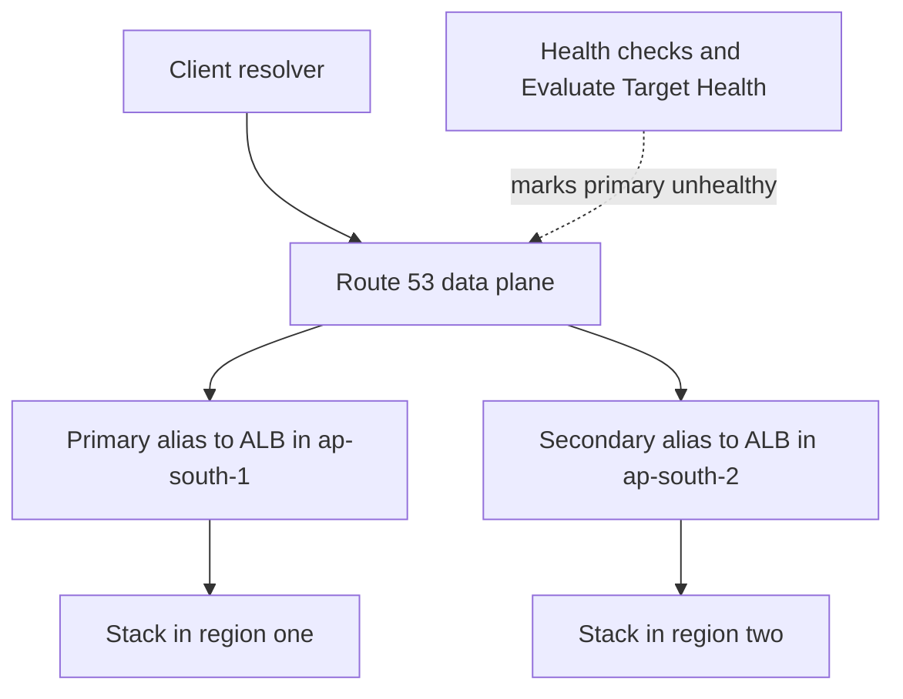
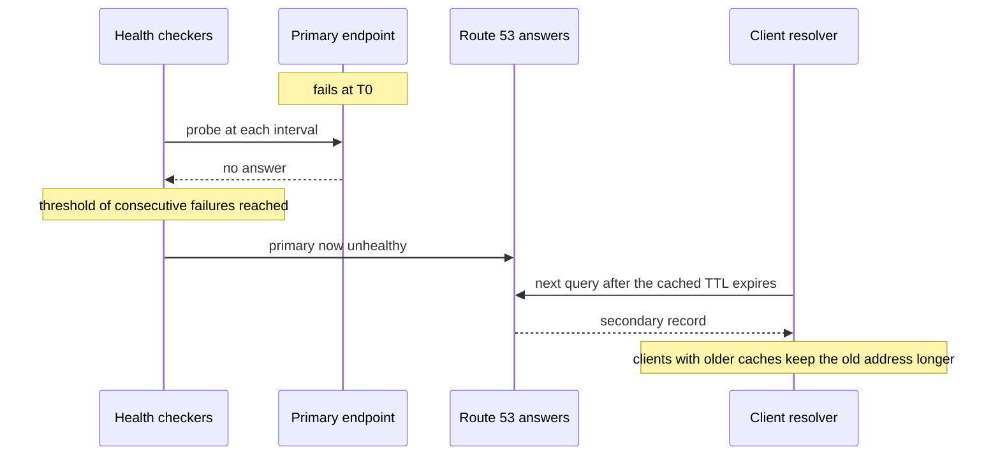

# Route 53

Route 53 is the managed-AWS side of [[How DNS Works]]: that note teaches the delegated hierarchy, recursive resolution, record types and why TTL governs every change; this one teaches what AWS builds on top — hosted zones, **alias records**, routing policies that choose an answer per query, health checks that remove dead answers, private DNS inside a VPC, a resolver for hybrid networks, and a registrar. (The name is the DNS port, 53.) It is the first hop of every request into your stack, and its failure modes are quiet: a wrong TTL or a shallow health check fails exactly when you need failover, not before.

## The problem that created it

Running authoritative DNS yourself means at least two servers in different networks, zone-file changes pushed through a deploy process, and exposure to the attacks that take DNS providers down (the Dyn outage in [[How DNS Works]]). Worse for steering, a self-run server's answer is static: it returns the same A record whether the target is up or not, so health-aware, latency-aware or weighted answers needed bolt-on scripts that rewrote zone files — the exact moment-of-failure automation you least want to depend on.

AWS launched Route 53 in 2010 as a DNS service whose answers are *computed at query time* from your records plus live health data, served from a global anycast network of edge locations (16 at the December 2010 beta launch; AWS's current pages say only "dozens", so no count is quoted here). The design splits two planes: a **control plane** (the API and console where you edit records, located in us-east-1) optimised for consistency, and a **data plane** (the authoritative answering and the health-checking) optimised for availability. The consequence you should internalise: the answering path keeps working when the editing path does not.

## What it solves

- **Authoritative DNS you do not run** — each hosted zone gets four name servers, answered from the global data plane.
- **Alias records** — a CNAME-like pointer to an AWS resource that works at the zone apex, follows the target's IP changes, and costs nothing to query.
- **Steering** — weighted, latency, geolocation, geoproximity, IP-based and multivalue answers, chosen per query without touching clients.
- **Health-checked failover** — a dead endpoint simply stops being returned ([[Failover]]).
- **Private DNS** — names that resolve only inside chosen VPCs, including split-horizon (same name, different answer inside and outside).
- **Hybrid and registrar functions** — Resolver endpoints to forward queries between VPCs and on-premises networks, and domain registration in the same place.

## How it works

*Figures in this section are AWS-documented values as of October 2026: "default" marks an editable setting, "fixed" or "hard" one AWS will not change for you. Re-check the linked user guide before quoting one in a design review.*

### Hosted zones: public and private

A **hosted zone** is a container for the records of one domain. A **public** zone answers the internet; for it to be reachable the registrar must delegate the domain to the four name servers Route 53 assigned to *that* zone — a random selection per zone, which cannot be changed afterwards (a *reusable delegation set* lets many zones share one set). A **private** zone is associated with one or more VPCs and is answered only for them, by the Route 53 Resolver built into every VPC (reachable at the VPC base address plus two, and at `169.254.169.253`). Both VPC attributes `enableDnsSupport` and `enableDnsHostnames` must be true. Associating a VPC from another account needs an authorisation created in the zone's account first, so a private zone does not leak across the uat and prod accounts unless you wire it ([[VPC and Networking]]).

Two resolution rules matter. With public and private zones of the same name (split-horizon), a VPC resolves from the private zone, and **if the private zone has no matching record the answer is NXDOMAIN — it does not fall through to the public zone**. With overlapping private zones the most specific wins, and a Resolver forwarding rule for the same domain overrides a private zone.

### Records, and why alias exists

The generic record types are in [[How DNS Works]]. The AWS-specific one is the **alias** record: usually an A or AAAA record whose value is an AWS resource — an ELB, a CloudFront distribution, an S3 static-website endpoint, API Gateway, Global Accelerator, a VPC endpoint, or another record in the same zone. It solves a real DNS limit: a CNAME cannot sit at the zone apex (`example.com`), but an alias can, and Route 53 answers with the target's current IPs, so a load balancer scaling or moving never breaks it. Three properties to remember: **queries to alias records pointing at AWS resources are free**, where CNAME queries are billed (a CNAME to a name inside Route 53 counts as two queries); **you cannot set the TTL** — Route 53 uses the target's (60 seconds for an ELB); and the alias must match the target's record type. An alias to an ELB (or to another record in the zone) supports **Evaluate Target Health**, covered below.

### Routing policies: the problem each solves

| Policy | Problem it solves | Detail worth knowing |
|---|---|---|
| Simple | One resource does one job | Several values may be returned together; none is individually health-checked |
| Weighted | Canary releases, gradual migration | Integer weight 0 to 255, share = weight ÷ sum; 0 drains a record (all zero means equal); needs one TTL across the group |
| Latency | Same service in several Regions | Answers with the Region that has the lowest measured latency from the resolver's network; records are tagged by Region |
| Failover | Active-passive | Primary and secondary; the secondary serves only when the primary is unhealthy |
| Geolocation | Content rights, language, data residency | By continent, country or US state, most specific wins; without a default record unmatched locations get no answer; location is an estimate (resolver address or EDNS0 client subnet) |
| Geoproximity | Shift load by physical distance | Distance to the resource's location, with a bias to grow or shrink a Region's share |
| IP-based | Route a known network (an ISP, an office) | Client CIDR blocks mapped to endpoints |
| Multivalue answer | Cheap client-side spread with health | Up to eight healthy records per answer, at random — not a substitute for a [[Load Balancers|load balancer]] |

Policies compose through alias trees (latency to each Region, then failover inside each). When records in a group carry health checks, keep their TTL at 60 seconds or less, and make it identical across the group.

The shape you will draw most often is active-passive across Regions:

### Health checks

Three kinds. An **endpoint** check has health checkers around the world send HTTP, HTTPS or TCP probes: for HTTP(S) the TCP connection must open within 4 seconds and a 2xx or 3xx must arrive within 2 (both fixed; a TCP check gets 10 seconds); HTTPS checks do **not** validate certificates; string matching searches only the first 5,120 bytes of the body. A **calculated** check aggregates up to 255 child checks (a fixed, non-adjustable quota as of 2026, though the API schema accepts 256) with an "at least N healthy" rule. A **CloudWatch-alarm** check follows an alarm's data stream — the way to health-check something private, since checkers cannot reach private or non-routable addresses; the alarm must be in the same account, standard resolution, a basic statistic (no extended statistics such as percentiles), no metric math and no M-out-of-N evaluation ([[CloudWatch]]).

**Detection arithmetic.** Each checker probes every *interval* (30 seconds default, or 10 with the fast option, which costs extra) and flips after a *failure threshold* of consecutive results (default 3, range 1 to 10). Detection time is interval times threshold: 30 × 3 = **90 s** by default, 10 × 3 = **30 s** fast, 10 × 1 = 10 s on paper but a single blip flips it. Checkers run from eight AWS Regions by default (you may pick a subset of at least three), none in India, and the endpoint counts as healthy while **more than 18 percent** of checkers say so (AWS notes the threshold may change) — a deliberate rule so that one region's network trouble does not fail you, which also means a failure visible from only some places can stay "healthy".

**Alias health.** For AWS resources do not create a separate health check; set Evaluate Target Health to Yes and Route 53 uses the resource's own view (for an ALB or NLB, healthy only while *every* target group that contains targets has at least one healthy target, and a target group with no registered targets counts as unhealthy, so one empty or failing target group fails the whole alias — see [[ALB and NLB]]; it says nothing about individual services behind a gateway).

**Fail-open rules** (documented, and surprising): a record with no health check is always healthy; *if no record in a group is healthy, all are treated as healthy*; failover with both primary and secondary unhealthy returns the **primary**; a secondary without a health check is always returned when the primary fails. A new health check counts as healthy until it has enough data. The consequence: a total outage never produces an empty answer, so you must alarm on the health checks themselves.

### TTL strategy for failover

Failover time is a sum: **detection + TTL + whoever caches beyond the TTL**.

Keep TTL at 60 seconds or less on records that may fail over (an alias to an ELB is fixed at 60 anyway), and lower it at least one old TTL before a planned migration ([[How DNS Works]]). Do not drive it to 1 to 5 seconds: query volume and bills rise, some resolvers floor low TTLs, and every blip becomes visible. The JVM and OS caches that outlive TTL are in [[How DNS Works]] too. Worked check of a promise: "2-minute failover" with defaults is up to 90 + 60 = **150 s** — the promise fails for any client that queried just before the flip; with fast checks it is 30 + 60 = **90 s**, and only for clients that honour TTL.

### Registrar and Resolver

As a **registrar** Route 53 registers and renews domains (billed per domain per year by TLD) and writes the registry's NS records. That is a separate object from the hosted zone: the registry's NS set and the zone's NS set must match, and registration is managed only on the us-east-1 control plane. **Resolver** (documented as Route 53 VPC Resolver) is the regional DNS service in each VPC; for hybrid networks, *inbound endpoints* let on-premises resolvers query your VPC's private zones, *outbound endpoints* with *forwarding rules* send chosen domains to on-premises servers. Endpoints are ENIs you pay for by the hour; DNS Firewall and query logging are optional. It has a hard quota: **1,024 packets per second** to link-local services (Resolver, instance metadata, time sync together), not raisable.

### Debugging a name

Separate "the zone is wrong" from "a cache is stale" by asking the zone's own name server directly (`dig @<one of the zone's assigned name servers> api.example.com`): if that answer is right, everything wrong is a cache downstream. Compare the NS set shown by `dig +trace example.com` (what the registry delegates to) with the zone's own NS record set — they must match. The console's test-record feature (the `TestDNSAnswer` API, public zones only) shows what a given routing policy would return for a given resolver location and client subnet without waiting for real traffic.

### Control plane, data plane, and accelerated recovery

Editing records goes through us-east-1; answering and health checking are distributed. So an incident plan must not depend on changing records mid-event. AWS added *accelerated recovery* in November 2025: opt-in per public hosted zone, switched on *before* an incident (no extra charge as of 2026), it keeps a copy of the zone in us-west-2 with a 60-minute target for resuming record changes if us-east-1 is impaired. Even then only record changes and reads work — no zone creation or deletion, no DNSSEC changes — and private zones are not covered. It shortens the edit outage to about an hour; it does not remove it.

### Cost shape

- **Order of magnitude (us-east-1 list, as of 2026, approximate)** — tens of US cents per zone-month, tens of cents per million standard queries, under a dollar per basic health-check-month, about an eighth of a dollar per Resolver ENI-hour. Read the pricing page before a proposal.
- **Per hosted zone per month** — a flat fee per thing; zones multiply with environments, tenants and accounts (a small extra fee applies past 10,000 records in a zone, which is also the default, adjustable records-per-zone quota as of 2026).
- **Per million queries** — standard queries on one meter; latency, geolocation, geoproximity and IP-based queries on separate, typically higher-rate lines; **alias queries to AWS resources free**. Queries follow *resolvers × records ÷ TTL*, not your user count: if 5,000 distinct resolvers refresh one non-alias record every 60 s, that is at most 5,000 × 1,440 = 7.2 million queries a day (about 216 million a month, under a hundred US dollars a month at the 2026 standard rate, approximate); at TTL 300 it is a fifth. An upper-bound model, but the shape holds.
- **Per health check per month** — AWS-endpoint checks cost less than non-AWS; HTTPS, string matching, the fast interval and latency measurement each add; a disabled check still bills. Count = services × environments × Regions, so check only what you fail over.
- **Resolver endpoints** — per ENI-hour plus per million forwarded queries; **Traffic Flow** policy records per month; **registration** per domain per year. Query logging is free from Route 53 — you pay the destination (CloudWatch, S3 or Firehose).

## Trade-offs

| You gain | You pay |
|---|---|
| Authoritative DNS with no servers, answered at the edge | Eventual consistency by design: TTL and resolver caches cap failover speed |
| Per-query steering and health-aware answers | Granularity is the resolver, not the user or the request |
| Free alias queries and apex support | You cannot set an alias TTL; alias only reaches AWS targets |
| Health checks as a global, managed vantage point | Checkers sit outside India and cannot probe private addresses; each check bills |
| Control and data plane split keeps answering during incidents | Edits depend on us-east-1; design failover to need none |

## Failure modes

- **A TTL too long for the failover you promised.** *Signal:* the health check flips on time, yet traffic keeps hitting the dead region for minutes. *Confirm:* add detection (interval × threshold) to the TTL of the record actually answered — a CNAME or A record to a partner endpoint at TTL 300 or 3600 is the usual culprit, since aliases to ELBs are fixed at 60 — and then to client caches. *Fix:* a TTL of 60 s or less on every record in the failover group, set before the incident.
- **A health check that passes because it hits a static page.** A CDN or nginx serving `/index.html` stays green while the application is dead; HTTPS checks ignore certificate validity; an alias with Evaluate Target Health is healthy while each of the ALB's target groups has a healthy target, which behind Kong means Kong, not the services. *Fix:* check a bounded, honest path (or a string in the body), or drive a CloudWatch-alarm check from real error and latency metrics; use calculated checks to avoid failing over on one dependency's blip.
- **A private zone not associated with the VPC.** *Signal:* a name resolves publicly (or NXDOMAIN) from one VPC and privately from another. *Confirm:* list the zone's associated VPCs and check both DNS attributes. The mirror image: a private zone *is* associated but lacks a record that exists in the same-named public zone, so the VPC gets NXDOMAIN with no fallback. Cross-account VPCs need an association authorisation.
- **A dangling record pointing at something released (subdomain takeover).** A record named `app.example.com` that still points at a deleted S3 website bucket name, a released Elastic IP or a retired endpoint lets whoever later claims that name serve content under your hostname — and read any cookies scoped to the parent domain. *Fix:* delete DNS records in the same change that deletes the resource, and sweep zones for targets that no longer resolve.
- **A deleted-and-recreated zone.** The new zone gets different name servers; the registrar still delegates to the old ones, and the whole domain goes dark. If you must recreate a zone, update the registrar's NS set to the new zone's name servers in the same change, or use a reusable delegation set from the start.
- **Health checkers blocked.** A WAF geo-block, security group or allow-list that rejects the checkers' addresses makes a healthy endpoint look dead and triggers a false failover. AWS publishes the checker ranges; allow them.
- **Failing over into a region with no data.** DNS moves users in seconds-to-minutes; promoting the data tier takes a deliberate decision and has an RPO. Never let a DNS health check be the only trigger for promoting a database ([[Disaster Recovery]]).

## When NOT to use it

- **For fast or per-request balancing** — DNS is the coarse tier above a [[Load Balancers|load balancer]]; its floor is TTL plus caches.
- **When failover must beat DNS caches** — use a layer that does not depend on them: CloudFront origin failover ([[CloudFront]]) or an anycast service such as AWS Global Accelerator.
- **Geolocation as a control** — it is an estimate; it does not enforce data residency or stop a VPN.
- **Secrets in record names** — public zones are public.
- **Health-checking everything** — each check is a meter; check the things you will actually fail over.

## In your stack

- **Public names** live in a public zone per account and point at CloudFront by alias; CloudFront then reaches the ALB ([[CloudFront]], [[ALB and NLB]]). With CloudFront in front, region choice usually moves to CloudFront (origin failover or origin selection) rather than Route 53 — so DNS failover matters for names that bypass it, such as a partner webhook hitting an NLB or ALB directly. That is an inference about your layout; check the records with `dig` and the zone list per account.
- **ACM validation records** (CNAMEs in the zone) must stay for certificates to auto-renew; deleting "unused" records in a cleanup is a classic way to break renewal ([[WAF and ACM]]).
- **uat versus prod:** separate accounts mean separate zones. Decide deliberately between a delegated `uat` subdomain (an NS record in the parent is then the single link; losing it kills uat) or a separate domain, and keep private zones per account unless you intend cross-account association.
- **Private DNS for internal names:** associate zones with the right VPCs; inside EKS, CoreDNS handles cluster names and forwards the rest to the VPC Resolver, where `ndots:5` multiplies lookups and can reach the 1,024 packets-per-second quota — lower `ndots` or add NodeLocal DNS ([[Kubernetes Networking]]).
- **At 1 replica DNS failover cannot help a service:** there is no second target in the region. It helps only across regions or across managed endpoints (an ElastiCache primary endpoint fails over by DNS, and the JVM cache bites — [[ElastiCache for Redis]]).
- **RBI localisation:** Route 53 is global, and DNS records are not regulated data, but the failover *target* is. Keep the second region in India (ap-south-2, Hyderabad is the in-country option, as in [[AWS Cost Shape]]; it is an opt-in Region each account must enable first); failing over to a region outside India is new regulatory scope, so confirm with compliance. Health probes originate outside India and carry only the probe path, so keep health responses free of customer data.
- **Weighted records for canaries** are a DNS-level alternative to ALB weighted target groups; DNS is slower to shift and to roll back because of caches.

## Interview angle

The 60-second answer to *"how would you fail over to another region?"*: *"Two full stacks in two Regions, each behind its own load balancer. In Route 53 I create failover (or latency with health) alias records to each Region's load balancer with Evaluate Target Health, or health checks driven by a CloudWatch alarm on real error rate; TTL 60 seconds or less. Failover time is detection plus TTL plus stragglers: 30 seconds times 3 failures by default is 90, plus 60 for TTL, so call it two to three minutes, and about 90 seconds with fast checks — I would not promise less over DNS. The hard part is not DNS but data: replication lag is the RPO, and I promote the secondary database as a deliberate step, not off a health blip. Nothing in the plan may depend on editing records during the incident, because the control plane is in us-east-1 (accelerated recovery, if enabled, shortens that gap to about an hour, not zero) — the secondary records and checks are pre-provisioned and rehearsed. For regulated data the second Region must be in-country. I'd also decide failback as a separate, human decision."*

- "Why not a 5-second TTL?" — cost, resolver floors, blips, and caches that ignore it.
- "CNAME at the apex?" — impossible; alias solves it, free for AWS targets.
- "What if Route 53 itself is down?" — data plane versus control plane; multi-provider DNS is the extreme answer.
- "Weighted or latency?" — weighted to control proportions (canary), latency to minimise distance.

## Check yourself

> [!question]- Q: Why is an alias record better than a CNAME for pointing `example.com` at a load balancer, and what can't you do with it?
> A CNAME cannot exist at the zone apex, because the apex must hold SOA and NS records; an alias can, since Route 53 answers with the target's current A or AAAA values, so scaling or moving the balancer never breaks it. Queries to alias records aimed at AWS resources are not billed, while CNAME queries are. The costs: it reaches only AWS targets or records in the same zone, you cannot set its TTL (it inherits the target's, 60 s for an ELB), and it must match the record type it points at.

> [!question]- Q: You promised a 60-second failover. The primary dies and users are still hitting it five minutes later. Walk through where the time went.
> Sum the addends. Detection: default 30 s interval × 3 failures = 90 s (10 s fast checks: 30 s). Then TTL: records answered at 300 s (a CNAME or A record you control) mean up to 300 s more before well-behaved resolvers re-ask; an alias to an ELB is fixed at 60 s. Then stragglers: JVM, OS or load-balancer-style caches that ignore TTL. 90 + 300 already exceeds five minutes. Fix the promise or the design: fast checks, TTL ≤ 60 s, and an architecture not dependent on cache expiry for the critical path.

> [!question]- Q: A service in a VPC gets NXDOMAIN for `db.internal.example.com`, though the record exists in the public zone and works from a laptop. Why?
> The VPC is associated with a private hosted zone of the same (or a parent) name. The VPC Resolver sees a matching private zone and answers only from it; since the private zone lacks that record, it returns NXDOMAIN rather than falling through to the public zone. The fix is to add the record to the private zone, or to stop overlapping namespaces. Also check whether a Resolver forwarding rule for the domain is overriding the zone.

> [!question]- Q: The health check is green and the dashboard says all good, yet users get 500s from one service. Name three ways the check can be lying.
> It may hit a static or cached path that does not exercise the application; HTTPS checks do not validate certificates, so TLS breakage is invisible; and an alias with Evaluate Target Health is healthy while each ALB target group has a healthy target, which behind a gateway such as Kong tells you Kong is alive, not that each service is. A fourth: a failover pair with both records unhealthy simply returns the primary, so nothing flags a total failure. Fix: a bounded deep path or body string, a CloudWatch-alarm check on real error rate, and an alarm on the health check's own status.

> [!question]- Q: Mini-design — an API in ap-south-1 must survive a Region loss with a 5-minute RTO, data staying in India.
> Second stack in ap-south-2 (Hyderabad), warm enough to take traffic (pilot light or scaled-down warm standby). Failover alias records to each Region's ALB, Evaluate Target Health on, plus a CloudWatch-alarm health check on the 5xx rate for the primary; fast 10-second checks, threshold 3, TTL 60: 30 + 60 = 90 s, so inside 5 minutes with room for stragglers. Data: continuous asynchronous replication in-country sets the RPO, and promotion is a rehearsed manual step. Pre-provision everything — no record edits during the event — and allow health-checker ranges through WAF. Cost shape: a second set of fixed floors, standby compute, replication transfer per GB, two health checks (fast and alarm-driven). Flag that any non-Indian copy is new regulatory scope.

## Sources

- Amazon Route 53 Developer Guide — "Route 53 concepts" (hosted zones, reusable delegation sets, control and data plane), "Choosing a routing policy" and each policy page (weighted, geolocation, latency, failover, multivalue answer, IP-based, geoproximity).
- Route 53 Developer Guide — "Choosing between alias and non-alias records"; "How Route 53 determines whether a health check is healthy"; "How Route 53 chooses records when health checking is configured"; "Active-active and active-passive failover"; health check configuration values and the `HealthCheckConfig` API reference.
- Route 53 Developer Guide — "Considerations when working with a private hosted zone"; Amazon VPC User Guide — "Understanding Amazon DNS" (Resolver address, DNS attributes, packets-per-second quota).
- Route 53 pricing page (hosted zones, queries, health checks, Resolver; checked October 2026); Route 53 Developer Guide — "Enabling accelerated recovery for managing public DNS records" and the November 2025 announcement; Route 53 API Reference — `HealthCheckConfig` (regions, thresholds, child-check maximum) and `TestDNSAnswer`; Elastic Load Balancing User Guide — "Target group health" (how Evaluate Target Health judges an ALB).
- Amazon EKS Best Practices Guide — "Cluster services" (CoreDNS, `ndots`, NodeLocal DNS); Elastic Load Balancing User Guide — request routing (DNS TTL of 60 seconds).
- AWS General Reference — "Amazon Route 53 endpoints and quotas" (calculated-check child quota, records per zone, `route53domains` endpoint in us-east-1; checked October 2026); AWS News Blog — "Amazon Route 53 – The AWS Domain Name Service" (December 2010).
