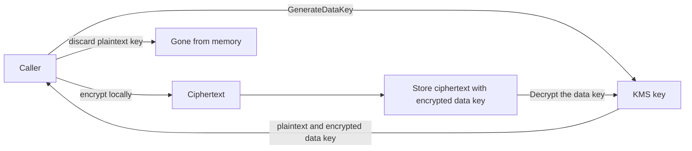
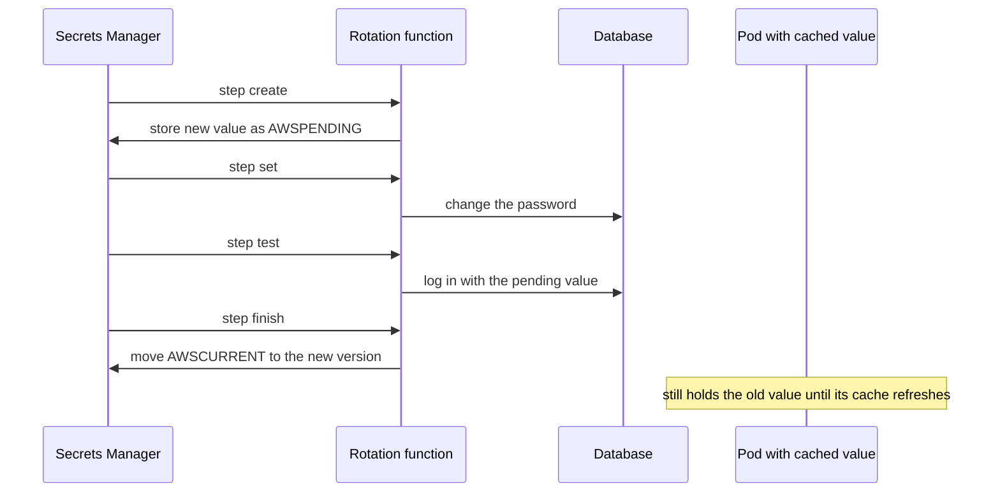

# Secrets Manager Parameter Store and KMS

Three AWS services answer one question: where does a credential live, who may read it, and how does the running process get it? **KMS** holds the keys, **Parameter Store** holds configuration (and, cheaply, small secrets), and **Secrets Manager** holds credentials that need rotation. This is the managed-AWS side of three ideas the vault already teaches: the secret-management discipline in [[API Security Essentials]] (central vault, rotation as routine, overlap during rotation), how a pod consumes configuration and Secrets ([[Kubernetes Configuration and Resources]]), and how an identity is granted access to a resource ([[IAM]]). What is AWS-specific is the layering — S3, EBS, ElastiCache, SQS and Secrets Manager itself all call KMS underneath — and the cost shape, which is per key, per secret and per API call.

## The problem that created it

A Spring Boot service needs a database password and a payment-partner API key at runtime. Every obvious home is wrong. In the **image**, the secret is copied to every registry replica and every laptop that pulls it. In the **repo**, it lives in git history forever, even after the file is deleted. In the **pipeline file**, it is readable by everyone with pipeline admin and tends to leak into build logs. In a plain **environment variable in a manifest**, it is in git again, one `kubectl describe` away from anyone with namespace access.

Then the auditor arrives and asks three questions: who *could* read the production database password last quarter, who *did*, and when was it last changed? Before managed secret stores the honest answers were "whoever could SSH to the config box", "no idea" and "nobody dares rotate it, because rotating means a coordinated redeploy". The deeper failure is that value, authority and change were all tangled into the deployment. The fix is to separate them: keep the value in a store, make *authority to read it* an IAM decision logged on every read, and make the value changeable without touching code.

## What it solves

- **Secrets out of artifacts** — the image, repo and pipeline hold a *name*, never a value.
- **Authority as policy** — the question "who could read it" is answered by IAM policies, a resource policy and a key policy, not by who has a shell.
- **An audit trail by construction** — every read is an API call that lands in CloudTrail with the calling principal; with a customer managed key there is a second record at KMS.
- **Rotation without redeploys** — Secrets Manager can change the credential on a schedule and on the database, in lockstep.
- **Encryption you do not have to build** — values are encrypted with a key whose policy you control, and one KMS key switch can make a whole class of data unreadable at once.
- **One mechanism under every other service** — learning KMS once explains the encryption settings of S3, EBS, SQS, ElastiCache and EKS.

## How it works

### KMS: the key that guards the other keys

KMS has three key types, and the difference is who owns the policy:

| Key type | Who controls it | Cost shape | Notes |
|---|---|---|---|
| AWS owned | AWS, invisible to you | free | Default for some services; no audit trail, no control |
| AWS managed (`aws/s3`, `aws/secretsmanager`, `aws/ssm`) | AWS creates it, you use it | no monthly key fee | You cannot edit its key policy, and AWS documents that `aws/secretsmanager` cannot be used for cross-account access, so a shared secret needs your own key |
| Customer managed | You: policy, rotation, disable, delete | per key per month, plus requests | The only type that can be shared across accounts or tightly scoped |

**Envelope encryption — why it exists.** KMS never hands you a KMS key; its key material never leaves KMS unencrypted. So to protect data you must send the data *to* KMS — but the `Encrypt` call accepts at most 4,096 bytes of plaintext with a symmetric key (API limit, as of 2026), and every call is a network round trip to a regional service with a shared request quota. The solution is a two-level hierarchy. Ask KMS for a **data key** (`GenerateDataKey`): it returns the key twice, once in plaintext and once encrypted under your KMS key. Encrypt the real data locally with the plaintext data key (AES-256), throw the plaintext key away, and store the *encrypted* data key next to the ciphertext. To read, send only the small encrypted data key to `Decrypt`, get the plaintext data key back, and decrypt locally.

Three consequences matter. Cost and latency scale with the number of *objects*, not bytes — one KMS call protects a 5 GB object as cheaply as a 5 byte one. Revoking or disabling the KMS key makes every data key wrapped under it undecryptable at once, so access can be cut centrally without touching the data. And the security of the large ciphertext reduces to who may call `Decrypt` on the small wrapped key — which is exactly what the key policy and CloudTrail govern.

**Key policy.** Every KMS key has a resource policy, and unlike most AWS resources it does *not* implicitly trust the owning account. The default statement that names `arn:aws:iam::<account>:root` is what lets the account's IAM policies work at all; without it IAM allows are ineffective (explicit denies still apply). Delete that statement and leave one named user, delete the user, and the key is unmanageable until AWS Support intervenes. Cross-account use needs *both* a key-policy allow and an IAM allow in the other account. Services such as EBS get temporary permission through **grants**, and conditions like `kms:ViaService` (usable only through a named service) and the **encryption context** (non-secret key-value pairs bound to the ciphertext, logged in CloudTrail) narrow a key to one purpose.

**Rotation.** Automatic rotation is optional on customer managed keys: a 365-day default period that you can change, plus on-demand rotation (as of 2026). The key ID and ARN do not change, old key material is retained so existing ciphertext still decrypts, and nothing is re-encrypted — **rotation does not rotate data keys**. AWS managed keys rotate yearly (every three years until May 2022). The first two rotations add a small monthly charge per key; later ones do not.

**Deletion** is scheduled with a waiting period of 7 to 30 days (default 30, as of 2026), and **disable** is the reversible first step. Both break every dependent service, so treat a key like a database, not a config value.

**Who calls KMS under the hood.** S3 with SSE-KMS requests a data key per object (S3 Bucket Keys cut those calls sharply), EBS wraps a volume key via grants, SQS encrypted queues and ElastiCache at-rest encryption can use your key ([[ElastiCache for Redis]]), Secrets Manager and SecureString parameters wrap values as above, and EKS wraps its etcd data key. See [[How S3 Works]] for the object side. KMS cryptographic-operation quotas are per account per Region, shared by every caller in that account including AWS services acting for you, and vary by Region: the symmetric default is 10,000 requests per second in Mumbai (ap-south-1), higher in a few large Regions (an adjustable default, as of 2026). AWS owned keys do not count against it, and a cross-account call is throttled against the *caller's* account.

### Parameter Store: hierarchical config, secrets on a budget

Parameter Store (a Systems Manager capability, often "SSM") is a key-value tree: `/payments/mongo/uri`, `/payments/feature/new-ledger`. Types are `String`, `StringList` and `SecureString` (value encrypted with `aws/ssm` or your key). The hierarchy lets one IAM policy grant a service its whole subtree, and `GetParametersByPath` fetches a subtree in one call. Versions are kept (up to 100, as of 2026) with labels such as `release`.

| Default quotas, as of 2026 | Standard | Advanced |
|---|---|---|
| Parameters per account per Region | 10,000 | 100,000 |
| Max value | 4 KB | 8 KB |
| Parameter policies (expiry, notification) | no | yes |
| Cross-account sharing | no | yes |
| Cost | no additional charge | per parameter per month; cannot be downgraded back |

Standard-tier parameters at default throughput are free, which is why Parameter Store is the **default home for non-secret config**: feature flags, endpoints, queue URLs, tuning knobs. The catch is throughput: the default is **40 transactions per second shared across `GetParameter`, `GetParameters` and `GetParametersByPath`** (default quota, as of 2026). A higher-throughput setting raises that to 10,000, 1,000 and 100 per second respectively and is billed per API interaction, counted per parameter returned. A `SecureString` read is further bound by KMS quotas. It offers no managed rotation; AWS's own guidance is to use Secrets Manager when you need rotation, cross-account access or finer audit (even though advanced parameters can be shared across accounts).

### Secrets Manager: built for credentials

A **secret** is a named container of **versions**; a version carries a value (up to 64 KiB, a fixed quota as of 2026) and **staging labels**. `AWSCURRENT` is what `GetSecretValue` returns by default, `AWSPREVIOUS` is the last one, and `AWSPENDING` marks a new value mid-rotation. Each version is envelope-encrypted: Secrets Manager calls `GenerateDataKey` on write and `Decrypt` on read, with an encryption context holding the secret's ARN, using `aws/secretsmanager` or your customer managed key.

**Rotation.** On a schedule, Secrets Manager invokes a rotation function — an ordinary [[Lambda]] — four times with a `Step`: **create** a new value as `AWSPENDING`, **set** it on the database, **test** it, **finish** by moving `AWSCURRENT` to it. Services that own their secrets use managed rotation with no function — as of 2026, master-user credentials for RDS, Aurora and DocumentDB, Redshift admin passwords, ECS Service Connect TLS certificates, and partner-held third-party credentials (managed external secrets). The function needs a network path to both the database and the Secrets Manager endpoint — a NAT gateway or VPC endpoint ([[VPC and Networking]]).

The strategy decides what the pod suffers. **Single-user** rotation changes the one account's password, so between `set` and `finish` — and for any client still holding the old value afterwards — logins fail. **Alternating users** keeps two database users and rotates the *idle* one, so the previous credential stays valid through a full cycle; it needs a separate superuser secret that may alter the first user. Alternating users is the dual-secret overlap that [[API Security Essentials]] asks for, and the one to prefer anywhere a pod can hold a credential for longer than the rotation window.

**Cross-account and Regions.** A secret has a resource policy for cross-account readers; the caller is throttled against *its own* account's quotas. Because the `aws/secretsmanager` key policy pins use to the owning account, a cross-account secret needs a customer managed key. Secrets can be replicated to other Regions, a [[Disaster Recovery]] lever with a data-localisation catch (see In your stack). Deleting a secret defaults to a recovery window (7 to 30 days, default 30, as of 2026) rather than immediate removal; an explicit force-delete skips it and cannot be undone.

### Getting a secret into a pod

| Path | How | Trade-off |
|---|---|---|
| **SDK at startup** (IRSA role) | App fetches on boot, e.g. Spring Cloud AWS `spring.config.import=aws-secretsmanager:name` or `aws-parameterstore:/path/` | Value only in process memory; no copy in etcd. Startup depends on AWS being reachable (fail-closed). Rotation needs a refresh hook — 3.x supports property-source reload — or a restart |
| **External Secrets Operator** | Controller reads the store, writes a Kubernetes Secret on a `refreshInterval` | Plain Kubernetes consumption (env or volume). **Sync lag** = refresh interval. A copy of the value now sits in etcd, readable by anyone with `get secrets` RBAC; env vars never update without a restart, mounted files update eventually. The controller's role is a shared blast radius unless you scope stores per namespace |
| **Secrets Store CSI driver + AWS provider** | Pod mounts the secret as files via a `SecretProviderClass` in its own namespace, using the *pod's* service-account role | Per-pod authority; pod cannot start (`ContainerCreating`) if the mount fails. Rotation is an opt-in reconciler with a configurable interval; syncing into a Kubernetes Secret is optional and reintroduces the etcd copy |

On the etcd point, be precise: since EKS 1.28 all Kubernetes API data is envelope-encrypted at rest by default (AWS owned key, or your own), so the exposure is not plaintext on disk — it is **RBAC and backups** (`kubectl get secret -o yaml` is base64, not encryption). See [[Kubernetes Configuration and Resources]] for the Secret object itself.

### Caching and the rotation race

Calling the store on every request is the failure the cache exists to prevent, so apps cache — and caching creates the race. AWS's Java caching client refreshes hourly by default; the Lambda extension defaults to, and caps at, a 300-second TTL (as of 2026). A value cached for an hour against a rotation that invalidates the old password in minutes means every pod fails until its TTL expires. Defences, in order: **alternating users** so the old credential survives a cycle; **refetch-and-retry once on an authentication failure** (not on every error), then rebuild the connection pool ([[Connection Pooling]]); a **TTL shorter than the overlap**, with jitter so a fleet does not refresh in lockstep; and exponential backoff on throttles ([[Timeouts Retries and Exponential Backoff]]).

### Cost shape

| Service | Bill scales with |
|---|---|
| KMS | **per customer managed key per month** (prorated hourly; each multi-Region replica is its own key; the first two rotations each add a key-month), plus **per 10,000 requests** above a free tier shared across Regions; AWS managed keys have no monthly fee |
| Secrets Manager | **per secret per month**, plus **per 10,000 API calls**; KMS requests when you use your own key; Lambda cost for rotation; replica secrets: AWS's replication guide defers to the pricing page, so check it before treating replicas as free |
| Parameter Store | standard parameters: free at default throughput; advanced: **per parameter per month** plus **per API interaction** at any throughput; higher throughput: **per API interaction** for every tier |

Worked example (US list prices, as of 2026, approximate): roughly $0.40 per secret-month and $0.05 per 10,000 calls; KMS about $1 per customer managed key-month and $0.03 per 10,000 requests after 20,000 free a month; advanced parameters about $0.05 per parameter-month. Eighty secrets across uat and prod is about $32 a month — noise. One hot path that calls `GetSecretValue` on every request at 100 requests per second makes about 259 million calls a month, roughly **$1,300** in Secrets Manager calls before the KMS decrypts it triggers. A five-minute cache makes that one pod's 8,640 fetches a month, a few cents. **The bill is set by call volume, not secret count.** Full picture in [[AWS Cost Shape]].

## Trade-offs

| You gain | You pay |
|---|---|
| Secrets out of images, repos and pipelines; read authority is an IAM decision | A hard runtime dependency on AWS APIs, IAM and KMS being reachable |
| Automatic rotation and versioning in Secrets Manager | Per-secret and per-call cost; rotation needs a Lambda and a network path to the database |
| Free, hierarchical config in Parameter Store | 40 TPS shared default throughput; no rotation; small values |
| Customer managed keys give scoped policy, audit and cross-account use | A key policy you can break — lockouts and deleted keys are your outage |
| Envelope encryption makes encryption cheap at any data size | The wrapped data key is the real secret path; one `Decrypt` permission unlocks it |
| Kubernetes-native delivery (ESO/CSI) keeps manifests unchanged | Sync lag, a second copy in etcd, or per-pod mount coupling |

## Failure modes

- **Reading the secret on every request.** Signal: Secrets Manager and KMS lines on the bill that track traffic, latency added to every call, and `ThrottlingException`. Be honest about which limit bites: `GetSecretValue` allows 10,000 requests per second per Region (a fixed quota, as of 2026), so one service rarely throttles *it*; the 40 TPS Parameter Store default is what a fleet hits first, then the KMS symmetric quota that every encrypted service in the account shares. Fix: cache with a TTL, fetch at startup.
- **Rotation before every pod refreshed.** Single-user rotation changes the password while pods hold the old one; logins fail until each pod's cache expires or it restarts. Fix: alternating users, retry-on-auth-failure with a refetch, TTL below the overlap.
- **A key policy that locks out the account.** The root-principal statement is removed or the only named principal is deleted; IAM allows stop working. Prevention: keep the account statement, review key-policy changes like code, alarm on `ScheduleKeyDeletion` and `DisableKey` ([[CloudWatch]]).
- **A disabled or deleted key takes dependents down with it.** Disabling a customer managed key used by an EKS cluster degrades the control plane; deleting it is unrecoverable. Same blast radius for secrets and encrypted volumes.
- **The uat ARN in prod.** Separate accounts put the account ID in the ARN, so a hardcoded uat ARN fails loudly in prod (access denied or not found) — the safe outcome. The dangerous one is a cross-account resource policy that lets prod read uat, silently pointing prod at the wrong database. Also: the ARN ends in six random characters, so an IAM policy pinned to an ARN breaks when a secret is deleted and recreated under the same name.
- **Secret in a log or a Kubernetes manifest.** The store is only as safe as the last place the value was printed; redact at the logger, never commit rendered Secrets.
- **Mount-time coupling.** With the CSI driver a throttled or denied fetch leaves the pod in `ContainerCreating`; at one replica that is an outage, not a retry.

## When NOT to use it

- **Non-secret config in Secrets Manager** — you pay per secret per month for a feature flag; use standard Parameter Store.
- **Large blobs** — values cap at 64 KiB in Secrets Manager and 4 or 8 KB in Parameter Store (as of 2026); keep big material in S3 under SSE-KMS and store the pointer.
- **Static, never-rotated tokens at scale** — a per-secret fee buys little if nothing rotates; weigh Parameter Store `SecureString`.
- **Credentials you can avoid entirely** — prefer a short-lived IAM role (IRSA) over an access key stored anywhere.
- **KMS directly for bulk data** — the 4,096-byte `Encrypt` limit exists to push you to envelope encryption; do not loop `Encrypt` over chunks.
- **A customer managed key per secret by default** — keys cost per month and each one is a lockout risk; one key per domain and environment is usually enough.

## In your stack

- **Prefer the secret you do not store.** `authMechanism=MONGODB-AWS` under IRSA means the Mongo driver signs requests with the pod role's temporary credentials: no database password exists to leak or rotate. It needs `com.amazonaws:aws-java-sdk-sts` on the classpath, a dependency no source file imports, so leave a comment on the declaration or a dependency cleanup removes it and every Mongo endpoint returns 500 while builds stay green.
- **IRSA scoping.** Give each service its own role; the trust policy pins the OIDC `sub` to one namespace and service account, the permission policy names specific secrets plus `kms:Decrypt` on the key. Write ARNs as name plus `-??????` so recreation does not break them.
- **Reference by name, not ARN.** Use the same secret and parameter *names* in both accounts (`/payments/partner-api-key`) and let the account supply the value, so one config file is correct in uat and prod.
- **Parameters at startup.** One `GetParametersByPath` per boot, not N `GetParameter` calls; a node drain restarts many 1-replica pods at once, and 40 shared TPS is easy to hit then.
- **Rotation race at 1 replica.** The single pod is the only holder of the old credential, so a rotation window is a full outage for that service unless alternating users or refetch-on-failure absorbs it. Rotate in business-quiet windows and watch auth failures.
- **Auditor answers.** "Who could read it" is the role policy, the resource policy and the key policy; "who did" is CloudTrail `GetSecretValue` and KMS `Decrypt` events keyed by role.
- **New regulatory scope to flag.** Replicating a secret or using a multi-Region key outside India copies key material and regulated values out of Mumbai (ap-south-1); keep replicas in-country (ap-south-2) and confirm with compliance. If cardholder data is in scope, PCI-DSS key-management duties apply to your CMKs.

## Interview angle

The question is "where do your secrets live and how does the app get them?" and the 60-second version is: *"Secrets live in AWS Secrets Manager, or Parameter Store SecureString for small ones, encrypted by KMS using envelope encryption — a data key generated by KMS encrypts the value, and that data key is stored encrypted under a customer managed key whose policy we control. Plain config goes in standard Parameter Store, which is free; credentials that need rotation go in Secrets Manager with alternating-user rotation. Pods on EKS get an IRSA role scoped to their own secrets, fetch at startup through the SDK or a synced Kubernetes Secret, cache with a TTL shorter than the rotation overlap, and refetch once on an auth failure. The audit trail is CloudTrail on every read, and where we can we avoid the secret entirely — MONGODB-AWS with IRSA has no password to store."*

Classic probes:

- "Why envelope encryption?" — 4 KB `Encrypt` limit, round-trip cost, and KMS never exporting the key; one wrapped data key per object.
- "Secrets Manager or Parameter Store?" — name the axis: rotation, cross-account, per-secret cost versus free hierarchical config.
- "What happens when you rotate under a running fleet?" — cached credentials, single versus alternating users, refetch on failure.
- "What if someone deletes the key?" — dependents fail; schedule-deletion window and disable-first are the safety nets.

## Check yourself

> [!question]- Q: Explain why KMS uses envelope encryption instead of encrypting your data directly.
> `Encrypt` accepts at most 4,096 bytes, every call is a network round trip against a shared regional quota, and KMS never releases the key material to be used locally. So KMS generates a data key, you encrypt the data locally with the plaintext copy, discard it, and store the wrapped copy beside the ciphertext. KMS is then called once per object, not per byte; disabling the KMS key makes every wrapped data key unusable at once; and rotating the KMS key needs no re-encryption of data because old key material is kept for decrypts.

> [!question]- Q: Right after a scheduled rotation, one service starts returning database authentication errors and recovers after about an hour. Diagnose and fix.
> A pod cached the old password (the hour is the caching client's default refresh) and the rotation used the single-user strategy, so the old password was invalid once the database was changed. Fix in layers: switch to alternating users so the previous credential stays valid for a cycle; on an authentication failure refetch the secret once and rebuild the connection pool; set the cache TTL shorter than the overlap, with jitter. Confirm by correlating the rotation's `finish` step in CloudTrail with the first auth failure.

> [!question]- Q: An IAM role has `kms:Decrypt` allowed on a key but still gets AccessDenied. List what you check.
> The key policy first, since a KMS key does not trust the account by default: is the account-root statement present so IAM allows take effect? Then an explicit deny anywhere, a `kms:ViaService` or encryption-context condition the call does not meet, a key that is disabled or pending deletion, and for a cross-account key whether *both* the key policy and the caller's IAM policy allow it. Also check Region — a key and its ciphertext are Regional.

> [!question]- Q: Mini-design — a payments service needs a partner API key rotated quarterly, a Mongo connection, and a dozen tuning values, deployed to uat and prod accounts on EKS. Where does each live and how does the pod get it?
> Tuning values: standard Parameter Store under `/payments/...`, fetched with one `GetParametersByPath` at startup. Partner API key: Secrets Manager with a customer managed key per environment, scheduled rotation, referenced by name in config so the same file works in both accounts. Mongo: MONGODB-AWS with the pod's IRSA role, so no password exists. The pod's role is scoped to that subtree, that secret and the key; the SDK fetches at boot, caches a few minutes, and refetches once on a 401. Cost shape: a handful of secrets and one or two keys, dominated by call volume only if someone skips the cache.

> [!question]- Q: Your prod bill shows Secrets Manager API calls and KMS requests growing in step with traffic. What happened and what do you change?
> A code path calls `GetSecretValue` per request (each call also triggers a KMS decrypt when a customer managed key is used). Prove it with CloudTrail counts per role. Fix by caching in the application with a TTL and jitter, or fetching only at startup; if many services re-read Parameter Store, use `GetParametersByPath` and the higher-throughput setting only if measured. Cost scales with calls, so the saving is roughly the cache hit ratio.

## Sources

- AWS KMS Developer Guide — key types, envelope encryption and data keys, key policies and the default key policy, grants, encryption context, rotating KMS keys, `Encrypt` API reference.
- AWS KMS and AWS Secrets Manager pricing pages (per-key, per-request, per-secret, per-call shapes; figures above are as of 2026, approximate).
- AWS Secrets Manager User Guide — secret encryption and decryption, rotation by Lambda function, rotation strategies, quotas, resource policies and replication.
- AWS Systems Manager User Guide — Parameter Store tiers, quotas and throughput, Parameter Store pricing, the Parameters and Secrets Lambda extension.
- Amazon EKS User Guide — default envelope encryption of Kubernetes API data, IAM roles for service accounts; AWS Secrets and Configuration Provider for the Secrets Store CSI driver; External Secrets Operator documentation; Spring Cloud AWS reference (Parameter Store and Secrets Manager).
- Checked 2026-10-05: https://docs.aws.amazon.com/kms/latest/APIReference/API_Encrypt.html, https://docs.aws.amazon.com/kms/latest/developerguide/rotate-keys.html, https://docs.aws.amazon.com/kms/latest/developerguide/deleting-keys.html, https://docs.aws.amazon.com/kms/latest/developerguide/requests-per-second.html, https://aws.amazon.com/kms/pricing/, https://aws.amazon.com/secrets-manager/pricing/, https://docs.aws.amazon.com/secretsmanager/latest/userguide/reference_limits.html, https://docs.aws.amazon.com/secretsmanager/latest/userguide/rotate-secrets_lambda-functions.html, https://docs.aws.amazon.com/secretsmanager/latest/userguide/rotate-secrets_managed.html, https://docs.aws.amazon.com/secretsmanager/latest/userguide/auth-and-access_examples_cross.html, https://docs.aws.amazon.com/secretsmanager/latest/apireference/API_DeleteSecret.html, https://docs.aws.amazon.com/secretsmanager/latest/userguide/retrieving-secrets_cache-java.html, https://docs.aws.amazon.com/systems-manager/latest/userguide/parameter-store-advanced-parameters.html, https://docs.aws.amazon.com/systems-manager/latest/userguide/parameter-store-throughput.html, https://docs.aws.amazon.com/general/latest/gr/ssm.html, https://aws.amazon.com/systems-manager/pricing/, https://docs.aws.amazon.com/systems-manager/latest/userguide/ps-integration-lambda-extensions.html, https://docs.aws.amazon.com/eks/latest/userguide/envelope-encryption.html.
- Re-checked 2026-10-14: https://docs.aws.amazon.com/secretsmanager/latest/userguide/replicate-secrets.html, https://docs.aws.amazon.com/kms/latest/developerguide/requests-per-second.html (ap-south-1 is on the 10,000 default list), plus every URL in the line above; Spring Cloud AWS 3.0 reload support: https://spring.io/blog/2023/05/02/announcing-spring-cloud-aws-3-0-0.
