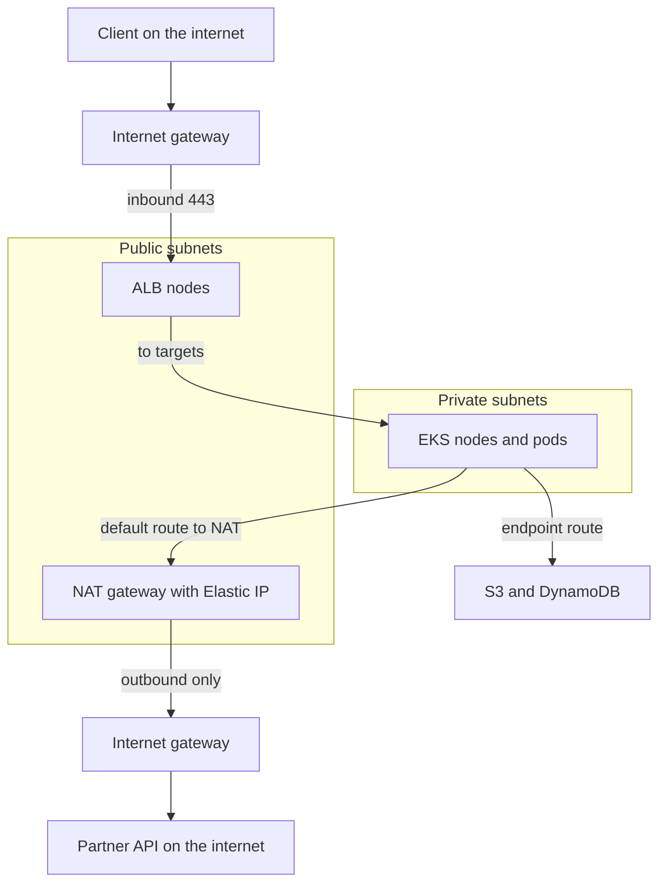
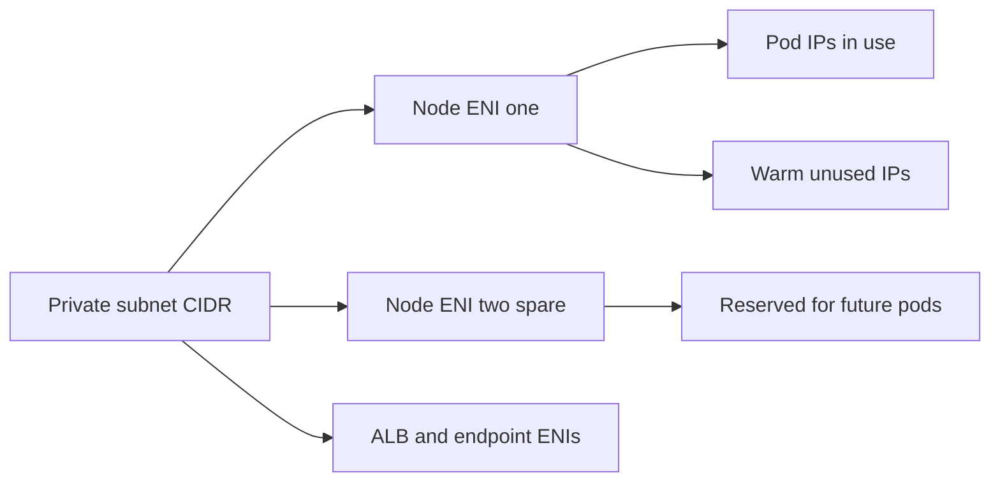

# VPC and Networking

A **VPC (Virtual Private Cloud)** is your own private network inside one AWS region: an address range you choose, carved into subnets, with route tables that decide where packets go and firewalls that decide who may send them. It is the managed-AWS side of the network path traced in [[Anatomy of a Web Request]], and the layer the pod network of [[Kubernetes Networking]] is built *on*, not beside. Almost every other service in this module either lives inside a VPC or is reached through one, so its bill and its failure modes show up here first.

## The problem that created it

The earliest EC2 ran in a single flat network shared with other customers: every instance had a public address, you had security groups and nothing else, and there was no way to pick your own address range, put a machine somewhere the internet could not reach, or join the network to your office. That was fine for experiments and a non-starter for a bank. Enterprises needed private address space that did not collide with their corporate ranges, a VPN to their data centre, a way to say "this tier is never reachable from the internet" that an auditor could verify, and segmentation they could draw on a whiteboard. VPC (announced August 2009) gave customers exactly that, and the old shared model, EC2-Classic, was retired in stages from 2021, with AWS declaring it fully gone in August 2023. Everything AWS sells today assumes the VPC as the unit of network isolation.

## What it solves

- **Private address space you control** — pick the CIDR, split it into subnets per Availability Zone, and never expose an address you did not mean to.
- **Reachability as configuration** — whether a subnet can talk to the internet is a *route*, not a property of the machine; you can read it off a route table.
- **Layered, stateful firewalling** — security groups on every network interface, optional NACLs on every subnet, both inspectable.
- **A private path to AWS services** — endpoints keep S3, ECR, SQS and friends off the public internet, which is both a security and a cost win.
- **Blast-radius boundaries** — a VPC (and the account around it) is the unit you can cut off, peer or audit; separate uat and prod accounts rest on this.

## How it works

### A VPC, its CIDR and its subnets

You give the VPC an IPv4 **CIDR block** (typically from the private ranges `10.0.0.0/8`, `172.16.0.0/12`, `192.168.0.0/16`; allowed sizes run from /16 down to /28, as of 2026) and may add secondary blocks later. A **subnet** is a slice of that range and lives in exactly **one Availability Zone**: the VPC is regional, but a subnet is not, which is why "spread across AZs" means "create a subnet per AZ". AWS reserves **five addresses in every subnet** (network, router, DNS, one for future use, broadcast; unchanged as of 2026), so a /24 gives 251 usable. Two consequences are worth internalising before any diagram. A subnet's IPv4 CIDR cannot be changed after creation, so you size for the future up front. And CIDRs must not overlap with anything you will ever connect — another VPC, an office, a partner's VPN — because overlapping ranges cannot be routed between; the cheapest moment to plan a company-wide address scheme is before the first VPC exists.

### Public and private: the route table decides

Every subnet is associated with a **route table**: a list of destination ranges and targets, where the most specific match wins. Every table has an undeletable `local` route for the VPC's own range. A subnet is **public** if, and only if, its route table sends internet-bound traffic (`0.0.0.0/0`) to an **Internet Gateway (IGW)**. It is **private** if it does not. The word "public" describes the route, not the machine: an instance in a public subnet is only reachable from the internet if it *also* has a public IPv4 address (the IGW does the one-to-one translation between that address and the instance's private one), and an instance in a private subnet is unreachable from outside by construction, because no route leads back. The IGW itself is free, redundant and scales without you thinking about it.

The pattern this draws is the default shape of a production VPC: only the load balancer (and NAT) sits in public subnets, everything with business logic and data sits in private subnets, and the route tables — not the application code — enforce that.

### NAT Gateway — and why it is the famous cost trap

A private subnet has no route to an IGW, yet nodes still need to pull packages and call third-party APIs. A **NAT Gateway** solves that: it sits in a *public* subnet with an Elastic IP, the private subnet's default route points at it, and it rewrites outbound connections to its own address and maps replies back. It is **one-way**: connections may be initiated from inside, never from outside.

It is a trap because the meter is hidden in the topology. A NAT Gateway bills **per hour it exists and per GB it processes**, and the per-GB charge applies to *every byte through it, whatever the destination* — including AWS's own services in the same region. The classic bills: nodes pulling container image layers on every scale-up, a backup job writing terabytes to S3, a log shipper, and — the sneaky one — calls between your own services made through *public* hostnames, which resolve to public IPs and leave via NAT instead of staying private. A NAT Gateway is also **zonal**: it lives in one AZ, so high availability means one per AZ with each private subnet routed to its own AZ's gateway (routing everything through a single gateway makes that AZ's failure an egress outage for all, and charges cross-AZ transfer on the way). The worked bill is in [[AWS Cost Shape]].

Two newer facts change the picture. A **regional NAT Gateway** (announced 19 November 2025) is one resource that expands and contracts across the AZs where you have workloads, needs no public subnet of its own, and takes the per-AZ route-table dance away; per the VPC docs as of 2026 it can take up to 60 minutes to extend to a new AZ, during which that AZ's traffic crosses zones, and it still bills per *active AZ*-hour, so the multi-AZ floor does not disappear. It does not support private NAT (use zonal gateways for that). And separately from billing, a gateway has a **port-allocation limit**: per the VPC docs as of 2026, each IPv4 address supports up to 55,000 simultaneous connections to one unique destination (IP, port, protocol); a zonal gateway takes up to 8 addresses (2 Elastic IPs by default, an adjustable quota) and a regional one up to 32 per AZ. A busy service hammering a single partner API without connection reuse can still exhaust ports; the `ErrorPortAllocation` metric is the tell.

### Security groups and NACLs

| | Security group | Network ACL |
|---|---|---|
| Attached to | A network interface (ENI) | A subnet |
| State | **Stateful** — return traffic is automatic | **Stateless** — return traffic needs its own rule |
| Rules | **Allow only**; all rules evaluated | Allow **and deny**; numbered, first match wins |
| Default | New group: inbound denied, outbound allowed (the VPC's *default* group also admits its own members) | The VPC's default NACL allows everything; a new custom NACL denies everything until you add rules |
| Can reference | Another security group, or a prefix list | CIDR ranges only (no prefix lists) |

A security group's killer feature is **referencing another group**: "allow 8080 from the Kong group" names a *role* rather than an address, so it keeps working as pods, nodes and instances churn. A NACL cannot do that, and because it is stateless you must open the high ephemeral ports for replies — the usual way a hand-written NACL breaks a working app.

**Rule of thumb:** security groups are the primary control, written per tier and chained by reference (ALB group → Kong group → service group → datastore group). Use NACLs sparingly, as a coarse subnet-level backstop or to *explicitly deny* a known-bad range, which security groups cannot express. An allow rule you forgot is an open door in either.

### VPC endpoints

An **endpoint** lets private resources reach an AWS service without the internet, an IGW or a NAT. There are two kinds. A **gateway endpoint** (S3 and DynamoDB only) is a route-table entry pointing the service's address range at the endpoint; it is **free**, regional, and applies only to subnets whose route tables you associate with it (it does not extend across peering, a Transit Gateway, VPN or Direct Connect). An **interface endpoint** (PrivateLink, almost everything else, and S3 and DynamoDB too) is an ENI with a private IP in *your* subnets, one per AZ you enable, with a security group, an endpoint policy, and optional private DNS that makes the normal service hostname resolve to the private address. Interface endpoints **bill per AZ-hour plus per GB processed** (the per-GB rate is tiered by regional volume).

Two payoffs. **Cost:** moving heavy flows off NAT, where the per-GB meter is highest — S3 is always worth a gateway endpoint; for interface endpoints you trade a fixed per-AZ floor for a lower per-GB rate, so they win only above a volume you should measure rather than guess. **Exposure:** traffic never traverses an IGW, and you can lock a bucket to the endpoint with the `aws:SourceVpce` condition ([[IAM]]).

### Connecting networks: peering versus Transit Gateway

**VPC peering** is a one-to-one link between two VPCs: simple, no hourly fee (same-AZ transfer over it is free, cross-AZ is billed), but **non-transitive** (A–B and B–C does not give A–C) and the CIDRs must not overlap; with many VPCs the mesh becomes unmanageable. **Transit Gateway** is a regional hub: attach VPCs and VPNs to it and route between them, including transitively, with central route tables — at the price of a per-attachment-hour and per-GB-processed meter. Peering is right for two or three networks; a hub is right once the number of pairs you would have to manage exceeds the number of networks.

### DNS inside a VPC

Every VPC has an Amazon-provided resolver, the **Route 53 Resolver**, at the VPC base address plus two (for `10.0.0.0/16`, `10.0.0.2`) and at the link-local `169.254.169.253`. It resolves public names, AWS-provided private hostnames and **private hosted zones** ([[Route 53]]); private hosted zones and interface-endpoint private DNS both require the VPC's `enableDnsSupport` and `enableDnsHostnames` attributes to be on. Two surprises: security groups and NACLs do not filter traffic to the resolver, and there is a **hard quota of 1,024 packets per second per network interface** for link-local services, *shared* with the instance metadata service and time sync, which cannot be raised (VPC docs, as of 2026). On EKS the cluster's DNS pods forward external lookups to this resolver, so a chatty fleet can hit the cap on the nodes running CoreDNS ([[Kubernetes Networking]] covers the `ndots` multiplier). Background on the protocol is in [[How DNS Works]].

### The EKS consequence: every pod is a VPC address

The default **VPC CNI** gives each pod a *real VPC IP* from the node's subnet; how it attaches them (secondary addresses on ENIs, the warm pool, the per-instance-type pod cap) is in [[Kubernetes Networking]] and not repeated here. The VPC-side consequence is that a Kubernetes concern becomes subnet arithmetic: **subnets run out of IPs** far sooner than the pod count suggests, because every node also pins warm spares, rolling deploys add surge pods, and load balancers and interface endpoints take addresses from the same subnets.

The fixes, at concept level: **bigger or additional subnets** (the unglamorous, correct answer; plan pod subnets large from day one), a **secondary CIDR with custom networking** so pods draw from a separate range, **prefix delegation** — /28 blocks per ENI slot instead of single addresses (mechanics in [[Kubernetes Networking]]); EKS managed node groups still cap max pods at 110 below 30 vCPUs and 250 above as of 2026, and the VPC cost is needing *contiguous* free /28s, so a fragmented subnet fails even with addresses left (reserve a block with a subnet CIDR reservation, and move to prefix mode through new node groups rather than a rolling replace) — and **IPv6 clusters**, which remove the scarcity. A related feature, security groups for pods, uses extra "branch" ENIs for per-pod firewalling.

### Cost shape

A VPC costs nothing; its components each bill on a different axis:

| Component | Bills per | Floor at zero traffic |
|---|---|---|
| VPC, subnets, route tables, security groups, NACLs, IGW | free | none |
| NAT Gateway | hour **and** GB processed | yes: per gateway (zonal) or per active AZ (regional) |
| Public IPv4 address (Elastic IP, NAT, internet-facing ALB nodes) | hour per address, in use or idle (since February 2024) | yes |
| Gateway endpoint | free | none |
| Interface endpoint | hour per AZ **and** GB processed (tiered) | yes, per endpoint per AZ |
| Transit Gateway | hour per attachment **and** GB processed | yes |
| VPC peering | no hourly; cross-AZ transfer billed, same-AZ free | none |
| Cross-AZ traffic | GB, **in each direction** | none |
| Internet egress | GB out (ingress from the internet is free) | none |
| VPC Flow Logs | GB ingested as vended logs at the destination | none |

The hidden one is **cross-AZ transfer**: inside a region, traffic between two private IPs in the *same* AZ is free, while crossing an AZ boundary is billed per GB on both sides, and same-AZ traffic sent via a *public or Elastic* IP is billed as if it crossed. It hides in a pod calling a datastore primary in another AZ, a client reaching a cache node elsewhere, and replication — the "transport cost is zero" fallacy from [[The Fallacies of Distributed Computing]]. Multi-AZ buys availability by multiplying every hour-billed item above and *adding* this meter ([[AWS Cost Shape]]).

## Trade-offs

| You gain | You pay |
|---|---|
| Private, isolated address space; reachability as auditable config | Addressing is a long-lived decision: CIDRs cannot be shrunk, overlaps block connectivity |
| Layered firewalls (security group per tier, NACL backstop) | Rule sprawl; stateless NACL mistakes are hard to spot |
| Private subnets with controlled egress through NAT | NAT per-GB meter, a per-AZ hourly floor, port limits, and one more hop to debug |
| Endpoints remove NAT cost and public exposure | Interface endpoints add a per-AZ floor and a policy surface; gateway endpoints cover only two services |
| Pods as first-class VPC citizens (SGs, flow logs, direct ALB targets) | Pod density and subnet IPs become capacity-planning inputs |
| Multi-AZ resilience | Cross-AZ transfer meter and duplicated fixed floors |

## Failure modes

- **Subnet IP exhaustion.** *Signal:* new pods stuck in `ContainerCreating` with CNI "failed to assign an IP" errors, or load balancer and endpoint creation failing, while CPU is idle. *Confirm:* free addresses per subnet; warm-pool and surge pods holding addresses. *Fix:* larger or additional subnets, prefix delegation with a reserved block, custom networking; do it before the next big rollout, not during it.
- **A security group that allows `0.0.0.0/0`.** *Signal:* a config scanner finding, or an unexpected scanner hitting the datastore. *Confirm:* the rule *and* whether the resource has a public IP or an IGW route (an open rule on a truly private resource is latent, not live). *Fix:* reference the caller's security group instead of a CIDR; keep Redis and MongoDB ports reachable only from app groups. Open datastore ports are the oldest breach genre in the cloud.
- **NAT in one AZ.** *Signal:* private subnets in the failing AZ lose all outbound calls, or every AZ does if a single gateway served the whole VPC. *Confirm:* the route table of each private subnet and which gateway it targets. *Fix:* one gateway per AZ with per-AZ route tables, or a regional NAT Gateway; accept the duplicated floor, because the alternative is an egress outage tied to one AZ.
- **A route table missing a route.** *Signal:* timeouts, not refusals — packets go nowhere. *Confirm:* the subnet's *associated* table (it may be the main table, not the one you edited), the default route, the endpoint route. *Fix:* correct the association; use Reachability Analyzer to trace a path instead of guessing. A new subnet silently falling onto the main route table is the common cause.
- **Cross-AZ traffic surprising the bill.** *Signal:* a data-transfer line item growing with request volume, not instance count. *Confirm:* group Cost Explorer by usage type; correlate flow logs with pod and datastore AZs. *Fix:* topology-aware routing where there are several replicas, read from in-zone replicas where freshness allows, and accept some cross-AZ as the price of availability.
- **NAT port exhaustion and the DNS packet cap.** *Signal:* intermittent connect failures to one partner endpoint, or sporadic DNS timeouts under load. *Confirm:* `ErrorPortAllocation`, and resolver throttling on the CoreDNS nodes. *Fix:* connection pooling and reuse, more addresses on the gateway (each adds 55,000 per destination), node-local DNS caching.
- **Prefix-delegation fragmentation.** *Signal:* `InsufficientCidrBlocks` in CNI logs with addresses apparently free. *Fix:* a dedicated or reserved block for prefixes.

## When NOT to use it

A VPC itself is unavoidable; the pieces are choices.

- **NAT Gateway for AWS-service traffic** — S3, DynamoDB, ECR and SQS flows belong on endpoints. NAT is for the genuinely external.
- **NACLs as the main firewall** — stateless, CIDR-only and numbered; reach for security groups first.
- **Peering as a growth strategy** — beyond a handful of networks, use a hub; and do not connect uat to prod just because it is easy.
- **Interface endpoints for low-volume APIs** — a fixed per-AZ hourly floor can exceed the NAT bill for a service you call rarely.
- **Public subnets for anything but load balancers and NAT** — "it needs to be reachable" is nearly always answered by a load balancer, not a public address.

## In your stack

- **CloudFront → ALB → Kong → EKS maps onto subnets directly.** The internet-facing ALB lives in public subnets in at least two AZs; Kong, nodes and pods in private ones. The ALB's security group should admit 443 from the **CloudFront managed prefix list** rather than `0.0.0.0/0` — but note that list admits *any* CloudFront distribution, so pair it with a secret origin header, or look at CloudFront's VPC origins so the ALB can sit in a private subnet at all ([[CloudFront]], [[ALB and NLB]]). Chain the rest by security-group reference: ALB → Kong → services → datastores.
- **Egress identity.** A fintech's partners often allow-list your source IPs; the NAT gateway's Elastic IP *is* that address. Keep the addresses when rebuilding NAT (zonal means one per AZ to register, which a regional gateway or a deliberate single-address design changes), and treat releasing one as a partner-facing change.
- **Endpoints worth having:** the S3 gateway endpoint (also what ECR image layers ride), ECR API and Docker interface endpoints ([[Container Registries and ECR]]), STS (pod role exchanges, see [[IAM]]), and SQS, Secrets Manager and CloudWatch Logs if measured volume justifies the per-AZ floor. Everything left on NAT is then genuinely external traffic.
- **Pod IPs with many 1-replica services:** each service uses few addresses, but every rollout adds a surge pod and every node holds a warm pool, so check free addresses before a simultaneous deploy. At one replica there is also no choice of zone: with three AZs, about two-thirds of calls from evenly spread callers cross an AZ to reach the single pod ([[Kubernetes Configuration and Resources]] for requests and surge).
- **uat and prod are separate accounts, hence separate VPCs.** Give them non-overlapping CIDRs anyway (a future hub or VPN will need it), do not peer them by default, and promote through images and config, not through a network path.
- **RBI data localisation:** regulated data stays in Mumbai (ap-south-1), but NAT can silently carry it elsewhere — a log vendor or analytics SaaS reached over the internet is a localisation question, not a networking detail. VPC Flow Logs are the audit evidence of where traffic actually went; they are layer 3/4, so they join to your `x-correlation-id` application logs by time and pod IP, not by header.

## Interview angle

**Public vs private subnet in 60 seconds:** *"A VPC is a private network in one region, split into per-AZ subnets. What makes a subnet public is its route table: a default route to an Internet Gateway. A private subnet has no such route, so it can't be reached from outside. Instances in private subnets get outbound-only internet through a NAT Gateway that sits in a public subnet; it's zonal, so you run one per AZ, and it bills per hour and per GB processed, which is why S3 and ECR traffic should go through VPC endpoints instead. Put load balancers in public subnets, application and data tiers in private ones."*

**Security group vs NACL:** *"Security groups are stateful, allow-only, attached to ENIs, and can reference other groups — the primary control. NACLs are stateless, subnet-level, numbered, with allow and deny — a coarse backstop, mainly for explicit denies — and you must allow ephemeral ports for return traffic."*

Probes: *why can't I reach the internet from a private instance?* (default route to NAT missing, NAT in a private subnet, or security group egress); *how do pods get IPs on EKS and what breaks?* (VPC CNI uses subnet addresses, ENI caps on density, exhaustion, prefix delegation); *why is our NAT bill high?* (per-GB on every byte; find the flow, add endpoints); *how do you connect fifty VPCs?* (hub, not a peering mesh).

## Check yourself

> [!question]- Q: Explain to a teammate what makes a subnet "public", and why a public subnet instance can still be unreachable.
> A subnet is public only because its route table sends the default route to an Internet Gateway; the subnet has no inherent public flag. Reachability from the internet additionally needs a public IPv4 (or Elastic) address on the instance, which the IGW translates to the private one, and a security group that allows the inbound port. Miss either and the instance is unreachable even in a public subnet. Conversely, a private subnet instance has no return route from the internet, so it cannot be reached however permissive its security group is.

> [!question]- Q: Cost Explorer shows NAT Gateway data processing as your largest network line item after a quiet month. How do you find the source and cut it?
> The meter is per GB through the gateway, whatever the destination, so the question is *which flows*. Use VPC Flow Logs filtered on the NAT interface (or the gateway's byte metrics) to rank destinations. Typical culprits: image pulls on node scale-ups, S3 traffic with no gateway endpoint, CloudWatch or other AWS API calls, and service-to-service calls via public hostnames. Fixes: a free S3 gateway endpoint; interface endpoints for ECR, STS and other heavy AWS APIs where volume beats the per-AZ floor; private DNS names for internal calls. What remains is the genuinely external traffic.

> [!question]- Q: New pods stick in ContainerCreating with IP-assignment errors; nodes are 20 percent CPU. What is happening and what are your options?
> With the VPC CNI each pod takes a real address from the node's subnet, and the CNI holds a warm spare of addresses per node, so the private subnet is out of free IPs (or a node is out of pod slots for its instance type). Confirm free addresses per subnet. Options in rising effort: bigger or additional subnets; custom networking with a secondary CIDR for pods; prefix delegation (assign /28 blocks) via new node groups, with a reserved contiguous block so fragmentation does not block it; IPv6. The durable lesson is to size pod subnets for the maximum fleet plus surge from day one.

> [!question]- Q: A request reaches your service but the response never returns. Security groups look right; a teammate recently added a NACL. What do you check?
> A NACL is stateless: the reply is evaluated as new traffic in the other direction, so the outbound rule must allow the client's ephemeral port range (and the inbound side likewise for outbound-initiated calls). A security group would have allowed the reply automatically. Check NACL rule numbers and order (first match wins, so an earlier deny shadows a later allow), then confirm the return path with Reachability Analyzer or flow logs. Prefer removing the custom NACL or restating it as an explicit-deny backstop.

> [!question]- Q: Mini-design — a prod VPC for the EKS fleet, ALB, Redis and MongoDB, with a partner bank that allow-lists your source IP, in three AZs. Sketch the network.
> One VPC in ap-south-1 with a /16 chosen not to overlap uat or any office or partner range. Per AZ: a small public subnet (ALB, NAT); a large private subnet for nodes and pods sized for fleet plus surge plus warm pool (a /19 gives 8,187 usable addresses); a small private data subnet for Redis and Mongo. One NAT per AZ (or regional NAT), Elastic IPs registered with the bank. Route tables: public to IGW; private to the AZ's NAT; S3 gateway endpoint on all private tables. Interface endpoints for ECR, STS and any measured heavy API. Security groups chained ALB → Kong → services → datastores, no `0.0.0.0/0` beyond the ALB's CloudFront-restricted 443. Flow Logs on, for audit. Cost shape: NAT and interface endpoints are hourly floors times three AZs, GB meters follow traffic, and cross-AZ follows where datastores sit.

## Sources

- Amazon VPC User Guide — subnet CIDR blocks (docs.aws.amazon.com/vpc/latest/userguide/subnet-sizing.html), NAT gateway basics and regional NAT gateways (nat-gateway-basics.html, nat-gateways-regional.html), security groups versus network ACLs, custom network ACLs, default security groups, Understanding Amazon DNS (1,024 PPS link-local quota), flow logs pricing; all checked October 2026.
- AWS PrivateLink guide — gateway endpoints and gateway endpoints for S3 (no additional charge; not usable across peering, Transit Gateway, VPN or Direct Connect); PrivateLink pricing (per AZ-hour, tiered per GB); gateway endpoints page (S3 and DynamoDB also offer interface endpoints; NACL rules cannot reference prefix lists).
- Amazon EKS User Guide, "Choose an optimal Amazon EC2 node instance type" (maxPods precedence, 110/250 managed node group cap); EKS Best Practices Guide, "Prefix Mode for Linux" (/28 prefixes, InsufficientCidrBlocks, subnet reservations, new node groups).
- Amazon CloudFront Developer Guide — managed prefix list; AWS announcement, "Amazon CloudFront announces VPC origins" (November 2024).
- AWS announcements: "Introducing Amazon Virtual Private Cloud" (August 2009); "EC2-Classic Networking is Retiring" (updated August 2023); "AWS NAT Gateway now supports regional availability" (19 November 2025); public IPv4 charge (February 2024); VPC peering pricing change (same-AZ transfer free from May 2021). AWS pricing pages for VPC, PrivateLink, Transit Gateway and EC2 data transfer (cross-AZ and public-IPv4 traffic billed in each direction, same-AZ free) — checked October 2026; shapes only here, figures in [[AWS Cost Shape]].
- Deutsch et al., "Fallacies of Distributed Computing" (transport cost is zero).
