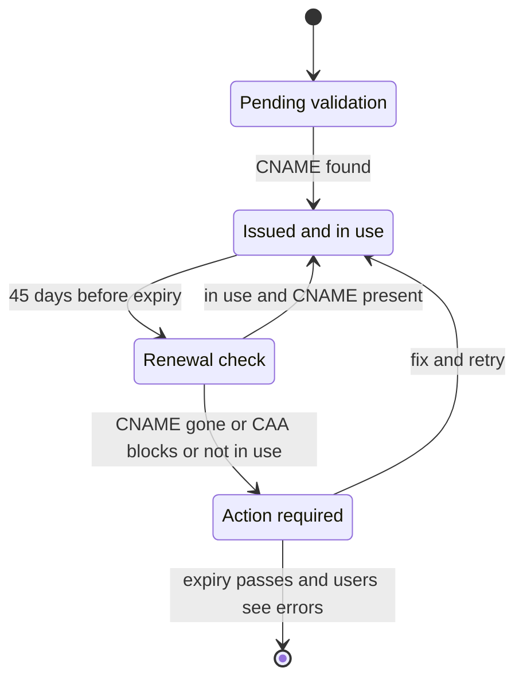
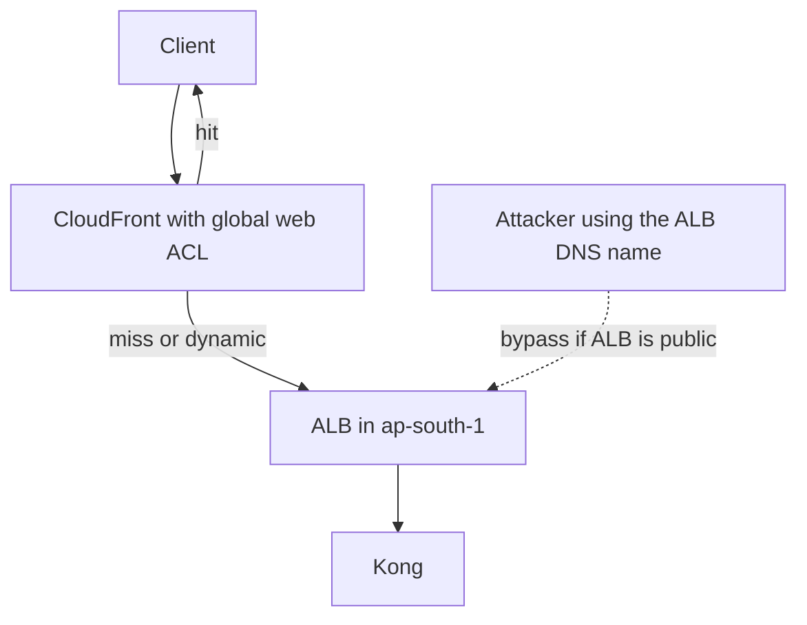

# WAF and ACM

Two edge-security services in one note, because they guard the same door and fail the same way: silently, until a customer notices. **ACM** is the managed-AWS side of the certificate lifecycle that [[TLS and HTTPS]] teaches — issue, deploy, renew, rotate. **WAF** is the managed-AWS side of the layer-7 filter that [[Rate Limiting]], [[API Gateway]] and [[Reverse Proxy vs Forward Proxy]] describe generically: inspect HTTP at the front door and drop what should not pass. This note teaches the AWS vocabulary, limits, failure modes and cost shape of both, not the underlying theory.

## The problem that created it

**Certificates are an outage generator.** By hand you generate a key, send a CSR, pay a CA, prove control by email, install the result on every server and remember the date. The private key gets copied around and the date lives in one person's calendar. Lifetimes keep shrinking: ACM's public certificates went from 395 to 198 days in February 2026 to follow CA/Browser Forum rules, and the Forum's schedule shortens them further in later years. Renewing by hand twice a year per certificate does not scale, so automation stopped being a convenience.

**Layers 3 and 4 cannot see HTTP.** Security groups, NACLs and Shield Standard know IPs, ports and floods. SQL injection, scraping and credential stuffing are valid requests on a valid port. Before WAF you wrote rules in every nginx or ModSecurity fleet, or in application code, and kept the signatures current yourself. WAF turned that into a managed rule set maintained by AWS and attached to the front door as configuration.

## What it solves

- **ACM**: free public certificates for AWS-integrated services, DNS validation done once, renewal with no human, and a private key that never leaves AWS.
- **WAF**: signature protection you do not maintain (OWASP-style classes, known-bad inputs, bot signals), a single enforcement point at the edge, and a rate-based rule as the coarse edge limiter.
- **Operability**: WAF's Count mode, labels, per-rule metrics and logs let you roll protection out without guessing; ACM publishes renewal events you can alarm on.

## How it works

### ACM: issuing, validating, renewing

ACM public certificates are **domain-validated**: proof you control the name, not who you are. A certificate carries 10 names as a default quota (2026), raisable to 100, and you choose a validation method; a third, **HTTP validation**, exists only for certificates used by CloudFront and does not cover wildcards. **DNS validation** gives you a CNAME (`_hash.example.com` pointing at an `acm-validations.aws` name) that you add once; it is reused for the same name in any Region and for replacement certificates, `*.example.com` shares the record with `example.com`, and the console can write it into Route 53 for you ([[Route 53]]). **Email validation** needs a human to click a link, again at every renewal, and cannot be switched to DNS later. Validation times out after 72 hours. Names go into public Certificate Transparency logs, so never put anything sensitive in one, and you cannot add or remove names after issuance — request a new certificate.

Renewal is where the risk lives. ACM renews a DNS-validated certificate automatically if it is **in use** by an integrated service (or exported) and **every validation CNAME is still present in public DNS**. For the current 198-day certificates it checks 45 days before expiry (older 395-day certificates: 60); renewal keeps the ARN but generates a **new key pair**. Imported certificates are never renewed — you reimport them. The first `ACM Certificate Renewal Action Required` event for a public certificate fires at 30 days before expiry, with AWS Health events alongside and `Approaching Expiration` events daily from 30 days, so a blocked renewal gives you roughly a month — and only if something routes those events to a human.

### ACM: where it attaches, and why it is regional

ACM certificates attach to **integrated services**: CloudFront, ALB and NLB TLS listeners, API Gateway custom domains, Cognito, App Runner, Elastic Beanstalk (through its load balancer) and Nitro Enclaves, among others (Amplify, OpenSearch custom endpoints and Network Firewall TLS inspection are also on the 2026 list). Certificates are **regional resources**, renewed independently per Region: a load balancer needs a certificate in *its* region, and CloudFront needs one in **us-east-1** (the CloudFront guide says so explicitly; an edge-optimised API Gateway endpoint follows the same rule because it is CloudFront underneath). They do not attach to a bare EC2 instance or a pod, because the private key of a public certificate used by integrated services is never released. Two paid routes now exist for that case: *exportable* public certificates, billed per domain at issuance and again at each renewal (ACM can sync them into EKS Secrets through the ACK controller), and *ACME-issued* certificates, billed per domain name at each issuance and renewal with monthly volume tiers, renewed by your ACME client rather than ACM, and not attachable to integrated services.

**AWS Private CA** in one paragraph: a managed private certificate authority where you build a root and subordinate hierarchy and issue certificates that only clients you configure will trust — internal TLS, mTLS between services, device identity. ACM can request private certificates from it and manage their renewal while they are in use. The bill is a flat monthly fee per CA (as of 2026, approximate: hundreds of dollars for a general-purpose CA, tens for a short-lived-certificate CA) plus a fee per certificate issued, so a CA is a standing cost even when idle. It is not for public sites, because browsers will not trust it, and compromise of the CA key compromises the whole trust domain.

**Do not pin ACM leaf certificates.** Each renewal brings a new key pair, so anything pinning the leaf certificate or its public key breaks. AWS recommends not pinning, or pinning the Amazon root CAs, or importing your own certificate.

### WAF: web ACLs, rules, actions

A **web ACL** is an ordered list of rules plus a default action (Allow or Block), attached to a protected resource; a resource carries one. Its **scope** is `CLOUDFRONT` — global, and the console fixes its home at **us-east-1** — or `REGIONAL`, created in the region of an ALB, API Gateway REST API, AppSync, Cognito user pool, App Runner, Verified Access, Amplify or Bedrock AgentCore Gateway (2026 list). (The console is renaming web ACLs "protection packs".) Rules run in priority order; the first *terminating* action wins.

- **Statements**: IP set match, geo match, string and regex match, size constraint, SQL-injection and XSS detection, label match and rate-based — combined with AND, OR and NOT.
- **Rule groups**: AWS Managed Rules (Core rule set, Known bad inputs, Admin protection, SQL database, IP reputation, Anonymous IP list, Bot Control in Common and Targeted levels, the Fraud Control groups for login and sign-up, an Anti-DDoS group), Marketplace groups, and your own. Each rule costs **WCUs**; a web ACL over 1,500 WCU pays extra. As of 2026 the Core rule set is 700, Known bad inputs 200, the Anti-DDoS group 50.
- **Actions**: Allow and Block are terminating (Block returns 403 unless customised); **Count** is not, so evaluation continues; CAPTCHA and Challenge interstitials run only for **browsers on HTTPS** answering a `GET` for HTML — never on `POST` or a CORS preflight — so a native app's JSON call cannot render them; it needs a token acquired beforehand through the WAF mobile SDK, which AWS grants on request rather than generally.
- **Labels**: a rule can tag a request and a later rule can match the tag — the way to combine weak signals.

Two behaviours to design around. If WAF itself hits an internal error, CloudFront typically *allows* the request while regional resources typically *deny* — so the edge ACL is never your only control. And changes propagate over seconds to minutes, so a new Block is not instant.

### Rate-based rules: the edge limiter

A rate-based rule counts requests per **aggregation key** over an **evaluation window** of 1, 2, 5 (default) or 10 minutes and applies its action past a **limit** whose minimum is 10 (2026 values). The default key is the source IP; custom keys include a header or cookie value, a query argument, the URI path, the HTTP method, a JA3 or JA4 TLS fingerprint, an ASN, a label, or combinations (each custom key adds 30 WCU to a base of 2). A **scope-down statement** restricts what is counted — "only `/login`". It is deliberately approximate: WAF weights recent requests, limits apply *near* the number you set, and the usual lag to start or stop is under 30 seconds but can reach minutes. Changing any setting resets the counters for up to a minute. That is a flood and brute-force guard, not a metering system; exact per-customer quotas belong at the gateway ([[Design a Rate Limiter]]).

### IP sets, geo match, and the client-IP problem

IP sets (CIDR lists) and geo match decide on the IP WAF sees. Attached to **CloudFront**, that is the real viewer. Attached to an **ALB behind CloudFront**, it is a CloudFront edge address. The fix is a **forwarded IP** configuration reading `X-Forwarded-For`, but geo, ASN and rate-based rules use the *first* entry (an IP-set rule can instead be told to use the last or any), and CloudFront *appends* the viewer address to any `X-Forwarded-For` the client already sent, so that first entry can be client-controlled (and the ALB then appends the edge address, leaving the true viewer second from last). The docs say plainly that headers can be altered to bypass inspection. The exception is the Bot Control and Anti-DDoS managed groups, which recognise CloudFront's ranges and read the client IP themselves; your own IP, geo and rate rules do not. Enforce at the layer that sees the true source.

### Where to attach a web ACL

| Attach to | Scope | Source IP the rules see | Sees cache hits | Body inspected by default (2026 limits) |
|---|---|---|---|---|
| CloudFront | global, home us-east-1 | the real viewer | yes, inspected before the cache | first 16 KB, raisable to 64 KB at extra cost |
| ALB | regional, same region as the ALB | the last proxy (a CloudFront edge if one is in front) | no, hits never arrive | first 8 KB, fixed |
| API Gateway REST | regional | the caller | n/a | first 16 KB, raisable to 64 KB |

**Shield Standard** is automatic and free for every AWS customer against the common layer-3 and layer-4 floods, with its most comprehensive coverage on CloudFront, Route 53 hosted zones and Global Accelerator; Shield Advanced is the paid tier. At layer 7 the answer is WAF itself: an Anti-DDoS managed rule group, and resource-level DDoS protection for ALBs (generally available since June 2025), on by default in an active-under-DDoS mode for any web ACL associated with an ALB. Rate-based rules complement them rather than replace them.

### Logging, and Count before Block

Web ACL logs go to CloudWatch Logs, S3 or Firehose (destination names must start with `aws-waf-logs-`); sensitive fields such as the `Authorization` header can be **redacted**. AWS's own guidance is to test and tune in a staging environment, then run new rules in **Count** on production traffic before enabling them. Count is set as a rule action override, per rule or for a whole group. Practically: leave it through a full business cycle (for a fintech, a month-end), read the logs and labels for false positives, then promote rule by rule. uat traffic does not exercise the shapes prod does.

### Cost shape

**ACM**: public certificates on integrated services are free, so the cost is operational. Exportable certificates are priced **per domain at issuance and at each renewal**, wildcards dearer (as of 2026, approximate, about $7 a name and $79 a wildcard); ACME certificates are priced **per domain name at each issuance and renewal**, tiered down with monthly volume, roughly a dollar a name. Private CA is **per CA per month plus per certificate issued**, the CA fee dominating at low volume.

**WAF**: a flat monthly fee **per web ACL** and **per rule or rule group**, plus a fee **per million requests inspected**, plus extras past 1,500 WCU and for body inspection beyond the 16 KB default. Rates as of 2026, approximate: $5 per ACL-month, $1 per rule-month, $0.60 per million requests — so a web ACL with six rules is about $11 flat and 100 million requests add about $60. The managed groups with their own meters are different in kind: **Bot Control** adds a subscription plus a per-request fee (Targeted far above Common), and the Fraud Control groups are priced, at their first volume tier, on the order of a dollar per *thousand* analysed requests, three orders of magnitude above the base per-million rate. Scope them down to login and sign-up paths. CAPTCHA and Challenge bill per attempt, the CloudFront flat-rate plans bundle a WAF allowance, and **logging is a separate meter** at the destination that can exceed the WAF line.

## Trade-offs

| You gain | You pay |
|---|---|
| Free auto-renewing certificates, key never exposed | Locked to integrated services and their region rules; DV only; renewal conditions to monitor |
| Managed signatures and a single edge enforcement point | False positives on real traffic; tuning labour; a fixed per-ACL and per-rule monthly floor |
| Coarse edge rate limiting before capacity is spent | Approximate counts, IP-centric keys, 30-second-plus lag |
| Count mode and logs for safe rollout | A promotion step teams forget; log volume and its own bill |
| A web ACL on CloudFront sees the true client before the cache | The ACL fails open on an internal WAF error, so it cannot be your only control |

## Failure modes

- **Renewal fails because the validation CNAME was deleted.** A zone migration, a Terraform destroy of "unused" records or a clean-up script removes `_hash.example.com`. Nothing breaks until the certificate actually expires (up to 198 days later), and the first warning arrives only about a month before that. *Signal:* a `Renewal Action Required` event or the certificate's renewal status stuck on pending validation. *Fix:* restore the record, and manage validation records as code with a delete guard.
- **Other silent renewal blockers.** The certificate is no longer attached to anything (not "in use"); a **CAA** record that omits `amazon.com`, `amazontrust.com`, `awstrust.com` and `amazonaws.com` was added later by a security team; email-validated certificates wait for a human; imported certificates never renew.
- **A managed rule blocking legitimate JSON.** The Core rule set's `SizeRestrictions_BODY` blocks bodies over 8 KB, so an onboarding payload with a base64 selfie dies at the edge; the Core set's XSS rules (and the SQL database group, if you add it) can fire on free-text fields. *Fix:* find the rule in the logs, set *that rule* to Count with a path scope-down, keep the rest in Block — and move large uploads to S3 presigned URLs. The opposite hazard is quieter: the inspection limit (2026) is 8 KB on an ALB and 16 KB (raisable to 64 KB at extra cost) on CloudFront, and the managed rules use `Continue` on oversize, so a payload hidden after the limit is simply not inspected.
- **Rate-based rule keyed on IP behind a shared NAT.** One office egress address, or a mobile carrier pool where many subscribers share IPv4 addresses (general behaviour of carrier-grade NAT; check your own traffic), is counted as a single client and gets blocked together while nothing else is wrong. *Fix:* scope the rule to the sensitive path, aggregate on a custom key (a device identifier header, or IP plus path), and start in Count.
- **WAF on the ALB while traffic enters through CloudFront.** The ALB's web ACL still sees the request, but its source IP is a CloudFront edge, so IP, geo and per-IP rate rules evaluate the *edge* — one busy edge gets throttled for everyone, or abusers are never separated. Cache hits never reach the ALB at all, so they are neither limited nor logged there. And if the ALB stays publicly reachable, an attacker skips CloudFront and any ACL attached to it. *Fix:* attach the ACL to the distribution and make the ALB reachable only from CloudFront ([[CloudFront]]).
- **The wrong Region.** A certificate in ap-south-1 never appears in CloudFront's certificate picker, and a us-east-1 certificate cannot be attached to your ALB — each environment needs both, validated separately.
- **A Count rule that never got promoted** — dashboards green, no protection. **An Allow rule above the blocks** — an office IP set placed first bypasses everything for that address.
- **Pinned clients after a renewal** — new key pair, old pin, mobile outage.

## When NOT to use it

- **ACM** when you need the private key on the host (a pod terminating its own mTLS) — use Private CA, exportable certificates, ACM's ACME endpoint or cert-manager; when you need an EV or organisation-validated identity, since ACM public certificates are DV.
- **WAF** as a substitute for input validation, authentication or authorisation; for exact per-customer quotas or plan limits; for a CAPTCHA wall in front of a native-app API. It is a coarse, probabilistic filter, and a Count-only ACL gives none of that.
- Tiny internal services behind private networking, where the per-ACL and per-rule floor buys nothing.

## In your stack

- **Two certificates per environment.** Each of uat and prod (separate accounts) needs a viewer certificate in us-east-1 for CloudFront and an ALB certificate in ap-south-1; they are not shared. TLS ends at the ALB, then Kong; pods hold no public certificate. DNS-validation CNAMEs live in the hosted zone — if that zone sits in another account, the record must be created *there*; deleting it fails the renewal check silently at 45 days, warns at 30, and becomes an outage only at expiry.
- **Alarm on renewal, not on expiry.** An EventBridge rule on `ACM Certificate Renewal Action Required` and `Approaching Expiration`, routed to on-call ([[Alerting and On-Call Design]]), plus a check of who receives the AWS Health email. Treat Terraform-managed validation records as protected.
- **Mobile pinning.** If the apps pin the leaf certificate or its key, an ACM renewal is an app outage; pin the Amazon roots or move the pin discipline before the first renewal.
- **Web ACL on CloudFront; ALB closed.** CloudFront is the one point that sees the real client IP and inspects before the cache. Start with Core rule set, Known bad inputs (it carries Log4j, Java-deserialisation and Spring RCE patterns — relevant to a Spring Boot fleet), IP reputation and an IP-set allow for partner addresses; judge Anonymous IP and Bot Control against real customers (VPN users exist). All in Count first, across a month-end.
- **Layered limits, per the org rule that generic rate limiting lives at the edge.** WAF: coarse per-IP flood and brute-force guard on sensitive paths. Kong: per-consumer and per-route quotas keyed on the authenticated `sub`. App: limits that are part of a security boundary — OTP attempts, PIN tries, login attempts per account — keyed on account or device, failing closed and audited. With many services at 1 replica, the edge limit is also capacity protection: a flood Kong would merely throttle can still saturate the single pod.
- **Large KYC payloads** hit the 8 KB body rule — use S3 presigned uploads so documents never traverse WAF or pods ([[How S3 Works]]).
- **Regulatory flags.** WAF logs hold client IPs, URIs and headers: redact, set retention deliberately, and note that a CloudWatch Logs destination must sit in the web ACL's own Region, which for a CloudFront ACL is us-east-1, so those logs cannot land in Mumbai; confirm the S3 and Firehose options before assuming otherwise. That is data-localisation scope to settle with compliance, not assume. Geo blocking restricts who can connect; it does not keep data in India. Blocked requests never reach Kong, so they carry no `x-correlation-id`; correlate by time, IP and URI. For allowed requests, Kong's real-IP handling must account for the edge and ALB entries in `X-Forwarded-For`, or its own per-IP limits key on the wrong address.

## Interview angle

The 60-second answer to *"where do you rate limit, and why?"*: *"In layers, because each layer sees a different identity and fails differently. At the edge, a WAF rate-based rule on CloudFront: a coarse per-IP flood and brute-force guard, the cheapest place to drop traffic before it spends ALB capacity, Kong CPU or a pod. It only knows IPs and headers, counts approximately over one-to-ten-minute windows, and takes up to half a minute to react, so I scope it to sensitive paths and key it carefully — a shared NAT or carrier pool makes IP a bad identity. At the gateway, Kong enforces per-consumer, per-route quotas keyed on the authenticated identity, with shared counters. In the app, limits that are a security boundary — OTP and PIN attempts per account — are keyed on account or device, fail closed, and are audited. Shed early what you can identify cheaply; enforce late what needs identity; and always roll a new rule out in Count mode first."*

Probes: *why is my ACM certificate not renewing* (in use, CNAME present, CAA allows Amazon, not imported); *why us-east-1* (CloudFront is global; the cert for the ALB is regional); *WAF on ALB or CloudFront* (CloudFront for the real client IP and pre-cache inspection; lock the ALB).

## Check yourself

> [!question]- Q: "ACM auto-renews" is not the same as "certificates never expire on us". Explain the conditions, and how a failure would reach you.
> Managed renewal runs about 45 days before expiry for 198-day certificates and requires: the certificate is in use by an integrated service (or exported); every ACM validation CNAME is still present in public DNS; and no CAA record excludes Amazon's CAs. Email-validated certificates need a human click, and imported certificates are never renewed. Failure is silent until ACM publishes a `Renewal Action Required` event (first for public certificates at 30 days before expiry) and AWS Health notices. Unless an EventBridge rule routes them to on-call, the first symptom is the outage.

> [!question]- Q: The Mumbai office gets 403s from the app after a per-IP rate rule goes live; phones are fine. Diagnose and fix.
> Everyone in the office egresses through one NAT address, so the rule counts the whole building as one client and blocks it once the shared total passes the limit. Check the web ACL logs for the blocking rule and source IP. Fix without disabling protection: scope the rule to the paths that need it (login, OTP), aggregate on a custom key such as IP plus a device header rather than IP alone, add an allow for known office ranges *below* the abuse rules only if justified, and trial the change in Count. Note the same flaw affects mobile carriers that share IPv4 addresses among many subscribers.

> [!question]- Q: After adding the Core rule set, 2% of onboarding POSTs fail with 403. How do you find the cause and fix it without removing the rule group?
> Look in the WAF logs for blocked requests on that path and read the terminating rule — probably `SizeRestrictions_BODY`, which blocks bodies over 8 KB, or an injection or XSS rule matching a free-text field. Put that single rule into a rule action override of Count, add a scope-down so it still protects other paths, and keep the group in Block. Move large documents to S3 presigned URLs so they never pass through the edge. Remember the inspection limit: bodies beyond 8 KB on an ALB or 16 KB on CloudFront are only partly inspected.

> [!question]- Q: You have a web ACL on the ALB and CloudFront in front. What does an IP-based rule actually see, and what should change?
> The ALB sees CloudFront's edge addresses as the source, so IP-set, geo and per-IP rate rules evaluate the edge, not the user; cache hits never reach the ALB, so they are not limited or logged there; and a publicly reachable ALB can be hit directly, skipping CloudFront. Attach the web ACL to the distribution (global scope, us-east-1), where the viewer address is real and inspection happens before the cache, then restrict the ALB to CloudFront with the managed prefix list plus a secret header, or a VPC origin. A forwarded-IP rule on the ALB is a weaker backstop because `X-Forwarded-For` can be client-influenced.

> [!question]- Q: Mini-design — protect a public fintech API at the edge: certificates, WAF rules, rollout, alarms, and cost control.
> Certificates: DNS-validated ACM certificates in us-east-1 (CloudFront) and ap-south-1 (ALB), validation records managed as code; EventBridge alarms on renewal events. WAF: global web ACL on the distribution — Core rule set, Known bad inputs, IP reputation, a rate-based rule scoped to login and OTP paths with a custom key, an IP-set allow for partners placed carefully; Fraud Control only on login and sign-up. Rollout: everything in Count through a month-end, then promote rule by rule with a rollback owner. ALB locked to CloudFront. Logs to a bucket with deliberate retention and redaction of `Authorization`. Cost: flat per ACL and per rule, per million requests, with Bot Control and Fraud Control scoped down because they bill per request at far higher rates; watch the log-ingestion meter.

## Sources

- AWS Certificate Manager User Guide — "Managed certificate renewal", "DNS validation", "Renew ACM public certificates" (DNS-validated renewal criteria), "Amazon EventBridge support for ACM", "Managed automation with integrated services", best practices (certificate pinning, Certificate Transparency), troubleshooting CAA problems, and Quotas.
- AWS What's New, February 2026 — "AWS Certificate Manager updates default certificate validity" (198 days, renewal at 45 days) and the ACM pricing page (integrated services free; exportable certificates per domain at issuance and renewal, ACME per domain per month); ACME certificate automation and HTTP validation pages.
- Amazon CloudFront Developer Guide — "Requirements for using SSL/TLS certificates with CloudFront" (certificate Region rules for viewer and origin).
- AWS WAF Developer Guide — web ACLs and the scope/Region rule, rule actions, rate-based rule statements (settings, aggregation, caveats), "Using forwarded IP addresses", baseline managed rule groups, "Testing and tuning your AWS WAF protections", logging.
- AWS WAF and AWS Shield pricing pages and the AWS Shield Standard overview — figures quoted only as orders of magnitude, as of 2026.
