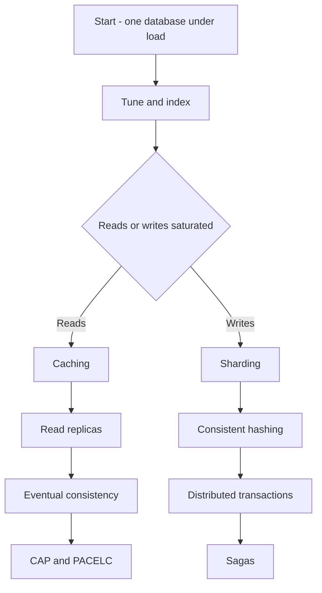

# Database Scaling Path

This is a **reading trail**, not new material. It walks the notes in the order the problems actually arrive, because the single most useful thing to understand about database scaling is that **every technique is the fix for the previous technique's limit**. Learned as a list, these are ten disconnected tricks. Learned as a chain, each one is forced by the thing before it.

The organising insight: **reads and writes scale differently, and they diverge early.** Almost everything is cheap and reversible on the read side; the write side is where the expensive, hard-to-undo decisions live. So the trail forks.

> **Before the fork**, read [[Database Scaling Patterns]] — it is the ladder view of this same journey and explains why the rungs are climbed in this order rather than jumping straight to the exciting ones.

---

## Step 0 — Know what the database is doing

**[[How Databases Store Data]]** → pages, the buffer pool, the write-ahead log.

Start here because every later decision is downstream of one fact: **data lives in fixed-size pages on disk, and reading a page you don't need is the fundamental waste.** Indexes, caches and replicas are all answers to that one problem. Skip this and the rest is memorisation.

## Step 1 — Indexing: stop reading pages you don't need

**[[Database Indexes]]** → then **[[Query Planning and EXPLAIN]]**.

The first real scaling move, and the one with by far the best return: a query that scanned a million pages now reads three or four. Nothing else on this trail gives a 100× improvement for a one-line change.

Two notes, deliberately: the first is what an index *is* (and why a B+ tree rather than a binary tree — it's about disk pages, not comparisons); the second is how the database *decides* whether to use one, and how you find out. Most "the index isn't working" problems are really plan problems, which is why these sit together.

**What it cannot fix:** a query that genuinely needs most of the table, and — importantly — **write volume**. Indexes make writes *slower*, since every index must be maintained. This is the first hint that reads and writes are about to diverge.

## Step 2 — Caching: stop asking the database at all

**[[Why Caching Works]]** → **[[Caching Strategies]]** → **[[Cache Invalidation]]**.

Indexing made each read cheap; caching removes the read entirely. It works because access is skewed — a small hot minority is requested over and over ([[Why Caching Works]] has the arithmetic).

This is the first step that **trades correctness for speed**, and that is the whole lesson: you are now serving data that may be stale, so you have to decide how stale is acceptable. That question never goes away for the rest of the trail. The hard parts are [[Cache Invalidation]] and [[Cache Stampede and Thundering Herd]]; the sharp edge is [[Hot Key Problem]].

**What it cannot fix:** writes (again), and workloads with no repetition. A cache also *adds* a failure mode — when it empties, the database takes the full load at its worst possible moment.

---

# The read branch

## Step 3 — Read replicas: more machines serving reads

**[[Replication|Read Replicas]]** → **[[Read Your Own Writes and Replica Lag Anomalies]]**.

Caching helped the *repeated* reads. Replicas help all the rest: copies of the database, each able to serve queries, with writes still going only to the leader.

The note is titled [[Replication]] because replicas are one use of a more general mechanism — the same machinery gives you high availability and [[Failover]], not just read capacity.

**The price is lag**, and it is not a detail — it is the entire reason the next three steps exist. A replica is always slightly behind, so a user can write and then not see their own write. [[Read Your Own Writes and Replica Lag Anomalies]] is the practical note; read it immediately after, because this is the bug you will actually hit.

**What it cannot fix:** writes. Every replica applies *every* write, so replicas add zero write capacity. If writes are your problem, the read branch is over — go to the write branch.

## Step 4 — Eventual consistency: naming what you just accepted

**[[Consistency Models|Eventual Consistency]]**.

You didn't choose eventual consistency as an architecture; you acquired it the moment you added a cache and a replica. This note gives the vocabulary for what you now have — and makes the key correction: **it is a spectrum, not a binary.** Between "always current" and "eventually current" sit causal consistency and the session guarantees (read-your-writes, monotonic reads) that are usually what you actually need.

Read it as the theory that explains the bug from Step 3.

## Step 5 — CAP and PACELC: why you cannot have it all

**[[CAP Theorem]]** → **[[PACELC]]**.

Now that staleness is real in your system, these theorems stop being trivia and become a description of your Tuesday.

[[CAP Theorem]] is narrower than its reputation: during a **network partition** you choose availability or consistency. That's it. It says nothing about normal operation — which is exactly why [[PACELC]] matters more in practice: *else* (no partition), you are still trading **latency against consistency** on every single request. Waiting for a majority of replicas is slower; reading the nearest replica is staler. That trade is live on every read you serve, partition or not.

Read PACELC second and treat it as the one you'll actually use.

---

# The write branch

Take this fork when the leader itself is saturated by writes, or one machine can no longer hold the data. Everything here is **harder to reverse** than anything on the read branch — which is why [[Database Scaling Patterns]] calls sharding a last resort rather than a next step.

## Step 6 — Sharding: split the data across machines

**[[Sharding]]** → **[[Hot Partition Problem]]**.

The only technique that genuinely scales writes: split rows of one table across machines, each owning a slice, each accepting writes independently.

Everything now depends on the **shard key**, which is the most consequential and least reversible choice on this entire trail. Get it wrong and you get [[Hot Partition Problem|hot partitions]] — one shard melting while the rest idle — and the arithmetic there shows why adding shards does *not* rescue you.

**The price:** queries that don't carry the shard key must fan out to every shard; cross-shard joins and transactions stop existing. Which forces the remaining steps.

## Step 7 — Consistent hashing: split without reshuffling

**[[Consistent Hashing]]**.

A sub-problem of Step 6, and the cleanest idea on the trail. The obvious scheme, `hash(key) % N`, is a trap: changing N remaps almost every key, so adding one machine means moving nearly all your data. The hash ring moves only about 1/N of it.

Short note, worth knowing exactly — it reappears in load balancers, caches and [[Design a Key-Value Store|key-value stores]].

## Step 8 — Distributed transactions: the invariant that spans shards

**[[Two-Phase Commit and Distributed Transactions|Distributed Transactions]]**.

Sharding broke `BEGIN…COMMIT`. Debit on shard A, credit on shard B — and ACID no longer covers you, because ACID was always a *single-database* promise.

The textbook answer is two-phase commit, and this note explains why the industry mostly rejected it: 2PC **blocks**. If the coordinator dies between prepare and commit, participants sit holding locks, unable to proceed or abort. You traded availability for atomicity at precisely the scale where availability was the point.

## Step 9 — Sagas: atomicity you can actually run

**[[Saga Pattern]]** → **[[Idempotency]]** → **[[The Outbox Pattern]]**.

The practical answer. Instead of one atomic transaction, run a **sequence of local transactions, each with a compensating action** that semantically undoes it. No distributed locks, no blocking coordinator.

The honest cost: you give up isolation. Intermediate states are visible, and a compensation is not a rollback — a refund is not an un-charge; it is a second, visible event. For fintech this is the central pattern, which is why [[Saga Pattern]] is the longest note in the vault, and why the pivot step (the irreversible one) deserves special attention.

[[Idempotency]] is mandatory alongside it — every saga step is retried, so every step must be safe to run twice. [[The Outbox Pattern]] solves the related dual-write problem: you cannot atomically update a database *and* publish an event.

---

## Where the two branches rejoin

Both ends arrive at the same place: **once data lives in more than one machine, correctness becomes something you design rather than something the database hands you.** The read branch gets there through staleness, the write branch through lost atomicity. [[Consistency Models]] and [[Idempotency]] are the two notes that serve both.

If you want to see the whole thing assembled into one system, [[Design a Key-Value Store]] builds a distributed store from scratch using nearly every note above, and ends with a table mapping each component back to the note that teaches it.

## How to use this trail

Nine of these steps have a full note with its own worked examples, failure modes and self-tests — this page only supplies the connective tissue. A workable pace is one step per sitting, in order, and after each one answer this question before moving on:

> **What is the limit of what I just learned, and which step fixes it?**

If you can answer that for all nine, you understand database scaling as a chain rather than a list — which is the whole point. The matching rapid-fire questions are in [[Practice Drills]] (questions 15–46 for the read branch and data layer, 47–57 for the theory), and the formulas are in [[Numbers and Formulas]].
