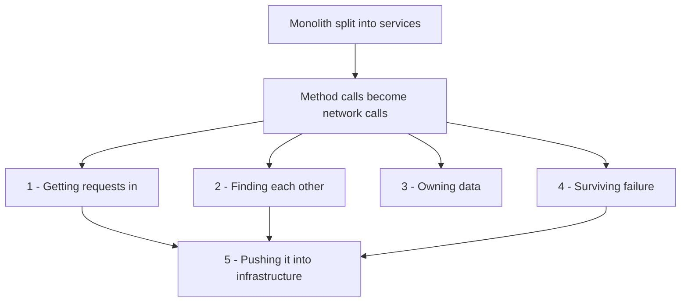

# Microservices Patterns Path

A **reading trail**, not new material. Microservices patterns are usually taught as a glossary, which is why they never stick — a list of twenty names with no organising idea behind them.

They organise cleanly once you see that **every one of them is a fix for a problem the network created.** Splitting a monolith converts method calls into network calls, and a network call can be slow, can fail, can be retried, can arrive twice, and crosses a trust and ownership boundary that a method call never did. Each pattern below answers one consequence of that single change.

Work through the five groups in order. Within a group, order matters less.

---

## Group 1 — Getting requests in: the edge

Before a request reaches a service, something in front of it terminates TLS, decides where it goes, and enforces policy. These four notes are usually confused with each other, so read them together.

**[[Reverse Proxy vs Forward Proxy]]** — start here. This answers *what a proxy even is and why one is needed*: a server that stands in for someone else in a conversation. The direction decides the name — a **forward** proxy represents the *client* (corporate egress, content filtering), a **reverse** proxy represents the *server* (everything below). Every other box on this list is a specialised reverse proxy.

**[[Load Balancers]]** — a reverse proxy whose job is *distribution*: spread requests across healthy instances, notice when one dies, drain it cleanly. L4 works at the connection level, L7 can see the HTTP request and route on it.

**[[API Gateway]]** — a reverse proxy whose job is *policy*: authentication, rate limiting, routing, request transformation. The distinction people ask about most is answered directly in that note's *Gateway vs load balancer vs reverse proxy* section. Short version: **a load balancer is identity-blind and distributes; a gateway is identity-aware and decides.** They stack, LB in front. Kong is the gateway in your stack.

**[[Backend for Frontend]]** — one backend per client experience (web, Android, iOS), owned by the client team, doing aggregation and payload shaping. Not a competitor to the gateway: the gateway handles cross-cutting policy for everyone, a BFF composes responses for exactly one consumer. Gateway first, then BFF.

**[[CORS]]** — the one on this list that is *not* infrastructure. It is a **browser** mechanism, and the most misunderstood item here: CORS does not protect your API. It relaxes a browser restriction so that a page on one origin may read a response from another. A non-browser client ignores it completely. Read it once properly and you will never again debug a "CORS error" that was really a 500.

## Group 2 — Finding each other

**[[Health Checks and Service Discovery]]** — in a monolith, calling another module meant knowing a function name. Now it means knowing an address, and addresses change constantly as pods restart and scale. Discovery is how a service finds a current, *healthy* address; health checking is how the registry knows which to hand out. In Kubernetes this is Services and EndpointSlices, which is discovery you get without running a registry yourself.

**[[Communication Patterns Between Services]]** — having found each other, how should they talk? Synchronous request-response versus asynchronous events, and the availability arithmetic that makes long synchronous chains dangerous. This note is the fork into Group 3.

## Group 3 — Owning data: the hard group

This is where microservices stop being a deployment choice and start being a *data* problem. Most teams underestimate this group, and it is where SDE2 interviews probe hardest.

**[[Database per Service]]** — the pattern that makes a split real. Each service exclusively owns its data; others reach it through its API or its events, never by querying its tables. Skip this and you have [[The Distributed Monolith Anti-Pattern|a distributed monolith]]: services that cannot deploy independently because they share a schema.

**[[Two-Phase Commit and Distributed Transactions]]** — having split the data, you have lost `BEGIN…COMMIT` across services. The textbook fix is 2PC, and this note explains why the industry largely rejected it: **it blocks.** A coordinator that dies between prepare and commit leaves participants holding locks, which trades away exactly the availability you split for.

**[[Saga Pattern]]** — the practical answer, and the longest note in the vault for good reason. A sequence of local transactions, each with a **compensating action** that semantically undoes it. The cost is that you give up isolation: intermediate states are visible, and a compensation is not a rollback — a refund is not an un-charge. For fintech this is the central pattern.

**[[Orchestration vs Choreography]]** — the question underneath every saga: *who is in charge?* Choreography lets each service react to events with no central brain; orchestration gives one coordinator the process definition, the state, and the compensation logic. The note goes past the choice into designing an orchestrator properly — a durable state machine per process instance, idempotent step commands, timeouts — and when to reach for an engine like Temporal or Step Functions instead of hand-rolling one. Rule of thumb from the note: choreography stops being readable at about three or four steps.

**[[The Outbox Pattern]]** — the companion problem: you cannot atomically write to your database *and* publish an event. Write the event to a table in the same transaction and relay it separately. Without this, sagas and event-driven flows silently lose messages.

**[[Idempotency]]** — mandatory alongside both. Every step in an async system is retried, so every step must be safe to run twice. The most-linked note in the vault, which tells you something.

**Event-driven microservices**, which you asked about, is not one pattern but this whole group plus Module 9. The entry point is [[Why Async Messaging Exists]], then [[Message Queues vs Event Logs]] for the distinction that decides your broker, then [[Event Sourcing]] and [[CQRS]] if you want the deeper end.

## Group 4 — Surviving failure

A network call fails in ways a method call never did. These are the defences, and they belong together because each covers a gap the others leave.

**[[Timeouts Retries and Exponential Backoff]]** — read first. Every remote call needs a timeout, retries are only safe on idempotent operations, and backoff needs **jitter** or your clients synchronise into a thundering herd. Also the retry-amplification arithmetic: attempts multiply across layers, so three layers at three attempts is 27× at the bottom.

**[[Circuit Breakers]]** — retries help a blip and worsen an outage. A breaker watches the failure rate and, once a dependency is clearly *down* rather than flaky, stops calling it entirely and fails fast. Closed, open, half-open. Resilience4j in your Java stack.

**[[Bulkheads and Isolation]]** — named after ship compartments: partition your resources so one failing dependency cannot consume every thread or connection and sink the whole service. The breaker stops you calling a dead dependency; the bulkhead stops a *slow* one from exhausting you while you wait.

**[[Load Shedding and Graceful Degradation]]** — when you simply cannot serve everything, choose deliberately what to drop rather than collapsing uniformly.

Together these four are the answer to "how does one slow service not take down everything?" — which is among the most common SDE2 follow-up questions.

## Group 5 — Pushing it into the infrastructure

Groups 1 and 4 describe behaviour every service needs. Implementing them as a library per language means N languages × M concerns, and upgrading one means redeploying everything. The alternative is to move them out of the process.

**[[Sidecar Pattern]]** — run the concern as a separate process beside the application, sharing its lifecycle and network namespace. In Kubernetes this is a second container in the same pod, reachable over localhost. The app becomes oblivious to mTLS, retries and telemetry. This is exactly what you suspected: it is the mechanism behind Envoy and Istio, and Kubernetes pods are what make it practical.

**[[Service Mesh]]** — the sidecar pattern applied fleet-wide, with a control plane. **Envoy is the data plane** (the proxy in each pod); **Istio is a control plane** (what configures all those Envoys). The note is honest about the cost: a mesh buys mTLS, uniform retries and traffic shifting for free, and charges resource overhead per pod, an extra hop each way, and a whole new layer to debug. For a small fleet — and especially at one replica per service — a gateway plus a good library usually wins.

---

## How the groups relate

A useful way to hold it: **Groups 1 and 2 get the request to the right place. Group 3 is the price of splitting the data. Group 4 is the price of the network. Group 5 is a decision about *where* Groups 1 and 4 are implemented, not a new capability.**

If you only remember one thing per group: edge = policy versus distribution; discovery = addresses change; data = you traded transactions for independence, and someone has to own the process (orchestration vs choreography); failure = timeouts, breakers, bulkheads; infrastructure = sidecars move cross-cutting code out of your app.

## Before you use any of this

Read [[Monolith vs Microservices]] first if you have not. Every pattern here is a *cost* you take on to buy independent deployability. A [[Modular Monolith]] avoids most of Group 3 and 4 entirely, and for many teams that is the correct answer. Knowing the patterns is not the same as knowing when the trade is worth making — and at SDE2 level, saying "I would not split this yet, because…" scores better than reciting the catalogue.

## Practice

The matching questions are in [[Practice Drills]] (75–85, 89–95 cover architecture, auth and resilience; 10–13 the edge). The design problem that exercises the most of this at once is [[Design a Payment System]], where sagas, idempotency, service-owned data and failure handling all have to work together.
